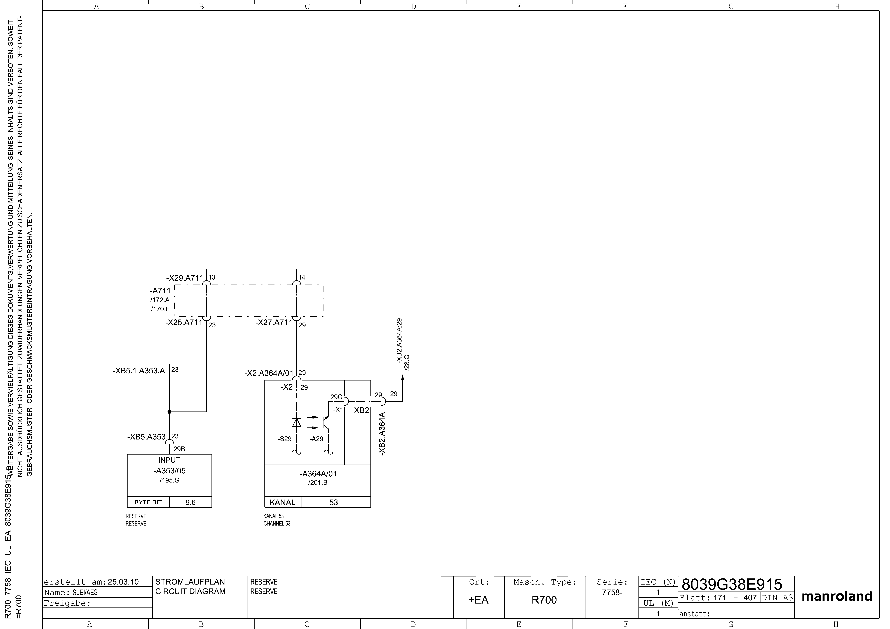

# +EA — Sheet 171 of 407 — RESERVE

**RESERVE**

> Part of the manroland **R700** printing press IEC/UL circuit diagrams.
> Drawing class: **Stromlaufplan / Circuit diagram** (DIN A3).
> Document `+EA` covers the **Printing unit** machine section.

## At a glance

| Field | Value |
|---|---|
| Document | `+EA`  (8039G38E915) |
| Sheet | **171** of 407 |
| Section (DE) | RESERVE |
| Section (EN) | RESERVE |
| Section type | CIRCUIT — Circuit diagram |
| Machine type | `R700` |
| Series | `7758` |
| Created | 25.03.10 |
| Replaces | — |
| Columns used | A, B, C, D |
| Path numbers | — |
| Labels on sheet | 42 |
| Cross-refs out | 5 |
| Cross-refs in | 13 |

**Previous:** [+EA sheet 170](SHEET_0170.md) · **Next:** [+EA sheet 172](SHEET_0172.md) · **Document TOC:** [_TOC.md](_TOC.md)  (+EA) · **Master TOC:** [all sheets](../_MASTER_TOC.md)

## Sheet image (300 DPI, exact vector render)



_Rendered directly from the PDF vector layer at 300 DPI (1-bit), no OCR and no resampling. Use it to confirm anything ambiguous in the text below._

## Cross-references on this sheet

Each entry is a wire leaving this sheet. The printed token is `/sheet.column`; the link resolves to that sheet inside the same document.

| Ref | Target sheet | Col | Path | Destination on target | Target section | From col |
|---|---|---|---|---|---|---|
| `/172.A` | [+EA sheet 172](SHEET_0172.md) | A | — | — | RESERVE | B |
| `/170.F` | [+EA sheet 170](SHEET_0170.md) | F | — | — | RESERVE | B |
| `/28.G` | [+EA sheet 28](SHEET_0028.md) | G | — | XB2.A364A:29 | BUSVERBINDUNGEN: SICHERHEITSBUS | D |
| `/195.G` | [+EA sheet 195](SHEET_0195.md) | G | — | — | REFERENZMODUL | B |
| `/201.B` | [+EA sheet 201](SHEET_0201.md) | B | — | — | REFERENZMODUL | C |

### Incoming references (sheets that point here)

Every other sheet that sends a wire to this one. `Back-ref` is the token printed on *that* sheet; `Path` is its line number.

| From sheet | Cols | Back-ref | Path | Refs | What continues there |
|---|---|---|---|---|---|
| [+EA#28](SHEET_0028.md) | G | `/28.G` | — | 1 | — |
| [+EA#170](SHEET_0170.md) | F | `/170.F` | — | 1 | — |
| [+EA#172](SHEET_0172.md) | A | `/172.A` | — | 1 | — |
| [+EA#195](SHEET_0195.md) | G | `/195.G` | — | 1 | — |
| [+EA#201](SHEET_0201.md) | B | `/201.B` | — | 1 | — |
| [+EA#227](SHEET_0227.md) | C, E | `/227.C`, `/227.E` | — | 2 | — |
| [+EA#240](SHEET_0240.md) | F | `/240.F` | — | 1 | — |
| [+EA#241](SHEET_0241.md) | A | `/241.A` | — | 1 | — |
| [+EA#268](SHEET_0268.md) | E | `/268.E` | — | 1 | — |
| [+EA#271](SHEET_0271.md) | F | `/271.F` | — | 1 | — |
| [+EA#274](SHEET_0274.md) | E | `/274.E` | — | 2 | — |


## Devices on this sheet

| Tag | Class | Class meaning (IEC) | Col | Sub | Terminal | Sign |
|---|---|---|---|---|---|---|
| `A353/05` | A | Baugruppe / assembly, module, PC board | B | 05 | — | — |
| `A711` | A | Baugruppe / assembly, module, PC board | B | — | — | — |
| `S29` | S | Schalter / switch | C | — | — | — |
| `A29` | A | Baugruppe / assembly, module, PC board | C | — | — | — |
| `X1` | X | Klemme / terminal, plug connector | C | — | — | — |
| `X2` | X | Klemme / terminal, plug connector | C | — | — | — |
| `XB2` | XB |  | C | — | — | — |
| `9.6` | — | cross-device reference | B | — | — | — |
| `XB5.A353` | — | cross-device reference | A | — | — | — |
| `XB5.1.A353.A` | — | cross-device reference | A | — | — | — |
| `X29.A711` | — | cross-device reference | B | — | — | — |
| `X25.A711` | — | cross-device reference | B | — | — | — |
| `X27.A711` | — | cross-device reference | C | — | — | — |
| `XB2.A364A` | — | cross-device reference | D | — | — | — |
| `XB2.A364A:29` | — | cross-device reference | D | — | 29 | — |

## Potentials / nets

_No named potentials on this sheet._

## Wire-end annotations (grouped as printed)

A wire that continues elsewhere is annotated with a small cluster: the destination description, the path/line number `#NN`, and the `/sheet.column` cross reference. Each row below is one such cluster exactly as it is grouped on the drawing.

| Col | Y | Path | Cross-ref | Text on the wire |
|---|---|---|---|---|
| B | 367.4 | — | — | `X29.A711 13` |
| C | 367.4 | — | — | `14` |
| B | 384.4 | — | — | `A711` |
| B | 397.5 | — | `/172.A` | — |
| B | 409.9 | — | `/170.F` | — |
| D | 425.8 | — | `/28.G` | `XB2.A364A:29` |
| B | 426.9 | — | — | `X25.A711 23` |
| C | 426.9 | — | — | `X27.A711 29` |
| A | 490.7 | — | — | `XB5.1.A353.A 23` |
| C | 494.9 | — | — | `X2.A364A/01 29` |
| C | 513.4 | — | — | `X2` |
| C | 514.8 | — | — | `29 29` |
| D | 523.3 | — | — | `29` |
| C | 527.6 | — | — | `29C` |
| C | 544.5 | — | — | `X1` |
| C | 544.6 | — | — | `XB2` |
| D | 551.6 | — | — | `XB2.A364A` |
| B | 580.0 | — | — | `XB5.A353 23` |
| C | 583.5 | — | — | `S29 A29` |
| B | 597.0 | — | — | `29B` |
| B | 611.5 | — | — | `INPUT` |
| B | 625.3 | — | — | `A353/05` |
| C | 629.6 | — | — | `A364A/01` |
| B | 639.1 | — | `/195.G` | — |
| C | 642.0 | — | `/201.B` | — |
| C | 667.8 | — | — | `KANAL 53` |
| B | 668.2 | — | — | `BYTE.BIT 9.6` |
| A | 688.2 | — | — | `RESERVE RESERVE` |
| C | 688.2 | — | — | `KANAL 53 CHANNEL 53` |


## Reconstructed tables

This sheet carries tabular content (pin map / terminal assignment / index). The grid below was rebuilt from the drawing's own rule lines, so each row is exactly one physical row of the table.

### Table 1 — 5 data rows × 9 columns (at x=170.1, y=360.0)

| A711 /172.A /170.F XB5.1.A353.A | X29.A711 X25.A711 23 | 13 | 23 | X27.A711 X2.A364A/01 | 14 29 29 |  |  | XB2.A364A:29 |
|---|---|---|---|---|---|---|---|---|
|  |  |  |  | `X2` | `29` | `29C X1` | `XB2` | `29 29` |
| `XB5.A353` | `23 29B` |  |  | `S29` | `A29` |  |  | `XB2.A364A` |
| `INPUT` |  |  |  |  |  |  |  |  |
|  | `A353/05 /195.G` |  |  |  | `A364A/01 /201.B` |  |  |  |
| `BYTE.BIT` | `9.6` |  |  | `KANAL` |  | `53` |  |  |


## Notes and free text on this sheet

| Text | Col | Y (pt) |
|---|---|---|
| `29B` | B | 596.98 |
| `INPUT` | B | 611.5 |
| `BYTE.BIT` | A | 668.75 |
| `RESERVE` | A | 688.18 |
| `KANAL 53` | C | 688.19 |
| `CHANNEL 53` | C | 698.13 |
| `29C` | C | 527.57 |
| `KANAL` | C | 667.86 |
| `A364A/01` | C | 629.6 |
| `X2.A364A/01` | C | 494.95 |

## Complete label inventory (exact text from the drawing)

Every text object inside the drawing area of this sheet, in DIN reading order (column A→H, then top→bottom). This is the authoritative list: if a string is not here it is not printed on this sheet.

| Col | Y | X | Dir | Type | Text |
|---|---|---|---|---|---|
| A | 491.4 | 150.8 | → | device ref | `XB5.1.A353.A` |
| A | 580.0 | 170.4 | → | device ref | `XB5.A353` |
| A | 668.8 | 180.0 | → | text | `BYTE.BIT` |
| A | 688.2 | 168.1 | → | text | `RESERVE` |
| A | 698.1 | 168.1 | → | text | `RESERVE` |
| B | 367.4 | 222.5 | → | device ref | `X29.A711` |
| B | 367.4 | 278.4 | → | number | `13` |
| B | 384.4 | 200.4 | → | device tag | `A711` |
| B | 397.5 | 201.3 | → | cross-reference | `/172.A` |
| B | 409.9 | 202.1 | → | cross-reference | `/170.F` |
| B | 426.9 | 221.1 | → | device ref | `X25.A711` |
| B | 431.2 | 278.9 | → | number | `23` |
| B | 490.7 | 229.3 | → | number | `23` |
| B | 580.0 | 229.3 | → | number | `23` |
| B | 597.0 | 232.2 | → | text | `29B` |
| B | 611.5 | 211.9 | → | text | `INPUT` |
| B | 625.3 | 205.4 | → | device tag | `A353/05` |
| B | 639.1 | 213.9 | → | cross-reference | `/195.G` |
| B | 668.2 | 248.3 | → | device ref | `9.6` |
| C | 367.4 | 398.8 | → | number | `14` |
| C | 426.9 | 341.6 | → | device ref | `X27.A711` |
| C | 431.2 | 399.4 | → | number | `29` |
| C | 495.0 | 327.1 | → | text | `X2.A364A/01` |
| C | 495.0 | 399.4 | → | number | `29` |
| C | 513.4 | 375.3 | → | device tag | `X2` |
| C | 514.8 | 402.2 | → | number | `29` |
| C | 527.6 | 442.2 | → | text | `29C` |
| C | 544.5 | 445.9 | → | device tag | `X1` |
| C | 544.6 | 470.3 | → | device tag | `XB2` |
| C | 583.5 | 371.6 | → | device tag | `S29` |
| C | 583.5 | 414.1 | → | device tag | `A29` |
| C | 629.6 | 401.0 | → | text | `A364A/01` |
| C | 642.0 | 412.6 | → | cross-reference | `/201.B` |
| C | 667.8 | 440.5 | → | number | `53` |
| C | 667.9 | 360.6 | → | text | `KANAL` |
| C | 688.2 | 352.3 | → | text | `KANAL 53` |
| C | 698.1 | 352.6 | → | text | `CHANNEL 53` |
| D | 425.8 | 530.4 | ↕ | device ref | `XB2.A364A:29` |
| D | 474.5 | 540.3 | ↕ | cross-reference | `/28.G` |
| D | 523.3 | 522.1 | → | number | `29` |
| D | 524.7 | 501.4 | → | number | `29` |
| D | 551.6 | 506.3 | ↕ | device ref | `XB2.A364A` |

## Reading-order text block

The same content as a plain block, grouped by DIN column — convenient to paste or to match against a visual description.

```text
=== Column A ===
 491.4  150.8  devref       XB5.1.A353.A
 580.0  170.4  devref       XB5.A353
 668.8  180.0  text         BYTE.BIT
 688.2  168.1  text         RESERVE
 698.1  168.1  text         RESERVE
=== Column B ===
 367.4  222.5  devref       X29.A711
 367.4  278.4  numeric      13
 384.4  200.4  devtag       A711
 397.5  201.3  xref         /172.A
 409.9  202.1  xref         /170.F
 426.9  221.1  devref       X25.A711
 431.2  278.9  numeric      23
 490.7  229.3  numeric      23
 580.0  229.3  numeric      23
 597.0  232.2  text         29B
 611.5  211.9  text         INPUT
 625.3  205.4  devtag       A353/05
 639.1  213.9  xref         /195.G
 668.2  248.3  devref       9.6
=== Column C ===
 367.4  398.8  numeric      14
 426.9  341.6  devref       X27.A711
 431.2  399.4  numeric      29
 495.0  327.1  text         X2.A364A/01
 495.0  399.4  numeric      29
 513.4  375.3  devtag       X2
 514.8  402.2  numeric      29
 527.6  442.2  text         29C
 544.5  445.9  devtag       X1
 544.6  470.3  devtag       XB2
 583.5  371.6  devtag       S29
 583.5  414.1  devtag       A29
 629.6  401.0  text         A364A/01
 642.0  412.6  xref         /201.B
 667.8  440.5  numeric      53
 667.9  360.6  text         KANAL
 688.2  352.3  text         KANAL 53
 698.1  352.6  text         CHANNEL 53
=== Column D ===
 425.8  530.4  devref       XB2.A364A:29
 474.5  540.3  xref         /28.G
 523.3  522.1  numeric      29
 524.7  501.4  numeric      29
 551.6  506.3  devref       XB2.A364A
```

---
_Generated from the PDF vector text layer; no OCR. Source: `R700_7758_IEC_UL_EA_8039G38E915_p`, sheet 171._
