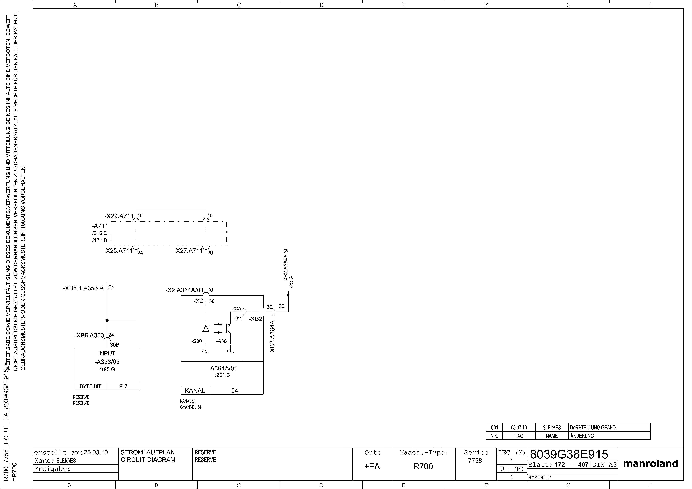

# +EA — Sheet 172 of 407 — RESERVE

**RESERVE**

> Part of the manroland **R700** printing press IEC/UL circuit diagrams.
> Drawing class: **Stromlaufplan / Circuit diagram** (DIN A3).
> Document `+EA` covers the **Printing unit** machine section.

## At a glance

| Field | Value |
|---|---|
| Document | `+EA`  (8039G38E915) |
| Sheet | **172** of 407 |
| Section (DE) | RESERVE |
| Section (EN) | RESERVE |
| Section type | CIRCUIT — Circuit diagram |
| Machine type | `R700` |
| Series | `7758` |
| Created | 25.03.10 |
| Replaces | — |
| Columns used | A, B, C, D, F, G |
| Path numbers | — |
| Labels on sheet | 50 |
| Cross-refs out | 5 |
| Cross-refs in | 13 |

**Previous:** [+EA sheet 171](SHEET_0171.md) · **Next:** [+EA sheet 173](SHEET_0173.md) · **Document TOC:** [_TOC.md](_TOC.md)  (+EA) · **Master TOC:** [all sheets](../_MASTER_TOC.md)

## Sheet image (300 DPI, exact vector render)



_Rendered directly from the PDF vector layer at 300 DPI (1-bit), no OCR and no resampling. Use it to confirm anything ambiguous in the text below._

## Cross-references on this sheet

Each entry is a wire leaving this sheet. The printed token is `/sheet.column`; the link resolves to that sheet inside the same document.

| Ref | Target sheet | Col | Path | Destination on target | Target section | From col |
|---|---|---|---|---|---|---|
| `/315.C` | [+EA sheet 315](SHEET_0315.md) | C | — | — | OPTION: LOGISTIK, AUSLEGER | A |
| `/171.B` | [+EA sheet 171](SHEET_0171.md) | B | — | — | RESERVE | A |
| `/28.G` | [+EA sheet 28](SHEET_0028.md) | G | — | XB2.A364A:30 | BUSVERBINDUNGEN: SICHERHEITSBUS | D |
| `/195.G` | [+EA sheet 195](SHEET_0195.md) | G | — | — | REFERENZMODUL | A |
| `/201.B` | [+EA sheet 201](SHEET_0201.md) | B | — | — | REFERENZMODUL | C |

### Incoming references (sheets that point here)

Every other sheet that sends a wire to this one. `Back-ref` is the token printed on *that* sheet; `Path` is its line number.

| From sheet | Cols | Back-ref | Path | Refs | What continues there |
|---|---|---|---|---|---|
| [+EA#28](SHEET_0028.md) | G | `/28.G` | — | 1 | — |
| [+EA#171](SHEET_0171.md) | B | `/171.B` | — | 1 | — |
| [+EA#195](SHEET_0195.md) | G | `/195.G` | — | 1 | — |
| [+EA#201](SHEET_0201.md) | B | `/201.B` | — | 1 | — |
| [+EA#227](SHEET_0227.md) | C, E | `/227.C`, `/227.E` | — | 2 | — |
| [+EA#240](SHEET_0240.md) | F | `/240.F` | — | 1 | — |
| [+EA#241](SHEET_0241.md) | A | `/241.A` | — | 1 | — |
| [+EA#268](SHEET_0268.md) | E | `/268.E` | — | 1 | — |
| [+EA#271](SHEET_0271.md) | F | `/271.F` | — | 1 | — |
| [+EA#274](SHEET_0274.md) | E | `/274.E` | — | 2 | — |
| [+EA#315](SHEET_0315.md) | C | `/315.C` | — | 1 | — |


## Devices on this sheet

| Tag | Class | Class meaning (IEC) | Col | Sub | Terminal | Sign |
|---|---|---|---|---|---|---|
| `A711` | A | Baugruppe / assembly, module, PC board | A | — | — | — |
| `S30` | S | Schalter / switch | B | — | — | — |
| `A30` | A | Baugruppe / assembly, module, PC board | C | — | — | — |
| `X1` | X | Klemme / terminal, plug connector | C | — | — | — |
| `X2` | X | Klemme / terminal, plug connector | C | — | — | — |
| `XB2` | XB |  | C | — | — | — |
| `A353/05` | A | Baugruppe / assembly, module, PC board | A | 05 | — | — |
| `X29.A711` | — | cross-device reference | B | — | — | — |
| `X25.A711` | — | cross-device reference | B | — | — | — |
| `X27.A711` | — | cross-device reference | B | — | — | — |
| `XB2.A364A` | — | cross-device reference | C | — | — | — |
| `XB5.1.A353.A` | — | cross-device reference | A | — | — | — |
| `9.7` | — | cross-device reference | B | — | — | — |
| `XB5.A353` | — | cross-device reference | A | — | — | — |
| `NR.` | — | cross-device reference | F | — | — | — |
| `05.07.10` | — | cross-device reference | F | — | — | — |
| `XB2.A364A:30` | — | cross-device reference | D | — | 30 | — |

## Potentials / nets

_No named potentials on this sheet._

## Wire-end annotations (grouped as printed)

A wire that continues elsewhere is annotated with a small cluster: the destination description, the path/line number `#NN`, and the `/sheet.column` cross reference. Each row below is one such cluster exactly as it is grouped on the drawing.

| Col | Y | Path | Cross-ref | Text on the wire |
|---|---|---|---|---|
| B | 367.4 | — | — | `X29.A711 15` |
| C | 367.4 | — | — | `16` |
| A | 384.4 | — | — | `A711` |
| A | 397.5 | — | `/315.C`, `/171.B` | — |
| D | 425.8 | — | `/28.G` | `XB2.A364A:30` |
| B | 426.9 | — | — | `X25.A711 24` |
| B | 426.9 | — | — | `X27.A711 30` |
| A | 490.7 | — | — | `XB5.1.A353.A 24` |
| B | 494.9 | — | — | `X2.A364A/01 30` |
| C | 513.4 | — | — | `X2` |
| C | 514.8 | — | — | `30 30` |
| D | 523.3 | — | — | `30` |
| C | 527.5 | — | — | `28A` |
| C | 544.5 | — | — | `X1` |
| C | 544.6 | — | — | `XB2` |
| C | 551.6 | — | — | `XB2.A364A` |
| A | 572.9 | — | — | `XB5.A353 24` |
| C | 583.5 | — | — | `S30 A30` |
| A | 589.9 | — | — | `30B` |
| A | 604.4 | — | — | `INPUT` |
| A | 618.3 | — | — | `A353/05` |
| C | 629.6 | — | — | `A364A/01` |
| A | 632.0 | — | `/195.G` | — |
| C | 642.0 | — | `/201.B` | — |
| A | 661.1 | — | — | `BYTE.BIT 9.7` |
| C | 667.8 | — | — | `KANAL 54` |
| A | 681.1 | — | — | `RESERVE RESERVE` |
| B | 688.2 | — | — | `KANAL 54 CHANNEL 54` |
| G | 733.0 | — | — | `001 05.07.10 SLEI/AES DARSTELLUNG GEÄND.` |
| G | 747.1 | — | — | `NR. TAG NAME ÄNDERUNG` |


## Reconstructed tables

This sheet carries tabular content (pin map / terminal assignment / index). The grid below was rebuilt from the drawing's own rule lines, so each row is exactly one physical row of the table.

### Table 1 — 6 data rows × 9 columns (at x=127.6, y=360.0)

| A711 /315.C /171.B XB5.1.A353.A | X29.A711 X25.A711 24 | 15 | 24 | X27.A711 X2.A364A/01 | 16 30 30 |  |  | XB2.A364A:30 |
|---|---|---|---|---|---|---|---|---|
|  |  |  |  | `X2` | `30` | `28A X1` | `XB2` | `30 30` |
| `XB5.A353` | `24 30B` |  |  | `S30` | `A30` |  |  | `XB2.A364A` |
| `INPUT` |  |  |  |  |  |  |  |  |
|  | `A353/05 /195.G` |  |  |  | `A364A/01 /201.B` |  |  |  |
| `BYTE.BIT` | `9.7` |  |  |  |  |  |  |  |
|  |  |  |  | `KANAL` |  | `54` |  |  |


## Notes and free text on this sheet

| Text | Col | Y (pt) |
|---|---|---|
| `KANAL 54` | B | 688.19 |
| `CHANNEL 54` | B | 698.13 |
| `28A` | C | 527.53 |
| `KANAL` | B | 667.86 |
| `A364A/01` | C | 629.6 |
| `X2.A364A/01` | B | 494.95 |
| `30B` | A | 589.89 |
| `INPUT` | A | 604.42 |
| `BYTE.BIT` | A | 661.67 |
| `RESERVE` | A | 681.09 |
| `TAG` | F | 747.27 |
| `NAME` | G | 747.25 |
| `ÄNDERUNG` | G | 747.31 |
| `SLEI/AES` | G | 733.13 |
| `DARSTELLUNG GEÄND.` | G | 733.12 |

## Complete label inventory (exact text from the drawing)

Every text object inside the drawing area of this sheet, in DIN reading order (column A→H, then top→bottom). This is the authoritative list: if a string is not here it is not printed on this sheet.

| Col | Y | X | Dir | Type | Text |
|---|---|---|---|---|---|
| A | 384.4 | 157.9 | → | device tag | `A711` |
| A | 397.5 | 158.7 | → | cross-reference | `/315.C` |
| A | 409.9 | 159.0 | → | cross-reference | `/171.B` |
| A | 490.7 | 186.8 | → | number | `24` |
| A | 491.4 | 108.3 | → | device ref | `XB5.1.A353.A` |
| A | 572.9 | 127.8 | → | device ref | `XB5.A353` |
| A | 572.9 | 186.8 | → | number | `24` |
| A | 589.9 | 189.6 | → | text | `30B` |
| A | 604.4 | 169.4 | → | text | `INPUT` |
| A | 618.3 | 162.9 | → | device tag | `A353/05` |
| A | 632.1 | 171.4 | → | cross-reference | `/195.G` |
| A | 661.7 | 137.5 | → | text | `BYTE.BIT` |
| A | 681.1 | 125.6 | → | text | `RESERVE` |
| A | 691.0 | 125.6 | → | text | `RESERVE` |
| B | 367.4 | 180.0 | → | device ref | `X29.A711` |
| B | 367.4 | 235.8 | → | number | `15` |
| B | 426.9 | 178.6 | → | device ref | `X25.A711` |
| B | 426.9 | 299.1 | → | device ref | `X27.A711` |
| B | 431.2 | 236.4 | → | number | `24` |
| B | 495.0 | 284.6 | → | text | `X2.A364A/01` |
| B | 583.5 | 329.1 | → | device tag | `S30` |
| B | 661.1 | 205.8 | → | device ref | `9.7` |
| B | 667.9 | 318.0 | → | text | `KANAL` |
| B | 688.2 | 309.8 | → | text | `KANAL 54` |
| B | 698.1 | 310.1 | → | text | `CHANNEL 54` |
| C | 367.4 | 356.3 | → | number | `16` |
| C | 431.2 | 356.9 | → | number | `30` |
| C | 495.0 | 356.9 | → | number | `30` |
| C | 513.4 | 332.8 | → | device tag | `X2` |
| C | 514.8 | 359.7 | → | number | `30` |
| C | 524.7 | 458.9 | → | number | `30` |
| C | 527.5 | 399.7 | → | text | `28A` |
| C | 544.5 | 403.4 | → | device tag | `X1` |
| C | 544.6 | 427.7 | → | device tag | `XB2` |
| C | 551.6 | 463.8 | ↕ | device ref | `XB2.A364A` |
| C | 583.5 | 371.6 | → | device tag | `A30` |
| C | 629.6 | 358.4 | → | text | `A364A/01` |
| C | 642.0 | 370.1 | → | cross-reference | `/201.B` |
| C | 667.8 | 398.0 | → | number | `54` |
| D | 425.8 | 487.8 | ↕ | device ref | `XB2.A364A:30` |
| D | 474.5 | 497.8 | ↕ | cross-reference | `/28.G` |
| D | 523.3 | 479.6 | → | number | `30` |
| F | 733.0 | 845.2 | → | number | `001` |
| F | 733.1 | 879.3 | → | device ref | `05.07.10` |
| F | 747.1 | 844.2 | → | device ref | `NR.` |
| F | 747.3 | 885.8 | → | text | `TAG` |
| G | 733.1 | 934.0 | → | text | `SLEI/AES` |
| G | 733.1 | 980.6 | → | text | `DARSTELLUNG GEÄND.` |
| G | 747.3 | 939.2 | → | text | `NAME` |
| G | 747.3 | 981.8 | → | text | `ÄNDERUNG` |

## Reading-order text block

The same content as a plain block, grouped by DIN column — convenient to paste or to match against a visual description.

```text
=== Column A ===
 384.4  157.9  devtag       A711
 397.5  158.7  xref         /315.C
 409.9  159.0  xref         /171.B
 490.7  186.8  numeric      24
 491.4  108.3  devref       XB5.1.A353.A
 572.9  127.8  devref       XB5.A353
 572.9  186.8  numeric      24
 589.9  189.6  text         30B
 604.4  169.4  text         INPUT
 618.3  162.9  devtag       A353/05
 632.1  171.4  xref         /195.G
 661.7  137.5  text         BYTE.BIT
 681.1  125.6  text         RESERVE
 691.0  125.6  text         RESERVE
=== Column B ===
 367.4  180.0  devref       X29.A711
 367.4  235.8  numeric      15
 426.9  178.6  devref       X25.A711
 426.9  299.1  devref       X27.A711
 431.2  236.4  numeric      24
 495.0  284.6  text         X2.A364A/01
 583.5  329.1  devtag       S30
 661.1  205.8  devref       9.7
 667.9  318.0  text         KANAL
 688.2  309.8  text         KANAL 54
 698.1  310.1  text         CHANNEL 54
=== Column C ===
 367.4  356.3  numeric      16
 431.2  356.9  numeric      30
 495.0  356.9  numeric      30
 513.4  332.8  devtag       X2
 514.8  359.7  numeric      30
 524.7  458.9  numeric      30
 527.5  399.7  text         28A
 544.5  403.4  devtag       X1
 544.6  427.7  devtag       XB2
 551.6  463.8  devref       XB2.A364A
 583.5  371.6  devtag       A30
 629.6  358.4  text         A364A/01
 642.0  370.1  xref         /201.B
 667.8  398.0  numeric      54
=== Column D ===
 425.8  487.8  devref       XB2.A364A:30
 474.5  497.8  xref         /28.G
 523.3  479.6  numeric      30
=== Column F ===
 733.0  845.2  numeric      001
 733.1  879.3  devref       05.07.10
 747.1  844.2  devref       NR.
 747.3  885.8  text         TAG
=== Column G ===
 733.1  934.0  text         SLEI/AES
 733.1  980.6  text         DARSTELLUNG GEÄND.
 747.3  939.2  text         NAME
 747.3  981.8  text         ÄNDERUNG
```

---
_Generated from the PDF vector text layer; no OCR. Source: `R700_7758_IEC_UL_EA_8039G38E915_p`, sheet 172._
