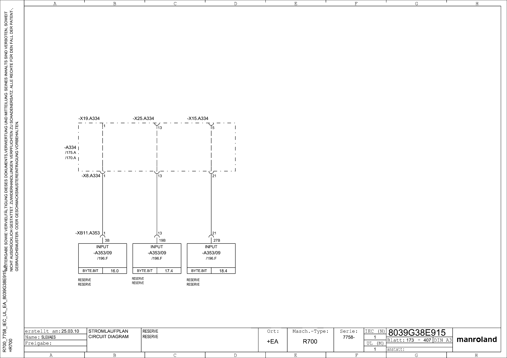

# +EA — Sheet 173 of 407 — RESERVE

**RESERVE**

> Part of the manroland **R700** printing press IEC/UL circuit diagrams.
> Drawing class: **Stromlaufplan / Circuit diagram** (DIN A3).
> Document `+EA` covers the **Printing unit** machine section.

## At a glance

| Field | Value |
|---|---|
| Document | `+EA`  (8039G38E915) |
| Sheet | **173** of 407 |
| Section (DE) | RESERVE |
| Section (EN) | RESERVE |
| Section type | CIRCUIT — Circuit diagram |
| Machine type | `R700` |
| Series | `7758` |
| Created | 25.03.10 |
| Replaces | — |
| Columns used | A, B, C, D |
| Path numbers | — |
| Labels on sheet | 41 |
| Cross-refs out | 5 |
| Cross-refs in | 14 |

**Previous:** [+EA sheet 172](SHEET_0172.md) · **Next:** [+EA sheet 174](SHEET_0174.md) · **Document TOC:** [_TOC.md](_TOC.md)  (+EA) · **Master TOC:** [all sheets](../_MASTER_TOC.md)

## Sheet image (300 DPI, exact vector render)



_Rendered directly from the PDF vector layer at 300 DPI (1-bit), no OCR and no resampling. Use it to confirm anything ambiguous in the text below._

## Cross-references on this sheet

Each entry is a wire leaving this sheet. The printed token is `/sheet.column`; the link resolves to that sheet inside the same document.

| Ref | Target sheet | Col | Path | Destination on target | Target section | From col |
|---|---|---|---|---|---|---|
| `/175.A` | [+EA sheet 175](SHEET_0175.md) | A | — | — | RESERVE | A |
| `/170.A` | [+EA sheet 170](SHEET_0170.md) | A | — | — | RESERVE | A |
| `/196.F` | [+EA sheet 196](SHEET_0196.md) | F | — | — | REFERENZMODUL | B |
| `/196.F` | [+EA sheet 196](SHEET_0196.md) | F | — | — | REFERENZMODUL | C |
| `/196.F` | [+EA sheet 196](SHEET_0196.md) | F | — | — | REFERENZMODUL | D |

### Incoming references (sheets that point here)

Every other sheet that sends a wire to this one. `Back-ref` is the token printed on *that* sheet; `Path` is its line number.

| From sheet | Cols | Back-ref | Path | Refs | What continues there |
|---|---|---|---|---|---|
| [+EA#170](SHEET_0170.md) | A | `/170.A` | — | 1 | — |
| [+EA#175](SHEET_0175.md) | A | `/175.A` | — | 1 | — |
| [+EA#196](SHEET_0196.md) | F | `/196.F` | — | 3 | — |
| [+EA#249](SHEET_0249.md) | D | `/249.D` | — | 3 | — |
| [+EA#256](SHEET_0256.md) | A | `/256.A` | — | 3 | — |
| [+EA#260](SHEET_0260.md) | D | `/260.D` | — | 1 | — |
| [+EA#263](SHEET_0263.md) | G | `/263.G` | — | 1 | — |
| [+EA#267](SHEET_0267.md) | B | `/267.B` | — | 1 | — |


## Devices on this sheet

| Tag | Class | Class meaning (IEC) | Col | Sub | Terminal | Sign |
|---|---|---|---|---|---|---|
| `A334` | A | Baugruppe / assembly, module, PC board | A | — | — | — |
| `A353/09` | A | Baugruppe / assembly, module, PC board | D | 09 | — | — |
| `A353/09` | A | Baugruppe / assembly, module, PC board | C | 09 | — | — |
| `A353/09` | A | Baugruppe / assembly, module, PC board | B | 09 | — | — |
| `18.4` | — | cross-device reference | D | — | — | — |
| `17.4` | — | cross-device reference | C | — | — | — |
| `16.0` | — | cross-device reference | B | — | — | — |
| `XB11.A353` | — | cross-device reference | B | — | — | — |
| `X8.A334` | — | cross-device reference | B | — | — | — |
| `X15.A334` | — | cross-device reference | C | — | — | — |
| `X19.A334` | — | cross-device reference | B | — | — | — |
| `X25.A334` | — | cross-device reference | B | — | — | — |

## Potentials / nets

_No named potentials on this sheet._

## Wire-end annotations (grouped as printed)

A wire that continues elsewhere is annotated with a small cluster: the destination description, the path/line number `#NN`, and the `/sheet.column` cross reference. Each row below is one such cluster exactly as it is grouped on the drawing.

| Col | Y | Path | Cross-ref | Text on the wire |
|---|---|---|---|---|
| B | 273.9 | — | — | `X19.A334 X25.A334 X15.A334` |
| B | 292.3 | — | — | `1` |
| C | 296.5 | — | — | `13` |
| D | 296.5 | — | — | `5` |
| A | 341.9 | — | — | `A334` |
| A | 354.9 | — | `/175.A`, `/170.A` | — |
| B | 408.5 | — | — | `X8.A334 1` |
| C | 409.9 | — | — | `13` |
| D | 409.9 | — | — | `21` |
| B | 543.1 | — | — | `XB11.A353 1` |
| C | 544.6 | — | — | `13` |
| D | 544.6 | — | — | `21` |
| B | 561.5 | — | — | `3B` |
| C | 561.5 | — | — | `19B` |
| D | 561.5 | — | — | `27B` |
| B | 576.1 | — | — | `INPUT` |
| C | 576.1 | — | — | `INPUT` |
| D | 576.1 | — | — | `INPUT` |
| B | 589.9 | — | — | `A353/09` |
| C | 589.9 | — | — | `A353/09` |
| D | 589.9 | — | — | `A353/09` |
| B | 603.7 | — | `/196.F` | — |
| C | 603.7 | — | `/196.F` | — |
| D | 603.7 | — | `/196.F` | — |
| B | 632.8 | — | — | `BYTE.BIT 16.0` |
| C | 632.8 | — | — | `BYTE.BIT 17.4` |
| D | 632.8 | — | — | `BYTE.BIT 18.4` |
| B | 652.8 | — | — | `RESERVE RESERVE` |
| A | 655.4 | — | — | `RESERVE RESERVE` |
| C | 655.4 | — | — | `RESERVE RESERVE` |


## Reconstructed tables

This sheet carries tabular content (pin map / terminal assignment / index). The grid below was rebuilt from the drawing's own rule lines, so each row is exactly one physical row of the table.

### Table 1 — 1 data rows × 2 columns (at x=184.3, y=572.6)

| INPUT | A353/09 /196.F |
|---|---|
| `BYTE.BIT` | `16.0` |


### Table 2 — 1 data rows × 2 columns (at x=311.8, y=572.6)

| INPUT | A353/09 /196.F |
|---|---|
| `BYTE.BIT` | `17.4` |


### Table 3 — 1 data rows × 2 columns (at x=439.4, y=572.6)

| INPUT | A353/09 /196.F |
|---|---|
| `BYTE.BIT` | `18.4` |


## Notes and free text on this sheet

| Text | Col | Y (pt) |
|---|---|---|
| `27B` | D | 561.55 |
| `INPUT` | D | 576.07 |
| `BYTE.BIT` | C | 633.32 |
| `RESERVE` | C | 655.39 |
| `19B` | C | 561.55 |
| `INPUT` | C | 576.07 |
| `BYTE.BIT` | B | 633.32 |
| `RESERVE` | B | 652.75 |
| `3B` | B | 561.53 |
| `INPUT` | B | 576.07 |
| `RESERVE` | A | 655.39 |

## Complete label inventory (exact text from the drawing)

Every text object inside the drawing area of this sheet, in DIN reading order (column A→H, then top→bottom). This is the authoritative list: if a string is not here it is not printed on this sheet.

| Col | Y | X | Dir | Type | Text |
|---|---|---|---|---|---|
| A | 341.9 | 150.8 | → | device tag | `A334` |
| A | 354.9 | 153.1 | → | cross-reference | `/175.A` |
| A | 367.4 | 153.1 | → | cross-reference | `/170.A` |
| A | 655.4 | 183.4 | → | text | `RESERVE` |
| A | 666.0 | 183.4 | → | text | `RESERVE` |
| B | 273.8 | 184.3 | → | device ref | `X19.A334` |
| B | 273.8 | 311.8 | → | device ref | `X25.A334` |
| B | 292.3 | 242.9 | → | number | `1` |
| B | 408.5 | 191.6 | → | device ref | `X8.A334` |
| B | 409.9 | 242.9 | → | number | `1` |
| B | 543.1 | 177.2 | → | device ref | `XB11.A353` |
| B | 544.6 | 242.9 | → | number | `1` |
| B | 561.5 | 246.3 | → | text | `3B` |
| B | 576.1 | 226.1 | → | text | `INPUT` |
| B | 589.9 | 219.5 | → | device tag | `A353/09` |
| B | 603.7 | 228.6 | → | cross-reference | `/196.F` |
| B | 632.8 | 259.5 | → | device ref | `16.0` |
| B | 633.3 | 194.2 | → | text | `BYTE.BIT` |
| B | 633.3 | 321.7 | → | text | `BYTE.BIT` |
| B | 652.7 | 309.8 | → | text | `RESERVE` |
| B | 662.7 | 309.8 | → | text | `RESERVE` |
| C | 273.8 | 439.4 | → | device ref | `X15.A334` |
| C | 296.5 | 370.5 | → | number | `13` |
| C | 409.9 | 370.5 | → | number | `13` |
| C | 544.6 | 370.5 | → | number | `13` |
| C | 561.5 | 373.3 | → | text | `19B` |
| C | 576.1 | 353.6 | → | text | `INPUT` |
| C | 589.9 | 347.1 | → | device tag | `A353/09` |
| C | 603.7 | 356.2 | → | cross-reference | `/196.F` |
| C | 632.8 | 387.1 | → | device ref | `17.4` |
| C | 633.3 | 449.3 | → | text | `BYTE.BIT` |
| C | 655.4 | 438.5 | → | text | `RESERVE` |
| C | 666.0 | 438.5 | → | text | `RESERVE` |
| D | 296.5 | 498.6 | → | number | `5` |
| D | 409.9 | 498.6 | → | number | `21` |
| D | 544.6 | 498.6 | → | number | `21` |
| D | 561.5 | 501.4 | → | text | `27B` |
| D | 576.1 | 481.2 | → | text | `INPUT` |
| D | 589.9 | 474.7 | → | device tag | `A353/09` |
| D | 603.7 | 483.7 | → | cross-reference | `/196.F` |
| D | 632.8 | 514.6 | → | device ref | `18.4` |

## Reading-order text block

The same content as a plain block, grouped by DIN column — convenient to paste or to match against a visual description.

```text
=== Column A ===
 341.9  150.8  devtag       A334
 354.9  153.1  xref         /175.A
 367.4  153.1  xref         /170.A
 655.4  183.4  text         RESERVE
 666.0  183.4  text         RESERVE
=== Column B ===
 273.8  184.3  devref       X19.A334
 273.8  311.8  devref       X25.A334
 292.3  242.9  numeric      1
 408.5  191.6  devref       X8.A334
 409.9  242.9  numeric      1
 543.1  177.2  devref       XB11.A353
 544.6  242.9  numeric      1
 561.5  246.3  text         3B
 576.1  226.1  text         INPUT
 589.9  219.5  devtag       A353/09
 603.7  228.6  xref         /196.F
 632.8  259.5  devref       16.0
 633.3  194.2  text         BYTE.BIT
 633.3  321.7  text         BYTE.BIT
 652.7  309.8  text         RESERVE
 662.7  309.8  text         RESERVE
=== Column C ===
 273.8  439.4  devref       X15.A334
 296.5  370.5  numeric      13
 409.9  370.5  numeric      13
 544.6  370.5  numeric      13
 561.5  373.3  text         19B
 576.1  353.6  text         INPUT
 589.9  347.1  devtag       A353/09
 603.7  356.2  xref         /196.F
 632.8  387.1  devref       17.4
 633.3  449.3  text         BYTE.BIT
 655.4  438.5  text         RESERVE
 666.0  438.5  text         RESERVE
=== Column D ===
 296.5  498.6  numeric      5
 409.9  498.6  numeric      21
 544.6  498.6  numeric      21
 561.5  501.4  text         27B
 576.1  481.2  text         INPUT
 589.9  474.7  devtag       A353/09
 603.7  483.7  xref         /196.F
 632.8  514.6  devref       18.4
```

---
_Generated from the PDF vector text layer; no OCR. Source: `R700_7758_IEC_UL_EA_8039G38E915_p`, sheet 173._
