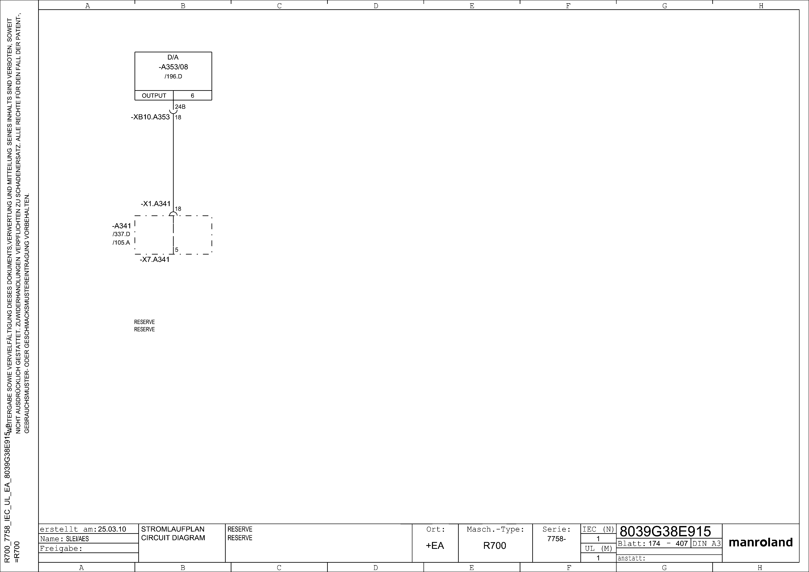

# +EA — Sheet 174 of 407 — RESERVE

**RESERVE**

> Part of the manroland **R700** printing press IEC/UL circuit diagrams.
> Drawing class: **Stromlaufplan / Circuit diagram** (DIN A3).
> Document `+EA` covers the **Printing unit** machine section.

## At a glance

| Field | Value |
|---|---|
| Document | `+EA`  (8039G38E915) |
| Sheet | **174** of 407 |
| Section (DE) | RESERVE |
| Section (EN) | RESERVE |
| Section type | CIRCUIT — Circuit diagram |
| Machine type | `R700` |
| Series | `7758` |
| Created | 25.03.10 |
| Replaces | — |
| Columns used | A, B |
| Path numbers | — |
| Labels on sheet | 17 |
| Cross-refs out | 3 |
| Cross-refs in | 6 |

**Previous:** [+EA sheet 173](SHEET_0173.md) · **Next:** [+EA sheet 175](SHEET_0175.md) · **Document TOC:** [_TOC.md](_TOC.md)  (+EA) · **Master TOC:** [all sheets](../_MASTER_TOC.md)

## Sheet image (300 DPI, exact vector render)



_Rendered directly from the PDF vector layer at 300 DPI (1-bit), no OCR and no resampling. Use it to confirm anything ambiguous in the text below._

## Cross-references on this sheet

Each entry is a wire leaving this sheet. The printed token is `/sheet.column`; the link resolves to that sheet inside the same document.

| Ref | Target sheet | Col | Path | Destination on target | Target section | From col |
|---|---|---|---|---|---|---|
| `/196.D` | [+EA sheet 196](SHEET_0196.md) | D | — | — | REFERENZMODUL | B |
| `/337.D` | [+EA sheet 337](SHEET_0337.md) | D | — | — | OPTION: BOGENWEICHE | A |
| `/105.A` | [+EA sheet 105](SHEET_0105.md) | A | — | — | BOGENFÜHRUNGSELEMENT | A |

### Incoming references (sheets that point here)

Every other sheet that sends a wire to this one. `Back-ref` is the token printed on *that* sheet; `Path` is its line number.

| From sheet | Cols | Back-ref | Path | Refs | What continues there |
|---|---|---|---|---|---|
| [+EA#105](SHEET_0105.md) | A | `/105.A` | — | 1 | — |
| [+EA#196](SHEET_0196.md) | D | `/196.D` | — | 1 | — |
| [+EA#209](SHEET_0209.md) | A | `/209.A` | — | 1 | — |
| [+EA#247](SHEET_0247.md) | C | `/247.C` | — | 1 | — |
| [+EA#254](SHEET_0254.md) | C | `/254.C` | — | 1 | — |
| [+EA#337](SHEET_0337.md) | D | `/337.D` | — | 1 | — |


## Devices on this sheet

| Tag | Class | Class meaning (IEC) | Col | Sub | Terminal | Sign |
|---|---|---|---|---|---|---|
| `A353/08` | A | Baugruppe / assembly, module, PC board | B | 08 | — | — |
| `A341` | A | Baugruppe / assembly, module, PC board | A | — | — | — |
| `XB10.A353` | — | cross-device reference | B | — | — | — |
| `X1.A341` | — | cross-device reference | B | — | — | — |
| `X7.A341` | — | cross-device reference | B | — | — | — |

## Potentials / nets

_No named potentials on this sheet._

## Wire-end annotations (grouped as printed)

A wire that continues elsewhere is annotated with a small cluster: the destination description, the path/line number `#NN`, and the `/sheet.column` cross reference. Each row below is one such cluster exactly as it is grouped on the drawing.

| Col | Y | Path | Cross-ref | Text on the wire |
|---|---|---|---|---|
| B | 80.0 | — | — | `D/A` |
| B | 93.8 | — | — | `A353/08` |
| B | 108.7 | — | `/196.D` | — |
| B | 137.1 | — | — | `OUTPUT 6` |
| B | 153.4 | — | — | `24B` |
| B | 167.6 | — | — | `XB10.A353 18` |
| B | 295.1 | — | — | `X1.A341 18` |
| A | 327.7 | — | — | `A341` |
| A | 340.8 | — | `/337.D`, `/105.A` | — |
| B | 363.9 | — | — | `X7.A341 5` |
| B | 471.1 | — | — | `RESERVE RESERVE` |


## Reconstructed tables

This sheet carries tabular content (pin map / terminal assignment / index). The grid below was rebuilt from the drawing's own rule lines, so each row is exactly one physical row of the table.

### Table 1 — 1 data rows × 2 columns (at x=198.4, y=76.5)

| D/A | A353/08 /196.D |
|---|---|
| `OUTPUT` | `6` |


## Notes and free text on this sheet

| Text | Col | Y (pt) |
|---|---|---|
| `24B` | B | 153.36 |
| `D/A` | B | 79.96 |
| `OUTPUT` | B | 137.06 |
| `RESERVE` | B | 471.14 |

## Complete label inventory (exact text from the drawing)

Every text object inside the drawing area of this sheet, in DIN reading order (column A→H, then top→bottom). This is the authoritative list: if a string is not here it is not printed on this sheet.

| Col | Y | X | Dir | Type | Text |
|---|---|---|---|---|---|
| A | 327.7 | 165.0 | → | device tag | `A341` |
| A | 340.8 | 165.8 | → | cross-reference | `/337.D` |
| A | 353.2 | 165.8 | → | cross-reference | `/105.A` |
| B | 80.0 | 246.3 | → | text | `D/A` |
| B | 93.8 | 233.7 | → | device tag | `A353/08` |
| B | 108.7 | 242.4 | → | cross-reference | `/196.D` |
| B | 137.1 | 208.8 | → | text | `OUTPUT` |
| B | 137.1 | 281.1 | → | number | `6` |
| B | 153.4 | 257.7 | → | text | `24B` |
| B | 167.5 | 192.8 | → | device ref | `XB10.A353` |
| B | 169.0 | 257.1 | → | number | `18` |
| B | 295.1 | 207.2 | → | device ref | `X1.A341` |
| B | 303.6 | 257.1 | → | number | `18` |
| B | 363.9 | 257.7 | → | number | `5` |
| B | 377.3 | 205.8 | → | device ref | `X7.A341` |
| B | 471.1 | 197.6 | → | text | `RESERVE` |
| B | 481.8 | 197.6 | → | text | `RESERVE` |

## Reading-order text block

The same content as a plain block, grouped by DIN column — convenient to paste or to match against a visual description.

```text
=== Column A ===
 327.7  165.0  devtag       A341
 340.8  165.8  xref         /337.D
 353.2  165.8  xref         /105.A
=== Column B ===
  80.0  246.3  text         D/A
  93.8  233.7  devtag       A353/08
 108.7  242.4  xref         /196.D
 137.1  208.8  text         OUTPUT
 137.1  281.1  numeric      6
 153.4  257.7  text         24B
 167.5  192.8  devref       XB10.A353
 169.0  257.1  numeric      18
 295.1  207.2  devref       X1.A341
 303.6  257.1  numeric      18
 363.9  257.7  numeric      5
 377.3  205.8  devref       X7.A341
 471.1  197.6  text         RESERVE
 481.8  197.6  text         RESERVE
```

---
_Generated from the PDF vector text layer; no OCR. Source: `R700_7758_IEC_UL_EA_8039G38E915_p`, sheet 174._
