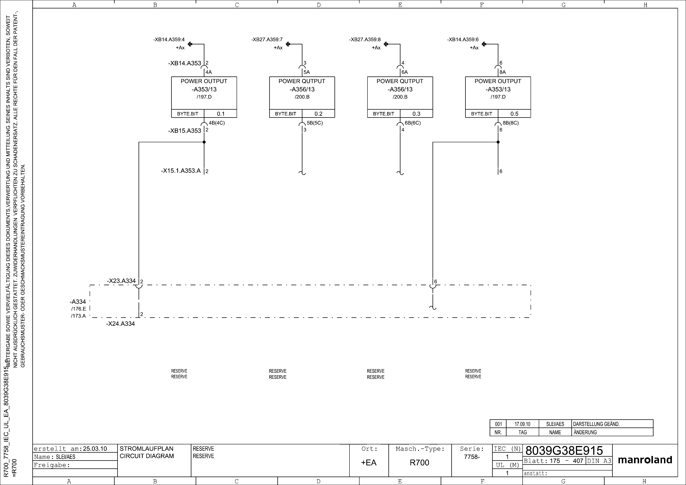

# +EA — Sheet 175 of 407 — RESERVE

**RESERVE**

> Part of the manroland **R700** printing press IEC/UL circuit diagrams.
> Drawing class: **Stromlaufplan / Circuit diagram** (DIN A3).
> Document `+EA` covers the **Printing unit** machine section.

## At a glance

| Field | Value |
|---|---|
| Document | `+EA`  (8039G38E915) |
| Sheet | **175** of 407 |
| Section (DE) | RESERVE |
| Section (EN) | RESERVE |
| Section type | CIRCUIT — Circuit diagram |
| Machine type | `R700` |
| Series | `7758` |
| Created | 25.03.10 |
| Replaces | — |
| Columns used | A, B, C, D, E, F, G |
| Path numbers | — |
| Labels on sheet | 73 |
| Cross-refs out | 6 |
| Cross-refs in | 19 |

**Previous:** [+EA sheet 174](SHEET_0174.md) · **Next:** [+EA sheet 176](SHEET_0176.md) · **Document TOC:** [_TOC.md](_TOC.md)  (+EA) · **Master TOC:** [all sheets](../_MASTER_TOC.md)

## Sheet image (300 DPI, exact vector render)



_Rendered directly from the PDF vector layer at 300 DPI (1-bit), no OCR and no resampling. Use it to confirm anything ambiguous in the text below._

## Cross-references on this sheet

Each entry is a wire leaving this sheet. The printed token is `/sheet.column`; the link resolves to that sheet inside the same document.

| Ref | Target sheet | Col | Path | Destination on target | Target section | From col |
|---|---|---|---|---|---|---|
| `/200.B` | [+EA sheet 200](SHEET_0200.md) | B | — | — | REFERENZMODUL | D |
| `/200.B` | [+EA sheet 200](SHEET_0200.md) | B | — | — | REFERENZMODUL | E |
| `/197.D` | [+EA sheet 197](SHEET_0197.md) | D | — | — | REFERENZMODUL | C |
| `/197.D` | [+EA sheet 197](SHEET_0197.md) | D | — | — | REFERENZMODUL | F |
| `/176.E` | [+EA sheet 176](SHEET_0176.md) | E | — | — | RESERVE | A |
| `/173.A` | [+EA sheet 173](SHEET_0173.md) | A | — | — | RESERVE | A |

### Incoming references (sheets that point here)

Every other sheet that sends a wire to this one. `Back-ref` is the token printed on *that* sheet; `Path` is its line number.

| From sheet | Cols | Back-ref | Path | Refs | What continues there |
|---|---|---|---|---|---|
| [+EA#173](SHEET_0173.md) | A | `/173.A` | — | 1 | — |
| [+EA#176](SHEET_0176.md) | E | `/176.E` | — | 1 | — |
| [+EA#197](SHEET_0197.md) | D | `/197.D` | — | 2 | — |
| [+EA#200](SHEET_0200.md) | B | `/200.B` | — | 2 | — |
| [+EA#259](SHEET_0259.md) | F, G | `/259.F`, `/259.G` | — | 4 | — |
| [+EA#260](SHEET_0260.md) | F, G | `/260.F`, `/260.G` | — | 4 | — |
| [+EA#261](SHEET_0261.md) | A | `/261.A` | — | 2 | — |
| [+EA#265](SHEET_0265.md) | A | `/265.A` | — | 2 | — |
| [+EA#285](SHEET_0285.md) | F | `/285.F` | — | 1 | — |


## Devices on this sheet

| Tag | Class | Class meaning (IEC) | Col | Sub | Terminal | Sign |
|---|---|---|---|---|---|---|
| `A353/13` | A | Baugruppe / assembly, module, PC board | C | 13 | — | — |
| `A334` | A | Baugruppe / assembly, module, PC board | A | — | — | — |
| `A356/13` | A | Baugruppe / assembly, module, PC board | D | 13 | — | — |
| `A356/13` | A | Baugruppe / assembly, module, PC board | E | 13 | — | — |
| `A353/13` | A | Baugruppe / assembly, module, PC board | F | 13 | — | — |
| `NR.` | — | cross-device reference | F | — | — | — |
| `17.09.10` | — | cross-device reference | F | — | — | — |
| `XB14.A359:4` | — | cross-device reference | B | — | 4 | — |
| `XB15.A353` | — | cross-device reference | B | — | — | — |
| `0.1` | — | cross-device reference | C | — | — | — |
| `XB14.A353` | — | cross-device reference | B | — | — | — |
| `X23.A334` | — | cross-device reference | B | — | — | — |
| `X15.1.A353.A` | — | cross-device reference | B | — | — | — |
| `0.2` | — | cross-device reference | D | — | — | — |
| `XB27.A359:7` | — | cross-device reference | C | — | 7 | — |
| `0.3` | — | cross-device reference | E | — | — | — |
| `XB27.A359:8` | — | cross-device reference | E | — | 8 | — |
| `XB14.A359:6` | — | cross-device reference | F | — | 6 | — |
| `0.5` | — | cross-device reference | F | — | — | — |
| `X24.A334` | — | cross-device reference | B | — | — | — |

## Potentials / nets

_No named potentials on this sheet._

## Wire-end annotations (grouped as printed)

A wire that continues elsewhere is annotated with a small cluster: the destination description, the path/line number `#NN`, and the `/sheet.column` cross reference. Each row below is one such cluster exactly as it is grouped on the drawing.

| Col | Y | Path | Cross-ref | Text on the wire |
|---|---|---|---|---|
| B | 64.8 | — | — | `XB14.A359:4` |
| C | 64.8 | — | — | `XB27.A359:7` |
| E | 64.8 | — | — | `XB27.A359:8` |
| F | 64.8 | — | — | `XB14.A359:6` |
| B | 79.0 | — | — | `+Ax` |
| D | 79.0 | — | — | `+Ax` |
| E | 79.0 | — | — | `+Ax` |
| F | 79.0 | — | — | `+Ax` |
| B | 105.2 | — | — | `XB14.A353 2` |
| D | 105.2 | — | — | `3` |
| E | 105.2 | — | — | `4` |
| F | 105.2 | — | — | `6` |
| C | 121.5 | — | — | `4A` |
| D | 121.5 | — | — | `5A` |
| E | 121.5 | — | — | `6A` |
| F | 121.5 | — | — | `8A` |
| C | 136.6 | — | — | `POWER OUTPUT` |
| D | 136.6 | — | — | `POWER QUTPUT` |
| E | 136.6 | — | — | `POWER QUTPUT` |
| F | 136.6 | — | — | `POWER OUTPUT` |
| C | 150.5 | — | — | `A353/13` |
| D | 150.5 | — | — | `A356/13` |
| E | 150.5 | — | — | `A356/13` |
| F | 150.5 | — | — | `A353/13` |
| C | 164.3 | — | `/197.D` | — |
| D | 164.3 | — | `/200.B` | — |
| E | 164.3 | — | `/200.B` | — |
| F | 164.3 | — | `/197.D` | — |
| C | 193.4 | — | — | `BYTE.BIT 0.1` |
| D | 193.4 | — | — | `BYTE.BIT 0.2` |
| E | 193.4 | — | — | `BYTE.BIT 0.3` |
| F | 193.4 | — | — | `BYTE.BIT 0.5` |
| C | 209.4 | — | — | `4B(4C)` |
| D | 209.4 | — | — | `5B(5C)` |
| E | 209.4 | — | — | `6B(6C)` |
| F | 209.4 | — | — | `8B(8C)` |
| B | 221.4 | — | — | `XB15.A353 2` |
| D | 221.4 | — | — | `3` |
| E | 221.4 | — | — | `4` |
| F | 221.4 | — | — | `6` |
| B | 291.6 | — | — | `X15.1.A353.A 2` |
| F | 293.7 | — | — | `6` |
| B | 482.9 | — | — | `X23.A334 2` |
| E | 485.1 | — | — | `6` |
| A | 519.0 | — | — | `A334` |
| A | 532.1 | — | `/176.E`, `/173.A` | — |
| B | 541.7 | — | — | `2` |
| B | 557.3 | — | — | `X24.A334` |
| D | 641.2 | — | — | `RESERVE RESERVE` |
| E | 641.2 | — | — | `RESERVE RESERVE` |
| B | 641.4 | — | — | `RESERVE RESERVE` |
| F | 641.4 | — | — | `RESERVE RESERVE` |
| G | 733.0 | — | — | `001 17.09.10 SLEI/AES DARSTELLUNG GEÄND.` |
| G | 747.1 | — | — | `NR. TAG NAME ÄNDERUNG` |


## Reconstructed tables

This sheet carries tabular content (pin map / terminal assignment / index). The grid below was rebuilt from the drawing's own rule lines, so each row is exactly one physical row of the table.

### Table 1 — 2 data rows × 2 columns (at x=297.6, y=133.2)

| POWER | OUTPUT A353/13 /197.D |
|---|---|
| `BYTE.BIT` | `0.1` |
| `XB15.A353` | `4B(4C) 2` |


### Table 2 — 2 data rows × 2 columns (at x=467.7, y=133.2)

| POWER | QUTPUT A356/13 /200.B |
|---|---|
| `BYTE.BIT` | `0.2` |
|  | `5B(5C) 3` |


### Table 3 — 2 data rows × 2 columns (at x=637.8, y=133.2)

| POWER | QUTPUT A356/13 /200.B |
|---|---|
| `BYTE.BIT` | `0.3` |
|  | `6B(6C) 4` |


### Table 4 — 2 data rows × 2 columns (at x=807.9, y=133.2)

| POWER | OUTPUT A353/13 /197.D |
|---|---|
| `BYTE.BIT` | `0.5` |
|  | `8B(8C) 6` |


## Notes and free text on this sheet

| Text | Col | Y (pt) |
|---|---|---|
| `TAG` | G | 747.27 |
| `NAME` | G | 747.25 |
| `ÄNDERUNG` | G | 747.31 |
| `SLEI/AES` | G | 733.13 |
| `DARSTELLUNG GEÄND.` | G | 733.12 |
| `+Ax` | B | 79.02 |
| `4A` | C | 121.45 |
| `4B(4C)` | C | 209.37 |
| `POWER OUTPUT` | C | 136.62 |
| `BYTE.BIT` | B | 193.95 |
| `RESERVE` | B | 641.41 |
| `5A` | D | 121.45 |
| `5B(5C)` | D | 209.37 |
| `POWER QUTPUT` | D | 136.62 |
| `BYTE.BIT` | D | 193.95 |
| `RESERVE` | D | 641.21 |
| `+Ax` | D | 79.02 |
| `6A` | E | 121.45 |
| `6B(6C)` | E | 209.37 |
| `POWER QUTPUT` | E | 136.62 |
| `BYTE.BIT` | E | 193.95 |
| `RESERVE` | E | 641.21 |
| `+Ax` | E | 79.02 |
| `+Ax` | F | 79.02 |
| `8A` | F | 121.45 |
| `8B(8C)` | F | 209.37 |
| `POWER OUTPUT` | F | 136.62 |
| `BYTE.BIT` | F | 193.95 |
| `RESERVE` | F | 641.41 |

## Complete label inventory (exact text from the drawing)

Every text object inside the drawing area of this sheet, in DIN reading order (column A→H, then top→bottom). This is the authoritative list: if a string is not here it is not printed on this sheet.

| Col | Y | X | Dir | Type | Text |
|---|---|---|---|---|---|
| A | 519.0 | 121.0 | → | device tag | `A334` |
| A | 532.1 | 123.9 | → | cross-reference | `/176.E` |
| A | 544.5 | 123.3 | → | cross-reference | `/173.A` |
| B | 64.8 | 265.9 | → | device ref | `XB14.A359:4` |
| B | 79.0 | 305.3 | → | text | `+Ax` |
| B | 105.2 | 292.0 | → | device ref | `XB14.A353` |
| B | 194.0 | 307.6 | → | text | `BYTE.BIT` |
| B | 222.1 | 292.0 | → | device ref | `XB15.A353` |
| B | 291.6 | 279.5 | → | device ref | `X15.1.A353.A` |
| B | 482.9 | 185.7 | → | device ref | `X23.A334` |
| B | 485.0 | 243.5 | → | number | `2` |
| B | 541.7 | 243.5 | → | number | `2` |
| B | 557.3 | 184.3 | → | device ref | `X24.A334` |
| B | 641.4 | 297.1 | → | text | `RESERVE` |
| B | 651.4 | 297.1 | → | text | `RESERVE` |
| C | 64.8 | 436.0 | → | device ref | `XB27.A359:7` |
| C | 105.2 | 356.9 | → | number | `2` |
| C | 121.5 | 356.9 | → | text | `4A` |
| C | 136.6 | 313.5 | → | text | `POWER OUTPUT` |
| C | 150.5 | 332.9 | → | device tag | `A353/13` |
| C | 164.3 | 341.6 | → | cross-reference | `/197.D` |
| C | 193.4 | 376.7 | → | device ref | `0.1` |
| C | 209.4 | 362.6 | → | text | `4B(4C)` |
| C | 221.4 | 356.9 | → | number | `2` |
| C | 293.7 | 356.9 | → | number | `2` |
| D | 79.0 | 475.4 | → | text | `+Ax` |
| D | 105.2 | 527.0 | → | number | `3` |
| D | 121.5 | 527.0 | → | text | `5A` |
| D | 136.6 | 483.6 | → | text | `POWER QUTPUT` |
| D | 150.5 | 503.0 | → | device tag | `A356/13` |
| D | 164.3 | 511.8 | → | cross-reference | `/200.B` |
| D | 193.4 | 546.0 | → | device ref | `0.2` |
| D | 194.0 | 477.6 | → | text | `BYTE.BIT` |
| D | 209.4 | 532.6 | → | text | `5B(5C)` |
| D | 221.4 | 527.0 | → | number | `3` |
| D | 641.2 | 466.9 | → | text | `RESERVE` |
| D | 651.8 | 466.9 | → | text | `RESERVE` |
| E | 64.8 | 606.0 | → | device ref | `XB27.A359:8` |
| E | 79.0 | 645.4 | → | text | `+Ax` |
| E | 105.2 | 697.0 | → | number | `4` |
| E | 121.5 | 697.0 | → | text | `6A` |
| E | 136.6 | 653.7 | → | text | `POWER QUTPUT` |
| E | 150.5 | 673.1 | → | device tag | `A356/13` |
| E | 164.3 | 681.9 | → | cross-reference | `/200.B` |
| E | 193.4 | 716.0 | → | device ref | `0.3` |
| E | 194.0 | 647.7 | → | text | `BYTE.BIT` |
| E | 209.4 | 702.7 | → | text | `6B(6C)` |
| E | 221.4 | 697.0 | → | number | `4` |
| E | 485.0 | 753.7 | → | number | `6` |
| E | 641.2 | 636.9 | → | text | `RESERVE` |
| E | 651.8 | 636.9 | → | text | `RESERVE` |
| F | 64.8 | 776.1 | → | device ref | `XB14.A359:6` |
| F | 79.0 | 815.5 | → | text | `+Ax` |
| F | 105.2 | 867.1 | → | number | `6` |
| F | 121.5 | 867.1 | → | text | `8A` |
| F | 136.6 | 823.7 | → | text | `POWER OUTPUT` |
| F | 150.5 | 843.2 | → | device tag | `A353/13` |
| F | 164.3 | 851.8 | → | cross-reference | `/197.D` |
| F | 193.4 | 886.1 | → | device ref | `0.5` |
| F | 194.0 | 817.8 | → | text | `BYTE.BIT` |
| F | 209.4 | 872.8 | → | text | `8B(8C)` |
| F | 221.4 | 867.1 | → | number | `6` |
| F | 293.7 | 867.1 | → | number | `6` |
| F | 641.4 | 807.3 | → | text | `RESERVE` |
| F | 651.4 | 807.3 | → | text | `RESERVE` |
| F | 733.0 | 859.4 | → | number | `001` |
| F | 733.1 | 893.2 | → | device ref | `17.09.10` |
| F | 747.1 | 858.4 | → | device ref | `NR.` |
| G | 733.1 | 948.2 | → | text | `SLEI/AES` |
| G | 733.1 | 994.8 | → | text | `DARSTELLUNG GEÄND.` |
| G | 747.3 | 900.0 | → | text | `TAG` |
| G | 747.3 | 953.4 | → | text | `NAME` |
| G | 747.3 | 996.0 | → | text | `ÄNDERUNG` |

## Reading-order text block

The same content as a plain block, grouped by DIN column — convenient to paste or to match against a visual description.

```text
=== Column A ===
 519.0  121.0  devtag       A334
 532.1  123.9  xref         /176.E
 544.5  123.3  xref         /173.A
=== Column B ===
  64.8  265.9  devref       XB14.A359:4
  79.0  305.3  text         +Ax
 105.2  292.0  devref       XB14.A353
 194.0  307.6  text         BYTE.BIT
 222.1  292.0  devref       XB15.A353
 291.6  279.5  devref       X15.1.A353.A
 482.9  185.7  devref       X23.A334
 485.0  243.5  numeric      2
 541.7  243.5  numeric      2
 557.3  184.3  devref       X24.A334
 641.4  297.1  text         RESERVE
 651.4  297.1  text         RESERVE
=== Column C ===
  64.8  436.0  devref       XB27.A359:7
 105.2  356.9  numeric      2
 121.5  356.9  text         4A
 136.6  313.5  text         POWER OUTPUT
 150.5  332.9  devtag       A353/13
 164.3  341.6  xref         /197.D
 193.4  376.7  devref       0.1
 209.4  362.6  text         4B(4C)
 221.4  356.9  numeric      2
 293.7  356.9  numeric      2
=== Column D ===
  79.0  475.4  text         +Ax
 105.2  527.0  numeric      3
 121.5  527.0  text         5A
 136.6  483.6  text         POWER QUTPUT
 150.5  503.0  devtag       A356/13
 164.3  511.8  xref         /200.B
 193.4  546.0  devref       0.2
 194.0  477.6  text         BYTE.BIT
 209.4  532.6  text         5B(5C)
 221.4  527.0  numeric      3
 641.2  466.9  text         RESERVE
 651.8  466.9  text         RESERVE
=== Column E ===
  64.8  606.0  devref       XB27.A359:8
  79.0  645.4  text         +Ax
 105.2  697.0  numeric      4
 121.5  697.0  text         6A
 136.6  653.7  text         POWER QUTPUT
 150.5  673.1  devtag       A356/13
 164.3  681.9  xref         /200.B
 193.4  716.0  devref       0.3
 194.0  647.7  text         BYTE.BIT
 209.4  702.7  text         6B(6C)
 221.4  697.0  numeric      4
 485.0  753.7  numeric      6
 641.2  636.9  text         RESERVE
 651.8  636.9  text         RESERVE
=== Column F ===
  64.8  776.1  devref       XB14.A359:6
  79.0  815.5  text         +Ax
 105.2  867.1  numeric      6
 121.5  867.1  text         8A
 136.6  823.7  text         POWER OUTPUT
 150.5  843.2  devtag       A353/13
 164.3  851.8  xref         /197.D
 193.4  886.1  devref       0.5
 194.0  817.8  text         BYTE.BIT
 209.4  872.8  text         8B(8C)
 221.4  867.1  numeric      6
 293.7  867.1  numeric      6
 641.4  807.3  text         RESERVE
 651.4  807.3  text         RESERVE
 733.0  859.4  numeric      001
 733.1  893.2  devref       17.09.10
 747.1  858.4  devref       NR.
=== Column G ===
 733.1  948.2  text         SLEI/AES
 733.1  994.8  text         DARSTELLUNG GEÄND.
 747.3  900.0  text         TAG
 747.3  953.4  text         NAME
 747.3  996.0  text         ÄNDERUNG
```

---
_Generated from the PDF vector text layer; no OCR. Source: `R700_7758_IEC_UL_EA_8039G38E915_p`, sheet 175._
