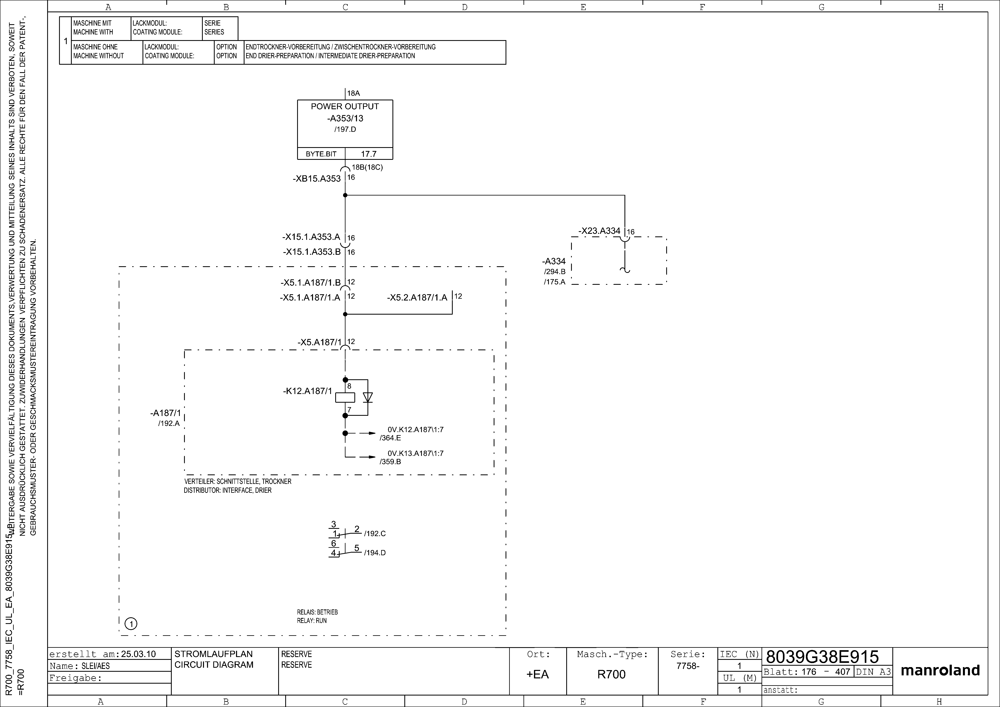

# +EA — Sheet 176 of 407 — RESERVE

**RESERVE**

> Part of the manroland **R700** printing press IEC/UL circuit diagrams.
> Drawing class: **Stromlaufplan / Circuit diagram** (DIN A3).
> Document `+EA` covers the **Printing unit** machine section.

## At a glance

| Field | Value |
|---|---|
| Document | `+EA`  (8039G38E915) |
| Sheet | **176** of 407 |
| Section (DE) | RESERVE |
| Section (EN) | RESERVE |
| Section type | CIRCUIT — Circuit diagram |
| Machine type | `R700` |
| Series | `7758` |
| Created | 25.03.10 |
| Replaces | — |
| Columns used | A, B, C, D, E |
| Path numbers | — |
| Labels on sheet | 63 |
| Cross-refs out | 8 |
| Cross-refs in | 16 |

**Previous:** [+EA sheet 175](SHEET_0175.md) · **Next:** [+EA sheet 177](SHEET_0177.md) · **Document TOC:** [_TOC.md](_TOC.md)  (+EA) · **Master TOC:** [all sheets](../_MASTER_TOC.md)

## Sheet image (300 DPI, exact vector render)



_Rendered directly from the PDF vector layer at 300 DPI (1-bit), no OCR and no resampling. Use it to confirm anything ambiguous in the text below._

## Cross-references on this sheet

Each entry is a wire leaving this sheet. The printed token is `/sheet.column`; the link resolves to that sheet inside the same document.

| Ref | Target sheet | Col | Path | Destination on target | Target section | From col |
|---|---|---|---|---|---|---|
| `/197.D` | [+EA sheet 197](SHEET_0197.md) | D | — | — | REFERENZMODUL | C |
| `/294.B` | [+EA sheet 294](SHEET_0294.md) | B | — | — | OPTION: ZWISCHENSTAPEL / | E |
| `/175.A` | [+EA sheet 175](SHEET_0175.md) | A | — | — | RESERVE | E |
| `/192.A` | [+EA sheet 192](SHEET_0192.md) | A | — | — | RESERVE | B |
| `/364.E` | [+EA sheet 364](SHEET_0364.md) | E | — | — | OPTION: TROCKNER VORBEREITUNG; | C |
| `/359.B` | [+EA sheet 359](SHEET_0359.md) | B | — | — | OPTION: | C |
| `/192.C` | [+EA sheet 192](SHEET_0192.md) | C | — | — | RESERVE | C |
| `/194.D` | [+EA sheet 194](SHEET_0194.md) | D | — | — | RESERVE | C |

### Incoming references (sheets that point here)

Every other sheet that sends a wire to this one. `Back-ref` is the token printed on *that* sheet; `Path` is its line number.

| From sheet | Cols | Back-ref | Path | Refs | What continues there |
|---|---|---|---|---|---|
| [+EA#175](SHEET_0175.md) | A | `/175.A` | — | 1 | — |
| [+EA#192](SHEET_0192.md) | A, C | `/192.A`, `/192.C` | — | 2 | — |
| [+EA#194](SHEET_0194.md) | D | `/194.D` | — | 1 | — |
| [+EA#197](SHEET_0197.md) | D | `/197.D` | — | 1 | — |
| [+EA#239](SHEET_0239.md) | C, E, F, G | `/239.C`, `/239.E`, `/239.F`, `/239.G` | — | 4 | — |
| [+EA#260](SHEET_0260.md) | F, G, H | `/260.F`, `/260.G`, `/260.H` | — | 3 | — |
| [+EA#265](SHEET_0265.md) | A | `/265.A` | — | 1 | — |
| [+EA#294](SHEET_0294.md) | A | `/294.A` | — | 1 | — |
| [+EA#359](SHEET_0359.md) | B | `/359.B` | — | 1 | 0V.K13.A187\1:7 |
| [+EA#364](SHEET_0364.md) | D | `/364.D` | — | 1 | 0V.K12.A187\1:7 |


## Devices on this sheet

| Tag | Class | Class meaning (IEC) | Col | Sub | Terminal | Sign |
|---|---|---|---|---|---|---|
| `A187/1` | A | Baugruppe / assembly, module, PC board | A | 1 | — | — |
| `A353/13` | A | Baugruppe / assembly, module, PC board | C | 13 | — | — |
| `A334` | A | Baugruppe / assembly, module, PC board | E | — | — | — |
| `XB15.A353` | — | cross-device reference | C | — | — | — |
| `17.7` | — | cross-device reference | C | — | — | — |
| `X15.1.A353.B` | — | cross-device reference | C | — | — | — |
| `X15.1.A353.A` | — | cross-device reference | C | — | — | — |
| `X23.A334` | — | cross-device reference | E | — | — | — |

## Potentials / nets

| Potential | Count | Columns | Attached devices | Terminals |
|---|---|---|---|---|
| `0V` | 2 | D | `A187\1`, `K12`, `K13` | `7` |


A potential such as `L24+/4` or `M24+` is a named supply/return rail; every place it appears on this sheet is electrically common.

## Wire-end annotations (grouped as printed)

A wire that continues elsewhere is annotated with a small cluster: the destination description, the path/line number `#NN`, and the `/sheet.column` cross reference. Each row below is one such cluster exactly as it is grouped on the drawing.

| Col | Y | Path | Cross-ref | Text on the wire |
|---|---|---|---|---|
| A | 24.7 | — | — | `1 SERIE SERIES OPTION OPTION` |
| A | 24.7 | — | — | `MASCHINE MIT MACHINE WITH` |
| A | 24.7 | — | — | `LACKMODUL:` |
| A | 35.4 | — | — | `COATING MODULE:` |
| A | 53.1 | — | — | `MASCHINE OHNE MACHINE WITHOUT` |
| A | 53.1 | — | — | `LACKMODUL:` |
| C | 53.1 | — | — | `ENDTROCKNER VORBEREITUNG / ZWISCHENTROCKNER VORBEREITUNG END DRIER PREPARATION / INTERMEDIATE DRIER PREPARATION` |
| B | 63.7 | — | — | `COATING MODULE:` |
| C | 107.3 | — | — | `18A` |
| C | 122.5 | — | — | `POWER OUTPUT` |
| C | 136.4 | — | — | `A353/13` |
| C | 150.2 | — | `/197.D` | — |
| C | 179.2 | — | — | `BYTE.BIT 17.7` |
| C | 195.2 | — | — | `18B(18C)` |
| C | 207.2 | — | — | `XB15.A353 16` |
| D | 270.3 | — | — | `X15.1.A353.A 16 X23.A334 16` |
| C | 295.1 | — | — | `X15.1.A353.B 16` |
| E | 306.4 | — | — | `A334` |
| E | 319.5 | — | `/294.B`, `/175.A` | — |
| C | 332.0 | — | — | `X5.1.A187/1.B 12` |
| C | 349.0 | — | — | `X5.1.A187/1.A 12` |
| D | 349.0 | — | — | `X5.2.A187/1.A 12` |
| C | 402.8 | — | — | `X5.A187/1 12` |
| C | 456.0 | — | — | `8` |
| C | 460.9 | — | — | `K12.A187/1` |
| C | 484.3 | — | — | `7` |
| A | 487.2 | — | — | `A187/1` |
| B | 500.2 | — | `/192.A` | — |
| D | 507.7 | — | — | `0V.K12.A187\1:7` |
| C | 517.6 | — | `/364.E` | — |
| D | 536.0 | — | — | `0V.K13.A187\1:7` |
| C | 545.9 | — | `/359.B` | — |
| B | 570.4 | — | — | `DISTRIBUTOR: INTERFACE, DRIER VERTEILER: SCHNITTSTELLE, TROCKNER` |
| C | 619.6 | — | — | `3 6 4 1` |
| C | 625.3 | — | — | `2` |
| C | 631.7 | — | `/192.C` | — |
| C | 648.0 | — | — | `5` |
| C | 654.4 | — | `/194.D` | — |
| C | 726.5 | — | — | `RELAIS: BETRIEB RELAY: RUN` |
| A | 739.6 | — | — | `1` |


## Reconstructed tables

This sheet carries tabular content (pin map / terminal assignment / index). The grid below was rebuilt from the drawing's own rule lines, so each row is exactly one physical row of the table.

### Table 1 — 3 data rows × 3 columns (at x=354.3, y=119.1)

| POWER | OUTPUT A353/13 /197.D |  |
|---|---|---|
| `BYTE.BIT` |  | `17.7` |
| `XB15.A353` | `18B(18C) 16` |  |
| `X15.1.A353.A X15.1.A353.B X5.1.A187/1.B X5.1.A187/1.A` | `16 16 12 12` |  |


## Notes and free text on this sheet

| Text | Col | Y (pt) |
|---|---|---|
| `X5.A187/1` | C | 402.83 |
| `VERTEILER: SCHNITTSTELLE, TROCKNER` | B | 570.4 |
| `DISTRIBUTOR: INTERFACE, DRIER` | B | 581.02 |
| `K12.A187/1` | C | 460.94 |
| `X5.1.A187/1.A` | C | 349.69 |
| `X5.1.A187/1.B` | C | 331.98 |
| `X5.2.A187/1.A` | D | 349.69 |
| `18A` | C | 107.29 |
| `18B(18C)` | C | 195.2 |
| `POWER OUTPUT` | C | 122.45 |
| `BYTE.BIT` | C | 179.78 |
| `RELAIS: BETRIEB` | C | 726.47 |
| `RELAY: RUN` | C | 736.39 |
| `MASCHINE MIT` | A | 24.73 |
| `MACHINE WITH` | A | 35.31 |
| `LACKMODUL:` | A | 24.72 |
| `COATING MODULE:` | A | 35.36 |
| `MASCHINE OHNE` | A | 53.07 |
| `MACHINE WITHOUT` | A | 63.68 |
| `COATING MODULE:` | B | 63.71 |
| `SERIE` | B | 24.67 |
| `SERIES` | B | 35.3 |
| `OPTION` | B | 53.04 |
| `ENDTROCKNER VORBEREITUNG / ZWISCHENTROCKNER VORBEREITUNG` | C | 53.07 |
| `END DRIER PREPARATION / INTERMEDIATE DRIER PREPARATION` | C | 63.7 |

## Complete label inventory (exact text from the drawing)

Every text object inside the drawing area of this sheet, in DIN reading order (column A→H, then top→bottom). This is the authoritative list: if a string is not here it is not printed on this sheet.

| Col | Y | X | Dir | Type | Text |
|---|---|---|---|---|---|
| A | 24.7 | 87.3 | → | text | `MASCHINE MIT` |
| A | 24.7 | 157.9 | → | text | `LACKMODUL:` |
| A | 35.3 | 87.3 | → | text | `MACHINE WITH` |
| A | 35.4 | 158.5 | → | text | `COATING MODULE:` |
| A | 44.2 | 75.4 | → | number | `1` |
| A | 53.1 | 87.3 | → | text | `MASCHINE OHNE` |
| A | 53.1 | 172.1 | → | text | `LACKMODUL:` |
| A | 63.7 | 87.3 | → | text | `MACHINE WITHOUT` |
| A | 487.2 | 178.9 | → | device tag | `A187/1` |
| A | 739.6 | 154.1 | → | number | `1` |
| B | 24.7 | 243.5 | → | text | `SERIE` |
| B | 35.3 | 243.5 | → | text | `SERIES` |
| B | 53.0 | 257.7 | → | text | `OPTION` |
| B | 63.7 | 172.6 | → | text | `COATING MODULE:` |
| B | 63.7 | 257.7 | → | text | `OPTION` |
| B | 500.2 | 188.5 | → | cross-reference | `/192.A` |
| B | 570.4 | 219.7 | → | text | `VERTEILER: SCHNITTSTELLE, TROCKNER` |
| B | 581.0 | 218.8 | → | text | `DISTRIBUTOR: INTERFACE, DRIER` |
| C | 53.1 | 292.5 | → | text | `ENDTROCKNER VORBEREITUNG / ZWISCHENTROCKNER VORBEREITUNG` |
| C | 63.7 | 292.5 | → | text | `END DRIER PREPARATION / INTERMEDIATE DRIER PREPARATION` |
| C | 107.3 | 413.0 | → | text | `18A` |
| C | 122.5 | 370.2 | → | text | `POWER OUTPUT` |
| C | 136.4 | 389.6 | → | device tag | `A353/13` |
| C | 150.2 | 398.3 | → | cross-reference | `/197.D` |
| C | 179.2 | 429.6 | → | device ref | `17.7` |
| C | 179.8 | 364.3 | → | text | `BYTE.BIT` |
| C | 195.2 | 418.7 | → | text | `18B(18C)` |
| C | 207.3 | 413.0 | → | number | `16` |
| C | 207.9 | 348.7 | → | device ref | `XB15.A353` |
| C | 277.4 | 336.2 | → | device ref | `X15.1.A353.A` |
| C | 279.5 | 413.0 | → | number | `16` |
| C | 295.1 | 337.0 | → | device ref | `X15.1.A353.B` |
| C | 296.5 | 413.0 | → | number | `16` |
| C | 332.0 | 334.2 | → | text | `X5.1.A187/1.B` |
| C | 332.0 | 413.0 | → | number | `12` |
| C | 349.0 | 413.0 | → | number | `12` |
| C | 349.7 | 333.4 | → | text | `X5.1.A187/1.A` |
| C | 402.8 | 354.3 | → | text | `X5.A187/1` |
| C | 402.8 | 413.0 | → | number | `12` |
| C | 456.0 | 413.6 | → | number | `8` |
| C | 460.9 | 337.0 | → | text | `K12.A187/1` |
| C | 484.3 | 413.6 | → | number | `7` |
| C | 517.6 | 452.1 | → | cross-reference | `/364.E` |
| C | 545.9 | 452.1 | → | cross-reference | `/359.B` |
| C | 619.6 | 394.3 | → | number | `3` |
| C | 625.3 | 422.1 | → | number | `2` |
| C | 631.0 | 395.7 | → | number | `1` |
| C | 631.7 | 433.7 | → | cross-reference | `/192.C` |
| C | 642.3 | 394.3 | → | number | `6` |
| C | 648.0 | 421.8 | → | number | `5` |
| C | 653.7 | 394.3 | → | number | `4` |
| C | 654.4 | 433.7 | → | cross-reference | `/194.D` |
| C | 726.5 | 353.8 | → | text | `RELAIS: BETRIEB` |
| C | 736.4 | 353.8 | → | text | `RELAY: RUN` |
| D | 349.0 | 540.6 | → | number | `12` |
| D | 349.7 | 460.9 | → | text | `X5.2.A187/1.A` |
| D | 507.7 | 461.8 | → | potential | `0V.K12.A187\1:7` |
| D | 536.0 | 461.8 | → | potential | `0V.K13.A187\1:7` |
| E | 270.3 | 688.8 | → | device ref | `X23.A334` |
| E | 272.5 | 746.1 | → | number | `16` |
| E | 306.4 | 645.4 | → | device tag | `A334` |
| E | 319.5 | 648.0 | → | cross-reference | `/294.B` |
| E | 331.9 | 647.7 | → | cross-reference | `/175.A` |

## Reading-order text block

The same content as a plain block, grouped by DIN column — convenient to paste or to match against a visual description.

```text
=== Column A ===
  24.7   87.3  text         MASCHINE MIT
  24.7  157.9  text         LACKMODUL:
  35.3   87.3  text         MACHINE WITH
  35.4  158.5  text         COATING MODULE:
  44.2   75.4  numeric      1
  53.1   87.3  text         MASCHINE OHNE
  53.1  172.1  text         LACKMODUL:
  63.7   87.3  text         MACHINE WITHOUT
 487.2  178.9  devtag       A187/1
 739.6  154.1  numeric      1
=== Column B ===
  24.7  243.5  text         SERIE
  35.3  243.5  text         SERIES
  53.0  257.7  text         OPTION
  63.7  172.6  text         COATING MODULE:
  63.7  257.7  text         OPTION
 500.2  188.5  xref         /192.A
 570.4  219.7  text         VERTEILER: SCHNITTSTELLE, TROCKNER
 581.0  218.8  text         DISTRIBUTOR: INTERFACE, DRIER
=== Column C ===
  53.1  292.5  text         ENDTROCKNER VORBEREITUNG / ZWISCHENTROCKNER VORBEREITUNG
  63.7  292.5  text         END DRIER PREPARATION / INTERMEDIATE DRIER PREPARATION
 107.3  413.0  text         18A
 122.5  370.2  text         POWER OUTPUT
 136.4  389.6  devtag       A353/13
 150.2  398.3  xref         /197.D
 179.2  429.6  devref       17.7
 179.8  364.3  text         BYTE.BIT
 195.2  418.7  text         18B(18C)
 207.3  413.0  numeric      16
 207.9  348.7  devref       XB15.A353
 277.4  336.2  devref       X15.1.A353.A
 279.5  413.0  numeric      16
 295.1  337.0  devref       X15.1.A353.B
 296.5  413.0  numeric      16
 332.0  334.2  text         X5.1.A187/1.B
 332.0  413.0  numeric      12
 349.0  413.0  numeric      12
 349.7  333.4  text         X5.1.A187/1.A
 402.8  354.3  text         X5.A187/1
 402.8  413.0  numeric      12
 456.0  413.6  numeric      8
 460.9  337.0  text         K12.A187/1
 484.3  413.6  numeric      7
 517.6  452.1  xref         /364.E
 545.9  452.1  xref         /359.B
 619.6  394.3  numeric      3
 625.3  422.1  numeric      2
 631.0  395.7  numeric      1
 631.7  433.7  xref         /192.C
 642.3  394.3  numeric      6
 648.0  421.8  numeric      5
 653.7  394.3  numeric      4
 654.4  433.7  xref         /194.D
 726.5  353.8  text         RELAIS: BETRIEB
 736.4  353.8  text         RELAY: RUN
=== Column D ===
 349.0  540.6  numeric      12
 349.7  460.9  text         X5.2.A187/1.A
 507.7  461.8  net          0V.K12.A187\1:7
 536.0  461.8  net          0V.K13.A187\1:7
=== Column E ===
 270.3  688.8  devref       X23.A334
 272.5  746.1  numeric      16
 306.4  645.4  devtag       A334
 319.5  648.0  xref         /294.B
 331.9  647.7  xref         /175.A
```

---
_Generated from the PDF vector text layer; no OCR. Source: `R700_7758_IEC_UL_EA_8039G38E915_p`, sheet 176._
