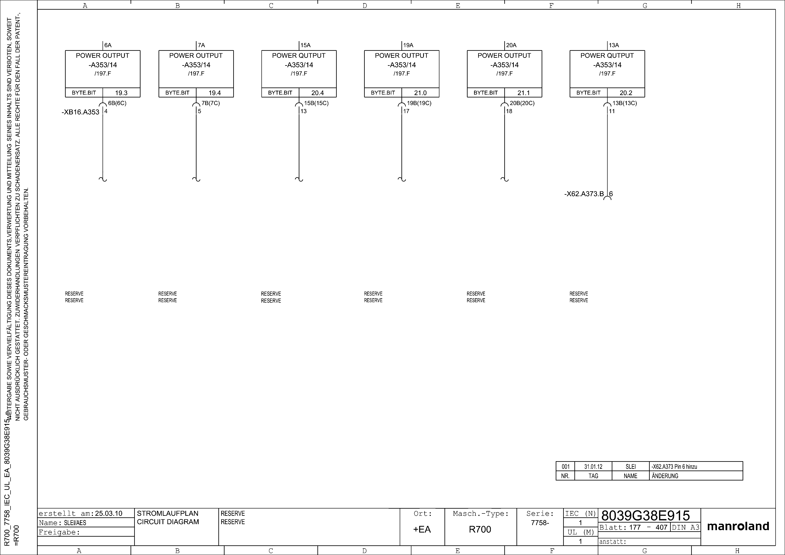

# +EA — Sheet 177 of 407 — RESERVE

**RESERVE**

> Part of the manroland **R700** printing press IEC/UL circuit diagrams.
> Drawing class: **Stromlaufplan / Circuit diagram** (DIN A3).
> Document `+EA` covers the **Printing unit** machine section.

## At a glance

| Field | Value |
|---|---|
| Document | `+EA`  (8039G38E915) |
| Sheet | **177** of 407 |
| Section (DE) | RESERVE |
| Section (EN) | RESERVE |
| Section type | CIRCUIT — Circuit diagram |
| Machine type | `R700` |
| Series | `7758` |
| Created | 25.03.10 |
| Replaces | — |
| Columns used | A, B, C, D, E, F, G |
| Path numbers | — |
| Labels on sheet | 71 |
| Cross-refs out | 6 |
| Cross-refs in | 13 |

**Previous:** [+EA sheet 176](SHEET_0176.md) · **Next:** [+EA sheet 178](SHEET_0178.md) · **Document TOC:** [_TOC.md](_TOC.md)  (+EA) · **Master TOC:** [all sheets](../_MASTER_TOC.md)

## Sheet image (300 DPI, exact vector render)



_Rendered directly from the PDF vector layer at 300 DPI (1-bit), no OCR and no resampling. Use it to confirm anything ambiguous in the text below._

## Cross-references on this sheet

Each entry is a wire leaving this sheet. The printed token is `/sheet.column`; the link resolves to that sheet inside the same document.

| Ref | Target sheet | Col | Path | Destination on target | Target section | From col |
|---|---|---|---|---|---|---|
| `/197.F` | [+EA sheet 197](SHEET_0197.md) | F | — | — | REFERENZMODUL | A |
| `/197.F` | [+EA sheet 197](SHEET_0197.md) | F | — | — | REFERENZMODUL | B |
| `/197.F` | [+EA sheet 197](SHEET_0197.md) | F | — | — | REFERENZMODUL | C |
| `/197.F` | [+EA sheet 197](SHEET_0197.md) | F | — | — | REFERENZMODUL | D |
| `/197.F` | [+EA sheet 197](SHEET_0197.md) | F | — | — | REFERENZMODUL | F |
| `/197.F` | [+EA sheet 197](SHEET_0197.md) | F | — | — | REFERENZMODUL | G |

### Incoming references (sheets that point here)

Every other sheet that sends a wire to this one. `Back-ref` is the token printed on *that* sheet; `Path` is its line number.

| From sheet | Cols | Back-ref | Path | Refs | What continues there |
|---|---|---|---|---|---|
| [+EA#197](SHEET_0197.md) | F | `/197.F` | — | 6 | — |
| [+EA#261](SHEET_0261.md) | G | `/261.G` | — | 6 | — |
| [+EA#283](SHEET_0283.md) | H | `/283.H` | — | 1 | — |


## Devices on this sheet

| Tag | Class | Class meaning (IEC) | Col | Sub | Terminal | Sign |
|---|---|---|---|---|---|---|
| `A353/14` | A | Baugruppe / assembly, module, PC board | C | 14 | — | — |
| `A353/14` | A | Baugruppe / assembly, module, PC board | A | 14 | — | — |
| `A353/14` | A | Baugruppe / assembly, module, PC board | B | 14 | — | — |
| `A353/14` | A | Baugruppe / assembly, module, PC board | D | 14 | — | — |
| `A353/14` | A | Baugruppe / assembly, module, PC board | F | 14 | — | — |
| `A353/14` | A | Baugruppe / assembly, module, PC board | G | 14 | — | — |
| `20.4` | — | cross-device reference | C | — | — | — |
| `XB16.A353` | — | cross-device reference | A | — | — | — |
| `19.3` | — | cross-device reference | A | — | — | — |
| `19.4` | — | cross-device reference | B | — | — | — |
| `21.0` | — | cross-device reference | E | — | — | — |
| `21.1` | — | cross-device reference | F | — | — | — |
| `20.2` | — | cross-device reference | G | — | — | — |
| `X62.A373.B` | — | cross-device reference | F | — | — | — |
| `31.01.12` | — | cross-device reference | F | — | — | — |
| `NR.` | — | cross-device reference | F | — | — | — |

## Potentials / nets

_No named potentials on this sheet._

## Wire-end annotations (grouped as printed)

A wire that continues elsewhere is annotated with a small cluster: the destination description, the path/line number `#NN`, and the `/sheet.column` cross reference. Each row below is one such cluster exactly as it is grouped on the drawing.

| Col | Y | Path | Cross-ref | Text on the wire |
|---|---|---|---|---|
| A | 64.8 | — | — | `6A` |
| B | 64.8 | — | — | `7A` |
| C | 64.8 | — | — | `15A` |
| D | 64.8 | — | — | `19A` |
| F | 64.8 | — | — | `20A` |
| G | 64.8 | — | — | `13A` |
| A | 79.9 | — | — | `POWER OUTPUT` |
| B | 79.9 | — | — | `POWER OUTPUT` |
| C | 79.9 | — | — | `POWER QUTPUT` |
| D | 79.9 | — | — | `POWER OUTPUT` |
| E | 79.9 | — | — | `POWER OUTPUT` |
| G | 79.9 | — | — | `POWER QUTPUT` |
| A | 93.8 | — | — | `A353/14` |
| B | 93.8 | — | — | `A353/14` |
| C | 93.8 | — | — | `A353/14` |
| D | 93.8 | — | — | `A353/14` |
| F | 93.8 | — | — | `A353/14` |
| G | 93.8 | — | — | `A353/14` |
| A | 107.6 | — | `/197.F` | — |
| B | 107.6 | — | `/197.F` | — |
| C | 107.6 | — | `/197.F` | — |
| D | 107.6 | — | `/197.F` | — |
| F | 107.6 | — | `/197.F` | — |
| G | 107.6 | — | `/197.F` | — |
| A | 136.7 | — | — | `BYTE.BIT 19.3` |
| B | 136.7 | — | — | `BYTE.BIT 19.4` |
| C | 136.7 | — | — | `BYTE.BIT 20.4` |
| D | 136.7 | — | — | `BYTE.BIT 21.0` |
| E | 136.7 | — | — | `BYTE.BIT 21.1` |
| G | 136.7 | — | — | `BYTE.BIT 20.2` |
| A | 152.7 | — | — | `6B(6C)` |
| B | 152.7 | — | — | `7B(7C)` |
| C | 152.7 | — | — | `15B(15C)` |
| E | 152.7 | — | — | `19B(19C)` |
| F | 152.7 | — | — | `20B(20C)` |
| G | 152.7 | — | — | `13B(13C)` |
| B | 164.7 | — | — | `XB16.A353 4 13` |
| B | 164.7 | — | — | `5` |
| D | 164.7 | — | — | `17` |
| F | 164.7 | — | — | `18` |
| G | 164.7 | — | — | `11` |
| F | 289.4 | — | — | `X62.A373.B 6` |
| C | 442.8 | — | — | `RESERVE RESERVE` |
| A | 443.0 | — | — | `RESERVE RESERVE` |
| B | 443.0 | — | — | `RESERVE RESERVE` |
| D | 443.0 | — | — | `RESERVE RESERVE` |
| E | 443.0 | — | — | `RESERVE RESERVE` |
| F | 443.0 | — | — | `RESERVE RESERVE` |
| G | 704.7 | — | — | `001 31.01.12 SLEI X62.A373 Pin 6 hinzu` |
| G | 718.8 | — | — | `NR. TAG NAME ÄNDERUNG` |


## Reconstructed tables

This sheet carries tabular content (pin map / terminal assignment / index). The grid below was rebuilt from the drawing's own rule lines, so each row is exactly one physical row of the table.

### Table 1 — 1 data rows × 2 columns (at x=99.2, y=76.5)

| POWER | OUTPUT A353/14 /197.F |
|---|---|
| `BYTE.BIT` | `19.3` |


### Table 2 — 1 data rows × 2 columns (at x=240.9, y=76.5)

| POWER | OUTPUT A353/14 /197.F |
|---|---|
| `BYTE.BIT` | `19.4` |


### Table 3 — 1 data rows × 2 columns (at x=396.9, y=76.5)

| POWER | QUTPUT A353/14 /197.F |
|---|---|
| `BYTE.BIT` | `20.4` |


### Table 4 — 1 data rows × 2 columns (at x=552.8, y=76.5)

| POWER | OUTPUT A353/14 /197.F |
|---|---|
| `BYTE.BIT` | `21.0` |


### Table 5 — 1 data rows × 2 columns (at x=708.7, y=76.5)

| POWER | OUTPUT A353/14 /197.F |
|---|---|
| `BYTE.BIT` | `21.1` |


### Table 6 — 1 data rows × 2 columns (at x=864.6, y=76.5)

| POWER | QUTPUT A353/14 /197.F |
|---|---|
| `BYTE.BIT` | `20.2` |


## Notes and free text on this sheet

| Text | Col | Y (pt) |
|---|---|---|
| `15A` | C | 64.77 |
| `15B(15C)` | C | 152.68 |
| `POWER QUTPUT` | C | 79.93 |
| `BYTE.BIT` | C | 137.26 |
| `RESERVE` | C | 442.79 |
| `6A` | A | 64.76 |
| `6B(6C)` | A | 152.68 |
| `POWER OUTPUT` | A | 79.93 |
| `BYTE.BIT` | A | 137.26 |
| `RESERVE` | A | 442.98 |
| `7A` | B | 64.76 |
| `7B(7C)` | B | 152.68 |
| `POWER OUTPUT` | B | 79.93 |
| `BYTE.BIT` | B | 137.26 |
| `RESERVE` | B | 442.98 |
| `19A` | D | 64.77 |
| `19B(19C)` | E | 152.68 |
| `POWER OUTPUT` | D | 79.93 |
| `BYTE.BIT` | D | 137.26 |
| `RESERVE` | D | 442.98 |
| `20A` | F | 64.77 |
| `20B(20C)` | F | 152.68 |
| `POWER OUTPUT` | E | 79.93 |
| `BYTE.BIT` | E | 137.26 |
| `RESERVE` | E | 442.98 |
| `13A` | G | 64.77 |
| `13B(13C)` | G | 152.68 |
| `POWER QUTPUT` | G | 79.93 |
| `BYTE.BIT` | F | 137.26 |
| `RESERVE` | F | 442.98 |
| `SLEI` | G | 704.75 |
| `X62.A373 Pin 6 hinzu` | G | 704.81 |
| `TAG` | F | 718.92 |
| `NAME` | G | 718.9 |
| `ÄNDERUNG` | G | 718.96 |

## Complete label inventory (exact text from the drawing)

Every text object inside the drawing area of this sheet, in DIN reading order (column A→H, then top→bottom). This is the authoritative list: if a string is not here it is not printed on this sheet.

| Col | Y | X | Dir | Type | Text |
|---|---|---|---|---|---|
| A | 64.8 | 158.5 | → | text | `6A` |
| A | 79.9 | 115.1 | → | text | `POWER OUTPUT` |
| A | 93.8 | 134.5 | → | device tag | `A353/14` |
| A | 107.6 | 143.6 | → | cross-reference | `/197.F` |
| A | 136.7 | 174.5 | → | device ref | `19.3` |
| A | 137.3 | 109.1 | → | text | `BYTE.BIT` |
| A | 152.7 | 164.1 | → | text | `6B(6C)` |
| A | 164.7 | 158.5 | → | number | `4` |
| A | 165.4 | 93.5 | → | device ref | `XB16.A353` |
| A | 443.0 | 98.6 | → | text | `RESERVE` |
| A | 452.9 | 98.6 | → | text | `RESERVE` |
| B | 64.8 | 300.2 | → | text | `7A` |
| B | 79.9 | 256.8 | → | text | `POWER OUTPUT` |
| B | 93.8 | 276.2 | → | device tag | `A353/14` |
| B | 107.6 | 285.3 | → | cross-reference | `/197.F` |
| B | 136.7 | 316.2 | → | device ref | `19.4` |
| B | 137.3 | 250.9 | → | text | `BYTE.BIT` |
| B | 152.7 | 305.9 | → | text | `7B(7C)` |
| B | 164.7 | 300.2 | → | number | `5` |
| B | 443.0 | 240.4 | → | text | `RESERVE` |
| B | 452.9 | 240.4 | → | text | `RESERVE` |
| C | 64.8 | 455.5 | → | text | `15A` |
| C | 79.9 | 412.7 | → | text | `POWER QUTPUT` |
| C | 93.8 | 432.1 | → | device tag | `A353/14` |
| C | 107.6 | 441.2 | → | cross-reference | `/197.F` |
| C | 136.7 | 472.4 | → | device ref | `20.4` |
| C | 137.3 | 406.8 | → | text | `BYTE.BIT` |
| C | 152.7 | 461.2 | → | text | `15B(15C)` |
| C | 164.7 | 455.5 | → | number | `13` |
| C | 442.8 | 396.0 | → | text | `RESERVE` |
| C | 453.4 | 396.0 | → | text | `RESERVE` |
| D | 64.8 | 611.4 | → | text | `19A` |
| D | 79.9 | 568.6 | → | text | `POWER OUTPUT` |
| D | 93.8 | 588.0 | → | device tag | `A353/14` |
| D | 107.6 | 597.1 | → | cross-reference | `/197.F` |
| D | 137.3 | 562.7 | → | text | `BYTE.BIT` |
| D | 164.7 | 611.4 | → | number | `17` |
| D | 443.0 | 552.2 | → | text | `RESERVE` |
| D | 452.9 | 552.2 | → | text | `RESERVE` |
| E | 79.9 | 724.5 | → | text | `POWER OUTPUT` |
| E | 136.7 | 628.3 | → | device ref | `21.0` |
| E | 137.3 | 718.6 | → | text | `BYTE.BIT` |
| E | 152.7 | 617.1 | → | text | `19B(19C)` |
| E | 443.0 | 708.1 | → | text | `RESERVE` |
| E | 452.9 | 708.1 | → | text | `RESERVE` |
| F | 64.8 | 767.9 | → | text | `20A` |
| F | 93.8 | 744.0 | → | device tag | `A353/14` |
| F | 107.6 | 753.0 | → | cross-reference | `/197.F` |
| F | 136.7 | 785.1 | → | device ref | `21.1` |
| F | 137.3 | 874.5 | → | text | `BYTE.BIT` |
| F | 152.7 | 773.6 | → | text | `20B(20C)` |
| F | 164.7 | 767.3 | → | number | `18` |
| F | 289.4 | 856.1 | → | device ref | `X62.A373.B` |
| F | 443.0 | 864.0 | → | text | `RESERVE` |
| F | 452.9 | 864.0 | → | text | `RESERVE` |
| F | 704.7 | 852.3 | → | number | `001` |
| F | 704.8 | 886.4 | → | device ref | `31.01.12` |
| F | 718.8 | 851.3 | → | device ref | `NR.` |
| F | 718.9 | 892.9 | → | text | `TAG` |
| G | 64.8 | 923.2 | → | text | `13A` |
| G | 79.9 | 880.4 | → | text | `POWER QUTPUT` |
| G | 93.8 | 899.9 | → | device tag | `A353/14` |
| G | 107.6 | 908.9 | → | cross-reference | `/197.F` |
| G | 136.7 | 940.1 | → | device ref | `20.2` |
| G | 152.7 | 928.9 | → | text | `13B(13C)` |
| G | 164.7 | 923.2 | → | number | `11` |
| G | 289.4 | 923.8 | → | number | `6` |
| G | 704.8 | 949.2 | → | text | `SLEI` |
| G | 704.8 | 988.3 | → | text | `X62.A373 Pin 6 hinzu` |
| G | 718.9 | 946.3 | → | text | `NAME` |
| G | 719.0 | 988.9 | → | text | `ÄNDERUNG` |

## Reading-order text block

The same content as a plain block, grouped by DIN column — convenient to paste or to match against a visual description.

```text
=== Column A ===
  64.8  158.5  text         6A
  79.9  115.1  text         POWER OUTPUT
  93.8  134.5  devtag       A353/14
 107.6  143.6  xref         /197.F
 136.7  174.5  devref       19.3
 137.3  109.1  text         BYTE.BIT
 152.7  164.1  text         6B(6C)
 164.7  158.5  numeric      4
 165.4   93.5  devref       XB16.A353
 443.0   98.6  text         RESERVE
 452.9   98.6  text         RESERVE
=== Column B ===
  64.8  300.2  text         7A
  79.9  256.8  text         POWER OUTPUT
  93.8  276.2  devtag       A353/14
 107.6  285.3  xref         /197.F
 136.7  316.2  devref       19.4
 137.3  250.9  text         BYTE.BIT
 152.7  305.9  text         7B(7C)
 164.7  300.2  numeric      5
 443.0  240.4  text         RESERVE
 452.9  240.4  text         RESERVE
=== Column C ===
  64.8  455.5  text         15A
  79.9  412.7  text         POWER QUTPUT
  93.8  432.1  devtag       A353/14
 107.6  441.2  xref         /197.F
 136.7  472.4  devref       20.4
 137.3  406.8  text         BYTE.BIT
 152.7  461.2  text         15B(15C)
 164.7  455.5  numeric      13
 442.8  396.0  text         RESERVE
 453.4  396.0  text         RESERVE
=== Column D ===
  64.8  611.4  text         19A
  79.9  568.6  text         POWER OUTPUT
  93.8  588.0  devtag       A353/14
 107.6  597.1  xref         /197.F
 137.3  562.7  text         BYTE.BIT
 164.7  611.4  numeric      17
 443.0  552.2  text         RESERVE
 452.9  552.2  text         RESERVE
=== Column E ===
  79.9  724.5  text         POWER OUTPUT
 136.7  628.3  devref       21.0
 137.3  718.6  text         BYTE.BIT
 152.7  617.1  text         19B(19C)
 443.0  708.1  text         RESERVE
 452.9  708.1  text         RESERVE
=== Column F ===
  64.8  767.9  text         20A
  93.8  744.0  devtag       A353/14
 107.6  753.0  xref         /197.F
 136.7  785.1  devref       21.1
 137.3  874.5  text         BYTE.BIT
 152.7  773.6  text         20B(20C)
 164.7  767.3  numeric      18
 289.4  856.1  devref       X62.A373.B
 443.0  864.0  text         RESERVE
 452.9  864.0  text         RESERVE
 704.7  852.3  numeric      001
 704.8  886.4  devref       31.01.12
 718.8  851.3  devref       NR.
 718.9  892.9  text         TAG
=== Column G ===
  64.8  923.2  text         13A
  79.9  880.4  text         POWER QUTPUT
  93.8  899.9  devtag       A353/14
 107.6  908.9  xref         /197.F
 136.7  940.1  devref       20.2
 152.7  928.9  text         13B(13C)
 164.7  923.2  numeric      11
 289.4  923.8  numeric      6
 704.8  949.2  text         SLEI
 704.8  988.3  text         X62.A373 Pin 6 hinzu
 718.9  946.3  text         NAME
 719.0  988.9  text         ÄNDERUNG
```

---
_Generated from the PDF vector text layer; no OCR. Source: `R700_7758_IEC_UL_EA_8039G38E915_p`, sheet 177._
