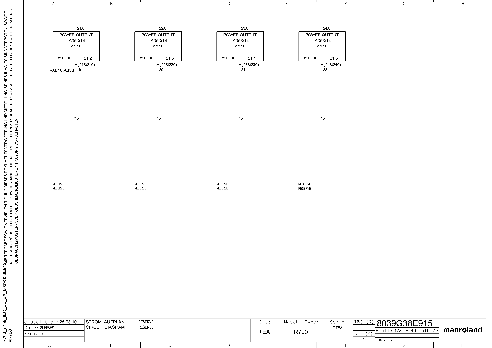

# +EA — Sheet 178 of 407 — RESERVE

**RESERVE**

> Part of the manroland **R700** printing press IEC/UL circuit diagrams.
> Drawing class: **Stromlaufplan / Circuit diagram** (DIN A3).
> Document `+EA` covers the **Printing unit** machine section.

## At a glance

| Field | Value |
|---|---|
| Document | `+EA`  (8039G38E915) |
| Sheet | **178** of 407 |
| Section (DE) | RESERVE |
| Section (EN) | RESERVE |
| Section type | CIRCUIT — Circuit diagram |
| Machine type | `R700` |
| Series | `7758` |
| Created | 25.03.10 |
| Replaces | — |
| Columns used | A, B, C, D, E, F |
| Path numbers | — |
| Labels on sheet | 41 |
| Cross-refs out | 4 |
| Cross-refs in | 8 |

**Previous:** [+EA sheet 177](SHEET_0177.md) · **Next:** [+EA sheet 179](SHEET_0179.md) · **Document TOC:** [_TOC.md](_TOC.md)  (+EA) · **Master TOC:** [all sheets](../_MASTER_TOC.md)

## Sheet image (300 DPI, exact vector render)



_Rendered directly from the PDF vector layer at 300 DPI (1-bit), no OCR and no resampling. Use it to confirm anything ambiguous in the text below._

## Cross-references on this sheet

Each entry is a wire leaving this sheet. The printed token is `/sheet.column`; the link resolves to that sheet inside the same document.

| Ref | Target sheet | Col | Path | Destination on target | Target section | From col |
|---|---|---|---|---|---|---|
| `/197.F` | [+EA sheet 197](SHEET_0197.md) | F | — | — | REFERENZMODUL | A |
| `/197.F` | [+EA sheet 197](SHEET_0197.md) | F | — | — | REFERENZMODUL | C |
| `/197.F` | [+EA sheet 197](SHEET_0197.md) | F | — | — | REFERENZMODUL | D |
| `/197.F` | [+EA sheet 197](SHEET_0197.md) | F | — | — | REFERENZMODUL | F |

### Incoming references (sheets that point here)

Every other sheet that sends a wire to this one. `Back-ref` is the token printed on *that* sheet; `Path` is its line number.

| From sheet | Cols | Back-ref | Path | Refs | What continues there |
|---|---|---|---|---|---|
| [+EA#197](SHEET_0197.md) | F | `/197.F` | — | 4 | — |
| [+EA#261](SHEET_0261.md) | G | `/261.G` | — | 4 | — |


## Devices on this sheet

| Tag | Class | Class meaning (IEC) | Col | Sub | Terminal | Sign |
|---|---|---|---|---|---|---|
| `A353/14` | A | Baugruppe / assembly, module, PC board | A | 14 | — | — |
| `A353/14` | A | Baugruppe / assembly, module, PC board | C | 14 | — | — |
| `A353/14` | A | Baugruppe / assembly, module, PC board | D | 14 | — | — |
| `A353/14` | A | Baugruppe / assembly, module, PC board | F | 14 | — | — |
| `21.2` | — | cross-device reference | B | — | — | — |
| `XB16.A353` | — | cross-device reference | A | — | — | — |
| `21.3` | — | cross-device reference | C | — | — | — |
| `21.4` | — | cross-device reference | D | — | — | — |
| `21.5` | — | cross-device reference | F | — | — | — |

## Potentials / nets

_No named potentials on this sheet._

## Wire-end annotations (grouped as printed)

A wire that continues elsewhere is annotated with a small cluster: the destination description, the path/line number `#NN`, and the `/sheet.column` cross reference. Each row below is one such cluster exactly as it is grouped on the drawing.

| Col | Y | Path | Cross-ref | Text on the wire |
|---|---|---|---|---|
| A | 64.8 | — | — | `21A` |
| C | 64.8 | — | — | `22A` |
| D | 64.8 | — | — | `23A` |
| F | 64.8 | — | — | `24A` |
| A | 79.9 | — | — | `POWER OUTPUT` |
| C | 79.9 | — | — | `POWER OUTPUT` |
| D | 79.9 | — | — | `POWER OUTPUT` |
| F | 79.9 | — | — | `POWER QUTPUT` |
| A | 93.8 | — | — | `A353/14` |
| C | 93.8 | — | — | `A353/14` |
| D | 93.8 | — | — | `A353/14` |
| F | 93.8 | — | — | `A353/14` |
| A | 107.6 | — | `/197.F` | — |
| C | 107.6 | — | `/197.F` | — |
| D | 107.6 | — | `/197.F` | — |
| F | 107.6 | — | `/197.F` | — |
| A | 136.7 | — | — | `BYTE.BIT 21.2` |
| C | 136.7 | — | — | `BYTE.BIT 21.3` |
| D | 136.7 | — | — | `BYTE.BIT 21.4` |
| F | 136.7 | — | — | `BYTE.BIT 21.5` |
| B | 152.7 | — | — | `21B(21C)` |
| C | 152.7 | — | — | `22B(22C)` |
| D | 152.7 | — | — | `23B(23C)` |
| F | 152.7 | — | — | `24B(24C)` |
| A | 164.7 | — | — | `XB16.A353 19` |
| C | 164.7 | — | — | `20` |
| E | 164.7 | — | — | `21 22` |
| E | 442.8 | — | — | `RESERVE RESERVE` |
| A | 443.0 | — | — | `RESERVE RESERVE` |
| B | 443.0 | — | — | `RESERVE RESERVE` |
| D | 443.0 | — | — | `RESERVE RESERVE` |


## Reconstructed tables

This sheet carries tabular content (pin map / terminal assignment / index). The grid below was rebuilt from the drawing's own rule lines, so each row is exactly one physical row of the table.

### Table 1 — 1 data rows × 2 columns (at x=127.6, y=76.5)

| POWER | OUTPUT A353/14 /197.F |
|---|---|
| `BYTE.BIT` | `21.2` |


### Table 2 — 1 data rows × 2 columns (at x=326.0, y=76.5)

| POWER | OUTPUT A353/14 /197.F |
|---|---|
| `BYTE.BIT` | `21.3` |


### Table 3 — 1 data rows × 2 columns (at x=524.4, y=76.5)

| POWER | OUTPUT A353/14 /197.F |
|---|---|
| `BYTE.BIT` | `21.4` |


### Table 4 — 1 data rows × 2 columns (at x=722.8, y=76.5)

| POWER | QUTPUT A353/14 /197.F |
|---|---|
| `BYTE.BIT` | `21.5` |


## Notes and free text on this sheet

| Text | Col | Y (pt) |
|---|---|---|
| `21A` | A | 64.77 |
| `21B(21C)` | B | 152.68 |
| `POWER OUTPUT` | A | 79.93 |
| `BYTE.BIT` | A | 137.26 |
| `RESERVE` | A | 442.98 |
| `22A` | C | 64.77 |
| `22B(22C)` | C | 152.68 |
| `POWER OUTPUT` | C | 79.93 |
| `BYTE.BIT` | C | 137.26 |
| `RESERVE` | B | 442.98 |
| `23A` | D | 64.77 |
| `23B(23C)` | D | 152.68 |
| `POWER OUTPUT` | D | 79.93 |
| `BYTE.BIT` | D | 137.26 |
| `RESERVE` | D | 442.98 |
| `24A` | F | 64.77 |
| `24B(24C)` | F | 152.68 |
| `POWER QUTPUT` | F | 79.93 |
| `BYTE.BIT` | E | 137.26 |
| `RESERVE` | E | 442.79 |

## Complete label inventory (exact text from the drawing)

Every text object inside the drawing area of this sheet, in DIN reading order (column A→H, then top→bottom). This is the authoritative list: if a string is not here it is not printed on this sheet.

| Col | Y | X | Dir | Type | Text |
|---|---|---|---|---|---|
| A | 64.8 | 186.8 | → | text | `21A` |
| A | 79.9 | 143.4 | → | text | `POWER OUTPUT` |
| A | 93.8 | 162.9 | → | device tag | `A353/14` |
| A | 107.6 | 171.9 | → | cross-reference | `/197.F` |
| A | 137.3 | 137.5 | → | text | `BYTE.BIT` |
| A | 164.7 | 186.2 | → | number | `19` |
| A | 165.4 | 121.9 | → | device ref | `XB16.A353` |
| A | 443.0 | 127.0 | → | text | `RESERVE` |
| A | 452.9 | 127.0 | → | text | `RESERVE` |
| B | 136.7 | 203.1 | → | device ref | `21.2` |
| B | 152.7 | 192.5 | → | text | `21B(21C)` |
| B | 443.0 | 325.4 | → | text | `RESERVE` |
| B | 452.9 | 325.4 | → | text | `RESERVE` |
| C | 64.8 | 385.2 | → | text | `22A` |
| C | 79.9 | 341.9 | → | text | `POWER OUTPUT` |
| C | 93.8 | 361.3 | → | device tag | `A353/14` |
| C | 107.6 | 370.3 | → | cross-reference | `/197.F` |
| C | 136.7 | 401.5 | → | device ref | `21.3` |
| C | 137.3 | 335.9 | → | text | `BYTE.BIT` |
| C | 152.7 | 390.9 | → | text | `22B(22C)` |
| C | 164.7 | 385.2 | → | number | `20` |
| D | 64.8 | 583.7 | → | text | `23A` |
| D | 79.9 | 540.3 | → | text | `POWER OUTPUT` |
| D | 93.8 | 559.7 | → | device tag | `A353/14` |
| D | 107.6 | 568.8 | → | cross-reference | `/197.F` |
| D | 136.7 | 600.0 | → | device ref | `21.4` |
| D | 137.3 | 534.3 | → | text | `BYTE.BIT` |
| D | 152.7 | 589.3 | → | text | `23B(23C)` |
| D | 164.7 | 583.7 | → | number | `21` |
| D | 443.0 | 523.8 | → | text | `RESERVE` |
| D | 452.9 | 523.8 | → | text | `RESERVE` |
| E | 137.3 | 732.8 | → | text | `BYTE.BIT` |
| E | 442.8 | 722.0 | → | text | `RESERVE` |
| E | 453.4 | 722.0 | → | text | `RESERVE` |
| F | 64.8 | 782.1 | → | text | `24A` |
| F | 79.9 | 738.7 | → | text | `POWER QUTPUT` |
| F | 93.8 | 758.1 | → | device tag | `A353/14` |
| F | 107.6 | 767.2 | → | cross-reference | `/197.F` |
| F | 136.7 | 798.4 | → | device ref | `21.5` |
| F | 152.7 | 787.7 | → | text | `24B(24C)` |
| F | 164.7 | 782.1 | → | number | `22` |

## Reading-order text block

The same content as a plain block, grouped by DIN column — convenient to paste or to match against a visual description.

```text
=== Column A ===
  64.8  186.8  text         21A
  79.9  143.4  text         POWER OUTPUT
  93.8  162.9  devtag       A353/14
 107.6  171.9  xref         /197.F
 137.3  137.5  text         BYTE.BIT
 164.7  186.2  numeric      19
 165.4  121.9  devref       XB16.A353
 443.0  127.0  text         RESERVE
 452.9  127.0  text         RESERVE
=== Column B ===
 136.7  203.1  devref       21.2
 152.7  192.5  text         21B(21C)
 443.0  325.4  text         RESERVE
 452.9  325.4  text         RESERVE
=== Column C ===
  64.8  385.2  text         22A
  79.9  341.9  text         POWER OUTPUT
  93.8  361.3  devtag       A353/14
 107.6  370.3  xref         /197.F
 136.7  401.5  devref       21.3
 137.3  335.9  text         BYTE.BIT
 152.7  390.9  text         22B(22C)
 164.7  385.2  numeric      20
=== Column D ===
  64.8  583.7  text         23A
  79.9  540.3  text         POWER OUTPUT
  93.8  559.7  devtag       A353/14
 107.6  568.8  xref         /197.F
 136.7  600.0  devref       21.4
 137.3  534.3  text         BYTE.BIT
 152.7  589.3  text         23B(23C)
 164.7  583.7  numeric      21
 443.0  523.8  text         RESERVE
 452.9  523.8  text         RESERVE
=== Column E ===
 137.3  732.8  text         BYTE.BIT
 442.8  722.0  text         RESERVE
 453.4  722.0  text         RESERVE
=== Column F ===
  64.8  782.1  text         24A
  79.9  738.7  text         POWER QUTPUT
  93.8  758.1  devtag       A353/14
 107.6  767.2  xref         /197.F
 136.7  798.4  devref       21.5
 152.7  787.7  text         24B(24C)
 164.7  782.1  numeric      22
```

---
_Generated from the PDF vector text layer; no OCR. Source: `R700_7758_IEC_UL_EA_8039G38E915_p`, sheet 178._
