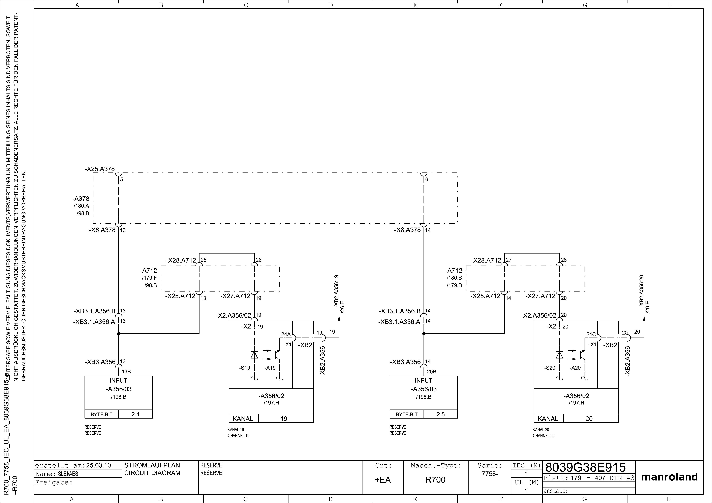

# +EA — Sheet 179 of 407 — RESERVE

**RESERVE**

> Part of the manroland **R700** printing press IEC/UL circuit diagrams.
> Drawing class: **Stromlaufplan / Circuit diagram** (DIN A3).
> Document `+EA` covers the **Printing unit** machine section.

## At a glance

| Field | Value |
|---|---|
| Document | `+EA`  (8039G38E915) |
| Sheet | **179** of 407 |
| Section (DE) | RESERVE |
| Section (EN) | RESERVE |
| Section type | CIRCUIT — Circuit diagram |
| Machine type | `R700` |
| Series | `7758` |
| Created | 25.03.10 |
| Replaces | — |
| Columns used | A, B, C, D, E, F, G, H |
| Path numbers | — |
| Labels on sheet | 98 |
| Cross-refs out | 12 |
| Cross-refs in | 34 |

**Previous:** [+EA sheet 178](SHEET_0178.md) · **Next:** [+EA sheet 180](SHEET_0180.md) · **Document TOC:** [_TOC.md](_TOC.md)  (+EA) · **Master TOC:** [all sheets](../_MASTER_TOC.md)

## Sheet image (300 DPI, exact vector render)



_Rendered directly from the PDF vector layer at 300 DPI (1-bit), no OCR and no resampling. Use it to confirm anything ambiguous in the text below._

## Cross-references on this sheet

Each entry is a wire leaving this sheet. The printed token is `/sheet.column`; the link resolves to that sheet inside the same document.

| Ref | Target sheet | Col | Path | Destination on target | Target section | From col |
|---|---|---|---|---|---|---|
| `/180.A` | [+EA sheet 180](SHEET_0180.md) | A | — | — | RESERVE | A |
| `/98.B` | [+EA sheet 98](SHEET_0098.md) | B | — | — | BOGENFÜHRUNGSELEMENT | A |
| `/26.E` | [+EA sheet 26](SHEET_0026.md) | E | — | XB2.A356:19 | BUSVERBINDUNGEN: SICHERHEITSBUS | D |
| `/26.E` | [+EA sheet 26](SHEET_0026.md) | E | — | XB2.A356:20 | BUSVERBINDUNGEN: SICHERHEITSBUS | H |
| `/180.B` | [+EA sheet 180](SHEET_0180.md) | B | — | — | RESERVE | E |
| `/179.B` | [+EA sheet 179](SHEET_0179.md) | B | — | — | RESERVE | E |
| `/179.F` | [+EA sheet 179](SHEET_0179.md) | F | — | — | RESERVE | B |
| `/98.B` | [+EA sheet 98](SHEET_0098.md) | B | — | — | BOGENFÜHRUNGSELEMENT | B |
| `/198.B` | [+EA sheet 198](SHEET_0198.md) | B | — | — | REFERENZMODUL | A |
| `/198.B` | [+EA sheet 198](SHEET_0198.md) | B | — | — | REFERENZMODUL | E |
| `/197.H` | [+EA sheet 197](SHEET_0197.md) | H | — | — | REFERENZMODUL | C |
| `/197.H` | [+EA sheet 197](SHEET_0197.md) | H | — | — | REFERENZMODUL | G |

### Incoming references (sheets that point here)

Every other sheet that sends a wire to this one. `Back-ref` is the token printed on *that* sheet; `Path` is its line number.

| From sheet | Cols | Back-ref | Path | Refs | What continues there |
|---|---|---|---|---|---|
| [+EA#26](SHEET_0026.md) | E | `/26.E` | — | 2 | XB2.A356:19; XB2.A356:20 |
| [+EA#98](SHEET_0098.md) | A, B | `/98.A`, `/98.B` | — | 2 | — |
| [+EA#179](SHEET_0179.md) | B, E | `/179.B`, `/179.E` | — | 2 | — |
| [+EA#180](SHEET_0180.md) | A, B | `/180.A`, `/180.B` | — | 2 | — |
| [+EA#197](SHEET_0197.md) | H | `/197.H` | — | 2 | — |
| [+EA#198](SHEET_0198.md) | B | `/198.B` | — | 2 | — |
| [+EA#225](SHEET_0225.md) | G | `/225.G` | — | 2 | — |
| [+EA#226](SHEET_0226.md) | F | `/226.F` | — | 2 | — |
| [+EA#234](SHEET_0234.md) | H | `/234.H` | — | 2 | — |
| [+EA#235](SHEET_0235.md) | A, B | `/235.A`, `/235.B` | — | 4 | — |
| [+EA#250](SHEET_0250.md) | D | `/250.D` | — | 2 | — |
| [+EA#268](SHEET_0268.md) | A, F | `/268.A`, `/268.F` | — | 4 | — |
| [+EA#271](SHEET_0271.md) | H | `/271.H` | — | 2 | — |
| [+EA#273](SHEET_0273.md) | C, D | `/273.C`, `/273.D` | — | 4 | — |


## Devices on this sheet

| Tag | Class | Class meaning (IEC) | Col | Sub | Terminal | Sign |
|---|---|---|---|---|---|---|
| `A378` | A | Baugruppe / assembly, module, PC board | A | — | — | — |
| `S19` | S | Schalter / switch | C | — | — | — |
| `A19` | A | Baugruppe / assembly, module, PC board | C | — | — | — |
| `X1` | X | Klemme / terminal, plug connector | C | — | — | — |
| `X2` | X | Klemme / terminal, plug connector | C | — | — | — |
| `XB2` | XB |  | D | — | — | — |
| `A356/02` | A | Baugruppe / assembly, module, PC board | C | 02 | — | — |
| `A712` | A | Baugruppe / assembly, module, PC board | B | — | — | — |
| `S20` | S | Schalter / switch | G | — | — | — |
| `A20` | A | Baugruppe / assembly, module, PC board | G | — | — | — |
| `X1` | X | Klemme / terminal, plug connector | G | — | — | — |
| `X2` | X | Klemme / terminal, plug connector | G | — | — | — |
| `XB2` | XB |  | G | — | — | — |
| `A356/02` | A | Baugruppe / assembly, module, PC board | G | 02 | — | — |
| `A712` | A | Baugruppe / assembly, module, PC board | E | — | — | — |
| `A356/03` | A | Baugruppe / assembly, module, PC board | E | 03 | — | — |
| `A356/03` | A | Baugruppe / assembly, module, PC board | A | 03 | — | — |
| `X8.A378` | — | cross-device reference | A | — | — | — |
| `XB3.1.A356.B` | — | cross-device reference | A | — | — | — |
| `XB3.1.A356.A` | — | cross-device reference | A | — | — | — |
| `XB2.A356` | — | cross-device reference | D | — | — | — |
| `X28.A712` | — | cross-device reference | B | — | — | — |
| `X27.A712` | — | cross-device reference | C | — | — | — |
| `X25.A712` | — | cross-device reference | B | — | — | — |
| `X8.A378` | — | cross-device reference | E | — | — | — |
| `XB3.1.A356.B` | — | cross-device reference | E | — | — | — |
| `XB3.1.A356.A` | — | cross-device reference | E | — | — | — |
| `XB2.A356` | — | cross-device reference | H | — | — | — |
| `X28.A712` | — | cross-device reference | F | — | — | — |
| `X27.A712` | — | cross-device reference | F | — | — | — |
| `X25.A712` | — | cross-device reference | F | — | — | — |
| `2.5` | — | cross-device reference | E | — | — | — |
| `XB3.A356` | — | cross-device reference | E | — | — | — |
| `2.4` | — | cross-device reference | B | — | — | — |
| `XB3.A356` | — | cross-device reference | A | — | — | — |
| `XB2.A356:20` | — | cross-device reference | H | — | 20 | — |
| `XB2.A356:19` | — | cross-device reference | D | — | 19 | — |
| `X25.A378` | — | cross-device reference | A | — | — | — |

## Potentials / nets

_No named potentials on this sheet._

## Wire-end annotations (grouped as printed)

A wire that continues elsewhere is annotated with a small cluster: the destination description, the path/line number `#NN`, and the `/sheet.column` cross reference. Each row below is one such cluster exactly as it is grouped on the drawing.

| Col | Y | Path | Cross-ref | Text on the wire |
|---|---|---|---|---|
| A | 278.1 | — | — | `X25.A378` |
| B | 296.5 | — | — | `5` |
| E | 296.5 | — | — | `6` |
| A | 327.7 | — | — | `A378` |
| A | 340.8 | — | `/180.A` | — |
| A | 353.2 | — | `/98.B` | — |
| A | 380.1 | — | — | `X8.A378 13` |
| E | 380.1 | — | — | `X8.A378 14` |
| C | 431.2 | — | — | `X28.A712 25 26` |
| F | 431.2 | — | — | `X28.A712 27 28` |
| B | 448.2 | — | — | `A712` |
| E | 448.2 | — | — | `A712` |
| D | 460.1 | — | `/26.E` | `XB2.A356:19` |
| H | 460.1 | — | `/26.E` | `XB2.A356:20` |
| E | 461.2 | — | `/180.B`, `/179.B` | — |
| B | 461.3 | — | `/179.F` | — |
| B | 473.6 | — | `/98.B` | — |
| C | 490.7 | — | — | `X25.A712 13 X27.A712 19` |
| F | 490.7 | — | — | `X25.A712 14 X27.A712 20` |
| A | 516.2 | — | — | `XB3.1.A356.B 13` |
| E | 516.2 | — | — | `XB3.1.A356.B 14` |
| C | 523.3 | — | — | `X2.A356/02 19` |
| G | 523.3 | — | — | `X2.A356/02 20` |
| A | 533.2 | — | — | `XB3.1.A356.A 13` |
| E | 533.2 | — | — | `XB3.1.A356.A 14` |
| C | 541.7 | — | — | `X2` |
| G | 541.7 | — | — | `X2` |
| D | 543.2 | — | — | `19 19` |
| G | 543.2 | — | — | `20 20` |
| D | 551.7 | — | — | `19` |
| H | 551.7 | — | — | `20` |
| C | 555.9 | — | — | `24A` |
| G | 555.9 | — | — | `24C` |
| C | 572.9 | — | — | `X1` |
| D | 572.9 | — | — | `XB2` |
| G | 572.9 | — | — | `X1` |
| G | 572.9 | — | — | `XB2` |
| D | 579.1 | — | — | `XB2.A356` |
| H | 579.1 | — | — | `XB2.A356` |
| A | 601.2 | — | — | `XB3.A356 13` |
| E | 601.2 | — | — | `XB3.A356 14` |
| C | 611.9 | — | — | `S19 A19` |
| G | 611.9 | — | — | `S20 A20` |
| B | 618.2 | — | — | `19B` |
| E | 618.2 | — | — | `20B` |
| A | 632.8 | — | — | `INPUT` |
| E | 632.8 | — | — | `INPUT` |
| A | 646.6 | — | — | `A356/03` |
| E | 646.6 | — | — | `A356/03` |
| C | 657.9 | — | — | `A356/02` |
| G | 657.9 | — | — | `A356/02` |
| A | 660.4 | — | `/198.B` | — |
| E | 660.4 | — | `/198.B` | — |
| C | 670.3 | — | `/197.H` | — |
| G | 670.3 | — | `/197.H` | — |
| A | 689.4 | — | — | `BYTE.BIT 2.4` |
| E | 689.4 | — | — | `BYTE.BIT 2.5` |
| C | 696.2 | — | — | `KANAL 19` |
| G | 696.2 | — | — | `KANAL 20` |
| A | 712.3 | — | — | `RESERVE RESERVE` |
| E | 712.3 | — | — | `RESERVE RESERVE` |
| C | 716.5 | — | — | `KANAL 19 CHANNEL 19` |
| G | 716.5 | — | — | `KANAL 20 CHANNEL 20` |


## Reconstructed tables

This sheet carries tabular content (pin map / terminal assignment / index). The grid below was rebuilt from the drawing's own rule lines, so each row is exactly one physical row of the table.

### Table 1 — 6 data rows × 19 columns (at x=141.7, y=423.8)

| XB3.1.A356.B | A712 /179.F /98.B 13 | X28.A712 X25.A712 | 25 13 | X27.A712 X2.A356/02 | 26 19 19 |  |  | XB2.A356:19 | /26.E | XB3.1.A356.B | A712 /180.B /179.B 14 | X28.A712 X25.A712 | 27 14 | X27.A712 X2.A356/02 | 28 20 20 |  |  | XB2.A356:20 |
|---|---|---|---|---|---|---|---|---|---|---|---|---|---|---|---|---|---|---|
| `XB3.1.A356.A` | `13` |  |  | `X2` | `19` |  |  | `19 19` |  | `XB3.1.A356.A` | `14` |  |  | `X2` | `20` |  |  | `20 20` |
| `XB3.A356` | `13 19B` |  |  | `S19` | `A19` | `24A X1` | `XB2` | `XB2.A356` |  | `XB3.A356` | `14 20B` |  |  | `S20` | `A20` | `24C X1` | `XB2` | `XB2.A356` |
| `INPUT` |  |  |  |  |  |  |  |  |  | `INPUT` |  |  |  |  |  |  |  |  |
|  | `A356/03 /198.B` |  |  |  | `A356/02 /197.H` |  |  |  |  |  | `A356/03 /198.B` |  |  |  | `A356/02 /197.H` |  |  |  |
| `BYTE.BIT` | `2.4` |  |  |  |  |  |  |  |  | `BYTE.BIT` | `2.5` |  |  |  |  |  |  |  |
|  |  |  |  | `KANAL` |  | `19` |  |  |  |  |  |  |  | `KANAL` |  | `20` |  |  |


## Notes and free text on this sheet

| Text | Col | Y (pt) |
|---|---|---|
| `KANAL 19` | C | 716.53 |
| `CHANNEL 19` | C | 726.48 |
| `24A` | C | 555.88 |
| `KANAL` | C | 696.2 |
| `X2.A356/02` | C | 523.3 |
| `KANAL 20` | F | 716.53 |
| `CHANNEL 20` | G | 726.48 |
| `24C` | G | 555.92 |
| `KANAL` | G | 696.2 |
| `X2.A356/02` | F | 523.3 |
| `20B` | E | 618.24 |
| `INPUT` | E | 632.76 |
| `BYTE.BIT` | E | 690.01 |
| `RESERVE` | E | 712.28 |
| `19B` | B | 618.24 |
| `INPUT` | A | 632.76 |
| `BYTE.BIT` | A | 690.01 |
| `RESERVE` | A | 712.28 |

## Complete label inventory (exact text from the drawing)

Every text object inside the drawing area of this sheet, in DIN reading order (column A→H, then top→bottom). This is the authoritative list: if a string is not here it is not printed on this sheet.

| Col | Y | X | Dir | Type | Text |
|---|---|---|---|---|---|
| A | 278.1 | 141.7 | → | device ref | `X25.A378` |
| A | 327.7 | 121.0 | → | device tag | `A378` |
| A | 340.8 | 123.3 | → | cross-reference | `/180.A` |
| A | 353.2 | 128.4 | → | cross-reference | `/98.B` |
| A | 380.2 | 149.1 | → | device ref | `X8.A378` |
| A | 516.2 | 123.3 | → | device ref | `XB3.1.A356.B` |
| A | 533.9 | 122.5 | → | device ref | `XB3.1.A356.A` |
| A | 601.3 | 142.0 | → | device ref | `XB3.A356` |
| A | 632.8 | 183.5 | → | text | `INPUT` |
| A | 646.6 | 177.0 | → | device tag | `A356/03` |
| A | 660.4 | 185.8 | → | cross-reference | `/198.B` |
| A | 690.0 | 151.7 | → | text | `BYTE.BIT` |
| A | 712.3 | 141.2 | → | text | `RESERVE` |
| A | 722.2 | 141.2 | → | text | `RESERVE` |
| B | 296.5 | 201.0 | → | number | `5` |
| B | 381.6 | 200.4 | → | number | `13` |
| B | 431.2 | 277.8 | → | device ref | `X28.A712` |
| B | 448.2 | 234.4 | → | device tag | `A712` |
| B | 461.3 | 237.5 | → | cross-reference | `/179.F` |
| B | 473.6 | 241.8 | → | cross-reference | `/98.B` |
| B | 490.7 | 276.4 | → | device ref | `X25.A712` |
| B | 495.0 | 335.1 | → | number | `13` |
| B | 516.2 | 200.4 | → | number | `13` |
| B | 533.2 | 200.4 | → | number | `13` |
| B | 601.3 | 200.4 | → | number | `13` |
| B | 618.2 | 203.2 | → | text | `19B` |
| B | 689.4 | 220.0 | → | device ref | `2.4` |
| C | 431.2 | 335.6 | → | number | `25` |
| C | 431.2 | 427.7 | → | number | `26` |
| C | 490.7 | 368.5 | → | device ref | `X27.A712` |
| C | 495.0 | 427.2 | → | number | `19` |
| C | 523.3 | 361.1 | → | text | `X2.A356/02` |
| C | 523.3 | 427.2 | → | number | `19` |
| C | 541.7 | 403.7 | → | device tag | `X2` |
| C | 543.2 | 430.0 | → | number | `19` |
| C | 555.9 | 470.6 | → | text | `24A` |
| C | 572.9 | 474.2 | → | device tag | `X1` |
| C | 611.9 | 400.0 | → | device tag | `S19` |
| C | 611.9 | 442.5 | → | device tag | `A19` |
| C | 657.9 | 432.1 | → | device tag | `A356/02` |
| C | 670.3 | 441.1 | → | cross-reference | `/197.H` |
| C | 696.2 | 388.9 | → | text | `KANAL` |
| C | 696.2 | 468.6 | → | number | `19` |
| C | 716.5 | 380.7 | → | text | `KANAL 19` |
| C | 726.5 | 381.0 | → | text | `CHANNEL 19` |
| D | 460.1 | 558.7 | ↕ | device ref | `XB2.A356:19` |
| D | 503.7 | 568.6 | ↕ | cross-reference | `/26.E` |
| D | 551.7 | 550.5 | → | number | `19` |
| D | 553.1 | 529.2 | → | number | `19` |
| D | 572.9 | 498.6 | → | device tag | `XB2` |
| D | 579.1 | 534.6 | ↕ | device ref | `XB2.A356` |
| E | 296.5 | 711.2 | → | number | `6` |
| E | 380.2 | 659.3 | → | device ref | `X8.A378` |
| E | 381.6 | 710.6 | → | number | `14` |
| E | 448.2 | 744.7 | → | device tag | `A712` |
| E | 461.2 | 747.2 | → | cross-reference | `/180.B` |
| E | 473.6 | 747.2 | → | cross-reference | `/179.B` |
| E | 516.2 | 633.5 | → | device ref | `XB3.1.A356.B` |
| E | 516.2 | 710.6 | → | number | `14` |
| E | 533.2 | 710.6 | → | number | `14` |
| E | 533.9 | 632.7 | → | device ref | `XB3.1.A356.A` |
| E | 601.3 | 652.3 | → | device ref | `XB3.A356` |
| E | 601.3 | 710.6 | → | number | `14` |
| E | 618.2 | 714.0 | → | text | `20B` |
| E | 632.8 | 693.8 | → | text | `INPUT` |
| E | 646.6 | 687.3 | → | device tag | `A356/03` |
| E | 660.4 | 696.0 | → | cross-reference | `/198.B` |
| E | 689.4 | 730.2 | → | device ref | `2.5` |
| E | 690.0 | 661.9 | → | text | `BYTE.BIT` |
| E | 712.3 | 651.4 | → | text | `RESERVE` |
| E | 722.2 | 651.4 | → | text | `RESERVE` |
| F | 431.2 | 788.0 | → | device ref | `X28.A712` |
| F | 431.2 | 845.9 | → | number | `27` |
| F | 490.7 | 786.6 | → | device ref | `X25.A712` |
| F | 490.7 | 878.7 | → | device ref | `X27.A712` |
| F | 495.0 | 845.3 | → | number | `14` |
| F | 523.3 | 871.4 | → | text | `X2.A356/02` |
| F | 716.5 | 890.9 | → | text | `KANAL 20` |
| G | 431.2 | 938.0 | → | number | `28` |
| G | 495.0 | 938.0 | → | number | `20` |
| G | 523.3 | 938.0 | → | number | `20` |
| G | 541.7 | 913.9 | → | device tag | `X2` |
| G | 543.2 | 940.8 | → | number | `20` |
| G | 553.1 | 1040.0 | → | number | `20` |
| G | 555.9 | 980.8 | → | text | `24C` |
| G | 572.9 | 984.5 | → | device tag | `X1` |
| G | 572.9 | 1008.9 | → | device tag | `XB2` |
| G | 611.9 | 910.2 | → | device tag | `S20` |
| G | 611.9 | 952.7 | → | device tag | `A20` |
| G | 657.9 | 942.4 | → | device tag | `A356/02` |
| G | 670.3 | 951.3 | → | cross-reference | `/197.H` |
| G | 696.2 | 899.1 | → | text | `KANAL` |
| G | 696.2 | 979.2 | → | number | `20` |
| G | 726.5 | 891.2 | → | text | `CHANNEL 20` |
| H | 460.1 | 1068.9 | ↕ | device ref | `XB2.A356:20` |
| H | 503.7 | 1078.8 | ↕ | cross-reference | `/26.E` |
| H | 551.7 | 1060.7 | → | number | `20` |
| H | 579.1 | 1044.9 | ↕ | device ref | `XB2.A356` |

## Reading-order text block

The same content as a plain block, grouped by DIN column — convenient to paste or to match against a visual description.

```text
=== Column A ===
 278.1  141.7  devref       X25.A378
 327.7  121.0  devtag       A378
 340.8  123.3  xref         /180.A
 353.2  128.4  xref         /98.B
 380.2  149.1  devref       X8.A378
 516.2  123.3  devref       XB3.1.A356.B
 533.9  122.5  devref       XB3.1.A356.A
 601.3  142.0  devref       XB3.A356
 632.8  183.5  text         INPUT
 646.6  177.0  devtag       A356/03
 660.4  185.8  xref         /198.B
 690.0  151.7  text         BYTE.BIT
 712.3  141.2  text         RESERVE
 722.2  141.2  text         RESERVE
=== Column B ===
 296.5  201.0  numeric      5
 381.6  200.4  numeric      13
 431.2  277.8  devref       X28.A712
 448.2  234.4  devtag       A712
 461.3  237.5  xref         /179.F
 473.6  241.8  xref         /98.B
 490.7  276.4  devref       X25.A712
 495.0  335.1  numeric      13
 516.2  200.4  numeric      13
 533.2  200.4  numeric      13
 601.3  200.4  numeric      13
 618.2  203.2  text         19B
 689.4  220.0  devref       2.4
=== Column C ===
 431.2  335.6  numeric      25
 431.2  427.7  numeric      26
 490.7  368.5  devref       X27.A712
 495.0  427.2  numeric      19
 523.3  361.1  text         X2.A356/02
 523.3  427.2  numeric      19
 541.7  403.7  devtag       X2
 543.2  430.0  numeric      19
 555.9  470.6  text         24A
 572.9  474.2  devtag       X1
 611.9  400.0  devtag       S19
 611.9  442.5  devtag       A19
 657.9  432.1  devtag       A356/02
 670.3  441.1  xref         /197.H
 696.2  388.9  text         KANAL
 696.2  468.6  numeric      19
 716.5  380.7  text         KANAL 19
 726.5  381.0  text         CHANNEL 19
=== Column D ===
 460.1  558.7  devref       XB2.A356:19
 503.7  568.6  xref         /26.E
 551.7  550.5  numeric      19
 553.1  529.2  numeric      19
 572.9  498.6  devtag       XB2
 579.1  534.6  devref       XB2.A356
=== Column E ===
 296.5  711.2  numeric      6
 380.2  659.3  devref       X8.A378
 381.6  710.6  numeric      14
 448.2  744.7  devtag       A712
 461.2  747.2  xref         /180.B
 473.6  747.2  xref         /179.B
 516.2  633.5  devref       XB3.1.A356.B
 516.2  710.6  numeric      14
 533.2  710.6  numeric      14
 533.9  632.7  devref       XB3.1.A356.A
 601.3  652.3  devref       XB3.A356
 601.3  710.6  numeric      14
 618.2  714.0  text         20B
 632.8  693.8  text         INPUT
 646.6  687.3  devtag       A356/03
 660.4  696.0  xref         /198.B
 689.4  730.2  devref       2.5
 690.0  661.9  text         BYTE.BIT
 712.3  651.4  text         RESERVE
 722.2  651.4  text         RESERVE
=== Column F ===
 431.2  788.0  devref       X28.A712
 431.2  845.9  numeric      27
 490.7  786.6  devref       X25.A712
 490.7  878.7  devref       X27.A712
 495.0  845.3  numeric      14
 523.3  871.4  text         X2.A356/02
 716.5  890.9  text         KANAL 20
=== Column G ===
 431.2  938.0  numeric      28
 495.0  938.0  numeric      20
 523.3  938.0  numeric      20
 541.7  913.9  devtag       X2
 543.2  940.8  numeric      20
 553.1 1040.0  numeric      20
 555.9  980.8  text         24C
 572.9  984.5  devtag       X1
 572.9 1008.9  devtag       XB2
 611.9  910.2  devtag       S20
 611.9  952.7  devtag       A20
 657.9  942.4  devtag       A356/02
 670.3  951.3  xref         /197.H
 696.2  899.1  text         KANAL
 696.2  979.2  numeric      20
 726.5  891.2  text         CHANNEL 20
=== Column H ===
 460.1 1068.9  devref       XB2.A356:20
 503.7 1078.8  xref         /26.E
 551.7 1060.7  numeric      20
 579.1 1044.9  devref       XB2.A356
```

---
_Generated from the PDF vector text layer; no OCR. Source: `R700_7758_IEC_UL_EA_8039G38E915_p`, sheet 179._
