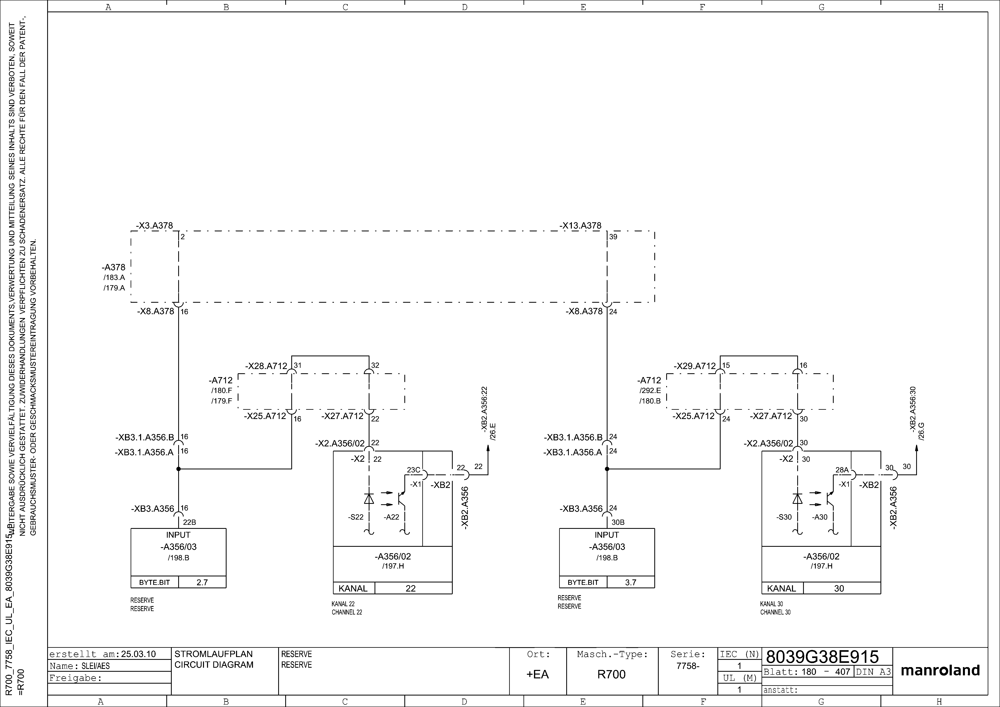

# +EA — Sheet 180 of 407 — RESERVE

**RESERVE**

> Part of the manroland **R700** printing press IEC/UL circuit diagrams.
> Drawing class: **Stromlaufplan / Circuit diagram** (DIN A3).
> Document `+EA` covers the **Printing unit** machine section.

## At a glance

| Field | Value |
|---|---|
| Document | `+EA`  (8039G38E915) |
| Sheet | **180** of 407 |
| Section (DE) | RESERVE |
| Section (EN) | RESERVE |
| Section type | CIRCUIT — Circuit diagram |
| Machine type | `R700` |
| Series | `7758` |
| Created | 25.03.10 |
| Replaces | — |
| Columns used | A, B, C, D, E, F, G, H |
| Path numbers | — |
| Labels on sheet | 99 |
| Cross-refs out | 12 |
| Cross-refs in | 34 |

**Previous:** [+EA sheet 179](SHEET_0179.md) · **Next:** [+EA sheet 181](SHEET_0181.md) · **Document TOC:** [_TOC.md](_TOC.md)  (+EA) · **Master TOC:** [all sheets](../_MASTER_TOC.md)

## Sheet image (300 DPI, exact vector render)



_Rendered directly from the PDF vector layer at 300 DPI (1-bit), no OCR and no resampling. Use it to confirm anything ambiguous in the text below._

## Cross-references on this sheet

Each entry is a wire leaving this sheet. The printed token is `/sheet.column`; the link resolves to that sheet inside the same document.

| Ref | Target sheet | Col | Path | Destination on target | Target section | From col |
|---|---|---|---|---|---|---|
| `/183.A` | [+EA sheet 183](SHEET_0183.md) | A | — | — | RESERVE | A |
| `/179.A` | [+EA sheet 179](SHEET_0179.md) | A | — | — | RESERVE | A |
| `/26.E` | [+EA sheet 26](SHEET_0026.md) | E | — | XB2.A356:22 | BUSVERBINDUNGEN: SICHERHEITSBUS | D |
| `/26.G` | [+EA sheet 26](SHEET_0026.md) | G | — | XB2.A356:30 | BUSVERBINDUNGEN: SICHERHEITSBUS | H |
| `/292.E` | [+EA sheet 292](SHEET_0292.md) | E | — | — | OPTION: PROBEBOGENENTNAHME HALBAUTOMATISCH | F |
| `/180.B` | [+EA sheet 180](SHEET_0180.md) | B | — | — | RESERVE | F |
| `/180.F` | [+EA sheet 180](SHEET_0180.md) | F | — | — | RESERVE | B |
| `/179.F` | [+EA sheet 179](SHEET_0179.md) | F | — | — | RESERVE | B |
| `/198.B` | [+EA sheet 198](SHEET_0198.md) | B | — | — | REFERENZMODUL | B |
| `/198.B` | [+EA sheet 198](SHEET_0198.md) | B | — | — | REFERENZMODUL | E |
| `/197.H` | [+EA sheet 197](SHEET_0197.md) | H | — | — | REFERENZMODUL | C |
| `/197.H` | [+EA sheet 197](SHEET_0197.md) | H | — | — | REFERENZMODUL | G |

### Incoming references (sheets that point here)

Every other sheet that sends a wire to this one. `Back-ref` is the token printed on *that* sheet; `Path` is its line number.

| From sheet | Cols | Back-ref | Path | Refs | What continues there |
|---|---|---|---|---|---|
| [+EA#26](SHEET_0026.md) | E, G | `/26.E`, `/26.G` | — | 2 | XB2.A356:22; XB2.A356:30 |
| [+EA#179](SHEET_0179.md) | A, E | `/179.A`, `/179.E` | — | 2 | — |
| [+EA#180](SHEET_0180.md) | B, F | `/180.B`, `/180.F` | — | 2 | — |
| [+EA#183](SHEET_0183.md) | A | `/183.A` | — | 1 | — |
| [+EA#197](SHEET_0197.md) | H | `/197.H` | — | 2 | — |
| [+EA#198](SHEET_0198.md) | B | `/198.B` | — | 2 | — |
| [+EA#225](SHEET_0225.md) | G | `/225.G` | — | 2 | — |
| [+EA#226](SHEET_0226.md) | F | `/226.F` | — | 2 | — |
| [+EA#234](SHEET_0234.md) | H | `/234.H` | — | 2 | — |
| [+EA#235](SHEET_0235.md) | A, B, D | `/235.A`, `/235.B`, `/235.D` | — | 5 | — |
| [+EA#250](SHEET_0250.md) | D | `/250.D` | — | 2 | — |
| [+EA#259](SHEET_0259.md) | B | `/259.B` | — | 1 | — |
| [+EA#268](SHEET_0268.md) | F | `/268.F` | — | 2 | — |
| [+EA#271](SHEET_0271.md) | H | `/271.H` | — | 2 | — |
| [+EA#273](SHEET_0273.md) | D | `/273.D` | — | 2 | — |
| [+EA#274](SHEET_0274.md) | G | `/274.G` | — | 2 | — |
| [+EA#292](SHEET_0292.md) | E | `/292.E` | — | 1 | — |


## Devices on this sheet

| Tag | Class | Class meaning (IEC) | Col | Sub | Terminal | Sign |
|---|---|---|---|---|---|---|
| `A378` | A | Baugruppe / assembly, module, PC board | A | — | — | — |
| `A356/03` | A | Baugruppe / assembly, module, PC board | B | 03 | — | — |
| `S22` | S | Schalter / switch | C | — | — | — |
| `A22` | A | Baugruppe / assembly, module, PC board | C | — | — | — |
| `X1` | X | Klemme / terminal, plug connector | D | — | — | — |
| `X2` | X | Klemme / terminal, plug connector | C | — | — | — |
| `XB2` | XB |  | D | — | — | — |
| `A356/02` | A | Baugruppe / assembly, module, PC board | C | 02 | — | — |
| `A712` | A | Baugruppe / assembly, module, PC board | B | — | — | — |
| `A356/03` | A | Baugruppe / assembly, module, PC board | E | 03 | — | — |
| `S30` | S | Schalter / switch | G | — | — | — |
| `A30` | A | Baugruppe / assembly, module, PC board | G | — | — | — |
| `X1` | X | Klemme / terminal, plug connector | G | — | — | — |
| `X2` | X | Klemme / terminal, plug connector | G | — | — | — |
| `XB2` | XB |  | G | — | — | — |
| `A356/02` | A | Baugruppe / assembly, module, PC board | G | 02 | — | — |
| `A712` | A | Baugruppe / assembly, module, PC board | F | — | — | — |
| `2.7` | — | cross-device reference | B | — | — | — |
| `XB3.A356` | — | cross-device reference | A | — | — | — |
| `X8.A378` | — | cross-device reference | A | — | — | — |
| `XB3.1.A356.B` | — | cross-device reference | A | — | — | — |
| `XB3.1.A356.A` | — | cross-device reference | A | — | — | — |
| `XB2.A356` | — | cross-device reference | D | — | — | — |
| `X28.A712` | — | cross-device reference | B | — | — | — |
| `X27.A712` | — | cross-device reference | C | — | — | — |
| `X25.A712` | — | cross-device reference | B | — | — | — |
| `3.7` | — | cross-device reference | E | — | — | — |
| `XB3.A356` | — | cross-device reference | E | — | — | — |
| `X8.A378` | — | cross-device reference | E | — | — | — |
| `XB3.1.A356.B` | — | cross-device reference | E | — | — | — |
| `XB3.1.A356.A` | — | cross-device reference | E | — | — | — |
| `XB2.A356` | — | cross-device reference | H | — | — | — |
| `X29.A712` | — | cross-device reference | F | — | — | — |
| `X27.A712` | — | cross-device reference | G | — | — | — |
| `X25.A712` | — | cross-device reference | F | — | — | — |
| `XB2.A356:30` | — | cross-device reference | H | — | 30 | — |
| `XB2.A356:22` | — | cross-device reference | D | — | 22 | — |
| `X3.A378` | — | cross-device reference | A | — | — | — |
| `X13.A378` | — | cross-device reference | E | — | — | — |

## Potentials / nets

_No named potentials on this sheet._

## Wire-end annotations (grouped as printed)

A wire that continues elsewhere is annotated with a small cluster: the destination description, the path/line number `#NN`, and the `/sheet.column` cross reference. Each row below is one such cluster exactly as it is grouped on the drawing.

| Col | Y | Path | Cross-ref | Text on the wire |
|---|---|---|---|---|
| C | 263.9 | — | — | `X3.A378 X13.A378` |
| B | 278.1 | — | — | `2` |
| E | 278.1 | — | — | `39` |
| A | 313.5 | — | — | `A378` |
| A | 326.6 | — | `/183.A`, `/179.A` | — |
| A | 366.0 | — | — | `X8.A378 16` |
| E | 366.0 | — | — | `X8.A378 24` |
| C | 431.2 | — | — | `X28.A712 31 32` |
| F | 431.2 | — | — | `X29.A712 15 16` |
| B | 448.2 | — | — | `A712` |
| F | 448.2 | — | — | `A712` |
| D | 460.1 | — | `/26.E` | `XB2.A356:22` |
| H | 460.1 | — | `/26.G` | `XB2.A356:30` |
| F | 461.2 | — | `/292.E`, `/180.B` | — |
| B | 461.3 | — | `/180.F`, `/179.F` | — |
| C | 490.7 | — | — | `X25.A712 16 X27.A712 22` |
| F | 490.7 | — | — | `X25.A712 24 X27.A712 30` |
| A | 516.2 | — | — | `XB3.1.A356.B 16` |
| E | 516.2 | — | — | `XB3.1.A356.B 24` |
| C | 523.3 | — | — | `X2.A356/02 22` |
| G | 523.3 | — | — | `X2.A356/02 30` |
| A | 533.2 | — | — | `XB3.1.A356.A 16` |
| E | 533.2 | — | — | `XB3.1.A356.A 24` |
| C | 541.7 | — | — | `X2` |
| G | 541.7 | — | — | `X2` |
| D | 543.2 | — | — | `22 22` |
| G | 543.2 | — | — | `30 30` |
| D | 551.7 | — | — | `22` |
| H | 551.7 | — | — | `30` |
| D | 555.9 | — | — | `23C` |
| G | 555.9 | — | — | `28A` |
| D | 572.9 | — | — | `X1` |
| D | 572.9 | — | — | `XB2` |
| G | 572.9 | — | — | `X1` |
| G | 572.9 | — | — | `XB2` |
| D | 579.1 | — | — | `XB2.A356` |
| H | 579.1 | — | — | `XB2.A356` |
| A | 601.2 | — | — | `XB3.A356 16` |
| E | 601.2 | — | — | `XB3.A356 24` |
| C | 611.9 | — | — | `S22 A22` |
| G | 611.9 | — | — | `S30 A30` |
| B | 618.2 | — | — | `22B` |
| E | 618.2 | — | — | `30B` |
| B | 632.8 | — | — | `INPUT` |
| E | 632.8 | — | — | `INPUT` |
| B | 646.6 | — | — | `A356/03` |
| E | 646.6 | — | — | `A356/03` |
| C | 657.9 | — | — | `A356/02` |
| G | 657.9 | — | — | `A356/02` |
| B | 660.4 | — | `/198.B` | — |
| E | 660.4 | — | `/198.B` | — |
| C | 670.3 | — | `/197.H` | — |
| G | 670.3 | — | `/197.H` | — |
| B | 689.4 | — | — | `BYTE.BIT 2.7` |
| E | 689.4 | — | — | `BYTE.BIT 3.7` |
| C | 696.2 | — | — | `KANAL 22` |
| G | 696.2 | — | — | `KANAL 30` |
| E | 709.4 | — | — | `RESERVE RESERVE` |
| A | 712.3 | — | — | `RESERVE RESERVE` |
| C | 716.5 | — | — | `KANAL 22 CHANNEL 22` |
| G | 716.5 | — | — | `KANAL 30 CHANNEL 30` |


## Reconstructed tables

This sheet carries tabular content (pin map / terminal assignment / index). The grid below was rebuilt from the drawing's own rule lines, so each row is exactly one physical row of the table.

### Table 1 — 6 data rows × 19 columns (at x=155.9, y=423.8)

| XB3.1.A356.B | A712 /180.F /179.F 16 | X28.A712 X25.A712 | 31 16 | X27.A712 X2.A356/02 | 32 22 22 |  |  | XB2.A356:22 | /26.E | XB3.1.A356.B | A712 /292.E /180.B 24 | X29.A712 X25.A712 | 15 24 | X27.A712 X2.A356/02 | 16 30 30 |  |  | XB2.A356:30 |
|---|---|---|---|---|---|---|---|---|---|---|---|---|---|---|---|---|---|---|
| `XB3.1.A356.A` | `16` |  |  | `X2` | `22` |  |  | `22 22` |  | `XB3.1.A356.A` | `24` |  |  | `X2` | `30` |  |  | `30 30` |
| `XB3.A356` | `16 22B` |  |  | `S22` | `A22` | `23C X1` | `XB2` | `XB2.A356` |  | `XB3.A356` | `24 30B` |  |  | `S30` | `A30` | `28A X1` | `XB2` | `XB2.A356` |
| `INPUT` |  |  |  |  |  |  |  |  |  | `INPUT` |  |  |  |  |  |  |  |  |
|  | `A356/03 /198.B` |  |  |  | `A356/02 /197.H` |  |  |  |  |  | `A356/03 /198.B` |  |  |  | `A356/02 /197.H` |  |  |  |
| `BYTE.BIT` | `2.7` |  |  |  |  |  |  |  |  | `BYTE.BIT` | `3.7` |  |  |  |  |  |  |  |
|  |  |  |  | `KANAL` |  | `22` |  |  |  |  |  |  |  | `KANAL` |  | `30` |  |  |


## Notes and free text on this sheet

| Text | Col | Y (pt) |
|---|---|---|
| `22B` | B | 618.24 |
| `INPUT` | B | 632.76 |
| `BYTE.BIT` | A | 690.01 |
| `RESERVE` | A | 712.28 |
| `KANAL 22` | C | 716.52 |
| `CHANNEL 22` | C | 726.47 |
| `23C` | D | 555.92 |
| `KANAL` | C | 696.2 |
| `X2.A356/02` | C | 523.3 |
| `30B` | E | 618.24 |
| `INPUT` | E | 632.76 |
| `BYTE.BIT` | E | 690.01 |
| `RESERVE` | E | 709.44 |
| `KANAL 30` | G | 716.53 |
| `CHANNEL 30` | G | 726.48 |
| `28A` | G | 555.88 |
| `KANAL` | G | 696.2 |
| `X2.A356/02` | G | 523.3 |

## Complete label inventory (exact text from the drawing)

Every text object inside the drawing area of this sheet, in DIN reading order (column A→H, then top→bottom). This is the authoritative list: if a string is not here it is not printed on this sheet.

| Col | Y | X | Dir | Type | Text |
|---|---|---|---|---|---|
| A | 263.9 | 161.9 | → | device ref | `X3.A378` |
| A | 313.5 | 121.0 | → | device tag | `A378` |
| A | 326.6 | 123.3 | → | cross-reference | `/183.A` |
| A | 339.0 | 123.3 | → | cross-reference | `/179.A` |
| A | 366.0 | 163.3 | → | device ref | `X8.A378` |
| A | 516.2 | 137.5 | → | device ref | `XB3.1.A356.B` |
| A | 533.9 | 136.6 | → | device ref | `XB3.1.A356.A` |
| A | 601.3 | 156.2 | → | device ref | `XB3.A356` |
| A | 690.0 | 165.8 | → | text | `BYTE.BIT` |
| A | 712.3 | 155.3 | → | text | `RESERVE` |
| A | 722.2 | 155.3 | → | text | `RESERVE` |
| B | 278.1 | 215.1 | → | number | `2` |
| B | 367.4 | 214.6 | → | number | `16` |
| B | 431.2 | 292.0 | → | device ref | `X28.A712` |
| B | 448.2 | 248.6 | → | device tag | `A712` |
| B | 461.3 | 251.7 | → | cross-reference | `/180.F` |
| B | 473.7 | 251.7 | → | cross-reference | `/179.F` |
| B | 490.7 | 290.6 | → | device ref | `X25.A712` |
| B | 516.2 | 214.6 | → | number | `16` |
| B | 533.2 | 214.6 | → | number | `16` |
| B | 601.3 | 214.6 | → | number | `16` |
| B | 618.2 | 218.0 | → | text | `22B` |
| B | 632.8 | 197.7 | → | text | `INPUT` |
| B | 646.6 | 191.2 | → | device tag | `A356/03` |
| B | 660.4 | 200.0 | → | cross-reference | `/198.B` |
| B | 689.4 | 234.1 | → | device ref | `2.7` |
| C | 431.2 | 349.8 | → | number | `31` |
| C | 431.2 | 441.9 | → | number | `32` |
| C | 490.7 | 382.7 | → | device ref | `X27.A712` |
| C | 495.0 | 349.2 | → | number | `16` |
| C | 495.0 | 441.9 | → | number | `22` |
| C | 523.3 | 375.3 | → | text | `X2.A356/02` |
| C | 523.3 | 441.9 | → | number | `22` |
| C | 541.7 | 417.8 | → | device tag | `X2` |
| C | 543.2 | 444.8 | → | number | `22` |
| C | 611.9 | 414.4 | → | device tag | `S22` |
| C | 611.9 | 456.9 | → | device tag | `A22` |
| C | 657.9 | 446.3 | → | device tag | `A356/02` |
| C | 670.3 | 455.2 | → | cross-reference | `/197.H` |
| C | 696.2 | 403.1 | → | text | `KANAL` |
| C | 716.5 | 394.9 | → | text | `KANAL 22` |
| C | 726.5 | 395.1 | → | text | `CHANNEL 22` |
| D | 460.1 | 572.9 | ↕ | device ref | `XB2.A356:22` |
| D | 503.7 | 582.8 | ↕ | cross-reference | `/26.E` |
| D | 551.7 | 564.9 | → | number | `22` |
| D | 553.1 | 544.0 | → | number | `22` |
| D | 555.9 | 484.7 | → | text | `23C` |
| D | 572.9 | 488.4 | → | device tag | `X1` |
| D | 572.9 | 512.8 | → | device tag | `XB2` |
| D | 579.1 | 548.8 | ↕ | device ref | `XB2.A356` |
| D | 696.2 | 483.2 | → | number | `22` |
| E | 263.9 | 666.1 | → | device ref | `X13.A378` |
| E | 278.1 | 725.4 | → | number | `39` |
| E | 366.0 | 673.5 | → | device ref | `X8.A378` |
| E | 367.4 | 725.4 | → | number | `24` |
| E | 516.2 | 647.7 | → | device ref | `XB3.1.A356.B` |
| E | 516.2 | 725.4 | → | number | `24` |
| E | 533.2 | 725.4 | → | number | `24` |
| E | 533.9 | 646.9 | → | device ref | `XB3.1.A356.A` |
| E | 601.3 | 666.4 | → | device ref | `XB3.A356` |
| E | 601.3 | 725.4 | → | number | `24` |
| E | 618.2 | 728.2 | → | text | `30B` |
| E | 632.8 | 708.0 | → | text | `INPUT` |
| E | 646.6 | 701.4 | → | device tag | `A356/03` |
| E | 660.4 | 710.2 | → | cross-reference | `/198.B` |
| E | 689.4 | 744.4 | → | device ref | `3.7` |
| E | 690.0 | 676.1 | → | text | `BYTE.BIT` |
| E | 709.4 | 664.2 | → | text | `RESERVE` |
| E | 719.4 | 664.2 | → | text | `RESERVE` |
| F | 431.2 | 802.2 | → | device ref | `X29.A712` |
| F | 431.2 | 859.5 | → | number | `15` |
| F | 448.2 | 758.8 | → | device tag | `A712` |
| F | 461.2 | 761.7 | → | cross-reference | `/292.E` |
| F | 473.6 | 761.4 | → | cross-reference | `/180.B` |
| F | 490.7 | 800.8 | → | device ref | `X25.A712` |
| F | 495.0 | 860.0 | → | number | `24` |
| G | 431.2 | 951.6 | → | number | `16` |
| G | 490.7 | 892.9 | → | device ref | `X27.A712` |
| G | 495.0 | 952.2 | → | number | `30` |
| G | 523.3 | 885.5 | → | text | `X2.A356/02` |
| G | 523.3 | 952.2 | → | number | `30` |
| G | 541.7 | 928.1 | → | device tag | `X2` |
| G | 543.2 | 955.0 | → | number | `30` |
| G | 555.9 | 995.0 | → | text | `28A` |
| G | 572.9 | 998.6 | → | device tag | `X1` |
| G | 572.9 | 1023.0 | → | device tag | `XB2` |
| G | 611.9 | 924.4 | → | device tag | `S30` |
| G | 611.9 | 966.9 | → | device tag | `A30` |
| G | 657.9 | 956.6 | → | device tag | `A356/02` |
| G | 670.3 | 965.5 | → | cross-reference | `/197.H` |
| G | 696.2 | 913.3 | → | text | `KANAL` |
| G | 696.2 | 993.3 | → | number | `30` |
| G | 716.5 | 905.1 | → | text | `KANAL 30` |
| G | 726.5 | 905.4 | → | text | `CHANNEL 30` |
| H | 460.1 | 1083.1 | ↕ | device ref | `XB2.A356:30` |
| H | 502.9 | 1093.0 | ↕ | cross-reference | `/26.G` |
| H | 551.7 | 1074.9 | → | number | `30` |
| H | 553.1 | 1054.2 | → | number | `30` |
| H | 579.1 | 1059.0 | ↕ | device ref | `XB2.A356` |

## Reading-order text block

The same content as a plain block, grouped by DIN column — convenient to paste or to match against a visual description.

```text
=== Column A ===
 263.9  161.9  devref       X3.A378
 313.5  121.0  devtag       A378
 326.6  123.3  xref         /183.A
 339.0  123.3  xref         /179.A
 366.0  163.3  devref       X8.A378
 516.2  137.5  devref       XB3.1.A356.B
 533.9  136.6  devref       XB3.1.A356.A
 601.3  156.2  devref       XB3.A356
 690.0  165.8  text         BYTE.BIT
 712.3  155.3  text         RESERVE
 722.2  155.3  text         RESERVE
=== Column B ===
 278.1  215.1  numeric      2
 367.4  214.6  numeric      16
 431.2  292.0  devref       X28.A712
 448.2  248.6  devtag       A712
 461.3  251.7  xref         /180.F
 473.7  251.7  xref         /179.F
 490.7  290.6  devref       X25.A712
 516.2  214.6  numeric      16
 533.2  214.6  numeric      16
 601.3  214.6  numeric      16
 618.2  218.0  text         22B
 632.8  197.7  text         INPUT
 646.6  191.2  devtag       A356/03
 660.4  200.0  xref         /198.B
 689.4  234.1  devref       2.7
=== Column C ===
 431.2  349.8  numeric      31
 431.2  441.9  numeric      32
 490.7  382.7  devref       X27.A712
 495.0  349.2  numeric      16
 495.0  441.9  numeric      22
 523.3  375.3  text         X2.A356/02
 523.3  441.9  numeric      22
 541.7  417.8  devtag       X2
 543.2  444.8  numeric      22
 611.9  414.4  devtag       S22
 611.9  456.9  devtag       A22
 657.9  446.3  devtag       A356/02
 670.3  455.2  xref         /197.H
 696.2  403.1  text         KANAL
 716.5  394.9  text         KANAL 22
 726.5  395.1  text         CHANNEL 22
=== Column D ===
 460.1  572.9  devref       XB2.A356:22
 503.7  582.8  xref         /26.E
 551.7  564.9  numeric      22
 553.1  544.0  numeric      22
 555.9  484.7  text         23C
 572.9  488.4  devtag       X1
 572.9  512.8  devtag       XB2
 579.1  548.8  devref       XB2.A356
 696.2  483.2  numeric      22
=== Column E ===
 263.9  666.1  devref       X13.A378
 278.1  725.4  numeric      39
 366.0  673.5  devref       X8.A378
 367.4  725.4  numeric      24
 516.2  647.7  devref       XB3.1.A356.B
 516.2  725.4  numeric      24
 533.2  725.4  numeric      24
 533.9  646.9  devref       XB3.1.A356.A
 601.3  666.4  devref       XB3.A356
 601.3  725.4  numeric      24
 618.2  728.2  text         30B
 632.8  708.0  text         INPUT
 646.6  701.4  devtag       A356/03
 660.4  710.2  xref         /198.B
 689.4  744.4  devref       3.7
 690.0  676.1  text         BYTE.BIT
 709.4  664.2  text         RESERVE
 719.4  664.2  text         RESERVE
=== Column F ===
 431.2  802.2  devref       X29.A712
 431.2  859.5  numeric      15
 448.2  758.8  devtag       A712
 461.2  761.7  xref         /292.E
 473.6  761.4  xref         /180.B
 490.7  800.8  devref       X25.A712
 495.0  860.0  numeric      24
=== Column G ===
 431.2  951.6  numeric      16
 490.7  892.9  devref       X27.A712
 495.0  952.2  numeric      30
 523.3  885.5  text         X2.A356/02
 523.3  952.2  numeric      30
 541.7  928.1  devtag       X2
 543.2  955.0  numeric      30
 555.9  995.0  text         28A
 572.9  998.6  devtag       X1
 572.9 1023.0  devtag       XB2
 611.9  924.4  devtag       S30
 611.9  966.9  devtag       A30
 657.9  956.6  devtag       A356/02
 670.3  965.5  xref         /197.H
 696.2  913.3  text         KANAL
 696.2  993.3  numeric      30
 716.5  905.1  text         KANAL 30
 726.5  905.4  text         CHANNEL 30
=== Column H ===
 460.1 1083.1  devref       XB2.A356:30
 502.9 1093.0  xref         /26.G
 551.7 1074.9  numeric      30
 553.1 1054.2  numeric      30
 579.1 1059.0  devref       XB2.A356
```

---
_Generated from the PDF vector text layer; no OCR. Source: `R700_7758_IEC_UL_EA_8039G38E915_p`, sheet 180._
