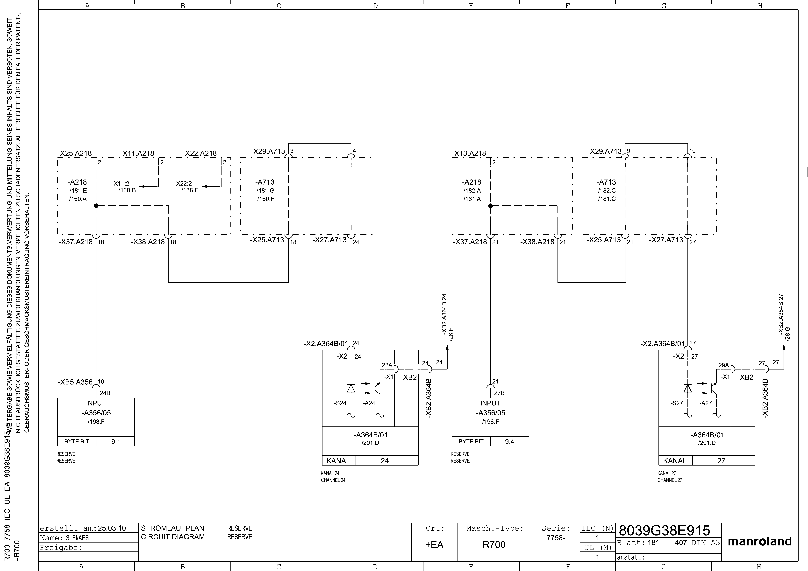

# +EA — Sheet 181 of 407 — RESERVE

**RESERVE**

> Part of the manroland **R700** printing press IEC/UL circuit diagrams.
> Drawing class: **Stromlaufplan / Circuit diagram** (DIN A3).
> Document `+EA` covers the **Printing unit** machine section.

## At a glance

| Field | Value |
|---|---|
| Document | `+EA`  (8039G38E915) |
| Sheet | **181** of 407 |
| Section (DE) | RESERVE |
| Section (EN) | RESERVE |
| Section type | CIRCUIT — Circuit diagram |
| Machine type | `R700` |
| Series | `7758` |
| Created | 25.03.10 |
| Replaces | — |
| Columns used | A, B, C, D, E, F, G, H |
| Path numbers | — |
| Labels on sheet | 105 |
| Cross-refs out | 16 |
| Cross-refs in | 38 |

**Previous:** [+EA sheet 180](SHEET_0180.md) · **Next:** [+EA sheet 182](SHEET_0182.md) · **Document TOC:** [_TOC.md](_TOC.md)  (+EA) · **Master TOC:** [all sheets](../_MASTER_TOC.md)

## Sheet image (300 DPI, exact vector render)



_Rendered directly from the PDF vector layer at 300 DPI (1-bit), no OCR and no resampling. Use it to confirm anything ambiguous in the text below._

## Cross-references on this sheet

Each entry is a wire leaving this sheet. The printed token is `/sheet.column`; the link resolves to that sheet inside the same document.

| Ref | Target sheet | Col | Path | Destination on target | Target section | From col |
|---|---|---|---|---|---|---|
| `/138.B` | [+EA sheet 138](SHEET_0138.md) | B | — | X11:2 | ZUGANGSABSICHERUNG | A |
| `/138.F` | [+EA sheet 138](SHEET_0138.md) | F | — | X22:2 | ZUGANGSABSICHERUNG | B |
| `/181.E` | [+EA sheet 181](SHEET_0181.md) | E | — | — | RESERVE | A |
| `/160.A` | [+EA sheet 160](SHEET_0160.md) | A | — | — | ZUGANGSABSICHERUNG | A |
| `/182.A` | [+EA sheet 182](SHEET_0182.md) | A | — | — | RESERVE | E |
| `/181.A` | [+EA sheet 181](SHEET_0181.md) | A | — | — | RESERVE | E |
| `/181.G` | [+EA sheet 181](SHEET_0181.md) | G | — | — | RESERVE | C |
| `/182.C` | [+EA sheet 182](SHEET_0182.md) | C | — | — | RESERVE | F |
| `/181.C` | [+EA sheet 181](SHEET_0181.md) | C | — | — | RESERVE | F |
| `/160.F` | [+EA sheet 160](SHEET_0160.md) | F | — | — | ZUGANGSABSICHERUNG | C |
| `/28.F` | [+EA sheet 28](SHEET_0028.md) | F | — | XB2.A364B:24 | BUSVERBINDUNGEN: SICHERHEITSBUS | E |
| `/28.G` | [+EA sheet 28](SHEET_0028.md) | G | — | XB2.A364B:27 | BUSVERBINDUNGEN: SICHERHEITSBUS | H |
| `/198.F` | [+EA sheet 198](SHEET_0198.md) | F | — | — | REFERENZMODUL | A |
| `/198.F` | [+EA sheet 198](SHEET_0198.md) | F | — | — | REFERENZMODUL | E |
| `/201.D` | [+EA sheet 201](SHEET_0201.md) | D | — | — | REFERENZMODUL | D |
| `/201.D` | [+EA sheet 201](SHEET_0201.md) | D | — | — | REFERENZMODUL | G |

### Incoming references (sheets that point here)

Every other sheet that sends a wire to this one. `Back-ref` is the token printed on *that* sheet; `Path` is its line number.

| From sheet | Cols | Back-ref | Path | Refs | What continues there |
|---|---|---|---|---|---|
| [+EA#28](SHEET_0028.md) | F, G | `/28.F`, `/28.G` | — | 2 | — |
| [+EA#138](SHEET_0138.md) | C, F | `/138.C`, `/138.F` | — | 2 | — |
| [+EA#160](SHEET_0160.md) | A, F | `/160.A`, `/160.F` | — | 2 | — |
| [+EA#181](SHEET_0181.md) | A, C, E, F | `/181.A`, `/181.C`, `/181.E`, `/181.F` | — | 4 | — |
| [+EA#182](SHEET_0182.md) | A, C | `/182.A`, `/182.C` | — | 2 | — |
| [+EA#198](SHEET_0198.md) | F | `/198.F` | — | 2 | — |
| [+EA#201](SHEET_0201.md) | D | `/201.D` | — | 2 | — |
| [+EA#227](SHEET_0227.md) | C, E | `/227.C`, `/227.E` | — | 4 | — |
| [+EA#241](SHEET_0241.md) | H | `/241.H` | — | 2 | — |
| [+EA#255](SHEET_0255.md) | F | `/255.F` | — | 1 | — |
| [+EA#258](SHEET_0258.md) | A | `/258.A` | — | 1 | — |
| [+EA#264](SHEET_0264.md) | G | `/264.G` | — | 1 | — |
| [+EA#267](SHEET_0267.md) | A | `/267.A` | — | 1 | — |
| [+EA#268](SHEET_0268.md) | G | `/268.G` | — | 2 | — |
| [+EA#272](SHEET_0272.md) | B | `/272.B` | — | 2 | — |
| [+EA#275](SHEET_0275.md) | A | `/275.A` | — | 4 | — |
| [+EA#279](SHEET_0279.md) | E | `/279.E` | — | 2 | — |
| [+EA#280](SHEET_0280.md) | A | `/280.A` | — | 2 | — |


## Devices on this sheet

| Tag | Class | Class meaning (IEC) | Col | Sub | Terminal | Sign |
|---|---|---|---|---|---|---|
| `A356/05` | A | Baugruppe / assembly, module, PC board | A | 05 | — | — |
| `S24` | S | Schalter / switch | D | — | — | — |
| `A24` | A | Baugruppe / assembly, module, PC board | D | — | — | — |
| `X1` | X | Klemme / terminal, plug connector | D | — | — | — |
| `X2` | X | Klemme / terminal, plug connector | D | — | — | — |
| `XB2` | XB |  | D | — | — | — |
| `A218` | A | Baugruppe / assembly, module, PC board | A | — | — | — |
| `A713` | A | Baugruppe / assembly, module, PC board | C | — | — | — |
| `A356/05` | A | Baugruppe / assembly, module, PC board | E | 05 | — | — |
| `S27` | S | Schalter / switch | G | — | — | — |
| `A27` | A | Baugruppe / assembly, module, PC board | G | — | — | — |
| `X1` | X | Klemme / terminal, plug connector | H | — | — | — |
| `X2` | X | Klemme / terminal, plug connector | G | — | — | — |
| `XB2` | XB |  | H | — | — | — |
| `A218` | A | Baugruppe / assembly, module, PC board | E | — | — | — |
| `A713` | A | Baugruppe / assembly, module, PC board | F | — | — | — |
| `X11:2` | X | Klemme / terminal, plug connector | A | — | 2 | — |
| `X22:2` | X | Klemme / terminal, plug connector | B | — | 2 | — |
| `9.1` | — | cross-device reference | A | — | — | — |
| `XB5.A356` | — | cross-device reference | A | — | — | — |
| `XB2.A364B` | — | cross-device reference | E | — | — | — |
| `X37.A218` | — | cross-device reference | A | — | — | — |
| `X38.A218` | — | cross-device reference | B | — | — | — |
| `X27.A713` | — | cross-device reference | D | — | — | — |
| `X25.A713` | — | cross-device reference | C | — | — | — |
| `X29.A713` | — | cross-device reference | C | — | — | — |
| `9.4` | — | cross-device reference | E | — | — | — |
| `XB2.A364B` | — | cross-device reference | H | — | — | — |
| `X37.A218` | — | cross-device reference | E | — | — | — |
| `X38.A218` | — | cross-device reference | F | — | — | — |
| `X27.A713` | — | cross-device reference | G | — | — | — |
| `X25.A713` | — | cross-device reference | F | — | — | — |
| `X29.A713` | — | cross-device reference | F | — | — | — |
| `XB2.A364B:24` | — | cross-device reference | E | — | 24 | — |
| `XB2.A364B:27` | — | cross-device reference | H | — | 27 | — |
| `X25.A218` | — | cross-device reference | A | — | — | — |
| `X11.A218` | — | cross-device reference | B | — | — | — |
| `X22.A218` | — | cross-device reference | B | — | — | — |
| `X13.A218` | — | cross-device reference | E | — | — | — |

## Potentials / nets

_No named potentials on this sheet._

## Wire-end annotations (grouped as printed)

A wire that continues elsewhere is annotated with a small cluster: the destination description, the path/line number `#NN`, and the `/sheet.column` cross reference. Each row below is one such cluster exactly as it is grouped on the drawing.

| Col | Y | Path | Cross-ref | Text on the wire |
|---|---|---|---|---|
| C | 218.6 | — | — | `X29.A713 3 4` |
| G | 218.6 | — | — | `X29.A713 9 10` |
| C | 221.4 | — | — | `X25.A218 X11.A218 X22.A218 X13.A218` |
| A | 235.6 | — | — | `2` |
| B | 235.6 | — | — | `2 2` |
| E | 235.6 | — | — | `2` |
| A | 263.9 | — | — | `A218` |
| C | 263.9 | — | — | `A713` |
| E | 263.9 | — | — | `A218` |
| F | 263.9 | — | — | `A713` |
| A | 266.8 | — | `/138.B` | `X11:2` |
| B | 266.8 | — | `/138.F` | `X22:2` |
| A | 277.0 | — | `/181.E`, `/160.A` | — |
| C | 277.0 | — | `/181.G` | — |
| E | 277.0 | — | `/182.A`, `/181.A` | — |
| F | 277.0 | — | `/182.C`, `/181.C` | — |
| C | 289.4 | — | `/160.F` | — |
| C | 349.0 | — | — | `X25.A713 18 X27.A713 24` |
| F | 349.0 | — | — | `X38.A218 21 X25.A713 21 X27.A713 27` |
| A | 351.8 | — | — | `X37.A218 18 X38.A218 18` |
| E | 351.8 | — | — | `X37.A218 21` |
| E | 432.9 | — | `/28.F` | `XB2.A364B:24` |
| H | 432.9 | — | `/28.G` | `XB2.A364B:27` |
| D | 502.0 | — | — | `X2.A364B/01 24` |
| G | 502.0 | — | — | `X2.A364B/01 27` |
| D | 520.5 | — | — | `X2` |
| G | 520.5 | — | — | `X2` |
| D | 521.9 | — | — | `24 24` |
| H | 521.9 | — | — | `27 27` |
| E | 530.4 | — | — | `24` |
| H | 530.4 | — | — | `27` |
| D | 534.6 | — | — | `22A` |
| H | 534.6 | — | — | `29A` |
| D | 551.6 | — | — | `X1` |
| H | 551.6 | — | — | `X1` |
| D | 551.7 | — | — | `XB2` |
| H | 551.7 | — | — | `XB2` |
| E | 557.9 | — | — | `XB2.A364B` |
| H | 557.9 | — | — | `XB2.A364B` |
| A | 558.7 | — | — | `XB5.A356 18` |
| E | 558.8 | — | — | `21` |
| A | 575.7 | — | — | `24B` |
| E | 575.7 | — | — | `27B` |
| A | 590.2 | — | — | `INPUT` |
| E | 590.2 | — | — | `INPUT` |
| D | 590.6 | — | — | `S24 A24` |
| G | 590.6 | — | — | `S27 A27` |
| A | 604.1 | — | — | `A356/05` |
| E | 604.1 | — | — | `A356/05` |
| A | 617.9 | — | `/198.F` | — |
| E | 617.9 | — | `/198.F` | — |
| D | 636.7 | — | — | `A364B/01` |
| G | 636.7 | — | — | `A364B/01` |
| A | 646.9 | — | — | `BYTE.BIT 9.1` |
| E | 646.9 | — | — | `BYTE.BIT 9.4` |
| D | 649.1 | — | `/201.D` | — |
| G | 649.1 | — | `/201.D` | — |
| A | 666.9 | — | — | `RESERVE RESERVE` |
| E | 666.9 | — | — | `RESERVE RESERVE` |
| D | 674.9 | — | — | `KANAL 24` |
| G | 674.9 | — | — | `KANAL 27` |
| D | 695.3 | — | — | `KANAL 24 CHANNEL 24` |
| G | 695.3 | — | — | `KANAL 27 CHANNEL 27` |


## Reconstructed tables

This sheet carries tabular content (pin map / terminal assignment / index). The grid below was rebuilt from the drawing's own rule lines, so each row is exactly one physical row of the table.

### Table 1 — 8 data rows × 23 columns (at x=85.0, y=211.2)

| X25.A218 A218 /181.E /160.A | 2 X11:2 /138.B | X11.A218 | 2 | X22.A218 X22:2 /138.F | X29.A713 2 A713 /181.G /160.F | 3 |  | 4 |  |  |  |  | X13.A218 A218 /182.A /181.A | 2 |  | X29.A713 A713 /182.C /181.C | 9 |  | 10 |  |  |  |
|---|---|---|---|---|---|---|---|---|---|---|---|---|---|---|---|---|---|---|---|---|---|---|
| `X37.A218` | `18` | `X38.A218` |  | `18` | `X25.A713` | `18` | `X27.A713` | `24` |  |  |  |  | `X37.A218` | `21` | `X38.A218` | `X25.A713 21` | `21` | `X27.A713` | `27` |  |  |  |
|  |  |  |  |  |  |  | `X2.A364B/01` | `24` |  |  | `XB2.A364B:24` | `/28.F` |  |  |  |  |  | `X2.A364B/01` | `27` |  |  | `XB2.A364B:27` |
| `XB5.A356` | `18 24B` |  |  |  |  |  | `X2` | `24` | `22A X1` | `XB2` | `24 24` |  |  | `21 27B` |  |  |  | `X2` | `27` | `29A X1` | `XB2` | `27 27` |
| `INPUT` | `A356/05 /198.F` |  |  |  |  |  | `S24` | `A24` |  |  | `XB2.A364B` |  | `INPUT` | `A356/05 /198.F` |  |  |  | `S27` | `A27` |  |  | `XB2.A364B` |
|  |  |  |  |  |  |  |  | `A364B/01` |  |  |  |  |  |  |  |  |  |  | `A364B/01` |  |  |  |
| `BYTE.BIT` | `9.1` |  |  |  |  |  |  | `/201.D` |  |  |  |  | `BYTE.BIT` | `9.4` |  |  |  |  | `/201.D` |  |  |  |
| `RESERVE` |  |  |  |  |  |  |  |  |  |  |  |  | `RESERVE` |  |  |  |  |  |  |  |  |  |
| `RESERVE` |  |  |  |  |  |  | `KANAL` |  | `24` |  |  |  | `RESERVE` |  |  |  |  | `KANAL` |  | `27` |  |  |


## Notes and free text on this sheet

| Text | Col | Y (pt) |
|---|---|---|
| `24B` | A | 575.72 |
| `INPUT` | A | 590.24 |
| `BYTE.BIT` | A | 647.49 |
| `RESERVE` | A | 666.92 |
| `KANAL 24` | D | 695.27 |
| `CHANNEL 24` | D | 705.22 |
| `22A` | D | 534.62 |
| `KANAL` | D | 674.94 |
| `A364B/01` | D | 636.68 |
| `X2.A364B/01` | C | 502.04 |
| `27B` | E | 575.72 |
| `INPUT` | E | 590.24 |
| `BYTE.BIT` | E | 647.49 |
| `RESERVE` | E | 666.92 |
| `KANAL 27` | G | 695.27 |
| `CHANNEL 27` | G | 705.22 |
| `29A` | H | 534.62 |
| `KANAL` | G | 674.94 |
| `A364B/01` | G | 636.68 |
| `X2.A364B/01` | G | 502.04 |

## Complete label inventory (exact text from the drawing)

Every text object inside the drawing area of this sheet, in DIN reading order (column A→H, then top→bottom). This is the authoritative list: if a string is not here it is not printed on this sheet.

| Col | Y | X | Dir | Type | Text |
|---|---|---|---|---|---|
| A | 221.4 | 85.0 | → | device ref | `X25.A218` |
| A | 235.6 | 144.3 | → | number | `2` |
| A | 263.9 | 99.8 | → | device tag | `A218` |
| A | 266.7 | 164.7 | → | device tag | `X11:2` |
| A | 276.6 | 174.6 | → | cross-reference | `/138.B` |
| A | 277.0 | 102.6 | → | cross-reference | `/181.E` |
| A | 289.4 | 102.0 | → | cross-reference | `/160.A` |
| A | 351.8 | 86.5 | → | device ref | `X37.A218` |
| A | 353.2 | 143.7 | → | number | `18` |
| A | 558.7 | 85.3 | → | device ref | `XB5.A356` |
| A | 558.7 | 143.7 | → | number | `18` |
| A | 575.7 | 147.1 | → | text | `24B` |
| A | 590.2 | 126.9 | → | text | `INPUT` |
| A | 604.1 | 120.3 | → | device tag | `A356/05` |
| A | 617.9 | 129.4 | → | cross-reference | `/198.F` |
| A | 646.9 | 164.1 | → | device ref | `9.1` |
| A | 647.5 | 95.0 | → | text | `BYTE.BIT` |
| A | 666.9 | 83.1 | → | text | `RESERVE` |
| A | 676.9 | 83.1 | → | text | `RESERVE` |
| B | 221.4 | 177.2 | → | device ref | `X11.A218` |
| B | 221.4 | 269.3 | → | device ref | `X22.A218` |
| B | 235.6 | 236.4 | → | number | `2` |
| B | 235.6 | 328.5 | → | number | `2` |
| B | 266.7 | 256.8 | → | device tag | `X22:2` |
| B | 276.7 | 267.3 | → | cross-reference | `/138.F` |
| B | 351.8 | 192.8 | → | device ref | `X38.A218` |
| B | 353.2 | 250.0 | → | number | `18` |
| C | 218.6 | 369.9 | → | device ref | `X29.A713` |
| C | 218.6 | 427.7 | → | number | `3` |
| C | 263.9 | 376.2 | → | device tag | `A713` |
| C | 277.0 | 378.1 | → | cross-reference | `/181.G` |
| C | 289.4 | 379.3 | → | cross-reference | `/160.F` |
| C | 349.0 | 368.5 | → | device ref | `X25.A713` |
| C | 353.2 | 427.2 | → | number | `18` |
| C | 502.0 | 447.6 | → | text | `X2.A364B/01` |
| D | 218.6 | 519.9 | → | number | `4` |
| D | 349.0 | 460.6 | → | device ref | `X27.A713` |
| D | 353.2 | 519.9 | → | number | `24` |
| D | 502.1 | 519.9 | → | number | `24` |
| D | 520.5 | 495.8 | → | device tag | `X2` |
| D | 521.9 | 522.7 | → | number | `24` |
| D | 534.6 | 562.7 | → | text | `22A` |
| D | 551.6 | 566.4 | → | device tag | `X1` |
| D | 551.7 | 590.7 | → | device tag | `XB2` |
| D | 590.6 | 492.1 | → | device tag | `S24` |
| D | 590.6 | 534.6 | → | device tag | `A24` |
| D | 636.7 | 521.4 | → | text | `A364B/01` |
| D | 649.1 | 532.9 | → | cross-reference | `/201.D` |
| D | 674.9 | 481.0 | → | text | `KANAL` |
| D | 674.9 | 561.1 | → | number | `24` |
| D | 695.3 | 472.8 | → | text | `KANAL 24` |
| D | 705.2 | 473.1 | → | text | `CHANNEL 24` |
| E | 221.4 | 666.1 | → | device ref | `X13.A218` |
| E | 235.6 | 725.4 | → | number | `2` |
| E | 263.9 | 680.9 | → | device tag | `A218` |
| E | 277.0 | 683.1 | → | cross-reference | `/182.A` |
| E | 289.4 | 683.1 | → | cross-reference | `/181.A` |
| E | 351.8 | 667.6 | → | device ref | `X37.A218` |
| E | 353.2 | 725.4 | → | number | `21` |
| E | 432.9 | 650.8 | ↕ | device ref | `XB2.A364B:24` |
| E | 483.0 | 660.7 | ↕ | cross-reference | `/28.F` |
| E | 530.4 | 642.6 | → | number | `24` |
| E | 531.8 | 621.9 | → | number | `24` |
| E | 557.9 | 626.8 | ↕ | device ref | `XB2.A364B` |
| E | 558.7 | 725.4 | → | number | `21` |
| E | 575.7 | 728.2 | → | text | `27B` |
| E | 590.2 | 708.0 | → | text | `INPUT` |
| E | 604.1 | 701.4 | → | device tag | `A356/05` |
| E | 617.9 | 710.5 | → | cross-reference | `/198.F` |
| E | 646.9 | 744.4 | → | device ref | `9.4` |
| E | 647.5 | 676.1 | → | text | `BYTE.BIT` |
| E | 666.9 | 664.2 | → | text | `RESERVE` |
| E | 676.9 | 664.2 | → | text | `RESERVE` |
| F | 218.6 | 866.0 | → | device ref | `X29.A713` |
| F | 263.9 | 879.3 | → | device tag | `A713` |
| F | 277.0 | 881.6 | → | cross-reference | `/182.C` |
| F | 289.4 | 881.6 | → | cross-reference | `/181.C` |
| F | 349.0 | 864.6 | → | device ref | `X25.A713` |
| F | 351.8 | 766.8 | → | device ref | `X38.A218` |
| F | 353.2 | 824.6 | → | number | `21` |
| G | 218.6 | 923.8 | → | number | `9` |
| G | 218.6 | 1015.4 | → | number | `10` |
| G | 349.0 | 956.7 | → | device ref | `X27.A713` |
| G | 353.2 | 923.8 | → | number | `21` |
| G | 353.2 | 1015.9 | → | number | `27` |
| G | 502.0 | 943.7 | → | text | `X2.A364B/01` |
| G | 502.1 | 1015.9 | → | number | `27` |
| G | 520.5 | 991.8 | → | device tag | `X2` |
| G | 521.9 | 1018.8 | → | number | `27` |
| G | 590.6 | 988.2 | → | device tag | `S27` |
| G | 590.6 | 1030.7 | → | device tag | `A27` |
| G | 636.7 | 1017.5 | → | text | `A364B/01` |
| G | 649.1 | 1029.0 | → | cross-reference | `/201.D` |
| G | 674.9 | 977.1 | → | text | `KANAL` |
| G | 695.3 | 968.9 | → | text | `KANAL 27` |
| G | 705.2 | 969.2 | → | text | `CHANNEL 27` |
| H | 432.9 | 1146.9 | ↕ | device ref | `XB2.A364B:27` |
| H | 481.6 | 1156.8 | ↕ | cross-reference | `/28.G` |
| H | 530.4 | 1138.7 | → | number | `27` |
| H | 531.8 | 1118.0 | → | number | `27` |
| H | 534.6 | 1058.7 | → | text | `29A` |
| H | 551.6 | 1062.4 | → | device tag | `X1` |
| H | 551.7 | 1086.8 | → | device tag | `XB2` |
| H | 557.9 | 1122.8 | ↕ | device ref | `XB2.A364B` |
| H | 674.9 | 1057.2 | → | number | `27` |

## Reading-order text block

The same content as a plain block, grouped by DIN column — convenient to paste or to match against a visual description.

```text
=== Column A ===
 221.4   85.0  devref       X25.A218
 235.6  144.3  numeric      2
 263.9   99.8  devtag       A218
 266.7  164.7  devtag       X11:2
 276.6  174.6  xref         /138.B
 277.0  102.6  xref         /181.E
 289.4  102.0  xref         /160.A
 351.8   86.5  devref       X37.A218
 353.2  143.7  numeric      18
 558.7   85.3  devref       XB5.A356
 558.7  143.7  numeric      18
 575.7  147.1  text         24B
 590.2  126.9  text         INPUT
 604.1  120.3  devtag       A356/05
 617.9  129.4  xref         /198.F
 646.9  164.1  devref       9.1
 647.5   95.0  text         BYTE.BIT
 666.9   83.1  text         RESERVE
 676.9   83.1  text         RESERVE
=== Column B ===
 221.4  177.2  devref       X11.A218
 221.4  269.3  devref       X22.A218
 235.6  236.4  numeric      2
 235.6  328.5  numeric      2
 266.7  256.8  devtag       X22:2
 276.7  267.3  xref         /138.F
 351.8  192.8  devref       X38.A218
 353.2  250.0  numeric      18
=== Column C ===
 218.6  369.9  devref       X29.A713
 218.6  427.7  numeric      3
 263.9  376.2  devtag       A713
 277.0  378.1  xref         /181.G
 289.4  379.3  xref         /160.F
 349.0  368.5  devref       X25.A713
 353.2  427.2  numeric      18
 502.0  447.6  text         X2.A364B/01
=== Column D ===
 218.6  519.9  numeric      4
 349.0  460.6  devref       X27.A713
 353.2  519.9  numeric      24
 502.1  519.9  numeric      24
 520.5  495.8  devtag       X2
 521.9  522.7  numeric      24
 534.6  562.7  text         22A
 551.6  566.4  devtag       X1
 551.7  590.7  devtag       XB2
 590.6  492.1  devtag       S24
 590.6  534.6  devtag       A24
 636.7  521.4  text         A364B/01
 649.1  532.9  xref         /201.D
 674.9  481.0  text         KANAL
 674.9  561.1  numeric      24
 695.3  472.8  text         KANAL 24
 705.2  473.1  text         CHANNEL 24
=== Column E ===
 221.4  666.1  devref       X13.A218
 235.6  725.4  numeric      2
 263.9  680.9  devtag       A218
 277.0  683.1  xref         /182.A
 289.4  683.1  xref         /181.A
 351.8  667.6  devref       X37.A218
 353.2  725.4  numeric      21
 432.9  650.8  devref       XB2.A364B:24
 483.0  660.7  xref         /28.F
 530.4  642.6  numeric      24
 531.8  621.9  numeric      24
 557.9  626.8  devref       XB2.A364B
 558.7  725.4  numeric      21
 575.7  728.2  text         27B
 590.2  708.0  text         INPUT
 604.1  701.4  devtag       A356/05
 617.9  710.5  xref         /198.F
 646.9  744.4  devref       9.4
 647.5  676.1  text         BYTE.BIT
 666.9  664.2  text         RESERVE
 676.9  664.2  text         RESERVE
=== Column F ===
 218.6  866.0  devref       X29.A713
 263.9  879.3  devtag       A713
 277.0  881.6  xref         /182.C
 289.4  881.6  xref         /181.C
 349.0  864.6  devref       X25.A713
 351.8  766.8  devref       X38.A218
 353.2  824.6  numeric      21
=== Column G ===
 218.6  923.8  numeric      9
 218.6 1015.4  numeric      10
 349.0  956.7  devref       X27.A713
 353.2  923.8  numeric      21
 353.2 1015.9  numeric      27
 502.0  943.7  text         X2.A364B/01
 502.1 1015.9  numeric      27
 520.5  991.8  devtag       X2
 521.9 1018.8  numeric      27
 590.6  988.2  devtag       S27
 590.6 1030.7  devtag       A27
 636.7 1017.5  text         A364B/01
 649.1 1029.0  xref         /201.D
 674.9  977.1  text         KANAL
 695.3  968.9  text         KANAL 27
 705.2  969.2  text         CHANNEL 27
=== Column H ===
 432.9 1146.9  devref       XB2.A364B:27
 481.6 1156.8  xref         /28.G
 530.4 1138.7  numeric      27
 531.8 1118.0  numeric      27
 534.6 1058.7  text         29A
 551.6 1062.4  devtag       X1
 551.7 1086.8  devtag       XB2
 557.9 1122.8  devref       XB2.A364B
 674.9 1057.2  numeric      27
```

---
_Generated from the PDF vector text layer; no OCR. Source: `R700_7758_IEC_UL_EA_8039G38E915_p`, sheet 181._
