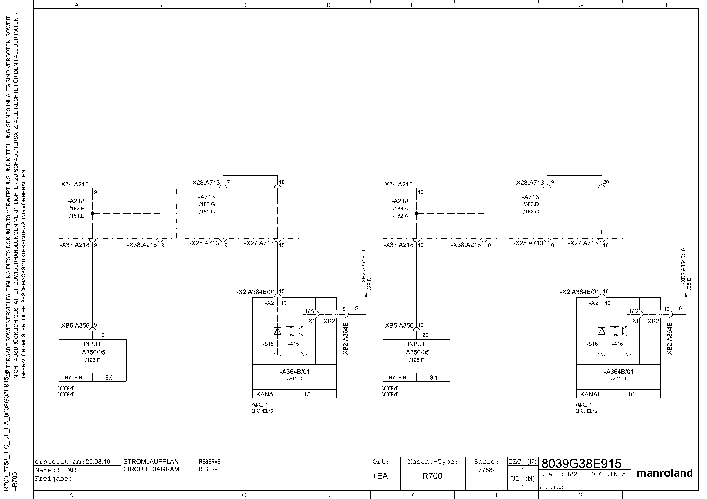

# +EA — Sheet 182 of 407 — RESERVE

**RESERVE**

> Part of the manroland **R700** printing press IEC/UL circuit diagrams.
> Drawing class: **Stromlaufplan / Circuit diagram** (DIN A3).
> Document `+EA` covers the **Printing unit** machine section.

## At a glance

| Field | Value |
|---|---|
| Document | `+EA`  (8039G38E915) |
| Sheet | **182** of 407 |
| Section (DE) | RESERVE |
| Section (EN) | RESERVE |
| Section type | CIRCUIT — Circuit diagram |
| Machine type | `R700` |
| Series | `7758` |
| Created | 25.03.10 |
| Replaces | — |
| Columns used | A, B, C, D, E, F, G, H |
| Path numbers | — |
| Labels on sheet | 98 |
| Cross-refs out | 14 |
| Cross-refs in | 34 |

**Previous:** [+EA sheet 181](SHEET_0181.md) · **Next:** [+EA sheet 183](SHEET_0183.md) · **Document TOC:** [_TOC.md](_TOC.md)  (+EA) · **Master TOC:** [all sheets](../_MASTER_TOC.md)

## Sheet image (300 DPI, exact vector render)



_Rendered directly from the PDF vector layer at 300 DPI (1-bit), no OCR and no resampling. Use it to confirm anything ambiguous in the text below._

## Cross-references on this sheet

Each entry is a wire leaving this sheet. The printed token is `/sheet.column`; the link resolves to that sheet inside the same document.

| Ref | Target sheet | Col | Path | Destination on target | Target section | From col |
|---|---|---|---|---|---|---|
| `/182.G` | [+EA sheet 182](SHEET_0182.md) | G | — | — | RESERVE | C |
| `/181.G` | [+EA sheet 181](SHEET_0181.md) | G | — | — | RESERVE | C |
| `/300.D` | [+EA sheet 300](SHEET_0300.md) | D | — | — | OPTION: ZWISCHENSTAPEL / | F |
| `/182.C` | [+EA sheet 182](SHEET_0182.md) | C | — | — | RESERVE | F |
| `/182.E` | [+EA sheet 182](SHEET_0182.md) | E | — | — | RESERVE | A |
| `/181.E` | [+EA sheet 181](SHEET_0181.md) | E | — | — | RESERVE | A |
| `/188.A` | [+EA sheet 188](SHEET_0188.md) | A | — | — | RESERVE | E |
| `/182.A` | [+EA sheet 182](SHEET_0182.md) | A | — | — | RESERVE | E |
| `/28.D` | [+EA sheet 28](SHEET_0028.md) | D | — | XB2.A364B:15 | BUSVERBINDUNGEN: SICHERHEITSBUS | D |
| `/28.D` | [+EA sheet 28](SHEET_0028.md) | D | — | XB2.A364B:16 | BUSVERBINDUNGEN: SICHERHEITSBUS | H |
| `/198.F` | [+EA sheet 198](SHEET_0198.md) | F | — | — | REFERENZMODUL | A |
| `/198.F` | [+EA sheet 198](SHEET_0198.md) | F | — | — | REFERENZMODUL | E |
| `/201.D` | [+EA sheet 201](SHEET_0201.md) | D | — | — | REFERENZMODUL | D |
| `/201.D` | [+EA sheet 201](SHEET_0201.md) | D | — | — | REFERENZMODUL | G |

### Incoming references (sheets that point here)

Every other sheet that sends a wire to this one. `Back-ref` is the token printed on *that* sheet; `Path` is its line number.

| From sheet | Cols | Back-ref | Path | Refs | What continues there |
|---|---|---|---|---|---|
| [+EA#28](SHEET_0028.md) | D | `/28.D` | — | 2 | — |
| [+EA#181](SHEET_0181.md) | E, F | `/181.E`, `/181.F` | — | 2 | — |
| [+EA#182](SHEET_0182.md) | A, C, E, F | `/182.A`, `/182.C`, `/182.E`, `/182.F` | — | 4 | — |
| [+EA#188](SHEET_0188.md) | A | `/188.A` | — | 1 | — |
| [+EA#198](SHEET_0198.md) | F | `/198.F` | — | 2 | — |
| [+EA#201](SHEET_0201.md) | D | `/201.D` | — | 2 | — |
| [+EA#227](SHEET_0227.md) | B, D | `/227.B`, `/227.D` | — | 4 | — |
| [+EA#241](SHEET_0241.md) | H | `/241.H` | — | 2 | — |
| [+EA#268](SHEET_0268.md) | G | `/268.G` | — | 2 | — |
| [+EA#272](SHEET_0272.md) | A | `/272.A` | — | 2 | — |
| [+EA#273](SHEET_0273.md) | F | `/273.F` | — | 4 | — |
| [+EA#277](SHEET_0277.md) | G | `/277.G` | — | 2 | — |
| [+EA#279](SHEET_0279.md) | E | `/279.E` | — | 2 | — |
| [+EA#280](SHEET_0280.md) | A | `/280.A` | — | 2 | — |
| [+EA#300](SHEET_0300.md) | D | `/300.D` | — | 1 | — |


## Devices on this sheet

| Tag | Class | Class meaning (IEC) | Col | Sub | Terminal | Sign |
|---|---|---|---|---|---|---|
| `A356/05` | A | Baugruppe / assembly, module, PC board | A | 05 | — | — |
| `A218` | A | Baugruppe / assembly, module, PC board | A | — | — | — |
| `A356/05` | A | Baugruppe / assembly, module, PC board | E | 05 | — | — |
| `A218` | A | Baugruppe / assembly, module, PC board | E | — | — | — |
| `A713` | A | Baugruppe / assembly, module, PC board | F | — | — | — |
| `S16` | S | Schalter / switch | G | — | — | — |
| `A16` | A | Baugruppe / assembly, module, PC board | G | — | — | — |
| `X1` | X | Klemme / terminal, plug connector | H | — | — | — |
| `X2` | X | Klemme / terminal, plug connector | G | — | — | — |
| `XB2` | XB |  | H | — | — | — |
| `S15` | S | Schalter / switch | C | — | — | — |
| `A15` | A | Baugruppe / assembly, module, PC board | D | — | — | — |
| `X1` | X | Klemme / terminal, plug connector | D | — | — | — |
| `X2` | X | Klemme / terminal, plug connector | C | — | — | — |
| `XB2` | XB |  | D | — | — | — |
| `A713` | A | Baugruppe / assembly, module, PC board | C | — | — | — |
| `8.0` | — | cross-device reference | A | — | — | — |
| `XB5.A356` | — | cross-device reference | A | — | — | — |
| `X37.A218` | — | cross-device reference | A | — | — | — |
| `X38.A218` | — | cross-device reference | B | — | — | — |
| `8.1` | — | cross-device reference | E | — | — | — |
| `XB5.A356` | — | cross-device reference | E | — | — | — |
| `X37.A218` | — | cross-device reference | E | — | — | — |
| `X38.A218` | — | cross-device reference | F | — | — | — |
| `X28.A713` | — | cross-device reference | F | — | — | — |
| `XB2.A364B` | — | cross-device reference | H | — | — | — |
| `X27.A713` | — | cross-device reference | G | — | — | — |
| `X25.A713` | — | cross-device reference | F | — | — | — |
| `XB2.A364B` | — | cross-device reference | D | — | — | — |
| `X28.A713` | — | cross-device reference | C | — | — | — |
| `X27.A713` | — | cross-device reference | C | — | — | — |
| `X25.A713` | — | cross-device reference | C | — | — | — |
| `XB2.A364B:15` | — | cross-device reference | D | — | 15 | — |
| `XB2.A364B:16` | — | cross-device reference | H | — | 16 | — |
| `X34.A218` | — | cross-device reference | A | — | — | — |
| `X34.A218` | — | cross-device reference | E | — | — | — |

## Potentials / nets

_No named potentials on this sheet._

## Wire-end annotations (grouped as printed)

A wire that continues elsewhere is annotated with a small cluster: the destination description, the path/line number `#NN`, and the `/sheet.column` cross reference. Each row below is one such cluster exactly as it is grouped on the drawing.

| Col | Y | Path | Cross-ref | Text on the wire |
|---|---|---|---|---|
| C | 303.6 | — | — | `X28.A713 17 18` |
| G | 303.6 | — | — | `X28.A713 19 20` |
| C | 306.4 | — | — | `X34.A218 X34.A218` |
| A | 320.6 | — | — | `A218 9` |
| E | 320.6 | — | — | `10` |
| C | 327.7 | — | — | `A713` |
| F | 327.7 | — | — | `A713` |
| E | 334.8 | — | — | `A218` |
| C | 340.8 | — | `/182.G`, `/181.G` | — |
| F | 340.8 | — | `/300.D`, `/182.C` | — |
| A | 347.9 | — | `/182.E`, `/181.E` | — |
| E | 347.9 | — | `/188.A`, `/182.A` | — |
| C | 405.7 | — | — | `X25.A713 9 X27.A713 15` |
| G | 405.7 | — | — | `X25.A713 10 X27.A713 16` |
| A | 408.5 | — | — | `X37.A218 9 X38.A218 9` |
| E | 408.5 | — | — | `X37.A218 10` |
| F | 408.5 | — | — | `X38.A218 10` |
| D | 418.7 | — | `/28.D` | `XB2.A364B:15` |
| H | 418.7 | — | `/28.D` | `XB2.A364B:16` |
| C | 487.9 | — | — | `X2.A364B/01 15` |
| G | 487.9 | — | — | `X2.A364B/01 16` |
| C | 506.3 | — | — | `X2` |
| G | 506.3 | — | — | `X2` |
| D | 507.7 | — | — | `15 15` |
| H | 507.7 | — | — | `16 16` |
| D | 516.2 | — | — | `15` |
| H | 516.2 | — | — | `16` |
| D | 520.4 | — | — | `17A` |
| H | 520.5 | — | — | `17C` |
| D | 537.5 | — | — | `X1` |
| D | 537.5 | — | — | `XB2` |
| H | 537.5 | — | — | `X1` |
| H | 537.5 | — | — | `XB2` |
| D | 543.7 | — | — | `XB2.A364B` |
| H | 543.7 | — | — | `XB2.A364B` |
| A | 544.6 | — | — | `XB5.A356 9` |
| E | 544.6 | — | — | `XB5.A356 10` |
| A | 561.5 | — | — | `11B` |
| E | 561.5 | — | — | `12B` |
| A | 576.1 | — | — | `INPUT` |
| E | 576.1 | — | — | `INPUT` |
| C | 576.4 | — | — | `S15 A15` |
| G | 576.4 | — | — | `S16 A16` |
| A | 589.9 | — | — | `A356/05` |
| E | 589.9 | — | — | `A356/05` |
| A | 603.7 | — | `/198.F` | — |
| E | 603.7 | — | `/198.F` | — |
| D | 622.5 | — | — | `A364B/01` |
| G | 622.5 | — | — | `A364B/01` |
| A | 632.7 | — | — | `BYTE.BIT 8.0` |
| E | 632.7 | — | — | `BYTE.BIT 8.1` |
| D | 634.9 | — | `/201.D` | — |
| G | 634.9 | — | `/201.D` | — |
| A | 652.8 | — | — | `RESERVE RESERVE` |
| E | 652.8 | — | — | `RESERVE RESERVE` |
| C | 660.7 | — | — | `KANAL 15` |
| G | 660.7 | — | — | `KANAL 16` |
| C | 681.1 | — | — | `KANAL 15 CHANNEL 15` |
| G | 681.1 | — | — | `KANAL 16 CHANNEL 16` |


## Reconstructed tables

This sheet carries tabular content (pin map / terminal assignment / index). The grid below was rebuilt from the drawing's own rule lines, so each row is exactly one physical row of the table.

### Table 1 — 8 data rows × 21 columns (at x=99.2, y=296.2)

| X34.A218 A218 /182.E | 9 |  | X28.A713 A713 /182.G /181.G | 17 |  | 18 |  |  |  |  | X34.A218 A218 /188.A | 10 |  | X28.A713 A713 /300.D /182.C | 19 |  | 20 |  |  |  |
|---|---|---|---|---|---|---|---|---|---|---|---|---|---|---|---|---|---|---|---|---|
| `/181.E X37.A218` | `9` | `X38.A218` | `X25.A713 9` | `9` | `X27.A713` | `15` |  |  | `XB2.A364B:15` |  | `/182.A X37.A218` | `10` | `X38.A218` | `X25.A713 10` | `10` | `X27.A713` | `16` |  |  | `XB2.A364B:16` |
|  |  |  |  |  | `X2.A364B/01` | `15` |  |  |  | `/28.D` |  |  |  |  |  | `X2.A364B/01` | `16` |  |  |  |
| `XB5.A356` | `9 11B` |  |  |  | `X2` | `15` | `17A X1` | `XB2` | `15 15` |  | `XB5.A356` | `10 12B` |  |  |  | `X2` | `16` | `17C X1` | `XB2` | `16 16` |
| `INPUT` | `A356/05 /198.F` |  |  |  | `S15` | `A15` |  |  | `XB2.A364B` |  | `INPUT` | `A356/05 /198.F` |  |  |  | `S16` | `A16` |  |  | `XB2.A364B` |
|  |  |  |  |  |  | `A364B/01` |  |  |  |  |  |  |  |  |  |  | `A364B/01` |  |  |  |
| `BYTE.BIT` | `8.0` |  |  |  |  | `/201.D` |  |  |  |  | `BYTE.BIT` | `8.1` |  |  |  |  | `/201.D` |  |  |  |
| `RESERVE` |  |  |  |  |  |  |  |  |  |  | `RESERVE` |  |  |  |  |  |  |  |  |  |
| `RESERVE` |  |  |  |  | `KANAL` |  | `15` |  |  |  | `RESERVE` |  |  |  |  | `KANAL` |  | `16` |  |  |


## Notes and free text on this sheet

| Text | Col | Y (pt) |
|---|---|---|
| `11B` | A | 561.55 |
| `INPUT` | A | 576.07 |
| `BYTE.BIT` | A | 633.32 |
| `RESERVE` | A | 652.75 |
| `12B` | E | 561.55 |
| `INPUT` | E | 576.07 |
| `BYTE.BIT` | E | 633.32 |
| `RESERVE` | E | 652.75 |
| `KANAL 16` | G | 681.1 |
| `CHANNEL 16` | G | 691.04 |
| `17C` | H | 520.49 |
| `KANAL` | G | 660.77 |
| `A364B/01` | G | 622.51 |
| `X2.A364B/01` | G | 487.87 |
| `KANAL 15` | C | 681.1 |
| `CHANNEL 15` | C | 691.04 |
| `17A` | D | 520.44 |
| `KANAL` | C | 660.77 |
| `A364B/01` | D | 622.51 |
| `X2.A364B/01` | C | 487.87 |

## Complete label inventory (exact text from the drawing)

Every text object inside the drawing area of this sheet, in DIN reading order (column A→H, then top→bottom). This is the authoritative list: if a string is not here it is not printed on this sheet.

| Col | Y | X | Dir | Type | Text |
|---|---|---|---|---|---|
| A | 306.4 | 99.2 | → | device ref | `X34.A218` |
| A | 320.6 | 158.5 | → | number | `9` |
| A | 334.8 | 114.0 | → | device tag | `A218` |
| A | 347.9 | 116.8 | → | cross-reference | `/182.E` |
| A | 360.3 | 116.8 | → | cross-reference | `/181.E` |
| A | 408.5 | 100.6 | → | device ref | `X37.A218` |
| A | 409.9 | 158.5 | → | number | `9` |
| A | 544.6 | 99.5 | → | device ref | `XB5.A356` |
| A | 544.6 | 158.5 | → | number | `9` |
| A | 561.5 | 160.7 | → | text | `11B` |
| A | 576.1 | 141.0 | → | text | `INPUT` |
| A | 589.9 | 134.5 | → | device tag | `A356/05` |
| A | 603.7 | 143.6 | → | cross-reference | `/198.F` |
| A | 632.7 | 177.4 | → | device ref | `8.0` |
| A | 633.3 | 109.1 | → | text | `BYTE.BIT` |
| A | 652.7 | 97.2 | → | text | `RESERVE` |
| A | 662.7 | 97.2 | → | text | `RESERVE` |
| B | 408.5 | 214.0 | → | device ref | `X38.A218` |
| B | 409.9 | 271.8 | → | number | `9` |
| C | 303.6 | 320.3 | → | device ref | `X28.A713` |
| C | 303.6 | 377.6 | → | number | `17` |
| C | 303.6 | 469.7 | → | number | `18` |
| C | 327.7 | 333.6 | → | device tag | `A713` |
| C | 340.8 | 335.6 | → | cross-reference | `/182.G` |
| C | 353.2 | 335.6 | → | cross-reference | `/181.G` |
| C | 405.7 | 318.9 | → | device ref | `X25.A713` |
| C | 405.7 | 411.0 | → | device ref | `X27.A713` |
| C | 409.9 | 378.1 | → | number | `9` |
| C | 409.9 | 469.7 | → | number | `15` |
| C | 487.9 | 398.0 | → | text | `X2.A364B/01` |
| C | 487.9 | 469.7 | → | number | `15` |
| C | 506.3 | 446.2 | → | device tag | `X2` |
| C | 507.7 | 472.5 | → | number | `15` |
| C | 576.4 | 442.5 | → | device tag | `S15` |
| C | 660.8 | 431.4 | → | text | `KANAL` |
| C | 681.1 | 423.2 | → | text | `KANAL 15` |
| C | 691.0 | 423.5 | → | text | `CHANNEL 15` |
| D | 418.7 | 608.3 | ↕ | device ref | `XB2.A364B:15` |
| D | 468.0 | 618.2 | ↕ | cross-reference | `/28.D` |
| D | 516.2 | 593.0 | → | number | `15` |
| D | 517.6 | 571.7 | → | number | `15` |
| D | 520.4 | 513.1 | → | text | `17A` |
| D | 537.5 | 516.8 | → | device tag | `X1` |
| D | 537.5 | 541.1 | → | device tag | `XB2` |
| D | 543.7 | 577.2 | ↕ | device ref | `XB2.A364B` |
| D | 576.4 | 485.0 | → | device tag | `A15` |
| D | 622.5 | 471.8 | → | text | `A364B/01` |
| D | 634.9 | 483.3 | → | cross-reference | `/201.D` |
| D | 660.7 | 511.1 | → | number | `15` |
| E | 306.4 | 644.9 | → | device ref | `X34.A218` |
| E | 320.6 | 703.6 | → | number | `10` |
| E | 334.8 | 659.6 | → | device tag | `A218` |
| E | 347.9 | 661.9 | → | cross-reference | `/188.A` |
| E | 360.3 | 661.9 | → | cross-reference | `/182.A` |
| E | 408.5 | 646.3 | → | device ref | `X37.A218` |
| E | 409.9 | 703.6 | → | number | `10` |
| E | 544.6 | 645.2 | → | device ref | `XB5.A356` |
| E | 544.6 | 703.6 | → | number | `10` |
| E | 561.5 | 706.4 | → | text | `12B` |
| E | 576.1 | 686.7 | → | text | `INPUT` |
| E | 589.9 | 680.2 | → | device tag | `A356/05` |
| E | 603.7 | 689.2 | → | cross-reference | `/198.F` |
| E | 632.7 | 724.0 | → | device ref | `8.1` |
| E | 633.3 | 654.8 | → | text | `BYTE.BIT` |
| E | 652.7 | 642.9 | → | text | `RESERVE` |
| E | 662.7 | 642.9 | → | text | `RESERVE` |
| F | 303.6 | 866.0 | → | device ref | `X28.A713` |
| F | 327.7 | 879.3 | → | device tag | `A713` |
| F | 340.8 | 881.6 | → | cross-reference | `/300.D` |
| F | 353.2 | 881.6 | → | cross-reference | `/182.C` |
| F | 405.7 | 864.6 | → | device ref | `X25.A713` |
| F | 408.5 | 759.7 | → | device ref | `X38.A218` |
| F | 409.9 | 816.9 | → | number | `10` |
| G | 303.6 | 923.2 | → | number | `19` |
| G | 303.6 | 1015.9 | → | number | `20` |
| G | 405.7 | 956.7 | → | device ref | `X27.A713` |
| G | 409.9 | 923.2 | → | number | `10` |
| G | 409.9 | 1015.4 | → | number | `16` |
| G | 487.9 | 943.7 | → | text | `X2.A364B/01` |
| G | 487.9 | 1015.4 | → | number | `16` |
| G | 506.3 | 991.8 | → | device tag | `X2` |
| G | 507.7 | 1018.2 | → | number | `16` |
| G | 576.4 | 988.2 | → | device tag | `S16` |
| G | 576.4 | 1030.7 | → | device tag | `A16` |
| G | 622.5 | 1017.5 | → | text | `A364B/01` |
| G | 634.9 | 1029.0 | → | cross-reference | `/201.D` |
| G | 660.8 | 977.1 | → | text | `KANAL` |
| G | 681.1 | 968.9 | → | text | `KANAL 16` |
| G | 691.0 | 969.2 | → | text | `CHANNEL 16` |
| H | 418.7 | 1146.9 | ↕ | device ref | `XB2.A364B:16` |
| H | 468.0 | 1156.8 | ↕ | cross-reference | `/28.D` |
| H | 516.2 | 1138.7 | → | number | `16` |
| H | 517.6 | 1117.4 | → | number | `16` |
| H | 520.5 | 1058.7 | → | text | `17C` |
| H | 537.5 | 1062.4 | → | device tag | `X1` |
| H | 537.5 | 1086.8 | → | device tag | `XB2` |
| H | 543.7 | 1122.8 | ↕ | device ref | `XB2.A364B` |
| H | 660.7 | 1056.8 | → | number | `16` |

## Reading-order text block

The same content as a plain block, grouped by DIN column — convenient to paste or to match against a visual description.

```text
=== Column A ===
 306.4   99.2  devref       X34.A218
 320.6  158.5  numeric      9
 334.8  114.0  devtag       A218
 347.9  116.8  xref         /182.E
 360.3  116.8  xref         /181.E
 408.5  100.6  devref       X37.A218
 409.9  158.5  numeric      9
 544.6   99.5  devref       XB5.A356
 544.6  158.5  numeric      9
 561.5  160.7  text         11B
 576.1  141.0  text         INPUT
 589.9  134.5  devtag       A356/05
 603.7  143.6  xref         /198.F
 632.7  177.4  devref       8.0
 633.3  109.1  text         BYTE.BIT
 652.7   97.2  text         RESERVE
 662.7   97.2  text         RESERVE
=== Column B ===
 408.5  214.0  devref       X38.A218
 409.9  271.8  numeric      9
=== Column C ===
 303.6  320.3  devref       X28.A713
 303.6  377.6  numeric      17
 303.6  469.7  numeric      18
 327.7  333.6  devtag       A713
 340.8  335.6  xref         /182.G
 353.2  335.6  xref         /181.G
 405.7  318.9  devref       X25.A713
 405.7  411.0  devref       X27.A713
 409.9  378.1  numeric      9
 409.9  469.7  numeric      15
 487.9  398.0  text         X2.A364B/01
 487.9  469.7  numeric      15
 506.3  446.2  devtag       X2
 507.7  472.5  numeric      15
 576.4  442.5  devtag       S15
 660.8  431.4  text         KANAL
 681.1  423.2  text         KANAL 15
 691.0  423.5  text         CHANNEL 15
=== Column D ===
 418.7  608.3  devref       XB2.A364B:15
 468.0  618.2  xref         /28.D
 516.2  593.0  numeric      15
 517.6  571.7  numeric      15
 520.4  513.1  text         17A
 537.5  516.8  devtag       X1
 537.5  541.1  devtag       XB2
 543.7  577.2  devref       XB2.A364B
 576.4  485.0  devtag       A15
 622.5  471.8  text         A364B/01
 634.9  483.3  xref         /201.D
 660.7  511.1  numeric      15
=== Column E ===
 306.4  644.9  devref       X34.A218
 320.6  703.6  numeric      10
 334.8  659.6  devtag       A218
 347.9  661.9  xref         /188.A
 360.3  661.9  xref         /182.A
 408.5  646.3  devref       X37.A218
 409.9  703.6  numeric      10
 544.6  645.2  devref       XB5.A356
 544.6  703.6  numeric      10
 561.5  706.4  text         12B
 576.1  686.7  text         INPUT
 589.9  680.2  devtag       A356/05
 603.7  689.2  xref         /198.F
 632.7  724.0  devref       8.1
 633.3  654.8  text         BYTE.BIT
 652.7  642.9  text         RESERVE
 662.7  642.9  text         RESERVE
=== Column F ===
 303.6  866.0  devref       X28.A713
 327.7  879.3  devtag       A713
 340.8  881.6  xref         /300.D
 353.2  881.6  xref         /182.C
 405.7  864.6  devref       X25.A713
 408.5  759.7  devref       X38.A218
 409.9  816.9  numeric      10
=== Column G ===
 303.6  923.2  numeric      19
 303.6 1015.9  numeric      20
 405.7  956.7  devref       X27.A713
 409.9  923.2  numeric      10
 409.9 1015.4  numeric      16
 487.9  943.7  text         X2.A364B/01
 487.9 1015.4  numeric      16
 506.3  991.8  devtag       X2
 507.7 1018.2  numeric      16
 576.4  988.2  devtag       S16
 576.4 1030.7  devtag       A16
 622.5 1017.5  text         A364B/01
 634.9 1029.0  xref         /201.D
 660.8  977.1  text         KANAL
 681.1  968.9  text         KANAL 16
 691.0  969.2  text         CHANNEL 16
=== Column H ===
 418.7 1146.9  devref       XB2.A364B:16
 468.0 1156.8  xref         /28.D
 516.2 1138.7  numeric      16
 517.6 1117.4  numeric      16
 520.5 1058.7  text         17C
 537.5 1062.4  devtag       X1
 537.5 1086.8  devtag       XB2
 543.7 1122.8  devref       XB2.A364B
 660.7 1056.8  numeric      16
```

---
_Generated from the PDF vector text layer; no OCR. Source: `R700_7758_IEC_UL_EA_8039G38E915_p`, sheet 182._
