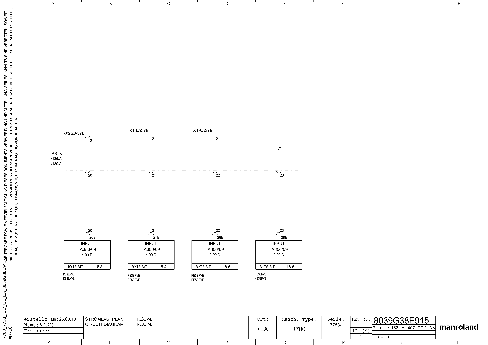

# +EA — Sheet 183 of 407 — RESERVE

**RESERVE**

> Part of the manroland **R700** printing press IEC/UL circuit diagrams.
> Drawing class: **Stromlaufplan / Circuit diagram** (DIN A3).
> Document `+EA` covers the **Printing unit** machine section.

## At a glance

| Field | Value |
|---|---|
| Document | `+EA`  (8039G38E915) |
| Sheet | **183** of 407 |
| Section (DE) | RESERVE |
| Section (EN) | RESERVE |
| Section type | CIRCUIT — Circuit diagram |
| Machine type | `R700` |
| Series | `7758` |
| Created | 25.03.10 |
| Replaces | — |
| Columns used | A, B, C, D, E |
| Path numbers | — |
| Labels on sheet | 49 |
| Cross-refs out | 6 |
| Cross-refs in | 17 |

**Previous:** [+EA sheet 182](SHEET_0182.md) · **Next:** [+EA sheet 184](SHEET_0184.md) · **Document TOC:** [_TOC.md](_TOC.md)  (+EA) · **Master TOC:** [all sheets](../_MASTER_TOC.md)

## Sheet image (300 DPI, exact vector render)



_Rendered directly from the PDF vector layer at 300 DPI (1-bit), no OCR and no resampling. Use it to confirm anything ambiguous in the text below._

## Cross-references on this sheet

Each entry is a wire leaving this sheet. The printed token is `/sheet.column`; the link resolves to that sheet inside the same document.

| Ref | Target sheet | Col | Path | Destination on target | Target section | From col |
|---|---|---|---|---|---|---|
| `/186.A` | [+EA sheet 186](SHEET_0186.md) | A | — | — | RESERVE | A |
| `/180.A` | [+EA sheet 180](SHEET_0180.md) | A | — | — | RESERVE | A |
| `/199.D` | [+EA sheet 199](SHEET_0199.md) | D | — | — | REFERENZMODUL | B |
| `/199.D` | [+EA sheet 199](SHEET_0199.md) | D | — | — | REFERENZMODUL | C |
| `/199.D` | [+EA sheet 199](SHEET_0199.md) | D | — | — | REFERENZMODUL | D |
| `/199.D` | [+EA sheet 199](SHEET_0199.md) | D | — | — | REFERENZMODUL | E |

### Incoming references (sheets that point here)

Every other sheet that sends a wire to this one. `Back-ref` is the token printed on *that* sheet; `Path` is its line number.

| From sheet | Cols | Back-ref | Path | Refs | What continues there |
|---|---|---|---|---|---|
| [+EA#180](SHEET_0180.md) | A | `/180.A` | — | 1 | — |
| [+EA#186](SHEET_0186.md) | A | `/186.A` | — | 1 | — |
| [+EA#199](SHEET_0199.md) | D | `/199.D` | — | 4 | — |
| [+EA#247](SHEET_0247.md) | F | `/247.F` | — | 4 | — |
| [+EA#256](SHEET_0256.md) | B | `/256.B` | — | 4 | — |
| [+EA#263](SHEET_0263.md) | F, G | `/263.F`, `/263.G` | — | 2 | — |
| [+EA#268](SHEET_0268.md) | A | `/268.A` | — | 1 | — |


## Devices on this sheet

| Tag | Class | Class meaning (IEC) | Col | Sub | Terminal | Sign |
|---|---|---|---|---|---|---|
| `A356/09` | A | Baugruppe / assembly, module, PC board | B | 09 | — | — |
| `A356/09` | A | Baugruppe / assembly, module, PC board | C | 09 | — | — |
| `A356/09` | A | Baugruppe / assembly, module, PC board | D | 09 | — | — |
| `A356/09` | A | Baugruppe / assembly, module, PC board | E | 09 | — | — |
| `A378` | A | Baugruppe / assembly, module, PC board | A | — | — | — |
| `18.3` | — | cross-device reference | B | — | — | — |
| `18.4` | — | cross-device reference | C | — | — | — |
| `18.5` | — | cross-device reference | D | — | — | — |
| `18.6` | — | cross-device reference | E | — | — | — |
| `X18.A378` | — | cross-device reference | B | — | — | — |
| `X19.A378` | — | cross-device reference | D | — | — | — |
| `X25.A378` | — | cross-device reference | A | — | — | — |

## Potentials / nets

_No named potentials on this sheet._

## Wire-end annotations (grouped as printed)

A wire that continues elsewhere is annotated with a small cluster: the destination description, the path/line number `#NN`, and the `/sheet.column` cross reference. Each row below is one such cluster exactly as it is grouped on the drawing.

| Col | Y | Path | Cross-ref | Text on the wire |
|---|---|---|---|---|
| B | 313.5 | — | — | `X25.A378 X18.A378 X19.A378` |
| C | 334.8 | — | — | `2` |
| D | 334.8 | — | — | `2` |
| B | 339.1 | — | — | `10` |
| A | 370.2 | — | — | `A378` |
| A | 383.3 | — | `/186.A`, `/180.A` | — |
| B | 424.1 | — | — | `20` |
| C | 424.1 | — | — | `21` |
| D | 424.1 | — | — | `22` |
| E | 424.1 | — | — | `23` |
| B | 558.8 | — | — | `20` |
| C | 558.8 | — | — | `21` |
| D | 558.8 | — | — | `22` |
| E | 558.8 | — | — | `23` |
| B | 575.7 | — | — | `26B` |
| C | 575.7 | — | — | `27B` |
| D | 575.7 | — | — | `28B` |
| E | 575.7 | — | — | `29B` |
| B | 590.2 | — | — | `INPUT` |
| C | 590.2 | — | — | `INPUT` |
| D | 590.2 | — | — | `INPUT` |
| E | 590.2 | — | — | `INPUT` |
| B | 604.1 | — | — | `A356/09` |
| C | 604.1 | — | — | `A356/09` |
| D | 604.1 | — | — | `A356/09` |
| E | 604.1 | — | — | `A356/09` |
| B | 617.9 | — | `/199.D` | — |
| C | 617.9 | — | `/199.D` | — |
| D | 617.9 | — | `/199.D` | — |
| E | 617.9 | — | `/199.D` | — |
| B | 646.9 | — | — | `BYTE.BIT 18.3` |
| C | 646.9 | — | — | `BYTE.BIT 18.4` |
| D | 646.9 | — | — | `BYTE.BIT 18.5` |
| E | 646.9 | — | — | `BYTE.BIT 18.6` |
| A | 666.9 | — | — | `RESERVE RESERVE` |
| E | 666.9 | — | — | `RESERVE RESERVE` |
| B | 669.6 | — | — | `RESERVE RESERVE` |
| D | 669.6 | — | — | `RESERVE RESERVE` |


## Reconstructed tables

This sheet carries tabular content (pin map / terminal assignment / index). The grid below was rebuilt from the drawing's own rule lines, so each row is exactly one physical row of the table.

### Table 1 — 1 data rows × 2 columns (at x=155.9, y=586.8)

| INPUT | A356/09 /199.D |
|---|---|
| `BYTE.BIT` | `18.3` |


### Table 2 — 1 data rows × 2 columns (at x=311.8, y=586.8)

| INPUT | A356/09 /199.D |
|---|---|
| `BYTE.BIT` | `18.4` |


### Table 3 — 1 data rows × 2 columns (at x=467.7, y=586.8)

| INPUT | A356/09 /199.D |
|---|---|
| `BYTE.BIT` | `18.5` |


### Table 4 — 1 data rows × 2 columns (at x=623.6, y=586.8)

| INPUT | A356/09 /199.D |
|---|---|
| `BYTE.BIT` | `18.6` |


## Notes and free text on this sheet

| Text | Col | Y (pt) |
|---|---|---|
| `26B` | B | 575.72 |
| `INPUT` | B | 590.24 |
| `BYTE.BIT` | A | 647.49 |
| `RESERVE` | A | 666.92 |
| `27B` | C | 575.72 |
| `INPUT` | C | 590.24 |
| `BYTE.BIT` | B | 647.49 |
| `RESERVE` | B | 669.56 |
| `28B` | D | 575.72 |
| `INPUT` | D | 590.24 |
| `BYTE.BIT` | D | 647.49 |
| `RESERVE` | D | 669.56 |
| `29B` | E | 575.72 |
| `INPUT` | E | 590.24 |
| `BYTE.BIT` | E | 647.49 |
| `RESERVE` | E | 666.92 |

## Complete label inventory (exact text from the drawing)

Every text object inside the drawing area of this sheet, in DIN reading order (column A→H, then top→bottom). This is the authoritative list: if a string is not here it is not printed on this sheet.

| Col | Y | X | Dir | Type | Text |
|---|---|---|---|---|---|
| A | 320.6 | 155.9 | → | device ref | `X25.A378` |
| A | 370.2 | 122.5 | → | device tag | `A378` |
| A | 383.3 | 124.7 | → | cross-reference | `/186.A` |
| A | 395.7 | 124.7 | → | cross-reference | `/180.A` |
| A | 647.5 | 165.8 | → | text | `BYTE.BIT` |
| A | 666.9 | 153.9 | → | text | `RESERVE` |
| A | 676.9 | 153.9 | → | text | `RESERVE` |
| B | 313.5 | 311.8 | → | device ref | `X18.A378` |
| B | 339.1 | 214.6 | → | number | `10` |
| B | 424.1 | 215.1 | → | number | `20` |
| B | 558.7 | 215.1 | → | number | `20` |
| B | 575.7 | 218.0 | → | text | `26B` |
| B | 590.2 | 197.7 | → | text | `INPUT` |
| B | 604.1 | 191.2 | → | device tag | `A356/09` |
| B | 617.9 | 199.8 | → | cross-reference | `/199.D` |
| B | 646.9 | 231.2 | → | device ref | `18.3` |
| B | 647.5 | 321.7 | → | text | `BYTE.BIT` |
| B | 669.6 | 311.0 | → | text | `RESERVE` |
| B | 680.2 | 311.0 | → | text | `RESERVE` |
| C | 334.8 | 371.1 | → | number | `2` |
| C | 424.1 | 371.1 | → | number | `21` |
| C | 558.7 | 371.1 | → | number | `21` |
| C | 575.7 | 373.9 | → | text | `27B` |
| C | 590.2 | 353.6 | → | text | `INPUT` |
| C | 604.1 | 347.1 | → | device tag | `A356/09` |
| C | 617.9 | 355.7 | → | cross-reference | `/199.D` |
| C | 646.9 | 387.1 | → | device ref | `18.4` |
| D | 313.5 | 467.7 | → | device ref | `X19.A378` |
| D | 334.8 | 527.0 | → | number | `2` |
| D | 424.1 | 527.0 | → | number | `22` |
| D | 558.7 | 527.0 | → | number | `22` |
| D | 575.7 | 529.8 | → | text | `28B` |
| D | 590.2 | 509.5 | → | text | `INPUT` |
| D | 604.1 | 503.0 | → | device tag | `A356/09` |
| D | 617.9 | 511.7 | → | cross-reference | `/199.D` |
| D | 646.9 | 543.0 | → | device ref | `18.5` |
| D | 647.5 | 477.6 | → | text | `BYTE.BIT` |
| D | 669.6 | 466.9 | → | text | `RESERVE` |
| D | 680.2 | 466.9 | → | text | `RESERVE` |
| E | 424.1 | 682.9 | → | number | `23` |
| E | 558.7 | 682.9 | → | number | `23` |
| E | 575.7 | 685.7 | → | text | `29B` |
| E | 590.2 | 665.4 | → | text | `INPUT` |
| E | 604.1 | 658.9 | → | device tag | `A356/09` |
| E | 617.9 | 667.6 | → | cross-reference | `/199.D` |
| E | 646.9 | 698.9 | → | device ref | `18.6` |
| E | 647.5 | 633.5 | → | text | `BYTE.BIT` |
| E | 666.9 | 621.6 | → | text | `RESERVE` |
| E | 676.9 | 621.6 | → | text | `RESERVE` |

## Reading-order text block

The same content as a plain block, grouped by DIN column — convenient to paste or to match against a visual description.

```text
=== Column A ===
 320.6  155.9  devref       X25.A378
 370.2  122.5  devtag       A378
 383.3  124.7  xref         /186.A
 395.7  124.7  xref         /180.A
 647.5  165.8  text         BYTE.BIT
 666.9  153.9  text         RESERVE
 676.9  153.9  text         RESERVE
=== Column B ===
 313.5  311.8  devref       X18.A378
 339.1  214.6  numeric      10
 424.1  215.1  numeric      20
 558.7  215.1  numeric      20
 575.7  218.0  text         26B
 590.2  197.7  text         INPUT
 604.1  191.2  devtag       A356/09
 617.9  199.8  xref         /199.D
 646.9  231.2  devref       18.3
 647.5  321.7  text         BYTE.BIT
 669.6  311.0  text         RESERVE
 680.2  311.0  text         RESERVE
=== Column C ===
 334.8  371.1  numeric      2
 424.1  371.1  numeric      21
 558.7  371.1  numeric      21
 575.7  373.9  text         27B
 590.2  353.6  text         INPUT
 604.1  347.1  devtag       A356/09
 617.9  355.7  xref         /199.D
 646.9  387.1  devref       18.4
=== Column D ===
 313.5  467.7  devref       X19.A378
 334.8  527.0  numeric      2
 424.1  527.0  numeric      22
 558.7  527.0  numeric      22
 575.7  529.8  text         28B
 590.2  509.5  text         INPUT
 604.1  503.0  devtag       A356/09
 617.9  511.7  xref         /199.D
 646.9  543.0  devref       18.5
 647.5  477.6  text         BYTE.BIT
 669.6  466.9  text         RESERVE
 680.2  466.9  text         RESERVE
=== Column E ===
 424.1  682.9  numeric      23
 558.7  682.9  numeric      23
 575.7  685.7  text         29B
 590.2  665.4  text         INPUT
 604.1  658.9  devtag       A356/09
 617.9  667.6  xref         /199.D
 646.9  698.9  devref       18.6
 647.5  633.5  text         BYTE.BIT
 666.9  621.6  text         RESERVE
 676.9  621.6  text         RESERVE
```

---
_Generated from the PDF vector text layer; no OCR. Source: `R700_7758_IEC_UL_EA_8039G38E915_p`, sheet 183._
