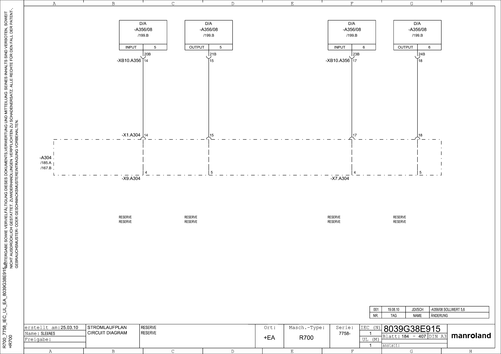

# +EA — Sheet 184 of 407 — RESERVE

**RESERVE**

> Part of the manroland **R700** printing press IEC/UL circuit diagrams.
> Drawing class: **Stromlaufplan / Circuit diagram** (DIN A3).
> Document `+EA` covers the **Printing unit** machine section.

## At a glance

| Field | Value |
|---|---|
| Document | `+EA`  (8039G38E915) |
| Sheet | **184** of 407 |
| Section (DE) | RESERVE |
| Section (EN) | RESERVE |
| Section type | CIRCUIT — Circuit diagram |
| Machine type | `R700` |
| Series | `7758` |
| Created | 25.03.10 |
| Replaces | — |
| Columns used | A, B, C, D, F, G, H |
| Path numbers | — |
| Labels on sheet | 60 |
| Cross-refs out | 6 |
| Cross-refs in | 18 |

**Previous:** [+EA sheet 183](SHEET_0183.md) · **Next:** [+EA sheet 185](SHEET_0185.md) · **Document TOC:** [_TOC.md](_TOC.md)  (+EA) · **Master TOC:** [all sheets](../_MASTER_TOC.md)

## Sheet image (300 DPI, exact vector render)



_Rendered directly from the PDF vector layer at 300 DPI (1-bit), no OCR and no resampling. Use it to confirm anything ambiguous in the text below._

## Cross-references on this sheet

Each entry is a wire leaving this sheet. The printed token is `/sheet.column`; the link resolves to that sheet inside the same document.

| Ref | Target sheet | Col | Path | Destination on target | Target section | From col |
|---|---|---|---|---|---|---|
| `/199.B` | [+EA sheet 199](SHEET_0199.md) | B | — | — | REFERENZMODUL | B |
| `/199.B` | [+EA sheet 199](SHEET_0199.md) | B | — | — | REFERENZMODUL | D |
| `/199.B` | [+EA sheet 199](SHEET_0199.md) | B | — | — | REFERENZMODUL | F |
| `/199.B` | [+EA sheet 199](SHEET_0199.md) | B | — | — | REFERENZMODUL | G |
| `/185.A` | [+EA sheet 185](SHEET_0185.md) | A | — | — | RESERVE | A |
| `/167.B` | [+EA sheet 167](SHEET_0167.md) | B | — | — | BOGENFÜHRUNGSELEMENT (BLASROHRE) | A |

### Incoming references (sheets that point here)

Every other sheet that sends a wire to this one. `Back-ref` is the token printed on *that* sheet; `Path` is its line number.

| From sheet | Cols | Back-ref | Path | Refs | What continues there |
|---|---|---|---|---|---|
| [+EA#167](SHEET_0167.md) | B | `/167.B` | — | 1 | — |
| [+EA#185](SHEET_0185.md) | A | `/185.A` | — | 1 | — |
| [+EA#199](SHEET_0199.md) | B | `/199.B` | — | 4 | — |
| [+EA#208](SHEET_0208.md) | C | `/208.C` | — | 4 | — |
| [+EA#246](SHEET_0246.md) | E | `/246.E` | — | 2 | — |
| [+EA#251](SHEET_0251.md) | F | `/251.F` | — | 2 | — |
| [+EA#254](SHEET_0254.md) | E | `/254.E` | — | 4 | — |


## Devices on this sheet

| Tag | Class | Class meaning (IEC) | Col | Sub | Terminal | Sign |
|---|---|---|---|---|---|---|
| `A356/08` | A | Baugruppe / assembly, module, PC board | D | 08 | — | — |
| `A356/08` | A | Baugruppe / assembly, module, PC board | B | 08 | — | — |
| `A356/08` | A | Baugruppe / assembly, module, PC board | G | 08 | — | — |
| `A356/08` | A | Baugruppe / assembly, module, PC board | F | 08 | — | — |
| `A304` | A | Baugruppe / assembly, module, PC board | A | — | — | — |
| `XB10.A356` | — | cross-device reference | B | — | — | — |
| `XB10.A356` | — | cross-device reference | F | — | — | — |
| `X1.A304` | — | cross-device reference | B | — | — | — |
| `NR.` | — | cross-device reference | F | — | — | — |
| `19.08.10` | — | cross-device reference | G | — | — | — |
| `X7.A304` | — | cross-device reference | F | — | — | — |
| `X9.A304` | — | cross-device reference | B | — | — | — |

## Potentials / nets

_No named potentials on this sheet._

## Wire-end annotations (grouped as printed)

A wire that continues elsewhere is annotated with a small cluster: the destination description, the path/line number `#NN`, and the `/sheet.column` cross reference. Each row below is one such cluster exactly as it is grouped on the drawing.

| Col | Y | Path | Cross-ref | Text on the wire |
|---|---|---|---|---|
| B | 51.6 | — | — | `D/A` |
| D | 51.6 | — | — | `D/A` |
| F | 51.6 | — | — | `D/A` |
| G | 51.6 | — | — | `D/A` |
| B | 65.5 | — | — | `A356/08` |
| D | 65.5 | — | — | `A356/08` |
| F | 65.5 | — | — | `A356/08` |
| G | 65.5 | — | — | `A356/08` |
| B | 80.3 | — | `/199.B` | — |
| D | 80.3 | — | `/199.B` | — |
| F | 80.3 | — | `/199.B` | — |
| G | 80.3 | — | `/199.B` | — |
| B | 108.7 | — | — | `INPUT 5` |
| D | 108.7 | — | — | `OUTPUT 5` |
| F | 108.7 | — | — | `INPUT 6` |
| G | 108.7 | — | — | `OUTPUT 6` |
| C | 125.0 | — | — | `20B` |
| D | 125.0 | — | — | `21B` |
| F | 125.0 | — | — | `23B` |
| G | 125.0 | — | — | `24B` |
| E | 139.2 | — | — | `XB10.A356 14 18` |
| F | 139.2 | — | — | `XB10.A356 17` |
| D | 140.6 | — | — | `15` |
| E | 316.4 | — | — | `X1.A304 14 15 17 18` |
| A | 370.2 | — | — | `A304` |
| A | 383.3 | — | `/185.A`, `/167.B` | — |
| E | 406.4 | — | — | `X9.A304 4 5 X7.A304 4 5` |
| B | 513.7 | — | — | `RESERVE RESERVE` |
| C | 513.7 | — | — | `RESERVE RESERVE` |
| F | 513.7 | — | — | `RESERVE RESERVE` |
| G | 513.7 | — | — | `RESERVE RESERVE` |
| G | 733.0 | — | — | `001 19.08.10 JDI/SCH A356/08 SOLLWERT 5,6` |
| G | 747.1 | — | — | `NR. TAG NAME ÄNDERUNG` |


## Reconstructed tables

This sheet carries tabular content (pin map / terminal assignment / index). The grid below was rebuilt from the drawing's own rule lines, so each row is exactly one physical row of the table.

### Table 1 — 1 data rows × 2 columns (at x=283.5, y=48.2)

| D/A | A356/08 /199.B |
|---|---|
| `INPUT` | `5` |


### Table 2 — 1 data rows × 2 columns (at x=439.4, y=48.2)

| D/A | A356/08 /199.B |
|---|---|
| `OUTPUT` | `5` |


### Table 3 — 1 data rows × 2 columns (at x=779.5, y=48.2)

| D/A | A356/08 /199.B |
|---|---|
| `INPUT` | `6` |


### Table 4 — 1 data rows × 2 columns (at x=935.4, y=48.2)

| D/A | A356/08 /199.B |
|---|---|
| `OUTPUT` | `6` |


## Notes and free text on this sheet

| Text | Col | Y (pt) |
|---|---|---|
| `21B` | D | 125.01 |
| `D/A` | D | 51.61 |
| `OUTPUT` | C | 108.71 |
| `RESERVE` | C | 513.66 |
| `20B` | C | 125.01 |
| `D/A` | B | 51.61 |
| `INPUT` | B | 108.7 |
| `RESERVE` | B | 513.66 |
| `24B` | G | 125.01 |
| `D/A` | G | 51.61 |
| `OUTPUT` | G | 108.71 |
| `RESERVE` | G | 513.66 |
| `23B` | F | 125.01 |
| `D/A` | F | 51.61 |
| `INPUT` | F | 108.7 |
| `RESERVE` | F | 513.66 |
| `TAG` | G | 747.27 |
| `NAME` | G | 747.25 |
| `ÄNDERUNG` | G | 747.31 |
| `JDI/SCH` | G | 733.1 |
| `A356/08 SOLLWERT 5,6` | H | 733.11 |

## Complete label inventory (exact text from the drawing)

Every text object inside the drawing area of this sheet, in DIN reading order (column A→H, then top→bottom). This is the authoritative list: if a string is not here it is not printed on this sheet.

| Col | Y | X | Dir | Type | Text |
|---|---|---|---|---|---|
| A | 370.2 | 94.1 | → | device tag | `A304` |
| A | 383.3 | 96.4 | → | cross-reference | `/185.A` |
| A | 395.7 | 96.7 | → | cross-reference | `/167.B` |
| B | 51.6 | 331.4 | → | text | `D/A` |
| B | 65.5 | 318.8 | → | device tag | `A356/08` |
| B | 80.3 | 327.5 | → | cross-reference | `/199.B` |
| B | 108.7 | 298.3 | → | text | `INPUT` |
| B | 139.2 | 277.8 | → | device ref | `XB10.A356` |
| B | 316.4 | 289.4 | → | device ref | `X1.A304` |
| B | 419.8 | 289.4 | → | device ref | `X9.A304` |
| B | 513.7 | 282.6 | → | text | `RESERVE` |
| B | 524.3 | 282.6 | → | text | `RESERVE` |
| C | 108.7 | 366.1 | → | number | `5` |
| C | 108.7 | 449.7 | → | text | `OUTPUT` |
| C | 125.0 | 342.7 | → | text | `20B` |
| C | 140.6 | 342.1 | → | number | `14` |
| C | 317.8 | 342.1 | → | number | `14` |
| C | 406.4 | 344.8 | → | number | `4` |
| C | 513.7 | 438.5 | → | text | `RESERVE` |
| C | 524.3 | 438.5 | → | text | `RESERVE` |
| D | 51.6 | 487.3 | → | text | `D/A` |
| D | 65.5 | 474.7 | → | device tag | `A356/08` |
| D | 80.3 | 483.4 | → | cross-reference | `/199.B` |
| D | 108.7 | 522.0 | → | number | `5` |
| D | 125.0 | 498.6 | → | text | `21B` |
| D | 140.6 | 498.0 | → | number | `15` |
| D | 317.8 | 498.0 | → | number | `15` |
| D | 406.4 | 500.7 | → | number | `5` |
| F | 51.6 | 827.4 | → | text | `D/A` |
| F | 65.5 | 814.8 | → | device tag | `A356/08` |
| F | 80.3 | 823.6 | → | cross-reference | `/199.B` |
| F | 108.7 | 794.4 | → | text | `INPUT` |
| F | 108.7 | 862.2 | → | number | `6` |
| F | 125.0 | 838.8 | → | text | `23B` |
| F | 139.2 | 773.9 | → | device ref | `XB10.A356` |
| F | 140.6 | 838.2 | → | number | `17` |
| F | 317.8 | 838.2 | → | number | `17` |
| F | 406.4 | 840.9 | → | number | `4` |
| F | 419.8 | 785.5 | → | device ref | `X7.A304` |
| F | 513.7 | 778.7 | → | text | `RESERVE` |
| F | 524.3 | 778.7 | → | text | `RESERVE` |
| F | 733.0 | 887.7 | → | number | `001` |
| F | 747.1 | 886.7 | → | device ref | `NR.` |
| G | 51.6 | 983.3 | → | text | `D/A` |
| G | 65.5 | 970.7 | → | device tag | `A356/08` |
| G | 80.3 | 979.5 | → | cross-reference | `/199.B` |
| G | 108.7 | 945.8 | → | text | `OUTPUT` |
| G | 108.7 | 1018.1 | → | number | `6` |
| G | 125.0 | 994.7 | → | text | `24B` |
| G | 140.6 | 994.1 | → | number | `18` |
| G | 317.8 | 994.1 | → | number | `18` |
| G | 406.4 | 996.8 | → | number | `5` |
| G | 513.7 | 934.6 | → | text | `RESERVE` |
| G | 524.3 | 934.6 | → | text | `RESERVE` |
| G | 733.1 | 921.5 | → | device ref | `19.08.10` |
| G | 733.1 | 978.7 | → | text | `JDI/SCH` |
| G | 747.3 | 928.3 | → | text | `TAG` |
| G | 747.3 | 981.7 | → | text | `NAME` |
| G | 747.3 | 1024.3 | → | text | `ÄNDERUNG` |
| H | 733.1 | 1023.7 | → | text | `A356/08 SOLLWERT 5,6` |

## Reading-order text block

The same content as a plain block, grouped by DIN column — convenient to paste or to match against a visual description.

```text
=== Column A ===
 370.2   94.1  devtag       A304
 383.3   96.4  xref         /185.A
 395.7   96.7  xref         /167.B
=== Column B ===
  51.6  331.4  text         D/A
  65.5  318.8  devtag       A356/08
  80.3  327.5  xref         /199.B
 108.7  298.3  text         INPUT
 139.2  277.8  devref       XB10.A356
 316.4  289.4  devref       X1.A304
 419.8  289.4  devref       X9.A304
 513.7  282.6  text         RESERVE
 524.3  282.6  text         RESERVE
=== Column C ===
 108.7  366.1  numeric      5
 108.7  449.7  text         OUTPUT
 125.0  342.7  text         20B
 140.6  342.1  numeric      14
 317.8  342.1  numeric      14
 406.4  344.8  numeric      4
 513.7  438.5  text         RESERVE
 524.3  438.5  text         RESERVE
=== Column D ===
  51.6  487.3  text         D/A
  65.5  474.7  devtag       A356/08
  80.3  483.4  xref         /199.B
 108.7  522.0  numeric      5
 125.0  498.6  text         21B
 140.6  498.0  numeric      15
 317.8  498.0  numeric      15
 406.4  500.7  numeric      5
=== Column F ===
  51.6  827.4  text         D/A
  65.5  814.8  devtag       A356/08
  80.3  823.6  xref         /199.B
 108.7  794.4  text         INPUT
 108.7  862.2  numeric      6
 125.0  838.8  text         23B
 139.2  773.9  devref       XB10.A356
 140.6  838.2  numeric      17
 317.8  838.2  numeric      17
 406.4  840.9  numeric      4
 419.8  785.5  devref       X7.A304
 513.7  778.7  text         RESERVE
 524.3  778.7  text         RESERVE
 733.0  887.7  numeric      001
 747.1  886.7  devref       NR.
=== Column G ===
  51.6  983.3  text         D/A
  65.5  970.7  devtag       A356/08
  80.3  979.5  xref         /199.B
 108.7  945.8  text         OUTPUT
 108.7 1018.1  numeric      6
 125.0  994.7  text         24B
 140.6  994.1  numeric      18
 317.8  994.1  numeric      18
 406.4  996.8  numeric      5
 513.7  934.6  text         RESERVE
 524.3  934.6  text         RESERVE
 733.1  921.5  devref       19.08.10
 733.1  978.7  text         JDI/SCH
 747.3  928.3  text         TAG
 747.3  981.7  text         NAME
 747.3 1024.3  text         ÄNDERUNG
=== Column H ===
 733.1 1023.7  text         A356/08 SOLLWERT 5,6
```

---
_Generated from the PDF vector text layer; no OCR. Source: `R700_7758_IEC_UL_EA_8039G38E915_p`, sheet 184._
