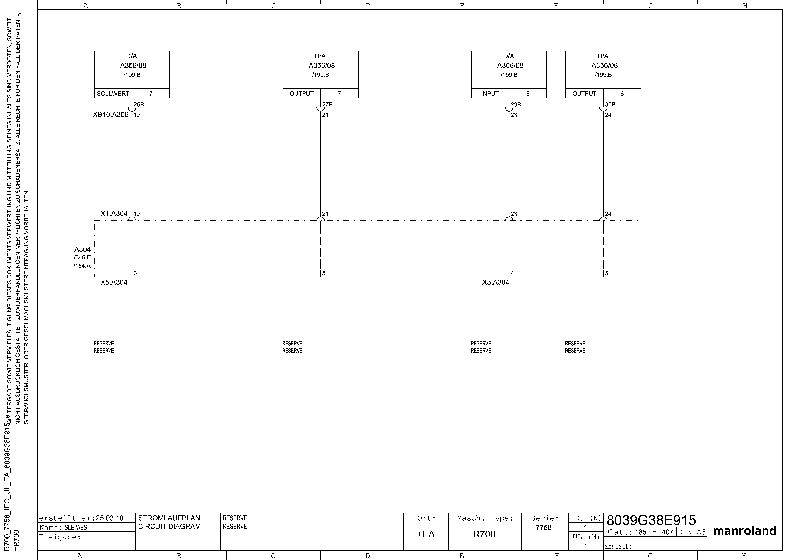

# +EA — Sheet 185 of 407 — RESERVE

**RESERVE**

> Part of the manroland **R700** printing press IEC/UL circuit diagrams.
> Drawing class: **Stromlaufplan / Circuit diagram** (DIN A3).
> Document `+EA` covers the **Printing unit** machine section.

## At a glance

| Field | Value |
|---|---|
| Document | `+EA`  (8039G38E915) |
| Sheet | **185** of 407 |
| Section (DE) | RESERVE |
| Section (EN) | RESERVE |
| Section type | CIRCUIT — Circuit diagram |
| Machine type | `R700` |
| Series | `7758` |
| Created | 25.03.10 |
| Replaces | — |
| Columns used | A, B, C, D, E, F, G |
| Path numbers | — |
| Labels on sheet | 51 |
| Cross-refs out | 6 |
| Cross-refs in | 18 |

**Previous:** [+EA sheet 184](SHEET_0184.md) · **Next:** [+EA sheet 186](SHEET_0186.md) · **Document TOC:** [_TOC.md](_TOC.md)  (+EA) · **Master TOC:** [all sheets](../_MASTER_TOC.md)

## Sheet image (300 DPI, exact vector render)



_Rendered directly from the PDF vector layer at 300 DPI (1-bit), no OCR and no resampling. Use it to confirm anything ambiguous in the text below._

## Cross-references on this sheet

Each entry is a wire leaving this sheet. The printed token is `/sheet.column`; the link resolves to that sheet inside the same document.

| Ref | Target sheet | Col | Path | Destination on target | Target section | From col |
|---|---|---|---|---|---|---|
| `/199.B` | [+EA sheet 199](SHEET_0199.md) | B | — | — | REFERENZMODUL | A |
| `/199.B` | [+EA sheet 199](SHEET_0199.md) | B | — | — | REFERENZMODUL | C |
| `/199.B` | [+EA sheet 199](SHEET_0199.md) | B | — | — | REFERENZMODUL | F |
| `/199.B` | [+EA sheet 199](SHEET_0199.md) | B | — | — | REFERENZMODUL | G |
| `/346.E` | [+EA sheet 346](SHEET_0346.md) | E | — | — | OPTION: VORBEREITUNG CO2 LÖSCHANLAGE | A |
| `/184.A` | [+EA sheet 184](SHEET_0184.md) | A | — | — | RESERVE | A |

### Incoming references (sheets that point here)

Every other sheet that sends a wire to this one. `Back-ref` is the token printed on *that* sheet; `Path` is its line number.

| From sheet | Cols | Back-ref | Path | Refs | What continues there |
|---|---|---|---|---|---|
| [+EA#184](SHEET_0184.md) | A | `/184.A` | — | 1 | — |
| [+EA#199](SHEET_0199.md) | B | `/199.B` | — | 4 | — |
| [+EA#208](SHEET_0208.md) | C | `/208.C` | — | 4 | — |
| [+EA#233](SHEET_0233.md) | H | `/233.H` | — | 2 | — |
| [+EA#240](SHEET_0240.md) | A | `/240.A` | — | 2 | — |
| [+EA#254](SHEET_0254.md) | E | `/254.E` | — | 4 | — |
| [+EA#346](SHEET_0346.md) | E | `/346.E` | — | 1 | — |


## Devices on this sheet

| Tag | Class | Class meaning (IEC) | Col | Sub | Terminal | Sign |
|---|---|---|---|---|---|---|
| `A304` | A | Baugruppe / assembly, module, PC board | A | — | — | — |
| `A356/08` | A | Baugruppe / assembly, module, PC board | C | 08 | — | — |
| `A356/08` | A | Baugruppe / assembly, module, PC board | A | 08 | — | — |
| `A356/08` | A | Baugruppe / assembly, module, PC board | F | 08 | — | — |
| `A356/08` | A | Baugruppe / assembly, module, PC board | G | 08 | — | — |
| `XB10.A356` | — | cross-device reference | A | — | — | — |
| `X1.A304` | — | cross-device reference | A | — | — | — |
| `X3.A304` | — | cross-device reference | E | — | — | — |
| `X5.A304` | — | cross-device reference | A | — | — | — |

## Potentials / nets

_No named potentials on this sheet._

## Wire-end annotations (grouped as printed)

A wire that continues elsewhere is annotated with a small cluster: the destination description, the path/line number `#NN`, and the `/sheet.column` cross reference. Each row below is one such cluster exactly as it is grouped on the drawing.

| Col | Y | Path | Cross-ref | Text on the wire |
|---|---|---|---|---|
| A | 80.0 | — | — | `D/A` |
| C | 80.0 | — | — | `D/A` |
| E | 80.0 | — | — | `D/A` |
| F | 80.0 | — | — | `D/A` |
| A | 93.8 | — | — | `A356/08` |
| C | 93.8 | — | — | `A356/08` |
| F | 93.8 | — | — | `A356/08` |
| G | 93.8 | — | — | `A356/08` |
| A | 108.7 | — | `/199.B` | — |
| C | 108.7 | — | `/199.B` | — |
| F | 108.7 | — | `/199.B` | — |
| G | 108.7 | — | `/199.B` | — |
| A | 137.0 | — | — | `SOLLWERT 7` |
| C | 137.1 | — | — | `OUTPUT 7` |
| E | 137.1 | — | — | `INPUT 8` |
| F | 137.1 | — | — | `OUTPUT 8` |
| B | 153.4 | — | — | `25B` |
| D | 153.4 | — | — | `27B` |
| F | 153.4 | — | — | `29B` |
| G | 153.4 | — | — | `30B` |
| A | 167.6 | — | — | `XB10.A356 19` |
| D | 169.0 | — | — | `21` |
| F | 169.0 | — | — | `23 24` |
| A | 316.4 | — | — | `X1.A304 19` |
| D | 317.8 | — | — | `21` |
| F | 317.8 | — | — | `23 24` |
| A | 370.2 | — | — | `A304` |
| A | 383.3 | — | `/346.E`, `/184.A` | — |
| B | 407.1 | — | — | `3` |
| D | 407.1 | — | — | `5` |
| F | 407.1 | — | — | `4 5` |
| C | 419.8 | — | — | `X5.A304 X3.A304` |
| A | 513.7 | — | — | `RESERVE RESERVE` |
| C | 513.7 | — | — | `RESERVE RESERVE` |
| E | 513.7 | — | — | `RESERVE RESERVE` |
| F | 513.7 | — | — | `RESERVE RESERVE` |


## Reconstructed tables

This sheet carries tabular content (pin map / terminal assignment / index). The grid below was rebuilt from the drawing's own rule lines, so each row is exactly one physical row of the table.

### Table 1 — 1 data rows × 2 columns (at x=141.7, y=76.5)

| D/A | A356/08 /199.B |
|---|---|
| `SOLLWERT` | `7` |


### Table 2 — 1 data rows × 2 columns (at x=425.2, y=76.5)

| D/A | A356/08 /199.B |
|---|---|
| `OUTPUT` | `7` |


### Table 3 — 1 data rows × 2 columns (at x=708.7, y=76.5)

| D/A | A356/08 /199.B |
|---|---|
| `INPUT` | `8` |


### Table 4 — 1 data rows × 2 columns (at x=850.4, y=76.5)

| D/A | A356/08 /199.B |
|---|---|
| `OUTPUT` | `8` |


## Notes and free text on this sheet

| Text | Col | Y (pt) |
|---|---|---|
| `27B` | D | 153.36 |
| `D/A` | C | 79.96 |
| `OUTPUT` | C | 137.06 |
| `RESERVE` | C | 513.66 |
| `25B` | B | 153.36 |
| `D/A` | A | 79.96 |
| `SOLLWERT` | A | 137 |
| `RESERVE` | A | 513.66 |
| `29B` | F | 153.36 |
| `D/A` | E | 79.96 |
| `INPUT` | E | 137.05 |
| `RESERVE` | E | 513.66 |
| `30B` | G | 153.36 |
| `D/A` | F | 79.96 |
| `OUTPUT` | F | 137.06 |
| `RESERVE` | F | 513.66 |

## Complete label inventory (exact text from the drawing)

Every text object inside the drawing area of this sheet, in DIN reading order (column A→H, then top→bottom). This is the authoritative list: if a string is not here it is not printed on this sheet.

| Col | Y | X | Dir | Type | Text |
|---|---|---|---|---|---|
| A | 80.0 | 189.6 | → | text | `D/A` |
| A | 93.8 | 177.0 | → | device tag | `A356/08` |
| A | 108.7 | 185.8 | → | cross-reference | `/199.B` |
| A | 137.0 | 145.6 | → | text | `SOLLWERT` |
| A | 167.5 | 136.1 | → | device ref | `XB10.A356` |
| A | 316.4 | 147.7 | → | device ref | `X1.A304` |
| A | 370.2 | 108.3 | → | device tag | `A304` |
| A | 383.3 | 111.1 | → | cross-reference | `/346.E` |
| A | 395.7 | 110.6 | → | cross-reference | `/184.A` |
| A | 419.8 | 147.7 | → | device ref | `X5.A304` |
| A | 513.7 | 140.9 | → | text | `RESERVE` |
| A | 524.3 | 140.9 | → | text | `RESERVE` |
| B | 137.1 | 224.4 | → | number | `7` |
| B | 153.4 | 201.0 | → | text | `25B` |
| B | 169.0 | 200.4 | → | number | `19` |
| B | 317.8 | 200.4 | → | number | `19` |
| B | 407.1 | 201.0 | → | number | `3` |
| C | 80.0 | 473.1 | → | text | `D/A` |
| C | 93.8 | 460.5 | → | device tag | `A356/08` |
| C | 108.7 | 469.3 | → | cross-reference | `/199.B` |
| C | 137.1 | 435.5 | → | text | `OUTPUT` |
| C | 513.7 | 424.3 | → | text | `RESERVE` |
| C | 524.3 | 424.3 | → | text | `RESERVE` |
| D | 137.1 | 507.8 | → | number | `7` |
| D | 153.4 | 484.4 | → | text | `27B` |
| D | 169.0 | 484.4 | → | number | `21` |
| D | 317.8 | 484.4 | → | number | `21` |
| D | 407.1 | 484.4 | → | number | `5` |
| E | 80.0 | 756.6 | → | text | `D/A` |
| E | 137.0 | 723.5 | → | text | `INPUT` |
| E | 419.8 | 721.7 | → | device ref | `X3.A304` |
| E | 513.7 | 707.8 | → | text | `RESERVE` |
| E | 524.3 | 707.8 | → | text | `RESERVE` |
| F | 80.0 | 898.3 | → | text | `D/A` |
| F | 93.8 | 744.0 | → | device tag | `A356/08` |
| F | 108.7 | 752.7 | → | cross-reference | `/199.B` |
| F | 137.1 | 791.3 | → | number | `8` |
| F | 137.1 | 860.7 | → | text | `OUTPUT` |
| F | 153.4 | 767.9 | → | text | `29B` |
| F | 169.0 | 767.9 | → | number | `23` |
| F | 317.8 | 767.9 | → | number | `23` |
| F | 407.1 | 767.9 | → | number | `4` |
| F | 513.7 | 849.5 | → | text | `RESERVE` |
| F | 524.3 | 849.5 | → | text | `RESERVE` |
| G | 93.8 | 885.7 | → | device tag | `A356/08` |
| G | 108.7 | 894.5 | → | cross-reference | `/199.B` |
| G | 137.1 | 933.0 | → | number | `8` |
| G | 153.4 | 909.6 | → | text | `30B` |
| G | 169.0 | 909.6 | → | number | `24` |
| G | 317.8 | 909.6 | → | number | `24` |
| G | 407.1 | 909.6 | → | number | `5` |

## Reading-order text block

The same content as a plain block, grouped by DIN column — convenient to paste or to match against a visual description.

```text
=== Column A ===
  80.0  189.6  text         D/A
  93.8  177.0  devtag       A356/08
 108.7  185.8  xref         /199.B
 137.0  145.6  text         SOLLWERT
 167.5  136.1  devref       XB10.A356
 316.4  147.7  devref       X1.A304
 370.2  108.3  devtag       A304
 383.3  111.1  xref         /346.E
 395.7  110.6  xref         /184.A
 419.8  147.7  devref       X5.A304
 513.7  140.9  text         RESERVE
 524.3  140.9  text         RESERVE
=== Column B ===
 137.1  224.4  numeric      7
 153.4  201.0  text         25B
 169.0  200.4  numeric      19
 317.8  200.4  numeric      19
 407.1  201.0  numeric      3
=== Column C ===
  80.0  473.1  text         D/A
  93.8  460.5  devtag       A356/08
 108.7  469.3  xref         /199.B
 137.1  435.5  text         OUTPUT
 513.7  424.3  text         RESERVE
 524.3  424.3  text         RESERVE
=== Column D ===
 137.1  507.8  numeric      7
 153.4  484.4  text         27B
 169.0  484.4  numeric      21
 317.8  484.4  numeric      21
 407.1  484.4  numeric      5
=== Column E ===
  80.0  756.6  text         D/A
 137.0  723.5  text         INPUT
 419.8  721.7  devref       X3.A304
 513.7  707.8  text         RESERVE
 524.3  707.8  text         RESERVE
=== Column F ===
  80.0  898.3  text         D/A
  93.8  744.0  devtag       A356/08
 108.7  752.7  xref         /199.B
 137.1  791.3  numeric      8
 137.1  860.7  text         OUTPUT
 153.4  767.9  text         29B
 169.0  767.9  numeric      23
 317.8  767.9  numeric      23
 407.1  767.9  numeric      4
 513.7  849.5  text         RESERVE
 524.3  849.5  text         RESERVE
=== Column G ===
  93.8  885.7  devtag       A356/08
 108.7  894.5  xref         /199.B
 137.1  933.0  numeric      8
 153.4  909.6  text         30B
 169.0  909.6  numeric      24
 317.8  909.6  numeric      24
 407.1  909.6  numeric      5
```

---
_Generated from the PDF vector text layer; no OCR. Source: `R700_7758_IEC_UL_EA_8039G38E915_p`, sheet 185._
