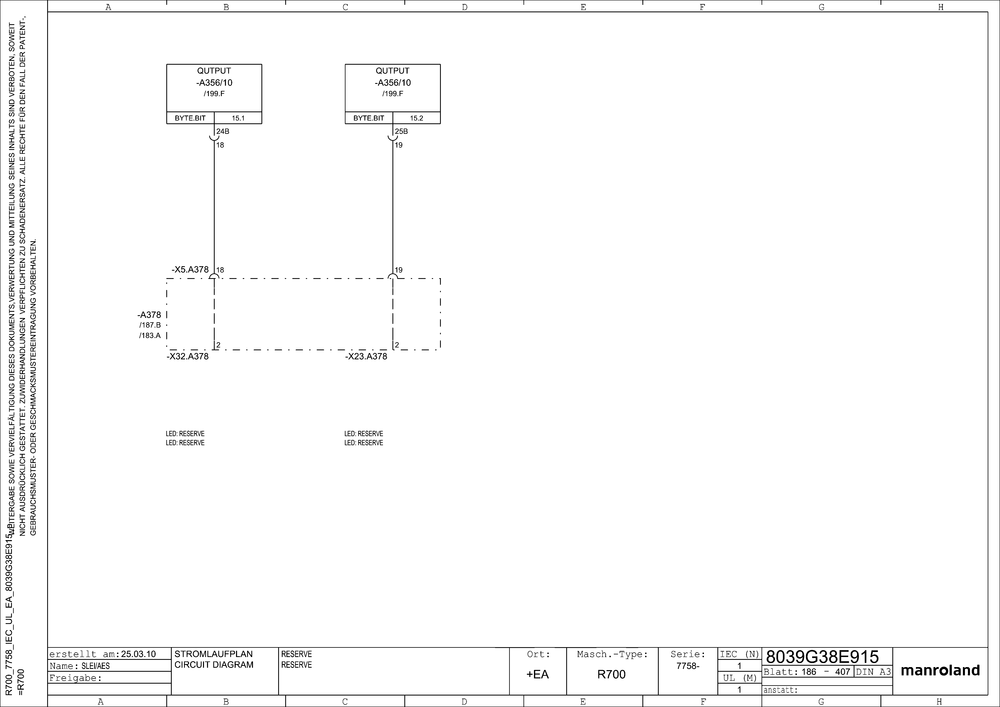

# +EA — Sheet 186 of 407 — RESERVE

**RESERVE**

> Part of the manroland **R700** printing press IEC/UL circuit diagrams.
> Drawing class: **Stromlaufplan / Circuit diagram** (DIN A3).
> Document `+EA` covers the **Printing unit** machine section.

## At a glance

| Field | Value |
|---|---|
| Document | `+EA`  (8039G38E915) |
| Sheet | **186** of 407 |
| Section (DE) | RESERVE |
| Section (EN) | RESERVE |
| Section type | CIRCUIT — Circuit diagram |
| Machine type | `R700` |
| Series | `7758` |
| Created | 25.03.10 |
| Replaces | — |
| Columns used | A, B, C, D |
| Path numbers | — |
| Labels on sheet | 28 |
| Cross-refs out | 4 |
| Cross-refs in | 10 |

**Previous:** [+EA sheet 185](SHEET_0185.md) · **Next:** [+EA sheet 187](SHEET_0187.md) · **Document TOC:** [_TOC.md](_TOC.md)  (+EA) · **Master TOC:** [all sheets](../_MASTER_TOC.md)

## Sheet image (300 DPI, exact vector render)



_Rendered directly from the PDF vector layer at 300 DPI (1-bit), no OCR and no resampling. Use it to confirm anything ambiguous in the text below._

## Cross-references on this sheet

Each entry is a wire leaving this sheet. The printed token is `/sheet.column`; the link resolves to that sheet inside the same document.

| Ref | Target sheet | Col | Path | Destination on target | Target section | From col |
|---|---|---|---|---|---|---|
| `/199.F` | [+EA sheet 199](SHEET_0199.md) | F | — | — | REFERENZMODUL | B |
| `/199.F` | [+EA sheet 199](SHEET_0199.md) | F | — | — | REFERENZMODUL | C |
| `/187.B` | [+EA sheet 187](SHEET_0187.md) | B | — | — | RESERVE | A |
| `/183.A` | [+EA sheet 183](SHEET_0183.md) | A | — | — | RESERVE | A |

### Incoming references (sheets that point here)

Every other sheet that sends a wire to this one. `Back-ref` is the token printed on *that* sheet; `Path` is its line number.

| From sheet | Cols | Back-ref | Path | Refs | What continues there |
|---|---|---|---|---|---|
| [+EA#183](SHEET_0183.md) | A | `/183.A` | — | 1 | — |
| [+EA#187](SHEET_0187.md) | B | `/187.B` | — | 1 | — |
| [+EA#199](SHEET_0199.md) | F | `/199.F` | — | 2 | — |
| [+EA#242](SHEET_0242.md) | D | `/242.D` | — | 2 | — |
| [+EA#257](SHEET_0257.md) | D | `/257.D` | — | 2 | — |
| [+EA#265](SHEET_0265.md) | E | `/265.E` | — | 1 | — |
| [+EA#276](SHEET_0276.md) | H | `/276.H` | — | 1 | — |


## Devices on this sheet

| Tag | Class | Class meaning (IEC) | Col | Sub | Terminal | Sign |
|---|---|---|---|---|---|---|
| `A356/10` | A | Baugruppe / assembly, module, PC board | C | 10 | — | — |
| `A356/10` | A | Baugruppe / assembly, module, PC board | B | 10 | — | — |
| `A378` | A | Baugruppe / assembly, module, PC board | A | — | — | — |
| `15.2` | — | cross-device reference | D | — | — | — |
| `X5.A378` | — | cross-device reference | B | — | — | — |
| `15.1` | — | cross-device reference | B | — | — | — |
| `X23.A378` | — | cross-device reference | C | — | — | — |
| `X32.A378` | — | cross-device reference | B | — | — | — |

## Potentials / nets

_No named potentials on this sheet._

## Wire-end annotations (grouped as printed)

A wire that continues elsewhere is annotated with a small cluster: the destination description, the path/line number `#NN`, and the `/sheet.column` cross reference. Each row below is one such cluster exactly as it is grouped on the drawing.

| Col | Y | Path | Cross-ref | Text on the wire |
|---|---|---|---|---|
| B | 80.0 | — | — | `QUTPUT` |
| C | 80.0 | — | — | `QUTPUT` |
| B | 93.8 | — | — | `A356/10` |
| C | 93.8 | — | — | `A356/10` |
| B | 107.6 | — | `/199.F` | — |
| C | 107.6 | — | `/199.F` | — |
| B | 137.3 | — | — | `BYTE.BIT 15.1` |
| C | 137.3 | — | — | `BYTE.BIT 15.2` |
| B | 152.7 | — | — | `24B` |
| C | 152.7 | — | — | `25B` |
| B | 169.0 | — | — | `18` |
| C | 169.0 | — | — | `19` |
| B | 316.4 | — | — | `X5.A378 18` |
| C | 317.8 | — | — | `19` |
| A | 370.2 | — | — | `A378` |
| A | 383.3 | — | `/187.B`, `/183.A` | — |
| C | 407.1 | — | — | `2 2` |
| B | 419.8 | — | — | `X32.A378 X23.A378` |
| B | 513.7 | — | — | `LED: RESERVE LED: RESERVE` |
| C | 513.7 | — | — | `LED: RESERVE LED: RESERVE` |


## Reconstructed tables

This sheet carries tabular content (pin map / terminal assignment / index). The grid below was rebuilt from the drawing's own rule lines, so each row is exactly one physical row of the table.

### Table 1 — 1 data rows × 2 columns (at x=198.4, y=76.5)

| QUTPUT | A356/10 /199.F |
|---|---|
| `BYTE.BIT` | `15.1` |


### Table 2 — 1 data rows × 2 columns (at x=411.0, y=76.5)

| QUTPUT | A356/10 /199.F |
|---|---|
| `BYTE.BIT` | `15.2` |


## Notes and free text on this sheet

| Text | Col | Y (pt) |
|---|---|---|
| `25B` | C | 152.65 |
| `QUTPUT` | C | 79.98 |
| `BYTE.BIT` | C | 137.26 |
| `LED: RESERVE` | C | 513.67 |
| `24B` | B | 152.65 |
| `QUTPUT` | B | 79.98 |
| `BYTE.BIT` | B | 137.26 |
| `LED: RESERVE` | B | 513.67 |

## Complete label inventory (exact text from the drawing)

Every text object inside the drawing area of this sheet, in DIN reading order (column A→H, then top→bottom). This is the authoritative list: if a string is not here it is not printed on this sheet.

| Col | Y | X | Dir | Type | Text |
|---|---|---|---|---|---|
| A | 370.2 | 163.6 | → | device tag | `A378` |
| A | 383.3 | 166.1 | → | cross-reference | `/187.B` |
| A | 395.7 | 165.8 | → | cross-reference | `/183.A` |
| B | 80.0 | 234.9 | → | text | `QUTPUT` |
| B | 93.8 | 233.7 | → | device tag | `A356/10` |
| B | 107.6 | 242.8 | → | cross-reference | `/199.F` |
| B | 137.3 | 208.3 | → | text | `BYTE.BIT` |
| B | 137.3 | 275.8 | → | device ref | `15.1` |
| B | 152.6 | 257.7 | → | text | `24B` |
| B | 169.0 | 257.1 | → | number | `18` |
| B | 316.4 | 204.4 | → | device ref | `X5.A378` |
| B | 317.8 | 257.1 | → | number | `18` |
| B | 407.1 | 257.7 | → | number | `2` |
| B | 419.8 | 198.4 | → | device ref | `X32.A378` |
| B | 513.7 | 197.6 | → | text | `LED: RESERVE` |
| B | 524.3 | 197.6 | → | text | `LED: RESERVE` |
| C | 80.0 | 447.4 | → | text | `QUTPUT` |
| C | 93.8 | 446.3 | → | device tag | `A356/10` |
| C | 107.6 | 455.4 | → | cross-reference | `/199.F` |
| C | 137.3 | 420.9 | → | text | `BYTE.BIT` |
| C | 152.6 | 470.3 | → | text | `25B` |
| C | 169.0 | 469.7 | → | number | `19` |
| C | 317.8 | 469.7 | → | number | `19` |
| C | 407.1 | 470.3 | → | number | `2` |
| C | 419.8 | 411.0 | → | device ref | `X23.A378` |
| C | 513.7 | 410.2 | → | text | `LED: RESERVE` |
| C | 524.3 | 410.2 | → | text | `LED: RESERVE` |
| D | 137.3 | 488.0 | → | device ref | `15.2` |

## Reading-order text block

The same content as a plain block, grouped by DIN column — convenient to paste or to match against a visual description.

```text
=== Column A ===
 370.2  163.6  devtag       A378
 383.3  166.1  xref         /187.B
 395.7  165.8  xref         /183.A
=== Column B ===
  80.0  234.9  text         QUTPUT
  93.8  233.7  devtag       A356/10
 107.6  242.8  xref         /199.F
 137.3  208.3  text         BYTE.BIT
 137.3  275.8  devref       15.1
 152.6  257.7  text         24B
 169.0  257.1  numeric      18
 316.4  204.4  devref       X5.A378
 317.8  257.1  numeric      18
 407.1  257.7  numeric      2
 419.8  198.4  devref       X32.A378
 513.7  197.6  text         LED: RESERVE
 524.3  197.6  text         LED: RESERVE
=== Column C ===
  80.0  447.4  text         QUTPUT
  93.8  446.3  devtag       A356/10
 107.6  455.4  xref         /199.F
 137.3  420.9  text         BYTE.BIT
 152.6  470.3  text         25B
 169.0  469.7  numeric      19
 317.8  469.7  numeric      19
 407.1  470.3  numeric      2
 419.8  411.0  devref       X23.A378
 513.7  410.2  text         LED: RESERVE
 524.3  410.2  text         LED: RESERVE
=== Column D ===
 137.3  488.0  devref       15.2
```

---
_Generated from the PDF vector text layer; no OCR. Source: `R700_7758_IEC_UL_EA_8039G38E915_p`, sheet 186._
