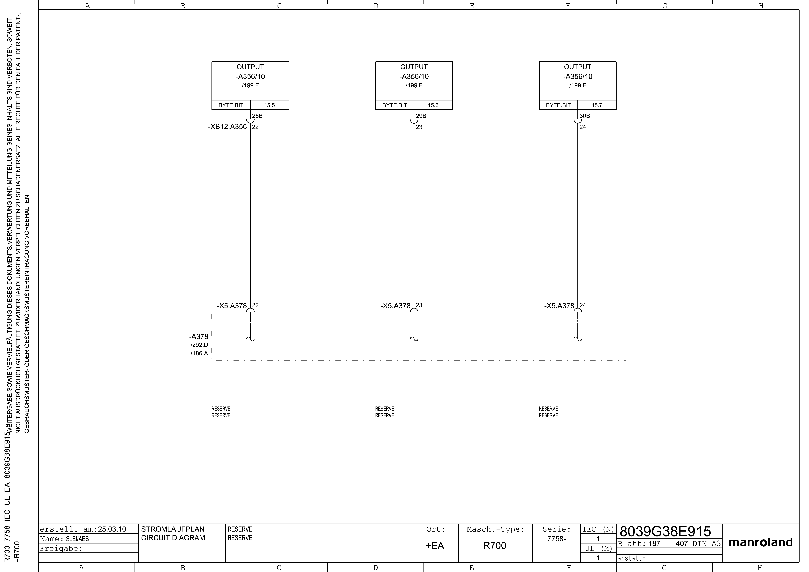

# +EA — Sheet 187 of 407 — RESERVE

**RESERVE**

> Part of the manroland **R700** printing press IEC/UL circuit diagrams.
> Drawing class: **Stromlaufplan / Circuit diagram** (DIN A3).
> Document `+EA` covers the **Printing unit** machine section.

## At a glance

| Field | Value |
|---|---|
| Document | `+EA`  (8039G38E915) |
| Sheet | **187** of 407 |
| Section (DE) | RESERVE |
| Section (EN) | RESERVE |
| Section type | CIRCUIT — Circuit diagram |
| Machine type | `R700` |
| Series | `7758` |
| Created | 25.03.10 |
| Replaces | — |
| Columns used | B, C, D, E, F |
| Path numbers | — |
| Labels on sheet | 37 |
| Cross-refs out | 5 |
| Cross-refs in | 11 |

**Previous:** [+EA sheet 186](SHEET_0186.md) · **Next:** [+EA sheet 188](SHEET_0188.md) · **Document TOC:** [_TOC.md](_TOC.md)  (+EA) · **Master TOC:** [all sheets](../_MASTER_TOC.md)

## Sheet image (300 DPI, exact vector render)



_Rendered directly from the PDF vector layer at 300 DPI (1-bit), no OCR and no resampling. Use it to confirm anything ambiguous in the text below._

## Cross-references on this sheet

Each entry is a wire leaving this sheet. The printed token is `/sheet.column`; the link resolves to that sheet inside the same document.

| Ref | Target sheet | Col | Path | Destination on target | Target section | From col |
|---|---|---|---|---|---|---|
| `/199.F` | [+EA sheet 199](SHEET_0199.md) | F | — | — | REFERENZMODUL | C |
| `/199.F` | [+EA sheet 199](SHEET_0199.md) | F | — | — | REFERENZMODUL | D |
| `/199.F` | [+EA sheet 199](SHEET_0199.md) | F | — | — | REFERENZMODUL | F |
| `/292.D` | [+EA sheet 292](SHEET_0292.md) | D | — | — | OPTION: PROBEBOGENENTNAHME HALBAUTOMATISCH | B |
| `/186.A` | [+EA sheet 186](SHEET_0186.md) | A | — | — | RESERVE | B |

### Incoming references (sheets that point here)

Every other sheet that sends a wire to this one. `Back-ref` is the token printed on *that* sheet; `Path` is its line number.

| From sheet | Cols | Back-ref | Path | Refs | What continues there |
|---|---|---|---|---|---|
| [+EA#186](SHEET_0186.md) | A | `/186.A` | — | 1 | — |
| [+EA#199](SHEET_0199.md) | F | `/199.F` | — | 3 | — |
| [+EA#242](SHEET_0242.md) | D | `/242.D` | — | 3 | — |
| [+EA#257](SHEET_0257.md) | D | `/257.D` | — | 3 | — |
| [+EA#292](SHEET_0292.md) | D | `/292.D` | — | 1 | — |


## Devices on this sheet

| Tag | Class | Class meaning (IEC) | Col | Sub | Terminal | Sign |
|---|---|---|---|---|---|---|
| `A378` | A | Baugruppe / assembly, module, PC board | B | — | — | — |
| `A356/10` | A | Baugruppe / assembly, module, PC board | C | 10 | — | — |
| `A356/10` | A | Baugruppe / assembly, module, PC board | D | 10 | — | — |
| `A356/10` | A | Baugruppe / assembly, module, PC board | F | 10 | — | — |
| `X5.A378` | — | cross-device reference | C | — | — | — |
| `X5.A378` | — | cross-device reference | D | — | — | — |
| `X5.A378` | — | cross-device reference | F | — | — | — |
| `15.5` | — | cross-device reference | C | — | — | — |
| `XB12.A356` | — | cross-device reference | B | — | — | — |
| `15.6` | — | cross-device reference | E | — | — | — |
| `15.7` | — | cross-device reference | F | — | — | — |

## Potentials / nets

_No named potentials on this sheet._

## Wire-end annotations (grouped as printed)

A wire that continues elsewhere is annotated with a small cluster: the destination description, the path/line number `#NN`, and the `/sheet.column` cross reference. Each row below is one such cluster exactly as it is grouped on the drawing.

| Col | Y | Path | Cross-ref | Text on the wire |
|---|---|---|---|---|
| C | 94.2 | — | — | `OUTPUT` |
| D | 94.2 | — | — | `OUTPUT` |
| F | 94.2 | — | — | `OUTPUT` |
| C | 108.0 | — | — | `A356/10` |
| D | 108.0 | — | — | `A356/10` |
| F | 108.0 | — | — | `A356/10` |
| C | 121.8 | — | `/199.F` | — |
| D | 121.8 | — | `/199.F` | — |
| F | 121.8 | — | `/199.F` | — |
| C | 151.4 | — | — | `BYTE.BIT 15.5` |
| D | 151.4 | — | — | `BYTE.BIT 15.6` |
| F | 151.4 | — | — | `BYTE.BIT 15.7` |
| C | 166.8 | — | — | `28B` |
| D | 166.8 | — | — | `29B` |
| F | 166.8 | — | — | `30B` |
| C | 181.7 | — | — | `XB12.A356 22` |
| D | 183.2 | — | — | `23` |
| F | 183.2 | — | — | `24` |
| C | 445.4 | — | — | `X5.A378 22` |
| E | 445.4 | — | — | `X5.A378 23 X5.A378 24` |
| B | 490.7 | — | — | `A378` |
| B | 503.8 | — | `/292.D`, `/186.A` | — |
| B | 598.9 | — | — | `RESERVE RESERVE` |
| D | 598.9 | — | — | `RESERVE RESERVE` |
| F | 598.9 | — | — | `RESERVE RESERVE` |


## Reconstructed tables

This sheet carries tabular content (pin map / terminal assignment / index). The grid below was rebuilt from the drawing's own rule lines, so each row is exactly one physical row of the table.

### Table 1 — 1 data rows × 2 columns (at x=311.8, y=90.7)

| OUTPUT | A356/10 /199.F |
|---|---|
| `BYTE.BIT` | `15.5` |


### Table 2 — 1 data rows × 2 columns (at x=552.8, y=90.7)

| OUTPUT | A356/10 /199.F |
|---|---|
| `BYTE.BIT` | `15.6` |


### Table 3 — 1 data rows × 2 columns (at x=793.7, y=90.7)

| OUTPUT | A356/10 /199.F |
|---|---|
| `BYTE.BIT` | `15.7` |


## Notes and free text on this sheet

| Text | Col | Y (pt) |
|---|---|---|
| `28B` | C | 166.82 |
| `OUTPUT` | C | 94.16 |
| `BYTE.BIT` | B | 151.43 |
| `RESERVE` | B | 598.89 |
| `29B` | D | 166.82 |
| `OUTPUT` | D | 94.16 |
| `BYTE.BIT` | D | 151.43 |
| `RESERVE` | D | 598.89 |
| `30B` | F | 166.82 |
| `OUTPUT` | F | 94.16 |
| `BYTE.BIT` | F | 151.43 |
| `RESERVE` | F | 598.89 |

## Complete label inventory (exact text from the drawing)

Every text object inside the drawing area of this sheet, in DIN reading order (column A→H, then top→bottom). This is the authoritative list: if a string is not here it is not printed on this sheet.

| Col | Y | X | Dir | Type | Text |
|---|---|---|---|---|---|
| B | 151.4 | 321.7 | → | text | `BYTE.BIT` |
| B | 181.7 | 306.1 | → | device ref | `XB12.A356` |
| B | 490.7 | 278.4 | → | device tag | `A378` |
| B | 503.8 | 280.6 | → | cross-reference | `/292.D` |
| B | 516.2 | 280.6 | → | cross-reference | `/186.A` |
| B | 598.9 | 311.2 | → | text | `RESERVE` |
| B | 608.8 | 311.2 | → | text | `RESERVE` |
| C | 94.2 | 348.2 | → | text | `OUTPUT` |
| C | 108.0 | 347.1 | → | device tag | `A356/10` |
| C | 121.8 | 356.2 | → | cross-reference | `/199.F` |
| C | 151.5 | 388.6 | → | device ref | `15.5` |
| C | 166.8 | 371.1 | → | text | `28B` |
| C | 183.2 | 371.1 | → | number | `22` |
| C | 445.3 | 319.2 | → | device ref | `X5.A378` |
| C | 445.4 | 371.1 | → | number | `22` |
| D | 94.2 | 589.2 | → | text | `OUTPUT` |
| D | 108.0 | 588.0 | → | device tag | `A356/10` |
| D | 121.8 | 597.1 | → | cross-reference | `/199.F` |
| D | 151.4 | 562.7 | → | text | `BYTE.BIT` |
| D | 166.8 | 612.0 | → | text | `29B` |
| D | 183.2 | 612.0 | → | number | `23` |
| D | 445.3 | 560.1 | → | device ref | `X5.A378` |
| D | 445.4 | 612.0 | → | number | `23` |
| D | 598.9 | 552.2 | → | text | `RESERVE` |
| D | 608.8 | 552.2 | → | text | `RESERVE` |
| E | 151.5 | 629.6 | → | device ref | `15.6` |
| F | 94.2 | 830.1 | → | text | `OUTPUT` |
| F | 108.0 | 829.0 | → | device tag | `A356/10` |
| F | 121.8 | 838.1 | → | cross-reference | `/199.F` |
| F | 151.4 | 803.6 | → | text | `BYTE.BIT` |
| F | 151.5 | 870.5 | → | device ref | `15.7` |
| F | 166.8 | 852.9 | → | text | `30B` |
| F | 183.2 | 852.9 | → | number | `24` |
| F | 445.3 | 801.1 | → | device ref | `X5.A378` |
| F | 445.4 | 852.9 | → | number | `24` |
| F | 598.9 | 793.1 | → | text | `RESERVE` |
| F | 608.8 | 793.1 | → | text | `RESERVE` |

## Reading-order text block

The same content as a plain block, grouped by DIN column — convenient to paste or to match against a visual description.

```text
=== Column B ===
 151.4  321.7  text         BYTE.BIT
 181.7  306.1  devref       XB12.A356
 490.7  278.4  devtag       A378
 503.8  280.6  xref         /292.D
 516.2  280.6  xref         /186.A
 598.9  311.2  text         RESERVE
 608.8  311.2  text         RESERVE
=== Column C ===
  94.2  348.2  text         OUTPUT
 108.0  347.1  devtag       A356/10
 121.8  356.2  xref         /199.F
 151.5  388.6  devref       15.5
 166.8  371.1  text         28B
 183.2  371.1  numeric      22
 445.3  319.2  devref       X5.A378
 445.4  371.1  numeric      22
=== Column D ===
  94.2  589.2  text         OUTPUT
 108.0  588.0  devtag       A356/10
 121.8  597.1  xref         /199.F
 151.4  562.7  text         BYTE.BIT
 166.8  612.0  text         29B
 183.2  612.0  numeric      23
 445.3  560.1  devref       X5.A378
 445.4  612.0  numeric      23
 598.9  552.2  text         RESERVE
 608.8  552.2  text         RESERVE
=== Column E ===
 151.5  629.6  devref       15.6
=== Column F ===
  94.2  830.1  text         OUTPUT
 108.0  829.0  devtag       A356/10
 121.8  838.1  xref         /199.F
 151.4  803.6  text         BYTE.BIT
 151.5  870.5  devref       15.7
 166.8  852.9  text         30B
 183.2  852.9  numeric      24
 445.3  801.1  devref       X5.A378
 445.4  852.9  numeric      24
 598.9  793.1  text         RESERVE
 608.8  793.1  text         RESERVE
```

---
_Generated from the PDF vector text layer; no OCR. Source: `R700_7758_IEC_UL_EA_8039G38E915_p`, sheet 187._
