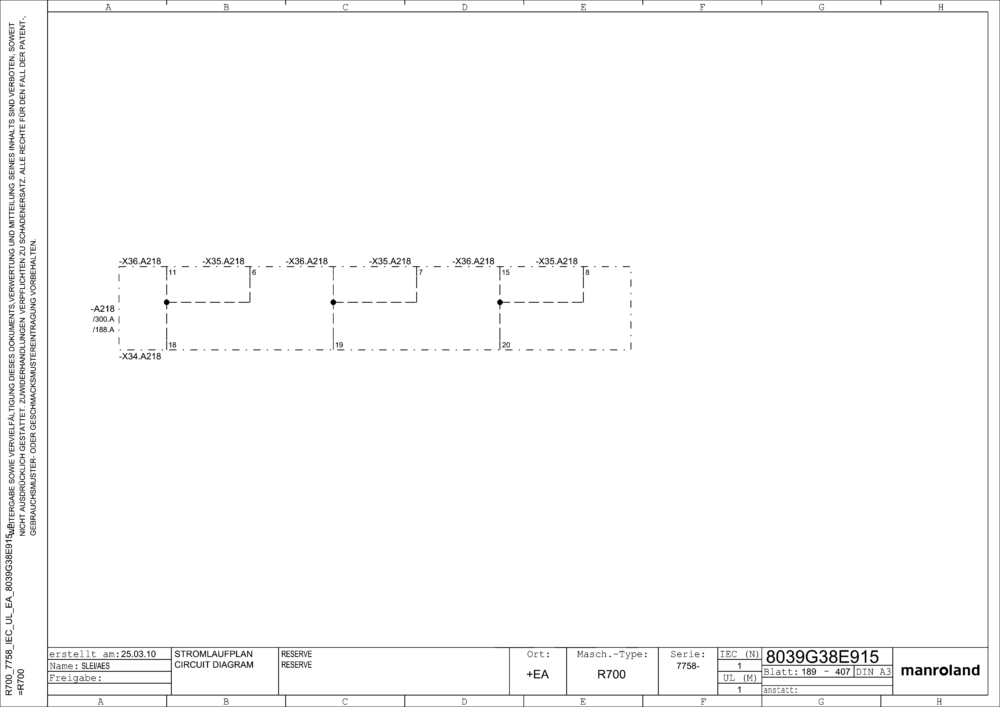

# +EA — Sheet 189 of 407 — RESERVE

**RESERVE**

> Part of the manroland **R700** printing press IEC/UL circuit diagrams.
> Drawing class: **Stromlaufplan / Circuit diagram** (DIN A3).
> Document `+EA` covers the **Printing unit** machine section.

## At a glance

| Field | Value |
|---|---|
| Document | `+EA`  (8039G38E915) |
| Sheet | **189** of 407 |
| Section (DE) | RESERVE |
| Section (EN) | RESERVE |
| Section type | CIRCUIT — Circuit diagram |
| Machine type | `R700` |
| Series | `7758` |
| Created | 25.03.10 |
| Replaces | — |
| Columns used | A, B, C, D, E |
| Path numbers | — |
| Labels on sheet | 18 |
| Cross-refs out | 2 |
| Cross-refs in | 11 |

**Previous:** [+EA sheet 188](SHEET_0188.md) · **Next:** [+EA sheet 190](SHEET_0190.md) · **Document TOC:** [_TOC.md](_TOC.md)  (+EA) · **Master TOC:** [all sheets](../_MASTER_TOC.md)

## Sheet image (300 DPI, exact vector render)



_Rendered directly from the PDF vector layer at 300 DPI (1-bit), no OCR and no resampling. Use it to confirm anything ambiguous in the text below._

## Cross-references on this sheet

Each entry is a wire leaving this sheet. The printed token is `/sheet.column`; the link resolves to that sheet inside the same document.

| Ref | Target sheet | Col | Path | Destination on target | Target section | From col |
|---|---|---|---|---|---|---|
| `/300.A` | [+EA sheet 300](SHEET_0300.md) | A | — | — | OPTION: ZWISCHENSTAPEL / | A |
| `/188.A` | [+EA sheet 188](SHEET_0188.md) | A | — | — | RESERVE | A |

### Incoming references (sheets that point here)

Every other sheet that sends a wire to this one. `Back-ref` is the token printed on *that* sheet; `Path` is its line number.

| From sheet | Cols | Back-ref | Path | Refs | What continues there |
|---|---|---|---|---|---|
| [+EA#188](SHEET_0188.md) | A | `/188.A` | — | 1 | — |
| [+EA#277](SHEET_0277.md) | G | `/277.G` | — | 3 | — |
| [+EA#278](SHEET_0278.md) | C, H | `/278.C`, `/278.H` | — | 6 | — |
| [+EA#300](SHEET_0300.md) | A | `/300.A` | — | 1 | — |


## Devices on this sheet

| Tag | Class | Class meaning (IEC) | Col | Sub | Terminal | Sign |
|---|---|---|---|---|---|---|
| `A218` | A | Baugruppe / assembly, module, PC board | A | — | — | — |
| `X35.A218` | — | cross-device reference | B | — | — | — |
| `X35.A218` | — | cross-device reference | C | — | — | — |
| `X35.A218` | — | cross-device reference | E | — | — | — |
| `X34.A218` | — | cross-device reference | A | — | — | — |
| `X36.A218` | — | cross-device reference | A | — | — | — |
| `X36.A218` | — | cross-device reference | C | — | — | — |
| `X36.A218` | — | cross-device reference | D | — | — | — |

## Potentials / nets

_No named potentials on this sheet._

## Wire-end annotations (grouped as printed)

A wire that continues elsewhere is annotated with a small cluster: the destination description, the path/line number `#NN`, and the `/sheet.column` cross reference. Each row below is one such cluster exactly as it is grouped on the drawing.

| Col | Y | Path | Cross-ref | Text on the wire |
|---|---|---|---|---|
| C | 306.4 | — | — | `X36.A218 X36.A218 X36.A218` |
| C | 306.4 | — | — | `X35.A218 X35.A218 X35.A218` |
| B | 320.6 | — | — | `11 6` |
| D | 320.6 | — | — | `7` |
| E | 320.6 | — | — | `15 8` |
| A | 363.1 | — | — | `A218` |
| A | 376.2 | — | `/300.A`, `/188.A` | — |
| B | 407.1 | — | — | `18` |
| C | 407.1 | — | — | `19` |
| D | 407.1 | — | — | `20` |
| A | 419.8 | — | — | `X34.A218` |


## Reconstructed tables

This sheet carries tabular content (pin map / terminal assignment / index). The grid below was rebuilt from the drawing's own rule lines, so each row is exactly one physical row of the table.

### Table 1 — 5 data rows × 13 columns (at x=198.4, y=0.0) — **X35.A218 11 6 X36.A218 X35.A218 X36.A218 7 15 8 18 19 20**

|  | STROMLAUFPLAN |  | RESERVE |  |  |  | Ort: |  | Masch. Type: | Serie: | IEC (N) | 8039G38E915 |
|---|---|---|---|---|---|---|---|---|---|---|---|---|
|  | `CIRCUIT DIAGRAM` |  |  |  |  |  |  |  |  |  |  |  |
|  |  |  | `RESERVE` |  |  |  |  |  |  | `7758` | `1` |  |
|  |  |  |  |  |  |  | `+EA` |  | `R700` |  |  | `Blatt: DIN A3 189 407` |
|  |  |  |  |  |  |  |  |  |  |  | `UL (M)` |  |
|  |  |  |  |  |  |  |  |  |  |  | `1` | `anstatt:` |


## Complete label inventory (exact text from the drawing)

Every text object inside the drawing area of this sheet, in DIN reading order (column A→H, then top→bottom). This is the authoritative list: if a string is not here it is not printed on this sheet.

| Col | Y | X | Dir | Type | Text |
|---|---|---|---|---|---|
| A | 306.4 | 141.7 | → | device ref | `X36.A218` |
| A | 363.1 | 108.3 | → | device tag | `A218` |
| A | 376.2 | 110.6 | → | cross-reference | `/300.A` |
| A | 388.6 | 110.6 | → | cross-reference | `/188.A` |
| A | 419.8 | 141.7 | → | device ref | `X34.A218` |
| B | 306.4 | 240.9 | → | device ref | `X35.A218` |
| B | 320.6 | 200.4 | → | number | `11` |
| B | 320.6 | 300.2 | → | number | `6` |
| B | 407.1 | 200.4 | → | number | `18` |
| C | 306.4 | 340.2 | → | device ref | `X36.A218` |
| C | 306.4 | 439.4 | → | device ref | `X35.A218` |
| C | 407.1 | 398.8 | → | number | `19` |
| D | 306.4 | 538.6 | → | device ref | `X36.A218` |
| D | 320.6 | 498.6 | → | number | `7` |
| D | 320.6 | 597.3 | → | number | `15` |
| D | 407.1 | 597.8 | → | number | `20` |
| E | 306.4 | 637.8 | → | device ref | `X35.A218` |
| E | 320.6 | 697.0 | → | number | `8` |

## Reading-order text block

The same content as a plain block, grouped by DIN column — convenient to paste or to match against a visual description.

```text
=== Column A ===
 306.4  141.7  devref       X36.A218
 363.1  108.3  devtag       A218
 376.2  110.6  xref         /300.A
 388.6  110.6  xref         /188.A
 419.8  141.7  devref       X34.A218
=== Column B ===
 306.4  240.9  devref       X35.A218
 320.6  200.4  numeric      11
 320.6  300.2  numeric      6
 407.1  200.4  numeric      18
=== Column C ===
 306.4  340.2  devref       X36.A218
 306.4  439.4  devref       X35.A218
 407.1  398.8  numeric      19
=== Column D ===
 306.4  538.6  devref       X36.A218
 320.6  498.6  numeric      7
 320.6  597.3  numeric      15
 407.1  597.8  numeric      20
=== Column E ===
 306.4  637.8  devref       X35.A218
 320.6  697.0  numeric      8
```

---
_Generated from the PDF vector text layer; no OCR. Source: `R700_7758_IEC_UL_EA_8039G38E915_p`, sheet 189._
