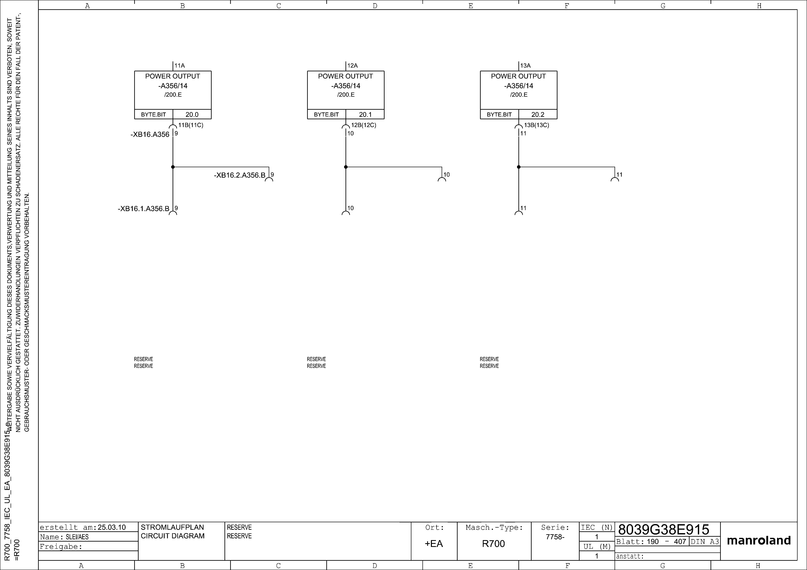

# +EA — Sheet 190 of 407 — RESERVE

**RESERVE**

> Part of the manroland **R700** printing press IEC/UL circuit diagrams.
> Drawing class: **Stromlaufplan / Circuit diagram** (DIN A3).
> Document `+EA` covers the **Printing unit** machine section.

## At a glance

| Field | Value |
|---|---|
| Document | `+EA`  (8039G38E915) |
| Sheet | **190** of 407 |
| Section (DE) | RESERVE |
| Section (EN) | RESERVE |
| Section type | CIRCUIT — Circuit diagram |
| Machine type | `R700` |
| Series | `7758` |
| Created | 25.03.10 |
| Replaces | — |
| Columns used | B, C, D, E, F, G |
| Path numbers | — |
| Labels on sheet | 39 |
| Cross-refs out | 3 |
| Cross-refs in | 12 |

**Previous:** [+EA sheet 189](SHEET_0189.md) · **Next:** [+EA sheet 191](SHEET_0191.md) · **Document TOC:** [_TOC.md](_TOC.md)  (+EA) · **Master TOC:** [all sheets](../_MASTER_TOC.md)

## Sheet image (300 DPI, exact vector render)



_Rendered directly from the PDF vector layer at 300 DPI (1-bit), no OCR and no resampling. Use it to confirm anything ambiguous in the text below._

## Cross-references on this sheet

Each entry is a wire leaving this sheet. The printed token is `/sheet.column`; the link resolves to that sheet inside the same document.

| Ref | Target sheet | Col | Path | Destination on target | Target section | From col |
|---|---|---|---|---|---|---|
| `/200.E` | [+EA sheet 200](SHEET_0200.md) | E | — | — | REFERENZMODUL | B |
| `/200.E` | [+EA sheet 200](SHEET_0200.md) | E | — | — | REFERENZMODUL | D |
| `/200.E` | [+EA sheet 200](SHEET_0200.md) | E | — | — | REFERENZMODUL | F |

### Incoming references (sheets that point here)

Every other sheet that sends a wire to this one. `Back-ref` is the token printed on *that* sheet; `Path` is its line number.

| From sheet | Cols | Back-ref | Path | Refs | What continues there |
|---|---|---|---|---|---|
| [+EA#200](SHEET_0200.md) | E | `/200.E` | — | 3 | — |
| [+EA#261](SHEET_0261.md) | H | `/261.H` | — | 3 | — |
| [+EA#262](SHEET_0262.md) | B, E | `/262.B`, `/262.E` | — | 6 | — |


## Devices on this sheet

| Tag | Class | Class meaning (IEC) | Col | Sub | Terminal | Sign |
|---|---|---|---|---|---|---|
| `A356/14` | A | Baugruppe / assembly, module, PC board | B | 14 | — | — |
| `A356/14` | A | Baugruppe / assembly, module, PC board | D | 14 | — | — |
| `A356/14` | A | Baugruppe / assembly, module, PC board | F | 14 | — | — |
| `20.0` | — | cross-device reference | B | — | — | — |
| `XB16.A356` | — | cross-device reference | B | — | — | — |
| `XB16.2.A356.B` | — | cross-device reference | C | — | — | — |
| `XB16.1.A356.B` | — | cross-device reference | B | — | — | — |
| `20.1` | — | cross-device reference | D | — | — | — |
| `20.2` | — | cross-device reference | F | — | — | — |

## Potentials / nets

_No named potentials on this sheet._

## Wire-end annotations (grouped as printed)

A wire that continues elsewhere is annotated with a small cluster: the destination description, the path/line number `#NN`, and the `/sheet.column` cross reference. Each row below is one such cluster exactly as it is grouped on the drawing.

| Col | Y | Path | Cross-ref | Text on the wire |
|---|---|---|---|---|
| B | 93.1 | — | — | `11A` |
| D | 93.1 | — | — | `12A` |
| F | 93.1 | — | — | `13A` |
| B | 108.3 | — | — | `POWER OUTPUT` |
| D | 108.3 | — | — | `POWER OUTPUT` |
| E | 108.3 | — | — | `POWER OUTPUT` |
| B | 122.2 | — | — | `A356/14` |
| D | 122.2 | — | — | `A356/14` |
| F | 122.2 | — | — | `A356/14` |
| B | 136.0 | — | `/200.E` | — |
| D | 136.0 | — | `/200.E` | — |
| F | 136.0 | — | `/200.E` | — |
| B | 165.0 | — | — | `BYTE.BIT 20.0` |
| D | 165.0 | — | — | `BYTE.BIT 20.1` |
| E | 165.0 | — | — | `BYTE.BIT 20.2` |
| B | 181.0 | — | — | `11B(11C)` |
| D | 181.0 | — | — | `12B(12C)` |
| F | 181.0 | — | — | `13B(13C)` |
| B | 193.1 | — | — | `XB16.A356 9` |
| D | 193.1 | — | — | `10` |
| F | 193.1 | — | — | `11` |
| C | 254.0 | — | — | `XB16.2.A356.B 9` |
| E | 254.0 | — | — | `10` |
| G | 254.0 | — | — | `11` |
| B | 303.6 | — | — | `XB16.1.A356.B 9` |
| D | 303.6 | — | — | `10` |
| F | 303.6 | — | — | `11` |
| B | 528.0 | — | — | `RESERVE RESERVE` |
| C | 528.0 | — | — | `RESERVE RESERVE` |
| E | 528.0 | — | — | `RESERVE RESERVE` |


## Reconstructed tables

This sheet carries tabular content (pin map / terminal assignment / index). The grid below was rebuilt from the drawing's own rule lines, so each row is exactly one physical row of the table.

### Table 1 — 2 data rows × 2 columns (at x=198.4, y=104.9)

| POWER | OUTPUT A356/14 /200.E |
|---|---|
| `BYTE.BIT` | `20.0` |
| `XB16.A356` | `11B(11C) 9` |


### Table 2 — 2 data rows × 2 columns (at x=453.5, y=104.9)

| POWER | OUTPUT A356/14 /200.E |
|---|---|
| `BYTE.BIT` | `20.1` |
|  | `12B(12C) 10` |


### Table 3 — 2 data rows × 2 columns (at x=708.7, y=104.9)

| POWER | OUTPUT A356/14 /200.E |
|---|---|
| `BYTE.BIT` | `20.2` |
|  | `13B(13C) 11` |


## Notes and free text on this sheet

| Text | Col | Y (pt) |
|---|---|---|
| `11A` | B | 93.12 |
| `11B(11C)` | B | 181.03 |
| `POWER OUTPUT` | B | 108.28 |
| `BYTE.BIT` | B | 165.6 |
| `RESERVE` | B | 528.02 |
| `12A` | D | 93.12 |
| `12B(12C)` | D | 181.03 |
| `POWER OUTPUT` | D | 108.28 |
| `BYTE.BIT` | C | 165.6 |
| `RESERVE` | C | 528.02 |
| `13A` | F | 93.12 |
| `13B(13C)` | F | 181.03 |
| `POWER OUTPUT` | E | 108.28 |
| `BYTE.BIT` | E | 165.6 |
| `RESERVE` | E | 528.02 |

## Complete label inventory (exact text from the drawing)

Every text object inside the drawing area of this sheet, in DIN reading order (column A→H, then top→bottom). This is the authoritative list: if a string is not here it is not printed on this sheet.

| Col | Y | X | Dir | Type | Text |
|---|---|---|---|---|---|
| B | 93.1 | 257.1 | → | text | `11A` |
| B | 108.3 | 214.3 | → | text | `POWER OUTPUT` |
| B | 122.2 | 233.7 | → | device tag | `A356/14` |
| B | 136.0 | 242.6 | → | cross-reference | `/200.E` |
| B | 165.0 | 274.0 | → | device ref | `20.0` |
| B | 165.6 | 208.3 | → | text | `BYTE.BIT` |
| B | 181.0 | 262.8 | → | text | `11B(11C)` |
| B | 193.1 | 257.7 | → | number | `9` |
| B | 193.8 | 192.8 | → | device ref | `XB16.A356` |
| B | 303.6 | 174.0 | → | device ref | `XB16.1.A356.B` |
| B | 303.6 | 257.7 | → | number | `9` |
| B | 528.0 | 197.9 | → | text | `RESERVE` |
| B | 538.0 | 197.9 | → | text | `RESERVE` |
| C | 165.6 | 463.5 | → | text | `BYTE.BIT` |
| C | 254.0 | 315.8 | → | device ref | `XB16.2.A356.B` |
| C | 254.0 | 399.4 | → | number | `9` |
| C | 528.0 | 453.0 | → | text | `RESERVE` |
| C | 538.0 | 453.0 | → | text | `RESERVE` |
| D | 93.1 | 512.2 | → | text | `12A` |
| D | 108.3 | 469.4 | → | text | `POWER OUTPUT` |
| D | 122.2 | 488.8 | → | device tag | `A356/14` |
| D | 136.0 | 497.8 | → | cross-reference | `/200.E` |
| D | 165.0 | 529.9 | → | device ref | `20.1` |
| D | 181.0 | 517.9 | → | text | `12B(12C)` |
| D | 193.1 | 512.2 | → | number | `10` |
| D | 303.6 | 512.2 | → | number | `10` |
| E | 108.3 | 724.5 | → | text | `POWER OUTPUT` |
| E | 165.6 | 718.6 | → | text | `BYTE.BIT` |
| E | 254.0 | 654.0 | → | number | `10` |
| E | 528.0 | 708.1 | → | text | `RESERVE` |
| E | 538.0 | 708.1 | → | text | `RESERVE` |
| F | 93.1 | 767.3 | → | text | `13A` |
| F | 122.2 | 744.0 | → | device tag | `A356/14` |
| F | 136.0 | 752.9 | → | cross-reference | `/200.E` |
| F | 165.0 | 784.2 | → | device ref | `20.2` |
| F | 181.0 | 773.0 | → | text | `13B(13C)` |
| F | 193.1 | 767.3 | → | number | `11` |
| F | 303.6 | 767.3 | → | number | `11` |
| G | 254.0 | 909.1 | → | number | `11` |

## Reading-order text block

The same content as a plain block, grouped by DIN column — convenient to paste or to match against a visual description.

```text
=== Column B ===
  93.1  257.1  text         11A
 108.3  214.3  text         POWER OUTPUT
 122.2  233.7  devtag       A356/14
 136.0  242.6  xref         /200.E
 165.0  274.0  devref       20.0
 165.6  208.3  text         BYTE.BIT
 181.0  262.8  text         11B(11C)
 193.1  257.7  numeric      9
 193.8  192.8  devref       XB16.A356
 303.6  174.0  devref       XB16.1.A356.B
 303.6  257.7  numeric      9
 528.0  197.9  text         RESERVE
 538.0  197.9  text         RESERVE
=== Column C ===
 165.6  463.5  text         BYTE.BIT
 254.0  315.8  devref       XB16.2.A356.B
 254.0  399.4  numeric      9
 528.0  453.0  text         RESERVE
 538.0  453.0  text         RESERVE
=== Column D ===
  93.1  512.2  text         12A
 108.3  469.4  text         POWER OUTPUT
 122.2  488.8  devtag       A356/14
 136.0  497.8  xref         /200.E
 165.0  529.9  devref       20.1
 181.0  517.9  text         12B(12C)
 193.1  512.2  numeric      10
 303.6  512.2  numeric      10
=== Column E ===
 108.3  724.5  text         POWER OUTPUT
 165.6  718.6  text         BYTE.BIT
 254.0  654.0  numeric      10
 528.0  708.1  text         RESERVE
 538.0  708.1  text         RESERVE
=== Column F ===
  93.1  767.3  text         13A
 122.2  744.0  devtag       A356/14
 136.0  752.9  xref         /200.E
 165.0  784.2  devref       20.2
 181.0  773.0  text         13B(13C)
 193.1  767.3  numeric      11
 303.6  767.3  numeric      11
=== Column G ===
 254.0  909.1  numeric      11
```

---
_Generated from the PDF vector text layer; no OCR. Source: `R700_7758_IEC_UL_EA_8039G38E915_p`, sheet 190._
