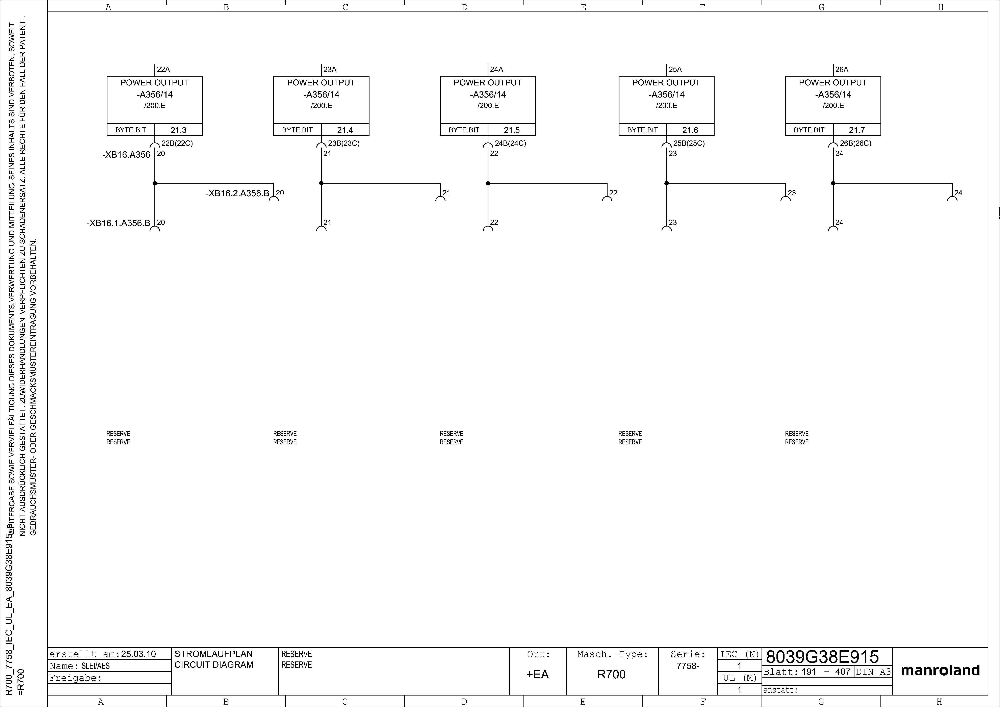

# +EA — Sheet 191 of 407 — RESERVE

**RESERVE**

> Part of the manroland **R700** printing press IEC/UL circuit diagrams.
> Drawing class: **Stromlaufplan / Circuit diagram** (DIN A3).
> Document `+EA` covers the **Printing unit** machine section.

## At a glance

| Field | Value |
|---|---|
| Document | `+EA`  (8039G38E915) |
| Sheet | **191** of 407 |
| Section (DE) | RESERVE |
| Section (EN) | RESERVE |
| Section type | CIRCUIT — Circuit diagram |
| Machine type | `R700` |
| Series | `7758` |
| Created | 25.03.10 |
| Replaces | — |
| Columns used | A, B, C, D, E, F, G, H |
| Path numbers | — |
| Labels on sheet | 63 |
| Cross-refs out | 5 |
| Cross-refs in | 20 |

**Previous:** [+EA sheet 190](SHEET_0190.md) · **Next:** [+EA sheet 192](SHEET_0192.md) · **Document TOC:** [_TOC.md](_TOC.md)  (+EA) · **Master TOC:** [all sheets](../_MASTER_TOC.md)

## Sheet image (300 DPI, exact vector render)



_Rendered directly from the PDF vector layer at 300 DPI (1-bit), no OCR and no resampling. Use it to confirm anything ambiguous in the text below._

## Cross-references on this sheet

Each entry is a wire leaving this sheet. The printed token is `/sheet.column`; the link resolves to that sheet inside the same document.

| Ref | Target sheet | Col | Path | Destination on target | Target section | From col |
|---|---|---|---|---|---|---|
| `/200.E` | [+EA sheet 200](SHEET_0200.md) | E | — | — | REFERENZMODUL | A |
| `/200.E` | [+EA sheet 200](SHEET_0200.md) | E | — | — | REFERENZMODUL | C |
| `/200.E` | [+EA sheet 200](SHEET_0200.md) | E | — | — | REFERENZMODUL | D |
| `/200.E` | [+EA sheet 200](SHEET_0200.md) | E | — | — | REFERENZMODUL | F |
| `/200.E` | [+EA sheet 200](SHEET_0200.md) | E | — | — | REFERENZMODUL | G |

### Incoming references (sheets that point here)

Every other sheet that sends a wire to this one. `Back-ref` is the token printed on *that* sheet; `Path` is its line number.

| From sheet | Cols | Back-ref | Path | Refs | What continues there |
|---|---|---|---|---|---|
| [+EA#200](SHEET_0200.md) | E | `/200.E` | — | 5 | — |
| [+EA#261](SHEET_0261.md) | H | `/261.H` | — | 5 | — |
| [+EA#262](SHEET_0262.md) | B, E | `/262.B`, `/262.E` | — | 10 | — |


## Devices on this sheet

| Tag | Class | Class meaning (IEC) | Col | Sub | Terminal | Sign |
|---|---|---|---|---|---|---|
| `A356/14` | A | Baugruppe / assembly, module, PC board | A | 14 | — | — |
| `A356/14` | A | Baugruppe / assembly, module, PC board | C | 14 | — | — |
| `A356/14` | A | Baugruppe / assembly, module, PC board | F | 14 | — | — |
| `A356/14` | A | Baugruppe / assembly, module, PC board | G | 14 | — | — |
| `A356/14` | A | Baugruppe / assembly, module, PC board | D | 14 | — | — |
| `21.3` | — | cross-device reference | B | — | — | — |
| `XB16.A356` | — | cross-device reference | A | — | — | — |
| `21.4` | — | cross-device reference | C | — | — | — |
| `21.6` | — | cross-device reference | F | — | — | — |
| `21.7` | — | cross-device reference | G | — | — | — |
| `21.5` | — | cross-device reference | D | — | — | — |
| `XB16.2.A356.B` | — | cross-device reference | B | — | — | — |
| `XB16.1.A356.B` | — | cross-device reference | A | — | — | — |

## Potentials / nets

_No named potentials on this sheet._

## Wire-end annotations (grouped as printed)

A wire that continues elsewhere is annotated with a small cluster: the destination description, the path/line number `#NN`, and the `/sheet.column` cross reference. Each row below is one such cluster exactly as it is grouped on the drawing.

| Col | Y | Path | Cross-ref | Text on the wire |
|---|---|---|---|---|
| A | 79.0 | — | — | `22A` |
| C | 79.0 | — | — | `23A` |
| D | 79.0 | — | — | `24A` |
| F | 79.0 | — | — | `25A` |
| G | 79.0 | — | — | `26A` |
| A | 94.1 | — | — | `POWER OUTPUT` |
| C | 94.1 | — | — | `POWER OUTPUT` |
| D | 94.1 | — | — | `POWER OUTPUT` |
| F | 94.1 | — | — | `POWER OUTPUT` |
| G | 94.1 | — | — | `POWER OUTPUT` |
| A | 108.0 | — | — | `A356/14` |
| C | 108.0 | — | — | `A356/14` |
| D | 108.0 | — | — | `A356/14` |
| F | 108.0 | — | — | `A356/14` |
| G | 108.0 | — | — | `A356/14` |
| A | 121.8 | — | `/200.E` | — |
| C | 121.8 | — | `/200.E` | — |
| D | 121.8 | — | `/200.E` | — |
| F | 121.8 | — | `/200.E` | — |
| G | 121.8 | — | `/200.E` | — |
| A | 150.9 | — | — | `BYTE.BIT 21.3` |
| C | 150.9 | — | — | `BYTE.BIT 21.4` |
| D | 150.9 | — | — | `BYTE.BIT 21.5` |
| F | 150.9 | — | — | `BYTE.BIT 21.6` |
| G | 150.9 | — | — | `BYTE.BIT 21.7` |
| B | 166.9 | — | — | `22B(22C)` |
| C | 166.9 | — | — | `23B(23C)` |
| D | 166.9 | — | — | `24B(24C)` |
| F | 166.9 | — | — | `25B(25C)` |
| G | 166.9 | — | — | `26B(26C)` |
| A | 178.9 | — | — | `XB16.A356 20` |
| C | 178.9 | — | — | `21` |
| D | 178.9 | — | — | `22` |
| F | 178.9 | — | — | `23` |
| G | 178.9 | — | — | `24` |
| B | 225.7 | — | — | `XB16.2.A356.B 20` |
| D | 225.7 | — | — | `21` |
| E | 225.7 | — | — | `22` |
| G | 225.7 | — | — | `23` |
| H | 225.7 | — | — | `24` |
| A | 261.1 | — | — | `XB16.1.A356.B 20` |
| C | 261.1 | — | — | `21` |
| D | 261.1 | — | — | `22` |
| F | 261.1 | — | — | `23` |
| G | 261.1 | — | — | `24` |
| A | 513.9 | — | — | `RESERVE RESERVE` |
| B | 513.9 | — | — | `RESERVE RESERVE` |
| D | 513.9 | — | — | `RESERVE RESERVE` |
| E | 513.9 | — | — | `RESERVE RESERVE` |
| G | 513.9 | — | — | `RESERVE RESERVE` |


## Reconstructed tables

This sheet carries tabular content (pin map / terminal assignment / index). The grid below was rebuilt from the drawing's own rule lines, so each row is exactly one physical row of the table.

### Table 1 — 2 data rows × 2 columns (at x=127.6, y=90.7)

| POWER | OUTPUT A356/14 /200.E |
|---|---|
| `BYTE.BIT` | `21.3` |
| `XB16.A356` | `22B(22C) 20` |


### Table 2 — 2 data rows × 2 columns (at x=326.0, y=90.7)

| POWER | OUTPUT A356/14 /200.E |
|---|---|
| `BYTE.BIT` | `21.4` |
|  | `23B(23C) 21` |


### Table 3 — 2 data rows × 2 columns (at x=524.4, y=90.7)

| POWER | OUTPUT A356/14 /200.E |
|---|---|
| `BYTE.BIT` | `21.5` |
|  | `24B(24C) 22` |


### Table 4 — 2 data rows × 2 columns (at x=737.0, y=90.7)

| POWER | OUTPUT A356/14 /200.E |
|---|---|
| `BYTE.BIT` | `21.6` |
|  | `25B(25C) 23` |


### Table 5 — 2 data rows × 2 columns (at x=935.4, y=90.7)

| POWER | OUTPUT A356/14 /200.E |
|---|---|
| `BYTE.BIT` | `21.7` |
|  | `26B(26C) 24` |


## Notes and free text on this sheet

| Text | Col | Y (pt) |
|---|---|---|
| `22A` | A | 78.95 |
| `22B(22C)` | B | 166.86 |
| `POWER OUTPUT` | A | 94.1 |
| `BYTE.BIT` | A | 151.43 |
| `RESERVE` | A | 513.85 |
| `23A` | C | 78.95 |
| `23B(23C)` | C | 166.86 |
| `POWER OUTPUT` | C | 94.1 |
| `BYTE.BIT` | C | 151.43 |
| `RESERVE` | B | 513.85 |
| `25A` | F | 78.95 |
| `25B(25C)` | F | 166.86 |
| `POWER OUTPUT` | F | 94.1 |
| `BYTE.BIT` | E | 151.43 |
| `RESERVE` | E | 513.85 |
| `26A` | G | 78.95 |
| `26B(26C)` | G | 166.86 |
| `POWER OUTPUT` | G | 94.1 |
| `BYTE.BIT` | G | 151.43 |
| `RESERVE` | G | 513.85 |
| `24A` | D | 78.95 |
| `24B(24C)` | D | 166.86 |
| `POWER OUTPUT` | D | 94.1 |
| `BYTE.BIT` | D | 151.43 |
| `RESERVE` | D | 513.85 |

## Complete label inventory (exact text from the drawing)

Every text object inside the drawing area of this sheet, in DIN reading order (column A→H, then top→bottom). This is the authoritative list: if a string is not here it is not printed on this sheet.

| Col | Y | X | Dir | Type | Text |
|---|---|---|---|---|---|
| A | 78.9 | 186.8 | → | text | `22A` |
| A | 94.1 | 143.4 | → | text | `POWER OUTPUT` |
| A | 108.0 | 162.9 | → | device tag | `A356/14` |
| A | 121.8 | 171.8 | → | cross-reference | `/200.E` |
| A | 151.4 | 137.5 | → | text | `BYTE.BIT` |
| A | 178.9 | 186.8 | → | number | `20` |
| A | 179.6 | 121.9 | → | device ref | `XB16.A356` |
| A | 261.1 | 103.2 | → | device ref | `XB16.1.A356.B` |
| A | 261.1 | 186.8 | → | number | `20` |
| A | 513.9 | 127.0 | → | text | `RESERVE` |
| A | 523.8 | 127.0 | → | text | `RESERVE` |
| B | 150.9 | 203.1 | → | device ref | `21.3` |
| B | 166.9 | 192.5 | → | text | `22B(22C)` |
| B | 225.7 | 244.9 | → | device ref | `XB16.2.A356.B` |
| B | 225.7 | 328.5 | → | number | `20` |
| B | 513.9 | 325.4 | → | text | `RESERVE` |
| B | 523.8 | 325.4 | → | text | `RESERVE` |
| C | 78.9 | 385.2 | → | text | `23A` |
| C | 94.1 | 341.9 | → | text | `POWER OUTPUT` |
| C | 108.0 | 361.3 | → | device tag | `A356/14` |
| C | 121.8 | 370.2 | → | cross-reference | `/200.E` |
| C | 150.9 | 401.5 | → | device ref | `21.4` |
| C | 151.4 | 335.9 | → | text | `BYTE.BIT` |
| C | 166.9 | 390.9 | → | text | `23B(23C)` |
| C | 178.9 | 385.2 | → | number | `21` |
| C | 261.1 | 385.2 | → | number | `21` |
| D | 78.9 | 583.7 | → | text | `24A` |
| D | 94.1 | 540.3 | → | text | `POWER OUTPUT` |
| D | 108.0 | 559.7 | → | device tag | `A356/14` |
| D | 121.8 | 568.6 | → | cross-reference | `/200.E` |
| D | 150.9 | 600.0 | → | device ref | `21.5` |
| D | 151.4 | 534.3 | → | text | `BYTE.BIT` |
| D | 166.9 | 589.3 | → | text | `24B(24C)` |
| D | 178.9 | 583.7 | → | number | `22` |
| D | 225.7 | 527.0 | → | number | `21` |
| D | 261.1 | 583.7 | → | number | `22` |
| D | 513.9 | 523.8 | → | text | `RESERVE` |
| D | 523.8 | 523.8 | → | text | `RESERVE` |
| E | 151.4 | 746.9 | → | text | `BYTE.BIT` |
| E | 225.7 | 725.4 | → | number | `22` |
| E | 513.9 | 736.4 | → | text | `RESERVE` |
| E | 523.8 | 736.4 | → | text | `RESERVE` |
| F | 78.9 | 796.3 | → | text | `25A` |
| F | 94.1 | 752.9 | → | text | `POWER OUTPUT` |
| F | 108.0 | 772.3 | → | device tag | `A356/14` |
| F | 121.8 | 781.2 | → | cross-reference | `/200.E` |
| F | 150.9 | 812.6 | → | device ref | `21.6` |
| F | 166.9 | 801.9 | → | text | `25B(25C)` |
| F | 178.9 | 796.3 | → | number | `23` |
| F | 261.1 | 796.3 | → | number | `23` |
| G | 78.9 | 994.7 | → | text | `26A` |
| G | 94.1 | 951.3 | → | text | `POWER OUTPUT` |
| G | 108.0 | 970.7 | → | device tag | `A356/14` |
| G | 121.8 | 979.7 | → | cross-reference | `/200.E` |
| G | 150.9 | 1011.0 | → | device ref | `21.7` |
| G | 151.4 | 945.4 | → | text | `BYTE.BIT` |
| G | 166.9 | 1000.3 | → | text | `26B(26C)` |
| G | 178.9 | 994.7 | → | number | `24` |
| G | 225.7 | 938.0 | → | number | `23` |
| G | 261.1 | 994.7 | → | number | `24` |
| G | 513.9 | 934.9 | → | text | `RESERVE` |
| G | 523.8 | 934.9 | → | text | `RESERVE` |
| H | 225.7 | 1136.4 | → | number | `24` |

## Reading-order text block

The same content as a plain block, grouped by DIN column — convenient to paste or to match against a visual description.

```text
=== Column A ===
  78.9  186.8  text         22A
  94.1  143.4  text         POWER OUTPUT
 108.0  162.9  devtag       A356/14
 121.8  171.8  xref         /200.E
 151.4  137.5  text         BYTE.BIT
 178.9  186.8  numeric      20
 179.6  121.9  devref       XB16.A356
 261.1  103.2  devref       XB16.1.A356.B
 261.1  186.8  numeric      20
 513.9  127.0  text         RESERVE
 523.8  127.0  text         RESERVE
=== Column B ===
 150.9  203.1  devref       21.3
 166.9  192.5  text         22B(22C)
 225.7  244.9  devref       XB16.2.A356.B
 225.7  328.5  numeric      20
 513.9  325.4  text         RESERVE
 523.8  325.4  text         RESERVE
=== Column C ===
  78.9  385.2  text         23A
  94.1  341.9  text         POWER OUTPUT
 108.0  361.3  devtag       A356/14
 121.8  370.2  xref         /200.E
 150.9  401.5  devref       21.4
 151.4  335.9  text         BYTE.BIT
 166.9  390.9  text         23B(23C)
 178.9  385.2  numeric      21
 261.1  385.2  numeric      21
=== Column D ===
  78.9  583.7  text         24A
  94.1  540.3  text         POWER OUTPUT
 108.0  559.7  devtag       A356/14
 121.8  568.6  xref         /200.E
 150.9  600.0  devref       21.5
 151.4  534.3  text         BYTE.BIT
 166.9  589.3  text         24B(24C)
 178.9  583.7  numeric      22
 225.7  527.0  numeric      21
 261.1  583.7  numeric      22
 513.9  523.8  text         RESERVE
 523.8  523.8  text         RESERVE
=== Column E ===
 151.4  746.9  text         BYTE.BIT
 225.7  725.4  numeric      22
 513.9  736.4  text         RESERVE
 523.8  736.4  text         RESERVE
=== Column F ===
  78.9  796.3  text         25A
  94.1  752.9  text         POWER OUTPUT
 108.0  772.3  devtag       A356/14
 121.8  781.2  xref         /200.E
 150.9  812.6  devref       21.6
 166.9  801.9  text         25B(25C)
 178.9  796.3  numeric      23
 261.1  796.3  numeric      23
=== Column G ===
  78.9  994.7  text         26A
  94.1  951.3  text         POWER OUTPUT
 108.0  970.7  devtag       A356/14
 121.8  979.7  xref         /200.E
 150.9 1011.0  devref       21.7
 151.4  945.4  text         BYTE.BIT
 166.9 1000.3  text         26B(26C)
 178.9  994.7  numeric      24
 225.7  938.0  numeric      23
 261.1  994.7  numeric      24
 513.9  934.9  text         RESERVE
 523.8  934.9  text         RESERVE
=== Column H ===
 225.7 1136.4  numeric      24
```

---
_Generated from the PDF vector text layer; no OCR. Source: `R700_7758_IEC_UL_EA_8039G38E915_p`, sheet 191._
