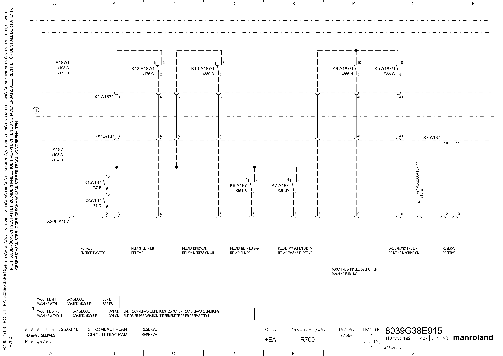

# +EA — Sheet 192 of 407 — RESERVE

**RESERVE**

> Part of the manroland **R700** printing press IEC/UL circuit diagrams.
> Drawing class: **Stromlaufplan / Circuit diagram** (DIN A3).
> Document `+EA` covers the **Printing unit** machine section.

## At a glance

| Field | Value |
|---|---|
| Document | `+EA`  (8039G38E915) |
| Sheet | **192** of 407 |
| Section (DE) | RESERVE |
| Section (EN) | RESERVE |
| Section type | CIRCUIT — Circuit diagram |
| Machine type | `R700` |
| Series | `7758` |
| Created | 25.03.10 |
| Replaces | — |
| Columns used | A, B, C, D, E, F, G, H |
| Path numbers | — |
| Labels on sheet | 109 |
| Cross-refs out | 13 |
| Cross-refs in | 42 |

**Previous:** [+EA sheet 191](SHEET_0191.md) · **Next:** [+EA sheet 193](SHEET_0193.md) · **Document TOC:** [_TOC.md](_TOC.md)  (+EA) · **Master TOC:** [all sheets](../_MASTER_TOC.md)

## Sheet image (300 DPI, exact vector render)



_Rendered directly from the PDF vector layer at 300 DPI (1-bit), no OCR and no resampling. Use it to confirm anything ambiguous in the text below._

## Cross-references on this sheet

Each entry is a wire leaving this sheet. The printed token is `/sheet.column`; the link resolves to that sheet inside the same document.

| Ref | Target sheet | Col | Path | Destination on target | Target section | From col |
|---|---|---|---|---|---|---|
| `/193.A` | [+EA sheet 193](SHEET_0193.md) | A | — | — | RESERVE | A |
| `/176.B` | [+EA sheet 176](SHEET_0176.md) | B | — | — | RESERVE | A |
| `/359.B` | [+EA sheet 359](SHEET_0359.md) | B | — | — | OPTION: | D |
| `/366.G` | [+EA sheet 366](SHEET_0366.md) | G | — | — | OPTION: TROCKNER VORBEREITUNG; | G |
| `/176.C` | [+EA sheet 176](SHEET_0176.md) | C | — | — | RESERVE | C |
| `/366.H` | [+EA sheet 366](SHEET_0366.md) | H | — | — | OPTION: TROCKNER VORBEREITUNG; | F |
| `/193.A` | [+EA sheet 193](SHEET_0193.md) | A | — | — | RESERVE | A |
| `/124.B` | [+EA sheet 124](SHEET_0124.md) | B | — | — | TROCKENBESTÄUBER | A |
| `/15.E` | [+EA sheet 15](SHEET_0015.md) | E | — | 24V.X206.A187:11 | SPANNUNGSVERSORGUNG: 400V, 24V | G |
| `/37.E` | [+EA sheet 37](SHEET_0037.md) | E | — | — | BUSVERBINDUNGEN: NOT AUS | B |
| `/351.B` | [+EA sheet 351](SHEET_0351.md) | B | — | — | OPTION: VORBEREITUNG: PUDERABSAUGUNG | D |
| `/351.D` | [+EA sheet 351](SHEET_0351.md) | D | — | — | OPTION: VORBEREITUNG: PUDERABSAUGUNG | E |
| `/37.D` | [+EA sheet 37](SHEET_0037.md) | D | — | — | BUSVERBINDUNGEN: NOT AUS | B |

### Incoming references (sheets that point here)

Every other sheet that sends a wire to this one. `Back-ref` is the token printed on *that* sheet; `Path` is its line number.

| From sheet | Cols | Back-ref | Path | Refs | What continues there |
|---|---|---|---|---|---|
| [+EA#15](SHEET_0015.md) | F | `/15.F` | — | 1 | 24V.X206.A187:11 |
| [+EA#37](SHEET_0037.md) | D, E | `/37.D`, `/37.E` | — | 2 | — |
| [+EA#124](SHEET_0124.md) | B | `/124.B` | — | 1 | — |
| [+EA#176](SHEET_0176.md) | B, C | `/176.B`, `/176.C` | — | 2 | — |
| [+EA#193](SHEET_0193.md) | A | `/193.A` | — | 2 | — |
| [+EA#206](SHEET_0206.md) | G, H | `/206.G`, `/206.H` | — | 7 | — |
| [+EA#207](SHEET_0207.md) | A, B | `/207.A`, `/207.B` | — | 7 | — |
| [+EA#246](SHEET_0246.md) | B | `/246.B` | — | 2 | — |
| [+EA#288](SHEET_0288.md) | F | `/288.F` | — | 13 | — |
| [+EA#351](SHEET_0351.md) | B, D | `/351.B`, `/351.D` | — | 2 | — |
| [+EA#359](SHEET_0359.md) | B | `/359.B` | — | 1 | — |
| [+EA#366](SHEET_0366.md) | G, H | `/366.G`, `/366.H` | — | 2 | — |


## Devices on this sheet

| Tag | Class | Class meaning (IEC) | Col | Sub | Terminal | Sign |
|---|---|---|---|---|---|---|
| `A187` | A | Baugruppe / assembly, module, PC board | A | — | — | — |
| `A187/1` | A | Baugruppe / assembly, module, PC board | A | 1 | — | — |
| `K2.A187` | — | cross-device reference | B | — | — | — |
| `K1.A187` | — | cross-device reference | B | — | — | — |
| `X1.A187` | — | cross-device reference | B | — | — | — |
| `K6.A187` | — | cross-device reference | D | — | — | — |
| `K7.A187` | — | cross-device reference | E | — | — | — |
| `X206.A187` | — | cross-device reference | A | — | — | — |
| `X7.A187` | — | cross-device reference | G | — | — | — |

## Potentials / nets

| Potential | Count | Columns | Attached devices | Terminals |
|---|---|---|---|---|
| `24V` | 1 | G | `A187`, `X206` | `11` |


A potential such as `L24+/4` or `M24+` is a named supply/return rail; every place it appears on this sheet is electrically common.

## Wire-end annotations (grouped as printed)

A wire that continues elsewhere is annotated with a small cluster: the destination description, the path/line number `#NN`, and the `/sheet.column` cross reference. Each row below is one such cluster exactly as it is grouped on the drawing.

| Col | Y | Path | Cross-ref | Text on the wire |
|---|---|---|---|---|
| A | 143.5 | — | — | `A187/1` |
| C | 144.2 | — | — | `K12.A187/1 3` |
| C | 144.2 | — | — | `1` |
| D | 144.2 | — | — | `K13.A187/1 3` |
| D | 144.2 | — | — | `1` |
| F | 144.2 | — | — | `10` |
| G | 144.2 | — | — | `10` |
| A | 156.5 | — | `/193.A`, `/176.B` | — |
| F | 157.6 | — | — | `K6.A187/1 9` |
| G | 157.6 | — | — | `K5.A187/1 9` |
| C | 170.7 | — | `/176.C` | — |
| D | 170.7 | — | `/359.B` | — |
| F | 170.7 | — | `/366.H` | — |
| G | 170.7 | — | `/366.G` | — |
| C | 172.5 | — | — | `2` |
| D | 172.5 | — | — | `2` |
| B | 224.2 | — | — | `X1.A187/1 3` |
| C | 225.7 | — | — | `4` |
| C | 225.7 | — | — | `5` |
| D | 225.7 | — | — | `6` |
| E | 225.7 | — | — | `39` |
| F | 225.7 | — | — | `40` |
| G | 225.7 | — | — | `41` |
| A | 257.7 | — | — | `1` |
| B | 317.8 | — | — | `X1.A187 3` |
| C | 317.8 | — | — | `4` |
| C | 317.8 | — | — | `5` |
| D | 317.8 | — | — | `6` |
| E | 317.8 | — | — | `39` |
| F | 317.8 | — | — | `40 41` |
| G | 320.6 | — | — | `X7.A187` |
| H | 334.8 | — | — | `10 11` |
| A | 349.0 | — | — | `A187` |
| A | 362.0 | — | `/193.A`, `/124.B` | — |
| G | 381.6 | — | `/15.E` | `24V.X206.A187:11` |
| B | 413.5 | — | — | `10` |
| D | 420.6 | — | — | `K6.A187 6` |
| D | 420.6 | — | — | `4` |
| E | 420.6 | — | — | `K7.A187 6` |
| E | 420.6 | — | — | `4` |
| B | 426.9 | — | — | `K1.A187 9` |
| B | 440.0 | — | `/37.E` | — |
| D | 447.1 | — | `/351.B` | — |
| E | 447.1 | — | `/351.D` | — |
| D | 448.9 | — | — | `5` |
| E | 448.9 | — | — | `5` |
| B | 456.0 | — | — | `10` |
| B | 469.4 | — | — | `K2.A187 9` |
| B | 482.5 | — | `/37.D` | — |
| B | 502.1 | — | — | `1 2` |
| B | 502.1 | — | — | `3 4` |
| D | 502.1 | — | — | `5` |
| E | 502.1 | — | — | `6 7` |
| G | 502.1 | — | — | `8 9 10 11 12 13` |
| A | 519.0 | — | — | `X206.A187` |
| C | 584.5 | — | — | `NOT AUS EMERGENCY STOP RELAIS: DRUCK AN RELAY: IMPRESSION ON RELAIS: WASCHEN, AKTIV RELAY: WASH UP, ACTIVE` |
| B | 584.5 | — | — | `RELAIS: BETRIEB RELAY: RUN` |
| D | 584.5 | — | — | `RELAIS: BETRIEB S+W RELAY: RUN PP` |
| G | 584.5 | — | — | `DRUCKMASCHINE EIN PRINTING MACHINE ON RESERVE RESERVE` |
| F | 634.2 | — | — | `MASCHINE WIRD LEER GEFAHREN MACHINE IS IDLING` |
| A | 705.0 | — | — | `1 SERIE SERIES OPTION OPTION` |
| A | 705.0 | — | — | `MASCHINE MIT MACHINE WITH` |
| A | 705.0 | — | — | `LACKMODUL:` |
| A | 715.7 | — | — | `COATING MODULE:` |
| A | 733.4 | — | — | `MASCHINE OHNE MACHINE WITHOUT` |
| A | 733.4 | — | — | `LACKMODUL:` |
| C | 733.4 | — | — | `ENDTROCKNER VORBEREITUNG / ZWISCHENTROCKNER VORBEREITUNG END DRIER PREPARATION / INTERMEDIATE DRIER PREPARATION` |
| B | 744.0 | — | — | `COATING MODULE:` |


## Reconstructed tables

This sheet carries tabular content (pin map / terminal assignment / index). The grid below was rebuilt from the drawing's own rule lines, so each row is exactly one physical row of the table.

### Table 1 — 5 data rows × 24 columns (at x=170.1, y=0.0) — **X1.A187/1 X1.A187 3 3 1 K12.A187/1 /176.C 2 4 4 3 1 K13.A187/1 /359.B 5 5 2 6 6 39 39 K6.A187/1 /366.H 10 9 40 40 K5.A187/1 /366.G 10 9 41 41 X7.A187 10 1 LACKMODUL: COATING MODULE: LACKMODUL: COATING K1.A187 /37.E K2.A187 /37.D NOT AUS EMERGENCY STOP MODULE: 10 9 10 9 2 SERIE SERIES OPTION OPTION 3 RELAIS: RELAY: END BETRIEB RUN ENDTROCKNER VORBEREITUNG DRIER PREPARATION 4 / / INTERMEDIATE RELAIS: DRUCK AN RELAY: IMPRESSION ON ZWISCHENTROCKNER VORBEREITUNG DRIER PREPARATION 5 4 K6.A187 /351.B RELAIS: BETRIEB RELAY: RUN PP 5 6 6 K7.A187 /351.D S+W RELAIS: RELAY: 4 5 7 WASCHEN, WASH UP, 6 AKTIV ACTIVE 8 MASCHINE WIRD MACHINE IS IDLING 9 LEER GEFAHREN PRINTING 24V.X206.A187:11 /15.E 10 11 DRUCKMASCHINE EIN MACHINE ON 12 RESERVE RESERVE**

|  |  | STROMLAUFPLAN |  | RESERVE |  |  |  |  |  |  |  | Ort: |  |  | Masch. Type: |  | Serie: |  | IEC (N) |  | 8039G38E915 |  |  |
|---|---|---|---|---|---|---|---|---|---|---|---|---|---|---|---|---|---|---|---|---|---|---|---|
|  | `CIRCUIT` |  | `DIAGRAM` |  |  |  |  |  |  |  |  |  |  |  |  |  |  |  |  |  |  |  |  |
|  |  |  |  | `RESERVE` |  |  |  |  |  |  |  |  |  |  |  |  | `7758` |  | `1` |  |  |  |  |
|  |  |  |  |  |  |  |  |  |  |  |  | `+EA` |  |  | `R700` |  |  |  |  | `Blatt:` | `DIN 192 407` | `A3` |  |
|  |  |  |  |  |  |  |  |  |  |  |  |  |  |  |  |  |  |  | `UL (M)` |  |  |  |  |
|  |  |  |  |  |  |  |  |  |  |  |  |  |  |  |  |  |  |  | `1` | `anstatt:` |  |  |  |


## Notes and free text on this sheet

| Text | Col | Y (pt) |
|---|---|---|
| `K12.A187/1` | B | 157.63 |
| `X1.A187/1` | B | 224.25 |
| `K13.A187/1` | C | 157.63 |
| `K6.A187/1` | F | 157.64 |
| `K5.A187/1` | G | 157.64 |
| `RELAIS: BETRIEB` | B | 584.53 |
| `RELAY: RUN` | B | 595.17 |
| `RELAIS: BETRIEB S+W` | D | 584.51 |
| `RELAY: RUN PP` | D | 595.18 |
| `RELAIS: WASCHEN, AKTIV` | E | 584.52 |
| `RELAY: WASH UP, ACTIVE` | E | 595.16 |
| `RELAIS: DRUCK AN` | C | 584.55 |
| `RELAY: IMPRESSION ON` | C | 595.18 |
| `NOT AUS` | B | 584.55 |
| `EMERGENCY STOP` | B | 595.19 |
| `RESERVE` | H | 584.52 |
| `DRUCKMASCHINE EIN` | G | 584.57 |
| `PRINTING MACHINE ON` | G | 595.2 |
| `MASCHINE WIRD LEER GEFAHREN` | F | 634.16 |
| `MACHINE IS IDLING` | F | 644.8 |
| `MASCHINE MIT` | A | 705.04 |
| `MACHINE WITH` | A | 715.63 |
| `LACKMODUL:` | A | 705.04 |
| `COATING MODULE:` | A | 715.68 |
| `MASCHINE OHNE` | A | 733.39 |
| `MACHINE WITHOUT` | A | 744 |
| `COATING MODULE:` | B | 744.02 |
| `SERIE` | B | 704.98 |
| `SERIES` | B | 715.62 |
| `OPTION` | B | 733.35 |
| `ENDTROCKNER VORBEREITUNG / ZWISCHENTROCKNER VORBEREITUNG` | C | 733.39 |
| `END DRIER PREPARATION / INTERMEDIATE DRIER PREPARATION` | C | 744.02 |

## Complete label inventory (exact text from the drawing)

Every text object inside the drawing area of this sheet, in DIN reading order (column A→H, then top→bottom). This is the authoritative list: if a string is not here it is not printed on this sheet.

| Col | Y | X | Dir | Type | Text |
|---|---|---|---|---|---|
| A | 143.5 | 127.8 | → | device tag | `A187/1` |
| A | 156.5 | 137.5 | → | cross-reference | `/193.A` |
| A | 168.9 | 137.8 | → | cross-reference | `/176.B` |
| A | 257.7 | 83.3 | → | number | `1` |
| A | 349.0 | 121.0 | → | device tag | `A187` |
| A | 362.0 | 123.3 | → | cross-reference | `/193.A` |
| A | 374.4 | 123.6 | → | cross-reference | `/124.B` |
| A | 502.1 | 172.1 | → | number | `1` |
| A | 519.0 | 107.4 | → | device ref | `X206.A187` |
| A | 705.0 | 87.3 | → | text | `MASCHINE MIT` |
| A | 705.0 | 157.9 | → | text | `LACKMODUL:` |
| A | 715.6 | 87.3 | → | text | `MACHINE WITH` |
| A | 715.7 | 158.5 | → | text | `COATING MODULE:` |
| A | 724.5 | 75.4 | → | number | `1` |
| A | 733.4 | 87.3 | → | text | `MASCHINE OHNE` |
| A | 733.4 | 172.1 | → | text | `LACKMODUL:` |
| A | 744.0 | 87.3 | → | text | `MACHINE WITHOUT` |
| B | 157.6 | 307.3 | → | text | `K12.A187/1` |
| B | 224.3 | 219.7 | → | text | `X1.A187/1` |
| B | 225.7 | 278.9 | → | number | `3` |
| B | 317.8 | 227.1 | → | device ref | `X1.A187` |
| B | 317.8 | 278.9 | → | number | `3` |
| B | 413.5 | 250.0 | → | number | `10` |
| B | 426.9 | 195.9 | → | device ref | `K1.A187` |
| B | 440.0 | 219.4 | → | cross-reference | `/37.E` |
| B | 441.8 | 250.6 | → | number | `9` |
| B | 456.0 | 250.0 | → | number | `10` |
| B | 469.4 | 195.9 | → | device ref | `K2.A187` |
| B | 482.5 | 218.8 | → | cross-reference | `/37.D` |
| B | 484.3 | 250.6 | → | number | `9` |
| B | 502.1 | 250.6 | → | number | `2` |
| B | 502.1 | 278.9 | → | number | `3` |
| B | 584.5 | 190.5 | → | text | `NOT AUS` |
| B | 584.5 | 311.0 | → | text | `RELAIS: BETRIEB` |
| B | 595.2 | 190.5 | → | text | `EMERGENCY STOP` |
| B | 595.2 | 311.0 | → | text | `RELAY: RUN` |
| B | 705.0 | 243.5 | → | text | `SERIE` |
| B | 715.6 | 243.5 | → | text | `SERIES` |
| B | 733.4 | 257.7 | → | text | `OPTION` |
| B | 744.0 | 172.6 | → | text | `COATING MODULE:` |
| B | 744.0 | 257.7 | → | text | `OPTION` |
| C | 144.2 | 362.6 | → | number | `1` |
| C | 144.2 | 385.2 | → | number | `3` |
| C | 157.6 | 449.0 | → | text | `K13.A187/1` |
| C | 170.7 | 338.7 | → | cross-reference | `/176.C` |
| C | 172.5 | 378.1 | → | number | `2` |
| C | 225.7 | 378.1 | → | number | `4` |
| C | 225.7 | 420.7 | → | number | `5` |
| C | 317.8 | 378.1 | → | number | `4` |
| C | 317.8 | 420.7 | → | number | `5` |
| C | 502.1 | 378.1 | → | number | `4` |
| C | 584.5 | 431.4 | → | text | `RELAIS: DRUCK AN` |
| C | 595.2 | 431.4 | → | text | `RELAY: IMPRESSION ON` |
| C | 733.4 | 292.5 | → | text | `ENDTROCKNER VORBEREITUNG / ZWISCHENTROCKNER VORBEREITUNG` |
| C | 744.0 | 292.5 | → | text | `END DRIER PREPARATION / INTERMEDIATE DRIER PREPARATION` |
| D | 144.2 | 504.3 | → | number | `1` |
| D | 144.2 | 527.0 | → | number | `3` |
| D | 170.7 | 480.8 | → | cross-reference | `/359.B` |
| D | 172.5 | 519.9 | → | number | `2` |
| D | 225.7 | 519.9 | → | number | `6` |
| D | 317.8 | 519.9 | → | number | `6` |
| D | 420.6 | 580.8 | → | number | `4` |
| D | 420.6 | 604.9 | → | number | `6` |
| D | 434.0 | 540.3 | → | device ref | `K6.A187` |
| D | 447.1 | 558.7 | → | cross-reference | `/351.B` |
| D | 448.9 | 597.8 | → | number | `5` |
| D | 502.1 | 519.9 | → | number | `5` |
| D | 502.1 | 597.8 | → | number | `6` |
| D | 584.5 | 544.8 | → | text | `RELAIS: BETRIEB S+W` |
| D | 595.2 | 544.8 | → | text | `RELAY: RUN PP` |
| E | 225.7 | 753.7 | → | number | `39` |
| E | 317.8 | 753.7 | → | number | `39` |
| E | 420.6 | 680.0 | → | number | `4` |
| E | 420.6 | 704.1 | → | number | `6` |
| E | 434.0 | 639.5 | → | device ref | `K7.A187` |
| E | 447.1 | 657.6 | → | cross-reference | `/351.D` |
| E | 448.9 | 697.0 | → | number | `5` |
| E | 502.1 | 697.0 | → | number | `7` |
| E | 502.1 | 753.7 | → | number | `8` |
| E | 584.5 | 658.2 | → | text | `RELAIS: WASCHEN, AKTIV` |
| E | 595.2 | 658.2 | → | text | `RELAY: WASH UP, ACTIVE` |
| F | 144.2 | 845.3 | → | number | `10` |
| F | 157.6 | 783.8 | → | text | `K6.A187/1` |
| F | 170.7 | 809.9 | → | cross-reference | `/366.H` |
| F | 172.5 | 845.9 | → | number | `9` |
| F | 225.7 | 845.9 | → | number | `40` |
| F | 317.8 | 845.9 | → | number | `40` |
| F | 502.1 | 845.9 | → | number | `9` |
| F | 634.2 | 786.0 | → | text | `MASCHINE WIRD LEER GEFAHREN` |
| F | 644.8 | 786.0 | → | text | `MACHINE IS IDLING` |
| G | 144.2 | 944.5 | → | number | `10` |
| G | 157.6 | 883.0 | → | text | `K5.A187/1` |
| G | 170.7 | 908.2 | → | cross-reference | `/366.G` |
| G | 172.5 | 945.1 | → | number | `9` |
| G | 225.7 | 945.1 | → | number | `41` |
| G | 317.8 | 945.1 | → | number | `41` |
| G | 320.6 | 998.1 | → | device ref | `X7.A187` |
| G | 381.5 | 983.9 | ↕ | potential | `24V.X206.A187:11` |
| G | 447.0 | 993.8 | ↕ | cross-reference | `/15.E` |
| G | 502.1 | 944.5 | → | number | `10` |
| G | 502.1 | 994.1 | → | number | `11` |
| G | 584.6 | 920.4 | → | text | `DRUCKMASCHINE EIN` |
| G | 595.2 | 920.4 | → | text | `PRINTING MACHINE ON` |
| H | 334.8 | 1050.8 | → | number | `10` |
| H | 334.8 | 1079.1 | → | number | `11` |
| H | 502.1 | 1050.8 | → | number | `12` |
| H | 502.1 | 1079.1 | → | number | `13` |
| H | 584.5 | 1048.0 | → | text | `RESERVE` |
| H | 595.2 | 1048.0 | → | text | `RESERVE` |

## Reading-order text block

The same content as a plain block, grouped by DIN column — convenient to paste or to match against a visual description.

```text
=== Column A ===
 143.5  127.8  devtag       A187/1
 156.5  137.5  xref         /193.A
 168.9  137.8  xref         /176.B
 257.7   83.3  numeric      1
 349.0  121.0  devtag       A187
 362.0  123.3  xref         /193.A
 374.4  123.6  xref         /124.B
 502.1  172.1  numeric      1
 519.0  107.4  devref       X206.A187
 705.0   87.3  text         MASCHINE MIT
 705.0  157.9  text         LACKMODUL:
 715.6   87.3  text         MACHINE WITH
 715.7  158.5  text         COATING MODULE:
 724.5   75.4  numeric      1
 733.4   87.3  text         MASCHINE OHNE
 733.4  172.1  text         LACKMODUL:
 744.0   87.3  text         MACHINE WITHOUT
=== Column B ===
 157.6  307.3  text         K12.A187/1
 224.3  219.7  text         X1.A187/1
 225.7  278.9  numeric      3
 317.8  227.1  devref       X1.A187
 317.8  278.9  numeric      3
 413.5  250.0  numeric      10
 426.9  195.9  devref       K1.A187
 440.0  219.4  xref         /37.E
 441.8  250.6  numeric      9
 456.0  250.0  numeric      10
 469.4  195.9  devref       K2.A187
 482.5  218.8  xref         /37.D
 484.3  250.6  numeric      9
 502.1  250.6  numeric      2
 502.1  278.9  numeric      3
 584.5  190.5  text         NOT AUS
 584.5  311.0  text         RELAIS: BETRIEB
 595.2  190.5  text         EMERGENCY STOP
 595.2  311.0  text         RELAY: RUN
 705.0  243.5  text         SERIE
 715.6  243.5  text         SERIES
 733.4  257.7  text         OPTION
 744.0  172.6  text         COATING MODULE:
 744.0  257.7  text         OPTION
=== Column C ===
 144.2  362.6  numeric      1
 144.2  385.2  numeric      3
 157.6  449.0  text         K13.A187/1
 170.7  338.7  xref         /176.C
 172.5  378.1  numeric      2
 225.7  378.1  numeric      4
 225.7  420.7  numeric      5
 317.8  378.1  numeric      4
 317.8  420.7  numeric      5
 502.1  378.1  numeric      4
 584.5  431.4  text         RELAIS: DRUCK AN
 595.2  431.4  text         RELAY: IMPRESSION ON
 733.4  292.5  text         ENDTROCKNER VORBEREITUNG / ZWISCHENTROCKNER VORBEREITUNG
 744.0  292.5  text         END DRIER PREPARATION / INTERMEDIATE DRIER PREPARATION
=== Column D ===
 144.2  504.3  numeric      1
 144.2  527.0  numeric      3
 170.7  480.8  xref         /359.B
 172.5  519.9  numeric      2
 225.7  519.9  numeric      6
 317.8  519.9  numeric      6
 420.6  580.8  numeric      4
 420.6  604.9  numeric      6
 434.0  540.3  devref       K6.A187
 447.1  558.7  xref         /351.B
 448.9  597.8  numeric      5
 502.1  519.9  numeric      5
 502.1  597.8  numeric      6
 584.5  544.8  text         RELAIS: BETRIEB S+W
 595.2  544.8  text         RELAY: RUN PP
=== Column E ===
 225.7  753.7  numeric      39
 317.8  753.7  numeric      39
 420.6  680.0  numeric      4
 420.6  704.1  numeric      6
 434.0  639.5  devref       K7.A187
 447.1  657.6  xref         /351.D
 448.9  697.0  numeric      5
 502.1  697.0  numeric      7
 502.1  753.7  numeric      8
 584.5  658.2  text         RELAIS: WASCHEN, AKTIV
 595.2  658.2  text         RELAY: WASH UP, ACTIVE
=== Column F ===
 144.2  845.3  numeric      10
 157.6  783.8  text         K6.A187/1
 170.7  809.9  xref         /366.H
 172.5  845.9  numeric      9
 225.7  845.9  numeric      40
 317.8  845.9  numeric      40
 502.1  845.9  numeric      9
 634.2  786.0  text         MASCHINE WIRD LEER GEFAHREN
 644.8  786.0  text         MACHINE IS IDLING
=== Column G ===
 144.2  944.5  numeric      10
 157.6  883.0  text         K5.A187/1
 170.7  908.2  xref         /366.G
 172.5  945.1  numeric      9
 225.7  945.1  numeric      41
 317.8  945.1  numeric      41
 320.6  998.1  devref       X7.A187
 381.5  983.9  net          24V.X206.A187:11
 447.0  993.8  xref         /15.E
 502.1  944.5  numeric      10
 502.1  994.1  numeric      11
 584.6  920.4  text         DRUCKMASCHINE EIN
 595.2  920.4  text         PRINTING MACHINE ON
=== Column H ===
 334.8 1050.8  numeric      10
 334.8 1079.1  numeric      11
 502.1 1050.8  numeric      12
 502.1 1079.1  numeric      13
 584.5 1048.0  text         RESERVE
 595.2 1048.0  text         RESERVE
```

---
_Generated from the PDF vector text layer; no OCR. Source: `R700_7758_IEC_UL_EA_8039G38E915_p`, sheet 192._
