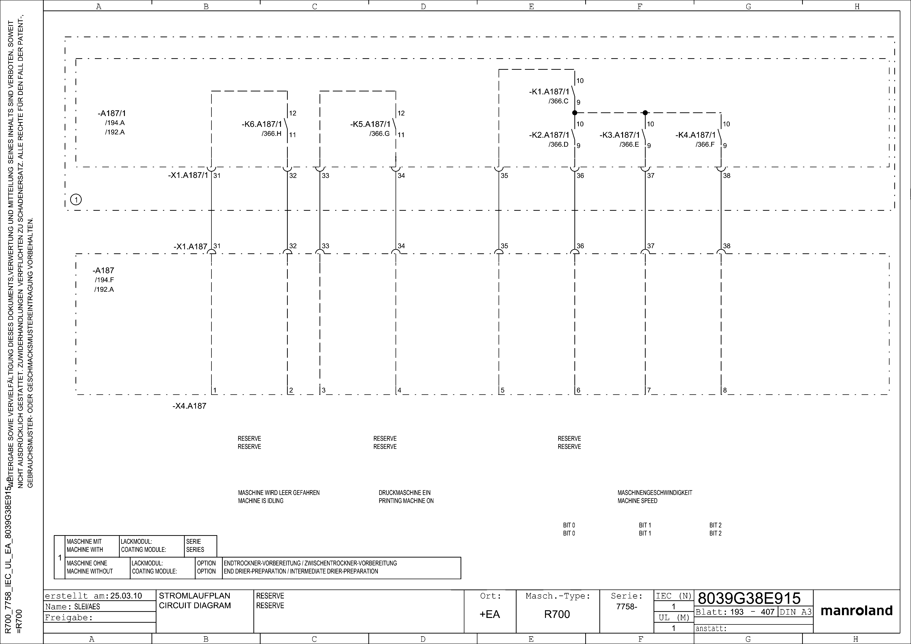

# +EA — Sheet 193 of 407 — RESERVE

**RESERVE**

> Part of the manroland **R700** printing press IEC/UL circuit diagrams.
> Drawing class: **Stromlaufplan / Circuit diagram** (DIN A3).
> Document `+EA` covers the **Printing unit** machine section.

## At a glance

| Field | Value |
|---|---|
| Document | `+EA`  (8039G38E915) |
| Sheet | **193** of 407 |
| Section (DE) | RESERVE |
| Section (EN) | RESERVE |
| Section type | CIRCUIT — Circuit diagram |
| Machine type | `R700` |
| Series | `7758` |
| Created | 25.03.10 |
| Replaces | — |
| Columns used | A, B, C, D, E, F, G |
| Path numbers | — |
| Labels on sheet | 91 |
| Cross-refs out | 10 |
| Cross-refs in | 34 |

**Previous:** [+EA sheet 192](SHEET_0192.md) · **Next:** [+EA sheet 194](SHEET_0194.md) · **Document TOC:** [_TOC.md](_TOC.md)  (+EA) · **Master TOC:** [all sheets](../_MASTER_TOC.md)

## Sheet image (300 DPI, exact vector render)



_Rendered directly from the PDF vector layer at 300 DPI (1-bit), no OCR and no resampling. Use it to confirm anything ambiguous in the text below._

## Cross-references on this sheet

Each entry is a wire leaving this sheet. The printed token is `/sheet.column`; the link resolves to that sheet inside the same document.

| Ref | Target sheet | Col | Path | Destination on target | Target section | From col |
|---|---|---|---|---|---|---|
| `/366.C` | [+EA sheet 366](SHEET_0366.md) | C | — | — | OPTION: TROCKNER VORBEREITUNG; | E |
| `/194.A` | [+EA sheet 194](SHEET_0194.md) | A | — | — | RESERVE | A |
| `/192.A` | [+EA sheet 192](SHEET_0192.md) | A | — | — | RESERVE | A |
| `/366.G` | [+EA sheet 366](SHEET_0366.md) | G | — | — | OPTION: TROCKNER VORBEREITUNG; | D |
| `/366.H` | [+EA sheet 366](SHEET_0366.md) | H | — | — | OPTION: TROCKNER VORBEREITUNG; | C |
| `/366.E` | [+EA sheet 366](SHEET_0366.md) | E | — | — | OPTION: TROCKNER VORBEREITUNG; | F |
| `/366.F` | [+EA sheet 366](SHEET_0366.md) | F | — | — | OPTION: TROCKNER VORBEREITUNG; | G |
| `/366.D` | [+EA sheet 366](SHEET_0366.md) | D | — | — | OPTION: TROCKNER VORBEREITUNG; | E |
| `/194.F` | [+EA sheet 194](SHEET_0194.md) | F | — | — | RESERVE | A |
| `/192.A` | [+EA sheet 192](SHEET_0192.md) | A | — | — | RESERVE | A |

### Incoming references (sheets that point here)

Every other sheet that sends a wire to this one. `Back-ref` is the token printed on *that* sheet; `Path` is its line number.

| From sheet | Cols | Back-ref | Path | Refs | What continues there |
|---|---|---|---|---|---|
| [+EA#192](SHEET_0192.md) | A | `/192.A` | — | 2 | — |
| [+EA#194](SHEET_0194.md) | A, F | `/194.A`, `/194.F` | — | 2 | — |
| [+EA#206](SHEET_0206.md) | H | `/206.H` | — | 8 | — |
| [+EA#207](SHEET_0207.md) | B | `/207.B` | — | 8 | — |
| [+EA#236](SHEET_0236.md) | B | `/236.B` | — | 8 | — |
| [+EA#366](SHEET_0366.md) | C, D, E, F, G, H | `/366.C`, `/366.D`, `/366.E`, `/366.F`, `/366.G`, `/366.H` | — | 6 | — |


## Devices on this sheet

| Tag | Class | Class meaning (IEC) | Col | Sub | Terminal | Sign |
|---|---|---|---|---|---|---|
| `A187` | A | Baugruppe / assembly, module, PC board | A | — | — | — |
| `A187/1` | A | Baugruppe / assembly, module, PC board | A | 1 | — | — |
| `X1.A187` | — | cross-device reference | B | — | — | — |
| `X4.A187` | — | cross-device reference | B | — | — | — |

## Potentials / nets

_No named potentials on this sheet._

## Wire-end annotations (grouped as printed)

A wire that continues elsewhere is annotated with a small cluster: the destination description, the path/line number `#NN`, and the `/sheet.column` cross reference. Each row below is one such cluster exactly as it is grouped on the drawing.

| Col | Y | Path | Cross-ref | Text on the wire |
|---|---|---|---|---|
| E | 101.7 | — | — | `10` |
| E | 115.1 | — | — | `K1.A187/1 9` |
| E | 128.2 | — | `/366.C` | — |
| A | 143.5 | — | — | `A187/1` |
| C | 144.2 | — | — | `12` |
| D | 144.2 | — | — | `12` |
| A | 156.5 | — | `/194.A`, `/192.A` | — |
| C | 157.6 | — | — | `K6.A187/1 11` |
| D | 157.6 | — | — | `K5.A187/1 11` |
| E | 158.4 | — | — | `10` |
| F | 158.4 | — | — | `10` |
| G | 158.4 | — | — | `10` |
| C | 170.7 | — | `/366.H` | — |
| D | 170.7 | — | `/366.G` | — |
| E | 171.8 | — | — | `K2.A187/1 9` |
| F | 171.8 | — | — | `K3.A187/1 9` |
| G | 171.8 | — | — | `K4.A187/1 9` |
| E | 184.9 | — | `/366.D` | — |
| F | 184.9 | — | `/366.E` | — |
| G | 184.9 | — | `/366.F` | — |
| B | 224.2 | — | — | `X1.A187/1 31` |
| C | 225.7 | — | — | `32` |
| C | 225.7 | — | — | `33` |
| D | 225.7 | — | — | `34` |
| E | 225.7 | — | — | `35` |
| E | 225.7 | — | — | `36` |
| F | 225.7 | — | — | `37 38` |
| A | 257.7 | — | — | `1` |
| B | 317.8 | — | — | `X1.A187 31` |
| C | 317.8 | — | — | `32` |
| C | 317.8 | — | — | `33` |
| D | 317.8 | — | — | `34` |
| E | 317.8 | — | — | `35` |
| E | 317.8 | — | — | `36` |
| F | 317.8 | — | — | `37 38` |
| A | 349.0 | — | — | `A187` |
| A | 362.0 | — | `/194.F`, `/192.A` | — |
| D | 506.3 | — | — | `1 2 3 4 5 6 7 8` |
| B | 526.1 | — | — | `X4.A187` |
| B | 570.4 | — | — | `RESERVE RESERVE` |
| D | 570.4 | — | — | `RESERVE RESERVE` |
| E | 570.4 | — | — | `RESERVE RESERVE` |
| C | 641.2 | — | — | `MASCHINE WIRD LEER GEFAHREN MACHINE IS IDLING DRUCKMASCHINE EIN PRINTING MACHINE ON` |
| F | 641.2 | — | — | `MASCHINENGESCHWINDIGKEIT MACHINE SPEED` |
| F | 683.6 | — | — | `BIT 0 BIT 0 BIT 1 BIT 1` |
| G | 683.7 | — | — | `BIT 2 BIT 2` |
| A | 705.0 | — | — | `1 SERIE SERIES OPTION OPTION` |
| A | 705.0 | — | — | `MASCHINE MIT MACHINE WITH` |
| A | 705.0 | — | — | `LACKMODUL:` |
| A | 715.7 | — | — | `COATING MODULE:` |
| A | 733.4 | — | — | `MASCHINE OHNE MACHINE WITHOUT` |
| A | 733.4 | — | — | `LACKMODUL:` |
| C | 733.4 | — | — | `ENDTROCKNER VORBEREITUNG / ZWISCHENTROCKNER VORBEREITUNG END DRIER PREPARATION / INTERMEDIATE DRIER PREPARATION` |
| B | 744.0 | — | — | `COATING MODULE:` |


## Reconstructed tables

This sheet carries tabular content (pin map / terminal assignment / index). The grid below was rebuilt from the drawing's own rule lines, so each row is exactly one physical row of the table.

### Table 1 — 5 data rows × 15 columns (at x=204.1, y=0.0) — **10 K1.A187/1 /366.C 9 X1.A187/1 X1.A187 X4.A187 SERIE SERIES OPTION OPTION MODULE: 31 31 1 RESERVE RESERVE MASCHINE MACHINE END K6.A187/1 /366.H WIRD LEER IS IDLING ENDTROCKNER VORBEREITUNG DRIER PREPARATION 12 11 32 32 2 GEFAHREN / / INTERMEDIATE K5.A187/1 /366.G 33 33 3 RESERVE RESERVE PRINTING ZWISCHENTROCKNER VORBEREITUNG DRIER PREPARATION 12 11 34 34 4 DRUCKMASCHINE EIN MACHINE ON 35 35 5 K2.A187/1 /366.D RESERVE RESERVE BIT 0 BIT 0 10 9 36 36 6 K3.A187/1 /366.E MACHINE BIT BIT 10 9 37 37 7 SPEED 1 1 MASCHINENGESCHWINDIGKEIT K4.A187/1 /366.F BIT 2 BIT 2 10 9 38 38 8**

| STROMLAUFPLAN |  | RESERVE |  |  |  | Ort: |  | Masch. Type: |  | Serie: |  | IEC (N) |  | 8039G38E915 |
|---|---|---|---|---|---|---|---|---|---|---|---|---|---|---|
| `CIRCUIT` | `DIAGRAM` |  |  |  |  |  |  |  |  |  |  |  |  |  |
|  |  | `RESERVE` |  |  |  |  |  |  |  | `7758` |  | `1` |  |  |
|  |  |  |  |  |  | `+EA` |  | `R700` |  |  |  |  | `Blatt:` | `DIN A3 193 407` |
|  |  |  |  |  |  |  |  |  |  |  |  | `UL (M)` |  |  |
|  |  |  |  |  |  |  |  |  |  |  |  | `1` | `anstatt:` |  |


## Notes and free text on this sheet

| Text | Col | Y (pt) |
|---|---|---|
| `X1.A187/1` | B | 224.25 |
| `K6.A187/1` | C | 157.64 |
| `K5.A187/1` | D | 157.64 |
| `K3.A187/1` | F | 171.81 |
| `K4.A187/1` | G | 171.81 |
| `K2.A187/1` | E | 171.81 |
| `K1.A187/1` | E | 115.12 |
| `RESERVE` | D | 570.35 |
| `DRUCKMASCHINE EIN` | D | 641.26 |
| `PRINTING MACHINE ON` | D | 651.89 |
| `MASCHINE WIRD LEER GEFAHREN` | C | 641.24 |
| `MACHINE IS IDLING` | C | 651.89 |
| `RESERVE` | B | 570.35 |
| `MASCHINENGESCHWINDIGKEIT` | F | 641.25 |
| `MACHINE SPEED` | F | 651.89 |
| `BIT 1` | F | 683.62 |
| `BIT 0` | E | 683.69 |
| `BIT 2` | G | 683.68 |
| `RESERVE` | E | 570.35 |
| `MASCHINE MIT` | A | 705.04 |
| `MACHINE WITH` | A | 715.63 |
| `LACKMODUL:` | A | 705.04 |
| `COATING MODULE:` | A | 715.68 |
| `MASCHINE OHNE` | A | 733.39 |
| `MACHINE WITHOUT` | A | 744 |
| `COATING MODULE:` | B | 744.02 |
| `SERIE` | B | 704.98 |
| `SERIES` | B | 715.62 |
| `OPTION` | B | 733.35 |
| `ENDTROCKNER VORBEREITUNG / ZWISCHENTROCKNER VORBEREITUNG` | C | 733.39 |
| `END DRIER PREPARATION / INTERMEDIATE DRIER PREPARATION` | C | 744.02 |

## Complete label inventory (exact text from the drawing)

Every text object inside the drawing area of this sheet, in DIN reading order (column A→H, then top→bottom). This is the authoritative list: if a string is not here it is not printed on this sheet.

| Col | Y | X | Dir | Type | Text |
|---|---|---|---|---|---|
| A | 143.5 | 127.8 | → | device tag | `A187/1` |
| A | 156.5 | 137.5 | → | cross-reference | `/194.A` |
| A | 168.9 | 137.5 | → | cross-reference | `/192.A` |
| A | 257.7 | 97.5 | → | number | `1` |
| A | 349.0 | 121.0 | → | device tag | `A187` |
| A | 362.0 | 124.2 | → | cross-reference | `/194.F` |
| A | 374.4 | 123.3 | → | cross-reference | `/192.A` |
| A | 705.0 | 87.3 | → | text | `MASCHINE MIT` |
| A | 705.0 | 157.9 | → | text | `LACKMODUL:` |
| A | 715.6 | 87.3 | → | text | `MACHINE WITH` |
| A | 715.7 | 158.5 | → | text | `COATING MODULE:` |
| A | 724.5 | 75.4 | → | number | `1` |
| A | 733.4 | 87.3 | → | text | `MASCHINE OHNE` |
| A | 733.4 | 172.1 | → | text | `LACKMODUL:` |
| A | 744.0 | 87.3 | → | text | `MACHINE WITHOUT` |
| B | 224.3 | 219.7 | → | text | `X1.A187/1` |
| B | 225.7 | 278.9 | → | number | `31` |
| B | 317.8 | 227.1 | → | device ref | `X1.A187` |
| B | 317.8 | 278.9 | → | number | `31` |
| B | 506.3 | 278.4 | → | number | `1` |
| B | 526.1 | 225.6 | → | device ref | `X4.A187` |
| B | 570.3 | 311.0 | → | text | `RESERVE` |
| B | 581.0 | 311.0 | → | text | `RESERVE` |
| B | 705.0 | 243.5 | → | text | `SERIE` |
| B | 715.6 | 243.5 | → | text | `SERIES` |
| B | 733.4 | 257.7 | → | text | `OPTION` |
| B | 744.0 | 172.6 | → | text | `COATING MODULE:` |
| B | 744.0 | 257.7 | → | text | `OPTION` |
| C | 144.2 | 377.6 | → | number | `12` |
| C | 157.6 | 316.1 | → | text | `K6.A187/1` |
| C | 170.7 | 342.1 | → | cross-reference | `/366.H` |
| C | 172.5 | 377.6 | → | number | `11` |
| C | 225.7 | 378.1 | → | number | `32` |
| C | 225.7 | 420.7 | → | number | `33` |
| C | 317.8 | 378.1 | → | number | `32` |
| C | 317.8 | 420.7 | → | number | `33` |
| C | 506.3 | 378.1 | → | number | `2` |
| C | 506.3 | 420.7 | → | number | `3` |
| C | 641.2 | 311.2 | → | text | `MASCHINE WIRD LEER GEFAHREN` |
| C | 651.9 | 311.2 | → | text | `MACHINE IS IDLING` |
| C | 733.4 | 292.5 | → | text | `ENDTROCKNER VORBEREITUNG / ZWISCHENTROCKNER VORBEREITUNG` |
| C | 744.0 | 292.5 | → | text | `END DRIER PREPARATION / INTERMEDIATE DRIER PREPARATION` |
| D | 144.2 | 519.3 | → | number | `12` |
| D | 157.6 | 457.8 | → | text | `K5.A187/1` |
| D | 170.7 | 483.0 | → | cross-reference | `/366.G` |
| D | 172.5 | 519.3 | → | number | `11` |
| D | 225.7 | 519.9 | → | number | `34` |
| D | 317.8 | 519.9 | → | number | `34` |
| D | 506.3 | 519.9 | → | number | `4` |
| D | 570.3 | 488.1 | → | text | `RESERVE` |
| D | 581.0 | 488.1 | → | text | `RESERVE` |
| D | 641.3 | 495.2 | → | text | `DRUCKMASCHINE EIN` |
| D | 651.9 | 495.2 | → | text | `PRINTING MACHINE ON` |
| E | 101.7 | 753.2 | → | number | `10` |
| E | 115.1 | 691.7 | → | text | `K1.A187/1` |
| E | 128.2 | 717.2 | → | cross-reference | `/366.C` |
| E | 130.0 | 753.7 | → | number | `9` |
| E | 158.4 | 753.2 | → | number | `10` |
| E | 171.8 | 691.7 | → | text | `K2.A187/1` |
| E | 184.9 | 717.2 | → | cross-reference | `/366.D` |
| E | 186.7 | 753.7 | → | number | `9` |
| E | 225.7 | 654.5 | → | number | `35` |
| E | 225.7 | 753.7 | → | number | `36` |
| E | 317.8 | 654.5 | → | number | `35` |
| E | 317.8 | 753.7 | → | number | `36` |
| E | 506.3 | 654.5 | → | number | `5` |
| E | 506.3 | 753.7 | → | number | `6` |
| E | 570.3 | 729.1 | → | text | `RESERVE` |
| E | 581.0 | 729.1 | → | text | `RESERVE` |
| E | 683.7 | 736.2 | → | text | `BIT 0` |
| E | 694.3 | 736.2 | → | text | `BIT 0` |
| F | 158.4 | 845.3 | → | number | `10` |
| F | 171.8 | 783.8 | → | text | `K3.A187/1` |
| F | 184.9 | 809.9 | → | cross-reference | `/366.E` |
| F | 186.7 | 845.9 | → | number | `9` |
| F | 225.7 | 845.9 | → | number | `37` |
| F | 317.8 | 845.9 | → | number | `37` |
| F | 506.3 | 845.9 | → | number | `7` |
| F | 641.2 | 807.3 | → | text | `MASCHINENGESCHWINDIGKEIT` |
| F | 651.9 | 807.3 | → | text | `MACHINE SPEED` |
| F | 683.6 | 835.4 | → | text | `BIT 1` |
| F | 694.2 | 835.4 | → | text | `BIT 1` |
| G | 158.4 | 944.5 | → | number | `10` |
| G | 171.8 | 883.0 | → | text | `K4.A187/1` |
| G | 184.9 | 909.4 | → | cross-reference | `/366.F` |
| G | 186.7 | 945.1 | → | number | `9` |
| G | 225.7 | 945.1 | → | number | `38` |
| G | 317.8 | 945.1 | → | number | `38` |
| G | 506.3 | 945.1 | → | number | `8` |
| G | 683.7 | 927.5 | → | text | `BIT 2` |
| G | 694.3 | 927.5 | → | text | `BIT 2` |

## Reading-order text block

The same content as a plain block, grouped by DIN column — convenient to paste or to match against a visual description.

```text
=== Column A ===
 143.5  127.8  devtag       A187/1
 156.5  137.5  xref         /194.A
 168.9  137.5  xref         /192.A
 257.7   97.5  numeric      1
 349.0  121.0  devtag       A187
 362.0  124.2  xref         /194.F
 374.4  123.3  xref         /192.A
 705.0   87.3  text         MASCHINE MIT
 705.0  157.9  text         LACKMODUL:
 715.6   87.3  text         MACHINE WITH
 715.7  158.5  text         COATING MODULE:
 724.5   75.4  numeric      1
 733.4   87.3  text         MASCHINE OHNE
 733.4  172.1  text         LACKMODUL:
 744.0   87.3  text         MACHINE WITHOUT
=== Column B ===
 224.3  219.7  text         X1.A187/1
 225.7  278.9  numeric      31
 317.8  227.1  devref       X1.A187
 317.8  278.9  numeric      31
 506.3  278.4  numeric      1
 526.1  225.6  devref       X4.A187
 570.3  311.0  text         RESERVE
 581.0  311.0  text         RESERVE
 705.0  243.5  text         SERIE
 715.6  243.5  text         SERIES
 733.4  257.7  text         OPTION
 744.0  172.6  text         COATING MODULE:
 744.0  257.7  text         OPTION
=== Column C ===
 144.2  377.6  numeric      12
 157.6  316.1  text         K6.A187/1
 170.7  342.1  xref         /366.H
 172.5  377.6  numeric      11
 225.7  378.1  numeric      32
 225.7  420.7  numeric      33
 317.8  378.1  numeric      32
 317.8  420.7  numeric      33
 506.3  378.1  numeric      2
 506.3  420.7  numeric      3
 641.2  311.2  text         MASCHINE WIRD LEER GEFAHREN
 651.9  311.2  text         MACHINE IS IDLING
 733.4  292.5  text         ENDTROCKNER VORBEREITUNG / ZWISCHENTROCKNER VORBEREITUNG
 744.0  292.5  text         END DRIER PREPARATION / INTERMEDIATE DRIER PREPARATION
=== Column D ===
 144.2  519.3  numeric      12
 157.6  457.8  text         K5.A187/1
 170.7  483.0  xref         /366.G
 172.5  519.3  numeric      11
 225.7  519.9  numeric      34
 317.8  519.9  numeric      34
 506.3  519.9  numeric      4
 570.3  488.1  text         RESERVE
 581.0  488.1  text         RESERVE
 641.3  495.2  text         DRUCKMASCHINE EIN
 651.9  495.2  text         PRINTING MACHINE ON
=== Column E ===
 101.7  753.2  numeric      10
 115.1  691.7  text         K1.A187/1
 128.2  717.2  xref         /366.C
 130.0  753.7  numeric      9
 158.4  753.2  numeric      10
 171.8  691.7  text         K2.A187/1
 184.9  717.2  xref         /366.D
 186.7  753.7  numeric      9
 225.7  654.5  numeric      35
 225.7  753.7  numeric      36
 317.8  654.5  numeric      35
 317.8  753.7  numeric      36
 506.3  654.5  numeric      5
 506.3  753.7  numeric      6
 570.3  729.1  text         RESERVE
 581.0  729.1  text         RESERVE
 683.7  736.2  text         BIT 0
 694.3  736.2  text         BIT 0
=== Column F ===
 158.4  845.3  numeric      10
 171.8  783.8  text         K3.A187/1
 184.9  809.9  xref         /366.E
 186.7  845.9  numeric      9
 225.7  845.9  numeric      37
 317.8  845.9  numeric      37
 506.3  845.9  numeric      7
 641.2  807.3  text         MASCHINENGESCHWINDIGKEIT
 651.9  807.3  text         MACHINE SPEED
 683.6  835.4  text         BIT 1
 694.2  835.4  text         BIT 1
=== Column G ===
 158.4  944.5  numeric      10
 171.8  883.0  text         K4.A187/1
 184.9  909.4  xref         /366.F
 186.7  945.1  numeric      9
 225.7  945.1  numeric      38
 317.8  945.1  numeric      38
 506.3  945.1  numeric      8
 683.7  927.5  text         BIT 2
 694.3  927.5  text         BIT 2
```

---
_Generated from the PDF vector text layer; no OCR. Source: `R700_7758_IEC_UL_EA_8039G38E915_p`, sheet 193._
