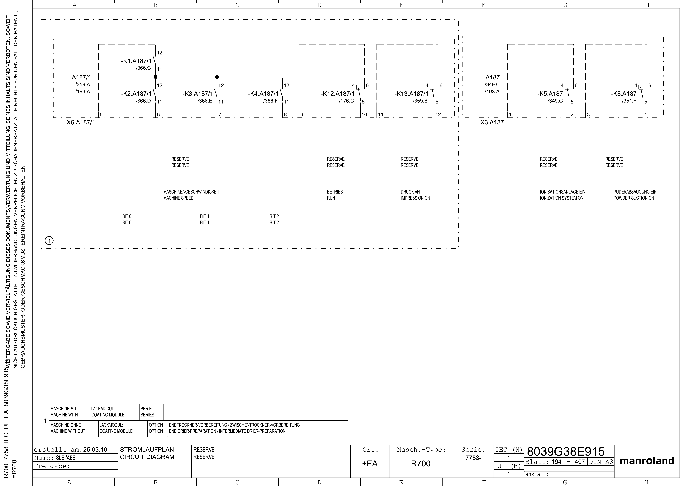

# +EA — Sheet 194 of 407 — RESERVE

**RESERVE**

> Part of the manroland **R700** printing press IEC/UL circuit diagrams.
> Drawing class: **Stromlaufplan / Circuit diagram** (DIN A3).
> Document `+EA` covers the **Printing unit** machine section.

## At a glance

| Field | Value |
|---|---|
| Document | `+EA`  (8039G38E915) |
| Sheet | **194** of 407 |
| Section (DE) | RESERVE |
| Section (EN) | RESERVE |
| Section type | CIRCUIT — Circuit diagram |
| Machine type | `R700` |
| Series | `7758` |
| Created | 25.03.10 |
| Replaces | — |
| Columns used | A, B, C, D, E, F, G, H |
| Path numbers | — |
| Labels on sheet | 98 |
| Cross-refs out | 12 |
| Cross-refs in | 24 |

**Previous:** [+EA sheet 193](SHEET_0193.md) · **Next:** [+EA sheet 195](SHEET_0195.md) · **Document TOC:** [_TOC.md](_TOC.md)  (+EA) · **Master TOC:** [all sheets](../_MASTER_TOC.md)

## Sheet image (300 DPI, exact vector render)



_Rendered directly from the PDF vector layer at 300 DPI (1-bit), no OCR and no resampling. Use it to confirm anything ambiguous in the text below._

## Cross-references on this sheet

Each entry is a wire leaving this sheet. The printed token is `/sheet.column`; the link resolves to that sheet inside the same document.

| Ref | Target sheet | Col | Path | Destination on target | Target section | From col |
|---|---|---|---|---|---|---|
| `/366.C` | [+EA sheet 366](SHEET_0366.md) | C | — | — | OPTION: TROCKNER VORBEREITUNG; | B |
| `/359.A` | [+EA sheet 359](SHEET_0359.md) | A | — | — | OPTION: | A |
| `/193.A` | [+EA sheet 193](SHEET_0193.md) | A | — | — | RESERVE | A |
| `/349.C` | [+EA sheet 349](SHEET_0349.md) | C | — | — | OPTION: VORBEREITUNG IONISATIONSANLAGE | F |
| `/193.A` | [+EA sheet 193](SHEET_0193.md) | A | — | — | RESERVE | F |
| `/366.E` | [+EA sheet 366](SHEET_0366.md) | E | — | — | OPTION: TROCKNER VORBEREITUNG; | C |
| `/359.B` | [+EA sheet 359](SHEET_0359.md) | B | — | — | OPTION: | E |
| `/366.F` | [+EA sheet 366](SHEET_0366.md) | F | — | — | OPTION: TROCKNER VORBEREITUNG; | C |
| `/349.G` | [+EA sheet 349](SHEET_0349.md) | G | — | — | OPTION: VORBEREITUNG IONISATIONSANLAGE | G |
| `/351.F` | [+EA sheet 351](SHEET_0351.md) | F | — | — | OPTION: VORBEREITUNG: PUDERABSAUGUNG | H |
| `/366.D` | [+EA sheet 366](SHEET_0366.md) | D | — | — | OPTION: TROCKNER VORBEREITUNG; | B |
| `/176.C` | [+EA sheet 176](SHEET_0176.md) | C | — | — | RESERVE | D |

### Incoming references (sheets that point here)

Every other sheet that sends a wire to this one. `Back-ref` is the token printed on *that* sheet; `Path` is its line number.

| From sheet | Cols | Back-ref | Path | Refs | What continues there |
|---|---|---|---|---|---|
| [+EA#176](SHEET_0176.md) | C | `/176.C` | — | 1 | — |
| [+EA#193](SHEET_0193.md) | A | `/193.A` | — | 2 | — |
| [+EA#231](SHEET_0231.md) | F | `/231.F` | — | 4 | — |
| [+EA#243](SHEET_0243.md) | H | `/243.H` | — | 8 | — |
| [+EA#349](SHEET_0349.md) | C, G | `/349.C`, `/349.G` | — | 2 | — |
| [+EA#351](SHEET_0351.md) | F | `/351.F` | — | 1 | — |
| [+EA#359](SHEET_0359.md) | A, B | `/359.A`, `/359.B` | — | 2 | — |
| [+EA#366](SHEET_0366.md) | C, D, E, F | `/366.C`, `/366.D`, `/366.E`, `/366.F` | — | 4 | — |


## Devices on this sheet

| Tag | Class | Class meaning (IEC) | Col | Sub | Terminal | Sign |
|---|---|---|---|---|---|---|
| `A187/1` | A | Baugruppe / assembly, module, PC board | A | 1 | — | — |
| `A187` | A | Baugruppe / assembly, module, PC board | F | — | — | — |
| `K5.A187` | — | cross-device reference | G | — | — | — |
| `K8.A187` | — | cross-device reference | H | — | — | — |
| `X3.A187` | — | cross-device reference | F | — | — | — |

## Potentials / nets

_No named potentials on this sheet._

## Wire-end annotations (grouped as printed)

A wire that continues elsewhere is annotated with a small cluster: the destination description, the path/line number `#NN`, and the `/sheet.column` cross reference. Each row below is one such cluster exactly as it is grouped on the drawing.

| Col | Y | Path | Cross-ref | Text on the wire |
|---|---|---|---|---|
| B | 87.5 | — | — | `12` |
| B | 100.9 | — | — | `K1.A187/1 11` |
| B | 114.0 | — | `/366.C` | — |
| A | 129.3 | — | — | `A187/1` |
| F | 129.3 | — | — | `A187` |
| A | 142.3 | — | `/359.A`, `/193.A` | — |
| F | 142.4 | — | `/349.C`, `/193.A` | — |
| B | 144.2 | — | — | `12` |
| C | 144.2 | — | — | `12` |
| D | 144.2 | — | — | `12` |
| D | 144.2 | — | — | `K12.A187/1 6` |
| D | 144.2 | — | — | `4` |
| E | 144.2 | — | — | `K13.A187/1 6` |
| E | 144.2 | — | — | `4` |
| G | 144.2 | — | — | `K5.A187 6` |
| G | 144.2 | — | — | `4` |
| H | 144.2 | — | — | `K8.A187 6` |
| H | 144.2 | — | — | `4` |
| B | 157.6 | — | — | `K2.A187/1 11` |
| C | 157.6 | — | — | `K3.A187/1 11` |
| C | 157.6 | — | — | `K4.A187/1 11` |
| B | 170.7 | — | `/366.D` | — |
| C | 170.7 | — | `/366.E` | — |
| C | 170.7 | — | `/366.F` | — |
| D | 170.7 | — | `/176.C` | — |
| E | 170.7 | — | `/359.B` | — |
| G | 170.7 | — | `/349.G` | — |
| H | 170.7 | — | `/351.F` | — |
| E | 172.5 | — | — | `5` |
| E | 172.5 | — | — | `5` |
| G | 172.5 | — | — | `5` |
| H | 172.5 | — | — | `5` |
| B | 194.5 | — | — | `5 6` |
| C | 194.5 | — | — | `7 8` |
| D | 194.5 | — | — | `9 10 11` |
| E | 194.5 | — | — | `12` |
| G | 194.5 | — | — | `1 2 3` |
| H | 194.5 | — | — | `4` |
| D | 207.2 | — | — | `X6.A187/1 X3.A187` |
| B | 272.7 | — | — | `RESERVE RESERVE` |
| D | 272.7 | — | — | `RESERVE RESERVE` |
| E | 272.7 | — | — | `RESERVE RESERVE` |
| G | 272.7 | — | — | `RESERVE RESERVE` |
| H | 272.7 | — | — | `RESERVE RESERVE` |
| B | 329.4 | — | — | `MASCHINENGESCHWINDIGKEIT MACHINE SPEED` |
| D | 329.4 | — | — | `BETRIEB RUN` |
| E | 329.4 | — | — | `DRUCK AN IMPRESSION ON` |
| G | 329.4 | — | — | `IONISATIONSANLAGE EIN IONIZATION SYSTEM ON` |
| H | 329.4 | — | — | `PUDERABSAUGUNG EIN POWDER SUCTION ON` |
| C | 371.8 | — | — | `BIT 1 BIT 1 BIT 2 BIT 2` |
| B | 371.9 | — | — | `BIT 0 BIT 0` |
| A | 413.6 | — | — | `1` |
| A | 705.0 | — | — | `1 SERIE SERIES OPTION OPTION` |
| A | 705.0 | — | — | `MASCHINE MIT MACHINE WITH` |
| A | 705.0 | — | — | `LACKMODUL:` |
| A | 715.7 | — | — | `COATING MODULE:` |
| A | 733.4 | — | — | `MASCHINE OHNE MACHINE WITHOUT` |
| A | 733.4 | — | — | `LACKMODUL:` |
| C | 733.4 | — | — | `ENDTROCKNER VORBEREITUNG / ZWISCHENTROCKNER VORBEREITUNG END DRIER PREPARATION / INTERMEDIATE DRIER PREPARATION` |
| B | 744.0 | — | — | `COATING MODULE:` |


## Reconstructed tables

This sheet carries tabular content (pin map / terminal assignment / index). The grid below was rebuilt from the drawing's own rule lines, so each row is exactly one physical row of the table.

### Table 1 — 6 data rows × 17 columns (at x=170.1, y=0.0) — **K1.A187/1 /366.C 12 11**

| 5 LACKMODUL: COATING MODULE: LACKMODUL: COATING | K2.A187/1 /366.D BIT 0 BIT 0 SERIE SERIES MODULE: | 12 11 6 RESERVE RESERVE MASCHINENGESCHWINDIGKEIT MACHINE SPEED OPTION OPTION END | 12 12 K3.A187/1 K4.A187/1 /366.E /366.F 11 11 7 8 BIT 1 BIT 2 BIT 1 BIT 2 ENDTROCKNER VORBEREITUNG / ZWISCHENTROCKNER VORBEREITUNG DRIER PREPARATION / INTERMEDIATE DRIER PREPARATION | K12.A187/1 /176.C 9 RESERVE RESERVE BETRIEB RUN | 4 5 10 | 6 | 11 | 4 K13.A187/1 /359.B 5 12 RESERVE RESERVE DRUCK AN IMPRESSION ON | 6 | A187 /349.C /193.A X3.A187 |  | 1 | 4 K5.A187 /349.G 5 2 RESERVE RESERVE IONISATIONSANLAGE IONIZATION SYSTEM | 6 EIN ON | 3 | 4 K8.A187 /351.F 5 4 RESERVE RESERVE PUDERABSAUGUNG POWDER SUCTION |
|---|---|---|---|---|---|---|---|---|---|---|---|---|---|---|---|---|
|  | `STROMLAUFPLAN` |  | `RESERVE` |  |  | `Ort:` |  | `Masch. Type:` |  | `Serie:` | `IEC` | `(N)` | `8039G38E915` |  |  |  |
|  | `CIRCUIT` | `DIAGRAM` |  |  |  |  |  |  |  |  |  |  |  |  |  |  |
|  |  |  | `RESERVE` |  |  |  |  |  |  | `7758` |  | `1` |  |  |  |  |
|  |  |  |  |  |  | `+EA` |  | `R700` |  |  |  |  | `Blatt: 194` | `407` | `DIN A3` |  |
|  |  |  |  |  |  |  |  |  |  |  | `UL` | `(M)` |  |  |  |  |
|  |  |  |  |  |  |  |  |  |  |  |  | `1` | `anstatt:` |  |  |  |


## Notes and free text on this sheet

| Text | Col | Y (pt) |
|---|---|---|
| `K2.A187/1` | B | 157.64 |
| `K4.A187/1` | C | 157.64 |
| `K1.A187/1` | B | 100.94 |
| `K3.A187/1` | C | 157.64 |
| `K12.A187/1` | D | 157.63 |
| `K13.A187/1` | E | 157.63 |
| `BETRIEB` | D | 329.4 |
| `RUN` | D | 340.04 |
| `DRUCK AN` | E | 329.43 |
| `IMPRESSION ON` | E | 340.06 |
| `RESERVE` | B | 272.71 |
| `X6.A187/1` | A | 207.24 |
| `RESERVE` | D | 272.71 |
| `RESERVE` | E | 272.71 |
| `RESERVE` | G | 272.71 |
| `RESERVE` | H | 272.71 |
| `IONISATIONSANLAGE EIN` | G | 329.43 |
| `IONIZATION SYSTEM ON` | G | 340.06 |
| `PUDERABSAUGUNG EIN` | H | 329.44 |
| `POWDER SUCTION ON` | H | 340.05 |
| `BIT 0` | B | 371.88 |
| `BIT 2` | C | 371.87 |
| `BIT 1` | C | 371.8 |
| `MASCHINENGESCHWINDIGKEIT` | B | 329.44 |
| `MACHINE SPEED` | B | 340.07 |
| `MASCHINE MIT` | A | 705.04 |
| `MACHINE WITH` | A | 715.63 |
| `LACKMODUL:` | A | 705.04 |
| `COATING MODULE:` | A | 715.68 |
| `MASCHINE OHNE` | A | 733.39 |
| `MACHINE WITHOUT` | A | 744 |
| `COATING MODULE:` | B | 744.02 |
| `SERIE` | B | 704.98 |
| `SERIES` | B | 715.62 |
| `OPTION` | B | 733.35 |
| `ENDTROCKNER VORBEREITUNG / ZWISCHENTROCKNER VORBEREITUNG` | C | 733.39 |
| `END DRIER PREPARATION / INTERMEDIATE DRIER PREPARATION` | C | 744.02 |

## Complete label inventory (exact text from the drawing)

Every text object inside the drawing area of this sheet, in DIN reading order (column A→H, then top→bottom). This is the authoritative list: if a string is not here it is not printed on this sheet.

| Col | Y | X | Dir | Type | Text |
|---|---|---|---|---|---|
| A | 129.3 | 120.8 | → | device tag | `A187/1` |
| A | 142.4 | 130.4 | → | cross-reference | `/359.A` |
| A | 154.8 | 130.4 | → | cross-reference | `/193.A` |
| A | 194.5 | 172.6 | → | number | `5` |
| A | 207.2 | 112.0 | → | text | `X6.A187/1` |
| A | 413.6 | 83.3 | → | number | `1` |
| A | 705.0 | 87.3 | → | text | `MASCHINE MIT` |
| A | 705.0 | 157.9 | → | text | `LACKMODUL:` |
| A | 715.6 | 87.3 | → | text | `MACHINE WITH` |
| A | 715.7 | 158.5 | → | text | `COATING MODULE:` |
| A | 724.5 | 75.4 | → | number | `1` |
| A | 733.4 | 87.3 | → | text | `MASCHINE OHNE` |
| A | 733.4 | 172.1 | → | text | `LACKMODUL:` |
| A | 744.0 | 87.3 | → | text | `MACHINE WITHOUT` |
| B | 87.5 | 271.3 | → | number | `12` |
| B | 100.9 | 209.8 | → | text | `K1.A187/1` |
| B | 114.0 | 235.3 | → | cross-reference | `/366.C` |
| B | 115.8 | 271.3 | → | number | `11` |
| B | 144.2 | 271.3 | → | number | `12` |
| B | 157.6 | 209.8 | → | text | `K2.A187/1` |
| B | 170.7 | 235.3 | → | cross-reference | `/366.D` |
| B | 172.5 | 271.3 | → | number | `11` |
| B | 194.5 | 271.8 | → | number | `6` |
| B | 272.7 | 296.8 | → | text | `RESERVE` |
| B | 283.3 | 296.8 | → | text | `RESERVE` |
| B | 329.4 | 282.9 | → | text | `MASCHINENGESCHWINDIGKEIT` |
| B | 340.1 | 282.9 | → | text | `MACHINE SPEED` |
| B | 371.9 | 211.7 | → | text | `BIT 0` |
| B | 382.5 | 211.7 | → | text | `BIT 0` |
| B | 705.0 | 243.5 | → | text | `SERIE` |
| B | 715.6 | 243.5 | → | text | `SERIES` |
| B | 733.4 | 257.7 | → | text | `OPTION` |
| B | 744.0 | 172.6 | → | text | `COATING MODULE:` |
| B | 744.0 | 257.7 | → | text | `OPTION` |
| C | 144.2 | 377.6 | → | number | `12` |
| C | 157.6 | 316.1 | → | text | `K3.A187/1` |
| C | 157.6 | 429.4 | → | text | `K4.A187/1` |
| C | 170.7 | 342.1 | → | cross-reference | `/366.E` |
| C | 170.7 | 455.8 | → | cross-reference | `/366.F` |
| C | 172.5 | 377.6 | → | number | `11` |
| C | 194.5 | 378.1 | → | number | `7` |
| C | 371.8 | 346.4 | → | text | `BIT 1` |
| C | 371.9 | 466.9 | → | text | `BIT 2` |
| C | 382.4 | 346.4 | → | text | `BIT 1` |
| C | 382.5 | 466.9 | → | text | `BIT 2` |
| C | 733.4 | 292.5 | → | text | `ENDTROCKNER VORBEREITUNG / ZWISCHENTROCKNER VORBEREITUNG` |
| C | 744.0 | 292.5 | → | text | `END DRIER PREPARATION / INTERMEDIATE DRIER PREPARATION` |
| D | 144.2 | 491.0 | → | number | `12` |
| D | 144.2 | 609.2 | → | number | `4` |
| D | 157.6 | 555.3 | → | text | `K12.A187/1` |
| D | 170.7 | 586.8 | → | cross-reference | `/176.C` |
| D | 172.5 | 491.0 | → | number | `11` |
| D | 194.5 | 491.5 | → | number | `8` |
| D | 194.5 | 519.9 | → | number | `9` |
| D | 272.7 | 566.1 | → | text | `RESERVE` |
| D | 283.3 | 566.1 | → | text | `RESERVE` |
| D | 329.4 | 566.1 | → | text | `BETRIEB` |
| D | 340.0 | 566.1 | → | text | `RUN` |
| E | 144.2 | 633.3 | → | number | `6` |
| E | 144.2 | 736.7 | → | number | `4` |
| E | 144.2 | 760.8 | → | number | `6` |
| E | 157.6 | 682.9 | → | text | `K13.A187/1` |
| E | 170.7 | 714.6 | → | cross-reference | `/359.B` |
| E | 172.5 | 626.2 | → | number | `5` |
| E | 172.5 | 753.7 | → | number | `5` |
| E | 194.5 | 625.6 | → | number | `10` |
| E | 194.5 | 654.0 | → | number | `11` |
| E | 194.5 | 753.2 | → | number | `12` |
| E | 272.7 | 693.6 | → | text | `RESERVE` |
| E | 283.3 | 693.6 | → | text | `RESERVE` |
| E | 329.4 | 693.6 | → | text | `DRUCK AN` |
| E | 340.1 | 693.6 | → | text | `IMPRESSION ON` |
| F | 129.3 | 836.8 | → | device tag | `A187` |
| F | 142.4 | 839.1 | → | cross-reference | `/349.C` |
| F | 154.8 | 839.1 | → | cross-reference | `/193.A` |
| F | 194.5 | 880.7 | → | number | `1` |
| F | 207.2 | 828.0 | → | device ref | `X3.A187` |
| G | 144.2 | 970.6 | → | number | `4` |
| G | 144.2 | 994.7 | → | number | `6` |
| G | 157.6 | 930.0 | → | device ref | `K5.A187` |
| G | 170.7 | 947.9 | → | cross-reference | `/349.G` |
| G | 172.5 | 987.6 | → | number | `5` |
| G | 194.5 | 987.6 | → | number | `2` |
| G | 194.5 | 1015.9 | → | number | `3` |
| G | 272.7 | 934.6 | → | text | `RESERVE` |
| G | 283.3 | 934.6 | → | text | `RESERVE` |
| G | 329.4 | 934.6 | → | text | `IONISATIONSANLAGE EIN` |
| G | 340.1 | 934.6 | → | text | `IONIZATION SYSTEM ON` |
| H | 144.2 | 1098.1 | → | number | `4` |
| H | 144.2 | 1122.2 | → | number | `6` |
| H | 157.6 | 1057.6 | → | device ref | `K8.A187` |
| H | 170.7 | 1076.6 | → | cross-reference | `/351.F` |
| H | 172.5 | 1115.1 | → | number | `5` |
| H | 194.5 | 1115.1 | → | number | `4` |
| H | 272.7 | 1048.0 | → | text | `RESERVE` |
| H | 283.3 | 1048.0 | → | text | `RESERVE` |
| H | 329.4 | 1062.1 | → | text | `PUDERABSAUGUNG EIN` |
| H | 340.1 | 1062.1 | → | text | `POWDER SUCTION ON` |

## Reading-order text block

The same content as a plain block, grouped by DIN column — convenient to paste or to match against a visual description.

```text
=== Column A ===
 129.3  120.8  devtag       A187/1
 142.4  130.4  xref         /359.A
 154.8  130.4  xref         /193.A
 194.5  172.6  numeric      5
 207.2  112.0  text         X6.A187/1
 413.6   83.3  numeric      1
 705.0   87.3  text         MASCHINE MIT
 705.0  157.9  text         LACKMODUL:
 715.6   87.3  text         MACHINE WITH
 715.7  158.5  text         COATING MODULE:
 724.5   75.4  numeric      1
 733.4   87.3  text         MASCHINE OHNE
 733.4  172.1  text         LACKMODUL:
 744.0   87.3  text         MACHINE WITHOUT
=== Column B ===
  87.5  271.3  numeric      12
 100.9  209.8  text         K1.A187/1
 114.0  235.3  xref         /366.C
 115.8  271.3  numeric      11
 144.2  271.3  numeric      12
 157.6  209.8  text         K2.A187/1
 170.7  235.3  xref         /366.D
 172.5  271.3  numeric      11
 194.5  271.8  numeric      6
 272.7  296.8  text         RESERVE
 283.3  296.8  text         RESERVE
 329.4  282.9  text         MASCHINENGESCHWINDIGKEIT
 340.1  282.9  text         MACHINE SPEED
 371.9  211.7  text         BIT 0
 382.5  211.7  text         BIT 0
 705.0  243.5  text         SERIE
 715.6  243.5  text         SERIES
 733.4  257.7  text         OPTION
 744.0  172.6  text         COATING MODULE:
 744.0  257.7  text         OPTION
=== Column C ===
 144.2  377.6  numeric      12
 157.6  316.1  text         K3.A187/1
 157.6  429.4  text         K4.A187/1
 170.7  342.1  xref         /366.E
 170.7  455.8  xref         /366.F
 172.5  377.6  numeric      11
 194.5  378.1  numeric      7
 371.8  346.4  text         BIT 1
 371.9  466.9  text         BIT 2
 382.4  346.4  text         BIT 1
 382.5  466.9  text         BIT 2
 733.4  292.5  text         ENDTROCKNER VORBEREITUNG / ZWISCHENTROCKNER VORBEREITUNG
 744.0  292.5  text         END DRIER PREPARATION / INTERMEDIATE DRIER PREPARATION
=== Column D ===
 144.2  491.0  numeric      12
 144.2  609.2  numeric      4
 157.6  555.3  text         K12.A187/1
 170.7  586.8  xref         /176.C
 172.5  491.0  numeric      11
 194.5  491.5  numeric      8
 194.5  519.9  numeric      9
 272.7  566.1  text         RESERVE
 283.3  566.1  text         RESERVE
 329.4  566.1  text         BETRIEB
 340.0  566.1  text         RUN
=== Column E ===
 144.2  633.3  numeric      6
 144.2  736.7  numeric      4
 144.2  760.8  numeric      6
 157.6  682.9  text         K13.A187/1
 170.7  714.6  xref         /359.B
 172.5  626.2  numeric      5
 172.5  753.7  numeric      5
 194.5  625.6  numeric      10
 194.5  654.0  numeric      11
 194.5  753.2  numeric      12
 272.7  693.6  text         RESERVE
 283.3  693.6  text         RESERVE
 329.4  693.6  text         DRUCK AN
 340.1  693.6  text         IMPRESSION ON
=== Column F ===
 129.3  836.8  devtag       A187
 142.4  839.1  xref         /349.C
 154.8  839.1  xref         /193.A
 194.5  880.7  numeric      1
 207.2  828.0  devref       X3.A187
=== Column G ===
 144.2  970.6  numeric      4
 144.2  994.7  numeric      6
 157.6  930.0  devref       K5.A187
 170.7  947.9  xref         /349.G
 172.5  987.6  numeric      5
 194.5  987.6  numeric      2
 194.5 1015.9  numeric      3
 272.7  934.6  text         RESERVE
 283.3  934.6  text         RESERVE
 329.4  934.6  text         IONISATIONSANLAGE EIN
 340.1  934.6  text         IONIZATION SYSTEM ON
=== Column H ===
 144.2 1098.1  numeric      4
 144.2 1122.2  numeric      6
 157.6 1057.6  devref       K8.A187
 170.7 1076.6  xref         /351.F
 172.5 1115.1  numeric      5
 194.5 1115.1  numeric      4
 272.7 1048.0  text         RESERVE
 283.3 1048.0  text         RESERVE
 329.4 1062.1  text         PUDERABSAUGUNG EIN
 340.1 1062.1  text         POWDER SUCTION ON
```

---
_Generated from the PDF vector text layer; no OCR. Source: `R700_7758_IEC_UL_EA_8039G38E915_p`, sheet 194._
