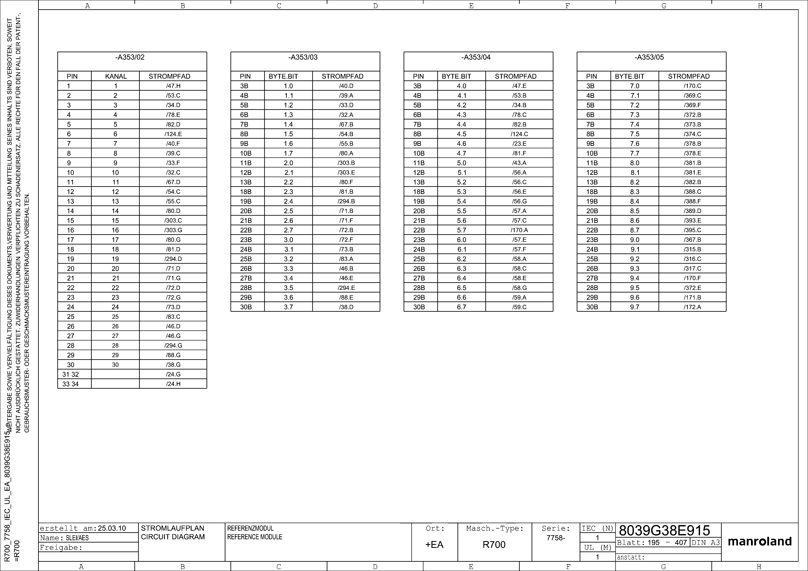

# +EA — Sheet 195 of 407 — REFERENZMODUL

**REFERENCE MODULE**

> Part of the manroland **R700** printing press IEC/UL circuit diagrams.
> Drawing class: **Stromlaufplan / Circuit diagram** (DIN A3).
> Document `+EA` covers the **Printing unit** machine section.

## At a glance

| Field | Value |
|---|---|
| Document | `+EA`  (8039G38E915) |
| Sheet | **195** of 407 |
| Section (DE) | REFERENZMODUL |
| Section (EN) | REFERENCE MODULE |
| Section type | REFERENCE_MODULE — Reference module |
| Machine type | `R700` |
| Series | `7758` |
| Created | 25.03.10 |
| Replaces | — |
| Columns used | A, B, C, D, E, F, G |
| Path numbers | — |
| Labels on sheet | 326 |
| Cross-refs out | 104 |
| Cross-refs in | 104 |

**Previous:** [+EA sheet 194](SHEET_0194.md) · **Next:** [+EA sheet 196](SHEET_0196.md) · **Document TOC:** [_TOC.md](_TOC.md)  (+EA) · **Master TOC:** [all sheets](../_MASTER_TOC.md)

## Sheet image (300 DPI, exact vector render)



_Rendered directly from the PDF vector layer at 300 DPI (1-bit), no OCR and no resampling. Use it to confirm anything ambiguous in the text below._

## Cross-references on this sheet

Each entry is a wire leaving this sheet. The printed token is `/sheet.column`; the link resolves to that sheet inside the same document.

| Ref | Target sheet | Col | Path | Destination on target | Target section | From col |
|---|---|---|---|---|---|---|
| `/47.E` | [+EA sheet 47](SHEET_0047.md) | E | — | — | SCHUTZ | F |
| `/47.H` | [+EA sheet 47](SHEET_0047.md) | H | — | — | SCHUTZ | B |
| `/40.D` | [+EA sheet 40](SHEET_0040.md) | D | — | — | BUSVERBINDUNGEN: STOP SICHERN | D |
| `/170.C` | [+EA sheet 170](SHEET_0170.md) | C | — | — | RESERVE | G |
| `/39.A` | [+EA sheet 39](SHEET_0039.md) | A | — | — | BUSVERBINDUNGEN: STOP SICHERN | D |
| `/53.B` | [+EA sheet 53](SHEET_0053.md) | B | — | — | MASCHINENBEDIENUNG: LAUFKOMMANDOS | F |
| `/53.C` | [+EA sheet 53](SHEET_0053.md) | C | — | — | MASCHINENBEDIENUNG: LAUFKOMMANDOS | B |
| `/369.C` | [+EA sheet 369](SHEET_0369.md) | C | — | — | OPTION: ENDTROCKNER 1 VORBEREITUNG; | G |
| `/34.B` | [+EA sheet 34](SHEET_0034.md) | B | — | — | BUSVERBINDUNGEN: NOT AUS | F |
| `/369.F` | [+EA sheet 369](SHEET_0369.md) | F | — | — | OPTION: ENDTROCKNER 1 VORBEREITUNG; | G |
| `/34.D` | [+EA sheet 34](SHEET_0034.md) | D | — | — | BUSVERBINDUNGEN: NOT AUS | B |
| `/33.D` | [+EA sheet 33](SHEET_0033.md) | D | — | — | BUSVERBINDUNGEN: NOT AUS | D |
| `/78.E` | [+EA sheet 78](SHEET_0078.md) | E | — | — | AUSLEGERSTAPELSTEUERUNG | B |
| `/32.A` | [+EA sheet 32](SHEET_0032.md) | A | — | — | BUSVERBINDUNGEN: NOT AUS | D |
| `/372.B` | [+EA sheet 372](SHEET_0372.md) | B | — | — | OPTION: ENDTROCKNER 1 VORBEREITUNG; | G |
| `/78.C` | [+EA sheet 78](SHEET_0078.md) | C | — | — | AUSLEGERSTAPELSTEUERUNG | F |
| `/67.B` | [+EA sheet 67](SHEET_0067.md) | B | — | — | LEITSTANDSFUNKTIONEN | D |
| `/82.B` | [+EA sheet 82](SHEET_0082.md) | B | — | — | AUSLEGERSTAPELSTEUERUNG: PROGRAMMSCHALTWERK | F |
| `/373.B` | [+EA sheet 373](SHEET_0373.md) | B | — | — | OPTION: ENDTROCKNER 1 VORBEREITUNG; | G |
| `/82.D` | [+EA sheet 82](SHEET_0082.md) | D | — | — | AUSLEGERSTAPELSTEUERUNG: PROGRAMMSCHALTWERK | B |
| `/54.B` | [+EA sheet 54](SHEET_0054.md) | B | — | — | MASCHINENBEDIENUNG: LAUFKOMMANDOS | D |
| `/124.E` | [+EA sheet 124](SHEET_0124.md) | E | — | — | TROCKENBESTÄUBER | B |
| `/124.C` | [+EA sheet 124](SHEET_0124.md) | C | — | — | TROCKENBESTÄUBER | F |
| `/374.C` | [+EA sheet 374](SHEET_0374.md) | C | — | — | OPTION: ENDTROCKNER 1 VORBEREITUNG; | G |
| `/55.B` | [+EA sheet 55](SHEET_0055.md) | B | — | — | MASCHINENBEDIENUNG: LAUFKOMMANDOS | D |
| `/23.E` | [+EA sheet 23](SHEET_0023.md) | E | — | — | SPANNUNGSVERSORGUNG: 400V, 24V | F |
| `/40.F` | [+EA sheet 40](SHEET_0040.md) | F | — | — | BUSVERBINDUNGEN: STOP SICHERN | B |
| `/378.B` | [+EA sheet 378](SHEET_0378.md) | B | — | — | OPTION: ENDTROCKNER 2 VORBEREITUNG | G |
| `/80.A` | [+EA sheet 80](SHEET_0080.md) | A | — | — | AUSLEGERSTAPELSTEUERUNG: BEDIENKOMMANDOS | D |
| `/81.F` | [+EA sheet 81](SHEET_0081.md) | F | — | — | AUSLEGERSTAPELSTEUERUNG: BEDIENKOMMANDOS | F |
| `/378.E` | [+EA sheet 378](SHEET_0378.md) | E | — | — | OPTION: ENDTROCKNER 2 VORBEREITUNG | G |
| `/39.C` | [+EA sheet 39](SHEET_0039.md) | C | — | — | BUSVERBINDUNGEN: STOP SICHERN | B |
| `/43.A` | [+EA sheet 43](SHEET_0043.md) | A | — | — | BUSVERBINDUNGEN: SIGNALSCHLEIFE | F |
| `/33.F` | [+EA sheet 33](SHEET_0033.md) | F | — | — | BUSVERBINDUNGEN: NOT AUS | B |
| `/303.B` | [+EA sheet 303](SHEET_0303.md) | B | — | — | OPTION: ZWISCHENSTAPEL / | D |
| `/381.B` | [+EA sheet 381](SHEET_0381.md) | B | — | — | OPTION: ENDTROCKNER 2 VORBEREITUNG | G |
| `/56.A` | [+EA sheet 56](SHEET_0056.md) | A | — | — | MASCHINENBEDIENUNG: BEDIENUNGKOMMANDOS | F |
| `/303.E` | [+EA sheet 303](SHEET_0303.md) | E | — | — | OPTION: ZWISCHENSTAPEL / | D |
| `/381.E` | [+EA sheet 381](SHEET_0381.md) | E | — | — | OPTION: ENDTROCKNER 2 VORBEREITUNG | G |
| `/32.C` | [+EA sheet 32](SHEET_0032.md) | C | — | — | BUSVERBINDUNGEN: NOT AUS | B |
| `/80.F` | [+EA sheet 80](SHEET_0080.md) | F | — | — | AUSLEGERSTAPELSTEUERUNG: BEDIENKOMMANDOS | D |
| `/382.B` | [+EA sheet 382](SHEET_0382.md) | B | — | — | OPTION: ENDTROCKNER 2 VORBEREITUNG | G |
| `/67.D` | [+EA sheet 67](SHEET_0067.md) | D | — | — | LEITSTANDSFUNKTIONEN | B |
| `/56.C` | [+EA sheet 56](SHEET_0056.md) | C | — | — | MASCHINENBEDIENUNG: BEDIENUNGKOMMANDOS | F |
| `/81.B` | [+EA sheet 81](SHEET_0081.md) | B | — | — | AUSLEGERSTAPELSTEUERUNG: BEDIENKOMMANDOS | D |
| `/56.E` | [+EA sheet 56](SHEET_0056.md) | E | — | — | MASCHINENBEDIENUNG: BEDIENUNGKOMMANDOS | F |
| `/54.C` | [+EA sheet 54](SHEET_0054.md) | C | — | — | MASCHINENBEDIENUNG: LAUFKOMMANDOS | B |
| `/388.C` | [+EA sheet 388](SHEET_0388.md) | C | — | — | OPTION: ZWISCHENTROCKNER VORBEREITUNG; | G |
| `/294.B` | [+EA sheet 294](SHEET_0294.md) | B | — | — | OPTION: ZWISCHENSTAPEL / | D |
| `/56.G` | [+EA sheet 56](SHEET_0056.md) | G | — | — | MASCHINENBEDIENUNG: BEDIENUNGKOMMANDOS | F |
| `/388.F` | [+EA sheet 388](SHEET_0388.md) | F | — | — | OPTION: ZWISCHENTROCKNER VORBEREITUNG; | G |
| `/55.C` | [+EA sheet 55](SHEET_0055.md) | C | — | — | MASCHINENBEDIENUNG: LAUFKOMMANDOS | B |
| `/71.B` | [+EA sheet 71](SHEET_0071.md) | B | — | — | AUSLEGERSTAPELSTEUERUNG | D |
| `/57.A` | [+EA sheet 57](SHEET_0057.md) | A | — | — | MASCHINENBEDIENUNG: BEDIENUNGKOMMANDOS | F |
| `/80.D` | [+EA sheet 80](SHEET_0080.md) | D | — | — | AUSLEGERSTAPELSTEUERUNG: BEDIENKOMMANDOS | B |
| `/389.D` | [+EA sheet 389](SHEET_0389.md) | D | — | — | OPTION: ZWISCHENTROCKNER VORBEREITUNG; | G |
| `/71.F` | [+EA sheet 71](SHEET_0071.md) | F | — | — | AUSLEGERSTAPELSTEUERUNG | D |
| `/393.E` | [+EA sheet 393](SHEET_0393.md) | E | — | — | OPTION: ZWISCHENTROCKNER VORBEREITUNG; | G |
| `/303.C` | [+EA sheet 303](SHEET_0303.md) | C | — | — | OPTION: ZWISCHENSTAPEL / | B |
| `/57.C` | [+EA sheet 57](SHEET_0057.md) | C | — | — | MASCHINENBEDIENUNG: BEDIENUNGKOMMANDOS | F |
| `/72.B` | [+EA sheet 72](SHEET_0072.md) | B | — | — | AUSLEGERSTAPELSTEUERUNG | D |
| `/170.A` | [+EA sheet 170](SHEET_0170.md) | A | — | — | RESERVE | F |
| `/303.G` | [+EA sheet 303](SHEET_0303.md) | G | — | — | OPTION: ZWISCHENSTAPEL / | B |
| `/395.C` | [+EA sheet 395](SHEET_0395.md) | C | — | — | OPTION: ZWISCHENTROCKNER VORBEREITUNG; | G |
| `/57.E` | [+EA sheet 57](SHEET_0057.md) | E | — | — | MASCHINENBEDIENUNG: BEDIENUNGKOMMANDOS | F |
| `/72.F` | [+EA sheet 72](SHEET_0072.md) | F | — | — | AUSLEGERSTAPELSTEUERUNG | D |
| `/367.B` | [+EA sheet 367](SHEET_0367.md) | B | — | — | OPTION: TROCKNER VORBEREITUNG; | G |
| `/80.G` | [+EA sheet 80](SHEET_0080.md) | G | — | — | AUSLEGERSTAPELSTEUERUNG: BEDIENKOMMANDOS | B |
| `/73.B` | [+EA sheet 73](SHEET_0073.md) | B | — | — | AUSLEGERSTAPELSTEUERUNG | D |
| `/57.F` | [+EA sheet 57](SHEET_0057.md) | F | — | — | MASCHINENBEDIENUNG: BEDIENUNGKOMMANDOS | F |
| `/315.B` | [+EA sheet 315](SHEET_0315.md) | B | — | — | OPTION: LOGISTIK, AUSLEGER | G |
| `/81.D` | [+EA sheet 81](SHEET_0081.md) | D | — | — | AUSLEGERSTAPELSTEUERUNG: BEDIENKOMMANDOS | B |
| `/83.A` | [+EA sheet 83](SHEET_0083.md) | A | — | — | AUSLEGERSTAPELSTEUERUNG: PROGRAMMSCHALTWERK | D |
| `/58.A` | [+EA sheet 58](SHEET_0058.md) | A | — | — | MASCHINENBEDIENUNG: BEDIENUNGKOMMANDOS | F |
| `/294.D` | [+EA sheet 294](SHEET_0294.md) | D | — | — | OPTION: ZWISCHENSTAPEL / | B |
| `/316.C` | [+EA sheet 316](SHEET_0316.md) | C | — | — | OPTION: LOGISTIK, AUSLEGER | G |
| `/46.B` | [+EA sheet 46](SHEET_0046.md) | B | — | — | SCHUTZ | D |
| `/71.D` | [+EA sheet 71](SHEET_0071.md) | D | — | — | AUSLEGERSTAPELSTEUERUNG | B |
| `/58.C` | [+EA sheet 58](SHEET_0058.md) | C | — | — | MASCHINENBEDIENUNG: BEDIENUNGKOMMANDOS | F |
| `/317.C` | [+EA sheet 317](SHEET_0317.md) | C | — | — | OPTION: LOGISTIK, AUSLEGER | G |
| `/46.E` | [+EA sheet 46](SHEET_0046.md) | E | — | — | SCHUTZ | D |
| `/58.E` | [+EA sheet 58](SHEET_0058.md) | E | — | — | MASCHINENBEDIENUNG: BEDIENUNGKOMMANDOS | F |
| `/71.G` | [+EA sheet 71](SHEET_0071.md) | G | — | — | AUSLEGERSTAPELSTEUERUNG | B |
| `/170.F` | [+EA sheet 170](SHEET_0170.md) | F | — | — | RESERVE | G |
| `/294.E` | [+EA sheet 294](SHEET_0294.md) | E | — | — | OPTION: ZWISCHENSTAPEL / | D |
| `/372.E` | [+EA sheet 372](SHEET_0372.md) | E | — | — | OPTION: ENDTROCKNER 1 VORBEREITUNG; | G |
| `/58.G` | [+EA sheet 58](SHEET_0058.md) | G | — | — | MASCHINENBEDIENUNG: BEDIENUNGKOMMANDOS | F |
| `/72.D` | [+EA sheet 72](SHEET_0072.md) | D | — | — | AUSLEGERSTAPELSTEUERUNG | B |
| `/88.E` | [+EA sheet 88](SHEET_0088.md) | E | — | — | SAUGWALZE | D |
| `/59.A` | [+EA sheet 59](SHEET_0059.md) | A | — | — | MASCHINENBEDIENUNG: BEDIENUNGKOMMANDOS | F |
| `/171.B` | [+EA sheet 171](SHEET_0171.md) | B | — | — | RESERVE | G |
| `/72.G` | [+EA sheet 72](SHEET_0072.md) | G | — | — | AUSLEGERSTAPELSTEUERUNG | B |
| `/172.A` | [+EA sheet 172](SHEET_0172.md) | A | — | — | RESERVE | G |
| `/73.D` | [+EA sheet 73](SHEET_0073.md) | D | — | — | AUSLEGERSTAPELSTEUERUNG | B |
| `/38.D` | [+EA sheet 38](SHEET_0038.md) | D | — | — | BUSVERBINDUNGEN: NOT AUS | D |
| `/59.C` | [+EA sheet 59](SHEET_0059.md) | C | — | — | MASCHINENBEDIENUNG: BEDIENUNGKOMMANDOS | F |
| `/83.C` | [+EA sheet 83](SHEET_0083.md) | C | — | — | AUSLEGERSTAPELSTEUERUNG: PROGRAMMSCHALTWERK | B |
| `/46.D` | [+EA sheet 46](SHEET_0046.md) | D | — | — | SCHUTZ | B |
| `/46.G` | [+EA sheet 46](SHEET_0046.md) | G | — | — | SCHUTZ | B |
| `/294.G` | [+EA sheet 294](SHEET_0294.md) | G | — | — | OPTION: ZWISCHENSTAPEL / | B |
| `/88.G` | [+EA sheet 88](SHEET_0088.md) | G | — | — | SAUGWALZE | B |
| `/38.G` | [+EA sheet 38](SHEET_0038.md) | G | — | — | BUSVERBINDUNGEN: NOT AUS | B |
| `/24.G` | [+EA sheet 24](SHEET_0024.md) | G | — | — | BUSVERBINDUNGEN: SICHERHEITSBUS | B |
| `/24.H` | [+EA sheet 24](SHEET_0024.md) | H | — | — | BUSVERBINDUNGEN: SICHERHEITSBUS | B |

### Incoming references (sheets that point here)

Every other sheet that sends a wire to this one. `Back-ref` is the token printed on *that* sheet; `Path` is its line number.

| From sheet | Cols | Back-ref | Path | Refs | What continues there |
|---|---|---|---|---|---|
| [+EA#23](SHEET_0023.md) | E | `/23.E` | — | 1 | — |
| [+EA#24](SHEET_0024.md) | G | `/24.G` | — | 2 | — |
| [+EA#32](SHEET_0032.md) | A, C | `/32.A`, `/32.C` | — | 2 | — |
| [+EA#33](SHEET_0033.md) | D, F | `/33.D`, `/33.F` | — | 2 | — |
| [+EA#34](SHEET_0034.md) | B, D | `/34.B`, `/34.D` | — | 2 | — |
| [+EA#38](SHEET_0038.md) | D, G | `/38.D`, `/38.G` | — | 2 | — |
| [+EA#39](SHEET_0039.md) | A, C | `/39.A`, `/39.C` | — | 2 | — |
| [+EA#40](SHEET_0040.md) | D, F | `/40.D`, `/40.F` | — | 2 | — |
| [+EA#43](SHEET_0043.md) | A | `/43.A` | — | 1 | — |
| [+EA#46](SHEET_0046.md) | B, D, E, G | `/46.B`, `/46.D`, `/46.E`, `/46.G` | — | 4 | — |
| [+EA#47](SHEET_0047.md) | E, G | `/47.E`, `/47.G` | — | 2 | — |
| [+EA#53](SHEET_0053.md) | A, C | `/53.A`, `/53.C` | — | 2 | — |
| [+EA#54](SHEET_0054.md) | A, C | `/54.A`, `/54.C` | — | 2 | — |
| [+EA#55](SHEET_0055.md) | A, C | `/55.A`, `/55.C` | — | 2 | — |
| [+EA#56](SHEET_0056.md) | A, C, E, G | `/56.A`, `/56.C`, `/56.E`, `/56.G` | — | 4 | — |
| [+EA#57](SHEET_0057.md) | A, C, E, F | `/57.A`, `/57.C`, `/57.E`, `/57.F` | — | 4 | — |
| [+EA#58](SHEET_0058.md) | A, C, E, G | `/58.A`, `/58.C`, `/58.E`, `/58.G` | — | 4 | — |
| [+EA#59](SHEET_0059.md) | A, C | `/59.A`, `/59.C` | — | 2 | — |
| [+EA#67](SHEET_0067.md) | B, D | `/67.B`, `/67.D` | — | 2 | — |
| [+EA#71](SHEET_0071.md) | B, D, F, G | `/71.B`, `/71.D`, `/71.F`, `/71.G` | — | 4 | — |
| [+EA#72](SHEET_0072.md) | B, D, F, G | `/72.B`, `/72.D`, `/72.F`, `/72.G` | — | 4 | — |
| [+EA#73](SHEET_0073.md) | B, D | `/73.B`, `/73.D` | — | 2 | — |
| [+EA#78](SHEET_0078.md) | B, E | `/78.B`, `/78.E` | — | 2 | — |
| [+EA#80](SHEET_0080.md) | A, C, E, G | `/80.A`, `/80.C`, `/80.E`, `/80.G` | — | 4 | — |
| [+EA#81](SHEET_0081.md) | B, D, F | `/81.B`, `/81.D`, `/81.F` | — | 3 | — |
| [+EA#82](SHEET_0082.md) | A, D | `/82.A`, `/82.D` | — | 2 | — |
| [+EA#83](SHEET_0083.md) | A, C | `/83.A`, `/83.C` | — | 2 | — |
| [+EA#88](SHEET_0088.md) | E, F | `/88.E`, `/88.F` | — | 2 | — |
| [+EA#124](SHEET_0124.md) | B, E | `/124.B`, `/124.E` | — | 2 | — |
| [+EA#170](SHEET_0170.md) | A, C, F | `/170.A`, `/170.C`, `/170.F` | — | 3 | — |
| [+EA#171](SHEET_0171.md) | B | `/171.B` | — | 1 | — |
| [+EA#172](SHEET_0172.md) | A | `/172.A` | — | 1 | — |
| [+EA#294](SHEET_0294.md) | B, D, E, G | `/294.B`, `/294.D`, `/294.E`, `/294.G` | — | 4 | — |
| [+EA#303](SHEET_0303.md) | B, C, E, G | `/303.B`, `/303.C`, `/303.E`, `/303.G` | — | 4 | — |
| [+EA#315](SHEET_0315.md) | B | `/315.B` | — | 1 | — |
| [+EA#316](SHEET_0316.md) | C | `/316.C` | — | 1 | — |
| [+EA#317](SHEET_0317.md) | C | `/317.C` | — | 1 | — |
| [+EA#367](SHEET_0367.md) | B | `/367.B` | — | 1 | — |
| [+EA#369](SHEET_0369.md) | C, F | `/369.C`, `/369.F` | — | 2 | — |
| [+EA#372](SHEET_0372.md) | A, E | `/372.A`, `/372.E` | — | 2 | — |
| [+EA#373](SHEET_0373.md) | B | `/373.B` | — | 1 | — |
| [+EA#374](SHEET_0374.md) | C | `/374.C` | — | 1 | — |
| [+EA#378](SHEET_0378.md) | B, E | `/378.B`, `/378.E` | — | 2 | — |
| [+EA#381](SHEET_0381.md) | B, E | `/381.B`, `/381.E` | — | 2 | — |
| [+EA#382](SHEET_0382.md) | B | `/382.B` | — | 1 | — |
| [+EA#388](SHEET_0388.md) | C, F | `/388.C`, `/388.F` | — | 2 | — |
| [+EA#389](SHEET_0389.md) | D | `/389.D` | — | 1 | — |
| [+EA#393](SHEET_0393.md) | E | `/393.E` | — | 1 | — |
| [+EA#395](SHEET_0395.md) | C | `/395.C` | — | 1 | — |


## Devices on this sheet

| Tag | Class | Class meaning (IEC) | Col | Sub | Terminal | Sign |
|---|---|---|---|---|---|---|
| `A353/02` | A | Baugruppe / assembly, module, PC board | A | 02 | — | — |
| `A353/03` | A | Baugruppe / assembly, module, PC board | C | 03 | — | — |
| `A353/04` | A | Baugruppe / assembly, module, PC board | E | 04 | — | — |
| `A353/05` | A | Baugruppe / assembly, module, PC board | G | 05 | — | — |
| `1.0` | — | cross-device reference | C | — | — | — |
| `1.1` | — | cross-device reference | C | — | — | — |
| `1.2` | — | cross-device reference | C | — | — | — |
| `1.3` | — | cross-device reference | C | — | — | — |
| `1.4` | — | cross-device reference | C | — | — | — |
| `1.5` | — | cross-device reference | C | — | — | — |
| `1.6` | — | cross-device reference | C | — | — | — |
| `1.7` | — | cross-device reference | C | — | — | — |
| `2.0` | — | cross-device reference | C | — | — | — |
| `2.1` | — | cross-device reference | C | — | — | — |
| `2.2` | — | cross-device reference | C | — | — | — |
| `2.3` | — | cross-device reference | C | — | — | — |
| `2.4` | — | cross-device reference | C | — | — | — |
| `2.5` | — | cross-device reference | C | — | — | — |
| `2.6` | — | cross-device reference | C | — | — | — |
| `2.7` | — | cross-device reference | C | — | — | — |
| `3.0` | — | cross-device reference | C | — | — | — |
| `3.1` | — | cross-device reference | C | — | — | — |
| `3.2` | — | cross-device reference | C | — | — | — |
| `3.3` | — | cross-device reference | C | — | — | — |
| `3.4` | — | cross-device reference | C | — | — | — |
| `3.5` | — | cross-device reference | C | — | — | — |
| `3.6` | — | cross-device reference | C | — | — | — |
| `3.7` | — | cross-device reference | C | — | — | — |
| `4.0` | — | cross-device reference | E | — | — | — |
| `4.1` | — | cross-device reference | E | — | — | — |
| `4.2` | — | cross-device reference | E | — | — | — |
| `4.3` | — | cross-device reference | E | — | — | — |
| `4.4` | — | cross-device reference | E | — | — | — |
| `4.5` | — | cross-device reference | E | — | — | — |
| `4.6` | — | cross-device reference | E | — | — | — |
| `4.7` | — | cross-device reference | E | — | — | — |
| `5.0` | — | cross-device reference | E | — | — | — |
| `5.1` | — | cross-device reference | E | — | — | — |
| `5.2` | — | cross-device reference | E | — | — | — |
| `5.3` | — | cross-device reference | E | — | — | — |
| `5.4` | — | cross-device reference | E | — | — | — |
| `5.5` | — | cross-device reference | E | — | — | — |
| `5.6` | — | cross-device reference | E | — | — | — |
| `5.7` | — | cross-device reference | E | — | — | — |
| `6.0` | — | cross-device reference | E | — | — | — |
| `6.1` | — | cross-device reference | E | — | — | — |
| `6.2` | — | cross-device reference | E | — | — | — |
| `6.3` | — | cross-device reference | E | — | — | — |
| `6.4` | — | cross-device reference | E | — | — | — |
| `6.5` | — | cross-device reference | E | — | — | — |
| `6.6` | — | cross-device reference | E | — | — | — |
| `6.7` | — | cross-device reference | E | — | — | — |
| `7.0` | — | cross-device reference | G | — | — | — |
| `7.1` | — | cross-device reference | G | — | — | — |
| `7.2` | — | cross-device reference | G | — | — | — |
| `7.3` | — | cross-device reference | G | — | — | — |
| `7.4` | — | cross-device reference | G | — | — | — |
| `7.5` | — | cross-device reference | G | — | — | — |
| `7.6` | — | cross-device reference | G | — | — | — |
| `7.7` | — | cross-device reference | G | — | — | — |
| `8.0` | — | cross-device reference | G | — | — | — |
| `8.1` | — | cross-device reference | G | — | — | — |
| `8.2` | — | cross-device reference | G | — | — | — |
| `8.3` | — | cross-device reference | G | — | — | — |
| `8.4` | — | cross-device reference | G | — | — | — |
| `8.5` | — | cross-device reference | G | — | — | — |
| `8.6` | — | cross-device reference | G | — | — | — |
| `8.7` | — | cross-device reference | G | — | — | — |
| `9.0` | — | cross-device reference | G | — | — | — |
| `9.1` | — | cross-device reference | G | — | — | — |
| `9.2` | — | cross-device reference | G | — | — | — |
| `9.3` | — | cross-device reference | G | — | — | — |
| `9.4` | — | cross-device reference | G | — | — | — |
| `9.5` | — | cross-device reference | G | — | — | — |
| `9.6` | — | cross-device reference | G | — | — | — |
| `9.7` | — | cross-device reference | G | — | — | — |

## Potentials / nets

_No named potentials on this sheet._

## Wire-end annotations (grouped as printed)

A wire that continues elsewhere is annotated with a small cluster: the destination description, the path/line number `#NN`, and the `/sheet.column` cross reference. Each row below is one such cluster exactly as it is grouped on the drawing.

| Col | Y | Path | Cross-ref | Text on the wire |
|---|---|---|---|---|
| A | 79.7 | — | — | `A353/02` |
| C | 79.7 | — | — | `A353/03` |
| E | 79.7 | — | — | `A353/04` |
| G | 79.7 | — | — | `A353/05` |
| B | 108.3 | — | — | `KANAL STROMPFAD` |
| C | 108.3 | — | — | `PIN BYTE.BIT` |
| D | 108.3 | — | — | `STROMPFAD` |
| E | 108.3 | — | — | `PIN BYTE.BIT` |
| E | 108.3 | — | — | `STROMPFAD` |
| F | 108.3 | — | — | `PIN BYTE.BIT` |
| G | 108.3 | — | — | `STROMPFAD` |
| A | 108.4 | — | — | `PIN` |
| A | 122.5 | — | — | `1 10 11 12 13 14 15 16 17 18 19 2 3 4 5 6 7 8 9 20 21 22 23 24` |
| A | 122.5 | — | — | `10 12 13 14 15 16 17 18 19 20 22 23 24 11 21 2 3 4 5 6 7 8 9 1` |
| C | 122.5 | — | — | `10B 11B 12B 13B 18B 19B 3B 4B 5B 6B 7B 8B 9B 20B 21B 22B 23B 24B 25B 26B 27B 28B 29B 30B` |
| C | 122.5 | — | — | `1.0 1.2 1.3 1.4 1.5 1.6 1.7 2.0 2.2 2.3 2.4 2.5 2.6 2.7 3.0 3.2 3.3 3.4 3.5 3.6 3.7 1.1 2.1 3.1` |
| D | 122.5 | — | — | `10B 11B 12B 13B 18B 19B 3B 4B 5B 6B 7B 8B 9B 20B 21B 22B 23B 24B 25B 26B 27B 28B 29B 30B` |
| E | 122.5 | — | — | `4.0 4.2 4.3 4.4 4.5 4.6 4.7 5.0 5.2 5.3 5.4 5.5 5.6 5.7 6.0 6.2 6.3 6.4 6.5 6.6 6.7 4.1 5.1 6.1` |
| F | 122.5 | — | — | `10B 11B 12B 13B 18B 19B 3B 4B 5B 6B 7B 8B 9B 20B 21B 22B 23B 24B 25B 26B 27B 28B 29B 30B` |
| G | 122.5 | — | — | `7.0 7.2 7.3 7.4 7.5 7.6 7.7 8.0 8.2 8.3 8.4 8.5 8.6 8.7 9.0 9.2 9.3 9.4 9.5 9.6 9.7 7.1 8.1 9.1` |
| F | 122.8 | — | `/47.E` | — |
| B | 122.9 | — | `/47.H` | — |
| D | 122.9 | — | `/40.D` | — |
| G | 122.9 | — | `/170.C` | — |
| D | 137.0 | — | `/39.A` | — |
| F | 137.0 | — | `/53.B` | — |
| B | 137.1 | — | `/53.C` | — |
| G | 137.1 | — | `/369.C` | — |
| B | 151.2 | — | `/34.D` | — |
| D | 151.2 | — | `/33.D` | — |
| F | 151.2 | — | `/34.B` | — |
| G | 151.2 | — | `/369.F` | — |
| B | 165.4 | — | `/78.E` | — |
| D | 165.4 | — | `/32.A` | — |
| F | 165.4 | — | `/78.C` | — |
| G | 165.4 | — | `/372.B` | — |
| D | 179.5 | — | `/67.B` | — |
| F | 179.5 | — | `/82.B` | — |
| B | 179.6 | — | `/82.D` | — |
| G | 179.6 | — | `/373.B` | — |
| B | 193.7 | — | `/124.E` | — |
| D | 193.7 | — | `/54.B` | — |
| F | 193.8 | — | `/124.C` | — |
| G | 193.8 | — | `/374.C` | — |
| B | 207.9 | — | `/40.F` | — |
| D | 207.9 | — | `/55.B` | — |
| F | 207.9 | — | `/23.E` | — |
| G | 207.9 | — | `/378.B` | — |
| B | 222.1 | — | `/39.C` | — |
| D | 222.1 | — | `/80.A` | — |
| F | 222.1 | — | `/81.F` | — |
| G | 222.1 | — | `/378.E` | — |
| B | 236.2 | — | `/33.F` | — |
| D | 236.2 | — | `/303.B` | — |
| F | 236.2 | — | `/43.A` | — |
| G | 236.2 | — | `/381.B` | — |
| B | 250.4 | — | `/32.C` | — |
| D | 250.4 | — | `/303.E` | — |
| F | 250.4 | — | `/56.A` | — |
| G | 250.4 | — | `/381.E` | — |
| B | 264.6 | — | `/67.D` | — |
| D | 264.6 | — | `/80.F` | — |
| F | 264.6 | — | `/56.C` | — |
| G | 264.6 | — | `/382.B` | — |
| B | 278.8 | — | `/54.C` | — |
| D | 278.8 | — | `/81.B` | — |
| F | 278.8 | — | `/56.E` | — |
| G | 278.8 | — | `/388.C` | — |
| D | 292.9 | — | `/294.B` | — |
| F | 292.9 | — | `/56.G` | — |
| G | 292.9 | — | `/388.F` | — |
| B | 293.0 | — | `/55.C` | — |
| B | 307.1 | — | `/80.D` | — |
| D | 307.1 | — | `/71.B` | — |
| F | 307.1 | — | `/57.A` | — |
| G | 307.1 | — | `/389.D` | — |
| B | 321.3 | — | `/303.C` | — |
| D | 321.3 | — | `/71.F` | — |
| F | 321.3 | — | `/57.C` | — |
| G | 321.3 | — | `/393.E` | — |
| D | 335.4 | — | `/72.B` | — |
| B | 335.5 | — | `/303.G` | — |
| F | 335.5 | — | `/170.A` | — |
| G | 335.5 | — | `/395.C` | — |
| B | 349.6 | — | `/80.G` | — |
| D | 349.6 | — | `/72.F` | — |
| F | 349.6 | — | `/57.E` | — |
| G | 349.6 | — | `/367.B` | — |
| B | 363.8 | — | `/81.D` | — |
| D | 363.8 | — | `/73.B` | — |
| F | 363.8 | — | `/57.F` | — |
| G | 363.8 | — | `/315.B` | — |
| B | 378.0 | — | `/294.D` | — |
| D | 378.0 | — | `/83.A` | — |
| F | 378.0 | — | `/58.A` | — |
| G | 378.0 | — | `/316.C` | — |
| D | 392.1 | — | `/46.B` | — |
| B | 392.2 | — | `/71.D` | — |
| F | 392.2 | — | `/58.C` | — |
| G | 392.2 | — | `/317.C` | — |
| B | 406.3 | — | `/71.G` | — |
| D | 406.3 | — | `/46.E` | — |
| F | 406.3 | — | `/58.E` | — |
| G | 406.3 | — | `/170.F` | — |
| B | 420.5 | — | `/72.D` | — |
| D | 420.5 | — | `/294.E` | — |
| F | 420.5 | — | `/58.G` | — |
| G | 420.5 | — | `/372.E` | — |
| B | 434.7 | — | `/72.G` | — |
| D | 434.7 | — | `/88.E` | — |
| F | 434.7 | — | `/59.A` | — |
| G | 434.7 | — | `/171.B` | — |
| B | 448.9 | — | `/73.D` | — |
| D | 448.9 | — | `/38.D` | — |
| F | 448.9 | — | `/59.C` | — |
| G | 448.9 | — | `/172.A` | — |
| A | 462.7 | — | — | `31 32 33 34 25 26 27 28 29 30` |
| B | 463.0 | — | `/83.C` | — |
| A | 463.1 | — | — | `25` |
| A | 477.2 | — | — | `26` |
| B | 477.2 | — | `/46.D` | — |
| A | 491.4 | — | — | `27` |
| B | 491.4 | — | `/46.G` | — |
| A | 505.6 | — | — | `28` |
| B | 505.6 | — | `/294.G` | — |
| B | 519.7 | — | `/88.G` | — |
| A | 519.8 | — | — | `29` |
| B | 533.9 | — | `/38.G` | — |
| A | 534.0 | — | — | `30` |
| B | 548.1 | — | `/24.G` | — |
| B | 562.2 | — | `/24.H` | — |


## Reconstructed tables

This sheet carries tabular content (pin map / terminal assignment / index). The grid below was rebuilt from the drawing's own rule lines, so each row is exactly one physical row of the table.

### Table 1 — 32 data rows × 3 columns (at x=85.0, y=76.5) — **A353/02**

| PIN | KANAL | STROMPFAD |
|---|---|---|
| `1` | `1` | `/47.H` |
| `2` | `2` | `/53.C` |
| `3` | `3` | `/34.D` |
| `4` | `4` | `/78.E` |
| `5` | `5` | `/82.D` |
| `6` | `6` | `/124.E` |
| `7` | `7` | `/40.F` |
| `8` | `8` | `/39.C` |
| `9` | `9` | `/33.F` |
| `10` | `10` | `/32.C` |
| `11` | `11` | `/67.D` |
| `12` | `12` | `/54.C` |
| `13` | `13` | `/55.C` |
| `14` | `14` | `/80.D` |
| `15` | `15` | `/303.C` |
| `16` | `16` | `/303.G` |
| `17` | `17` | `/80.G` |
| `18` | `18` | `/81.D` |
| `19` | `19` | `/294.D` |
| `20` | `20` | `/71.D` |
| `21` | `21` | `/71.G` |
| `22` | `22` | `/72.D` |
| `23` | `23` | `/72.G` |
| `24` | `24` | `/73.D` |
| `25` | `25` | `/83.C` |
| `26` | `26` | `/46.D` |
| `27` | `27` | `/46.G` |
| `28` | `28` | `/294.G` |
| `29` | `29` | `/88.G` |
| `30` | `30` | `/38.G` |
| `31 32` |  | `/24.G` |
| `33 34` |  | `/24.H` |


### Table 2 — 24 data rows × 3 columns (at x=340.2, y=76.5) — **A353/03**

| PIN | BYTE.BIT | STROMPFAD |
|---|---|---|
| `3B` | `1.0` | `/40.D` |
| `4B` | `1.1` | `/39.A` |
| `5B` | `1.2` | `/33.D` |
| `6B` | `1.3` | `/32.A` |
| `7B` | `1.4` | `/67.B` |
| `8B` | `1.5` | `/54.B` |
| `9B` | `1.6` | `/55.B` |
| `10B` | `1.7` | `/80.A` |
| `11B` | `2.0` | `/303.B` |
| `12B` | `2.1` | `/303.E` |
| `13B` | `2.2` | `/80.F` |
| `18B` | `2.3` | `/81.B` |
| `19B` | `2.4` | `/294.B` |
| `20B` | `2.5` | `/71.B` |
| `21B` | `2.6` | `/71.F` |
| `22B` | `2.7` | `/72.B` |
| `23B` | `3.0` | `/72.F` |
| `24B` | `3.1` | `/73.B` |
| `25B` | `3.2` | `/83.A` |
| `26B` | `3.3` | `/46.B` |
| `27B` | `3.4` | `/46.E` |
| `28B` | `3.5` | `/294.E` |
| `29B` | `3.6` | `/88.E` |
| `30B` | `3.7` | `/38.D` |


### Table 3 — 24 data rows × 3 columns (at x=595.3, y=76.5) — **A353/04**

| PIN | BYTE.BIT | STROMPFAD |
|---|---|---|
| `3B` | `4.0` | `/47.E` |
| `4B` | `4.1` | `/53.B` |
| `5B` | `4.2` | `/34.B` |
| `6B` | `4.3` | `/78.C` |
| `7B` | `4.4` | `/82.B` |
| `8B` | `4.5` | `/124.C` |
| `9B` | `4.6` | `/23.E` |
| `10B` | `4.7` | `/81.F` |
| `11B` | `5.0` | `/43.A` |
| `12B` | `5.1` | `/56.A` |
| `13B` | `5.2` | `/56.C` |
| `18B` | `5.3` | `/56.E` |
| `19B` | `5.4` | `/56.G` |
| `20B` | `5.5` | `/57.A` |
| `21B` | `5.6` | `/57.C` |
| `22B` | `5.7` | `/170.A` |
| `23B` | `6.0` | `/57.E` |
| `24B` | `6.1` | `/57.F` |
| `25B` | `6.2` | `/58.A` |
| `26B` | `6.3` | `/58.C` |
| `27B` | `6.4` | `/58.E` |
| `28B` | `6.5` | `/58.G` |
| `29B` | `6.6` | `/59.A` |
| `30B` | `6.7` | `/59.C` |


### Table 4 — 24 data rows × 3 columns (at x=850.4, y=76.5) — **A353/05**

| PIN | BYTE.BIT | STROMPFAD |
|---|---|---|
| `3B` | `7.0` | `/170.C` |
| `4B` | `7.1` | `/369.C` |
| `5B` | `7.2` | `/369.F` |
| `6B` | `7.3` | `/372.B` |
| `7B` | `7.4` | `/373.B` |
| `8B` | `7.5` | `/374.C` |
| `9B` | `7.6` | `/378.B` |
| `10B` | `7.7` | `/378.E` |
| `11B` | `8.0` | `/381.B` |
| `12B` | `8.1` | `/381.E` |
| `13B` | `8.2` | `/382.B` |
| `18B` | `8.3` | `/388.C` |
| `19B` | `8.4` | `/388.F` |
| `20B` | `8.5` | `/389.D` |
| `21B` | `8.6` | `/393.E` |
| `22B` | `8.7` | `/395.C` |
| `23B` | `9.0` | `/367.B` |
| `24B` | `9.1` | `/315.B` |
| `25B` | `9.2` | `/316.C` |
| `26B` | `9.3` | `/317.C` |
| `27B` | `9.4` | `/170.F` |
| `28B` | `9.5` | `/372.E` |
| `29B` | `9.6` | `/171.B` |
| `30B` | `9.7` | `/172.A` |


## Notes and free text on this sheet

| Text | Col | Y (pt) |
|---|---|---|
| `PIN` | A | 108.37 |
| `STROMPFAD` | B | 108.33 |
| `KANAL` | A | 108.34 |
| `3B` | C | 122.53 |
| `4B` | C | 136.7 |
| `5B` | C | 150.87 |
| `6B` | C | 165.05 |
| `7B` | C | 179.22 |
| `8B` | C | 193.39 |
| `9B` | C | 207.57 |
| `10B` | C | 221.74 |
| `11B` | C | 235.92 |
| `12B` | C | 250.09 |
| `13B` | C | 264.26 |
| `18B` | C | 278.44 |
| `19B` | C | 292.61 |
| `20B` | C | 306.78 |
| `21B` | C | 320.96 |
| `22B` | C | 335.13 |
| `23B` | C | 349.3 |
| `24B` | C | 363.48 |
| `25B` | C | 377.65 |
| `26B` | C | 391.82 |
| `27B` | C | 406 |
| `28B` | C | 420.17 |
| `29B` | C | 434.34 |
| `30B` | C | 448.52 |
| `PIN` | C | 108.37 |
| `BYTE.BIT` | C | 108.34 |
| `STROMPFAD` | D | 108.33 |
| `3B` | D | 122.53 |
| `4B` | D | 136.7 |
| `5B` | D | 150.87 |
| `6B` | D | 165.05 |
| `7B` | D | 179.22 |
| `8B` | D | 193.39 |
| `9B` | D | 207.57 |
| `10B` | D | 221.74 |
| `11B` | D | 235.92 |
| `12B` | D | 250.09 |
| `13B` | D | 264.26 |
| `18B` | D | 278.44 |
| `19B` | D | 292.61 |
| `20B` | D | 306.78 |
| `21B` | D | 320.96 |
| `22B` | D | 335.13 |
| `23B` | D | 349.3 |
| `24B` | D | 363.48 |
| `25B` | D | 377.65 |
| `26B` | D | 391.82 |
| `27B` | D | 406 |
| `28B` | D | 420.17 |
| `29B` | D | 434.34 |
| `30B` | D | 448.52 |
| `PIN` | D | 108.37 |
| `BYTE.BIT` | E | 108.34 |
| `STROMPFAD` | E | 108.33 |
| `3B` | F | 122.53 |
| `4B` | F | 136.7 |
| `5B` | F | 150.87 |
| `6B` | F | 165.05 |
| `7B` | F | 179.22 |
| `8B` | F | 193.39 |
| `9B` | F | 207.57 |
| `10B` | F | 221.74 |
| `11B` | F | 235.92 |
| `12B` | F | 250.09 |
| `13B` | F | 264.26 |
| `18B` | F | 278.44 |
| `19B` | F | 292.61 |
| `20B` | F | 306.78 |
| `21B` | F | 320.96 |
| `22B` | F | 335.13 |
| `23B` | F | 349.3 |
| `24B` | F | 363.48 |
| `25B` | F | 377.65 |
| `26B` | F | 391.82 |
| `27B` | F | 406 |
| `28B` | F | 420.17 |
| `29B` | F | 434.34 |
| `30B` | F | 448.52 |
| `PIN` | F | 108.37 |
| `BYTE.BIT` | G | 108.34 |
| `STROMPFAD` | G | 108.33 |

## Complete label inventory (exact text from the drawing)

Every text object inside the drawing area of this sheet, in DIN reading order (column A→H, then top→bottom). This is the authoritative list: if a string is not here it is not printed on this sheet.

| Col | Y | X | Dir | Type | Text |
|---|---|---|---|---|---|
| A | 79.7 | 169.9 | → | device tag | `A353/02` |
| A | 108.3 | 155.1 | → | text | `KANAL` |
| A | 108.4 | 98.4 | → | text | `PIN` |
| A | 122.5 | 98.4 | → | number | `1` |
| A | 122.5 | 168.0 | → | number | `1` |
| A | 136.7 | 98.9 | → | number | `2` |
| A | 136.7 | 167.4 | → | number | `2` |
| A | 150.9 | 98.9 | → | number | `3` |
| A | 150.9 | 167.4 | → | number | `3` |
| A | 165.1 | 98.9 | → | number | `4` |
| A | 165.1 | 167.4 | → | number | `4` |
| A | 179.2 | 98.9 | → | number | `5` |
| A | 179.2 | 167.4 | → | number | `5` |
| A | 193.4 | 98.9 | → | number | `6` |
| A | 193.4 | 167.4 | → | number | `6` |
| A | 207.6 | 98.9 | → | number | `7` |
| A | 207.6 | 167.4 | → | number | `7` |
| A | 221.8 | 98.9 | → | number | `8` |
| A | 221.8 | 167.4 | → | number | `8` |
| A | 235.9 | 98.9 | → | number | `9` |
| A | 235.9 | 167.4 | → | number | `9` |
| A | 250.1 | 98.4 | → | number | `10` |
| A | 250.1 | 164.4 | → | number | `10` |
| A | 264.3 | 98.4 | → | number | `11` |
| A | 264.3 | 165.3 | → | number | `11` |
| A | 278.5 | 98.4 | → | number | `12` |
| A | 278.5 | 164.4 | → | number | `12` |
| A | 292.6 | 98.4 | → | number | `13` |
| A | 292.6 | 164.4 | → | number | `13` |
| A | 306.8 | 98.4 | → | number | `14` |
| A | 306.8 | 164.4 | → | number | `14` |
| A | 321.0 | 98.4 | → | number | `15` |
| A | 321.0 | 164.4 | → | number | `15` |
| A | 335.1 | 98.4 | → | number | `16` |
| A | 335.1 | 164.4 | → | number | `16` |
| A | 349.3 | 98.4 | → | number | `17` |
| A | 349.3 | 164.4 | → | number | `17` |
| A | 363.5 | 98.4 | → | number | `18` |
| A | 363.5 | 164.4 | → | number | `18` |
| A | 377.7 | 98.4 | → | number | `19` |
| A | 377.7 | 164.4 | → | number | `19` |
| A | 391.8 | 98.9 | → | number | `20` |
| A | 391.8 | 164.7 | → | number | `20` |
| A | 406.0 | 98.9 | → | number | `21` |
| A | 406.0 | 165.5 | → | number | `21` |
| A | 420.2 | 98.9 | → | number | `22` |
| A | 420.2 | 164.7 | → | number | `22` |
| A | 434.4 | 98.9 | → | number | `23` |
| A | 434.4 | 164.7 | → | number | `23` |
| A | 448.5 | 98.9 | → | number | `24` |
| A | 448.5 | 164.7 | → | number | `24` |
| A | 462.7 | 98.9 | → | number | `25` |
| A | 463.1 | 165.3 | → | number | `25` |
| A | 476.9 | 98.9 | → | number | `26` |
| A | 477.3 | 165.3 | → | number | `26` |
| A | 491.0 | 98.9 | → | number | `27` |
| A | 491.4 | 165.3 | → | number | `27` |
| A | 505.2 | 98.9 | → | number | `28` |
| A | 505.6 | 165.3 | → | number | `28` |
| A | 519.4 | 98.9 | → | number | `29` |
| A | 519.8 | 165.3 | → | number | `29` |
| A | 533.6 | 98.9 | → | number | `30` |
| A | 533.9 | 165.3 | → | number | `30` |
| A | 547.7 | 91.8 | → | number | `31 32` |
| A | 561.9 | 91.8 | → | number | `33 34` |
| B | 108.3 | 219.1 | → | text | `STROMPFAD` |
| B | 122.9 | 245.1 | → | cross-reference | `/47.H` |
| B | 137.1 | 244.8 | → | cross-reference | `/53.C` |
| B | 151.2 | 244.8 | → | cross-reference | `/34.D` |
| B | 165.4 | 245.1 | → | cross-reference | `/78.E` |
| B | 179.6 | 244.8 | → | cross-reference | `/82.D` |
| B | 193.7 | 242.6 | → | cross-reference | `/124.E` |
| B | 207.9 | 245.2 | → | cross-reference | `/40.F` |
| B | 222.1 | 244.8 | → | cross-reference | `/39.C` |
| B | 236.2 | 245.2 | → | cross-reference | `/33.F` |
| B | 250.4 | 244.8 | → | cross-reference | `/32.C` |
| B | 264.6 | 244.8 | → | cross-reference | `/67.D` |
| B | 278.8 | 244.8 | → | cross-reference | `/54.C` |
| B | 293.0 | 244.8 | → | cross-reference | `/55.C` |
| B | 307.1 | 244.8 | → | cross-reference | `/80.D` |
| B | 321.3 | 242.4 | → | cross-reference | `/303.C` |
| B | 335.5 | 242.2 | → | cross-reference | `/303.G` |
| B | 349.6 | 244.6 | → | cross-reference | `/80.G` |
| B | 363.8 | 244.8 | → | cross-reference | `/81.D` |
| B | 378.0 | 242.4 | → | cross-reference | `/294.D` |
| B | 392.2 | 244.8 | → | cross-reference | `/71.D` |
| B | 406.3 | 244.6 | → | cross-reference | `/71.G` |
| B | 420.5 | 244.8 | → | cross-reference | `/72.D` |
| B | 434.7 | 244.6 | → | cross-reference | `/72.G` |
| B | 448.9 | 244.8 | → | cross-reference | `/73.D` |
| B | 463.0 | 244.8 | → | cross-reference | `/83.C` |
| B | 477.2 | 244.8 | → | cross-reference | `/46.D` |
| B | 491.4 | 244.6 | → | cross-reference | `/46.G` |
| B | 505.6 | 242.2 | → | cross-reference | `/294.G` |
| B | 519.7 | 244.6 | → | cross-reference | `/88.G` |
| B | 533.9 | 244.6 | → | cross-reference | `/38.G` |
| B | 548.1 | 244.6 | → | cross-reference | `/24.G` |
| B | 562.3 | 245.1 | → | cross-reference | `/24.H` |
| C | 79.7 | 425.1 | → | device tag | `A353/03` |
| C | 108.3 | 396.0 | → | text | `BYTE.BIT` |
| C | 108.4 | 353.5 | → | text | `PIN` |
| C | 122.5 | 354.0 | → | text | `3B` |
| C | 122.5 | 418.1 | → | device ref | `1.0` |
| C | 136.7 | 354.0 | → | text | `4B` |
| C | 136.7 | 419.0 | → | device ref | `1.1` |
| C | 150.9 | 354.0 | → | text | `5B` |
| C | 150.9 | 418.1 | → | device ref | `1.2` |
| C | 165.0 | 354.0 | → | text | `6B` |
| C | 165.0 | 418.1 | → | device ref | `1.3` |
| C | 179.2 | 354.0 | → | text | `7B` |
| C | 179.2 | 418.1 | → | device ref | `1.4` |
| C | 193.4 | 354.0 | → | text | `8B` |
| C | 193.4 | 418.1 | → | device ref | `1.5` |
| C | 207.5 | 418.1 | → | device ref | `1.6` |
| C | 207.6 | 354.0 | → | text | `9B` |
| C | 221.7 | 353.5 | → | text | `10B` |
| C | 221.7 | 418.1 | → | device ref | `1.7` |
| C | 235.9 | 353.5 | → | text | `11B` |
| C | 235.9 | 418.4 | → | device ref | `2.0` |
| C | 250.1 | 353.5 | → | text | `12B` |
| C | 250.1 | 419.2 | → | device ref | `2.1` |
| C | 264.2 | 418.4 | → | device ref | `2.2` |
| C | 264.3 | 353.5 | → | text | `13B` |
| C | 278.4 | 353.5 | → | text | `18B` |
| C | 278.4 | 418.4 | → | device ref | `2.3` |
| C | 292.6 | 353.5 | → | text | `19B` |
| C | 292.6 | 418.4 | → | device ref | `2.4` |
| C | 306.8 | 354.0 | → | text | `20B` |
| C | 306.8 | 418.4 | → | device ref | `2.5` |
| C | 320.9 | 418.4 | → | device ref | `2.6` |
| C | 321.0 | 354.0 | → | text | `21B` |
| C | 335.1 | 354.0 | → | text | `22B` |
| C | 335.1 | 418.4 | → | device ref | `2.7` |
| C | 349.3 | 354.0 | → | text | `23B` |
| C | 349.3 | 418.4 | → | device ref | `3.0` |
| C | 363.5 | 354.0 | → | text | `24B` |
| C | 363.5 | 419.2 | → | device ref | `3.1` |
| C | 377.6 | 354.0 | → | text | `25B` |
| C | 377.6 | 418.4 | → | device ref | `3.2` |
| C | 391.8 | 354.0 | → | text | `26B` |
| C | 391.8 | 418.4 | → | device ref | `3.3` |
| C | 406.0 | 354.0 | → | text | `27B` |
| C | 406.0 | 418.4 | → | device ref | `3.4` |
| C | 420.1 | 418.4 | → | device ref | `3.5` |
| C | 420.2 | 354.0 | → | text | `28B` |
| C | 434.3 | 354.0 | → | text | `29B` |
| C | 434.3 | 418.4 | → | device ref | `3.6` |
| C | 448.5 | 354.0 | → | text | `30B` |
| C | 448.5 | 418.4 | → | device ref | `3.7` |
| D | 108.3 | 474.2 | → | text | `STROMPFAD` |
| D | 108.4 | 608.6 | → | text | `PIN` |
| D | 122.5 | 609.2 | → | text | `3B` |
| D | 122.9 | 499.9 | → | cross-reference | `/40.D` |
| D | 136.7 | 609.2 | → | text | `4B` |
| D | 137.0 | 499.9 | → | cross-reference | `/39.A` |
| D | 150.9 | 609.2 | → | text | `5B` |
| D | 151.2 | 499.9 | → | cross-reference | `/33.D` |
| D | 165.0 | 609.2 | → | text | `6B` |
| D | 165.4 | 499.9 | → | cross-reference | `/32.A` |
| D | 179.2 | 609.2 | → | text | `7B` |
| D | 179.5 | 500.0 | → | cross-reference | `/67.B` |
| D | 193.4 | 609.2 | → | text | `8B` |
| D | 193.7 | 500.0 | → | cross-reference | `/54.B` |
| D | 207.6 | 609.2 | → | text | `9B` |
| D | 207.9 | 500.0 | → | cross-reference | `/55.B` |
| D | 221.7 | 608.6 | → | text | `10B` |
| D | 222.1 | 499.9 | → | cross-reference | `/80.A` |
| D | 235.9 | 608.6 | → | text | `11B` |
| D | 236.2 | 497.6 | → | cross-reference | `/303.B` |
| D | 250.1 | 608.6 | → | text | `12B` |
| D | 250.4 | 497.8 | → | cross-reference | `/303.E` |
| D | 264.3 | 608.6 | → | text | `13B` |
| D | 264.6 | 500.3 | → | cross-reference | `/80.F` |
| D | 278.4 | 608.6 | → | text | `18B` |
| D | 278.8 | 500.0 | → | cross-reference | `/81.B` |
| D | 292.6 | 608.6 | → | text | `19B` |
| D | 292.9 | 497.6 | → | cross-reference | `/294.B` |
| D | 306.8 | 609.2 | → | text | `20B` |
| D | 307.1 | 500.0 | → | cross-reference | `/71.B` |
| D | 321.0 | 609.2 | → | text | `21B` |
| D | 321.3 | 500.3 | → | cross-reference | `/71.F` |
| D | 335.1 | 609.2 | → | text | `22B` |
| D | 335.4 | 500.0 | → | cross-reference | `/72.B` |
| D | 349.3 | 609.2 | → | text | `23B` |
| D | 349.6 | 500.3 | → | cross-reference | `/72.F` |
| D | 363.5 | 609.2 | → | text | `24B` |
| D | 363.8 | 500.0 | → | cross-reference | `/73.B` |
| D | 377.6 | 609.2 | → | text | `25B` |
| D | 378.0 | 499.9 | → | cross-reference | `/83.A` |
| D | 391.8 | 609.2 | → | text | `26B` |
| D | 392.1 | 500.0 | → | cross-reference | `/46.B` |
| D | 406.0 | 609.2 | → | text | `27B` |
| D | 406.3 | 500.2 | → | cross-reference | `/46.E` |
| D | 420.2 | 609.2 | → | text | `28B` |
| D | 420.5 | 497.8 | → | cross-reference | `/294.E` |
| D | 434.3 | 609.2 | → | text | `29B` |
| D | 434.7 | 500.2 | → | cross-reference | `/88.E` |
| D | 448.5 | 609.2 | → | text | `30B` |
| D | 448.9 | 499.9 | → | cross-reference | `/38.D` |
| E | 79.7 | 680.2 | → | device tag | `A353/04` |
| E | 108.3 | 651.1 | → | text | `BYTE.BIT` |
| E | 108.3 | 729.4 | → | text | `STROMPFAD` |
| E | 122.5 | 673.5 | → | device ref | `4.0` |
| E | 136.7 | 674.4 | → | device ref | `4.1` |
| E | 150.9 | 673.5 | → | device ref | `4.2` |
| E | 165.0 | 673.5 | → | device ref | `4.3` |
| E | 179.2 | 673.5 | → | device ref | `4.4` |
| E | 193.4 | 673.5 | → | device ref | `4.5` |
| E | 207.5 | 673.5 | → | device ref | `4.6` |
| E | 221.7 | 673.5 | → | device ref | `4.7` |
| E | 235.9 | 673.5 | → | device ref | `5.0` |
| E | 250.1 | 674.4 | → | device ref | `5.1` |
| E | 264.2 | 673.5 | → | device ref | `5.2` |
| E | 278.4 | 673.5 | → | device ref | `5.3` |
| E | 292.6 | 673.5 | → | device ref | `5.4` |
| E | 306.8 | 673.5 | → | device ref | `5.5` |
| E | 320.9 | 673.5 | → | device ref | `5.6` |
| E | 335.1 | 673.5 | → | device ref | `5.7` |
| E | 349.3 | 673.5 | → | device ref | `6.0` |
| E | 363.5 | 674.4 | → | device ref | `6.1` |
| E | 377.6 | 673.5 | → | device ref | `6.2` |
| E | 391.8 | 673.5 | → | device ref | `6.3` |
| E | 406.0 | 673.5 | → | device ref | `6.4` |
| E | 420.1 | 673.5 | → | device ref | `6.5` |
| E | 434.3 | 673.5 | → | device ref | `6.6` |
| E | 448.5 | 673.5 | → | device ref | `6.7` |
| F | 108.4 | 863.7 | → | text | `PIN` |
| F | 122.5 | 864.3 | → | text | `3B` |
| F | 122.8 | 755.3 | → | cross-reference | `/47.E` |
| F | 136.7 | 864.3 | → | text | `4B` |
| F | 137.0 | 755.1 | → | cross-reference | `/53.B` |
| F | 150.9 | 864.3 | → | text | `5B` |
| F | 151.2 | 755.1 | → | cross-reference | `/34.B` |
| F | 165.0 | 864.3 | → | text | `6B` |
| F | 165.4 | 755.0 | → | cross-reference | `/78.C` |
| F | 179.2 | 864.3 | → | text | `7B` |
| F | 179.5 | 755.1 | → | cross-reference | `/82.B` |
| F | 193.4 | 864.3 | → | text | `8B` |
| F | 193.8 | 752.6 | → | cross-reference | `/124.C` |
| F | 207.6 | 864.3 | → | text | `9B` |
| F | 207.9 | 755.3 | → | cross-reference | `/23.E` |
| F | 221.7 | 863.7 | → | text | `10B` |
| F | 222.1 | 755.4 | → | cross-reference | `/81.F` |
| F | 235.9 | 863.7 | → | text | `11B` |
| F | 236.2 | 755.0 | → | cross-reference | `/43.A` |
| F | 250.1 | 863.7 | → | text | `12B` |
| F | 250.4 | 755.0 | → | cross-reference | `/56.A` |
| F | 264.3 | 863.7 | → | text | `13B` |
| F | 264.6 | 755.0 | → | cross-reference | `/56.C` |
| F | 278.4 | 863.7 | → | text | `18B` |
| F | 278.8 | 755.3 | → | cross-reference | `/56.E` |
| F | 292.6 | 863.7 | → | text | `19B` |
| F | 292.9 | 754.9 | → | cross-reference | `/56.G` |
| F | 306.8 | 864.3 | → | text | `20B` |
| F | 307.1 | 755.0 | → | cross-reference | `/57.A` |
| F | 321.0 | 864.3 | → | text | `21B` |
| F | 321.3 | 755.0 | → | cross-reference | `/57.C` |
| F | 335.1 | 864.3 | → | text | `22B` |
| F | 335.5 | 752.6 | → | cross-reference | `/170.A` |
| F | 349.3 | 864.3 | → | text | `23B` |
| F | 349.6 | 755.3 | → | cross-reference | `/57.E` |
| F | 363.5 | 864.3 | → | text | `24B` |
| F | 363.8 | 755.4 | → | cross-reference | `/57.F` |
| F | 377.6 | 864.3 | → | text | `25B` |
| F | 378.0 | 755.0 | → | cross-reference | `/58.A` |
| F | 391.8 | 864.3 | → | text | `26B` |
| F | 392.2 | 755.0 | → | cross-reference | `/58.C` |
| F | 406.0 | 864.3 | → | text | `27B` |
| F | 406.3 | 755.3 | → | cross-reference | `/58.E` |
| F | 420.2 | 864.3 | → | text | `28B` |
| F | 420.5 | 754.9 | → | cross-reference | `/58.G` |
| F | 434.3 | 864.3 | → | text | `29B` |
| F | 434.7 | 755.0 | → | cross-reference | `/59.A` |
| F | 448.5 | 864.3 | → | text | `30B` |
| F | 448.9 | 755.0 | → | cross-reference | `/59.C` |
| G | 79.7 | 935.3 | → | device tag | `A353/05` |
| G | 108.3 | 906.2 | → | text | `BYTE.BIT` |
| G | 108.3 | 984.5 | → | text | `STROMPFAD` |
| G | 122.5 | 928.6 | → | device ref | `7.0` |
| G | 122.9 | 1007.7 | → | cross-reference | `/170.C` |
| G | 136.7 | 929.5 | → | device ref | `7.1` |
| G | 137.1 | 1007.7 | → | cross-reference | `/369.C` |
| G | 150.9 | 928.6 | → | device ref | `7.2` |
| G | 151.2 | 1008.1 | → | cross-reference | `/369.F` |
| G | 165.0 | 928.6 | → | device ref | `7.3` |
| G | 165.4 | 1007.9 | → | cross-reference | `/372.B` |
| G | 179.2 | 928.6 | → | device ref | `7.4` |
| G | 179.6 | 1007.9 | → | cross-reference | `/373.B` |
| G | 193.4 | 928.6 | → | device ref | `7.5` |
| G | 193.8 | 1007.7 | → | cross-reference | `/374.C` |
| G | 207.5 | 928.6 | → | device ref | `7.6` |
| G | 207.9 | 1007.9 | → | cross-reference | `/378.B` |
| G | 221.7 | 928.6 | → | device ref | `7.7` |
| G | 222.1 | 1008.0 | → | cross-reference | `/378.E` |
| G | 235.9 | 928.6 | → | device ref | `8.0` |
| G | 236.2 | 1007.9 | → | cross-reference | `/381.B` |
| G | 250.1 | 929.5 | → | device ref | `8.1` |
| G | 250.4 | 1008.0 | → | cross-reference | `/381.E` |
| G | 264.2 | 928.6 | → | device ref | `8.2` |
| G | 264.6 | 1007.9 | → | cross-reference | `/382.B` |
| G | 278.4 | 928.6 | → | device ref | `8.3` |
| G | 278.8 | 1007.7 | → | cross-reference | `/388.C` |
| G | 292.6 | 928.6 | → | device ref | `8.4` |
| G | 293.0 | 1008.1 | → | cross-reference | `/388.F` |
| G | 306.8 | 928.6 | → | device ref | `8.5` |
| G | 307.1 | 1007.7 | → | cross-reference | `/389.D` |
| G | 320.9 | 928.6 | → | device ref | `8.6` |
| G | 321.3 | 1008.0 | → | cross-reference | `/393.E` |
| G | 335.1 | 928.6 | → | device ref | `8.7` |
| G | 335.5 | 1007.7 | → | cross-reference | `/395.C` |
| G | 349.3 | 928.6 | → | device ref | `9.0` |
| G | 349.6 | 1007.9 | → | cross-reference | `/367.B` |
| G | 363.5 | 929.5 | → | device ref | `9.1` |
| G | 363.8 | 1007.9 | → | cross-reference | `/315.B` |
| G | 377.6 | 928.6 | → | device ref | `9.2` |
| G | 378.0 | 1007.7 | → | cross-reference | `/316.C` |
| G | 391.8 | 928.6 | → | device ref | `9.3` |
| G | 392.2 | 1007.7 | → | cross-reference | `/317.C` |
| G | 406.0 | 928.6 | → | device ref | `9.4` |
| G | 406.3 | 1008.1 | → | cross-reference | `/170.F` |
| G | 420.1 | 928.6 | → | device ref | `9.5` |
| G | 420.5 | 1008.0 | → | cross-reference | `/372.E` |
| G | 434.3 | 928.6 | → | device ref | `9.6` |
| G | 434.7 | 1007.9 | → | cross-reference | `/171.B` |
| G | 448.5 | 928.6 | → | device ref | `9.7` |
| G | 448.8 | 1007.7 | → | cross-reference | `/172.A` |

## Reading-order text block

The same content as a plain block, grouped by DIN column — convenient to paste or to match against a visual description.

```text
=== Column A ===
  79.7  169.9  devtag       A353/02
 108.3  155.1  text         KANAL
 108.4   98.4  text         PIN
 122.5   98.4  numeric      1
 122.5  168.0  numeric      1
 136.7   98.9  numeric      2
 136.7  167.4  numeric      2
 150.9   98.9  numeric      3
 150.9  167.4  numeric      3
 165.1   98.9  numeric      4
 165.1  167.4  numeric      4
 179.2   98.9  numeric      5
 179.2  167.4  numeric      5
 193.4   98.9  numeric      6
 193.4  167.4  numeric      6
 207.6   98.9  numeric      7
 207.6  167.4  numeric      7
 221.8   98.9  numeric      8
 221.8  167.4  numeric      8
 235.9   98.9  numeric      9
 235.9  167.4  numeric      9
 250.1   98.4  numeric      10
 250.1  164.4  numeric      10
 264.3   98.4  numeric      11
 264.3  165.3  numeric      11
 278.5   98.4  numeric      12
 278.5  164.4  numeric      12
 292.6   98.4  numeric      13
 292.6  164.4  numeric      13
 306.8   98.4  numeric      14
 306.8  164.4  numeric      14
 321.0   98.4  numeric      15
 321.0  164.4  numeric      15
 335.1   98.4  numeric      16
 335.1  164.4  numeric      16
 349.3   98.4  numeric      17
 349.3  164.4  numeric      17
 363.5   98.4  numeric      18
 363.5  164.4  numeric      18
 377.7   98.4  numeric      19
 377.7  164.4  numeric      19
 391.8   98.9  numeric      20
 391.8  164.7  numeric      20
 406.0   98.9  numeric      21
 406.0  165.5  numeric      21
 420.2   98.9  numeric      22
 420.2  164.7  numeric      22
 434.4   98.9  numeric      23
 434.4  164.7  numeric      23
 448.5   98.9  numeric      24
 448.5  164.7  numeric      24
 462.7   98.9  numeric      25
 463.1  165.3  numeric      25
 476.9   98.9  numeric      26
 477.3  165.3  numeric      26
 491.0   98.9  numeric      27
 491.4  165.3  numeric      27
 505.2   98.9  numeric      28
 505.6  165.3  numeric      28
 519.4   98.9  numeric      29
 519.8  165.3  numeric      29
 533.6   98.9  numeric      30
 533.9  165.3  numeric      30
 547.7   91.8  numeric      31 32
 561.9   91.8  numeric      33 34
=== Column B ===
 108.3  219.1  text         STROMPFAD
 122.9  245.1  xref         /47.H
 137.1  244.8  xref         /53.C
 151.2  244.8  xref         /34.D
 165.4  245.1  xref         /78.E
 179.6  244.8  xref         /82.D
 193.7  242.6  xref         /124.E
 207.9  245.2  xref         /40.F
 222.1  244.8  xref         /39.C
 236.2  245.2  xref         /33.F
 250.4  244.8  xref         /32.C
 264.6  244.8  xref         /67.D
 278.8  244.8  xref         /54.C
 293.0  244.8  xref         /55.C
 307.1  244.8  xref         /80.D
 321.3  242.4  xref         /303.C
 335.5  242.2  xref         /303.G
 349.6  244.6  xref         /80.G
 363.8  244.8  xref         /81.D
 378.0  242.4  xref         /294.D
 392.2  244.8  xref         /71.D
 406.3  244.6  xref         /71.G
 420.5  244.8  xref         /72.D
 434.7  244.6  xref         /72.G
 448.9  244.8  xref         /73.D
 463.0  244.8  xref         /83.C
 477.2  244.8  xref         /46.D
 491.4  244.6  xref         /46.G
 505.6  242.2  xref         /294.G
 519.7  244.6  xref         /88.G
 533.9  244.6  xref         /38.G
 548.1  244.6  xref         /24.G
 562.3  245.1  xref         /24.H
=== Column C ===
  79.7  425.1  devtag       A353/03
 108.3  396.0  text         BYTE.BIT
 108.4  353.5  text         PIN
 122.5  354.0  text         3B
 122.5  418.1  devref       1.0
 136.7  354.0  text         4B
 136.7  419.0  devref       1.1
 150.9  354.0  text         5B
 150.9  418.1  devref       1.2
 165.0  354.0  text         6B
 165.0  418.1  devref       1.3
 179.2  354.0  text         7B
 179.2  418.1  devref       1.4
 193.4  354.0  text         8B
 193.4  418.1  devref       1.5
 207.5  418.1  devref       1.6
 207.6  354.0  text         9B
 221.7  353.5  text         10B
 221.7  418.1  devref       1.7
 235.9  353.5  text         11B
 235.9  418.4  devref       2.0
 250.1  353.5  text         12B
 250.1  419.2  devref       2.1
 264.2  418.4  devref       2.2
 264.3  353.5  text         13B
 278.4  353.5  text         18B
 278.4  418.4  devref       2.3
 292.6  353.5  text         19B
 292.6  418.4  devref       2.4
 306.8  354.0  text         20B
 306.8  418.4  devref       2.5
 320.9  418.4  devref       2.6
 321.0  354.0  text         21B
 335.1  354.0  text         22B
 335.1  418.4  devref       2.7
 349.3  354.0  text         23B
 349.3  418.4  devref       3.0
 363.5  354.0  text         24B
 363.5  419.2  devref       3.1
 377.6  354.0  text         25B
 377.6  418.4  devref       3.2
 391.8  354.0  text         26B
 391.8  418.4  devref       3.3
 406.0  354.0  text         27B
 406.0  418.4  devref       3.4
 420.1  418.4  devref       3.5
 420.2  354.0  text         28B
 434.3  354.0  text         29B
 434.3  418.4  devref       3.6
 448.5  354.0  text         30B
 448.5  418.4  devref       3.7
=== Column D ===
 108.3  474.2  text         STROMPFAD
 108.4  608.6  text         PIN
 122.5  609.2  text         3B
 122.9  499.9  xref         /40.D
 136.7  609.2  text         4B
 137.0  499.9  xref         /39.A
 150.9  609.2  text         5B
 151.2  499.9  xref         /33.D
 165.0  609.2  text         6B
 165.4  499.9  xref         /32.A
 179.2  609.2  text         7B
 179.5  500.0  xref         /67.B
 193.4  609.2  text         8B
 193.7  500.0  xref         /54.B
 207.6  609.2  text         9B
 207.9  500.0  xref         /55.B
 221.7  608.6  text         10B
 222.1  499.9  xref         /80.A
 235.9  608.6  text         11B
 236.2  497.6  xref         /303.B
 250.1  608.6  text         12B
 250.4  497.8  xref         /303.E
 264.3  608.6  text         13B
 264.6  500.3  xref         /80.F
 278.4  608.6  text         18B
 278.8  500.0  xref         /81.B
 292.6  608.6  text         19B
 292.9  497.6  xref         /294.B
 306.8  609.2  text         20B
 307.1  500.0  xref         /71.B
 321.0  609.2  text         21B
 321.3  500.3  xref         /71.F
 335.1  609.2  text         22B
 335.4  500.0  xref         /72.B
 349.3  609.2  text         23B
 349.6  500.3  xref         /72.F
 363.5  609.2  text         24B
 363.8  500.0  xref         /73.B
 377.6  609.2  text         25B
 378.0  499.9  xref         /83.A
 391.8  609.2  text         26B
 392.1  500.0  xref         /46.B
 406.0  609.2  text         27B
 406.3  500.2  xref         /46.E
 420.2  609.2  text         28B
 420.5  497.8  xref         /294.E
 434.3  609.2  text         29B
 434.7  500.2  xref         /88.E
 448.5  609.2  text         30B
 448.9  499.9  xref         /38.D
=== Column E ===
  79.7  680.2  devtag       A353/04
 108.3  651.1  text         BYTE.BIT
 108.3  729.4  text         STROMPFAD
 122.5  673.5  devref       4.0
 136.7  674.4  devref       4.1
 150.9  673.5  devref       4.2
 165.0  673.5  devref       4.3
 179.2  673.5  devref       4.4
 193.4  673.5  devref       4.5
 207.5  673.5  devref       4.6
 221.7  673.5  devref       4.7
 235.9  673.5  devref       5.0
 250.1  674.4  devref       5.1
 264.2  673.5  devref       5.2
 278.4  673.5  devref       5.3
 292.6  673.5  devref       5.4
 306.8  673.5  devref       5.5
 320.9  673.5  devref       5.6
 335.1  673.5  devref       5.7
 349.3  673.5  devref       6.0
 363.5  674.4  devref       6.1
 377.6  673.5  devref       6.2
 391.8  673.5  devref       6.3
 406.0  673.5  devref       6.4
 420.1  673.5  devref       6.5
 434.3  673.5  devref       6.6
 448.5  673.5  devref       6.7
=== Column F ===
 108.4  863.7  text         PIN
 122.5  864.3  text         3B
 122.8  755.3  xref         /47.E
 136.7  864.3  text         4B
 137.0  755.1  xref         /53.B
 150.9  864.3  text         5B
 151.2  755.1  xref         /34.B
 165.0  864.3  text         6B
 165.4  755.0  xref         /78.C
 179.2  864.3  text         7B
 179.5  755.1  xref         /82.B
 193.4  864.3  text         8B
 193.8  752.6  xref         /124.C
 207.6  864.3  text         9B
 207.9  755.3  xref         /23.E
 221.7  863.7  text         10B
 222.1  755.4  xref         /81.F
 235.9  863.7  text         11B
 236.2  755.0  xref         /43.A
 250.1  863.7  text         12B
 250.4  755.0  xref         /56.A
 264.3  863.7  text         13B
 264.6  755.0  xref         /56.C
 278.4  863.7  text         18B
 278.8  755.3  xref         /56.E
 292.6  863.7  text         19B
 292.9  754.9  xref         /56.G
 306.8  864.3  text         20B
 307.1  755.0  xref         /57.A
 321.0  864.3  text         21B
 321.3  755.0  xref         /57.C
 335.1  864.3  text         22B
 335.5  752.6  xref         /170.A
 349.3  864.3  text         23B
 349.6  755.3  xref         /57.E
 363.5  864.3  text         24B
 363.8  755.4  xref         /57.F
 377.6  864.3  text         25B
 378.0  755.0  xref         /58.A
 391.8  864.3  text         26B
 392.2  755.0  xref         /58.C
 406.0  864.3  text         27B
 406.3  755.3  xref         /58.E
 420.2  864.3  text         28B
 420.5  754.9  xref         /58.G
 434.3  864.3  text         29B
 434.7  755.0  xref         /59.A
 448.5  864.3  text         30B
 448.9  755.0  xref         /59.C
=== Column G ===
  79.7  935.3  devtag       A353/05
 108.3  906.2  text         BYTE.BIT
 108.3  984.5  text         STROMPFAD
 122.5  928.6  devref       7.0
 122.9 1007.7  xref         /170.C
 136.7  929.5  devref       7.1
 137.1 1007.7  xref         /369.C
 150.9  928.6  devref       7.2
 151.2 1008.1  xref         /369.F
 165.0  928.6  devref       7.3
 165.4 1007.9  xref         /372.B
 179.2  928.6  devref       7.4
 179.6 1007.9  xref         /373.B
 193.4  928.6  devref       7.5
 193.8 1007.7  xref         /374.C
 207.5  928.6  devref       7.6
 207.9 1007.9  xref         /378.B
 221.7  928.6  devref       7.7
 222.1 1008.0  xref         /378.E
 235.9  928.6  devref       8.0
 236.2 1007.9  xref         /381.B
 250.1  929.5  devref       8.1
 250.4 1008.0  xref         /381.E
 264.2  928.6  devref       8.2
 264.6 1007.9  xref         /382.B
 278.4  928.6  devref       8.3
 278.8 1007.7  xref         /388.C
 292.6  928.6  devref       8.4
 293.0 1008.1  xref         /388.F
 306.8  928.6  devref       8.5
 307.1 1007.7  xref         /389.D
 320.9  928.6  devref       8.6
 321.3 1008.0  xref         /393.E
 335.1  928.6  devref       8.7
 335.5 1007.7  xref         /395.C
 349.3  928.6  devref       9.0
 349.6 1007.9  xref         /367.B
 363.5  929.5  devref       9.1
 363.8 1007.9  xref         /315.B
 377.6  928.6  devref       9.2
 378.0 1007.7  xref         /316.C
 391.8  928.6  devref       9.3
 392.2 1007.7  xref         /317.C
 406.0  928.6  devref       9.4
 406.3 1008.1  xref         /170.F
 420.1  928.6  devref       9.5
 420.5 1008.0  xref         /372.E
 434.3  928.6  devref       9.6
 434.7 1007.9  xref         /171.B
 448.5  928.6  devref       9.7
 448.8 1007.7  xref         /172.A
```

---
_Generated from the PDF vector text layer; no OCR. Source: `R700_7758_IEC_UL_EA_8039G38E915_p`, sheet 195._
