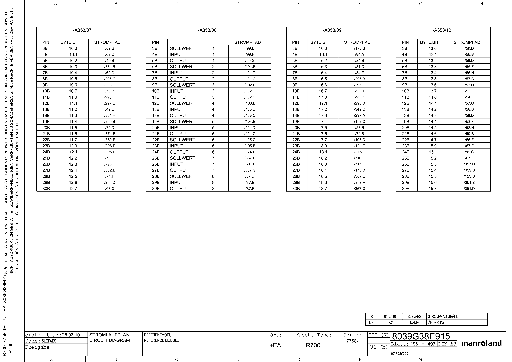

# +EA — Sheet 196 of 407 — REFERENZMODUL

**REFERENCE MODULE**

> Part of the manroland **R700** printing press IEC/UL circuit diagrams.
> Drawing class: **Stromlaufplan / Circuit diagram** (DIN A3).
> Document `+EA` covers the **Printing unit** machine section.

## At a glance

| Field | Value |
|---|---|
| Document | `+EA`  (8039G38E915) |
| Sheet | **196** of 407 |
| Section (DE) | REFERENZMODUL |
| Section (EN) | REFERENCE MODULE |
| Section type | REFERENCE_MODULE — Reference module |
| Machine type | `R700` |
| Series | `7758` |
| Created | 25.03.10 |
| Replaces | — |
| Columns used | A, B, C, D, E, F, G, H |
| Path numbers | — |
| Labels on sheet | 335 |
| Cross-refs out | 96 |
| Cross-refs in | 96 |

**Previous:** [+EA sheet 195](SHEET_0195.md) · **Next:** [+EA sheet 197](SHEET_0197.md) · **Document TOC:** [_TOC.md](_TOC.md)  (+EA) · **Master TOC:** [all sheets](../_MASTER_TOC.md)

## Sheet image (300 DPI, exact vector render)



_Rendered directly from the PDF vector layer at 300 DPI (1-bit), no OCR and no resampling. Use it to confirm anything ambiguous in the text below._

## Cross-references on this sheet

Each entry is a wire leaving this sheet. The printed token is `/sheet.column`; the link resolves to that sheet inside the same document.

| Ref | Target sheet | Col | Path | Destination on target | Target section | From col |
|---|---|---|---|---|---|---|
| `/69.B` | [+EA sheet 69](SHEET_0069.md) | B | — | — | SCHMIERUNG | B |
| `/99.E` | [+EA sheet 99](SHEET_0099.md) | E | — | — | BOGENFÜHRUNGSELEMENT | D |
| `/173.B` | [+EA sheet 173](SHEET_0173.md) | B | — | — | RESERVE | F |
| `/59.D` | [+EA sheet 59](SHEET_0059.md) | D | — | — | MASCHINENBEDIENUNG: BEDIENUNGKOMMANDOS | H |
| `/84.A` | [+EA sheet 84](SHEET_0084.md) | A | — | — | AUSLEGERSTAPELSTEUERUNG: PROGRAMMSCHALTWERK | F |
| `/56.B` | [+EA sheet 56](SHEET_0056.md) | B | — | — | MASCHINENBEDIENUNG: BEDIENUNGKOMMANDOS | H |
| `/99.F` | [+EA sheet 99](SHEET_0099.md) | F | — | — | BOGENFÜHRUNGSELEMENT | D |
| `/69.C` | [+EA sheet 69](SHEET_0069.md) | C | — | — | SCHMIERUNG | B |
| `/49.B` | [+EA sheet 49](SHEET_0049.md) | B | — | — | SCHUTZ | B |
| `/84.B` | [+EA sheet 84](SHEET_0084.md) | B | — | — | AUSLEGERSTAPELSTEUERUNG: PROGRAMMSCHALTWERK | F |
| `/99.G` | [+EA sheet 99](SHEET_0099.md) | G | — | — | BOGENFÜHRUNGSELEMENT | D |
| `/56.D` | [+EA sheet 56](SHEET_0056.md) | D | — | — | MASCHINENBEDIENUNG: BEDIENUNGKOMMANDOS | H |
| `/374.B` | [+EA sheet 374](SHEET_0374.md) | B | — | — | OPTION: ENDTROCKNER 1 VORBEREITUNG; | B |
| `/101.E` | [+EA sheet 101](SHEET_0101.md) | E | — | — | BOGENFÜHRUNGSELEMENT | D |
| `/56.F` | [+EA sheet 56](SHEET_0056.md) | F | — | — | MASCHINENBEDIENUNG: BEDIENUNGKOMMANDOS | H |
| `/84.C` | [+EA sheet 84](SHEET_0084.md) | C | — | — | AUSLEGERSTAPELSTEUERUNG: PROGRAMMSCHALTWERK | F |
| `/84.E` | [+EA sheet 84](SHEET_0084.md) | E | — | — | AUSLEGERSTAPELSTEUERUNG: PROGRAMMSCHALTWERK | F |
| `/69.D` | [+EA sheet 69](SHEET_0069.md) | D | — | — | SCHMIERUNG | B |
| `/56.H` | [+EA sheet 56](SHEET_0056.md) | H | — | — | MASCHINENBEDIENUNG: BEDIENUNGKOMMANDOS | H |
| `/101.D` | [+EA sheet 101](SHEET_0101.md) | D | — | — | BOGENFÜHRUNGSELEMENT | D |
| `/57.B` | [+EA sheet 57](SHEET_0057.md) | B | — | — | MASCHINENBEDIENUNG: BEDIENUNGKOMMANDOS | H |
| `/295.B` | [+EA sheet 295](SHEET_0295.md) | B | — | — | OPTION: ZWISCHENSTAPEL / | F |
| `/296.C` | [+EA sheet 296](SHEET_0296.md) | C | — | — | OPTION: ZWISCHENSTAPEL / | B |
| `/101.C` | [+EA sheet 101](SHEET_0101.md) | C | — | — | BOGENFÜHRUNGSELEMENT | D |
| `/102.E` | [+EA sheet 102](SHEET_0102.md) | E | — | — | BOGENFÜHRUNGSELEMENT | D |
| `/393.H` | [+EA sheet 393](SHEET_0393.md) | H | — | — | OPTION: ZWISCHENTROCKNER VORBEREITUNG; | B |
| `/295.C` | [+EA sheet 295](SHEET_0295.md) | C | — | — | OPTION: ZWISCHENSTAPEL / | F |
| `/57.D` | [+EA sheet 57](SHEET_0057.md) | D | — | — | MASCHINENBEDIENUNG: BEDIENUNGKOMMANDOS | H |
| `/76.B` | [+EA sheet 76](SHEET_0076.md) | B | — | — | AUSLEGERSTAPELSTEUERUNG | B |
| `/53.F` | [+EA sheet 53](SHEET_0053.md) | F | — | — | MASCHINENBEDIENUNG: LAUFKOMMANDOS | H |
| `/23.D` | [+EA sheet 23](SHEET_0023.md) | D | — | — | SPANNUNGSVERSORGUNG: 400V, 24V | F |
| `/102.D` | [+EA sheet 102](SHEET_0102.md) | D | — | — | BOGENFÜHRUNGSELEMENT | D |
| `/54.F` | [+EA sheet 54](SHEET_0054.md) | F | — | — | MASCHINENBEDIENUNG: LAUFKOMMANDOS | H |
| `/23.C` | [+EA sheet 23](SHEET_0023.md) | C | — | — | SPANNUNGSVERSORGUNG: 400V, 24V | F |
| `/296.D` | [+EA sheet 296](SHEET_0296.md) | D | — | — | OPTION: ZWISCHENSTAPEL / | B |
| `/102.C` | [+EA sheet 102](SHEET_0102.md) | C | — | — | BOGENFÜHRUNGSELEMENT | D |
| `/103.E` | [+EA sheet 103](SHEET_0103.md) | E | — | — | BOGENFÜHRUNGSELEMENT | D |
| `/296.B` | [+EA sheet 296](SHEET_0296.md) | B | — | — | OPTION: ZWISCHENSTAPEL / | F |
| `/57.G` | [+EA sheet 57](SHEET_0057.md) | G | — | — | MASCHINENBEDIENUNG: BEDIENUNGKOMMANDOS | H |
| `/297.C` | [+EA sheet 297](SHEET_0297.md) | C | — | — | OPTION: ZWISCHENSTAPEL / | B |
| `/58.B` | [+EA sheet 58](SHEET_0058.md) | B | — | — | MASCHINENBEDIENUNG: BEDIENUNGKOMMANDOS | H |
| `/49.C` | [+EA sheet 49](SHEET_0049.md) | C | — | — | SCHUTZ | B |
| `/103.D` | [+EA sheet 103](SHEET_0103.md) | D | — | — | BOGENFÜHRUNGSELEMENT | D |
| `/349.C` | [+EA sheet 349](SHEET_0349.md) | C | — | — | OPTION: VORBEREITUNG IONISATIONSANLAGE | F |
| `/297.A` | [+EA sheet 297](SHEET_0297.md) | A | — | — | OPTION: ZWISCHENSTAPEL / | F |
| `/58.D` | [+EA sheet 58](SHEET_0058.md) | D | — | — | MASCHINENBEDIENUNG: BEDIENUNGKOMMANDOS | H |
| `/304.H` | [+EA sheet 304](SHEET_0304.md) | H | — | — | OPTION: ZWISCHENSTAPEL / | B |
| `/103.C` | [+EA sheet 103](SHEET_0103.md) | C | — | — | BOGENFÜHRUNGSELEMENT | D |
| `/58.F` | [+EA sheet 58](SHEET_0058.md) | F | — | — | MASCHINENBEDIENUNG: BEDIENUNGKOMMANDOS | H |
| `/395.B` | [+EA sheet 395](SHEET_0395.md) | B | — | — | OPTION: ZWISCHENTROCKNER VORBEREITUNG; | B |
| `/104.E` | [+EA sheet 104](SHEET_0104.md) | E | — | — | BOGENFÜHRUNGSELEMENT | D |
| `/173.C` | [+EA sheet 173](SHEET_0173.md) | C | — | — | RESERVE | F |
| `/23.B` | [+EA sheet 23](SHEET_0023.md) | B | — | — | SPANNUNGSVERSORGUNG: 400V, 24V | F |
| `/74.D` | [+EA sheet 74](SHEET_0074.md) | D | — | — | AUSLEGERSTAPELSTEUERUNG | B |
| `/58.H` | [+EA sheet 58](SHEET_0058.md) | H | — | — | MASCHINENBEDIENUNG: BEDIENUNGKOMMANDOS | H |
| `/104.D` | [+EA sheet 104](SHEET_0104.md) | D | — | — | BOGENFÜHRUNGSELEMENT | D |
| `/74.B` | [+EA sheet 74](SHEET_0074.md) | B | — | — | AUSLEGERSTAPELSTEUERUNG | F |
| `/59.B` | [+EA sheet 59](SHEET_0059.md) | B | — | — | MASCHINENBEDIENUNG: BEDIENUNGKOMMANDOS | H |
| `/374.F` | [+EA sheet 374](SHEET_0374.md) | F | — | — | OPTION: ENDTROCKNER 1 VORBEREITUNG; | B |
| `/104.C` | [+EA sheet 104](SHEET_0104.md) | C | — | — | BOGENFÜHRUNGSELEMENT | D |
| `/55.F` | [+EA sheet 55](SHEET_0055.md) | F | — | — | MASCHINENBEDIENUNG: LAUFKOMMANDOS | H |
| `/382.F` | [+EA sheet 382](SHEET_0382.md) | F | — | — | OPTION: ENDTROCKNER 2 VORBEREITUNG | B |
| `/105.C` | [+EA sheet 105](SHEET_0105.md) | C | — | — | BOGENFÜHRUNGSELEMENT | D |
| `/107.D` | [+EA sheet 107](SHEET_0107.md) | D | — | — | BOGENGLÄTTER | F |
| `/105.B` | [+EA sheet 105](SHEET_0105.md) | B | — | — | BOGENFÜHRUNGSELEMENT | D |
| `/67.F` | [+EA sheet 67](SHEET_0067.md) | F | — | — | LEITSTANDSFUNKTIONEN | H |
| `/296.F` | [+EA sheet 296](SHEET_0296.md) | F | — | — | OPTION: ZWISCHENSTAPEL / | B |
| `/121.F` | [+EA sheet 121](SHEET_0121.md) | F | — | — | TROCKENBESTÄUBER | F |
| `/174.B` | [+EA sheet 174](SHEET_0174.md) | B | — | — | RESERVE | D |
| `/395.F` | [+EA sheet 395](SHEET_0395.md) | F | — | — | OPTION: ZWISCHENTROCKNER VORBEREITUNG; | B |
| `/315.F` | [+EA sheet 315](SHEET_0315.md) | F | — | — | OPTION: LOGISTIK, AUSLEGER | F |
| `/81.G` | [+EA sheet 81](SHEET_0081.md) | G | — | — | AUSLEGERSTAPELSTEUERUNG: BEDIENKOMMANDOS | H |
| `/67.F` | [+EA sheet 67](SHEET_0067.md) | F | — | — | LEITSTANDSFUNKTIONEN | H |
| `/337.E` | [+EA sheet 337](SHEET_0337.md) | E | — | — | OPTION: BOGENWEICHE | D |
| `/316.G` | [+EA sheet 316](SHEET_0316.md) | G | — | — | OPTION: LOGISTIK, AUSLEGER | F |
| `/76.D` | [+EA sheet 76](SHEET_0076.md) | D | — | — | AUSLEGERSTAPELSTEUERUNG | B |
| `/337.F` | [+EA sheet 337](SHEET_0337.md) | F | — | — | OPTION: BOGENWEICHE | D |
| `/317.G` | [+EA sheet 317](SHEET_0317.md) | G | — | — | OPTION: LOGISTIK, AUSLEGER | F |
| `/296.H` | [+EA sheet 296](SHEET_0296.md) | H | — | — | OPTION: ZWISCHENSTAPEL / | B |
| `/357.D` | [+EA sheet 357](SHEET_0357.md) | D | — | — | OPTION: AUFLAGENZÄHLER / GUTBOGENZÄHLER | H |
| `/302.E` | [+EA sheet 302](SHEET_0302.md) | E | — | — | OPTION: ZWISCHENSTAPEL / | B |
| `/359.B` | [+EA sheet 359](SHEET_0359.md) | B | — | — | OPTION: | H |
| `/337.G` | [+EA sheet 337](SHEET_0337.md) | G | — | — | OPTION: BOGENWEICHE | D |
| `/173.D` | [+EA sheet 173](SHEET_0173.md) | D | — | — | RESERVE | F |
| `/74.F` | [+EA sheet 74](SHEET_0074.md) | F | — | — | AUSLEGERSTAPELSTEUERUNG | B |
| `/367.E` | [+EA sheet 367](SHEET_0367.md) | E | — | — | OPTION: TROCKNER VORBEREITUNG; | F |
| `/123.B` | [+EA sheet 123](SHEET_0123.md) | B | — | — | TROCKENBESTÄUBER | H |
| `/87.D` | [+EA sheet 87](SHEET_0087.md) | D | — | — | SAUGWALZE | D |
| `/87.E` | [+EA sheet 87](SHEET_0087.md) | E | — | — | SAUGWALZE | D |
| `/351.B` | [+EA sheet 351](SHEET_0351.md) | B | — | — | OPTION: VORBEREITUNG: PUDERABSAUGUNG | H |
| `/367.F` | [+EA sheet 367](SHEET_0367.md) | F | — | — | OPTION: TROCKNER VORBEREITUNG; | F |
| `/350.D` | [+EA sheet 350](SHEET_0350.md) | D | — | — | OPTION: VORBEREITUNG: PUDERABSAUGUNG | B |
| `/87.F` | [+EA sheet 87](SHEET_0087.md) | F | — | — | SAUGWALZE | D |
| `/67.G` | [+EA sheet 67](SHEET_0067.md) | G | — | — | LEITSTANDSFUNKTIONEN | B |
| `/367.G` | [+EA sheet 367](SHEET_0367.md) | G | — | — | OPTION: TROCKNER VORBEREITUNG; | F |
| `/351.D` | [+EA sheet 351](SHEET_0351.md) | D | — | — | OPTION: VORBEREITUNG: PUDERABSAUGUNG | H |

### Incoming references (sheets that point here)

Every other sheet that sends a wire to this one. `Back-ref` is the token printed on *that* sheet; `Path` is its line number.

| From sheet | Cols | Back-ref | Path | Refs | What continues there |
|---|---|---|---|---|---|
| [+EA#23](SHEET_0023.md) | B, C, D | `/23.B`, `/23.C`, `/23.D` | — | 3 | — |
| [+EA#49](SHEET_0049.md) | B, C | `/49.B`, `/49.C` | — | 2 | — |
| [+EA#53](SHEET_0053.md) | F | `/53.F` | — | 1 | — |
| [+EA#54](SHEET_0054.md) | F | `/54.F` | — | 1 | — |
| [+EA#55](SHEET_0055.md) | F | `/55.F` | — | 1 | — |
| [+EA#56](SHEET_0056.md) | B, D, F, H | `/56.B`, `/56.D`, `/56.F`, `/56.H` | — | 4 | — |
| [+EA#57](SHEET_0057.md) | B, D, G | `/57.B`, `/57.D`, `/57.G` | — | 3 | — |
| [+EA#58](SHEET_0058.md) | B, D, F, H | `/58.B`, `/58.D`, `/58.F`, `/58.H` | — | 4 | — |
| [+EA#59](SHEET_0059.md) | B, D | `/59.B`, `/59.D` | — | 2 | — |
| [+EA#67](SHEET_0067.md) | F, G | `/67.F`, `/67.G` | — | 3 | — |
| [+EA#69](SHEET_0069.md) | A, C, D | `/69.A`, `/69.C`, `/69.D` | — | 3 | — |
| [+EA#74](SHEET_0074.md) | A, D, F | `/74.A`, `/74.D`, `/74.F` | — | 3 | — |
| [+EA#76](SHEET_0076.md) | B, D | `/76.B`, `/76.D` | — | 2 | — |
| [+EA#81](SHEET_0081.md) | G | `/81.G` | — | 1 | — |
| [+EA#84](SHEET_0084.md) | A, B, C, E | `/84.A`, `/84.B`, `/84.C`, `/84.E` | — | 4 | — |
| [+EA#87](SHEET_0087.md) | D, E, F | `/87.D`, `/87.E`, `/87.F` | — | 3 | — |
| [+EA#99](SHEET_0099.md) | E, F, G | `/99.E`, `/99.F`, `/99.G` | — | 3 | — |
| [+EA#101](SHEET_0101.md) | C, D, E | `/101.C`, `/101.D`, `/101.E` | — | 3 | — |
| [+EA#102](SHEET_0102.md) | C, D, E | `/102.C`, `/102.D`, `/102.E` | — | 3 | — |
| [+EA#103](SHEET_0103.md) | C, D, E | `/103.C`, `/103.D`, `/103.E` | — | 3 | — |
| [+EA#104](SHEET_0104.md) | C, D, E | `/104.C`, `/104.D`, `/104.E` | — | 3 | — |
| [+EA#105](SHEET_0105.md) | B, C | `/105.B`, `/105.C` | — | 2 | — |
| [+EA#107](SHEET_0107.md) | D | `/107.D` | — | 1 | — |
| [+EA#121](SHEET_0121.md) | F | `/121.F` | — | 1 | — |
| [+EA#123](SHEET_0123.md) | B | `/123.B` | — | 1 | — |
| [+EA#173](SHEET_0173.md) | B, C, D | `/173.B`, `/173.C`, `/173.D` | — | 3 | — |
| [+EA#174](SHEET_0174.md) | B | `/174.B` | — | 1 | — |
| [+EA#295](SHEET_0295.md) | B, C | `/295.B`, `/295.C` | — | 2 | — |
| [+EA#296](SHEET_0296.md) | B, C, D, F, G | `/296.B`, `/296.C`, `/296.D`, `/296.F`, `/296.G` | — | 5 | — |
| [+EA#297](SHEET_0297.md) | A, C | `/297.A`, `/297.C` | — | 2 | — |
| [+EA#302](SHEET_0302.md) | E | `/302.E` | — | 1 | — |
| [+EA#304](SHEET_0304.md) | G | `/304.G` | — | 1 | — |
| [+EA#315](SHEET_0315.md) | F | `/315.F` | — | 1 | — |
| [+EA#316](SHEET_0316.md) | G | `/316.G` | — | 1 | — |
| [+EA#317](SHEET_0317.md) | G | `/317.G` | — | 1 | — |
| [+EA#337](SHEET_0337.md) | E, F, G | `/337.E`, `/337.F`, `/337.G` | — | 3 | — |
| [+EA#349](SHEET_0349.md) | C | `/349.C` | — | 1 | — |
| [+EA#350](SHEET_0350.md) | D | `/350.D` | — | 1 | — |
| [+EA#351](SHEET_0351.md) | B, D | `/351.B`, `/351.D` | — | 2 | — |
| [+EA#357](SHEET_0357.md) | D | `/357.D` | — | 1 | — |
| [+EA#359](SHEET_0359.md) | B | `/359.B` | — | 1 | — |
| [+EA#367](SHEET_0367.md) | E, F, G | `/367.E`, `/367.F`, `/367.G` | — | 3 | — |
| [+EA#374](SHEET_0374.md) | B, F | `/374.B`, `/374.F` | — | 2 | — |
| [+EA#382](SHEET_0382.md) | F | `/382.F` | — | 1 | — |
| [+EA#393](SHEET_0393.md) | G | `/393.G` | — | 1 | — |
| [+EA#395](SHEET_0395.md) | B, F | `/395.B`, `/395.F` | — | 2 | — |


## Devices on this sheet

| Tag | Class | Class meaning (IEC) | Col | Sub | Terminal | Sign |
|---|---|---|---|---|---|---|
| `A353/08` | A | Baugruppe / assembly, module, PC board | C | 08 | — | — |
| `A353/09` | A | Baugruppe / assembly, module, PC board | F | 09 | — | — |
| `A353/10` | A | Baugruppe / assembly, module, PC board | G | 10 | — | — |
| `A353/07` | A | Baugruppe / assembly, module, PC board | A | 07 | — | — |
| `16.0` | — | cross-device reference | E | — | — | — |
| `16.1` | — | cross-device reference | E | — | — | — |
| `16.2` | — | cross-device reference | E | — | — | — |
| `16.3` | — | cross-device reference | E | — | — | — |
| `16.4` | — | cross-device reference | E | — | — | — |
| `16.5` | — | cross-device reference | E | — | — | — |
| `16.6` | — | cross-device reference | E | — | — | — |
| `16.7` | — | cross-device reference | E | — | — | — |
| `17.0` | — | cross-device reference | E | — | — | — |
| `17.1` | — | cross-device reference | E | — | — | — |
| `17.2` | — | cross-device reference | E | — | — | — |
| `17.3` | — | cross-device reference | E | — | — | — |
| `17.4` | — | cross-device reference | E | — | — | — |
| `17.5` | — | cross-device reference | E | — | — | — |
| `17.6` | — | cross-device reference | E | — | — | — |
| `17.7` | — | cross-device reference | E | — | — | — |
| `18.0` | — | cross-device reference | E | — | — | — |
| `18.1` | — | cross-device reference | E | — | — | — |
| `18.2` | — | cross-device reference | E | — | — | — |
| `18.3` | — | cross-device reference | E | — | — | — |
| `18.4` | — | cross-device reference | E | — | — | — |
| `18.5` | — | cross-device reference | E | — | — | — |
| `18.6` | — | cross-device reference | E | — | — | — |
| `18.7` | — | cross-device reference | E | — | — | — |
| `13.0` | — | cross-device reference | G | — | — | — |
| `13.1` | — | cross-device reference | G | — | — | — |
| `13.2` | — | cross-device reference | G | — | — | — |
| `13.3` | — | cross-device reference | G | — | — | — |
| `13.4` | — | cross-device reference | G | — | — | — |
| `13.5` | — | cross-device reference | G | — | — | — |
| `13.6` | — | cross-device reference | G | — | — | — |
| `13.7` | — | cross-device reference | G | — | — | — |
| `14.0` | — | cross-device reference | G | — | — | — |
| `14.1` | — | cross-device reference | G | — | — | — |
| `14.2` | — | cross-device reference | G | — | — | — |
| `14.3` | — | cross-device reference | G | — | — | — |
| `14.4` | — | cross-device reference | G | — | — | — |
| `14.5` | — | cross-device reference | G | — | — | — |
| `14.6` | — | cross-device reference | G | — | — | — |
| `14.7` | — | cross-device reference | G | — | — | — |
| `15.0` | — | cross-device reference | G | — | — | — |
| `15.1` | — | cross-device reference | G | — | — | — |
| `15.2` | — | cross-device reference | G | — | — | — |
| `15.3` | — | cross-device reference | G | — | — | — |
| `15.4` | — | cross-device reference | G | — | — | — |
| `15.5` | — | cross-device reference | G | — | — | — |
| `15.6` | — | cross-device reference | G | — | — | — |
| `15.7` | — | cross-device reference | G | — | — | — |
| `10.0` | — | cross-device reference | A | — | — | — |
| `10.1` | — | cross-device reference | A | — | — | — |
| `10.2` | — | cross-device reference | A | — | — | — |
| `10.3` | — | cross-device reference | A | — | — | — |
| `10.4` | — | cross-device reference | A | — | — | — |
| `10.5` | — | cross-device reference | A | — | — | — |
| `10.6` | — | cross-device reference | A | — | — | — |
| `10.7` | — | cross-device reference | A | — | — | — |
| `11.0` | — | cross-device reference | A | — | — | — |
| `11.1` | — | cross-device reference | A | — | — | — |
| `11.2` | — | cross-device reference | A | — | — | — |
| `11.3` | — | cross-device reference | A | — | — | — |
| `11.4` | — | cross-device reference | A | — | — | — |
| `11.5` | — | cross-device reference | A | — | — | — |
| `11.6` | — | cross-device reference | A | — | — | — |
| `11.7` | — | cross-device reference | A | — | — | — |
| `12.0` | — | cross-device reference | A | — | — | — |
| `12.1` | — | cross-device reference | A | — | — | — |
| `12.2` | — | cross-device reference | A | — | — | — |
| `12.3` | — | cross-device reference | A | — | — | — |
| `12.4` | — | cross-device reference | A | — | — | — |
| `12.5` | — | cross-device reference | A | — | — | — |
| `12.6` | — | cross-device reference | A | — | — | — |
| `12.7` | — | cross-device reference | A | — | — | — |
| `NR.` | — | cross-device reference | F | — | — | — |
| `05.07.10` | — | cross-device reference | F | — | — | — |

## Potentials / nets

_No named potentials on this sheet._

## Wire-end annotations (grouped as printed)

A wire that continues elsewhere is annotated with a small cluster: the destination description, the path/line number `#NN`, and the `/sheet.column` cross reference. Each row below is one such cluster exactly as it is grouped on the drawing.

| Col | Y | Path | Cross-ref | Text on the wire |
|---|---|---|---|---|
| A | 65.5 | — | — | `A353/07` |
| C | 65.5 | — | — | `A353/08` |
| F | 65.5 | — | — | `A353/09` |
| G | 65.5 | — | — | `A353/10` |
| A | 94.2 | — | — | `PIN BYTE.BIT` |
| B | 94.2 | — | — | `STROMPFAD` |
| C | 94.2 | — | — | `10B 11B 12B 13B 18B 19B 3B 4B 5B 6B 7B 8B 9B 20B 21B 22B 23B 24B 25B 26B 27B 28B 29B 30B STROMPFAD` |
| C | 94.2 | — | — | `PIN` |
| E | 94.2 | — | — | `PIN BYTE.BIT` |
| F | 94.2 | — | — | `STROMPFAD` |
| G | 94.2 | — | — | `PIN BYTE.BIT` |
| H | 94.2 | — | — | `STROMPFAD` |
| C | 108.0 | — | — | `INPUT INPUT INPUT INPUT INPUT INPUT INPUT INPUT SOLLWERT OUTPUT SOLLWERT OUTPUT SOLLWERT OUTPUT SOLLWERT OUTPUT SOLLWERT OUTPUT SOLLWERT OUTPUT SOLLWERT OUTPUT SOLLWERT OUTPUT` |
| A | 108.3 | — | — | `10B 11B 12B 13B 18B 19B 3B 4B 5B 6B 7B 8B 9B 20B 21B 22B 23B 24B 25B 26B 27B 28B 29B 30B` |
| A | 108.3 | — | — | `10.0 10.2 10.3 10.4 10.5 10.6 10.7 11.0 11.2 11.3 11.4 11.5 11.6 11.7 12.0 12.2 12.3 12.4 12.5 12.6 12.7 10.1 11.1 12.1` |
| E | 108.3 | — | — | `10B 11B 12B 13B 18B 19B 3B 4B 5B 6B 7B 8B 9B 20B 21B 22B 23B 24B 25B 26B 27B 28B 29B 30B` |
| E | 108.3 | — | — | `16.0 16.2 16.3 16.4 16.5 16.6 16.7 17.0 17.2 17.3 17.4 17.5 17.6 17.7 18.0 18.2 18.3 18.4 18.5 18.6 18.7 16.1 17.1 18.1` |
| G | 108.3 | — | — | `10B 11B 12B 13B 18B 19B 3B 4B 5B 6B 7B 8B 9B 20B 21B 22B 23B 24B 25B 26B 27B 28B 29B 30B` |
| G | 108.3 | — | — | `13.0 13.2 13.3 13.4 13.5 13.6 13.7 14.0 14.2 14.3 14.4 14.5 14.6 14.7 15.0 15.2 15.3 15.4 15.5 15.6 15.7 13.1 14.1 15.1` |
| D | 108.4 | — | — | `2 2 2 3 3 3 4 4 4 5 5 5 6 6 6 7 7 7 8 8 8 1 1 1` |
| B | 108.7 | — | `/69.B` | — |
| D | 108.7 | — | `/99.E` | — |
| F | 108.7 | — | `/173.B` | — |
| H | 108.7 | — | `/59.D` | — |
| F | 122.8 | — | `/84.A` | — |
| H | 122.8 | — | `/56.B` | — |
| B | 122.9 | — | `/69.C` | — |
| D | 122.9 | — | `/99.F` | — |
| B | 137.0 | — | `/49.B` | — |
| D | 137.0 | — | `/99.G` | — |
| F | 137.0 | — | `/84.B` | — |
| H | 137.1 | — | `/56.D` | — |
| B | 151.2 | — | `/374.B` | — |
| D | 151.2 | — | `/101.E` | — |
| F | 151.2 | — | `/84.C` | — |
| H | 151.2 | — | `/56.F` | — |
| B | 165.4 | — | `/69.D` | — |
| D | 165.4 | — | `/101.D` | — |
| F | 165.4 | — | `/84.E` | — |
| H | 165.4 | — | `/56.H` | — |
| H | 179.5 | — | `/57.B` | — |
| B | 179.6 | — | `/296.C` | — |
| D | 179.6 | — | `/101.C` | — |
| F | 179.6 | — | `/295.B` | — |
| D | 193.7 | — | `/102.E` | — |
| B | 193.8 | — | `/393.H` | — |
| F | 193.8 | — | `/295.C` | — |
| H | 193.8 | — | `/57.D` | — |
| B | 207.9 | — | `/76.B` | — |
| D | 207.9 | — | `/102.D` | — |
| F | 207.9 | — | `/23.D` | — |
| H | 207.9 | — | `/53.F` | — |
| B | 222.1 | — | `/296.D` | — |
| D | 222.1 | — | `/102.C` | — |
| F | 222.1 | — | `/23.C` | — |
| H | 222.1 | — | `/54.F` | — |
| D | 236.2 | — | `/103.E` | — |
| F | 236.2 | — | `/296.B` | — |
| H | 236.2 | — | `/57.G` | — |
| B | 236.3 | — | `/297.C` | — |
| B | 250.4 | — | `/49.C` | — |
| D | 250.4 | — | `/103.D` | — |
| F | 250.4 | — | `/349.C` | — |
| H | 250.4 | — | `/58.B` | — |
| B | 264.6 | — | `/304.H` | — |
| D | 264.6 | — | `/103.C` | — |
| F | 264.6 | — | `/297.A` | — |
| H | 264.6 | — | `/58.D` | — |
| B | 278.8 | — | `/395.B` | — |
| D | 278.8 | — | `/104.E` | — |
| F | 278.8 | — | `/173.C` | — |
| H | 278.8 | — | `/58.F` | — |
| F | 292.9 | — | `/23.B` | — |
| B | 293.0 | — | `/74.D` | — |
| D | 293.0 | — | `/104.D` | — |
| H | 293.0 | — | `/58.H` | — |
| B | 307.1 | — | `/374.F` | — |
| D | 307.1 | — | `/104.C` | — |
| F | 307.1 | — | `/74.B` | — |
| H | 307.1 | — | `/59.B` | — |
| B | 321.3 | — | `/382.F` | — |
| D | 321.3 | — | `/105.C` | — |
| F | 321.3 | — | `/107.D` | — |
| H | 321.3 | — | `/55.F` | — |
| B | 335.5 | — | `/296.F` | — |
| D | 335.5 | — | `/105.B` | — |
| F | 335.5 | — | `/121.F` | — |
| H | 335.5 | — | `/67.F` | — |
| B | 349.6 | — | `/395.F` | — |
| D | 349.6 | — | `/174.B` | — |
| F | 349.6 | — | `/315.F` | — |
| H | 349.6 | — | `/81.G` | — |
| B | 363.8 | — | `/76.D` | — |
| D | 363.8 | — | `/337.E` | — |
| F | 363.8 | — | `/316.G` | — |
| H | 363.8 | — | `/67.F` | — |
| B | 378.0 | — | `/296.H` | — |
| D | 378.0 | — | `/337.F` | — |
| F | 378.0 | — | `/317.G` | — |
| H | 378.0 | — | `/357.D` | — |
| B | 392.1 | — | `/302.E` | — |
| H | 392.1 | — | `/359.B` | — |
| D | 392.2 | — | `/337.G` | — |
| F | 392.2 | — | `/173.D` | — |
| B | 406.3 | — | `/74.F` | — |
| D | 406.3 | — | `/87.D` | — |
| F | 406.3 | — | `/367.E` | — |
| H | 406.3 | — | `/123.B` | — |
| B | 420.5 | — | `/350.D` | — |
| D | 420.5 | — | `/87.E` | — |
| F | 420.5 | — | `/367.F` | — |
| H | 420.5 | — | `/351.B` | — |
| B | 434.7 | — | `/67.G` | — |
| D | 434.7 | — | `/87.F` | — |
| F | 434.7 | — | `/367.G` | — |
| H | 434.7 | — | `/351.D` | — |
| G | 733.0 | — | — | `001 05.07.10 SLEI/AES STROMPFAD GEÄND.` |
| G | 747.1 | — | — | `NR. TAG NAME ÄNDERUNG` |


## Reconstructed tables

This sheet carries tabular content (pin map / terminal assignment / index). The grid below was rebuilt from the drawing's own rule lines, so each row is exactly one physical row of the table.

### Table 1 — 24 data rows × 3 columns (at x=85.0, y=62.4) — **A353/07**

| PIN | BYTE.BIT | STROMPFAD |
|---|---|---|
| `3B` | `10.0` | `/69.B` |
| `4B` | `10.1` | `/69.C` |
| `5B` | `10.2` | `/49.B` |
| `6B` | `10.3` | `/374.B` |
| `7B` | `10.4` | `/69.D` |
| `8B` | `10.5` | `/296.C` |
| `9B` | `10.6` | `/393.H` |
| `10B` | `10.7` | `/76.B` |
| `11B` | `11.0` | `/296.D` |
| `12B` | `11.1` | `/297.C` |
| `13B` | `11.2` | `/49.C` |
| `18B` | `11.3` | `/304.H` |
| `19B` | `11.4` | `/395.B` |
| `20B` | `11.5` | `/74.D` |
| `21B` | `11.6` | `/374.F` |
| `22B` | `11.7` | `/382.F` |
| `23B` | `12.0` | `/296.F` |
| `24B` | `12.1` | `/395.F` |
| `25B` | `12.2` | `/76.D` |
| `26B` | `12.3` | `/296.H` |
| `27B` | `12.4` | `/302.E` |
| `28B` | `12.5` | `/74.F` |
| `29B` | `12.6` | `/350.D` |
| `30B` | `12.7` | `/67.G` |


### Table 2 — 24 data rows × 4 columns (at x=340.2, y=62.4) — **A353/08**

| PIN |  |  | STROMPFAD |
|---|---|---|---|
| `3B` | `SOLLWERT` | `1` | `/99.E` |
| `4B` | `INPUT` | `1` | `/99.F` |
| `5B` | `OUTPUT` | `1` | `/99.G` |
| `6B` | `SOLLWERT` | `2` | `/101.E` |
| `7B` | `INPUT` | `2` | `/101.D` |
| `8B` | `OUTPUT` | `2` | `/101.C` |
| `9B` | `SOLLWERT` | `3` | `/102.E` |
| `10B` | `INPUT` | `3` | `/102.D` |
| `11B` | `OUTPUT` | `3` | `/102.C` |
| `12B` | `SOLLWERT` | `4` | `/103.E` |
| `13B` | `INPUT` | `4` | `/103.D` |
| `18B` | `OUTPUT` | `4` | `/103.C` |
| `19B` | `SOLLWERT` | `5` | `/104.E` |
| `20B` | `INPUT` | `5` | `/104.D` |
| `21B` | `OUTPUT` | `5` | `/104.C` |
| `22B` | `SOLLWERT` | `6` | `/105.C` |
| `23B` | `INPUT` | `6` | `/105.B` |
| `24B` | `OUTPUT` | `6` | `/174.B` |
| `25B` | `SOLLWERT` | `7` | `/337.E` |
| `26B` | `INPUT` | `7` | `/337.F` |
| `27B` | `OUTPUT` | `7` | `/337.G` |
| `28B` | `SOLLWERT` | `8` | `/87.D` |
| `29B` | `INPUT` | `8` | `/87.E` |
| `30B` | `OUTPUT` | `8` | `/87.F` |


### Table 3 — 24 data rows × 3 columns (at x=666.1, y=62.4) — **A353/09**

| PIN | BYTE.BIT | STROMPFAD |
|---|---|---|
| `3B` | `16.0` | `/173.B` |
| `4B` | `16.1` | `/84.A` |
| `5B` | `16.2` | `/84.B` |
| `6B` | `16.3` | `/84.C` |
| `7B` | `16.4` | `/84.E` |
| `8B` | `16.5` | `/295.B` |
| `9B` | `16.6` | `/295.C` |
| `10B` | `16.7` | `/23.D` |
| `11B` | `17.0` | `/23.C` |
| `12B` | `17.1` | `/296.B` |
| `13B` | `17.2` | `/349.C` |
| `18B` | `17.3` | `/297.A` |
| `19B` | `17.4` | `/173.C` |
| `20B` | `17.5` | `/23.B` |
| `21B` | `17.6` | `/74.B` |
| `22B` | `17.7` | `/107.D` |
| `23B` | `18.0` | `/121.F` |
| `24B` | `18.1` | `/315.F` |
| `25B` | `18.2` | `/316.G` |
| `26B` | `18.3` | `/317.G` |
| `27B` | `18.4` | `/173.D` |
| `28B` | `18.5` | `/367.E` |
| `29B` | `18.6` | `/367.F` |
| `30B` | `18.7` | `/367.G` |


### Table 4 — 24 data rows × 3 columns (at x=921.3, y=62.4) — **A353/10**

| PIN | BYTE.BIT | STROMPFAD |
|---|---|---|
| `3B` | `13.0` | `/59.D` |
| `4B` | `13.1` | `/56.B` |
| `5B` | `13.2` | `/56.D` |
| `6B` | `13.3` | `/56.F` |
| `7B` | `13.4` | `/56.H` |
| `8B` | `13.5` | `/57.B` |
| `9B` | `13.6` | `/57.D` |
| `10B` | `13.7` | `/53.F` |
| `11B` | `14.0` | `/54.F` |
| `12B` | `14.1` | `/57.G` |
| `13B` | `14.2` | `/58.B` |
| `18B` | `14.3` | `/58.D` |
| `19B` | `14.4` | `/58.F` |
| `20B` | `14.5` | `/58.H` |
| `21B` | `14.6` | `/59.B` |
| `22B` | `14.7` | `/55.F` |
| `23B` | `15.0` | `/67.F` |
| `24B` | `15.1` | `/81.G` |
| `25B` | `15.2` | `/67.F` |
| `26B` | `15.3` | `/357.D` |
| `27B` | `15.4` | `/359.B` |
| `28B` | `15.5` | `/123.B` |
| `29B` | `15.6` | `/351.B` |
| `30B` | `15.7` | `/351.D` |


## Notes and free text on this sheet

| Text | Col | Y (pt) |
|---|---|---|
| `STROMPFAD` | D | 94.15 |
| `3B` | C | 108.35 |
| `4B` | C | 122.53 |
| `5B` | C | 136.7 |
| `6B` | C | 150.87 |
| `7B` | C | 165.05 |
| `8B` | C | 179.22 |
| `9B` | C | 193.39 |
| `10B` | C | 207.57 |
| `11B` | C | 221.74 |
| `12B` | C | 235.92 |
| `13B` | C | 250.09 |
| `18B` | C | 264.26 |
| `19B` | C | 278.44 |
| `20B` | C | 292.61 |
| `21B` | C | 306.78 |
| `22B` | C | 320.96 |
| `23B` | C | 335.13 |
| `24B` | C | 349.3 |
| `25B` | C | 363.48 |
| `26B` | C | 377.65 |
| `27B` | C | 391.82 |
| `28B` | C | 406 |
| `29B` | C | 420.17 |
| `30B` | C | 434.34 |
| `PIN` | C | 94.2 |
| `SOLLWERT` | C | 107.96 |
| `INPUT` | C | 122.24 |
| `OUTPUT` | C | 136.37 |
| `3B` | E | 108.35 |
| `4B` | E | 122.53 |
| `5B` | E | 136.7 |
| `6B` | E | 150.87 |
| `7B` | E | 165.05 |
| `8B` | E | 179.22 |
| `9B` | E | 193.39 |
| `10B` | E | 207.57 |
| `11B` | E | 221.74 |
| `12B` | E | 235.92 |
| `13B` | E | 250.09 |
| `18B` | E | 264.26 |
| `19B` | E | 278.44 |
| `20B` | E | 292.61 |
| `21B` | E | 306.78 |
| `22B` | E | 320.96 |
| `23B` | E | 335.13 |
| `24B` | E | 349.3 |
| `25B` | E | 363.48 |
| `26B` | E | 377.65 |
| `27B` | E | 391.82 |
| `28B` | E | 406 |
| `29B` | E | 420.17 |
| `30B` | E | 434.34 |
| `PIN` | E | 94.2 |
| `BYTE.BIT` | E | 94.17 |
| `STROMPFAD` | F | 94.15 |
| `3B` | G | 108.35 |
| `4B` | G | 122.53 |
| `5B` | G | 136.7 |
| `6B` | G | 150.87 |
| `7B` | G | 165.05 |
| `8B` | G | 179.22 |
| `9B` | G | 193.39 |
| `10B` | G | 207.57 |
| `11B` | G | 221.74 |
| `12B` | G | 235.92 |
| `13B` | G | 250.09 |
| `18B` | G | 264.26 |
| `19B` | G | 278.44 |
| `20B` | G | 292.61 |
| `21B` | G | 306.78 |
| `22B` | G | 320.96 |
| `23B` | G | 335.13 |
| `24B` | G | 349.3 |
| `25B` | G | 363.48 |
| `26B` | G | 377.65 |
| `27B` | G | 391.82 |
| `28B` | G | 406 |
| `29B` | G | 420.17 |
| `30B` | G | 434.34 |
| `PIN` | G | 94.2 |
| `BYTE.BIT` | G | 94.17 |
| `STROMPFAD` | H | 94.15 |
| `3B` | A | 108.35 |
| `4B` | A | 122.53 |
| `5B` | A | 136.7 |
| `6B` | A | 150.87 |
| `7B` | A | 165.05 |
| `8B` | A | 179.22 |
| `9B` | A | 193.39 |
| `10B` | A | 207.57 |
| `11B` | A | 221.74 |
| `12B` | A | 235.92 |
| `13B` | A | 250.09 |
| `18B` | A | 264.26 |
| `19B` | A | 278.44 |
| `20B` | A | 292.61 |
| `21B` | A | 306.78 |
| `22B` | A | 320.96 |
| `23B` | A | 335.13 |
| `24B` | A | 349.3 |
| `25B` | A | 363.48 |
| `26B` | A | 377.65 |
| `27B` | A | 391.82 |
| `28B` | A | 406 |
| `29B` | A | 420.17 |
| `30B` | A | 434.34 |
| `PIN` | A | 94.2 |
| `BYTE.BIT` | A | 94.17 |
| `STROMPFAD` | B | 94.15 |
| `TAG` | G | 747.27 |
| `NAME` | G | 747.25 |
| `ÄNDERUNG` | G | 747.31 |
| `SLEI/AES` | G | 733.13 |
| `STROMPFAD GEÄND.` | G | 733.12 |

## Complete label inventory (exact text from the drawing)

Every text object inside the drawing area of this sheet, in DIN reading order (column A→H, then top→bottom). This is the authoritative list: if a string is not here it is not printed on this sheet.

| Col | Y | X | Dir | Type | Text |
|---|---|---|---|---|---|
| A | 65.5 | 169.9 | → | device tag | `A353/07` |
| A | 94.2 | 98.4 | → | text | `PIN` |
| A | 94.2 | 140.9 | → | text | `BYTE.BIT` |
| A | 108.3 | 160.3 | → | device ref | `10.0` |
| A | 108.4 | 98.9 | → | text | `3B` |
| A | 122.5 | 98.9 | → | text | `4B` |
| A | 122.5 | 161.1 | → | device ref | `10.1` |
| A | 136.7 | 98.9 | → | text | `5B` |
| A | 136.7 | 160.3 | → | device ref | `10.2` |
| A | 150.9 | 98.9 | → | text | `6B` |
| A | 150.9 | 160.3 | → | device ref | `10.3` |
| A | 165.0 | 98.9 | → | text | `7B` |
| A | 165.0 | 160.3 | → | device ref | `10.4` |
| A | 179.2 | 98.9 | → | text | `8B` |
| A | 179.2 | 160.3 | → | device ref | `10.5` |
| A | 193.4 | 98.9 | → | text | `9B` |
| A | 193.4 | 160.3 | → | device ref | `10.6` |
| A | 207.6 | 98.4 | → | text | `10B` |
| A | 207.6 | 160.3 | → | device ref | `10.7` |
| A | 221.7 | 98.4 | → | text | `11B` |
| A | 221.7 | 160.3 | → | device ref | `11.0` |
| A | 235.9 | 98.4 | → | text | `12B` |
| A | 235.9 | 161.1 | → | device ref | `11.1` |
| A | 250.1 | 98.4 | → | text | `13B` |
| A | 250.1 | 160.3 | → | device ref | `11.2` |
| A | 264.2 | 160.3 | → | device ref | `11.3` |
| A | 264.3 | 98.4 | → | text | `18B` |
| A | 278.4 | 98.4 | → | text | `19B` |
| A | 278.4 | 160.3 | → | device ref | `11.4` |
| A | 292.6 | 98.9 | → | text | `20B` |
| A | 292.6 | 160.3 | → | device ref | `11.5` |
| A | 306.8 | 98.9 | → | text | `21B` |
| A | 306.8 | 160.3 | → | device ref | `11.6` |
| A | 320.9 | 160.3 | → | device ref | `11.7` |
| A | 321.0 | 98.9 | → | text | `22B` |
| A | 335.1 | 98.9 | → | text | `23B` |
| A | 335.1 | 160.3 | → | device ref | `12.0` |
| A | 349.3 | 98.9 | → | text | `24B` |
| A | 349.3 | 161.1 | → | device ref | `12.1` |
| A | 363.5 | 98.9 | → | text | `25B` |
| A | 363.5 | 160.3 | → | device ref | `12.2` |
| A | 377.6 | 98.9 | → | text | `26B` |
| A | 377.6 | 160.3 | → | device ref | `12.3` |
| A | 391.8 | 98.9 | → | text | `27B` |
| A | 391.8 | 160.3 | → | device ref | `12.4` |
| A | 406.0 | 98.9 | → | text | `28B` |
| A | 406.0 | 160.3 | → | device ref | `12.5` |
| A | 420.2 | 98.9 | → | text | `29B` |
| A | 420.2 | 160.3 | → | device ref | `12.6` |
| A | 434.3 | 98.9 | → | text | `30B` |
| A | 434.3 | 160.3 | → | device ref | `12.7` |
| B | 94.2 | 219.1 | → | text | `STROMPFAD` |
| B | 108.7 | 244.9 | → | cross-reference | `/69.B` |
| B | 122.9 | 244.8 | → | cross-reference | `/69.C` |
| B | 137.0 | 244.9 | → | cross-reference | `/49.B` |
| B | 151.2 | 242.5 | → | cross-reference | `/374.B` |
| B | 165.4 | 244.8 | → | cross-reference | `/69.D` |
| B | 179.6 | 242.4 | → | cross-reference | `/296.C` |
| B | 193.8 | 242.6 | → | cross-reference | `/393.H` |
| B | 207.9 | 244.9 | → | cross-reference | `/76.B` |
| B | 222.1 | 242.4 | → | cross-reference | `/296.D` |
| B | 236.3 | 242.4 | → | cross-reference | `/297.C` |
| B | 250.4 | 244.8 | → | cross-reference | `/49.C` |
| B | 264.6 | 242.6 | → | cross-reference | `/304.H` |
| B | 278.8 | 242.5 | → | cross-reference | `/395.B` |
| B | 293.0 | 244.8 | → | cross-reference | `/74.D` |
| B | 307.1 | 242.8 | → | cross-reference | `/374.F` |
| B | 321.3 | 242.8 | → | cross-reference | `/382.F` |
| B | 335.5 | 242.8 | → | cross-reference | `/296.F` |
| B | 349.6 | 242.8 | → | cross-reference | `/395.F` |
| B | 363.8 | 244.8 | → | cross-reference | `/76.D` |
| B | 378.0 | 242.6 | → | cross-reference | `/296.H` |
| B | 392.2 | 242.6 | → | cross-reference | `/302.E` |
| B | 406.3 | 245.2 | → | cross-reference | `/74.F` |
| B | 420.5 | 242.4 | → | cross-reference | `/350.D` |
| B | 434.7 | 244.6 | → | cross-reference | `/67.G` |
| C | 65.5 | 460.5 | → | device tag | `A353/08` |
| C | 94.2 | 353.5 | → | text | `PIN` |
| C | 108.0 | 394.9 | → | text | `SOLLWERT` |
| C | 108.4 | 354.0 | → | text | `3B` |
| C | 122.2 | 394.6 | → | text | `INPUT` |
| C | 122.5 | 354.0 | → | text | `4B` |
| C | 136.4 | 394.9 | → | text | `OUTPUT` |
| C | 136.7 | 354.0 | → | text | `5B` |
| C | 150.5 | 394.9 | → | text | `SOLLWERT` |
| C | 150.9 | 354.0 | → | text | `6B` |
| C | 164.8 | 394.6 | → | text | `INPUT` |
| C | 165.0 | 354.0 | → | text | `7B` |
| C | 178.9 | 394.9 | → | text | `OUTPUT` |
| C | 179.2 | 354.0 | → | text | `8B` |
| C | 193.0 | 394.9 | → | text | `SOLLWERT` |
| C | 193.4 | 354.0 | → | text | `9B` |
| C | 207.3 | 394.6 | → | text | `INPUT` |
| C | 207.6 | 353.5 | → | text | `10B` |
| C | 221.4 | 394.9 | → | text | `OUTPUT` |
| C | 221.7 | 353.5 | → | text | `11B` |
| C | 235.5 | 394.9 | → | text | `SOLLWERT` |
| C | 235.9 | 353.5 | → | text | `12B` |
| C | 249.8 | 394.6 | → | text | `INPUT` |
| C | 250.1 | 353.5 | → | text | `13B` |
| C | 263.9 | 394.9 | → | text | `OUTPUT` |
| C | 264.3 | 353.5 | → | text | `18B` |
| C | 278.0 | 394.9 | → | text | `SOLLWERT` |
| C | 278.4 | 353.5 | → | text | `19B` |
| C | 292.3 | 394.6 | → | text | `INPUT` |
| C | 292.6 | 354.0 | → | text | `20B` |
| C | 306.4 | 394.9 | → | text | `OUTPUT` |
| C | 306.8 | 354.0 | → | text | `21B` |
| C | 320.6 | 394.9 | → | text | `SOLLWERT` |
| C | 321.0 | 354.0 | → | text | `22B` |
| C | 334.8 | 394.6 | → | text | `INPUT` |
| C | 335.1 | 354.0 | → | text | `23B` |
| C | 349.0 | 394.9 | → | text | `OUTPUT` |
| C | 349.3 | 354.0 | → | text | `24B` |
| C | 363.1 | 394.9 | → | text | `SOLLWERT` |
| C | 363.5 | 354.0 | → | text | `25B` |
| C | 377.4 | 394.6 | → | text | `INPUT` |
| C | 377.6 | 354.0 | → | text | `26B` |
| C | 391.5 | 394.9 | → | text | `OUTPUT` |
| C | 391.8 | 354.0 | → | text | `27B` |
| C | 405.6 | 394.9 | → | text | `SOLLWERT` |
| C | 406.0 | 354.0 | → | text | `28B` |
| C | 419.9 | 394.6 | → | text | `INPUT` |
| C | 420.2 | 354.0 | → | text | `29B` |
| C | 434.0 | 394.9 | → | text | `OUTPUT` |
| C | 434.3 | 354.0 | → | text | `30B` |
| D | 94.2 | 545.1 | → | text | `STROMPFAD` |
| D | 108.4 | 493.9 | → | number | `1` |
| D | 108.7 | 571.0 | → | cross-reference | `/99.E` |
| D | 122.5 | 493.9 | → | number | `1` |
| D | 122.9 | 571.2 | → | cross-reference | `/99.F` |
| D | 136.7 | 493.9 | → | number | `1` |
| D | 137.0 | 570.6 | → | cross-reference | `/99.G` |
| D | 150.9 | 493.4 | → | number | `2` |
| D | 151.2 | 568.6 | → | cross-reference | `/101.E` |
| D | 165.1 | 493.4 | → | number | `2` |
| D | 165.4 | 568.3 | → | cross-reference | `/101.D` |
| D | 179.2 | 493.4 | → | number | `2` |
| D | 179.6 | 568.3 | → | cross-reference | `/101.C` |
| D | 193.4 | 493.4 | → | number | `3` |
| D | 193.7 | 568.6 | → | cross-reference | `/102.E` |
| D | 207.6 | 493.4 | → | number | `3` |
| D | 207.9 | 568.3 | → | cross-reference | `/102.D` |
| D | 221.8 | 493.4 | → | number | `3` |
| D | 222.1 | 568.3 | → | cross-reference | `/102.C` |
| D | 235.9 | 493.4 | → | number | `4` |
| D | 236.2 | 568.6 | → | cross-reference | `/103.E` |
| D | 250.1 | 493.4 | → | number | `4` |
| D | 250.4 | 568.3 | → | cross-reference | `/103.D` |
| D | 264.3 | 493.4 | → | number | `4` |
| D | 264.6 | 568.3 | → | cross-reference | `/103.C` |
| D | 278.5 | 493.4 | → | number | `5` |
| D | 278.8 | 568.6 | → | cross-reference | `/104.E` |
| D | 292.6 | 493.4 | → | number | `5` |
| D | 293.0 | 568.3 | → | cross-reference | `/104.D` |
| D | 306.8 | 493.4 | → | number | `5` |
| D | 307.1 | 568.3 | → | cross-reference | `/104.C` |
| D | 321.0 | 493.4 | → | number | `6` |
| D | 321.3 | 568.3 | → | cross-reference | `/105.C` |
| D | 335.1 | 493.4 | → | number | `6` |
| D | 335.5 | 568.5 | → | cross-reference | `/105.B` |
| D | 349.3 | 493.4 | → | number | `6` |
| D | 349.6 | 568.5 | → | cross-reference | `/174.B` |
| D | 363.5 | 493.4 | → | number | `7` |
| D | 363.8 | 568.6 | → | cross-reference | `/337.E` |
| D | 377.7 | 493.4 | → | number | `7` |
| D | 378.0 | 568.8 | → | cross-reference | `/337.F` |
| D | 391.8 | 493.4 | → | number | `7` |
| D | 392.2 | 568.2 | → | cross-reference | `/337.G` |
| D | 406.0 | 493.4 | → | number | `8` |
| D | 406.3 | 570.8 | → | cross-reference | `/87.D` |
| D | 420.2 | 493.4 | → | number | `8` |
| D | 420.5 | 571.0 | → | cross-reference | `/87.E` |
| D | 434.4 | 493.4 | → | number | `8` |
| D | 434.7 | 571.2 | → | cross-reference | `/87.F` |
| E | 94.2 | 679.5 | → | text | `PIN` |
| E | 94.2 | 722.0 | → | text | `BYTE.BIT` |
| E | 108.3 | 741.4 | → | device ref | `16.0` |
| E | 108.4 | 680.0 | → | text | `3B` |
| E | 122.5 | 680.0 | → | text | `4B` |
| E | 122.5 | 742.3 | → | device ref | `16.1` |
| E | 136.7 | 680.0 | → | text | `5B` |
| E | 136.7 | 741.4 | → | device ref | `16.2` |
| E | 150.9 | 680.0 | → | text | `6B` |
| E | 150.9 | 741.4 | → | device ref | `16.3` |
| E | 165.0 | 680.0 | → | text | `7B` |
| E | 165.0 | 741.4 | → | device ref | `16.4` |
| E | 179.2 | 680.0 | → | text | `8B` |
| E | 179.2 | 741.4 | → | device ref | `16.5` |
| E | 193.4 | 680.0 | → | text | `9B` |
| E | 193.4 | 741.4 | → | device ref | `16.6` |
| E | 207.6 | 679.5 | → | text | `10B` |
| E | 207.6 | 741.4 | → | device ref | `16.7` |
| E | 221.7 | 679.5 | → | text | `11B` |
| E | 221.7 | 741.4 | → | device ref | `17.0` |
| E | 235.9 | 679.5 | → | text | `12B` |
| E | 235.9 | 742.3 | → | device ref | `17.1` |
| E | 250.1 | 679.5 | → | text | `13B` |
| E | 250.1 | 741.4 | → | device ref | `17.2` |
| E | 264.2 | 741.4 | → | device ref | `17.3` |
| E | 264.3 | 679.5 | → | text | `18B` |
| E | 278.4 | 679.5 | → | text | `19B` |
| E | 278.4 | 741.4 | → | device ref | `17.4` |
| E | 292.6 | 680.0 | → | text | `20B` |
| E | 292.6 | 741.4 | → | device ref | `17.5` |
| E | 306.8 | 680.0 | → | text | `21B` |
| E | 306.8 | 741.4 | → | device ref | `17.6` |
| E | 320.9 | 741.4 | → | device ref | `17.7` |
| E | 321.0 | 680.0 | → | text | `22B` |
| E | 335.1 | 680.0 | → | text | `23B` |
| E | 335.1 | 741.4 | → | device ref | `18.0` |
| E | 349.3 | 680.0 | → | text | `24B` |
| E | 349.3 | 742.3 | → | device ref | `18.1` |
| E | 363.5 | 680.0 | → | text | `25B` |
| E | 363.5 | 741.4 | → | device ref | `18.2` |
| E | 377.6 | 680.0 | → | text | `26B` |
| E | 377.6 | 741.4 | → | device ref | `18.3` |
| E | 391.8 | 680.0 | → | text | `27B` |
| E | 391.8 | 741.4 | → | device ref | `18.4` |
| E | 406.0 | 680.0 | → | text | `28B` |
| E | 406.0 | 741.4 | → | device ref | `18.5` |
| E | 420.2 | 680.0 | → | text | `29B` |
| E | 420.2 | 741.4 | → | device ref | `18.6` |
| E | 434.3 | 680.0 | → | text | `30B` |
| E | 434.3 | 741.4 | → | device ref | `18.7` |
| F | 65.5 | 751.0 | → | device tag | `A353/09` |
| F | 94.2 | 800.2 | → | text | `STROMPFAD` |
| F | 108.7 | 823.6 | → | cross-reference | `/173.B` |
| F | 122.8 | 825.9 | → | cross-reference | `/84.A` |
| F | 137.0 | 826.0 | → | cross-reference | `/84.B` |
| F | 151.2 | 825.9 | → | cross-reference | `/84.C` |
| F | 165.4 | 826.2 | → | cross-reference | `/84.E` |
| F | 179.6 | 823.6 | → | cross-reference | `/295.B` |
| F | 193.8 | 823.5 | → | cross-reference | `/295.C` |
| F | 207.9 | 825.9 | → | cross-reference | `/23.D` |
| F | 222.1 | 825.9 | → | cross-reference | `/23.C` |
| F | 236.2 | 823.6 | → | cross-reference | `/296.B` |
| F | 250.4 | 823.5 | → | cross-reference | `/349.C` |
| F | 264.6 | 823.5 | → | cross-reference | `/297.A` |
| F | 278.8 | 823.5 | → | cross-reference | `/173.C` |
| F | 292.9 | 826.0 | → | cross-reference | `/23.B` |
| F | 307.1 | 826.0 | → | cross-reference | `/74.B` |
| F | 321.3 | 823.5 | → | cross-reference | `/107.D` |
| F | 335.5 | 823.9 | → | cross-reference | `/121.F` |
| F | 349.6 | 823.9 | → | cross-reference | `/315.F` |
| F | 363.8 | 823.3 | → | cross-reference | `/316.G` |
| F | 378.0 | 823.3 | → | cross-reference | `/317.G` |
| F | 392.2 | 823.5 | → | cross-reference | `/173.D` |
| F | 406.3 | 823.7 | → | cross-reference | `/367.E` |
| F | 420.5 | 823.9 | → | cross-reference | `/367.F` |
| F | 434.7 | 823.3 | → | cross-reference | `/367.G` |
| F | 733.0 | 859.4 | → | number | `001` |
| F | 733.1 | 893.5 | → | device ref | `05.07.10` |
| F | 747.1 | 858.4 | → | device ref | `NR.` |
| G | 65.5 | 1006.2 | → | device tag | `A353/10` |
| G | 94.2 | 934.6 | → | text | `PIN` |
| G | 94.2 | 977.1 | → | text | `BYTE.BIT` |
| G | 108.3 | 996.5 | → | device ref | `13.0` |
| G | 108.4 | 935.1 | → | text | `3B` |
| G | 122.5 | 935.1 | → | text | `4B` |
| G | 122.5 | 997.4 | → | device ref | `13.1` |
| G | 136.7 | 935.1 | → | text | `5B` |
| G | 136.7 | 996.5 | → | device ref | `13.2` |
| G | 150.9 | 935.1 | → | text | `6B` |
| G | 150.9 | 996.5 | → | device ref | `13.3` |
| G | 165.0 | 935.1 | → | text | `7B` |
| G | 165.0 | 996.5 | → | device ref | `13.4` |
| G | 179.2 | 935.1 | → | text | `8B` |
| G | 179.2 | 996.5 | → | device ref | `13.5` |
| G | 193.4 | 935.1 | → | text | `9B` |
| G | 193.4 | 996.5 | → | device ref | `13.6` |
| G | 207.6 | 934.6 | → | text | `10B` |
| G | 207.6 | 996.5 | → | device ref | `13.7` |
| G | 221.7 | 934.6 | → | text | `11B` |
| G | 221.7 | 996.5 | → | device ref | `14.0` |
| G | 235.9 | 934.6 | → | text | `12B` |
| G | 235.9 | 997.4 | → | device ref | `14.1` |
| G | 250.1 | 934.6 | → | text | `13B` |
| G | 250.1 | 996.5 | → | device ref | `14.2` |
| G | 264.2 | 996.5 | → | device ref | `14.3` |
| G | 264.3 | 934.6 | → | text | `18B` |
| G | 278.4 | 934.6 | → | text | `19B` |
| G | 278.4 | 996.5 | → | device ref | `14.4` |
| G | 292.6 | 935.1 | → | text | `20B` |
| G | 292.6 | 996.5 | → | device ref | `14.5` |
| G | 306.8 | 935.1 | → | text | `21B` |
| G | 306.8 | 996.5 | → | device ref | `14.6` |
| G | 320.9 | 996.5 | → | device ref | `14.7` |
| G | 321.0 | 935.1 | → | text | `22B` |
| G | 335.1 | 935.1 | → | text | `23B` |
| G | 335.1 | 996.5 | → | device ref | `15.0` |
| G | 349.3 | 935.1 | → | text | `24B` |
| G | 349.3 | 997.4 | → | device ref | `15.1` |
| G | 363.5 | 935.1 | → | text | `25B` |
| G | 363.5 | 996.5 | → | device ref | `15.2` |
| G | 377.6 | 935.1 | → | text | `26B` |
| G | 377.6 | 996.5 | → | device ref | `15.3` |
| G | 391.8 | 935.1 | → | text | `27B` |
| G | 391.8 | 996.5 | → | device ref | `15.4` |
| G | 406.0 | 935.1 | → | text | `28B` |
| G | 406.0 | 996.5 | → | device ref | `15.5` |
| G | 420.2 | 935.1 | → | text | `29B` |
| G | 420.2 | 996.5 | → | device ref | `15.6` |
| G | 434.3 | 935.1 | → | text | `30B` |
| G | 434.3 | 996.5 | → | device ref | `15.7` |
| G | 733.1 | 948.2 | → | text | `SLEI/AES` |
| G | 733.1 | 995.1 | → | text | `STROMPFAD GEÄND.` |
| G | 747.3 | 900.0 | → | text | `TAG` |
| G | 747.3 | 953.4 | → | text | `NAME` |
| G | 747.3 | 996.0 | → | text | `ÄNDERUNG` |
| H | 94.2 | 1055.3 | → | text | `STROMPFAD` |
| H | 108.7 | 1081.0 | → | cross-reference | `/59.D` |
| H | 122.8 | 1081.1 | → | cross-reference | `/56.B` |
| H | 137.1 | 1081.0 | → | cross-reference | `/56.D` |
| H | 151.2 | 1081.4 | → | cross-reference | `/56.F` |
| H | 165.4 | 1081.3 | → | cross-reference | `/56.H` |
| H | 179.5 | 1081.1 | → | cross-reference | `/57.B` |
| H | 193.7 | 1081.0 | → | cross-reference | `/57.D` |
| H | 207.9 | 1081.4 | → | cross-reference | `/53.F` |
| H | 222.1 | 1081.4 | → | cross-reference | `/54.F` |
| H | 236.3 | 1080.9 | → | cross-reference | `/57.G` |
| H | 250.4 | 1081.1 | → | cross-reference | `/58.B` |
| H | 264.6 | 1081.0 | → | cross-reference | `/58.D` |
| H | 278.8 | 1081.4 | → | cross-reference | `/58.F` |
| H | 293.0 | 1081.3 | → | cross-reference | `/58.H` |
| H | 307.1 | 1081.1 | → | cross-reference | `/59.B` |
| H | 321.3 | 1081.4 | → | cross-reference | `/55.F` |
| H | 335.5 | 1081.4 | → | cross-reference | `/67.F` |
| H | 349.6 | 1080.9 | → | cross-reference | `/81.G` |
| H | 363.8 | 1081.4 | → | cross-reference | `/67.F` |
| H | 378.0 | 1078.6 | → | cross-reference | `/357.D` |
| H | 392.2 | 1078.7 | → | cross-reference | `/359.B` |
| H | 406.3 | 1078.7 | → | cross-reference | `/123.B` |
| H | 420.5 | 1078.7 | → | cross-reference | `/351.B` |
| H | 434.7 | 1078.6 | → | cross-reference | `/351.D` |

## Reading-order text block

The same content as a plain block, grouped by DIN column — convenient to paste or to match against a visual description.

```text
=== Column A ===
  65.5  169.9  devtag       A353/07
  94.2   98.4  text         PIN
  94.2  140.9  text         BYTE.BIT
 108.3  160.3  devref       10.0
 108.4   98.9  text         3B
 122.5   98.9  text         4B
 122.5  161.1  devref       10.1
 136.7   98.9  text         5B
 136.7  160.3  devref       10.2
 150.9   98.9  text         6B
 150.9  160.3  devref       10.3
 165.0   98.9  text         7B
 165.0  160.3  devref       10.4
 179.2   98.9  text         8B
 179.2  160.3  devref       10.5
 193.4   98.9  text         9B
 193.4  160.3  devref       10.6
 207.6   98.4  text         10B
 207.6  160.3  devref       10.7
 221.7   98.4  text         11B
 221.7  160.3  devref       11.0
 235.9   98.4  text         12B
 235.9  161.1  devref       11.1
 250.1   98.4  text         13B
 250.1  160.3  devref       11.2
 264.2  160.3  devref       11.3
 264.3   98.4  text         18B
 278.4   98.4  text         19B
 278.4  160.3  devref       11.4
 292.6   98.9  text         20B
 292.6  160.3  devref       11.5
 306.8   98.9  text         21B
 306.8  160.3  devref       11.6
 320.9  160.3  devref       11.7
 321.0   98.9  text         22B
 335.1   98.9  text         23B
 335.1  160.3  devref       12.0
 349.3   98.9  text         24B
 349.3  161.1  devref       12.1
 363.5   98.9  text         25B
 363.5  160.3  devref       12.2
 377.6   98.9  text         26B
 377.6  160.3  devref       12.3
 391.8   98.9  text         27B
 391.8  160.3  devref       12.4
 406.0   98.9  text         28B
 406.0  160.3  devref       12.5
 420.2   98.9  text         29B
 420.2  160.3  devref       12.6
 434.3   98.9  text         30B
 434.3  160.3  devref       12.7
=== Column B ===
  94.2  219.1  text         STROMPFAD
 108.7  244.9  xref         /69.B
 122.9  244.8  xref         /69.C
 137.0  244.9  xref         /49.B
 151.2  242.5  xref         /374.B
 165.4  244.8  xref         /69.D
 179.6  242.4  xref         /296.C
 193.8  242.6  xref         /393.H
 207.9  244.9  xref         /76.B
 222.1  242.4  xref         /296.D
 236.3  242.4  xref         /297.C
 250.4  244.8  xref         /49.C
 264.6  242.6  xref         /304.H
 278.8  242.5  xref         /395.B
 293.0  244.8  xref         /74.D
 307.1  242.8  xref         /374.F
 321.3  242.8  xref         /382.F
 335.5  242.8  xref         /296.F
 349.6  242.8  xref         /395.F
 363.8  244.8  xref         /76.D
 378.0  242.6  xref         /296.H
 392.2  242.6  xref         /302.E
 406.3  245.2  xref         /74.F
 420.5  242.4  xref         /350.D
 434.7  244.6  xref         /67.G
=== Column C ===
  65.5  460.5  devtag       A353/08
  94.2  353.5  text         PIN
 108.0  394.9  text         SOLLWERT
 108.4  354.0  text         3B
 122.2  394.6  text         INPUT
 122.5  354.0  text         4B
 136.4  394.9  text         OUTPUT
 136.7  354.0  text         5B
 150.5  394.9  text         SOLLWERT
 150.9  354.0  text         6B
 164.8  394.6  text         INPUT
 165.0  354.0  text         7B
 178.9  394.9  text         OUTPUT
 179.2  354.0  text         8B
 193.0  394.9  text         SOLLWERT
 193.4  354.0  text         9B
 207.3  394.6  text         INPUT
 207.6  353.5  text         10B
 221.4  394.9  text         OUTPUT
 221.7  353.5  text         11B
 235.5  394.9  text         SOLLWERT
 235.9  353.5  text         12B
 249.8  394.6  text         INPUT
 250.1  353.5  text         13B
 263.9  394.9  text         OUTPUT
 264.3  353.5  text         18B
 278.0  394.9  text         SOLLWERT
 278.4  353.5  text         19B
 292.3  394.6  text         INPUT
 292.6  354.0  text         20B
 306.4  394.9  text         OUTPUT
 306.8  354.0  text         21B
 320.6  394.9  text         SOLLWERT
 321.0  354.0  text         22B
 334.8  394.6  text         INPUT
 335.1  354.0  text         23B
 349.0  394.9  text         OUTPUT
 349.3  354.0  text         24B
 363.1  394.9  text         SOLLWERT
 363.5  354.0  text         25B
 377.4  394.6  text         INPUT
 377.6  354.0  text         26B
 391.5  394.9  text         OUTPUT
 391.8  354.0  text         27B
 405.6  394.9  text         SOLLWERT
 406.0  354.0  text         28B
 419.9  394.6  text         INPUT
 420.2  354.0  text         29B
 434.0  394.9  text         OUTPUT
 434.3  354.0  text         30B
=== Column D ===
  94.2  545.1  text         STROMPFAD
 108.4  493.9  numeric      1
 108.7  571.0  xref         /99.E
 122.5  493.9  numeric      1
 122.9  571.2  xref         /99.F
 136.7  493.9  numeric      1
 137.0  570.6  xref         /99.G
 150.9  493.4  numeric      2
 151.2  568.6  xref         /101.E
 165.1  493.4  numeric      2
 165.4  568.3  xref         /101.D
 179.2  493.4  numeric      2
 179.6  568.3  xref         /101.C
 193.4  493.4  numeric      3
 193.7  568.6  xref         /102.E
 207.6  493.4  numeric      3
 207.9  568.3  xref         /102.D
 221.8  493.4  numeric      3
 222.1  568.3  xref         /102.C
 235.9  493.4  numeric      4
 236.2  568.6  xref         /103.E
 250.1  493.4  numeric      4
 250.4  568.3  xref         /103.D
 264.3  493.4  numeric      4
 264.6  568.3  xref         /103.C
 278.5  493.4  numeric      5
 278.8  568.6  xref         /104.E
 292.6  493.4  numeric      5
 293.0  568.3  xref         /104.D
 306.8  493.4  numeric      5
 307.1  568.3  xref         /104.C
 321.0  493.4  numeric      6
 321.3  568.3  xref         /105.C
 335.1  493.4  numeric      6
 335.5  568.5  xref         /105.B
 349.3  493.4  numeric      6
 349.6  568.5  xref         /174.B
 363.5  493.4  numeric      7
 363.8  568.6  xref         /337.E
 377.7  493.4  numeric      7
 378.0  568.8  xref         /337.F
 391.8  493.4  numeric      7
 392.2  568.2  xref         /337.G
 406.0  493.4  numeric      8
 406.3  570.8  xref         /87.D
 420.2  493.4  numeric      8
 420.5  571.0  xref         /87.E
 434.4  493.4  numeric      8
 434.7  571.2  xref         /87.F
=== Column E ===
  94.2  679.5  text         PIN
  94.2  722.0  text         BYTE.BIT
 108.3  741.4  devref       16.0
 108.4  680.0  text         3B
 122.5  680.0  text         4B
 122.5  742.3  devref       16.1
 136.7  680.0  text         5B
 136.7  741.4  devref       16.2
 150.9  680.0  text         6B
 150.9  741.4  devref       16.3
 165.0  680.0  text         7B
 165.0  741.4  devref       16.4
 179.2  680.0  text         8B
 179.2  741.4  devref       16.5
 193.4  680.0  text         9B
 193.4  741.4  devref       16.6
 207.6  679.5  text         10B
 207.6  741.4  devref       16.7
 221.7  679.5  text         11B
 221.7  741.4  devref       17.0
 235.9  679.5  text         12B
 235.9  742.3  devref       17.1
 250.1  679.5  text         13B
 250.1  741.4  devref       17.2
 264.2  741.4  devref       17.3
 264.3  679.5  text         18B
 278.4  679.5  text         19B
 278.4  741.4  devref       17.4
 292.6  680.0  text         20B
 292.6  741.4  devref       17.5
 306.8  680.0  text         21B
 306.8  741.4  devref       17.6
 320.9  741.4  devref       17.7
 321.0  680.0  text         22B
 335.1  680.0  text         23B
 335.1  741.4  devref       18.0
 349.3  680.0  text         24B
 349.3  742.3  devref       18.1
 363.5  680.0  text         25B
 363.5  741.4  devref       18.2
 377.6  680.0  text         26B
 377.6  741.4  devref       18.3
 391.8  680.0  text         27B
 391.8  741.4  devref       18.4
 406.0  680.0  text         28B
 406.0  741.4  devref       18.5
 420.2  680.0  text         29B
 420.2  741.4  devref       18.6
 434.3  680.0  text         30B
 434.3  741.4  devref       18.7
=== Column F ===
  65.5  751.0  devtag       A353/09
  94.2  800.2  text         STROMPFAD
 108.7  823.6  xref         /173.B
 122.8  825.9  xref         /84.A
 137.0  826.0  xref         /84.B
 151.2  825.9  xref         /84.C
 165.4  826.2  xref         /84.E
 179.6  823.6  xref         /295.B
 193.8  823.5  xref         /295.C
 207.9  825.9  xref         /23.D
 222.1  825.9  xref         /23.C
 236.2  823.6  xref         /296.B
 250.4  823.5  xref         /349.C
 264.6  823.5  xref         /297.A
 278.8  823.5  xref         /173.C
 292.9  826.0  xref         /23.B
 307.1  826.0  xref         /74.B
 321.3  823.5  xref         /107.D
 335.5  823.9  xref         /121.F
 349.6  823.9  xref         /315.F
 363.8  823.3  xref         /316.G
 378.0  823.3  xref         /317.G
 392.2  823.5  xref         /173.D
 406.3  823.7  xref         /367.E
 420.5  823.9  xref         /367.F
 434.7  823.3  xref         /367.G
 733.0  859.4  numeric      001
 733.1  893.5  devref       05.07.10
 747.1  858.4  devref       NR.
=== Column G ===
  65.5 1006.2  devtag       A353/10
  94.2  934.6  text         PIN
  94.2  977.1  text         BYTE.BIT
 108.3  996.5  devref       13.0
 108.4  935.1  text         3B
 122.5  935.1  text         4B
 122.5  997.4  devref       13.1
 136.7  935.1  text         5B
 136.7  996.5  devref       13.2
 150.9  935.1  text         6B
 150.9  996.5  devref       13.3
 165.0  935.1  text         7B
 165.0  996.5  devref       13.4
 179.2  935.1  text         8B
 179.2  996.5  devref       13.5
 193.4  935.1  text         9B
 193.4  996.5  devref       13.6
 207.6  934.6  text         10B
 207.6  996.5  devref       13.7
 221.7  934.6  text         11B
 221.7  996.5  devref       14.0
 235.9  934.6  text         12B
 235.9  997.4  devref       14.1
 250.1  934.6  text         13B
 250.1  996.5  devref       14.2
 264.2  996.5  devref       14.3
 264.3  934.6  text         18B
 278.4  934.6  text         19B
 278.4  996.5  devref       14.4
 292.6  935.1  text         20B
 292.6  996.5  devref       14.5
 306.8  935.1  text         21B
 306.8  996.5  devref       14.6
 320.9  996.5  devref       14.7
 321.0  935.1  text         22B
 335.1  935.1  text         23B
 335.1  996.5  devref       15.0
 349.3  935.1  text         24B
 349.3  997.4  devref       15.1
 363.5  935.1  text         25B
 363.5  996.5  devref       15.2
 377.6  935.1  text         26B
 377.6  996.5  devref       15.3
 391.8  935.1  text         27B
 391.8  996.5  devref       15.4
 406.0  935.1  text         28B
 406.0  996.5  devref       15.5
 420.2  935.1  text         29B
 420.2  996.5  devref       15.6
 434.3  935.1  text         30B
 434.3  996.5  devref       15.7
 733.1  948.2  text         SLEI/AES
 733.1  995.1  text         STROMPFAD GEÄND.
 747.3  900.0  text         TAG
 747.3  953.4  text         NAME
 747.3  996.0  text         ÄNDERUNG
=== Column H ===
  94.2 1055.3  text         STROMPFAD
 108.7 1081.0  xref         /59.D
 122.8 1081.1  xref         /56.B
 137.1 1081.0  xref         /56.D
 151.2 1081.4  xref         /56.F
 165.4 1081.3  xref         /56.H
 179.5 1081.1  xref         /57.B
 193.7 1081.0  xref         /57.D
 207.9 1081.4  xref         /53.F
 222.1 1081.4  xref         /54.F
 236.3 1080.9  xref         /57.G
 250.4 1081.1  xref         /58.B
 264.6 1081.0  xref         /58.D
 278.8 1081.4  xref         /58.F
 293.0 1081.3  xref         /58.H
 307.1 1081.1  xref         /59.B
 321.3 1081.4  xref         /55.F
 335.5 1081.4  xref         /67.F
 349.6 1080.9  xref         /81.G
 363.8 1081.4  xref         /67.F
 378.0 1078.6  xref         /357.D
 392.2 1078.7  xref         /359.B
 406.3 1078.7  xref         /123.B
 420.5 1078.7  xref         /351.B
 434.7 1078.6  xref         /351.D
```

---
_Generated from the PDF vector text layer; no OCR. Source: `R700_7758_IEC_UL_EA_8039G38E915_p`, sheet 196._
