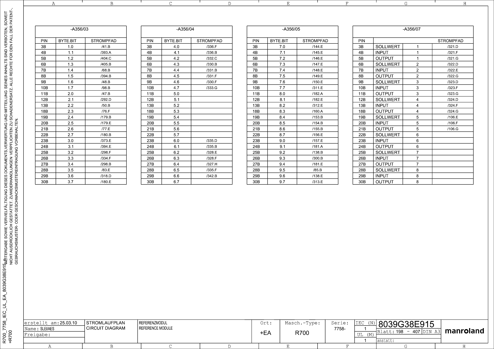

# +EA — Sheet 198 of 407 — REFERENZMODUL

**REFERENCE MODULE**

> Part of the manroland **R700** printing press IEC/UL circuit diagrams.
> Drawing class: **Stromlaufplan / Circuit diagram** (DIN A3).
> Document `+EA` covers the **Printing unit** machine section.

## At a glance

| Field | Value |
|---|---|
| Document | `+EA`  (8039G38E915) |
| Sheet | **198** of 407 |
| Section (DE) | REFERENZMODUL |
| Section (EN) | REFERENCE MODULE |
| Section type | REFERENCE_MODULE — Reference module |
| Machine type | `R700` |
| Series | `7758` |
| Created | 25.03.10 |
| Replaces | — |
| Columns used | A, B, C, D, E, F, G, H |
| Path numbers | — |
| Labels on sheet | 309 |
| Cross-refs out | 78 |
| Cross-refs in | 78 |

**Previous:** [+EA sheet 197](SHEET_0197.md) · **Next:** [+EA sheet 199](SHEET_0199.md) · **Document TOC:** [_TOC.md](_TOC.md)  (+EA) · **Master TOC:** [all sheets](../_MASTER_TOC.md)

## Sheet image (300 DPI, exact vector render)



_Rendered directly from the PDF vector layer at 300 DPI (1-bit), no OCR and no resampling. Use it to confirm anything ambiguous in the text below._

## Cross-references on this sheet

Each entry is a wire leaving this sheet. The printed token is `/sheet.column`; the link resolves to that sheet inside the same document.

| Ref | Target sheet | Col | Path | Destination on target | Target section | From col |
|---|---|---|---|---|---|---|
| `/41.B` | [+EA sheet 41](SHEET_0041.md) | B | — | — | BUSVERBINDUNGEN: STOP SICHERN | B |
| `/144.E` | [+EA sheet 144](SHEET_0144.md) | E | — | — | ZUGANGSABSICHERUNG | F |
| `/336.F` | [+EA sheet 336](SHEET_0336.md) | F | — | — | OPTION: BOGENWEICHE | D |
| `/321.D` | [+EA sheet 321](SHEET_0321.md) | D | — | — | OPTION: VERLÄNGERUNG 3656,8MM | H |
| `/393.A` | [+EA sheet 393](SHEET_0393.md) | A | — | — | OPTION: ZWISCHENTROCKNER VORBEREITUNG; | B |
| `/336.B` | [+EA sheet 336](SHEET_0336.md) | B | — | — | OPTION: BOGENWEICHE | D |
| `/145.E` | [+EA sheet 145](SHEET_0145.md) | E | — | — | ZUGANGSABSICHERUNG | F |
| `/321.F` | [+EA sheet 321](SHEET_0321.md) | F | — | — | OPTION: VERLÄNGERUNG 3656,8MM | H |
| `/146.E` | [+EA sheet 146](SHEET_0146.md) | E | — | — | ZUGANGSABSICHERUNG | F |
| `/321.G` | [+EA sheet 321](SHEET_0321.md) | G | — | — | OPTION: VERLÄNGERUNG 3656,8MM | H |
| `/404.C` | [+EA sheet 404](SHEET_0404.md) | C | — | — | OPTION: SCHNITTSTELLE UV ENDTROCKNER | B |
| `/332.C` | [+EA sheet 332](SHEET_0332.md) | C | — | — | OPTION: BOGENWEICHE | D |
| `/405.B` | [+EA sheet 405](SHEET_0405.md) | B | — | — | OPTION: SCHNITTSTELLE UV ENDTROCKNER | B |
| `/330.B` | [+EA sheet 330](SHEET_0330.md) | B | — | — | OPTION: BOGENWEICHE | D |
| `/147.E` | [+EA sheet 147](SHEET_0147.md) | E | — | — | ZUGANGSABSICHERUNG | F |
| `/322.D` | [+EA sheet 322](SHEET_0322.md) | D | — | — | OPTION: VERLÄNGERUNG 3656,8MM | H |
| `/68.B` | [+EA sheet 68](SHEET_0068.md) | B | — | — | LEITSTANDSFUNKTIONEN | B |
| `/331.B` | [+EA sheet 331](SHEET_0331.md) | B | — | — | OPTION: BOGENWEICHE | D |
| `/148.E` | [+EA sheet 148](SHEET_0148.md) | E | — | — | ZUGANGSABSICHERUNG | F |
| `/322.E` | [+EA sheet 322](SHEET_0322.md) | E | — | — | OPTION: VERLÄNGERUNG 3656,8MM | H |
| `/394.B` | [+EA sheet 394](SHEET_0394.md) | B | — | — | OPTION: ZWISCHENTROCKNER VORBEREITUNG; | B |
| `/149.E` | [+EA sheet 149](SHEET_0149.md) | E | — | — | ZUGANGSABSICHERUNG | F |
| `/331.F` | [+EA sheet 331](SHEET_0331.md) | F | — | — | OPTION: BOGENWEICHE | D |
| `/322.G` | [+EA sheet 322](SHEET_0322.md) | G | — | — | OPTION: VERLÄNGERUNG 3656,8MM | H |
| `/48.B` | [+EA sheet 48](SHEET_0048.md) | B | — | — | SCHUTZ | B |
| `/150.E` | [+EA sheet 150](SHEET_0150.md) | E | — | — | ZUGANGSABSICHERUNG | F |
| `/330.F` | [+EA sheet 330](SHEET_0330.md) | F | — | — | OPTION: BOGENWEICHE | D |
| `/323.D` | [+EA sheet 323](SHEET_0323.md) | D | — | — | OPTION: VERLÄNGERUNG 3656,8MM | H |
| `/98.B` | [+EA sheet 98](SHEET_0098.md) | B | — | — | BOGENFÜHRUNGSELEMENT | B |
| `/311.E` | [+EA sheet 311](SHEET_0311.md) | E | — | — | OPTION: AUTOMATISCHE STAPELAUFFAHRT STOP / | F |
| `/323.F` | [+EA sheet 323](SHEET_0323.md) | F | — | — | OPTION: VERLÄNGERUNG 3656,8MM | H |
| `/333.G` | [+EA sheet 333](SHEET_0333.md) | G | — | — | OPTION: BOGENWEICHE | D |
| `/47.B` | [+EA sheet 47](SHEET_0047.md) | B | — | — | SCHUTZ | B |
| `/182.A` | [+EA sheet 182](SHEET_0182.md) | A | — | — | RESERVE | F |
| `/323.G` | [+EA sheet 323](SHEET_0323.md) | G | — | — | OPTION: VERLÄNGERUNG 3656,8MM | H |
| `/182.E` | [+EA sheet 182](SHEET_0182.md) | E | — | — | RESERVE | F |
| `/292.D` | [+EA sheet 292](SHEET_0292.md) | D | — | — | OPTION: PROBEBOGENENTNAHME HALBAUTOMATISCH | B |
| `/324.D` | [+EA sheet 324](SHEET_0324.md) | D | — | — | OPTION: VERLÄNGERUNG 3656,8MM | H |
| `/50.B` | [+EA sheet 50](SHEET_0050.md) | B | — | — | SCHUTZ | B |
| `/312.E` | [+EA sheet 312](SHEET_0312.md) | E | — | — | OPTION: LOGISTIK, AUSLEGER | F |
| `/324.F` | [+EA sheet 324](SHEET_0324.md) | F | — | — | OPTION: VERLÄNGERUNG 3656,8MM | H |
| `/76.F` | [+EA sheet 76](SHEET_0076.md) | F | — | — | AUSLEGERSTAPELSTEUERUNG | B |
| `/160.A` | [+EA sheet 160](SHEET_0160.md) | A | — | — | ZUGANGSABSICHERUNG | F |
| `/324.G` | [+EA sheet 324](SHEET_0324.md) | G | — | — | OPTION: VERLÄNGERUNG 3656,8MM | H |
| `/179.B` | [+EA sheet 179](SHEET_0179.md) | B | — | — | RESERVE | B |
| `/153.B` | [+EA sheet 153](SHEET_0153.md) | B | — | — | ZUGANGSABSICHERUNG | F |
| `/106.E` | [+EA sheet 106](SHEET_0106.md) | E | — | — | BOGENFÜHRUNGSELEMENT | H |
| `/179.E` | [+EA sheet 179](SHEET_0179.md) | E | — | — | RESERVE | B |
| `/154.B` | [+EA sheet 154](SHEET_0154.md) | B | — | — | ZUGANGSABSICHERUNG | F |
| `/106.F` | [+EA sheet 106](SHEET_0106.md) | F | — | — | BOGENFÜHRUNGSELEMENT | H |
| `/77.E` | [+EA sheet 77](SHEET_0077.md) | E | — | — | AUSLEGERSTAPELSTEUERUNG | B |
| `/155.B` | [+EA sheet 155](SHEET_0155.md) | B | — | — | ZUGANGSABSICHERUNG | F |
| `/106.G` | [+EA sheet 106](SHEET_0106.md) | G | — | — | BOGENFÜHRUNGSELEMENT | H |
| `/180.B` | [+EA sheet 180](SHEET_0180.md) | B | — | — | RESERVE | B |
| `/156.E` | [+EA sheet 156](SHEET_0156.md) | E | — | — | ZUGANGSABSICHERUNG | F |
| `/373.E` | [+EA sheet 373](SHEET_0373.md) | E | — | — | OPTION: ENDTROCKNER 1 VORBEREITUNG; | B |
| `/157.E` | [+EA sheet 157](SHEET_0157.md) | E | — | — | ZUGANGSABSICHERUNG | F |
| `/335.D` | [+EA sheet 335](SHEET_0335.md) | D | — | — | OPTION: BOGENWEICHE | D |
| `/394.E` | [+EA sheet 394](SHEET_0394.md) | E | — | — | OPTION: ZWISCHENTROCKNER VORBEREITUNG; | B |
| `/335.B` | [+EA sheet 335](SHEET_0335.md) | B | — | — | OPTION: BOGENWEICHE | D |
| `/181.A` | [+EA sheet 181](SHEET_0181.md) | A | — | — | RESERVE | F |
| `/328.E` | [+EA sheet 328](SHEET_0328.md) | E | — | — | OPTION: BOGENWEICHE | D |
| `/138.B` | [+EA sheet 138](SHEET_0138.md) | B | — | — | ZUGANGSABSICHERUNG | F |
| `/298.F` | [+EA sheet 298](SHEET_0298.md) | F | — | — | OPTION: ZWISCHENSTAPEL / | B |
| `/300.B` | [+EA sheet 300](SHEET_0300.md) | B | — | — | OPTION: ZWISCHENSTAPEL / | F |
| `/334.F` | [+EA sheet 334](SHEET_0334.md) | F | — | — | OPTION: BOGENWEICHE | B |
| `/328.F` | [+EA sheet 328](SHEET_0328.md) | F | — | — | OPTION: BOGENWEICHE | D |
| `/298.B` | [+EA sheet 298](SHEET_0298.md) | B | — | — | OPTION: ZWISCHENSTAPEL / | B |
| `/181.E` | [+EA sheet 181](SHEET_0181.md) | E | — | — | RESERVE | F |
| `/327.H` | [+EA sheet 327](SHEET_0327.md) | H | — | — | OPTION: BOGENWEICHE | D |
| `/83.E` | [+EA sheet 83](SHEET_0083.md) | E | — | — | AUSLEGERSTAPELSTEUERUNG: PROGRAMMSCHALTWERK | B |
| `/85.B` | [+EA sheet 85](SHEET_0085.md) | B | — | — | AUSLEGERSTAPELSTEUERUNG: PROGRAMMSCHALTWERK | F |
| `/335.F` | [+EA sheet 335](SHEET_0335.md) | F | — | — | OPTION: BOGENWEICHE | D |
| `/342.B` | [+EA sheet 342](SHEET_0342.md) | B | — | — | OPTION: BOGENWEICHE | D |
| `/138.E` | [+EA sheet 138](SHEET_0138.md) | E | — | — | ZUGANGSABSICHERUNG | F |
| `/318.D` | [+EA sheet 318](SHEET_0318.md) | D | — | — | OPTION: LOGISTIK, AUSLEGER | B |
| `/180.E` | [+EA sheet 180](SHEET_0180.md) | E | — | — | RESERVE | B |
| `/313.E` | [+EA sheet 313](SHEET_0313.md) | E | — | — | OPTION: LOGISTIK, AUSLEGER | F |

### Incoming references (sheets that point here)

Every other sheet that sends a wire to this one. `Back-ref` is the token printed on *that* sheet; `Path` is its line number.

| From sheet | Cols | Back-ref | Path | Refs | What continues there |
|---|---|---|---|---|---|
| [+EA#41](SHEET_0041.md) | B | `/41.B` | — | 1 | — |
| [+EA#47](SHEET_0047.md) | B | `/47.B` | — | 1 | — |
| [+EA#48](SHEET_0048.md) | B | `/48.B` | — | 1 | — |
| [+EA#50](SHEET_0050.md) | B | `/50.B` | — | 1 | — |
| [+EA#68](SHEET_0068.md) | B | `/68.B` | — | 1 | — |
| [+EA#76](SHEET_0076.md) | F | `/76.F` | — | 1 | — |
| [+EA#77](SHEET_0077.md) | E | `/77.E` | — | 1 | — |
| [+EA#83](SHEET_0083.md) | E | `/83.E` | — | 1 | — |
| [+EA#85](SHEET_0085.md) | B | `/85.B` | — | 1 | — |
| [+EA#98](SHEET_0098.md) | B | `/98.B` | — | 1 | — |
| [+EA#106](SHEET_0106.md) | E, F, G | `/106.E`, `/106.F`, `/106.G` | — | 3 | — |
| [+EA#138](SHEET_0138.md) | B, E | `/138.B`, `/138.E` | — | 2 | — |
| [+EA#144](SHEET_0144.md) | E | `/144.E` | — | 1 | — |
| [+EA#145](SHEET_0145.md) | E | `/145.E` | — | 1 | — |
| [+EA#146](SHEET_0146.md) | E | `/146.E` | — | 1 | — |
| [+EA#147](SHEET_0147.md) | E | `/147.E` | — | 1 | — |
| [+EA#148](SHEET_0148.md) | E | `/148.E` | — | 1 | — |
| [+EA#149](SHEET_0149.md) | E | `/149.E` | — | 1 | — |
| [+EA#150](SHEET_0150.md) | E | `/150.E` | — | 1 | — |
| [+EA#153](SHEET_0153.md) | B | `/153.B` | — | 1 | — |
| [+EA#154](SHEET_0154.md) | B | `/154.B` | — | 1 | — |
| [+EA#155](SHEET_0155.md) | B | `/155.B` | — | 1 | — |
| [+EA#156](SHEET_0156.md) | E | `/156.E` | — | 1 | — |
| [+EA#157](SHEET_0157.md) | E | `/157.E` | — | 1 | — |
| [+EA#160](SHEET_0160.md) | A | `/160.A` | — | 1 | — |
| [+EA#179](SHEET_0179.md) | A, E | `/179.A`, `/179.E` | — | 2 | — |
| [+EA#180](SHEET_0180.md) | B, E | `/180.B`, `/180.E` | — | 2 | — |
| [+EA#181](SHEET_0181.md) | A, E | `/181.A`, `/181.E` | — | 2 | — |
| [+EA#182](SHEET_0182.md) | A, E | `/182.A`, `/182.E` | — | 2 | — |
| [+EA#292](SHEET_0292.md) | D | `/292.D` | — | 1 | — |
| [+EA#298](SHEET_0298.md) | B, F | `/298.B`, `/298.F` | — | 2 | — |
| [+EA#300](SHEET_0300.md) | B | `/300.B` | — | 1 | — |
| [+EA#311](SHEET_0311.md) | E | `/311.E` | — | 1 | — |
| [+EA#312](SHEET_0312.md) | E | `/312.E` | — | 1 | — |
| [+EA#313](SHEET_0313.md) | E | `/313.E` | — | 1 | — |
| [+EA#318](SHEET_0318.md) | D | `/318.D` | — | 1 | — |
| [+EA#321](SHEET_0321.md) | D, F, G | `/321.D`, `/321.F`, `/321.G` | — | 3 | — |
| [+EA#322](SHEET_0322.md) | D, E, G | `/322.D`, `/322.E`, `/322.G` | — | 3 | — |
| [+EA#323](SHEET_0323.md) | D, F, G | `/323.D`, `/323.F`, `/323.G` | — | 3 | — |
| [+EA#324](SHEET_0324.md) | D, F, G | `/324.D`, `/324.F`, `/324.G` | — | 3 | — |
| [+EA#327](SHEET_0327.md) | G | `/327.G` | — | 1 | — |
| [+EA#328](SHEET_0328.md) | E, F | `/328.E`, `/328.F` | — | 2 | — |
| [+EA#330](SHEET_0330.md) | B, F | `/330.B`, `/330.F` | — | 2 | — |
| [+EA#331](SHEET_0331.md) | B, F | `/331.B`, `/331.F` | — | 2 | — |
| [+EA#332](SHEET_0332.md) | C | `/332.C` | — | 1 | — |
| [+EA#333](SHEET_0333.md) | G | `/333.G` | — | 1 | — |
| [+EA#334](SHEET_0334.md) | F | `/334.F` | — | 1 | — |
| [+EA#335](SHEET_0335.md) | B, D, F | `/335.B`, `/335.D`, `/335.F` | — | 3 | — |
| [+EA#336](SHEET_0336.md) | B, F | `/336.B`, `/336.F` | — | 2 | — |
| [+EA#342](SHEET_0342.md) | B | `/342.B` | — | 1 | — |
| [+EA#373](SHEET_0373.md) | E | `/373.E` | — | 1 | — |
| [+EA#393](SHEET_0393.md) | A | `/393.A` | — | 1 | — |
| [+EA#394](SHEET_0394.md) | B, E | `/394.B`, `/394.E` | — | 2 | — |
| [+EA#404](SHEET_0404.md) | C | `/404.C` | — | 1 | — |
| [+EA#405](SHEET_0405.md) | B | `/405.B` | — | 1 | — |


## Devices on this sheet

| Tag | Class | Class meaning (IEC) | Col | Sub | Terminal | Sign |
|---|---|---|---|---|---|---|
| `A356/03` | A | Baugruppe / assembly, module, PC board | A | 03 | — | — |
| `A356/04` | A | Baugruppe / assembly, module, PC board | C | 04 | — | — |
| `A356/05` | A | Baugruppe / assembly, module, PC board | E | 05 | — | — |
| `A356/07` | A | Baugruppe / assembly, module, PC board | G | 07 | — | — |
| `1.0` | — | cross-device reference | A | — | — | — |
| `1.1` | — | cross-device reference | A | — | — | — |
| `1.2` | — | cross-device reference | A | — | — | — |
| `1.3` | — | cross-device reference | A | — | — | — |
| `1.4` | — | cross-device reference | A | — | — | — |
| `1.5` | — | cross-device reference | A | — | — | — |
| `1.6` | — | cross-device reference | A | — | — | — |
| `1.7` | — | cross-device reference | A | — | — | — |
| `2.0` | — | cross-device reference | A | — | — | — |
| `2.1` | — | cross-device reference | A | — | — | — |
| `2.2` | — | cross-device reference | A | — | — | — |
| `2.3` | — | cross-device reference | A | — | — | — |
| `2.4` | — | cross-device reference | A | — | — | — |
| `2.5` | — | cross-device reference | A | — | — | — |
| `2.6` | — | cross-device reference | A | — | — | — |
| `2.7` | — | cross-device reference | A | — | — | — |
| `3.0` | — | cross-device reference | A | — | — | — |
| `3.1` | — | cross-device reference | A | — | — | — |
| `3.2` | — | cross-device reference | A | — | — | — |
| `3.3` | — | cross-device reference | A | — | — | — |
| `3.4` | — | cross-device reference | A | — | — | — |
| `3.5` | — | cross-device reference | A | — | — | — |
| `3.6` | — | cross-device reference | A | — | — | — |
| `3.7` | — | cross-device reference | A | — | — | — |
| `4.0` | — | cross-device reference | C | — | — | — |
| `4.1` | — | cross-device reference | C | — | — | — |
| `4.2` | — | cross-device reference | C | — | — | — |
| `4.3` | — | cross-device reference | C | — | — | — |
| `4.4` | — | cross-device reference | C | — | — | — |
| `4.5` | — | cross-device reference | C | — | — | — |
| `4.6` | — | cross-device reference | C | — | — | — |
| `4.7` | — | cross-device reference | C | — | — | — |
| `5.0` | — | cross-device reference | C | — | — | — |
| `5.1` | — | cross-device reference | C | — | — | — |
| `5.2` | — | cross-device reference | C | — | — | — |
| `5.3` | — | cross-device reference | C | — | — | — |
| `5.4` | — | cross-device reference | C | — | — | — |
| `5.5` | — | cross-device reference | C | — | — | — |
| `5.6` | — | cross-device reference | C | — | — | — |
| `5.7` | — | cross-device reference | C | — | — | — |
| `6.0` | — | cross-device reference | C | — | — | — |
| `6.1` | — | cross-device reference | C | — | — | — |
| `6.2` | — | cross-device reference | C | — | — | — |
| `6.3` | — | cross-device reference | C | — | — | — |
| `6.4` | — | cross-device reference | C | — | — | — |
| `6.5` | — | cross-device reference | C | — | — | — |
| `6.6` | — | cross-device reference | C | — | — | — |
| `6.7` | — | cross-device reference | C | — | — | — |
| `7.0` | — | cross-device reference | E | — | — | — |
| `7.1` | — | cross-device reference | E | — | — | — |
| `7.2` | — | cross-device reference | E | — | — | — |
| `7.3` | — | cross-device reference | E | — | — | — |
| `7.4` | — | cross-device reference | E | — | — | — |
| `7.5` | — | cross-device reference | E | — | — | — |
| `7.6` | — | cross-device reference | E | — | — | — |
| `7.7` | — | cross-device reference | E | — | — | — |
| `8.0` | — | cross-device reference | E | — | — | — |
| `8.1` | — | cross-device reference | E | — | — | — |
| `8.2` | — | cross-device reference | E | — | — | — |
| `8.3` | — | cross-device reference | E | — | — | — |
| `8.4` | — | cross-device reference | E | — | — | — |
| `8.5` | — | cross-device reference | E | — | — | — |
| `8.6` | — | cross-device reference | E | — | — | — |
| `8.7` | — | cross-device reference | E | — | — | — |
| `9.0` | — | cross-device reference | E | — | — | — |
| `9.1` | — | cross-device reference | E | — | — | — |
| `9.2` | — | cross-device reference | E | — | — | — |
| `9.3` | — | cross-device reference | E | — | — | — |
| `9.4` | — | cross-device reference | E | — | — | — |
| `9.5` | — | cross-device reference | E | — | — | — |
| `9.6` | — | cross-device reference | E | — | — | — |
| `9.7` | — | cross-device reference | E | — | — | — |

## Potentials / nets

_No named potentials on this sheet._

## Wire-end annotations (grouped as printed)

A wire that continues elsewhere is annotated with a small cluster: the destination description, the path/line number `#NN`, and the `/sheet.column` cross reference. Each row below is one such cluster exactly as it is grouped on the drawing.

| Col | Y | Path | Cross-ref | Text on the wire |
|---|---|---|---|---|
| A | 65.5 | — | — | `A356/03` |
| C | 65.5 | — | — | `A356/04` |
| E | 65.5 | — | — | `A356/05` |
| G | 65.5 | — | — | `A356/07` |
| A | 94.2 | — | — | `PIN BYTE.BIT` |
| B | 94.2 | — | — | `STROMPFAD` |
| C | 94.2 | — | — | `PIN BYTE.BIT` |
| D | 94.2 | — | — | `STROMPFAD` |
| E | 94.2 | — | — | `PIN BYTE.BIT` |
| E | 94.2 | — | — | `STROMPFAD` |
| G | 94.2 | — | — | `10B 11B 12B 13B 18B 19B 3B 4B 5B 6B 7B 8B 9B 20B 21B 22B 23B 24B 25B 26B 27B 28B 29B 30B STROMPFAD` |
| F | 94.2 | — | — | `PIN` |
| G | 108.0 | — | — | `INPUT INPUT INPUT INPUT INPUT INPUT INPUT INPUT SOLLWERT OUTPUT SOLLWERT OUTPUT SOLLWERT OUTPUT SOLLWERT OUTPUT SOLLWERT OUTPUT SOLLWERT OUTPUT SOLLWERT OUTPUT SOLLWERT OUTPUT` |
| A | 108.3 | — | — | `10B 11B 12B 13B 18B 19B 3B 4B 5B 6B 7B 8B 9B 20B 21B 22B 23B 24B 25B 26B 27B 28B 29B 30B` |
| A | 108.3 | — | — | `1.0 1.2 1.3 1.4 1.5 1.6 1.7 2.0 2.2 2.3 2.4 2.5 2.6 2.7 3.0 3.2 3.3 3.4 3.5 3.6 3.7 1.1 2.1 3.1` |
| C | 108.3 | — | — | `10B 11B 12B 13B 18B 19B 3B 4B 5B 6B 7B 8B 9B 20B 21B 22B 23B 24B 25B 26B 27B 28B 29B 30B` |
| C | 108.3 | — | — | `4.0 4.2 4.3 4.4 4.5 4.6 4.7 5.0 5.2 5.3 5.4 5.5 5.6 5.7 6.0 6.2 6.3 6.4 6.5 6.6 6.7 4.1 5.1 6.1` |
| D | 108.3 | — | — | `10B 11B 12B 13B 18B 19B 3B 4B 5B 6B 7B 8B 9B 20B 21B 22B 23B 24B 25B 26B 27B 28B 29B 30B` |
| E | 108.3 | — | — | `7.0 7.2 7.3 7.4 7.5 7.6 7.7 8.0 8.2 8.3 8.4 8.5 8.6 8.7 9.0 9.2 9.3 9.4 9.5 9.6 9.7 7.1 8.1 9.1` |
| G | 108.4 | — | — | `2 2 2 3 3 3 4 4 4 5 5 5 6 6 6 7 7 7 8 8 8 1 1 1` |
| B | 108.7 | — | `/41.B` | — |
| D | 108.7 | — | `/336.F` | — |
| F | 108.7 | — | `/144.E` | — |
| H | 108.7 | — | `/321.D` | — |
| B | 122.9 | — | `/393.A` | — |
| D | 122.9 | — | `/336.B` | — |
| F | 122.9 | — | `/145.E` | — |
| H | 122.9 | — | `/321.F` | — |
| F | 137.0 | — | `/146.E` | — |
| B | 137.1 | — | `/404.C` | — |
| D | 137.1 | — | `/332.C` | — |
| H | 137.1 | — | `/321.G` | — |
| B | 151.2 | — | `/405.B` | — |
| D | 151.2 | — | `/330.B` | — |
| F | 151.2 | — | `/147.E` | — |
| H | 151.2 | — | `/322.D` | — |
| B | 165.4 | — | `/68.B` | — |
| D | 165.4 | — | `/331.B` | — |
| F | 165.4 | — | `/148.E` | — |
| H | 165.4 | — | `/322.E` | — |
| B | 179.6 | — | `/394.B` | — |
| D | 179.6 | — | `/331.F` | — |
| F | 179.6 | — | `/149.E` | — |
| H | 179.6 | — | `/322.G` | — |
| B | 193.7 | — | `/48.B` | — |
| D | 193.7 | — | `/330.F` | — |
| F | 193.7 | — | `/150.E` | — |
| H | 193.8 | — | `/323.D` | — |
| B | 207.9 | — | `/98.B` | — |
| D | 207.9 | — | `/333.G` | — |
| F | 207.9 | — | `/311.E` | — |
| H | 207.9 | — | `/323.F` | — |
| B | 222.1 | — | `/47.B` | — |
| F | 222.1 | — | `/182.A` | — |
| H | 222.1 | — | `/323.G` | — |
| F | 236.2 | — | `/182.E` | — |
| B | 236.3 | — | `/292.D` | — |
| H | 236.3 | — | `/324.D` | — |
| B | 250.4 | — | `/50.B` | — |
| F | 250.4 | — | `/312.E` | — |
| H | 250.4 | — | `/324.F` | — |
| B | 264.6 | — | `/76.F` | — |
| F | 264.6 | — | `/160.A` | — |
| H | 264.6 | — | `/324.G` | — |
| B | 278.8 | — | `/179.B` | — |
| F | 278.8 | — | `/153.B` | — |
| H | 278.8 | — | `/106.E` | — |
| B | 292.9 | — | `/179.E` | — |
| F | 292.9 | — | `/154.B` | — |
| H | 292.9 | — | `/106.F` | — |
| B | 307.1 | — | `/77.E` | — |
| F | 307.1 | — | `/155.B` | — |
| H | 307.1 | — | `/106.G` | — |
| B | 321.3 | — | `/180.B` | — |
| F | 321.3 | — | `/156.E` | — |
| B | 335.5 | — | `/373.E` | — |
| D | 335.5 | — | `/335.D` | — |
| F | 335.5 | — | `/157.E` | — |
| B | 349.6 | — | `/394.E` | — |
| D | 349.6 | — | `/335.B` | — |
| F | 349.6 | — | `/181.A` | — |
| B | 363.8 | — | `/298.F` | — |
| D | 363.8 | — | `/328.E` | — |
| F | 363.8 | — | `/138.B` | — |
| B | 378.0 | — | `/334.F` | — |
| D | 378.0 | — | `/328.F` | — |
| F | 378.0 | — | `/300.B` | — |
| B | 392.1 | — | `/298.B` | — |
| F | 392.1 | — | `/181.E` | — |
| D | 392.2 | — | `/327.H` | — |
| B | 406.3 | — | `/83.E` | — |
| D | 406.3 | — | `/335.F` | — |
| F | 406.3 | — | `/85.B` | — |
| B | 420.5 | — | `/318.D` | — |
| D | 420.5 | — | `/342.B` | — |
| F | 420.5 | — | `/138.E` | — |
| B | 434.7 | — | `/180.E` | — |
| F | 434.7 | — | `/313.E` | — |


## Reconstructed tables

This sheet carries tabular content (pin map / terminal assignment / index). The grid below was rebuilt from the drawing's own rule lines, so each row is exactly one physical row of the table.

### Table 1 — 24 data rows × 3 columns (at x=85.0, y=62.4) — **A356/03**

| PIN | BYTE.BIT | STROMPFAD |
|---|---|---|
| `3B` | `1.0` | `/41.B` |
| `4B` | `1.1` | `/393.A` |
| `5B` | `1.2` | `/404.C` |
| `6B` | `1.3` | `/405.B` |
| `7B` | `1.4` | `/68.B` |
| `8B` | `1.5` | `/394.B` |
| `9B` | `1.6` | `/48.B` |
| `10B` | `1.7` | `/98.B` |
| `11B` | `2.0` | `/47.B` |
| `12B` | `2.1` | `/292.D` |
| `13B` | `2.2` | `/50.B` |
| `18B` | `2.3` | `/76.F` |
| `19B` | `2.4` | `/179.B` |
| `20B` | `2.5` | `/179.E` |
| `21B` | `2.6` | `/77.E` |
| `22B` | `2.7` | `/180.B` |
| `23B` | `3.0` | `/373.E` |
| `24B` | `3.1` | `/394.E` |
| `25B` | `3.2` | `/298.F` |
| `26B` | `3.3` | `/334.F` |
| `27B` | `3.4` | `/298.B` |
| `28B` | `3.5` | `/83.E` |
| `29B` | `3.6` | `/318.D` |
| `30B` | `3.7` | `/180.E` |


### Table 2 — 24 data rows × 3 columns (at x=340.2, y=62.4) — **A356/04**

| PIN | BYTE.BIT | STROMPFAD |
|---|---|---|
| `3B` | `4.0` | `/336.F` |
| `4B` | `4.1` | `/336.B` |
| `5B` | `4.2` | `/332.C` |
| `6B` | `4.3` | `/330.B` |
| `7B` | `4.4` | `/331.B` |
| `8B` | `4.5` | `/331.F` |
| `9B` | `4.6` | `/330.F` |
| `10B` | `4.7` | `/333.G` |
| `11B` | `5.0` |  |
| `12B` | `5.1` |  |
| `13B` | `5.2` |  |
| `18B` | `5.3` |  |
| `19B` | `5.4` |  |
| `20B` | `5.5` |  |
| `21B` | `5.6` |  |
| `22B` | `5.7` |  |
| `23B` | `6.0` | `/335.D` |
| `24B` | `6.1` | `/335.B` |
| `25B` | `6.2` | `/328.E` |
| `26B` | `6.3` | `/328.F` |
| `27B` | `6.4` | `/327.H` |
| `28B` | `6.5` | `/335.F` |
| `29B` | `6.6` | `/342.B` |
| `30B` | `6.7` |  |


### Table 3 — 24 data rows × 3 columns (at x=595.3, y=62.4) — **A356/05**

| PIN | BYTE.BIT | STROMPFAD |
|---|---|---|
| `3B` | `7.0` | `/144.E` |
| `4B` | `7.1` | `/145.E` |
| `5B` | `7.2` | `/146.E` |
| `6B` | `7.3` | `/147.E` |
| `7B` | `7.4` | `/148.E` |
| `8B` | `7.5` | `/149.E` |
| `9B` | `7.6` | `/150.E` |
| `10B` | `7.7` | `/311.E` |
| `11B` | `8.0` | `/182.A` |
| `12B` | `8.1` | `/182.E` |
| `13B` | `8.2` | `/312.E` |
| `18B` | `8.3` | `/160.A` |
| `19B` | `8.4` | `/153.B` |
| `20B` | `8.5` | `/154.B` |
| `21B` | `8.6` | `/155.B` |
| `22B` | `8.7` | `/156.E` |
| `23B` | `9.0` | `/157.E` |
| `24B` | `9.1` | `/181.A` |
| `25B` | `9.2` | `/138.B` |
| `26B` | `9.3` | `/300.B` |
| `27B` | `9.4` | `/181.E` |
| `28B` | `9.5` | `/85.B` |
| `29B` | `9.6` | `/138.E` |
| `30B` | `9.7` | `/313.E` |


### Table 4 — 24 data rows × 4 columns (at x=850.4, y=62.4) — **A356/07**

| PIN |  |  | STROMPFAD |
|---|---|---|---|
| `3B` | `SOLLWERT` | `1` | `/321.D` |
| `4B` | `INPUT` | `1` | `/321.F` |
| `5B` | `OUTPUT` | `1` | `/321.G` |
| `6B` | `SOLLWERT` | `2` | `/322.D` |
| `7B` | `INPUT` | `2` | `/322.E` |
| `8B` | `OUTPUT` | `2` | `/322.G` |
| `9B` | `SOLLWERT` | `3` | `/323.D` |
| `10B` | `INPUT` | `3` | `/323.F` |
| `11B` | `OUTPUT` | `3` | `/323.G` |
| `12B` | `SOLLWERT` | `4` | `/324.D` |
| `13B` | `INPUT` | `4` | `/324.F` |
| `18B` | `OUTPUT` | `4` | `/324.G` |
| `19B` | `SOLLWERT` | `5` | `/106.E` |
| `20B` | `INPUT` | `5` | `/106.F` |
| `21B` | `OUTPUT` | `5` | `/106.G` |
| `22B` | `SOLLWERT` | `6` |  |
| `23B` | `INPUT` | `6` |  |
| `24B` | `OUTPUT` | `6` |  |
| `25B` | `SOLLWERT` | `7` |  |
| `26B` | `INPUT` | `7` |  |
| `27B` | `OUTPUT` | `7` |  |
| `28B` | `SOLLWERT` | `8` |  |
| `29B` | `INPUT` | `8` |  |
| `30B` | `OUTPUT` | `8` |  |


## Notes and free text on this sheet

| Text | Col | Y (pt) |
|---|---|---|
| `3B` | A | 108.35 |
| `4B` | A | 122.53 |
| `5B` | A | 136.7 |
| `6B` | A | 150.87 |
| `7B` | A | 165.05 |
| `8B` | A | 179.22 |
| `9B` | A | 193.39 |
| `10B` | A | 207.57 |
| `11B` | A | 221.74 |
| `12B` | A | 235.92 |
| `13B` | A | 250.09 |
| `18B` | A | 264.26 |
| `19B` | A | 278.44 |
| `20B` | A | 292.61 |
| `21B` | A | 306.78 |
| `22B` | A | 320.96 |
| `23B` | A | 335.13 |
| `24B` | A | 349.3 |
| `25B` | A | 363.48 |
| `26B` | A | 377.65 |
| `27B` | A | 391.82 |
| `28B` | A | 406 |
| `29B` | A | 420.17 |
| `30B` | A | 434.34 |
| `PIN` | A | 94.2 |
| `BYTE.BIT` | A | 94.17 |
| `STROMPFAD` | B | 94.15 |
| `3B` | C | 108.35 |
| `4B` | C | 122.53 |
| `5B` | C | 136.7 |
| `6B` | C | 150.87 |
| `7B` | C | 165.05 |
| `8B` | C | 179.22 |
| `9B` | C | 193.39 |
| `10B` | C | 207.57 |
| `11B` | C | 221.74 |
| `12B` | C | 235.92 |
| `13B` | C | 250.09 |
| `18B` | C | 264.26 |
| `19B` | C | 278.44 |
| `20B` | C | 292.61 |
| `21B` | C | 306.78 |
| `22B` | C | 320.96 |
| `23B` | C | 335.13 |
| `24B` | C | 349.3 |
| `25B` | C | 363.48 |
| `26B` | C | 377.65 |
| `27B` | C | 391.82 |
| `28B` | C | 406 |
| `29B` | C | 420.17 |
| `30B` | C | 434.34 |
| `PIN` | C | 94.2 |
| `BYTE.BIT` | C | 94.17 |
| `STROMPFAD` | D | 94.15 |
| `3B` | D | 108.35 |
| `4B` | D | 122.53 |
| `5B` | D | 136.7 |
| `6B` | D | 150.87 |
| `7B` | D | 165.05 |
| `8B` | D | 179.22 |
| `9B` | D | 193.39 |
| `10B` | D | 207.57 |
| `11B` | D | 221.74 |
| `12B` | D | 235.92 |
| `13B` | D | 250.09 |
| `18B` | D | 264.26 |
| `19B` | D | 278.44 |
| `20B` | D | 292.61 |
| `21B` | D | 306.78 |
| `22B` | D | 320.96 |
| `23B` | D | 335.13 |
| `24B` | D | 349.3 |
| `25B` | D | 363.48 |
| `26B` | D | 377.65 |
| `27B` | D | 391.82 |
| `28B` | D | 406 |
| `29B` | D | 420.17 |
| `30B` | D | 434.34 |
| `PIN` | D | 94.2 |
| `BYTE.BIT` | E | 94.17 |
| `STROMPFAD` | E | 94.15 |
| `STROMPFAD` | H | 94.15 |
| `3B` | F | 108.35 |
| `4B` | F | 122.53 |
| `5B` | F | 136.7 |
| `6B` | F | 150.87 |
| `7B` | F | 165.05 |
| `8B` | F | 179.22 |
| `9B` | F | 193.39 |
| `10B` | F | 207.57 |
| `11B` | F | 221.74 |
| `12B` | F | 235.92 |
| `13B` | F | 250.09 |
| `18B` | F | 264.26 |
| `19B` | F | 278.44 |
| `20B` | F | 292.61 |
| `21B` | F | 306.78 |
| `22B` | F | 320.96 |
| `23B` | F | 335.13 |
| `24B` | F | 349.3 |
| `25B` | F | 363.48 |
| `26B` | F | 377.65 |
| `27B` | F | 391.82 |
| `28B` | F | 406 |
| `29B` | F | 420.17 |
| `30B` | F | 434.34 |
| `PIN` | F | 94.2 |
| `SOLLWERT` | G | 107.96 |
| `INPUT` | G | 122.24 |
| `OUTPUT` | G | 136.37 |

## Complete label inventory (exact text from the drawing)

Every text object inside the drawing area of this sheet, in DIN reading order (column A→H, then top→bottom). This is the authoritative list: if a string is not here it is not printed on this sheet.

| Col | Y | X | Dir | Type | Text |
|---|---|---|---|---|---|
| A | 65.5 | 169.9 | → | device tag | `A356/03` |
| A | 94.2 | 98.4 | → | text | `PIN` |
| A | 94.2 | 140.9 | → | text | `BYTE.BIT` |
| A | 108.3 | 163.0 | → | device ref | `1.0` |
| A | 108.4 | 98.9 | → | text | `3B` |
| A | 122.5 | 98.9 | → | text | `4B` |
| A | 122.5 | 163.8 | → | device ref | `1.1` |
| A | 136.7 | 98.9 | → | text | `5B` |
| A | 136.7 | 163.0 | → | device ref | `1.2` |
| A | 150.9 | 98.9 | → | text | `6B` |
| A | 150.9 | 163.0 | → | device ref | `1.3` |
| A | 165.0 | 98.9 | → | text | `7B` |
| A | 165.0 | 163.0 | → | device ref | `1.4` |
| A | 179.2 | 98.9 | → | text | `8B` |
| A | 179.2 | 163.0 | → | device ref | `1.5` |
| A | 193.4 | 98.9 | → | text | `9B` |
| A | 193.4 | 163.0 | → | device ref | `1.6` |
| A | 207.5 | 163.0 | → | device ref | `1.7` |
| A | 207.6 | 98.4 | → | text | `10B` |
| A | 221.7 | 98.4 | → | text | `11B` |
| A | 221.7 | 163.3 | → | device ref | `2.0` |
| A | 235.9 | 98.4 | → | text | `12B` |
| A | 235.9 | 164.1 | → | device ref | `2.1` |
| A | 250.1 | 98.4 | → | text | `13B` |
| A | 250.1 | 163.3 | → | device ref | `2.2` |
| A | 264.2 | 163.3 | → | device ref | `2.3` |
| A | 264.3 | 98.4 | → | text | `18B` |
| A | 278.4 | 98.4 | → | text | `19B` |
| A | 278.4 | 163.3 | → | device ref | `2.4` |
| A | 292.6 | 98.9 | → | text | `20B` |
| A | 292.6 | 163.3 | → | device ref | `2.5` |
| A | 306.8 | 98.9 | → | text | `21B` |
| A | 306.8 | 163.3 | → | device ref | `2.6` |
| A | 320.9 | 163.3 | → | device ref | `2.7` |
| A | 321.0 | 98.9 | → | text | `22B` |
| A | 335.1 | 98.9 | → | text | `23B` |
| A | 335.1 | 163.3 | → | device ref | `3.0` |
| A | 349.3 | 98.9 | → | text | `24B` |
| A | 349.3 | 164.1 | → | device ref | `3.1` |
| A | 363.5 | 98.9 | → | text | `25B` |
| A | 363.5 | 163.3 | → | device ref | `3.2` |
| A | 377.6 | 98.9 | → | text | `26B` |
| A | 377.6 | 163.3 | → | device ref | `3.3` |
| A | 391.8 | 98.9 | → | text | `27B` |
| A | 391.8 | 163.3 | → | device ref | `3.4` |
| A | 406.0 | 98.9 | → | text | `28B` |
| A | 406.0 | 163.3 | → | device ref | `3.5` |
| A | 420.1 | 163.3 | → | device ref | `3.6` |
| A | 420.2 | 98.9 | → | text | `29B` |
| A | 434.3 | 98.9 | → | text | `30B` |
| A | 434.3 | 163.3 | → | device ref | `3.7` |
| B | 94.2 | 219.1 | → | text | `STROMPFAD` |
| B | 108.7 | 244.9 | → | cross-reference | `/41.B` |
| B | 122.9 | 242.4 | → | cross-reference | `/393.A` |
| B | 137.1 | 242.4 | → | cross-reference | `/404.C` |
| B | 151.2 | 242.5 | → | cross-reference | `/405.B` |
| B | 165.4 | 244.9 | → | cross-reference | `/68.B` |
| B | 179.6 | 242.5 | → | cross-reference | `/394.B` |
| B | 193.7 | 244.9 | → | cross-reference | `/48.B` |
| B | 207.9 | 244.9 | → | cross-reference | `/98.B` |
| B | 222.1 | 244.9 | → | cross-reference | `/47.B` |
| B | 236.3 | 242.4 | → | cross-reference | `/292.D` |
| B | 250.4 | 244.9 | → | cross-reference | `/50.B` |
| B | 264.6 | 245.2 | → | cross-reference | `/76.F` |
| B | 278.8 | 242.5 | → | cross-reference | `/179.B` |
| B | 292.9 | 242.6 | → | cross-reference | `/179.E` |
| B | 307.1 | 245.1 | → | cross-reference | `/77.E` |
| B | 321.3 | 242.5 | → | cross-reference | `/180.B` |
| B | 335.5 | 242.6 | → | cross-reference | `/373.E` |
| B | 349.6 | 242.6 | → | cross-reference | `/394.E` |
| B | 363.8 | 242.8 | → | cross-reference | `/298.F` |
| B | 378.0 | 242.8 | → | cross-reference | `/334.F` |
| B | 392.2 | 242.5 | → | cross-reference | `/298.B` |
| B | 406.3 | 245.1 | → | cross-reference | `/83.E` |
| B | 420.5 | 242.4 | → | cross-reference | `/318.D` |
| B | 434.7 | 242.6 | → | cross-reference | `/180.E` |
| C | 65.5 | 425.1 | → | device tag | `A356/04` |
| C | 94.2 | 353.5 | → | text | `PIN` |
| C | 94.2 | 396.0 | → | text | `BYTE.BIT` |
| C | 108.3 | 418.4 | → | device ref | `4.0` |
| C | 108.4 | 354.0 | → | text | `3B` |
| C | 122.5 | 354.0 | → | text | `4B` |
| C | 122.5 | 419.2 | → | device ref | `4.1` |
| C | 136.7 | 354.0 | → | text | `5B` |
| C | 136.7 | 418.4 | → | device ref | `4.2` |
| C | 150.9 | 354.0 | → | text | `6B` |
| C | 150.9 | 418.4 | → | device ref | `4.3` |
| C | 165.0 | 354.0 | → | text | `7B` |
| C | 165.0 | 418.4 | → | device ref | `4.4` |
| C | 179.2 | 354.0 | → | text | `8B` |
| C | 179.2 | 418.4 | → | device ref | `4.5` |
| C | 193.4 | 354.0 | → | text | `9B` |
| C | 193.4 | 418.4 | → | device ref | `4.6` |
| C | 207.5 | 418.4 | → | device ref | `4.7` |
| C | 207.6 | 353.5 | → | text | `10B` |
| C | 221.7 | 353.5 | → | text | `11B` |
| C | 221.7 | 418.4 | → | device ref | `5.0` |
| C | 235.9 | 353.5 | → | text | `12B` |
| C | 235.9 | 419.2 | → | device ref | `5.1` |
| C | 250.1 | 353.5 | → | text | `13B` |
| C | 250.1 | 418.4 | → | device ref | `5.2` |
| C | 264.2 | 418.4 | → | device ref | `5.3` |
| C | 264.3 | 353.5 | → | text | `18B` |
| C | 278.4 | 353.5 | → | text | `19B` |
| C | 278.4 | 418.4 | → | device ref | `5.4` |
| C | 292.6 | 354.0 | → | text | `20B` |
| C | 292.6 | 418.4 | → | device ref | `5.5` |
| C | 306.8 | 354.0 | → | text | `21B` |
| C | 306.8 | 418.4 | → | device ref | `5.6` |
| C | 320.9 | 418.4 | → | device ref | `5.7` |
| C | 321.0 | 354.0 | → | text | `22B` |
| C | 335.1 | 354.0 | → | text | `23B` |
| C | 335.1 | 418.4 | → | device ref | `6.0` |
| C | 349.3 | 354.0 | → | text | `24B` |
| C | 349.3 | 419.2 | → | device ref | `6.1` |
| C | 363.5 | 354.0 | → | text | `25B` |
| C | 363.5 | 418.4 | → | device ref | `6.2` |
| C | 377.6 | 354.0 | → | text | `26B` |
| C | 377.6 | 418.4 | → | device ref | `6.3` |
| C | 391.8 | 354.0 | → | text | `27B` |
| C | 391.8 | 418.4 | → | device ref | `6.4` |
| C | 406.0 | 354.0 | → | text | `28B` |
| C | 406.0 | 418.4 | → | device ref | `6.5` |
| C | 420.1 | 418.4 | → | device ref | `6.6` |
| C | 420.2 | 354.0 | → | text | `29B` |
| C | 434.3 | 354.0 | → | text | `30B` |
| C | 434.3 | 418.4 | → | device ref | `6.7` |
| D | 94.2 | 474.2 | → | text | `STROMPFAD` |
| D | 94.2 | 608.6 | → | text | `PIN` |
| D | 108.4 | 609.2 | → | text | `3B` |
| D | 108.7 | 497.9 | → | cross-reference | `/336.F` |
| D | 122.5 | 609.2 | → | text | `4B` |
| D | 122.9 | 497.6 | → | cross-reference | `/336.B` |
| D | 136.7 | 609.2 | → | text | `5B` |
| D | 137.1 | 497.5 | → | cross-reference | `/332.C` |
| D | 150.9 | 609.2 | → | text | `6B` |
| D | 151.2 | 497.6 | → | cross-reference | `/330.B` |
| D | 165.0 | 609.2 | → | text | `7B` |
| D | 165.4 | 497.6 | → | cross-reference | `/331.B` |
| D | 179.2 | 609.2 | → | text | `8B` |
| D | 179.6 | 497.9 | → | cross-reference | `/331.F` |
| D | 193.4 | 609.2 | → | text | `9B` |
| D | 193.7 | 497.9 | → | cross-reference | `/330.F` |
| D | 207.6 | 608.6 | → | text | `10B` |
| D | 207.9 | 497.3 | → | cross-reference | `/333.G` |
| D | 221.7 | 608.6 | → | text | `11B` |
| D | 235.9 | 608.6 | → | text | `12B` |
| D | 250.1 | 608.6 | → | text | `13B` |
| D | 264.3 | 608.6 | → | text | `18B` |
| D | 278.4 | 608.6 | → | text | `19B` |
| D | 292.6 | 609.2 | → | text | `20B` |
| D | 306.8 | 609.2 | → | text | `21B` |
| D | 321.0 | 609.2 | → | text | `22B` |
| D | 335.1 | 609.2 | → | text | `23B` |
| D | 335.5 | 497.5 | → | cross-reference | `/335.D` |
| D | 349.3 | 609.2 | → | text | `24B` |
| D | 349.6 | 497.6 | → | cross-reference | `/335.B` |
| D | 363.5 | 609.2 | → | text | `25B` |
| D | 363.8 | 497.8 | → | cross-reference | `/328.E` |
| D | 377.6 | 609.2 | → | text | `26B` |
| D | 378.0 | 497.9 | → | cross-reference | `/328.F` |
| D | 391.8 | 609.2 | → | text | `27B` |
| D | 392.2 | 497.8 | → | cross-reference | `/327.H` |
| D | 406.0 | 609.2 | → | text | `28B` |
| D | 406.3 | 497.9 | → | cross-reference | `/335.F` |
| D | 420.2 | 609.2 | → | text | `29B` |
| D | 420.5 | 497.6 | → | cross-reference | `/342.B` |
| D | 434.3 | 609.2 | → | text | `30B` |
| E | 65.5 | 680.2 | → | device tag | `A356/05` |
| E | 94.2 | 651.1 | → | text | `BYTE.BIT` |
| E | 94.2 | 729.4 | → | text | `STROMPFAD` |
| E | 108.3 | 673.5 | → | device ref | `7.0` |
| E | 122.5 | 674.4 | → | device ref | `7.1` |
| E | 136.7 | 673.5 | → | device ref | `7.2` |
| E | 150.9 | 673.5 | → | device ref | `7.3` |
| E | 165.0 | 673.5 | → | device ref | `7.4` |
| E | 179.2 | 673.5 | → | device ref | `7.5` |
| E | 193.4 | 673.5 | → | device ref | `7.6` |
| E | 207.5 | 673.5 | → | device ref | `7.7` |
| E | 221.7 | 673.5 | → | device ref | `8.0` |
| E | 235.9 | 674.4 | → | device ref | `8.1` |
| E | 250.1 | 673.5 | → | device ref | `8.2` |
| E | 264.2 | 673.5 | → | device ref | `8.3` |
| E | 278.4 | 673.5 | → | device ref | `8.4` |
| E | 292.6 | 673.5 | → | device ref | `8.5` |
| E | 306.8 | 673.5 | → | device ref | `8.6` |
| E | 320.9 | 673.5 | → | device ref | `8.7` |
| E | 335.1 | 673.5 | → | device ref | `9.0` |
| E | 349.3 | 674.4 | → | device ref | `9.1` |
| E | 363.5 | 673.5 | → | device ref | `9.2` |
| E | 377.6 | 673.5 | → | device ref | `9.3` |
| E | 391.8 | 673.5 | → | device ref | `9.4` |
| E | 406.0 | 673.5 | → | device ref | `9.5` |
| E | 420.1 | 673.5 | → | device ref | `9.6` |
| E | 434.3 | 673.5 | → | device ref | `9.7` |
| F | 94.2 | 863.7 | → | text | `PIN` |
| F | 108.4 | 864.3 | → | text | `3B` |
| F | 108.7 | 752.9 | → | cross-reference | `/144.E` |
| F | 122.5 | 864.3 | → | text | `4B` |
| F | 122.9 | 752.9 | → | cross-reference | `/145.E` |
| F | 136.7 | 864.3 | → | text | `5B` |
| F | 137.0 | 752.9 | → | cross-reference | `/146.E` |
| F | 150.9 | 864.3 | → | text | `6B` |
| F | 151.2 | 752.9 | → | cross-reference | `/147.E` |
| F | 165.0 | 864.3 | → | text | `7B` |
| F | 165.4 | 752.9 | → | cross-reference | `/148.E` |
| F | 179.2 | 864.3 | → | text | `8B` |
| F | 179.6 | 752.9 | → | cross-reference | `/149.E` |
| F | 193.4 | 864.3 | → | text | `9B` |
| F | 193.7 | 752.9 | → | cross-reference | `/150.E` |
| F | 207.6 | 863.7 | → | text | `10B` |
| F | 207.9 | 752.9 | → | cross-reference | `/311.E` |
| F | 221.7 | 863.7 | → | text | `11B` |
| F | 222.1 | 752.6 | → | cross-reference | `/182.A` |
| F | 235.9 | 863.7 | → | text | `12B` |
| F | 236.2 | 752.9 | → | cross-reference | `/182.E` |
| F | 250.1 | 863.7 | → | text | `13B` |
| F | 250.4 | 752.9 | → | cross-reference | `/312.E` |
| F | 264.3 | 863.7 | → | text | `18B` |
| F | 264.6 | 752.6 | → | cross-reference | `/160.A` |
| F | 278.4 | 863.7 | → | text | `19B` |
| F | 278.8 | 752.7 | → | cross-reference | `/153.B` |
| F | 292.6 | 864.3 | → | text | `20B` |
| F | 292.9 | 752.7 | → | cross-reference | `/154.B` |
| F | 306.8 | 864.3 | → | text | `21B` |
| F | 307.1 | 752.7 | → | cross-reference | `/155.B` |
| F | 321.0 | 864.3 | → | text | `22B` |
| F | 321.3 | 752.9 | → | cross-reference | `/156.E` |
| F | 335.1 | 864.3 | → | text | `23B` |
| F | 335.5 | 752.9 | → | cross-reference | `/157.E` |
| F | 349.3 | 864.3 | → | text | `24B` |
| F | 349.6 | 752.6 | → | cross-reference | `/181.A` |
| F | 363.5 | 864.3 | → | text | `25B` |
| F | 363.8 | 752.7 | → | cross-reference | `/138.B` |
| F | 377.6 | 864.3 | → | text | `26B` |
| F | 378.0 | 752.7 | → | cross-reference | `/300.B` |
| F | 391.8 | 864.3 | → | text | `27B` |
| F | 392.2 | 752.9 | → | cross-reference | `/181.E` |
| F | 406.0 | 864.3 | → | text | `28B` |
| F | 406.3 | 755.1 | → | cross-reference | `/85.B` |
| F | 420.2 | 864.3 | → | text | `29B` |
| F | 420.5 | 752.9 | → | cross-reference | `/138.E` |
| F | 434.3 | 864.3 | → | text | `30B` |
| F | 434.7 | 752.9 | → | cross-reference | `/313.E` |
| G | 65.5 | 970.7 | → | device tag | `A356/07` |
| G | 108.0 | 905.1 | → | text | `SOLLWERT` |
| G | 108.4 | 1004.2 | → | number | `1` |
| G | 122.2 | 904.8 | → | text | `INPUT` |
| G | 122.5 | 1004.2 | → | number | `1` |
| G | 136.4 | 905.1 | → | text | `OUTPUT` |
| G | 136.7 | 1004.2 | → | number | `1` |
| G | 150.5 | 905.1 | → | text | `SOLLWERT` |
| G | 150.9 | 1003.6 | → | number | `2` |
| G | 164.8 | 904.8 | → | text | `INPUT` |
| G | 165.1 | 1003.6 | → | number | `2` |
| G | 178.9 | 905.1 | → | text | `OUTPUT` |
| G | 179.2 | 1003.6 | → | number | `2` |
| G | 193.0 | 905.1 | → | text | `SOLLWERT` |
| G | 193.4 | 1003.6 | → | number | `3` |
| G | 207.3 | 904.8 | → | text | `INPUT` |
| G | 207.6 | 1003.6 | → | number | `3` |
| G | 221.4 | 905.1 | → | text | `OUTPUT` |
| G | 221.8 | 1003.6 | → | number | `3` |
| G | 235.5 | 905.1 | → | text | `SOLLWERT` |
| G | 235.9 | 1003.6 | → | number | `4` |
| G | 249.8 | 904.8 | → | text | `INPUT` |
| G | 250.1 | 1003.6 | → | number | `4` |
| G | 263.9 | 905.1 | → | text | `OUTPUT` |
| G | 264.3 | 1003.6 | → | number | `4` |
| G | 278.0 | 905.1 | → | text | `SOLLWERT` |
| G | 278.5 | 1003.6 | → | number | `5` |
| G | 292.3 | 904.8 | → | text | `INPUT` |
| G | 292.6 | 1003.6 | → | number | `5` |
| G | 306.4 | 905.1 | → | text | `OUTPUT` |
| G | 306.8 | 1003.6 | → | number | `5` |
| G | 320.6 | 905.1 | → | text | `SOLLWERT` |
| G | 321.0 | 1003.6 | → | number | `6` |
| G | 334.8 | 904.8 | → | text | `INPUT` |
| G | 335.1 | 1003.6 | → | number | `6` |
| G | 349.0 | 905.1 | → | text | `OUTPUT` |
| G | 349.3 | 1003.6 | → | number | `6` |
| G | 363.1 | 905.1 | → | text | `SOLLWERT` |
| G | 363.5 | 1003.6 | → | number | `7` |
| G | 377.4 | 904.8 | → | text | `INPUT` |
| G | 377.7 | 1003.6 | → | number | `7` |
| G | 391.5 | 905.1 | → | text | `OUTPUT` |
| G | 391.8 | 1003.6 | → | number | `7` |
| G | 405.6 | 905.1 | → | text | `SOLLWERT` |
| G | 406.0 | 1003.6 | → | number | `8` |
| G | 419.9 | 904.8 | → | text | `INPUT` |
| G | 420.2 | 1003.6 | → | number | `8` |
| G | 434.0 | 905.1 | → | text | `OUTPUT` |
| G | 434.4 | 1003.6 | → | number | `8` |
| H | 94.2 | 1055.3 | → | text | `STROMPFAD` |
| H | 108.7 | 1078.6 | → | cross-reference | `/321.D` |
| H | 122.9 | 1079.0 | → | cross-reference | `/321.F` |
| H | 137.1 | 1078.4 | → | cross-reference | `/321.G` |
| H | 151.2 | 1078.6 | → | cross-reference | `/322.D` |
| H | 165.4 | 1078.9 | → | cross-reference | `/322.E` |
| H | 179.6 | 1078.4 | → | cross-reference | `/322.G` |
| H | 193.8 | 1078.6 | → | cross-reference | `/323.D` |
| H | 207.9 | 1079.0 | → | cross-reference | `/323.F` |
| H | 222.1 | 1078.4 | → | cross-reference | `/323.G` |
| H | 236.3 | 1078.6 | → | cross-reference | `/324.D` |
| H | 250.4 | 1079.0 | → | cross-reference | `/324.F` |
| H | 264.6 | 1078.4 | → | cross-reference | `/324.G` |
| H | 278.8 | 1078.9 | → | cross-reference | `/106.E` |
| H | 293.0 | 1079.0 | → | cross-reference | `/106.F` |
| H | 307.1 | 1078.4 | → | cross-reference | `/106.G` |

## Reading-order text block

The same content as a plain block, grouped by DIN column — convenient to paste or to match against a visual description.

```text
=== Column A ===
  65.5  169.9  devtag       A356/03
  94.2   98.4  text         PIN
  94.2  140.9  text         BYTE.BIT
 108.3  163.0  devref       1.0
 108.4   98.9  text         3B
 122.5   98.9  text         4B
 122.5  163.8  devref       1.1
 136.7   98.9  text         5B
 136.7  163.0  devref       1.2
 150.9   98.9  text         6B
 150.9  163.0  devref       1.3
 165.0   98.9  text         7B
 165.0  163.0  devref       1.4
 179.2   98.9  text         8B
 179.2  163.0  devref       1.5
 193.4   98.9  text         9B
 193.4  163.0  devref       1.6
 207.5  163.0  devref       1.7
 207.6   98.4  text         10B
 221.7   98.4  text         11B
 221.7  163.3  devref       2.0
 235.9   98.4  text         12B
 235.9  164.1  devref       2.1
 250.1   98.4  text         13B
 250.1  163.3  devref       2.2
 264.2  163.3  devref       2.3
 264.3   98.4  text         18B
 278.4   98.4  text         19B
 278.4  163.3  devref       2.4
 292.6   98.9  text         20B
 292.6  163.3  devref       2.5
 306.8   98.9  text         21B
 306.8  163.3  devref       2.6
 320.9  163.3  devref       2.7
 321.0   98.9  text         22B
 335.1   98.9  text         23B
 335.1  163.3  devref       3.0
 349.3   98.9  text         24B
 349.3  164.1  devref       3.1
 363.5   98.9  text         25B
 363.5  163.3  devref       3.2
 377.6   98.9  text         26B
 377.6  163.3  devref       3.3
 391.8   98.9  text         27B
 391.8  163.3  devref       3.4
 406.0   98.9  text         28B
 406.0  163.3  devref       3.5
 420.1  163.3  devref       3.6
 420.2   98.9  text         29B
 434.3   98.9  text         30B
 434.3  163.3  devref       3.7
=== Column B ===
  94.2  219.1  text         STROMPFAD
 108.7  244.9  xref         /41.B
 122.9  242.4  xref         /393.A
 137.1  242.4  xref         /404.C
 151.2  242.5  xref         /405.B
 165.4  244.9  xref         /68.B
 179.6  242.5  xref         /394.B
 193.7  244.9  xref         /48.B
 207.9  244.9  xref         /98.B
 222.1  244.9  xref         /47.B
 236.3  242.4  xref         /292.D
 250.4  244.9  xref         /50.B
 264.6  245.2  xref         /76.F
 278.8  242.5  xref         /179.B
 292.9  242.6  xref         /179.E
 307.1  245.1  xref         /77.E
 321.3  242.5  xref         /180.B
 335.5  242.6  xref         /373.E
 349.6  242.6  xref         /394.E
 363.8  242.8  xref         /298.F
 378.0  242.8  xref         /334.F
 392.2  242.5  xref         /298.B
 406.3  245.1  xref         /83.E
 420.5  242.4  xref         /318.D
 434.7  242.6  xref         /180.E
=== Column C ===
  65.5  425.1  devtag       A356/04
  94.2  353.5  text         PIN
  94.2  396.0  text         BYTE.BIT
 108.3  418.4  devref       4.0
 108.4  354.0  text         3B
 122.5  354.0  text         4B
 122.5  419.2  devref       4.1
 136.7  354.0  text         5B
 136.7  418.4  devref       4.2
 150.9  354.0  text         6B
 150.9  418.4  devref       4.3
 165.0  354.0  text         7B
 165.0  418.4  devref       4.4
 179.2  354.0  text         8B
 179.2  418.4  devref       4.5
 193.4  354.0  text         9B
 193.4  418.4  devref       4.6
 207.5  418.4  devref       4.7
 207.6  353.5  text         10B
 221.7  353.5  text         11B
 221.7  418.4  devref       5.0
 235.9  353.5  text         12B
 235.9  419.2  devref       5.1
 250.1  353.5  text         13B
 250.1  418.4  devref       5.2
 264.2  418.4  devref       5.3
 264.3  353.5  text         18B
 278.4  353.5  text         19B
 278.4  418.4  devref       5.4
 292.6  354.0  text         20B
 292.6  418.4  devref       5.5
 306.8  354.0  text         21B
 306.8  418.4  devref       5.6
 320.9  418.4  devref       5.7
 321.0  354.0  text         22B
 335.1  354.0  text         23B
 335.1  418.4  devref       6.0
 349.3  354.0  text         24B
 349.3  419.2  devref       6.1
 363.5  354.0  text         25B
 363.5  418.4  devref       6.2
 377.6  354.0  text         26B
 377.6  418.4  devref       6.3
 391.8  354.0  text         27B
 391.8  418.4  devref       6.4
 406.0  354.0  text         28B
 406.0  418.4  devref       6.5
 420.1  418.4  devref       6.6
 420.2  354.0  text         29B
 434.3  354.0  text         30B
 434.3  418.4  devref       6.7
=== Column D ===
  94.2  474.2  text         STROMPFAD
  94.2  608.6  text         PIN
 108.4  609.2  text         3B
 108.7  497.9  xref         /336.F
 122.5  609.2  text         4B
 122.9  497.6  xref         /336.B
 136.7  609.2  text         5B
 137.1  497.5  xref         /332.C
 150.9  609.2  text         6B
 151.2  497.6  xref         /330.B
 165.0  609.2  text         7B
 165.4  497.6  xref         /331.B
 179.2  609.2  text         8B
 179.6  497.9  xref         /331.F
 193.4  609.2  text         9B
 193.7  497.9  xref         /330.F
 207.6  608.6  text         10B
 207.9  497.3  xref         /333.G
 221.7  608.6  text         11B
 235.9  608.6  text         12B
 250.1  608.6  text         13B
 264.3  608.6  text         18B
 278.4  608.6  text         19B
 292.6  609.2  text         20B
 306.8  609.2  text         21B
 321.0  609.2  text         22B
 335.1  609.2  text         23B
 335.5  497.5  xref         /335.D
 349.3  609.2  text         24B
 349.6  497.6  xref         /335.B
 363.5  609.2  text         25B
 363.8  497.8  xref         /328.E
 377.6  609.2  text         26B
 378.0  497.9  xref         /328.F
 391.8  609.2  text         27B
 392.2  497.8  xref         /327.H
 406.0  609.2  text         28B
 406.3  497.9  xref         /335.F
 420.2  609.2  text         29B
 420.5  497.6  xref         /342.B
 434.3  609.2  text         30B
=== Column E ===
  65.5  680.2  devtag       A356/05
  94.2  651.1  text         BYTE.BIT
  94.2  729.4  text         STROMPFAD
 108.3  673.5  devref       7.0
 122.5  674.4  devref       7.1
 136.7  673.5  devref       7.2
 150.9  673.5  devref       7.3
 165.0  673.5  devref       7.4
 179.2  673.5  devref       7.5
 193.4  673.5  devref       7.6
 207.5  673.5  devref       7.7
 221.7  673.5  devref       8.0
 235.9  674.4  devref       8.1
 250.1  673.5  devref       8.2
 264.2  673.5  devref       8.3
 278.4  673.5  devref       8.4
 292.6  673.5  devref       8.5
 306.8  673.5  devref       8.6
 320.9  673.5  devref       8.7
 335.1  673.5  devref       9.0
 349.3  674.4  devref       9.1
 363.5  673.5  devref       9.2
 377.6  673.5  devref       9.3
 391.8  673.5  devref       9.4
 406.0  673.5  devref       9.5
 420.1  673.5  devref       9.6
 434.3  673.5  devref       9.7
=== Column F ===
  94.2  863.7  text         PIN
 108.4  864.3  text         3B
 108.7  752.9  xref         /144.E
 122.5  864.3  text         4B
 122.9  752.9  xref         /145.E
 136.7  864.3  text         5B
 137.0  752.9  xref         /146.E
 150.9  864.3  text         6B
 151.2  752.9  xref         /147.E
 165.0  864.3  text         7B
 165.4  752.9  xref         /148.E
 179.2  864.3  text         8B
 179.6  752.9  xref         /149.E
 193.4  864.3  text         9B
 193.7  752.9  xref         /150.E
 207.6  863.7  text         10B
 207.9  752.9  xref         /311.E
 221.7  863.7  text         11B
 222.1  752.6  xref         /182.A
 235.9  863.7  text         12B
 236.2  752.9  xref         /182.E
 250.1  863.7  text         13B
 250.4  752.9  xref         /312.E
 264.3  863.7  text         18B
 264.6  752.6  xref         /160.A
 278.4  863.7  text         19B
 278.8  752.7  xref         /153.B
 292.6  864.3  text         20B
 292.9  752.7  xref         /154.B
 306.8  864.3  text         21B
 307.1  752.7  xref         /155.B
 321.0  864.3  text         22B
 321.3  752.9  xref         /156.E
 335.1  864.3  text         23B
 335.5  752.9  xref         /157.E
 349.3  864.3  text         24B
 349.6  752.6  xref         /181.A
 363.5  864.3  text         25B
 363.8  752.7  xref         /138.B
 377.6  864.3  text         26B
 378.0  752.7  xref         /300.B
 391.8  864.3  text         27B
 392.2  752.9  xref         /181.E
 406.0  864.3  text         28B
 406.3  755.1  xref         /85.B
 420.2  864.3  text         29B
 420.5  752.9  xref         /138.E
 434.3  864.3  text         30B
 434.7  752.9  xref         /313.E
=== Column G ===
  65.5  970.7  devtag       A356/07
 108.0  905.1  text         SOLLWERT
 108.4 1004.2  numeric      1
 122.2  904.8  text         INPUT
 122.5 1004.2  numeric      1
 136.4  905.1  text         OUTPUT
 136.7 1004.2  numeric      1
 150.5  905.1  text         SOLLWERT
 150.9 1003.6  numeric      2
 164.8  904.8  text         INPUT
 165.1 1003.6  numeric      2
 178.9  905.1  text         OUTPUT
 179.2 1003.6  numeric      2
 193.0  905.1  text         SOLLWERT
 193.4 1003.6  numeric      3
 207.3  904.8  text         INPUT
 207.6 1003.6  numeric      3
 221.4  905.1  text         OUTPUT
 221.8 1003.6  numeric      3
 235.5  905.1  text         SOLLWERT
 235.9 1003.6  numeric      4
 249.8  904.8  text         INPUT
 250.1 1003.6  numeric      4
 263.9  905.1  text         OUTPUT
 264.3 1003.6  numeric      4
 278.0  905.1  text         SOLLWERT
 278.5 1003.6  numeric      5
 292.3  904.8  text         INPUT
 292.6 1003.6  numeric      5
 306.4  905.1  text         OUTPUT
 306.8 1003.6  numeric      5
 320.6  905.1  text         SOLLWERT
 321.0 1003.6  numeric      6
 334.8  904.8  text         INPUT
 335.1 1003.6  numeric      6
 349.0  905.1  text         OUTPUT
 349.3 1003.6  numeric      6
 363.1  905.1  text         SOLLWERT
 363.5 1003.6  numeric      7
 377.4  904.8  text         INPUT
 377.7 1003.6  numeric      7
 391.5  905.1  text         OUTPUT
 391.8 1003.6  numeric      7
 405.6  905.1  text         SOLLWERT
 406.0 1003.6  numeric      8
 419.9  904.8  text         INPUT
 420.2 1003.6  numeric      8
 434.0  905.1  text         OUTPUT
 434.4 1003.6  numeric      8
=== Column H ===
  94.2 1055.3  text         STROMPFAD
 108.7 1078.6  xref         /321.D
 122.9 1079.0  xref         /321.F
 137.1 1078.4  xref         /321.G
 151.2 1078.6  xref         /322.D
 165.4 1078.9  xref         /322.E
 179.6 1078.4  xref         /322.G
 193.8 1078.6  xref         /323.D
 207.9 1079.0  xref         /323.F
 222.1 1078.4  xref         /323.G
 236.3 1078.6  xref         /324.D
 250.4 1079.0  xref         /324.F
 264.6 1078.4  xref         /324.G
 278.8 1078.9  xref         /106.E
 293.0 1079.0  xref         /106.F
 307.1 1078.4  xref         /106.G
```

---
_Generated from the PDF vector text layer; no OCR. Source: `R700_7758_IEC_UL_EA_8039G38E915_p`, sheet 198._
