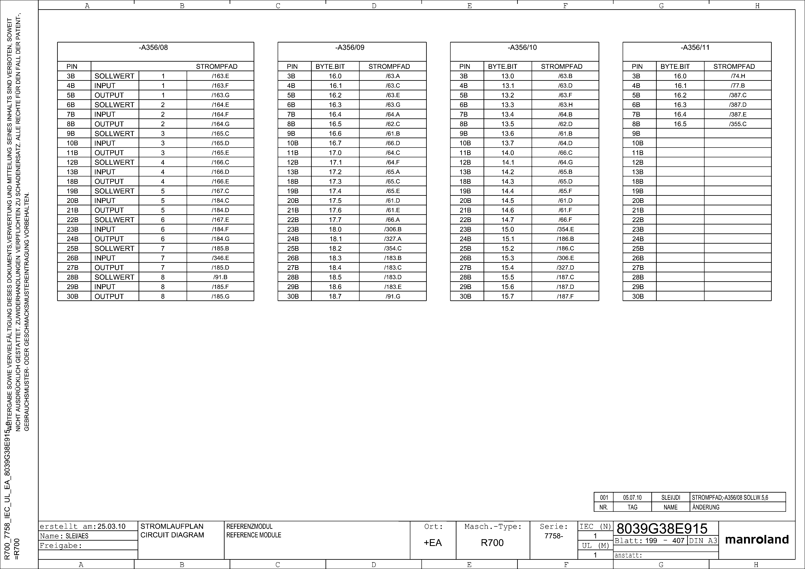

# +EA — Sheet 199 of 407 — REFERENZMODUL

**REFERENCE MODULE**

> Part of the manroland **R700** printing press IEC/UL circuit diagrams.
> Drawing class: **Stromlaufplan / Circuit diagram** (DIN A3).
> Document `+EA` covers the **Printing unit** machine section.

## At a glance

| Field | Value |
|---|---|
| Document | `+EA`  (8039G38E915) |
| Sheet | **199** of 407 |
| Section (DE) | REFERENZMODUL |
| Section (EN) | REFERENCE MODULE |
| Section type | REFERENCE_MODULE — Reference module |
| Machine type | `R700` |
| Series | `7758` |
| Created | 25.03.10 |
| Replaces | — |
| Columns used | A, B, C, D, E, F, G, H |
| Path numbers | — |
| Labels on sheet | 299 |
| Cross-refs out | 78 |
| Cross-refs in | 78 |

**Previous:** [+EA sheet 198](SHEET_0198.md) · **Next:** [+EA sheet 200](SHEET_0200.md) · **Document TOC:** [_TOC.md](_TOC.md)  (+EA) · **Master TOC:** [all sheets](../_MASTER_TOC.md)

## Sheet image (300 DPI, exact vector render)



_Rendered directly from the PDF vector layer at 300 DPI (1-bit), no OCR and no resampling. Use it to confirm anything ambiguous in the text below._

## Cross-references on this sheet

Each entry is a wire leaving this sheet. The printed token is `/sheet.column`; the link resolves to that sheet inside the same document.

| Ref | Target sheet | Col | Path | Destination on target | Target section | From col |
|---|---|---|---|---|---|---|
| `/63.A` | [+EA sheet 63](SHEET_0063.md) | A | — | — | MASCHINENBEDIENUNG: BEDIENUNGKOMMANDOS | D |
| `/63.B` | [+EA sheet 63](SHEET_0063.md) | B | — | — | MASCHINENBEDIENUNG: BEDIENUNGKOMMANDOS | F |
| `/163.E` | [+EA sheet 163](SHEET_0163.md) | E | — | — | VERLÄNGERUNG 1828,4MM | B |
| `/74.H` | [+EA sheet 74](SHEET_0074.md) | H | — | — | AUSLEGERSTAPELSTEUERUNG | H |
| `/77.B` | [+EA sheet 77](SHEET_0077.md) | B | — | — | AUSLEGERSTAPELSTEUERUNG | H |
| `/163.F` | [+EA sheet 163](SHEET_0163.md) | F | — | — | VERLÄNGERUNG 1828,4MM | B |
| `/63.C` | [+EA sheet 63](SHEET_0063.md) | C | — | — | MASCHINENBEDIENUNG: BEDIENUNGKOMMANDOS | D |
| `/63.D` | [+EA sheet 63](SHEET_0063.md) | D | — | — | MASCHINENBEDIENUNG: BEDIENUNGKOMMANDOS | F |
| `/63.E` | [+EA sheet 63](SHEET_0063.md) | E | — | — | MASCHINENBEDIENUNG: BEDIENUNGKOMMANDOS | D |
| `/63.F` | [+EA sheet 63](SHEET_0063.md) | F | — | — | MASCHINENBEDIENUNG: BEDIENUNGKOMMANDOS | F |
| `/163.G` | [+EA sheet 163](SHEET_0163.md) | G | — | — | VERLÄNGERUNG 1828,4MM | B |
| `/387.C` | [+EA sheet 387](SHEET_0387.md) | C | — | — | OPTION: ZWISCHENTROCKNER VORBEREITUNG; | H |
| `/164.E` | [+EA sheet 164](SHEET_0164.md) | E | — | — | VERLÄNGERUNG 1828,4MM | B |
| `/63.G` | [+EA sheet 63](SHEET_0063.md) | G | — | — | MASCHINENBEDIENUNG: BEDIENUNGKOMMANDOS | D |
| `/63.H` | [+EA sheet 63](SHEET_0063.md) | H | — | — | MASCHINENBEDIENUNG: BEDIENUNGKOMMANDOS | F |
| `/387.D` | [+EA sheet 387](SHEET_0387.md) | D | — | — | OPTION: ZWISCHENTROCKNER VORBEREITUNG; | H |
| `/64.A` | [+EA sheet 64](SHEET_0064.md) | A | — | — | MASCHINENBEDIENUNG: BEDIENUNGKOMMANDOS | D |
| `/64.B` | [+EA sheet 64](SHEET_0064.md) | B | — | — | MASCHINENBEDIENUNG: BEDIENUNGKOMMANDOS | F |
| `/387.E` | [+EA sheet 387](SHEET_0387.md) | E | — | — | OPTION: ZWISCHENTROCKNER VORBEREITUNG; | H |
| `/164.F` | [+EA sheet 164](SHEET_0164.md) | F | — | — | VERLÄNGERUNG 1828,4MM | B |
| `/164.G` | [+EA sheet 164](SHEET_0164.md) | G | — | — | VERLÄNGERUNG 1828,4MM | B |
| `/62.C` | [+EA sheet 62](SHEET_0062.md) | C | — | — | MASCHINENBEDIENUNG: BEDIENUNGKOMMANDOS | D |
| `/62.D` | [+EA sheet 62](SHEET_0062.md) | D | — | — | MASCHINENBEDIENUNG: BEDIENUNGKOMMANDOS | F |
| `/355.C` | [+EA sheet 355](SHEET_0355.md) | C | — | — | OPTION: VORBEREITUNG: PUDERABSAUGUNG | H |
| `/61.B` | [+EA sheet 61](SHEET_0061.md) | B | — | — | MASCHINENBEDIENUNG: BEDIENUNGKOMMANDOS | D |
| `/61.B` | [+EA sheet 61](SHEET_0061.md) | B | — | — | MASCHINENBEDIENUNG: BEDIENUNGKOMMANDOS | F |
| `/165.C` | [+EA sheet 165](SHEET_0165.md) | C | — | — | VERLÄNGERUNG 1828,4MM | B |
| `/66.D` | [+EA sheet 66](SHEET_0066.md) | D | — | — | MASCHINENBEDIENUNG: BEDIENUNGKOMMANDOS | D |
| `/64.D` | [+EA sheet 64](SHEET_0064.md) | D | — | — | MASCHINENBEDIENUNG: BEDIENUNGKOMMANDOS | F |
| `/165.D` | [+EA sheet 165](SHEET_0165.md) | D | — | — | VERLÄNGERUNG 1828,4MM | B |
| `/165.E` | [+EA sheet 165](SHEET_0165.md) | E | — | — | VERLÄNGERUNG 1828,4MM | B |
| `/64.C` | [+EA sheet 64](SHEET_0064.md) | C | — | — | MASCHINENBEDIENUNG: BEDIENUNGKOMMANDOS | D |
| `/66.C` | [+EA sheet 66](SHEET_0066.md) | C | — | — | MASCHINENBEDIENUNG: BEDIENUNGKOMMANDOS | F |
| `/64.F` | [+EA sheet 64](SHEET_0064.md) | F | — | — | MASCHINENBEDIENUNG: BEDIENUNGKOMMANDOS | D |
| `/64.G` | [+EA sheet 64](SHEET_0064.md) | G | — | — | MASCHINENBEDIENUNG: BEDIENUNGKOMMANDOS | F |
| `/166.C` | [+EA sheet 166](SHEET_0166.md) | C | — | — | VERLÄNGERUNG 1828,4MM | B |
| `/65.A` | [+EA sheet 65](SHEET_0065.md) | A | — | — | MASCHINENBEDIENUNG: BEDIENUNGKOMMANDOS | D |
| `/65.B` | [+EA sheet 65](SHEET_0065.md) | B | — | — | MASCHINENBEDIENUNG: BEDIENUNGKOMMANDOS | F |
| `/166.D` | [+EA sheet 166](SHEET_0166.md) | D | — | — | VERLÄNGERUNG 1828,4MM | B |
| `/166.E` | [+EA sheet 166](SHEET_0166.md) | E | — | — | VERLÄNGERUNG 1828,4MM | B |
| `/65.C` | [+EA sheet 65](SHEET_0065.md) | C | — | — | MASCHINENBEDIENUNG: BEDIENUNGKOMMANDOS | D |
| `/65.D` | [+EA sheet 65](SHEET_0065.md) | D | — | — | MASCHINENBEDIENUNG: BEDIENUNGKOMMANDOS | F |
| `/65.E` | [+EA sheet 65](SHEET_0065.md) | E | — | — | MASCHINENBEDIENUNG: BEDIENUNGKOMMANDOS | D |
| `/65.F` | [+EA sheet 65](SHEET_0065.md) | F | — | — | MASCHINENBEDIENUNG: BEDIENUNGKOMMANDOS | F |
| `/167.C` | [+EA sheet 167](SHEET_0167.md) | C | — | — | BOGENFÜHRUNGSELEMENT (BLASROHRE) | B |
| `/61.D` | [+EA sheet 61](SHEET_0061.md) | D | — | — | MASCHINENBEDIENUNG: BEDIENUNGKOMMANDOS | D |
| `/61.D` | [+EA sheet 61](SHEET_0061.md) | D | — | — | MASCHINENBEDIENUNG: BEDIENUNGKOMMANDOS | F |
| `/184.C` | [+EA sheet 184](SHEET_0184.md) | C | — | — | RESERVE | B |
| `/61.E` | [+EA sheet 61](SHEET_0061.md) | E | — | — | MASCHINENBEDIENUNG: BEDIENUNGKOMMANDOS | D |
| `/61.F` | [+EA sheet 61](SHEET_0061.md) | F | — | — | MASCHINENBEDIENUNG: BEDIENUNGKOMMANDOS | F |
| `/184.D` | [+EA sheet 184](SHEET_0184.md) | D | — | — | RESERVE | B |
| `/66.A` | [+EA sheet 66](SHEET_0066.md) | A | — | — | MASCHINENBEDIENUNG: BEDIENUNGKOMMANDOS | D |
| `/66.F` | [+EA sheet 66](SHEET_0066.md) | F | — | — | MASCHINENBEDIENUNG: BEDIENUNGKOMMANDOS | F |
| `/167.E` | [+EA sheet 167](SHEET_0167.md) | E | — | — | BOGENFÜHRUNGSELEMENT (BLASROHRE) | B |
| `/306.B` | [+EA sheet 306](SHEET_0306.md) | B | — | — | OPTION: ZWISCHENSTAPEL / | D |
| `/354.E` | [+EA sheet 354](SHEET_0354.md) | E | — | — | OPTION: VORBEREITUNG: PUDERABSAUGUNG | F |
| `/184.F` | [+EA sheet 184](SHEET_0184.md) | F | — | — | RESERVE | B |
| `/327.A` | [+EA sheet 327](SHEET_0327.md) | A | — | — | OPTION: BOGENWEICHE | D |
| `/186.B` | [+EA sheet 186](SHEET_0186.md) | B | — | — | RESERVE | F |
| `/184.G` | [+EA sheet 184](SHEET_0184.md) | G | — | — | RESERVE | B |
| `/185.B` | [+EA sheet 185](SHEET_0185.md) | B | — | — | RESERVE | B |
| `/354.C` | [+EA sheet 354](SHEET_0354.md) | C | — | — | OPTION: VORBEREITUNG: PUDERABSAUGUNG | D |
| `/186.C` | [+EA sheet 186](SHEET_0186.md) | C | — | — | RESERVE | F |
| `/346.E` | [+EA sheet 346](SHEET_0346.md) | E | — | — | OPTION: VORBEREITUNG CO2 LÖSCHANLAGE | B |
| `/183.B` | [+EA sheet 183](SHEET_0183.md) | B | — | — | RESERVE | D |
| `/306.E` | [+EA sheet 306](SHEET_0306.md) | E | — | — | OPTION: ZWISCHENSTAPEL / | F |
| `/185.D` | [+EA sheet 185](SHEET_0185.md) | D | — | — | RESERVE | B |
| `/183.C` | [+EA sheet 183](SHEET_0183.md) | C | — | — | RESERVE | D |
| `/327.D` | [+EA sheet 327](SHEET_0327.md) | D | — | — | OPTION: BOGENWEICHE | F |
| `/91.B` | [+EA sheet 91](SHEET_0091.md) | B | — | — | BLASROHRE (BLASRAHMEN) | B |
| `/183.D` | [+EA sheet 183](SHEET_0183.md) | D | — | — | RESERVE | D |
| `/187.C` | [+EA sheet 187](SHEET_0187.md) | C | — | — | RESERVE | F |
| `/183.E` | [+EA sheet 183](SHEET_0183.md) | E | — | — | RESERVE | D |
| `/185.F` | [+EA sheet 185](SHEET_0185.md) | F | — | — | RESERVE | B |
| `/187.D` | [+EA sheet 187](SHEET_0187.md) | D | — | — | RESERVE | F |
| `/91.G` | [+EA sheet 91](SHEET_0091.md) | G | — | — | BLASROHRE (BLASRAHMEN) | D |
| `/187.F` | [+EA sheet 187](SHEET_0187.md) | F | — | — | RESERVE | F |
| `/185.G` | [+EA sheet 185](SHEET_0185.md) | G | — | — | RESERVE | B |

### Incoming references (sheets that point here)

Every other sheet that sends a wire to this one. `Back-ref` is the token printed on *that* sheet; `Path` is its line number.

| From sheet | Cols | Back-ref | Path | Refs | What continues there |
|---|---|---|---|---|---|
| [+EA#61](SHEET_0061.md) | A, B, C, D, E, F | `/61.A`, `/61.B`, `/61.C`, `/61.D`, `/61.E`, `/61.F` | — | 6 | — |
| [+EA#62](SHEET_0062.md) | C, D | `/62.C`, `/62.D` | — | 2 | — |
| [+EA#63](SHEET_0063.md) | A, B, C, D, E, F, G, H | `/63.A`, `/63.B`, `/63.C`, `/63.D`, `/63.E`, `/63.F`, `/63.G`, `/63.H` | — | 8 | — |
| [+EA#64](SHEET_0064.md) | A, B, C, D, F, G | `/64.A`, `/64.B`, `/64.C`, `/64.D`, `/64.F`, `/64.G` | — | 6 | — |
| [+EA#65](SHEET_0065.md) | A, B, C, D, E, F | `/65.A`, `/65.B`, `/65.C`, `/65.D`, `/65.E`, `/65.F` | — | 6 | — |
| [+EA#66](SHEET_0066.md) | A, C, D, F | `/66.A`, `/66.C`, `/66.D`, `/66.F` | — | 4 | — |
| [+EA#74](SHEET_0074.md) | H | `/74.H` | — | 1 | — |
| [+EA#77](SHEET_0077.md) | B | `/77.B` | — | 1 | — |
| [+EA#91](SHEET_0091.md) | A, G | `/91.A`, `/91.G` | — | 2 | — |
| [+EA#163](SHEET_0163.md) | E, F, G | `/163.E`, `/163.F`, `/163.G` | — | 3 | — |
| [+EA#164](SHEET_0164.md) | E, F, G | `/164.E`, `/164.F`, `/164.G` | — | 3 | — |
| [+EA#165](SHEET_0165.md) | C, D, E | `/165.C`, `/165.D`, `/165.E` | — | 3 | — |
| [+EA#166](SHEET_0166.md) | C, D, E | `/166.C`, `/166.D`, `/166.E` | — | 3 | — |
| [+EA#167](SHEET_0167.md) | B, E | `/167.B`, `/167.E` | — | 2 | — |
| [+EA#183](SHEET_0183.md) | B, C, D, E | `/183.B`, `/183.C`, `/183.D`, `/183.E` | — | 4 | — |
| [+EA#184](SHEET_0184.md) | B, D, F, G | `/184.B`, `/184.D`, `/184.F`, `/184.G` | — | 4 | — |
| [+EA#185](SHEET_0185.md) | A, C, F, G | `/185.A`, `/185.C`, `/185.F`, `/185.G` | — | 4 | — |
| [+EA#186](SHEET_0186.md) | B, C | `/186.B`, `/186.C` | — | 2 | — |
| [+EA#187](SHEET_0187.md) | C, D, F | `/187.C`, `/187.D`, `/187.F` | — | 3 | — |
| [+EA#306](SHEET_0306.md) | B, E | `/306.B`, `/306.E` | — | 2 | — |
| [+EA#327](SHEET_0327.md) | A, D | `/327.A`, `/327.D` | — | 2 | — |
| [+EA#346](SHEET_0346.md) | E | `/346.E` | — | 1 | — |
| [+EA#354](SHEET_0354.md) | C, E | `/354.C`, `/354.E` | — | 2 | — |
| [+EA#355](SHEET_0355.md) | C | `/355.C` | — | 1 | — |
| [+EA#387](SHEET_0387.md) | C, D, E | `/387.C`, `/387.D`, `/387.E` | — | 3 | — |


## Devices on this sheet

| Tag | Class | Class meaning (IEC) | Col | Sub | Terminal | Sign |
|---|---|---|---|---|---|---|
| `A356/08` | A | Baugruppe / assembly, module, PC board | B | 08 | — | — |
| `A356/09` | A | Baugruppe / assembly, module, PC board | D | 09 | — | — |
| `A356/10` | A | Baugruppe / assembly, module, PC board | F | 10 | — | — |
| `A356/11` | A | Baugruppe / assembly, module, PC board | G | 11 | — | — |
| `16.0` | — | cross-device reference | D | — | — | — |
| `16.1` | — | cross-device reference | D | — | — | — |
| `16.2` | — | cross-device reference | D | — | — | — |
| `16.3` | — | cross-device reference | D | — | — | — |
| `16.4` | — | cross-device reference | D | — | — | — |
| `16.5` | — | cross-device reference | D | — | — | — |
| `16.6` | — | cross-device reference | D | — | — | — |
| `16.7` | — | cross-device reference | D | — | — | — |
| `17.0` | — | cross-device reference | D | — | — | — |
| `17.1` | — | cross-device reference | D | — | — | — |
| `17.2` | — | cross-device reference | D | — | — | — |
| `17.3` | — | cross-device reference | D | — | — | — |
| `17.4` | — | cross-device reference | D | — | — | — |
| `17.5` | — | cross-device reference | D | — | — | — |
| `17.6` | — | cross-device reference | D | — | — | — |
| `17.7` | — | cross-device reference | D | — | — | — |
| `18.0` | — | cross-device reference | D | — | — | — |
| `18.1` | — | cross-device reference | D | — | — | — |
| `18.2` | — | cross-device reference | D | — | — | — |
| `18.3` | — | cross-device reference | D | — | — | — |
| `18.4` | — | cross-device reference | D | — | — | — |
| `18.5` | — | cross-device reference | D | — | — | — |
| `18.6` | — | cross-device reference | D | — | — | — |
| `18.7` | — | cross-device reference | D | — | — | — |
| `13.0` | — | cross-device reference | E | — | — | — |
| `13.1` | — | cross-device reference | E | — | — | — |
| `13.2` | — | cross-device reference | E | — | — | — |
| `13.3` | — | cross-device reference | E | — | — | — |
| `13.4` | — | cross-device reference | E | — | — | — |
| `13.5` | — | cross-device reference | E | — | — | — |
| `13.6` | — | cross-device reference | E | — | — | — |
| `13.7` | — | cross-device reference | E | — | — | — |
| `14.0` | — | cross-device reference | E | — | — | — |
| `14.1` | — | cross-device reference | E | — | — | — |
| `14.2` | — | cross-device reference | E | — | — | — |
| `14.3` | — | cross-device reference | E | — | — | — |
| `14.4` | — | cross-device reference | E | — | — | — |
| `14.5` | — | cross-device reference | E | — | — | — |
| `14.6` | — | cross-device reference | E | — | — | — |
| `14.7` | — | cross-device reference | E | — | — | — |
| `15.0` | — | cross-device reference | E | — | — | — |
| `15.1` | — | cross-device reference | E | — | — | — |
| `15.2` | — | cross-device reference | E | — | — | — |
| `15.3` | — | cross-device reference | E | — | — | — |
| `15.4` | — | cross-device reference | E | — | — | — |
| `15.5` | — | cross-device reference | E | — | — | — |
| `15.6` | — | cross-device reference | E | — | — | — |
| `15.7` | — | cross-device reference | E | — | — | — |
| `16.0` | — | cross-device reference | G | — | — | — |
| `16.1` | — | cross-device reference | G | — | — | — |
| `16.2` | — | cross-device reference | G | — | — | — |
| `16.3` | — | cross-device reference | G | — | — | — |
| `16.4` | — | cross-device reference | G | — | — | — |
| `16.5` | — | cross-device reference | G | — | — | — |
| `NR.` | — | cross-device reference | F | — | — | — |
| `05.07.10` | — | cross-device reference | G | — | — | — |

## Potentials / nets

_No named potentials on this sheet._

## Wire-end annotations (grouped as printed)

A wire that continues elsewhere is annotated with a small cluster: the destination description, the path/line number `#NN`, and the `/sheet.column` cross reference. Each row below is one such cluster exactly as it is grouped on the drawing.

| Col | Y | Path | Cross-ref | Text on the wire |
|---|---|---|---|---|
| B | 65.5 | — | — | `A356/08` |
| D | 65.5 | — | — | `A356/09` |
| F | 65.5 | — | — | `A356/10` |
| G | 65.5 | — | — | `A356/11` |
| B | 94.2 | — | — | `10B 11B 12B 13B 18B 19B 3B 4B 5B 6B 7B 8B 9B 20B 21B 22B 23B 24B 25B 26B 27B 28B 29B 30B STROMPFAD` |
| A | 94.2 | — | — | `PIN` |
| C | 94.2 | — | — | `PIN BYTE.BIT` |
| D | 94.2 | — | — | `STROMPFAD` |
| E | 94.2 | — | — | `PIN BYTE.BIT` |
| F | 94.2 | — | — | `STROMPFAD` |
| G | 94.2 | — | — | `PIN BYTE.BIT` |
| H | 94.2 | — | — | `STROMPFAD` |
| A | 108.0 | — | — | `INPUT INPUT INPUT INPUT INPUT INPUT INPUT INPUT SOLLWERT OUTPUT SOLLWERT OUTPUT SOLLWERT OUTPUT SOLLWERT OUTPUT SOLLWERT OUTPUT SOLLWERT OUTPUT SOLLWERT OUTPUT SOLLWERT OUTPUT` |
| C | 108.3 | — | — | `10B 11B 12B 13B 18B 19B 3B 4B 5B 6B 7B 8B 9B 20B 21B 22B 23B 24B 25B 26B 27B 28B 29B 30B` |
| D | 108.3 | — | — | `16.0 16.2 16.3 16.4 16.5 16.6 16.7 17.0 17.2 17.3 17.4 17.5 17.6 17.7 18.0 18.2 18.3 18.4 18.5 18.6 18.7 16.1 17.1 18.1` |
| E | 108.3 | — | — | `10B 11B 12B 13B 18B 19B 3B 4B 5B 6B 7B 8B 9B 20B 21B 22B 23B 24B 25B 26B 27B 28B 29B 30B` |
| E | 108.3 | — | — | `13.0 13.2 13.3 13.4 13.5 13.6 13.7 14.0 14.2 14.3 14.4 14.5 14.6 14.7 15.0 15.2 15.3 15.4 15.5 15.6 15.7 13.1 14.1 15.1` |
| G | 108.3 | — | — | `10B 11B 12B 13B 18B 19B 3B 4B 5B 6B 7B 8B 9B 20B 21B 22B 23B 24B 25B 26B 27B 28B 29B 30B` |
| G | 108.3 | — | — | `16.0 16.2 16.3 16.4 16.5 16.1` |
| B | 108.4 | — | — | `2 2 2 3 3 3 4 4 4 5 5 5 6 6 6 7 7 7 8 8 8 1 1 1` |
| B | 108.7 | — | `/163.E` | — |
| D | 108.7 | — | `/63.A` | — |
| F | 108.7 | — | `/63.B` | — |
| H | 108.7 | — | `/74.H` | — |
| H | 122.8 | — | `/77.B` | — |
| B | 122.9 | — | `/163.F` | — |
| D | 122.9 | — | `/63.C` | — |
| F | 122.9 | — | `/63.D` | — |
| D | 137.0 | — | `/63.E` | — |
| F | 137.0 | — | `/63.F` | — |
| B | 137.1 | — | `/163.G` | — |
| H | 137.1 | — | `/387.C` | — |
| B | 151.2 | — | `/164.E` | — |
| D | 151.2 | — | `/63.G` | — |
| F | 151.2 | — | `/63.H` | — |
| H | 151.2 | — | `/387.D` | — |
| B | 165.4 | — | `/164.F` | — |
| D | 165.4 | — | `/64.A` | — |
| F | 165.4 | — | `/64.B` | — |
| H | 165.4 | — | `/387.E` | — |
| B | 179.6 | — | `/164.G` | — |
| D | 179.6 | — | `/62.C` | — |
| F | 179.6 | — | `/62.D` | — |
| H | 179.6 | — | `/355.C` | — |
| D | 193.7 | — | `/61.B` | — |
| F | 193.7 | — | `/61.B` | — |
| B | 193.8 | — | `/165.C` | — |
| B | 207.9 | — | `/165.D` | — |
| D | 207.9 | — | `/66.D` | — |
| F | 207.9 | — | `/64.D` | — |
| B | 222.1 | — | `/165.E` | — |
| D | 222.1 | — | `/64.C` | — |
| F | 222.1 | — | `/66.C` | — |
| D | 236.2 | — | `/64.F` | — |
| F | 236.2 | — | `/64.G` | — |
| B | 236.3 | — | `/166.C` | — |
| B | 250.4 | — | `/166.D` | — |
| D | 250.4 | — | `/65.A` | — |
| F | 250.4 | — | `/65.B` | — |
| B | 264.6 | — | `/166.E` | — |
| D | 264.6 | — | `/65.C` | — |
| F | 264.6 | — | `/65.D` | — |
| B | 278.8 | — | `/167.C` | — |
| D | 278.8 | — | `/65.E` | — |
| F | 278.8 | — | `/65.F` | — |
| B | 293.0 | — | `/184.C` | — |
| D | 293.0 | — | `/61.D` | — |
| F | 293.0 | — | `/61.D` | — |
| B | 307.1 | — | `/184.D` | — |
| D | 307.1 | — | `/61.E` | — |
| F | 307.1 | — | `/61.F` | — |
| B | 321.3 | — | `/167.E` | — |
| D | 321.3 | — | `/66.A` | — |
| F | 321.3 | — | `/66.F` | — |
| B | 335.5 | — | `/184.F` | — |
| D | 335.5 | — | `/306.B` | — |
| F | 335.5 | — | `/354.E` | — |
| B | 349.6 | — | `/184.G` | — |
| D | 349.6 | — | `/327.A` | — |
| F | 349.6 | — | `/186.B` | — |
| B | 363.8 | — | `/185.B` | — |
| D | 363.8 | — | `/354.C` | — |
| F | 363.8 | — | `/186.C` | — |
| B | 378.0 | — | `/346.E` | — |
| D | 378.0 | — | `/183.B` | — |
| F | 378.0 | — | `/306.E` | — |
| B | 392.2 | — | `/185.D` | — |
| D | 392.2 | — | `/183.C` | — |
| F | 392.2 | — | `/327.D` | — |
| B | 406.3 | — | `/91.B` | — |
| D | 406.4 | — | `/183.D` | — |
| F | 406.4 | — | `/187.C` | — |
| B | 420.5 | — | `/185.F` | — |
| D | 420.5 | — | `/183.E` | — |
| F | 420.5 | — | `/187.D` | — |
| B | 434.7 | — | `/185.G` | — |
| D | 434.7 | — | `/91.G` | — |
| F | 434.7 | — | `/187.F` | — |
| G | 733.0 | — | — | `001 05.07.10 SLEI/JDI STROMPFAD; A356/08 SOLLW.5,6` |
| G | 747.1 | — | — | `NR. TAG NAME ÄNDERUNG` |


## Reconstructed tables

This sheet carries tabular content (pin map / terminal assignment / index). The grid below was rebuilt from the drawing's own rule lines, so each row is exactly one physical row of the table.

### Table 1 — 24 data rows × 4 columns (at x=85.0, y=62.4) — **A356/08**

| PIN |  |  | STROMPFAD |
|---|---|---|---|
| `3B` | `SOLLWERT` | `1` | `/163.E` |
| `4B` | `INPUT` | `1` | `/163.F` |
| `5B` | `OUTPUT` | `1` | `/163.G` |
| `6B` | `SOLLWERT` | `2` | `/164.E` |
| `7B` | `INPUT` | `2` | `/164.F` |
| `8B` | `OUTPUT` | `2` | `/164.G` |
| `9B` | `SOLLWERT` | `3` | `/165.C` |
| `10B` | `INPUT` | `3` | `/165.D` |
| `11B` | `OUTPUT` | `3` | `/165.E` |
| `12B` | `SOLLWERT` | `4` | `/166.C` |
| `13B` | `INPUT` | `4` | `/166.D` |
| `18B` | `OUTPUT` | `4` | `/166.E` |
| `19B` | `SOLLWERT` | `5` | `/167.C` |
| `20B` | `INPUT` | `5` | `/184.C` |
| `21B` | `OUTPUT` | `5` | `/184.D` |
| `22B` | `SOLLWERT` | `6` | `/167.E` |
| `23B` | `INPUT` | `6` | `/184.F` |
| `24B` | `OUTPUT` | `6` | `/184.G` |
| `25B` | `SOLLWERT` | `7` | `/185.B` |
| `26B` | `INPUT` | `7` | `/346.E` |
| `27B` | `OUTPUT` | `7` | `/185.D` |
| `28B` | `SOLLWERT` | `8` | `/91.B` |
| `29B` | `INPUT` | `8` | `/185.F` |
| `30B` | `OUTPUT` | `8` | `/185.G` |


### Table 2 — 24 data rows × 3 columns (at x=411.0, y=62.4) — **A356/09**

| PIN | BYTE.BIT | STROMPFAD |
|---|---|---|
| `3B` | `16.0` | `/63.A` |
| `4B` | `16.1` | `/63.C` |
| `5B` | `16.2` | `/63.E` |
| `6B` | `16.3` | `/63.G` |
| `7B` | `16.4` | `/64.A` |
| `8B` | `16.5` | `/62.C` |
| `9B` | `16.6` | `/61.B` |
| `10B` | `16.7` | `/66.D` |
| `11B` | `17.0` | `/64.C` |
| `12B` | `17.1` | `/64.F` |
| `13B` | `17.2` | `/65.A` |
| `18B` | `17.3` | `/65.C` |
| `19B` | `17.4` | `/65.E` |
| `20B` | `17.5` | `/61.D` |
| `21B` | `17.6` | `/61.E` |
| `22B` | `17.7` | `/66.A` |
| `23B` | `18.0` | `/306.B` |
| `24B` | `18.1` | `/327.A` |
| `25B` | `18.2` | `/354.C` |
| `26B` | `18.3` | `/183.B` |
| `27B` | `18.4` | `/183.C` |
| `28B` | `18.5` | `/183.D` |
| `29B` | `18.6` | `/183.E` |
| `30B` | `18.7` | `/91.G` |


### Table 3 — 24 data rows × 3 columns (at x=666.1, y=62.4) — **A356/10**

| PIN | BYTE.BIT | STROMPFAD |
|---|---|---|
| `3B` | `13.0` | `/63.B` |
| `4B` | `13.1` | `/63.D` |
| `5B` | `13.2` | `/63.F` |
| `6B` | `13.3` | `/63.H` |
| `7B` | `13.4` | `/64.B` |
| `8B` | `13.5` | `/62.D` |
| `9B` | `13.6` | `/61.B` |
| `10B` | `13.7` | `/64.D` |
| `11B` | `14.0` | `/66.C` |
| `12B` | `14.1` | `/64.G` |
| `13B` | `14.2` | `/65.B` |
| `18B` | `14.3` | `/65.D` |
| `19B` | `14.4` | `/65.F` |
| `20B` | `14.5` | `/61.D` |
| `21B` | `14.6` | `/61.F` |
| `22B` | `14.7` | `/66.F` |
| `23B` | `15.0` | `/354.E` |
| `24B` | `15.1` | `/186.B` |
| `25B` | `15.2` | `/186.C` |
| `26B` | `15.3` | `/306.E` |
| `27B` | `15.4` | `/327.D` |
| `28B` | `15.5` | `/187.C` |
| `29B` | `15.6` | `/187.D` |
| `30B` | `15.7` | `/187.F` |


### Table 4 — 24 data rows × 3 columns (at x=921.3, y=62.4) — **A356/11**

| PIN | BYTE.BIT | STROMPFAD |
|---|---|---|
| `3B` | `16.0` | `/74.H` |
| `4B` | `16.1` | `/77.B` |
| `5B` | `16.2` | `/387.C` |
| `6B` | `16.3` | `/387.D` |
| `7B` | `16.4` | `/387.E` |
| `8B` | `16.5` | `/355.C` |
| `9B` |  |  |
| `10B` |  |  |
| `11B` |  |  |
| `12B` |  |  |
| `13B` |  |  |
| `18B` |  |  |
| `19B` |  |  |
| `20B` |  |  |
| `21B` |  |  |
| `22B` |  |  |
| `23B` |  |  |
| `24B` |  |  |
| `25B` |  |  |
| `26B` |  |  |
| `27B` |  |  |
| `28B` |  |  |
| `29B` |  |  |
| `30B` |  |  |


## Notes and free text on this sheet

| Text | Col | Y (pt) |
|---|---|---|
| `STROMPFAD` | B | 94.15 |
| `3B` | A | 108.35 |
| `4B` | A | 122.53 |
| `5B` | A | 136.7 |
| `6B` | A | 150.87 |
| `7B` | A | 165.05 |
| `8B` | A | 179.22 |
| `9B` | A | 193.39 |
| `10B` | A | 207.57 |
| `11B` | A | 221.74 |
| `12B` | A | 235.92 |
| `13B` | A | 250.09 |
| `18B` | A | 264.26 |
| `19B` | A | 278.44 |
| `20B` | A | 292.61 |
| `21B` | A | 306.78 |
| `22B` | A | 320.96 |
| `23B` | A | 335.13 |
| `24B` | A | 349.3 |
| `25B` | A | 363.48 |
| `26B` | A | 377.65 |
| `27B` | A | 391.82 |
| `28B` | A | 406 |
| `29B` | A | 420.17 |
| `30B` | A | 434.34 |
| `PIN` | A | 94.2 |
| `SOLLWERT` | A | 107.96 |
| `INPUT` | A | 122.24 |
| `OUTPUT` | A | 136.37 |
| `3B` | C | 108.35 |
| `4B` | C | 122.53 |
| `5B` | C | 136.7 |
| `6B` | C | 150.87 |
| `7B` | C | 165.05 |
| `8B` | C | 179.22 |
| `9B` | C | 193.39 |
| `10B` | C | 207.57 |
| `11B` | C | 221.74 |
| `12B` | C | 235.92 |
| `13B` | C | 250.09 |
| `18B` | C | 264.26 |
| `19B` | C | 278.44 |
| `20B` | C | 292.61 |
| `21B` | C | 306.78 |
| `22B` | C | 320.96 |
| `23B` | C | 335.13 |
| `24B` | C | 349.3 |
| `25B` | C | 363.48 |
| `26B` | C | 377.65 |
| `27B` | C | 391.82 |
| `28B` | C | 406 |
| `29B` | C | 420.17 |
| `30B` | C | 434.34 |
| `PIN` | C | 94.2 |
| `BYTE.BIT` | D | 94.17 |
| `STROMPFAD` | D | 94.15 |
| `3B` | E | 108.35 |
| `4B` | E | 122.53 |
| `5B` | E | 136.7 |
| `6B` | E | 150.87 |
| `7B` | E | 165.05 |
| `8B` | E | 179.22 |
| `9B` | E | 193.39 |
| `10B` | E | 207.57 |
| `11B` | E | 221.74 |
| `12B` | E | 235.92 |
| `13B` | E | 250.09 |
| `18B` | E | 264.26 |
| `19B` | E | 278.44 |
| `20B` | E | 292.61 |
| `21B` | E | 306.78 |
| `22B` | E | 320.96 |
| `23B` | E | 335.13 |
| `24B` | E | 349.3 |
| `25B` | E | 363.48 |
| `26B` | E | 377.65 |
| `27B` | E | 391.82 |
| `28B` | E | 406 |
| `29B` | E | 420.17 |
| `30B` | E | 434.34 |
| `PIN` | E | 94.2 |
| `BYTE.BIT` | E | 94.17 |
| `STROMPFAD` | F | 94.15 |
| `3B` | G | 108.35 |
| `4B` | G | 122.53 |
| `5B` | G | 136.7 |
| `6B` | G | 150.87 |
| `7B` | G | 165.05 |
| `8B` | G | 179.22 |
| `9B` | G | 193.39 |
| `10B` | G | 207.57 |
| `11B` | G | 221.74 |
| `12B` | G | 235.92 |
| `13B` | G | 250.09 |
| `18B` | G | 264.26 |
| `19B` | G | 278.44 |
| `20B` | G | 292.61 |
| `21B` | G | 306.78 |
| `22B` | G | 320.96 |
| `23B` | G | 335.13 |
| `24B` | G | 349.3 |
| `25B` | G | 363.48 |
| `26B` | G | 377.65 |
| `27B` | G | 391.82 |
| `28B` | G | 406 |
| `29B` | G | 420.17 |
| `30B` | G | 434.34 |
| `PIN` | G | 94.2 |
| `BYTE.BIT` | G | 94.17 |
| `STROMPFAD` | H | 94.15 |
| `TAG` | G | 747.27 |
| `NAME` | G | 747.25 |
| `ÄNDERUNG` | G | 747.31 |
| `SLEI/JDI` | G | 733.11 |
| `STROMPFAD; A356/08 SOLLW.5,6` | H | 733.12 |

## Complete label inventory (exact text from the drawing)

Every text object inside the drawing area of this sheet, in DIN reading order (column A→H, then top→bottom). This is the authoritative list: if a string is not here it is not printed on this sheet.

| Col | Y | X | Dir | Type | Text |
|---|---|---|---|---|---|
| A | 94.2 | 98.4 | → | text | `PIN` |
| A | 108.0 | 139.7 | → | text | `SOLLWERT` |
| A | 108.4 | 98.9 | → | text | `3B` |
| A | 122.2 | 139.5 | → | text | `INPUT` |
| A | 122.5 | 98.9 | → | text | `4B` |
| A | 136.4 | 139.7 | → | text | `OUTPUT` |
| A | 136.7 | 98.9 | → | text | `5B` |
| A | 150.5 | 139.7 | → | text | `SOLLWERT` |
| A | 150.9 | 98.9 | → | text | `6B` |
| A | 164.8 | 139.5 | → | text | `INPUT` |
| A | 165.0 | 98.9 | → | text | `7B` |
| A | 178.9 | 139.7 | → | text | `OUTPUT` |
| A | 179.2 | 98.9 | → | text | `8B` |
| A | 193.0 | 139.7 | → | text | `SOLLWERT` |
| A | 193.4 | 98.9 | → | text | `9B` |
| A | 207.3 | 139.5 | → | text | `INPUT` |
| A | 207.6 | 98.4 | → | text | `10B` |
| A | 221.4 | 139.7 | → | text | `OUTPUT` |
| A | 221.7 | 98.4 | → | text | `11B` |
| A | 235.5 | 139.7 | → | text | `SOLLWERT` |
| A | 235.9 | 98.4 | → | text | `12B` |
| A | 249.8 | 139.5 | → | text | `INPUT` |
| A | 250.1 | 98.4 | → | text | `13B` |
| A | 263.9 | 139.7 | → | text | `OUTPUT` |
| A | 264.3 | 98.4 | → | text | `18B` |
| A | 278.0 | 139.7 | → | text | `SOLLWERT` |
| A | 278.4 | 98.4 | → | text | `19B` |
| A | 292.3 | 139.5 | → | text | `INPUT` |
| A | 292.6 | 98.9 | → | text | `20B` |
| A | 306.4 | 139.7 | → | text | `OUTPUT` |
| A | 306.8 | 98.9 | → | text | `21B` |
| A | 320.6 | 139.7 | → | text | `SOLLWERT` |
| A | 321.0 | 98.9 | → | text | `22B` |
| A | 334.8 | 139.5 | → | text | `INPUT` |
| A | 335.1 | 98.9 | → | text | `23B` |
| A | 349.0 | 139.7 | → | text | `OUTPUT` |
| A | 349.3 | 98.9 | → | text | `24B` |
| A | 363.1 | 139.7 | → | text | `SOLLWERT` |
| A | 363.5 | 98.9 | → | text | `25B` |
| A | 377.4 | 139.5 | → | text | `INPUT` |
| A | 377.6 | 98.9 | → | text | `26B` |
| A | 391.5 | 139.7 | → | text | `OUTPUT` |
| A | 391.8 | 98.9 | → | text | `27B` |
| A | 405.6 | 139.7 | → | text | `SOLLWERT` |
| A | 406.0 | 98.9 | → | text | `28B` |
| A | 419.9 | 139.5 | → | text | `INPUT` |
| A | 420.2 | 98.9 | → | text | `29B` |
| A | 434.0 | 139.7 | → | text | `OUTPUT` |
| A | 434.3 | 98.9 | → | text | `30B` |
| B | 65.5 | 205.4 | → | device tag | `A356/08` |
| B | 94.2 | 290.0 | → | text | `STROMPFAD` |
| B | 108.4 | 238.8 | → | number | `1` |
| B | 108.7 | 313.5 | → | cross-reference | `/163.E` |
| B | 122.5 | 238.8 | → | number | `1` |
| B | 122.9 | 313.7 | → | cross-reference | `/163.F` |
| B | 136.7 | 238.8 | → | number | `1` |
| B | 137.1 | 313.1 | → | cross-reference | `/163.G` |
| B | 150.9 | 238.3 | → | number | `2` |
| B | 151.2 | 313.5 | → | cross-reference | `/164.E` |
| B | 165.1 | 238.3 | → | number | `2` |
| B | 165.4 | 313.7 | → | cross-reference | `/164.F` |
| B | 179.2 | 238.3 | → | number | `2` |
| B | 179.6 | 313.1 | → | cross-reference | `/164.G` |
| B | 193.4 | 238.3 | → | number | `3` |
| B | 193.8 | 313.2 | → | cross-reference | `/165.C` |
| B | 207.6 | 238.3 | → | number | `3` |
| B | 207.9 | 313.2 | → | cross-reference | `/165.D` |
| B | 221.8 | 238.3 | → | number | `3` |
| B | 222.1 | 313.5 | → | cross-reference | `/165.E` |
| B | 235.9 | 238.3 | → | number | `4` |
| B | 236.3 | 313.2 | → | cross-reference | `/166.C` |
| B | 250.1 | 238.3 | → | number | `4` |
| B | 250.4 | 313.2 | → | cross-reference | `/166.D` |
| B | 264.3 | 238.3 | → | number | `4` |
| B | 264.6 | 313.5 | → | cross-reference | `/166.E` |
| B | 278.5 | 238.3 | → | number | `5` |
| B | 278.8 | 313.2 | → | cross-reference | `/167.C` |
| B | 292.6 | 238.3 | → | number | `5` |
| B | 293.0 | 313.2 | → | cross-reference | `/184.C` |
| B | 306.8 | 238.3 | → | number | `5` |
| B | 307.1 | 313.2 | → | cross-reference | `/184.D` |
| B | 321.0 | 238.3 | → | number | `6` |
| B | 321.3 | 313.5 | → | cross-reference | `/167.E` |
| B | 335.1 | 238.3 | → | number | `6` |
| B | 335.5 | 313.7 | → | cross-reference | `/184.F` |
| B | 349.3 | 238.3 | → | number | `6` |
| B | 349.7 | 313.1 | → | cross-reference | `/184.G` |
| B | 363.5 | 238.3 | → | number | `7` |
| B | 363.8 | 313.4 | → | cross-reference | `/185.B` |
| B | 377.7 | 238.3 | → | number | `7` |
| B | 378.0 | 313.5 | → | cross-reference | `/346.E` |
| B | 391.8 | 238.3 | → | number | `7` |
| B | 392.2 | 313.2 | → | cross-reference | `/185.D` |
| B | 406.0 | 238.3 | → | number | `8` |
| B | 406.3 | 315.8 | → | cross-reference | `/91.B` |
| B | 420.2 | 238.3 | → | number | `8` |
| B | 420.5 | 313.7 | → | cross-reference | `/185.F` |
| B | 434.4 | 238.3 | → | number | `8` |
| B | 434.7 | 313.1 | → | cross-reference | `/185.G` |
| C | 94.2 | 424.3 | → | text | `PIN` |
| C | 108.4 | 424.9 | → | text | `3B` |
| C | 122.5 | 424.9 | → | text | `4B` |
| C | 136.7 | 424.9 | → | text | `5B` |
| C | 150.9 | 424.9 | → | text | `6B` |
| C | 165.0 | 424.9 | → | text | `7B` |
| C | 179.2 | 424.9 | → | text | `8B` |
| C | 193.4 | 424.9 | → | text | `9B` |
| C | 207.6 | 424.3 | → | text | `10B` |
| C | 221.7 | 424.3 | → | text | `11B` |
| C | 235.9 | 424.3 | → | text | `12B` |
| C | 250.1 | 424.3 | → | text | `13B` |
| C | 264.3 | 424.3 | → | text | `18B` |
| C | 278.4 | 424.3 | → | text | `19B` |
| C | 292.6 | 424.9 | → | text | `20B` |
| C | 306.8 | 424.9 | → | text | `21B` |
| C | 321.0 | 424.9 | → | text | `22B` |
| C | 335.1 | 424.9 | → | text | `23B` |
| C | 349.3 | 424.9 | → | text | `24B` |
| C | 363.5 | 424.9 | → | text | `25B` |
| C | 377.6 | 424.9 | → | text | `26B` |
| C | 391.8 | 424.9 | → | text | `27B` |
| C | 406.0 | 424.9 | → | text | `28B` |
| C | 420.2 | 424.9 | → | text | `29B` |
| C | 434.3 | 424.9 | → | text | `30B` |
| D | 65.5 | 495.9 | → | device tag | `A356/09` |
| D | 94.2 | 466.9 | → | text | `BYTE.BIT` |
| D | 94.2 | 545.1 | → | text | `STROMPFAD` |
| D | 108.3 | 486.3 | → | device ref | `16.0` |
| D | 108.7 | 570.8 | → | cross-reference | `/63.A` |
| D | 122.5 | 487.1 | → | device ref | `16.1` |
| D | 122.9 | 570.8 | → | cross-reference | `/63.C` |
| D | 136.7 | 486.3 | → | device ref | `16.2` |
| D | 137.0 | 571.0 | → | cross-reference | `/63.E` |
| D | 150.9 | 486.3 | → | device ref | `16.3` |
| D | 151.2 | 570.6 | → | cross-reference | `/63.G` |
| D | 165.0 | 486.3 | → | device ref | `16.4` |
| D | 165.4 | 570.8 | → | cross-reference | `/64.A` |
| D | 179.2 | 486.3 | → | device ref | `16.5` |
| D | 179.6 | 570.8 | → | cross-reference | `/62.C` |
| D | 193.4 | 486.3 | → | device ref | `16.6` |
| D | 193.7 | 570.9 | → | cross-reference | `/61.B` |
| D | 207.6 | 486.3 | → | device ref | `16.7` |
| D | 207.9 | 570.8 | → | cross-reference | `/66.D` |
| D | 221.7 | 486.3 | → | device ref | `17.0` |
| D | 222.1 | 570.8 | → | cross-reference | `/64.C` |
| D | 235.9 | 487.1 | → | device ref | `17.1` |
| D | 236.2 | 571.2 | → | cross-reference | `/64.F` |
| D | 250.1 | 486.3 | → | device ref | `17.2` |
| D | 250.4 | 570.8 | → | cross-reference | `/65.A` |
| D | 264.2 | 486.3 | → | device ref | `17.3` |
| D | 264.6 | 570.8 | → | cross-reference | `/65.C` |
| D | 278.4 | 486.3 | → | device ref | `17.4` |
| D | 278.8 | 571.0 | → | cross-reference | `/65.E` |
| D | 292.6 | 486.3 | → | device ref | `17.5` |
| D | 293.0 | 570.8 | → | cross-reference | `/61.D` |
| D | 306.8 | 486.3 | → | device ref | `17.6` |
| D | 307.1 | 571.0 | → | cross-reference | `/61.E` |
| D | 320.9 | 486.3 | → | device ref | `17.7` |
| D | 321.3 | 570.8 | → | cross-reference | `/66.A` |
| D | 335.1 | 486.3 | → | device ref | `18.0` |
| D | 335.5 | 568.5 | → | cross-reference | `/306.B` |
| D | 349.3 | 487.1 | → | device ref | `18.1` |
| D | 349.6 | 568.3 | → | cross-reference | `/327.A` |
| D | 363.5 | 486.3 | → | device ref | `18.2` |
| D | 363.8 | 568.3 | → | cross-reference | `/354.C` |
| D | 377.6 | 486.3 | → | device ref | `18.3` |
| D | 378.0 | 568.5 | → | cross-reference | `/183.B` |
| D | 391.8 | 486.3 | → | device ref | `18.4` |
| D | 392.2 | 568.3 | → | cross-reference | `/183.C` |
| D | 406.0 | 486.3 | → | device ref | `18.5` |
| D | 406.4 | 568.3 | → | cross-reference | `/183.D` |
| D | 420.2 | 486.3 | → | device ref | `18.6` |
| D | 420.5 | 568.6 | → | cross-reference | `/183.E` |
| D | 434.3 | 486.3 | → | device ref | `18.7` |
| D | 434.7 | 570.6 | → | cross-reference | `/91.G` |
| E | 94.2 | 679.5 | → | text | `PIN` |
| E | 94.2 | 722.0 | → | text | `BYTE.BIT` |
| E | 108.3 | 741.4 | → | device ref | `13.0` |
| E | 108.4 | 680.0 | → | text | `3B` |
| E | 122.5 | 680.0 | → | text | `4B` |
| E | 122.5 | 742.3 | → | device ref | `13.1` |
| E | 136.7 | 680.0 | → | text | `5B` |
| E | 136.7 | 741.4 | → | device ref | `13.2` |
| E | 150.9 | 680.0 | → | text | `6B` |
| E | 150.9 | 741.4 | → | device ref | `13.3` |
| E | 165.0 | 680.0 | → | text | `7B` |
| E | 165.0 | 741.4 | → | device ref | `13.4` |
| E | 179.2 | 680.0 | → | text | `8B` |
| E | 179.2 | 741.4 | → | device ref | `13.5` |
| E | 193.4 | 680.0 | → | text | `9B` |
| E | 193.4 | 741.4 | → | device ref | `13.6` |
| E | 207.6 | 679.5 | → | text | `10B` |
| E | 207.6 | 741.4 | → | device ref | `13.7` |
| E | 221.7 | 679.5 | → | text | `11B` |
| E | 221.7 | 741.4 | → | device ref | `14.0` |
| E | 235.9 | 679.5 | → | text | `12B` |
| E | 235.9 | 742.3 | → | device ref | `14.1` |
| E | 250.1 | 679.5 | → | text | `13B` |
| E | 250.1 | 741.4 | → | device ref | `14.2` |
| E | 264.2 | 741.4 | → | device ref | `14.3` |
| E | 264.3 | 679.5 | → | text | `18B` |
| E | 278.4 | 679.5 | → | text | `19B` |
| E | 278.4 | 741.4 | → | device ref | `14.4` |
| E | 292.6 | 680.0 | → | text | `20B` |
| E | 292.6 | 741.4 | → | device ref | `14.5` |
| E | 306.8 | 680.0 | → | text | `21B` |
| E | 306.8 | 741.4 | → | device ref | `14.6` |
| E | 320.9 | 741.4 | → | device ref | `14.7` |
| E | 321.0 | 680.0 | → | text | `22B` |
| E | 335.1 | 680.0 | → | text | `23B` |
| E | 335.1 | 741.4 | → | device ref | `15.0` |
| E | 349.3 | 680.0 | → | text | `24B` |
| E | 349.3 | 742.3 | → | device ref | `15.1` |
| E | 363.5 | 680.0 | → | text | `25B` |
| E | 363.5 | 741.4 | → | device ref | `15.2` |
| E | 377.6 | 680.0 | → | text | `26B` |
| E | 377.6 | 741.4 | → | device ref | `15.3` |
| E | 391.8 | 680.0 | → | text | `27B` |
| E | 391.8 | 741.4 | → | device ref | `15.4` |
| E | 406.0 | 680.0 | → | text | `28B` |
| E | 406.0 | 741.4 | → | device ref | `15.5` |
| E | 420.2 | 680.0 | → | text | `29B` |
| E | 420.2 | 741.4 | → | device ref | `15.6` |
| E | 434.3 | 680.0 | → | text | `30B` |
| E | 434.3 | 741.4 | → | device ref | `15.7` |
| F | 65.5 | 751.0 | → | device tag | `A356/10` |
| F | 94.2 | 800.2 | → | text | `STROMPFAD` |
| F | 108.7 | 826.0 | → | cross-reference | `/63.B` |
| F | 122.9 | 825.9 | → | cross-reference | `/63.D` |
| F | 137.0 | 826.3 | → | cross-reference | `/63.F` |
| F | 151.2 | 826.2 | → | cross-reference | `/63.H` |
| F | 165.4 | 826.0 | → | cross-reference | `/64.B` |
| F | 179.6 | 825.9 | → | cross-reference | `/62.D` |
| F | 193.7 | 826.0 | → | cross-reference | `/61.B` |
| F | 207.9 | 825.9 | → | cross-reference | `/64.D` |
| F | 222.1 | 825.9 | → | cross-reference | `/66.C` |
| F | 236.3 | 825.7 | → | cross-reference | `/64.G` |
| F | 250.4 | 826.0 | → | cross-reference | `/65.B` |
| F | 264.6 | 825.9 | → | cross-reference | `/65.D` |
| F | 278.8 | 826.3 | → | cross-reference | `/65.F` |
| F | 293.0 | 825.9 | → | cross-reference | `/61.D` |
| F | 307.1 | 826.3 | → | cross-reference | `/61.F` |
| F | 321.3 | 826.3 | → | cross-reference | `/66.F` |
| F | 335.5 | 823.7 | → | cross-reference | `/354.E` |
| F | 349.6 | 823.6 | → | cross-reference | `/186.B` |
| F | 363.8 | 823.5 | → | cross-reference | `/186.C` |
| F | 378.0 | 823.7 | → | cross-reference | `/306.E` |
| F | 392.2 | 823.5 | → | cross-reference | `/327.D` |
| F | 406.4 | 823.5 | → | cross-reference | `/187.C` |
| F | 420.5 | 823.5 | → | cross-reference | `/187.D` |
| F | 434.7 | 823.9 | → | cross-reference | `/187.F` |
| F | 733.0 | 887.7 | → | number | `001` |
| F | 747.1 | 886.7 | → | device ref | `NR.` |
| G | 65.5 | 1006.9 | → | device tag | `A356/11` |
| G | 94.2 | 934.6 | → | text | `PIN` |
| G | 94.2 | 977.1 | → | text | `BYTE.BIT` |
| G | 108.3 | 996.5 | → | device ref | `16.0` |
| G | 108.4 | 935.1 | → | text | `3B` |
| G | 122.5 | 935.1 | → | text | `4B` |
| G | 122.5 | 997.4 | → | device ref | `16.1` |
| G | 136.7 | 935.1 | → | text | `5B` |
| G | 136.7 | 996.5 | → | device ref | `16.2` |
| G | 150.9 | 935.1 | → | text | `6B` |
| G | 150.9 | 996.5 | → | device ref | `16.3` |
| G | 165.0 | 935.1 | → | text | `7B` |
| G | 165.0 | 996.5 | → | device ref | `16.4` |
| G | 179.2 | 935.1 | → | text | `8B` |
| G | 179.2 | 996.5 | → | device ref | `16.5` |
| G | 193.4 | 935.1 | → | text | `9B` |
| G | 207.6 | 934.6 | → | text | `10B` |
| G | 221.7 | 934.6 | → | text | `11B` |
| G | 235.9 | 934.6 | → | text | `12B` |
| G | 250.1 | 934.6 | → | text | `13B` |
| G | 264.3 | 934.6 | → | text | `18B` |
| G | 278.4 | 934.6 | → | text | `19B` |
| G | 292.6 | 935.1 | → | text | `20B` |
| G | 306.8 | 935.1 | → | text | `21B` |
| G | 321.0 | 935.1 | → | text | `22B` |
| G | 335.1 | 935.1 | → | text | `23B` |
| G | 349.3 | 935.1 | → | text | `24B` |
| G | 363.5 | 935.1 | → | text | `25B` |
| G | 377.6 | 935.1 | → | text | `26B` |
| G | 391.8 | 935.1 | → | text | `27B` |
| G | 406.0 | 935.1 | → | text | `28B` |
| G | 420.2 | 935.1 | → | text | `29B` |
| G | 434.3 | 935.1 | → | text | `30B` |
| G | 733.1 | 921.9 | → | device ref | `05.07.10` |
| G | 733.1 | 978.4 | → | text | `SLEI/JDI` |
| G | 747.3 | 928.3 | → | text | `TAG` |
| G | 747.3 | 981.7 | → | text | `NAME` |
| G | 747.3 | 1024.3 | → | text | `ÄNDERUNG` |
| H | 94.2 | 1055.3 | → | text | `STROMPFAD` |
| H | 108.7 | 1081.3 | → | cross-reference | `/74.H` |
| H | 122.8 | 1081.1 | → | cross-reference | `/77.B` |
| H | 137.1 | 1078.6 | → | cross-reference | `/387.C` |
| H | 151.2 | 1078.6 | → | cross-reference | `/387.D` |
| H | 165.4 | 1078.9 | → | cross-reference | `/387.E` |
| H | 179.6 | 1078.6 | → | cross-reference | `/355.C` |
| H | 733.1 | 1023.4 | → | text | `STROMPFAD; A356/08 SOLLW.5,6` |

## Reading-order text block

The same content as a plain block, grouped by DIN column — convenient to paste or to match against a visual description.

```text
=== Column A ===
  94.2   98.4  text         PIN
 108.0  139.7  text         SOLLWERT
 108.4   98.9  text         3B
 122.2  139.5  text         INPUT
 122.5   98.9  text         4B
 136.4  139.7  text         OUTPUT
 136.7   98.9  text         5B
 150.5  139.7  text         SOLLWERT
 150.9   98.9  text         6B
 164.8  139.5  text         INPUT
 165.0   98.9  text         7B
 178.9  139.7  text         OUTPUT
 179.2   98.9  text         8B
 193.0  139.7  text         SOLLWERT
 193.4   98.9  text         9B
 207.3  139.5  text         INPUT
 207.6   98.4  text         10B
 221.4  139.7  text         OUTPUT
 221.7   98.4  text         11B
 235.5  139.7  text         SOLLWERT
 235.9   98.4  text         12B
 249.8  139.5  text         INPUT
 250.1   98.4  text         13B
 263.9  139.7  text         OUTPUT
 264.3   98.4  text         18B
 278.0  139.7  text         SOLLWERT
 278.4   98.4  text         19B
 292.3  139.5  text         INPUT
 292.6   98.9  text         20B
 306.4  139.7  text         OUTPUT
 306.8   98.9  text         21B
 320.6  139.7  text         SOLLWERT
 321.0   98.9  text         22B
 334.8  139.5  text         INPUT
 335.1   98.9  text         23B
 349.0  139.7  text         OUTPUT
 349.3   98.9  text         24B
 363.1  139.7  text         SOLLWERT
 363.5   98.9  text         25B
 377.4  139.5  text         INPUT
 377.6   98.9  text         26B
 391.5  139.7  text         OUTPUT
 391.8   98.9  text         27B
 405.6  139.7  text         SOLLWERT
 406.0   98.9  text         28B
 419.9  139.5  text         INPUT
 420.2   98.9  text         29B
 434.0  139.7  text         OUTPUT
 434.3   98.9  text         30B
=== Column B ===
  65.5  205.4  devtag       A356/08
  94.2  290.0  text         STROMPFAD
 108.4  238.8  numeric      1
 108.7  313.5  xref         /163.E
 122.5  238.8  numeric      1
 122.9  313.7  xref         /163.F
 136.7  238.8  numeric      1
 137.1  313.1  xref         /163.G
 150.9  238.3  numeric      2
 151.2  313.5  xref         /164.E
 165.1  238.3  numeric      2
 165.4  313.7  xref         /164.F
 179.2  238.3  numeric      2
 179.6  313.1  xref         /164.G
 193.4  238.3  numeric      3
 193.8  313.2  xref         /165.C
 207.6  238.3  numeric      3
 207.9  313.2  xref         /165.D
 221.8  238.3  numeric      3
 222.1  313.5  xref         /165.E
 235.9  238.3  numeric      4
 236.3  313.2  xref         /166.C
 250.1  238.3  numeric      4
 250.4  313.2  xref         /166.D
 264.3  238.3  numeric      4
 264.6  313.5  xref         /166.E
 278.5  238.3  numeric      5
 278.8  313.2  xref         /167.C
 292.6  238.3  numeric      5
 293.0  313.2  xref         /184.C
 306.8  238.3  numeric      5
 307.1  313.2  xref         /184.D
 321.0  238.3  numeric      6
 321.3  313.5  xref         /167.E
 335.1  238.3  numeric      6
 335.5  313.7  xref         /184.F
 349.3  238.3  numeric      6
 349.7  313.1  xref         /184.G
 363.5  238.3  numeric      7
 363.8  313.4  xref         /185.B
 377.7  238.3  numeric      7
 378.0  313.5  xref         /346.E
 391.8  238.3  numeric      7
 392.2  313.2  xref         /185.D
 406.0  238.3  numeric      8
 406.3  315.8  xref         /91.B
 420.2  238.3  numeric      8
 420.5  313.7  xref         /185.F
 434.4  238.3  numeric      8
 434.7  313.1  xref         /185.G
=== Column C ===
  94.2  424.3  text         PIN
 108.4  424.9  text         3B
 122.5  424.9  text         4B
 136.7  424.9  text         5B
 150.9  424.9  text         6B
 165.0  424.9  text         7B
 179.2  424.9  text         8B
 193.4  424.9  text         9B
 207.6  424.3  text         10B
 221.7  424.3  text         11B
 235.9  424.3  text         12B
 250.1  424.3  text         13B
 264.3  424.3  text         18B
 278.4  424.3  text         19B
 292.6  424.9  text         20B
 306.8  424.9  text         21B
 321.0  424.9  text         22B
 335.1  424.9  text         23B
 349.3  424.9  text         24B
 363.5  424.9  text         25B
 377.6  424.9  text         26B
 391.8  424.9  text         27B
 406.0  424.9  text         28B
 420.2  424.9  text         29B
 434.3  424.9  text         30B
=== Column D ===
  65.5  495.9  devtag       A356/09
  94.2  466.9  text         BYTE.BIT
  94.2  545.1  text         STROMPFAD
 108.3  486.3  devref       16.0
 108.7  570.8  xref         /63.A
 122.5  487.1  devref       16.1
 122.9  570.8  xref         /63.C
 136.7  486.3  devref       16.2
 137.0  571.0  xref         /63.E
 150.9  486.3  devref       16.3
 151.2  570.6  xref         /63.G
 165.0  486.3  devref       16.4
 165.4  570.8  xref         /64.A
 179.2  486.3  devref       16.5
 179.6  570.8  xref         /62.C
 193.4  486.3  devref       16.6
 193.7  570.9  xref         /61.B
 207.6  486.3  devref       16.7
 207.9  570.8  xref         /66.D
 221.7  486.3  devref       17.0
 222.1  570.8  xref         /64.C
 235.9  487.1  devref       17.1
 236.2  571.2  xref         /64.F
 250.1  486.3  devref       17.2
 250.4  570.8  xref         /65.A
 264.2  486.3  devref       17.3
 264.6  570.8  xref         /65.C
 278.4  486.3  devref       17.4
 278.8  571.0  xref         /65.E
 292.6  486.3  devref       17.5
 293.0  570.8  xref         /61.D
 306.8  486.3  devref       17.6
 307.1  571.0  xref         /61.E
 320.9  486.3  devref       17.7
 321.3  570.8  xref         /66.A
 335.1  486.3  devref       18.0
 335.5  568.5  xref         /306.B
 349.3  487.1  devref       18.1
 349.6  568.3  xref         /327.A
 363.5  486.3  devref       18.2
 363.8  568.3  xref         /354.C
 377.6  486.3  devref       18.3
 378.0  568.5  xref         /183.B
 391.8  486.3  devref       18.4
 392.2  568.3  xref         /183.C
 406.0  486.3  devref       18.5
 406.4  568.3  xref         /183.D
 420.2  486.3  devref       18.6
 420.5  568.6  xref         /183.E
 434.3  486.3  devref       18.7
 434.7  570.6  xref         /91.G
=== Column E ===
  94.2  679.5  text         PIN
  94.2  722.0  text         BYTE.BIT
 108.3  741.4  devref       13.0
 108.4  680.0  text         3B
 122.5  680.0  text         4B
 122.5  742.3  devref       13.1
 136.7  680.0  text         5B
 136.7  741.4  devref       13.2
 150.9  680.0  text         6B
 150.9  741.4  devref       13.3
 165.0  680.0  text         7B
 165.0  741.4  devref       13.4
 179.2  680.0  text         8B
 179.2  741.4  devref       13.5
 193.4  680.0  text         9B
 193.4  741.4  devref       13.6
 207.6  679.5  text         10B
 207.6  741.4  devref       13.7
 221.7  679.5  text         11B
 221.7  741.4  devref       14.0
 235.9  679.5  text         12B
 235.9  742.3  devref       14.1
 250.1  679.5  text         13B
 250.1  741.4  devref       14.2
 264.2  741.4  devref       14.3
 264.3  679.5  text         18B
 278.4  679.5  text         19B
 278.4  741.4  devref       14.4
 292.6  680.0  text         20B
 292.6  741.4  devref       14.5
 306.8  680.0  text         21B
 306.8  741.4  devref       14.6
 320.9  741.4  devref       14.7
 321.0  680.0  text         22B
 335.1  680.0  text         23B
 335.1  741.4  devref       15.0
 349.3  680.0  text         24B
 349.3  742.3  devref       15.1
 363.5  680.0  text         25B
 363.5  741.4  devref       15.2
 377.6  680.0  text         26B
 377.6  741.4  devref       15.3
 391.8  680.0  text         27B
 391.8  741.4  devref       15.4
 406.0  680.0  text         28B
 406.0  741.4  devref       15.5
 420.2  680.0  text         29B
 420.2  741.4  devref       15.6
 434.3  680.0  text         30B
 434.3  741.4  devref       15.7
=== Column F ===
  65.5  751.0  devtag       A356/10
  94.2  800.2  text         STROMPFAD
 108.7  826.0  xref         /63.B
 122.9  825.9  xref         /63.D
 137.0  826.3  xref         /63.F
 151.2  826.2  xref         /63.H
 165.4  826.0  xref         /64.B
 179.6  825.9  xref         /62.D
 193.7  826.0  xref         /61.B
 207.9  825.9  xref         /64.D
 222.1  825.9  xref         /66.C
 236.3  825.7  xref         /64.G
 250.4  826.0  xref         /65.B
 264.6  825.9  xref         /65.D
 278.8  826.3  xref         /65.F
 293.0  825.9  xref         /61.D
 307.1  826.3  xref         /61.F
 321.3  826.3  xref         /66.F
 335.5  823.7  xref         /354.E
 349.6  823.6  xref         /186.B
 363.8  823.5  xref         /186.C
 378.0  823.7  xref         /306.E
 392.2  823.5  xref         /327.D
 406.4  823.5  xref         /187.C
 420.5  823.5  xref         /187.D
 434.7  823.9  xref         /187.F
 733.0  887.7  numeric      001
 747.1  886.7  devref       NR.
=== Column G ===
  65.5 1006.9  devtag       A356/11
  94.2  934.6  text         PIN
  94.2  977.1  text         BYTE.BIT
 108.3  996.5  devref       16.0
 108.4  935.1  text         3B
 122.5  935.1  text         4B
 122.5  997.4  devref       16.1
 136.7  935.1  text         5B
 136.7  996.5  devref       16.2
 150.9  935.1  text         6B
 150.9  996.5  devref       16.3
 165.0  935.1  text         7B
 165.0  996.5  devref       16.4
 179.2  935.1  text         8B
 179.2  996.5  devref       16.5
 193.4  935.1  text         9B
 207.6  934.6  text         10B
 221.7  934.6  text         11B
 235.9  934.6  text         12B
 250.1  934.6  text         13B
 264.3  934.6  text         18B
 278.4  934.6  text         19B
 292.6  935.1  text         20B
 306.8  935.1  text         21B
 321.0  935.1  text         22B
 335.1  935.1  text         23B
 349.3  935.1  text         24B
 363.5  935.1  text         25B
 377.6  935.1  text         26B
 391.8  935.1  text         27B
 406.0  935.1  text         28B
 420.2  935.1  text         29B
 434.3  935.1  text         30B
 733.1  921.9  devref       05.07.10
 733.1  978.4  text         SLEI/JDI
 747.3  928.3  text         TAG
 747.3  981.7  text         NAME
 747.3 1024.3  text         ÄNDERUNG
=== Column H ===
  94.2 1055.3  text         STROMPFAD
 108.7 1081.3  xref         /74.H
 122.8 1081.1  xref         /77.B
 137.1 1078.6  xref         /387.C
 151.2 1078.6  xref         /387.D
 165.4 1078.9  xref         /387.E
 179.6 1078.6  xref         /355.C
 733.1 1023.4  text         STROMPFAD; A356/08 SOLLW.5,6
```

---
_Generated from the PDF vector text layer; no OCR. Source: `R700_7758_IEC_UL_EA_8039G38E915_p`, sheet 199._
