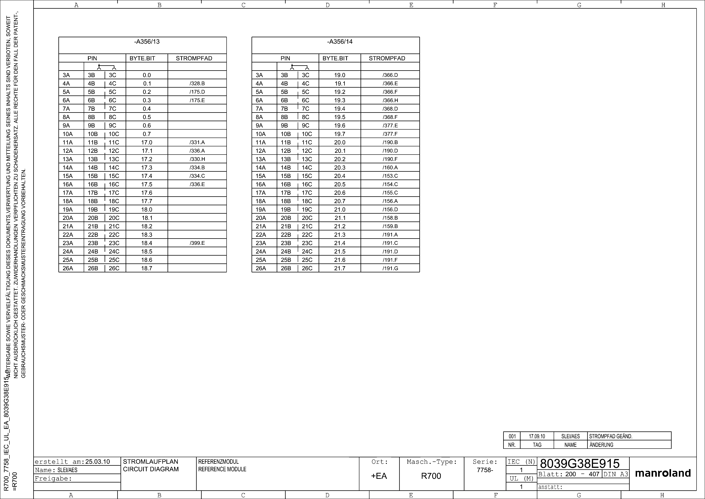

# +EA — Sheet 200 of 407 — REFERENZMODUL

**REFERENCE MODULE**

> Part of the manroland **R700** printing press IEC/UL circuit diagrams.
> Drawing class: **Stromlaufplan / Circuit diagram** (DIN A3).
> Document `+EA` covers the **Printing unit** machine section.

## At a glance

| Field | Value |
|---|---|
| Document | `+EA`  (8039G38E915) |
| Sheet | **200** of 407 |
| Section (DE) | REFERENZMODUL |
| Section (EN) | REFERENCE MODULE |
| Section type | REFERENCE_MODULE — Reference module |
| Machine type | `R700` |
| Series | `7758` |
| Created | 25.03.10 |
| Replaces | — |
| Columns used | A, B, C, D, E, F, G |
| Path numbers | — |
| Labels on sheet | 242 |
| Cross-refs out | 34 |
| Cross-refs in | 34 |

**Previous:** [+EA sheet 199](SHEET_0199.md) · **Next:** [+EA sheet 201](SHEET_0201.md) · **Document TOC:** [_TOC.md](_TOC.md)  (+EA) · **Master TOC:** [all sheets](../_MASTER_TOC.md)

## Sheet image (300 DPI, exact vector render)



_Rendered directly from the PDF vector layer at 300 DPI (1-bit), no OCR and no resampling. Use it to confirm anything ambiguous in the text below._

## Cross-references on this sheet

Each entry is a wire leaving this sheet. The printed token is `/sheet.column`; the link resolves to that sheet inside the same document.

| Ref | Target sheet | Col | Path | Destination on target | Target section | From col |
|---|---|---|---|---|---|---|
| `/366.D` | [+EA sheet 366](SHEET_0366.md) | D | — | — | OPTION: TROCKNER VORBEREITUNG; | E |
| `/328.B` | [+EA sheet 328](SHEET_0328.md) | B | — | — | OPTION: BOGENWEICHE | B |
| `/366.E` | [+EA sheet 366](SHEET_0366.md) | E | — | — | OPTION: TROCKNER VORBEREITUNG; | E |
| `/366.F` | [+EA sheet 366](SHEET_0366.md) | F | — | — | OPTION: TROCKNER VORBEREITUNG; | E |
| `/175.D` | [+EA sheet 175](SHEET_0175.md) | D | — | — | RESERVE | B |
| `/175.E` | [+EA sheet 175](SHEET_0175.md) | E | — | — | RESERVE | B |
| `/366.H` | [+EA sheet 366](SHEET_0366.md) | H | — | — | OPTION: TROCKNER VORBEREITUNG; | E |
| `/368.D` | [+EA sheet 368](SHEET_0368.md) | D | — | — | OPTION: ENDTROCKNER 1 VORBEREITUNG; | E |
| `/368.F` | [+EA sheet 368](SHEET_0368.md) | F | — | — | OPTION: ENDTROCKNER 1 VORBEREITUNG; | E |
| `/377.E` | [+EA sheet 377](SHEET_0377.md) | E | — | — | OPTION: ENDTROCKNER 2 VORBEREITUNG | E |
| `/377.F` | [+EA sheet 377](SHEET_0377.md) | F | — | — | OPTION: ENDTROCKNER 2 VORBEREITUNG | E |
| `/331.A` | [+EA sheet 331](SHEET_0331.md) | A | — | — | OPTION: BOGENWEICHE | B |
| `/190.B` | [+EA sheet 190](SHEET_0190.md) | B | — | — | RESERVE | E |
| `/336.A` | [+EA sheet 336](SHEET_0336.md) | A | — | — | OPTION: BOGENWEICHE | B |
| `/190.D` | [+EA sheet 190](SHEET_0190.md) | D | — | — | RESERVE | E |
| `/190.F` | [+EA sheet 190](SHEET_0190.md) | F | — | — | RESERVE | E |
| `/330.H` | [+EA sheet 330](SHEET_0330.md) | H | — | — | OPTION: BOGENWEICHE | B |
| `/334.B` | [+EA sheet 334](SHEET_0334.md) | B | — | — | OPTION: BOGENWEICHE | B |
| `/160.A` | [+EA sheet 160](SHEET_0160.md) | A | — | — | ZUGANGSABSICHERUNG | E |
| `/334.C` | [+EA sheet 334](SHEET_0334.md) | C | — | — | OPTION: BOGENWEICHE | B |
| `/153.C` | [+EA sheet 153](SHEET_0153.md) | C | — | — | ZUGANGSABSICHERUNG | E |
| `/336.E` | [+EA sheet 336](SHEET_0336.md) | E | — | — | OPTION: BOGENWEICHE | B |
| `/154.C` | [+EA sheet 154](SHEET_0154.md) | C | — | — | ZUGANGSABSICHERUNG | E |
| `/155.C` | [+EA sheet 155](SHEET_0155.md) | C | — | — | ZUGANGSABSICHERUNG | E |
| `/156.A` | [+EA sheet 156](SHEET_0156.md) | A | — | — | ZUGANGSABSICHERUNG | E |
| `/156.D` | [+EA sheet 156](SHEET_0156.md) | D | — | — | ZUGANGSABSICHERUNG | E |
| `/158.B` | [+EA sheet 158](SHEET_0158.md) | B | — | — | ZUGANGSABSICHERUNG | E |
| `/159.B` | [+EA sheet 159](SHEET_0159.md) | B | — | — | ZUGANGSABSICHERUNG | E |
| `/191.A` | [+EA sheet 191](SHEET_0191.md) | A | — | — | RESERVE | E |
| `/399.E` | [+EA sheet 399](SHEET_0399.md) | E | — | — | OPTION: DÜNNDRUCKEINRICHTUNG | B |
| `/191.C` | [+EA sheet 191](SHEET_0191.md) | C | — | — | RESERVE | E |
| `/191.D` | [+EA sheet 191](SHEET_0191.md) | D | — | — | RESERVE | E |
| `/191.F` | [+EA sheet 191](SHEET_0191.md) | F | — | — | RESERVE | E |
| `/191.G` | [+EA sheet 191](SHEET_0191.md) | G | — | — | RESERVE | E |

### Incoming references (sheets that point here)

Every other sheet that sends a wire to this one. `Back-ref` is the token printed on *that* sheet; `Path` is its line number.

| From sheet | Cols | Back-ref | Path | Refs | What continues there |
|---|---|---|---|---|---|
| [+EA#153](SHEET_0153.md) | C | `/153.C` | — | 1 | — |
| [+EA#154](SHEET_0154.md) | C | `/154.C` | — | 1 | — |
| [+EA#155](SHEET_0155.md) | C | `/155.C` | — | 1 | — |
| [+EA#156](SHEET_0156.md) | A, D | `/156.A`, `/156.D` | — | 2 | — |
| [+EA#158](SHEET_0158.md) | B | `/158.B` | — | 1 | — |
| [+EA#159](SHEET_0159.md) | B | `/159.B` | — | 1 | — |
| [+EA#160](SHEET_0160.md) | A | `/160.A` | — | 1 | — |
| [+EA#175](SHEET_0175.md) | D, E | `/175.D`, `/175.E` | — | 2 | — |
| [+EA#190](SHEET_0190.md) | B, D, F | `/190.B`, `/190.D`, `/190.F` | — | 3 | — |
| [+EA#191](SHEET_0191.md) | A, C, D, F, G | `/191.A`, `/191.C`, `/191.D`, `/191.F`, `/191.G` | — | 5 | — |
| [+EA#328](SHEET_0328.md) | B | `/328.B` | — | 1 | — |
| [+EA#330](SHEET_0330.md) | G | `/330.G` | — | 1 | — |
| [+EA#331](SHEET_0331.md) | A | `/331.A` | — | 1 | — |
| [+EA#334](SHEET_0334.md) | B, C | `/334.B`, `/334.C` | — | 2 | — |
| [+EA#336](SHEET_0336.md) | A, E | `/336.A`, `/336.E` | — | 2 | — |
| [+EA#366](SHEET_0366.md) | D, E, F, H | `/366.D`, `/366.E`, `/366.F`, `/366.H` | — | 4 | — |
| [+EA#368](SHEET_0368.md) | D, F | `/368.D`, `/368.F` | — | 2 | — |
| [+EA#377](SHEET_0377.md) | E, F | `/377.E`, `/377.F` | — | 2 | — |
| [+EA#399](SHEET_0399.md) | E | `/399.E` | — | 1 | — |


## Devices on this sheet

| Tag | Class | Class meaning (IEC) | Col | Sub | Terminal | Sign |
|---|---|---|---|---|---|---|
| `A356/13` | A | Baugruppe / assembly, module, PC board | B | 13 | — | — |
| `A356/14` | A | Baugruppe / assembly, module, PC board | D | 14 | — | — |
| `0.0` | — | cross-device reference | B | — | — | — |
| `0.1` | — | cross-device reference | B | — | — | — |
| `0.2` | — | cross-device reference | B | — | — | — |
| `0.3` | — | cross-device reference | B | — | — | — |
| `0.4` | — | cross-device reference | B | — | — | — |
| `0.5` | — | cross-device reference | B | — | — | — |
| `0.6` | — | cross-device reference | B | — | — | — |
| `0.7` | — | cross-device reference | B | — | — | — |
| `17.0` | — | cross-device reference | B | — | — | — |
| `17.1` | — | cross-device reference | B | — | — | — |
| `17.2` | — | cross-device reference | B | — | — | — |
| `17.3` | — | cross-device reference | B | — | — | — |
| `17.4` | — | cross-device reference | B | — | — | — |
| `17.5` | — | cross-device reference | B | — | — | — |
| `17.6` | — | cross-device reference | B | — | — | — |
| `17.7` | — | cross-device reference | B | — | — | — |
| `18.0` | — | cross-device reference | B | — | — | — |
| `18.1` | — | cross-device reference | B | — | — | — |
| `18.2` | — | cross-device reference | B | — | — | — |
| `18.3` | — | cross-device reference | B | — | — | — |
| `18.4` | — | cross-device reference | B | — | — | — |
| `18.5` | — | cross-device reference | B | — | — | — |
| `18.6` | — | cross-device reference | B | — | — | — |
| `18.7` | — | cross-device reference | B | — | — | — |
| `19.0` | — | cross-device reference | D | — | — | — |
| `19.1` | — | cross-device reference | D | — | — | — |
| `19.2` | — | cross-device reference | D | — | — | — |
| `19.3` | — | cross-device reference | D | — | — | — |
| `19.4` | — | cross-device reference | D | — | — | — |
| `19.5` | — | cross-device reference | D | — | — | — |
| `19.6` | — | cross-device reference | D | — | — | — |
| `19.7` | — | cross-device reference | D | — | — | — |
| `20.0` | — | cross-device reference | D | — | — | — |
| `20.1` | — | cross-device reference | D | — | — | — |
| `20.2` | — | cross-device reference | D | — | — | — |
| `20.3` | — | cross-device reference | D | — | — | — |
| `20.4` | — | cross-device reference | D | — | — | — |
| `20.5` | — | cross-device reference | D | — | — | — |
| `20.6` | — | cross-device reference | D | — | — | — |
| `20.7` | — | cross-device reference | D | — | — | — |
| `21.0` | — | cross-device reference | D | — | — | — |
| `21.1` | — | cross-device reference | D | — | — | — |
| `21.2` | — | cross-device reference | D | — | — | — |
| `21.3` | — | cross-device reference | D | — | — | — |
| `21.4` | — | cross-device reference | D | — | — | — |
| `21.5` | — | cross-device reference | D | — | — | — |
| `21.6` | — | cross-device reference | D | — | — | — |
| `21.7` | — | cross-device reference | D | — | — | — |
| `NR.` | — | cross-device reference | F | — | — | — |
| `17.09.10` | — | cross-device reference | F | — | — | — |

## Potentials / nets

_No named potentials on this sheet._

## Wire-end annotations (grouped as printed)

A wire that continues elsewhere is annotated with a small cluster: the destination description, the path/line number `#NN`, and the `/sheet.column` cross reference. Each row below is one such cluster exactly as it is grouped on the drawing.

| Col | Y | Path | Cross-ref | Text on the wire |
|---|---|---|---|---|
| B | 65.5 | — | — | `A356/13` |
| D | 65.5 | — | — | `A356/14` |
| A | 94.2 | — | — | `PIN` |
| B | 94.2 | — | — | `BYTE.BIT STROMPFAD` |
| C | 94.2 | — | — | `PIN` |
| D | 94.2 | — | — | `BYTE.BIT STROMPFAD` |
| A | 122.5 | — | — | `10A 11A 12A 13A 14A 15A 16A 17A 18A 19A 3A 4A 5A 6A 7A 8A 9A 20A` |
| A | 122.5 | — | — | `21A 22A 23A 24A 25A 26A 10B 11B 12B 13B 14B 15B 16B 17B 18B 19B 3B 4B 5B 6B 7B 8B 9B 20B` |
| A | 122.5 | — | — | `10C 11C 12C 13C 14C 15C 16C 17C 18C 19C 3C 4C 5C 6C 7C 8C 9C 20C 21C 22C 23C 24C 25C 26C` |
| B | 122.5 | — | — | `17.0 17.2 17.3 17.4 17.5 17.6 17.7 18.0 18.2 18.3 18.4 18.5 18.6 18.7 17.1 18.1 0.0 0.2 0.3 0.4 0.5 0.6 0.7 0.1` |
| C | 122.5 | — | — | `10A 11A 12A 13A 14A 15A 16A 17A 18A 19A 3A 4A 5A 6A 7A 8A 9A 20A` |
| C | 122.5 | — | — | `21A 22A 23A 24A 25A 26A 10B 11B 12B 13B 14B 15B 16B 17B 18B 19B 3B 4B 5B 6B 7B 8B 9B 20B` |
| D | 122.5 | — | — | `10C 11C 12C 13C 14C 15C 16C 17C 18C 19C 3C 4C 5C 6C 7C 8C 9C 20C 21C 22C 23C 24C 25C 26C` |
| D | 122.5 | — | — | `19.0 19.2 19.3 19.4 19.5 19.6 19.7 20.0 20.2 20.3 20.4 20.5 20.6 20.7 21.0 21.2 21.3 21.4 21.5 21.6 21.7 19.1 20.1 21.1` |
| E | 122.9 | — | `/366.D` | — |
| B | 137.0 | — | `/328.B` | — |
| E | 137.0 | — | `/366.E` | — |
| B | 151.2 | — | `/175.D` | — |
| E | 151.2 | — | `/366.F` | — |
| B | 165.4 | — | `/175.E` | — |
| E | 165.4 | — | `/366.H` | — |
| E | 179.6 | — | `/368.D` | — |
| E | 193.7 | — | `/368.F` | — |
| E | 207.9 | — | `/377.E` | — |
| E | 222.1 | — | `/377.F` | — |
| B | 236.2 | — | `/331.A` | — |
| E | 236.2 | — | `/190.B` | — |
| B | 250.4 | — | `/336.A` | — |
| E | 250.4 | — | `/190.D` | — |
| B | 264.6 | — | `/330.H` | — |
| E | 264.6 | — | `/190.F` | — |
| B | 278.8 | — | `/334.B` | — |
| E | 278.8 | — | `/160.A` | — |
| B | 293.0 | — | `/334.C` | — |
| E | 293.0 | — | `/153.C` | — |
| B | 307.1 | — | `/336.E` | — |
| E | 307.1 | — | `/154.C` | — |
| E | 321.3 | — | `/155.C` | — |
| E | 335.5 | — | `/156.A` | — |
| E | 349.7 | — | `/156.D` | — |
| E | 363.8 | — | `/158.B` | — |
| A | 377.6 | — | — | `21B 22B 23B 24B 25B 26B` |
| D | 377.6 | — | — | `21B 22B 23B 24B 25B 26B` |
| E | 378.0 | — | `/159.B` | — |
| E | 392.1 | — | `/191.A` | — |
| B | 406.3 | — | `/399.E` | — |
| E | 406.4 | — | `/191.C` | — |
| E | 420.5 | — | `/191.D` | — |
| E | 434.7 | — | `/191.F` | — |
| E | 448.9 | — | `/191.G` | — |
| G | 733.0 | — | — | `001 17.09.10 SLEI/AES STROMPFAD GEÄND.` |
| G | 747.1 | — | — | `NR. TAG NAME ÄNDERUNG` |


## Reconstructed tables

This sheet carries tabular content (pin map / terminal assignment / index). The grid below was rebuilt from the drawing's own rule lines, so each row is exactly one physical row of the table.

### Table 1 — 24 data rows × 5 columns (at x=99.2, y=62.4) — **A356/13**

|  | PIN |  | BYTE.BIT | STROMPFAD |
|---|---|---|---|---|
| `3A` | `3B` | `3C` | `0.0` |  |
| `4A` | `4B` | `4C` | `0.1` | `/328.B` |
| `5A` | `5B` | `5C` | `0.2` | `/175.D` |
| `6A` | `6B` | `6C` | `0.3` | `/175.E` |
| `7A` | `7B` | `7C` | `0.4` |  |
| `8A` | `8B` | `8C` | `0.5` |  |
| `9A` | `9B` | `9C` | `0.6` |  |
| `10A` | `10B` | `10C` | `0.7` |  |
| `11A` | `11B` | `11C` | `17.0` | `/331.A` |
| `12A` | `12B` | `12C` | `17.1` | `/336.A` |
| `13A` | `13B` | `13C` | `17.2` | `/330.H` |
| `14A` | `14B` | `14C` | `17.3` | `/334.B` |
| `15A` | `15B` | `15C` | `17.4` | `/334.C` |
| `16A` | `16B` | `16C` | `17.5` | `/336.E` |
| `17A` | `17B` | `17C` | `17.6` |  |
| `18A` | `18B` | `18C` | `17.7` |  |
| `19A` | `19B` | `19C` | `18.0` |  |
| `20A` | `20B` | `20C` | `18.1` |  |
| `21A` | `21B` | `21C` | `18.2` |  |
| `22A` | `22B` | `22C` | `18.3` |  |
| `23A` | `23B` | `23C` | `18.4` | `/399.E` |
| `24A` | `24B` | `24C` | `18.5` |  |
| `25A` | `25B` | `25C` | `18.6` |  |
| `26A` | `26B` | `26C` | `18.7` |  |


### Table 2 — 24 data rows × 5 columns (at x=425.2, y=62.4) — **A356/14**

|  | PIN |  | BYTE.BIT | STROMPFAD |
|---|---|---|---|---|
| `3A` | `3B` | `3C` | `19.0` | `/366.D` |
| `4A` | `4B` | `4C` | `19.1` | `/366.E` |
| `5A` | `5B` | `5C` | `19.2` | `/366.F` |
| `6A` | `6B` | `6C` | `19.3` | `/366.H` |
| `7A` | `7B` | `7C` | `19.4` | `/368.D` |
| `8A` | `8B` | `8C` | `19.5` | `/368.F` |
| `9A` | `9B` | `9C` | `19.6` | `/377.E` |
| `10A` | `10B` | `10C` | `19.7` | `/377.F` |
| `11A` | `11B` | `11C` | `20.0` | `/190.B` |
| `12A` | `12B` | `12C` | `20.1` | `/190.D` |
| `13A` | `13B` | `13C` | `20.2` | `/190.F` |
| `14A` | `14B` | `14C` | `20.3` | `/160.A` |
| `15A` | `15B` | `15C` | `20.4` | `/153.C` |
| `16A` | `16B` | `16C` | `20.5` | `/154.C` |
| `17A` | `17B` | `17C` | `20.6` | `/155.C` |
| `18A` | `18B` | `18C` | `20.7` | `/156.A` |
| `19A` | `19B` | `19C` | `21.0` | `/156.D` |
| `20A` | `20B` | `20C` | `21.1` | `/158.B` |
| `21A` | `21B` | `21C` | `21.2` | `/159.B` |
| `22A` | `22B` | `22C` | `21.3` | `/191.A` |
| `23A` | `23B` | `23C` | `21.4` | `/191.C` |
| `24A` | `24B` | `24C` | `21.5` | `/191.D` |
| `25A` | `25B` | `25C` | `21.6` | `/191.F` |
| `26A` | `26B` | `26C` | `21.7` | `/191.G` |


## Notes and free text on this sheet

| Text | Col | Y (pt) |
|---|---|---|
| `PIN` | A | 94.2 |
| `3A` | A | 122.53 |
| `4A` | A | 136.7 |
| `5A` | A | 150.87 |
| `6A` | A | 165.05 |
| `7A` | A | 179.22 |
| `8A` | A | 193.39 |
| `9A` | A | 207.57 |
| `10A` | A | 221.74 |
| `11A` | A | 235.92 |
| `12A` | A | 250.09 |
| `13A` | A | 264.26 |
| `14A` | A | 278.44 |
| `15A` | A | 292.61 |
| `16A` | A | 306.78 |
| `17A` | A | 320.96 |
| `18A` | A | 335.13 |
| `19A` | A | 349.3 |
| `20A` | A | 363.48 |
| `3B` | A | 122.53 |
| `4B` | A | 136.7 |
| `5B` | A | 150.87 |
| `6B` | A | 165.05 |
| `7B` | A | 179.22 |
| `8B` | A | 193.39 |
| `9B` | A | 207.57 |
| `10B` | A | 221.74 |
| `11B` | A | 235.92 |
| `12B` | A | 250.09 |
| `13B` | A | 264.26 |
| `14B` | A | 278.44 |
| `15B` | A | 292.61 |
| `16B` | A | 306.78 |
| `17B` | A | 320.96 |
| `18B` | A | 335.13 |
| `19B` | A | 349.3 |
| `20B` | A | 363.48 |
| `21A` | A | 377.65 |
| `22A` | A | 391.82 |
| `23A` | A | 406 |
| `24A` | A | 420.17 |
| `25A` | A | 434.34 |
| `26A` | A | 448.52 |
| `21B` | A | 377.65 |
| `22B` | A | 391.82 |
| `23B` | A | 406 |
| `24B` | A | 420.17 |
| `25B` | A | 434.34 |
| `26B` | A | 448.52 |
| `BYTE.BIT` | B | 94.17 |
| `STROMPFAD` | B | 94.15 |
| `3C` | A | 122.52 |
| `4C` | A | 136.69 |
| `5C` | A | 150.86 |
| `6C` | A | 165.04 |
| `7C` | A | 179.21 |
| `8C` | A | 193.38 |
| `9C` | A | 207.56 |
| `10C` | A | 221.74 |
| `11C` | A | 235.91 |
| `12C` | A | 250.08 |
| `13C` | A | 264.26 |
| `14C` | A | 278.43 |
| `15C` | A | 292.6 |
| `16C` | A | 306.78 |
| `17C` | A | 320.95 |
| `18C` | A | 335.12 |
| `19C` | A | 349.3 |
| `20C` | A | 363.47 |
| `21C` | A | 377.64 |
| `22C` | A | 391.82 |
| `23C` | A | 405.99 |
| `24C` | A | 420.16 |
| `25C` | A | 434.34 |
| `26C` | A | 448.51 |
| `PIN` | C | 94.2 |
| `3A` | C | 122.53 |
| `4A` | C | 136.7 |
| `5A` | C | 150.87 |
| `6A` | C | 165.05 |
| `7A` | C | 179.22 |
| `8A` | C | 193.39 |
| `9A` | C | 207.57 |
| `10A` | C | 221.74 |
| `11A` | C | 235.92 |
| `12A` | C | 250.09 |
| `13A` | C | 264.26 |
| `14A` | C | 278.44 |
| `15A` | C | 292.61 |
| `16A` | C | 306.78 |
| `17A` | C | 320.96 |
| `18A` | C | 335.13 |
| `19A` | C | 349.3 |
| `20A` | C | 363.48 |
| `3B` | C | 122.53 |
| `4B` | C | 136.7 |
| `5B` | C | 150.87 |
| `6B` | C | 165.05 |
| `7B` | C | 179.22 |
| `8B` | C | 193.39 |
| `9B` | C | 207.57 |
| `10B` | D | 221.74 |
| `11B` | D | 235.92 |
| `12B` | D | 250.09 |
| `13B` | D | 264.26 |
| `14B` | D | 278.44 |
| `15B` | D | 292.61 |
| `16B` | D | 306.78 |
| `17B` | D | 320.96 |
| `18B` | D | 335.13 |
| `19B` | D | 349.3 |
| `20B` | D | 363.48 |
| `21A` | C | 377.65 |
| `22A` | C | 391.82 |
| `23A` | C | 406 |
| `24A` | C | 420.17 |
| `25A` | C | 434.34 |
| `26A` | C | 448.52 |
| `21B` | D | 377.65 |
| `22B` | D | 391.82 |
| `23B` | D | 406 |
| `24B` | D | 420.17 |
| `25B` | D | 434.34 |
| `26B` | D | 448.52 |
| `BYTE.BIT` | D | 94.17 |
| `STROMPFAD` | E | 94.15 |
| `3C` | D | 122.52 |
| `4C` | D | 136.69 |
| `5C` | D | 150.86 |
| `6C` | D | 165.04 |
| `7C` | D | 179.21 |
| `8C` | D | 193.38 |
| `9C` | D | 207.56 |
| `10C` | D | 221.74 |
| `11C` | D | 235.91 |
| `12C` | D | 250.08 |
| `13C` | D | 264.26 |
| `14C` | D | 278.43 |
| `15C` | D | 292.6 |
| `16C` | D | 306.78 |
| `17C` | D | 320.95 |
| `18C` | D | 335.12 |
| `19C` | D | 349.3 |
| `20C` | D | 363.47 |
| `21C` | D | 377.64 |
| `22C` | D | 391.82 |
| `23C` | D | 405.99 |
| `24C` | D | 420.16 |
| `25C` | D | 434.34 |
| `26C` | D | 448.51 |
| `TAG` | G | 747.27 |
| `NAME` | G | 747.25 |
| `ÄNDERUNG` | G | 747.31 |
| `SLEI/AES` | G | 733.13 |
| `STROMPFAD GEÄND.` | G | 733.12 |

## Complete label inventory (exact text from the drawing)

Every text object inside the drawing area of this sheet, in DIN reading order (column A→H, then top→bottom). This is the authoritative list: if a string is not here it is not printed on this sheet.

| Col | Y | X | Dir | Type | Text |
|---|---|---|---|---|---|
| A | 94.2 | 148.0 | → | text | `PIN` |
| A | 122.5 | 106.0 | → | text | `3A` |
| A | 122.5 | 148.5 | → | text | `3B` |
| A | 122.5 | 184.0 | → | text | `3C` |
| A | 136.7 | 106.0 | → | text | `4A` |
| A | 136.7 | 148.5 | → | text | `4B` |
| A | 136.7 | 184.0 | → | text | `4C` |
| A | 150.9 | 106.0 | → | text | `5A` |
| A | 150.9 | 148.5 | → | text | `5B` |
| A | 150.9 | 184.0 | → | text | `5C` |
| A | 165.0 | 106.0 | → | text | `6A` |
| A | 165.0 | 148.5 | → | text | `6B` |
| A | 165.0 | 184.0 | → | text | `6C` |
| A | 179.2 | 106.0 | → | text | `7A` |
| A | 179.2 | 148.5 | → | text | `7B` |
| A | 179.2 | 184.0 | → | text | `7C` |
| A | 193.4 | 106.0 | → | text | `8A` |
| A | 193.4 | 148.5 | → | text | `8B` |
| A | 193.4 | 184.0 | → | text | `8C` |
| A | 207.6 | 106.0 | → | text | `9A` |
| A | 207.6 | 148.5 | → | text | `9B` |
| A | 207.6 | 184.0 | → | text | `9C` |
| A | 221.7 | 105.4 | → | text | `10A` |
| A | 221.7 | 148.0 | → | text | `10B` |
| A | 221.7 | 183.4 | → | text | `10C` |
| A | 235.9 | 105.4 | → | text | `11A` |
| A | 235.9 | 148.0 | → | text | `11B` |
| A | 235.9 | 183.4 | → | text | `11C` |
| A | 250.1 | 105.4 | → | text | `12A` |
| A | 250.1 | 148.0 | → | text | `12B` |
| A | 250.1 | 183.4 | → | text | `12C` |
| A | 264.3 | 105.4 | → | text | `13A` |
| A | 264.3 | 148.0 | → | text | `13B` |
| A | 264.3 | 183.4 | → | text | `13C` |
| A | 278.4 | 105.4 | → | text | `14A` |
| A | 278.4 | 148.0 | → | text | `14B` |
| A | 278.4 | 183.4 | → | text | `14C` |
| A | 292.6 | 105.4 | → | text | `15A` |
| A | 292.6 | 148.0 | → | text | `15B` |
| A | 292.6 | 183.4 | → | text | `15C` |
| A | 306.8 | 105.4 | → | text | `16A` |
| A | 306.8 | 148.0 | → | text | `16B` |
| A | 306.8 | 183.4 | → | text | `16C` |
| A | 321.0 | 105.4 | → | text | `17A` |
| A | 321.0 | 148.0 | → | text | `17B` |
| A | 321.0 | 183.4 | → | text | `17C` |
| A | 335.1 | 105.4 | → | text | `18A` |
| A | 335.1 | 148.0 | → | text | `18B` |
| A | 335.1 | 183.4 | → | text | `18C` |
| A | 349.3 | 105.4 | → | text | `19A` |
| A | 349.3 | 148.0 | → | text | `19B` |
| A | 349.3 | 183.4 | → | text | `19C` |
| A | 363.5 | 106.0 | → | text | `20A` |
| A | 363.5 | 148.5 | → | text | `20B` |
| A | 363.5 | 184.0 | → | text | `20C` |
| A | 377.6 | 106.0 | → | text | `21A` |
| A | 377.6 | 148.5 | → | text | `21B` |
| A | 377.6 | 184.0 | → | text | `21C` |
| A | 391.8 | 106.0 | → | text | `22A` |
| A | 391.8 | 148.5 | → | text | `22B` |
| A | 391.8 | 184.0 | → | text | `22C` |
| A | 406.0 | 106.0 | → | text | `23A` |
| A | 406.0 | 148.5 | → | text | `23B` |
| A | 406.0 | 184.0 | → | text | `23C` |
| A | 420.2 | 106.0 | → | text | `24A` |
| A | 420.2 | 148.5 | → | text | `24B` |
| A | 420.2 | 184.0 | → | text | `24C` |
| A | 434.3 | 106.0 | → | text | `25A` |
| A | 434.3 | 148.5 | → | text | `25B` |
| A | 434.3 | 184.0 | → | text | `25C` |
| A | 448.5 | 106.0 | → | text | `26A` |
| A | 448.5 | 148.5 | → | text | `26B` |
| A | 448.5 | 184.0 | → | text | `26C` |
| B | 65.5 | 226.6 | → | device tag | `A356/13` |
| B | 94.2 | 218.8 | → | text | `BYTE.BIT` |
| B | 94.2 | 297.1 | → | text | `STROMPFAD` |
| B | 122.5 | 241.2 | → | device ref | `0.0` |
| B | 136.7 | 242.1 | → | device ref | `0.1` |
| B | 137.0 | 320.5 | → | cross-reference | `/328.B` |
| B | 150.9 | 241.2 | → | device ref | `0.2` |
| B | 151.2 | 320.3 | → | cross-reference | `/175.D` |
| B | 165.0 | 241.2 | → | device ref | `0.3` |
| B | 165.4 | 320.6 | → | cross-reference | `/175.E` |
| B | 179.2 | 241.2 | → | device ref | `0.4` |
| B | 193.4 | 241.2 | → | device ref | `0.5` |
| B | 207.5 | 241.2 | → | device ref | `0.6` |
| B | 221.7 | 241.2 | → | device ref | `0.7` |
| B | 235.9 | 238.3 | → | device ref | `17.0` |
| B | 236.2 | 320.3 | → | cross-reference | `/331.A` |
| B | 250.1 | 239.1 | → | device ref | `17.1` |
| B | 250.4 | 320.3 | → | cross-reference | `/336.A` |
| B | 264.2 | 238.3 | → | device ref | `17.2` |
| B | 264.6 | 320.6 | → | cross-reference | `/330.H` |
| B | 278.4 | 238.3 | → | device ref | `17.3` |
| B | 278.8 | 320.5 | → | cross-reference | `/334.B` |
| B | 292.6 | 238.3 | → | device ref | `17.4` |
| B | 293.0 | 320.3 | → | cross-reference | `/334.C` |
| B | 306.8 | 238.3 | → | device ref | `17.5` |
| B | 307.1 | 320.6 | → | cross-reference | `/336.E` |
| B | 320.9 | 238.3 | → | device ref | `17.6` |
| B | 335.1 | 238.3 | → | device ref | `17.7` |
| B | 349.3 | 238.3 | → | device ref | `18.0` |
| B | 363.5 | 239.1 | → | device ref | `18.1` |
| B | 377.6 | 238.3 | → | device ref | `18.2` |
| B | 391.8 | 238.3 | → | device ref | `18.3` |
| B | 406.0 | 238.3 | → | device ref | `18.4` |
| B | 406.3 | 320.6 | → | cross-reference | `/399.E` |
| B | 420.2 | 238.3 | → | device ref | `18.5` |
| B | 434.3 | 238.3 | → | device ref | `18.6` |
| B | 448.5 | 238.3 | → | device ref | `18.7` |
| C | 94.2 | 474.0 | → | text | `PIN` |
| C | 122.5 | 432.0 | → | text | `3A` |
| C | 122.5 | 474.5 | → | text | `3B` |
| C | 136.7 | 432.0 | → | text | `4A` |
| C | 136.7 | 474.5 | → | text | `4B` |
| C | 150.9 | 432.0 | → | text | `5A` |
| C | 150.9 | 474.5 | → | text | `5B` |
| C | 165.0 | 432.0 | → | text | `6A` |
| C | 165.0 | 474.5 | → | text | `6B` |
| C | 179.2 | 432.0 | → | text | `7A` |
| C | 179.2 | 474.5 | → | text | `7B` |
| C | 193.4 | 432.0 | → | text | `8A` |
| C | 193.4 | 474.5 | → | text | `8B` |
| C | 207.6 | 432.0 | → | text | `9A` |
| C | 207.6 | 474.5 | → | text | `9B` |
| C | 221.7 | 431.4 | → | text | `10A` |
| C | 235.9 | 431.4 | → | text | `11A` |
| C | 250.1 | 431.4 | → | text | `12A` |
| C | 264.3 | 431.4 | → | text | `13A` |
| C | 278.4 | 431.4 | → | text | `14A` |
| C | 292.6 | 431.4 | → | text | `15A` |
| C | 306.8 | 431.4 | → | text | `16A` |
| C | 321.0 | 431.4 | → | text | `17A` |
| C | 335.1 | 431.4 | → | text | `18A` |
| C | 349.3 | 431.4 | → | text | `19A` |
| C | 363.5 | 432.0 | → | text | `20A` |
| C | 377.6 | 432.0 | → | text | `21A` |
| C | 391.8 | 432.0 | → | text | `22A` |
| C | 406.0 | 432.0 | → | text | `23A` |
| C | 420.2 | 432.0 | → | text | `24A` |
| C | 434.3 | 432.0 | → | text | `25A` |
| C | 448.5 | 432.0 | → | text | `26A` |
| D | 65.5 | 552.6 | → | device tag | `A356/14` |
| D | 94.2 | 544.8 | → | text | `BYTE.BIT` |
| D | 122.5 | 510.0 | → | text | `3C` |
| D | 122.5 | 564.2 | → | device ref | `19.0` |
| D | 136.7 | 510.0 | → | text | `4C` |
| D | 136.7 | 565.1 | → | device ref | `19.1` |
| D | 150.9 | 510.0 | → | text | `5C` |
| D | 150.9 | 564.2 | → | device ref | `19.2` |
| D | 165.0 | 510.0 | → | text | `6C` |
| D | 165.0 | 564.2 | → | device ref | `19.3` |
| D | 179.2 | 510.0 | → | text | `7C` |
| D | 179.2 | 564.2 | → | device ref | `19.4` |
| D | 193.4 | 510.0 | → | text | `8C` |
| D | 193.4 | 564.2 | → | device ref | `19.5` |
| D | 207.6 | 510.0 | → | text | `9C` |
| D | 207.6 | 564.2 | → | device ref | `19.6` |
| D | 221.7 | 474.0 | → | text | `10B` |
| D | 221.7 | 509.4 | → | text | `10C` |
| D | 221.7 | 564.2 | → | device ref | `19.7` |
| D | 235.9 | 474.0 | → | text | `11B` |
| D | 235.9 | 509.4 | → | text | `11C` |
| D | 235.9 | 564.5 | → | device ref | `20.0` |
| D | 250.1 | 474.0 | → | text | `12B` |
| D | 250.1 | 509.4 | → | text | `12C` |
| D | 250.1 | 565.4 | → | device ref | `20.1` |
| D | 264.2 | 564.5 | → | device ref | `20.2` |
| D | 264.3 | 474.0 | → | text | `13B` |
| D | 264.3 | 509.4 | → | text | `13C` |
| D | 278.4 | 474.0 | → | text | `14B` |
| D | 278.4 | 509.4 | → | text | `14C` |
| D | 278.4 | 564.5 | → | device ref | `20.3` |
| D | 292.6 | 474.0 | → | text | `15B` |
| D | 292.6 | 509.4 | → | text | `15C` |
| D | 292.6 | 564.5 | → | device ref | `20.4` |
| D | 306.8 | 474.0 | → | text | `16B` |
| D | 306.8 | 509.4 | → | text | `16C` |
| D | 306.8 | 564.5 | → | device ref | `20.5` |
| D | 320.9 | 564.5 | → | device ref | `20.6` |
| D | 321.0 | 474.0 | → | text | `17B` |
| D | 321.0 | 509.4 | → | text | `17C` |
| D | 335.1 | 474.0 | → | text | `18B` |
| D | 335.1 | 509.4 | → | text | `18C` |
| D | 335.1 | 564.5 | → | device ref | `20.7` |
| D | 349.3 | 474.0 | → | text | `19B` |
| D | 349.3 | 509.4 | → | text | `19C` |
| D | 349.3 | 564.5 | → | device ref | `21.0` |
| D | 363.5 | 474.5 | → | text | `20B` |
| D | 363.5 | 510.0 | → | text | `20C` |
| D | 363.5 | 565.4 | → | device ref | `21.1` |
| D | 377.6 | 474.5 | → | text | `21B` |
| D | 377.6 | 510.0 | → | text | `21C` |
| D | 377.6 | 564.5 | → | device ref | `21.2` |
| D | 391.8 | 474.5 | → | text | `22B` |
| D | 391.8 | 510.0 | → | text | `22C` |
| D | 391.8 | 564.5 | → | device ref | `21.3` |
| D | 406.0 | 474.5 | → | text | `23B` |
| D | 406.0 | 510.0 | → | text | `23C` |
| D | 406.0 | 564.5 | → | device ref | `21.4` |
| D | 420.2 | 474.5 | → | text | `24B` |
| D | 420.2 | 510.0 | → | text | `24C` |
| D | 420.2 | 564.5 | → | device ref | `21.5` |
| D | 434.3 | 474.5 | → | text | `25B` |
| D | 434.3 | 510.0 | → | text | `25C` |
| D | 434.3 | 564.5 | → | device ref | `21.6` |
| D | 448.5 | 474.5 | → | text | `26B` |
| D | 448.5 | 510.0 | → | text | `26C` |
| D | 448.5 | 564.5 | → | device ref | `21.7` |
| E | 94.2 | 623.1 | → | text | `STROMPFAD` |
| E | 122.9 | 646.3 | → | cross-reference | `/366.D` |
| E | 137.0 | 646.6 | → | cross-reference | `/366.E` |
| E | 151.2 | 646.7 | → | cross-reference | `/366.F` |
| E | 165.4 | 646.6 | → | cross-reference | `/366.H` |
| E | 179.6 | 646.3 | → | cross-reference | `/368.D` |
| E | 193.7 | 646.7 | → | cross-reference | `/368.F` |
| E | 207.9 | 646.6 | → | cross-reference | `/377.E` |
| E | 222.1 | 646.7 | → | cross-reference | `/377.F` |
| E | 236.2 | 646.4 | → | cross-reference | `/190.B` |
| E | 250.4 | 646.3 | → | cross-reference | `/190.D` |
| E | 264.6 | 646.7 | → | cross-reference | `/190.F` |
| E | 278.8 | 646.3 | → | cross-reference | `/160.A` |
| E | 293.0 | 646.3 | → | cross-reference | `/153.C` |
| E | 307.1 | 646.3 | → | cross-reference | `/154.C` |
| E | 321.3 | 646.3 | → | cross-reference | `/155.C` |
| E | 335.5 | 646.3 | → | cross-reference | `/156.A` |
| E | 349.7 | 646.3 | → | cross-reference | `/156.D` |
| E | 363.8 | 646.4 | → | cross-reference | `/158.B` |
| E | 378.0 | 646.4 | → | cross-reference | `/159.B` |
| E | 392.2 | 646.3 | → | cross-reference | `/191.A` |
| E | 406.4 | 646.3 | → | cross-reference | `/191.C` |
| E | 420.5 | 646.3 | → | cross-reference | `/191.D` |
| E | 434.7 | 646.7 | → | cross-reference | `/191.F` |
| E | 448.9 | 646.2 | → | cross-reference | `/191.G` |
| F | 733.0 | 859.4 | → | number | `001` |
| F | 733.1 | 893.2 | → | device ref | `17.09.10` |
| F | 747.1 | 858.4 | → | device ref | `NR.` |
| G | 733.1 | 948.2 | → | text | `SLEI/AES` |
| G | 733.1 | 995.1 | → | text | `STROMPFAD GEÄND.` |
| G | 747.3 | 900.0 | → | text | `TAG` |
| G | 747.3 | 953.4 | → | text | `NAME` |
| G | 747.3 | 996.0 | → | text | `ÄNDERUNG` |

## Reading-order text block

The same content as a plain block, grouped by DIN column — convenient to paste or to match against a visual description.

```text
=== Column A ===
  94.2  148.0  text         PIN
 122.5  106.0  text         3A
 122.5  148.5  text         3B
 122.5  184.0  text         3C
 136.7  106.0  text         4A
 136.7  148.5  text         4B
 136.7  184.0  text         4C
 150.9  106.0  text         5A
 150.9  148.5  text         5B
 150.9  184.0  text         5C
 165.0  106.0  text         6A
 165.0  148.5  text         6B
 165.0  184.0  text         6C
 179.2  106.0  text         7A
 179.2  148.5  text         7B
 179.2  184.0  text         7C
 193.4  106.0  text         8A
 193.4  148.5  text         8B
 193.4  184.0  text         8C
 207.6  106.0  text         9A
 207.6  148.5  text         9B
 207.6  184.0  text         9C
 221.7  105.4  text         10A
 221.7  148.0  text         10B
 221.7  183.4  text         10C
 235.9  105.4  text         11A
 235.9  148.0  text         11B
 235.9  183.4  text         11C
 250.1  105.4  text         12A
 250.1  148.0  text         12B
 250.1  183.4  text         12C
 264.3  105.4  text         13A
 264.3  148.0  text         13B
 264.3  183.4  text         13C
 278.4  105.4  text         14A
 278.4  148.0  text         14B
 278.4  183.4  text         14C
 292.6  105.4  text         15A
 292.6  148.0  text         15B
 292.6  183.4  text         15C
 306.8  105.4  text         16A
 306.8  148.0  text         16B
 306.8  183.4  text         16C
 321.0  105.4  text         17A
 321.0  148.0  text         17B
 321.0  183.4  text         17C
 335.1  105.4  text         18A
 335.1  148.0  text         18B
 335.1  183.4  text         18C
 349.3  105.4  text         19A
 349.3  148.0  text         19B
 349.3  183.4  text         19C
 363.5  106.0  text         20A
 363.5  148.5  text         20B
 363.5  184.0  text         20C
 377.6  106.0  text         21A
 377.6  148.5  text         21B
 377.6  184.0  text         21C
 391.8  106.0  text         22A
 391.8  148.5  text         22B
 391.8  184.0  text         22C
 406.0  106.0  text         23A
 406.0  148.5  text         23B
 406.0  184.0  text         23C
 420.2  106.0  text         24A
 420.2  148.5  text         24B
 420.2  184.0  text         24C
 434.3  106.0  text         25A
 434.3  148.5  text         25B
 434.3  184.0  text         25C
 448.5  106.0  text         26A
 448.5  148.5  text         26B
 448.5  184.0  text         26C
=== Column B ===
  65.5  226.6  devtag       A356/13
  94.2  218.8  text         BYTE.BIT
  94.2  297.1  text         STROMPFAD
 122.5  241.2  devref       0.0
 136.7  242.1  devref       0.1
 137.0  320.5  xref         /328.B
 150.9  241.2  devref       0.2
 151.2  320.3  xref         /175.D
 165.0  241.2  devref       0.3
 165.4  320.6  xref         /175.E
 179.2  241.2  devref       0.4
 193.4  241.2  devref       0.5
 207.5  241.2  devref       0.6
 221.7  241.2  devref       0.7
 235.9  238.3  devref       17.0
 236.2  320.3  xref         /331.A
 250.1  239.1  devref       17.1
 250.4  320.3  xref         /336.A
 264.2  238.3  devref       17.2
 264.6  320.6  xref         /330.H
 278.4  238.3  devref       17.3
 278.8  320.5  xref         /334.B
 292.6  238.3  devref       17.4
 293.0  320.3  xref         /334.C
 306.8  238.3  devref       17.5
 307.1  320.6  xref         /336.E
 320.9  238.3  devref       17.6
 335.1  238.3  devref       17.7
 349.3  238.3  devref       18.0
 363.5  239.1  devref       18.1
 377.6  238.3  devref       18.2
 391.8  238.3  devref       18.3
 406.0  238.3  devref       18.4
 406.3  320.6  xref         /399.E
 420.2  238.3  devref       18.5
 434.3  238.3  devref       18.6
 448.5  238.3  devref       18.7
=== Column C ===
  94.2  474.0  text         PIN
 122.5  432.0  text         3A
 122.5  474.5  text         3B
 136.7  432.0  text         4A
 136.7  474.5  text         4B
 150.9  432.0  text         5A
 150.9  474.5  text         5B
 165.0  432.0  text         6A
 165.0  474.5  text         6B
 179.2  432.0  text         7A
 179.2  474.5  text         7B
 193.4  432.0  text         8A
 193.4  474.5  text         8B
 207.6  432.0  text         9A
 207.6  474.5  text         9B
 221.7  431.4  text         10A
 235.9  431.4  text         11A
 250.1  431.4  text         12A
 264.3  431.4  text         13A
 278.4  431.4  text         14A
 292.6  431.4  text         15A
 306.8  431.4  text         16A
 321.0  431.4  text         17A
 335.1  431.4  text         18A
 349.3  431.4  text         19A
 363.5  432.0  text         20A
 377.6  432.0  text         21A
 391.8  432.0  text         22A
 406.0  432.0  text         23A
 420.2  432.0  text         24A
 434.3  432.0  text         25A
 448.5  432.0  text         26A
=== Column D ===
  65.5  552.6  devtag       A356/14
  94.2  544.8  text         BYTE.BIT
 122.5  510.0  text         3C
 122.5  564.2  devref       19.0
 136.7  510.0  text         4C
 136.7  565.1  devref       19.1
 150.9  510.0  text         5C
 150.9  564.2  devref       19.2
 165.0  510.0  text         6C
 165.0  564.2  devref       19.3
 179.2  510.0  text         7C
 179.2  564.2  devref       19.4
 193.4  510.0  text         8C
 193.4  564.2  devref       19.5
 207.6  510.0  text         9C
 207.6  564.2  devref       19.6
 221.7  474.0  text         10B
 221.7  509.4  text         10C
 221.7  564.2  devref       19.7
 235.9  474.0  text         11B
 235.9  509.4  text         11C
 235.9  564.5  devref       20.0
 250.1  474.0  text         12B
 250.1  509.4  text         12C
 250.1  565.4  devref       20.1
 264.2  564.5  devref       20.2
 264.3  474.0  text         13B
 264.3  509.4  text         13C
 278.4  474.0  text         14B
 278.4  509.4  text         14C
 278.4  564.5  devref       20.3
 292.6  474.0  text         15B
 292.6  509.4  text         15C
 292.6  564.5  devref       20.4
 306.8  474.0  text         16B
 306.8  509.4  text         16C
 306.8  564.5  devref       20.5
 320.9  564.5  devref       20.6
 321.0  474.0  text         17B
 321.0  509.4  text         17C
 335.1  474.0  text         18B
 335.1  509.4  text         18C
 335.1  564.5  devref       20.7
 349.3  474.0  text         19B
 349.3  509.4  text         19C
 349.3  564.5  devref       21.0
 363.5  474.5  text         20B
 363.5  510.0  text         20C
 363.5  565.4  devref       21.1
 377.6  474.5  text         21B
 377.6  510.0  text         21C
 377.6  564.5  devref       21.2
 391.8  474.5  text         22B
 391.8  510.0  text         22C
 391.8  564.5  devref       21.3
 406.0  474.5  text         23B
 406.0  510.0  text         23C
 406.0  564.5  devref       21.4
 420.2  474.5  text         24B
 420.2  510.0  text         24C
 420.2  564.5  devref       21.5
 434.3  474.5  text         25B
 434.3  510.0  text         25C
 434.3  564.5  devref       21.6
 448.5  474.5  text         26B
 448.5  510.0  text         26C
 448.5  564.5  devref       21.7
=== Column E ===
  94.2  623.1  text         STROMPFAD
 122.9  646.3  xref         /366.D
 137.0  646.6  xref         /366.E
 151.2  646.7  xref         /366.F
 165.4  646.6  xref         /366.H
 179.6  646.3  xref         /368.D
 193.7  646.7  xref         /368.F
 207.9  646.6  xref         /377.E
 222.1  646.7  xref         /377.F
 236.2  646.4  xref         /190.B
 250.4  646.3  xref         /190.D
 264.6  646.7  xref         /190.F
 278.8  646.3  xref         /160.A
 293.0  646.3  xref         /153.C
 307.1  646.3  xref         /154.C
 321.3  646.3  xref         /155.C
 335.5  646.3  xref         /156.A
 349.7  646.3  xref         /156.D
 363.8  646.4  xref         /158.B
 378.0  646.4  xref         /159.B
 392.2  646.3  xref         /191.A
 406.4  646.3  xref         /191.C
 420.5  646.3  xref         /191.D
 434.7  646.7  xref         /191.F
 448.9  646.2  xref         /191.G
=== Column F ===
 733.0  859.4  numeric      001
 733.1  893.2  devref       17.09.10
 747.1  858.4  devref       NR.
=== Column G ===
 733.1  948.2  text         SLEI/AES
 733.1  995.1  text         STROMPFAD GEÄND.
 747.3  900.0  text         TAG
 747.3  953.4  text         NAME
 747.3  996.0  text         ÄNDERUNG
```

---
_Generated from the PDF vector text layer; no OCR. Source: `R700_7758_IEC_UL_EA_8039G38E915_p`, sheet 200._
