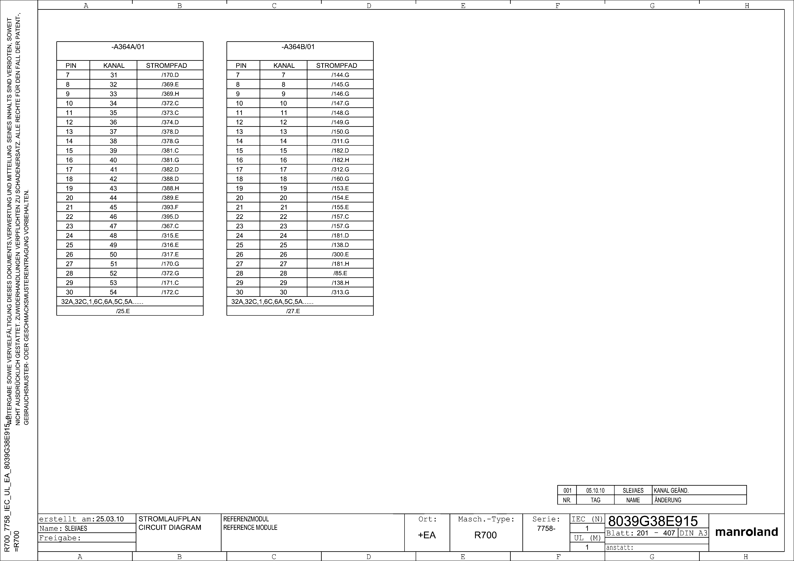

# +EA — Sheet 201 of 407 — REFERENZMODUL

**REFERENCE MODULE**

> Part of the manroland **R700** printing press IEC/UL circuit diagrams.
> Drawing class: **Stromlaufplan / Circuit diagram** (DIN A3).
> Document `+EA` covers the **Printing unit** machine section.

## At a glance

| Field | Value |
|---|---|
| Document | `+EA`  (8039G38E915) |
| Sheet | **201** of 407 |
| Section (DE) | REFERENZMODUL |
| Section (EN) | REFERENCE MODULE |
| Section type | REFERENCE_MODULE — Reference module |
| Machine type | `R700` |
| Series | `7758` |
| Created | 25.03.10 |
| Replaces | — |
| Columns used | A, B, C, D, F, G |
| Path numbers | — |
| Labels on sheet | 164 |
| Cross-refs out | 50 |
| Cross-refs in | 50 |

**Previous:** [+EA sheet 200](SHEET_0200.md) · **Next:** [+EA sheet 202](SHEET_0202.md) · **Document TOC:** [_TOC.md](_TOC.md)  (+EA) · **Master TOC:** [all sheets](../_MASTER_TOC.md)

## Sheet image (300 DPI, exact vector render)



_Rendered directly from the PDF vector layer at 300 DPI (1-bit), no OCR and no resampling. Use it to confirm anything ambiguous in the text below._

## Cross-references on this sheet

Each entry is a wire leaving this sheet. The printed token is `/sheet.column`; the link resolves to that sheet inside the same document.

| Ref | Target sheet | Col | Path | Destination on target | Target section | From col |
|---|---|---|---|---|---|---|
| `/144.G` | [+EA sheet 144](SHEET_0144.md) | G | — | — | ZUGANGSABSICHERUNG | D |
| `/170.D` | [+EA sheet 170](SHEET_0170.md) | D | — | — | RESERVE | B |
| `/369.E` | [+EA sheet 369](SHEET_0369.md) | E | — | — | OPTION: ENDTROCKNER 1 VORBEREITUNG; | B |
| `/145.G` | [+EA sheet 145](SHEET_0145.md) | G | — | — | ZUGANGSABSICHERUNG | D |
| `/146.G` | [+EA sheet 146](SHEET_0146.md) | G | — | — | ZUGANGSABSICHERUNG | D |
| `/369.H` | [+EA sheet 369](SHEET_0369.md) | H | — | — | OPTION: ENDTROCKNER 1 VORBEREITUNG; | B |
| `/147.G` | [+EA sheet 147](SHEET_0147.md) | G | — | — | ZUGANGSABSICHERUNG | D |
| `/372.C` | [+EA sheet 372](SHEET_0372.md) | C | — | — | OPTION: ENDTROCKNER 1 VORBEREITUNG; | B |
| `/148.G` | [+EA sheet 148](SHEET_0148.md) | G | — | — | ZUGANGSABSICHERUNG | D |
| `/373.C` | [+EA sheet 373](SHEET_0373.md) | C | — | — | OPTION: ENDTROCKNER 1 VORBEREITUNG; | B |
| `/149.G` | [+EA sheet 149](SHEET_0149.md) | G | — | — | ZUGANGSABSICHERUNG | D |
| `/374.D` | [+EA sheet 374](SHEET_0374.md) | D | — | — | OPTION: ENDTROCKNER 1 VORBEREITUNG; | B |
| `/150.G` | [+EA sheet 150](SHEET_0150.md) | G | — | — | ZUGANGSABSICHERUNG | D |
| `/378.D` | [+EA sheet 378](SHEET_0378.md) | D | — | — | OPTION: ENDTROCKNER 2 VORBEREITUNG | B |
| `/378.G` | [+EA sheet 378](SHEET_0378.md) | G | — | — | OPTION: ENDTROCKNER 2 VORBEREITUNG | B |
| `/311.G` | [+EA sheet 311](SHEET_0311.md) | G | — | — | OPTION: AUTOMATISCHE STAPELAUFFAHRT STOP / | D |
| `/381.C` | [+EA sheet 381](SHEET_0381.md) | C | — | — | OPTION: ENDTROCKNER 2 VORBEREITUNG | B |
| `/182.D` | [+EA sheet 182](SHEET_0182.md) | D | — | — | RESERVE | D |
| `/381.G` | [+EA sheet 381](SHEET_0381.md) | G | — | — | OPTION: ENDTROCKNER 2 VORBEREITUNG | B |
| `/182.H` | [+EA sheet 182](SHEET_0182.md) | H | — | — | RESERVE | D |
| `/312.G` | [+EA sheet 312](SHEET_0312.md) | G | — | — | OPTION: LOGISTIK, AUSLEGER | D |
| `/382.D` | [+EA sheet 382](SHEET_0382.md) | D | — | — | OPTION: ENDTROCKNER 2 VORBEREITUNG | B |
| `/160.G` | [+EA sheet 160](SHEET_0160.md) | G | — | — | ZUGANGSABSICHERUNG | D |
| `/388.D` | [+EA sheet 388](SHEET_0388.md) | D | — | — | OPTION: ZWISCHENTROCKNER VORBEREITUNG; | B |
| `/153.E` | [+EA sheet 153](SHEET_0153.md) | E | — | — | ZUGANGSABSICHERUNG | D |
| `/388.H` | [+EA sheet 388](SHEET_0388.md) | H | — | — | OPTION: ZWISCHENTROCKNER VORBEREITUNG; | B |
| `/389.E` | [+EA sheet 389](SHEET_0389.md) | E | — | — | OPTION: ZWISCHENTROCKNER VORBEREITUNG; | B |
| `/154.E` | [+EA sheet 154](SHEET_0154.md) | E | — | — | ZUGANGSABSICHERUNG | D |
| `/155.E` | [+EA sheet 155](SHEET_0155.md) | E | — | — | ZUGANGSABSICHERUNG | D |
| `/393.F` | [+EA sheet 393](SHEET_0393.md) | F | — | — | OPTION: ZWISCHENTROCKNER VORBEREITUNG; | B |
| `/395.D` | [+EA sheet 395](SHEET_0395.md) | D | — | — | OPTION: ZWISCHENTROCKNER VORBEREITUNG; | B |
| `/157.C` | [+EA sheet 157](SHEET_0157.md) | C | — | — | ZUGANGSABSICHERUNG | D |
| `/157.G` | [+EA sheet 157](SHEET_0157.md) | G | — | — | ZUGANGSABSICHERUNG | D |
| `/367.C` | [+EA sheet 367](SHEET_0367.md) | C | — | — | OPTION: TROCKNER VORBEREITUNG; | B |
| `/315.E` | [+EA sheet 315](SHEET_0315.md) | E | — | — | OPTION: LOGISTIK, AUSLEGER | B |
| `/181.D` | [+EA sheet 181](SHEET_0181.md) | D | — | — | RESERVE | D |
| `/316.E` | [+EA sheet 316](SHEET_0316.md) | E | — | — | OPTION: LOGISTIK, AUSLEGER | B |
| `/138.D` | [+EA sheet 138](SHEET_0138.md) | D | — | — | ZUGANGSABSICHERUNG | D |
| `/317.E` | [+EA sheet 317](SHEET_0317.md) | E | — | — | OPTION: LOGISTIK, AUSLEGER | B |
| `/300.E` | [+EA sheet 300](SHEET_0300.md) | E | — | — | OPTION: ZWISCHENSTAPEL / | D |
| `/170.G` | [+EA sheet 170](SHEET_0170.md) | G | — | — | RESERVE | B |
| `/181.H` | [+EA sheet 181](SHEET_0181.md) | H | — | — | RESERVE | D |
| `/85.E` | [+EA sheet 85](SHEET_0085.md) | E | — | — | AUSLEGERSTAPELSTEUERUNG: PROGRAMMSCHALTWERK | D |
| `/372.G` | [+EA sheet 372](SHEET_0372.md) | G | — | — | OPTION: ENDTROCKNER 1 VORBEREITUNG; | B |
| `/171.C` | [+EA sheet 171](SHEET_0171.md) | C | — | — | RESERVE | B |
| `/138.H` | [+EA sheet 138](SHEET_0138.md) | H | — | — | ZUGANGSABSICHERUNG | D |
| `/313.G` | [+EA sheet 313](SHEET_0313.md) | G | — | — | OPTION: LOGISTIK, AUSLEGER | D |
| `/172.C` | [+EA sheet 172](SHEET_0172.md) | C | — | — | RESERVE | B |
| `/25.E` | [+EA sheet 25](SHEET_0025.md) | E | — | — | BUSVERBINDUNGEN: SICHERHEITSBUS | A |
| `/27.E` | [+EA sheet 27](SHEET_0027.md) | E | — | — | BUSVERBINDUNGEN: SICHERHEITSBUS | C |

### Incoming references (sheets that point here)

Every other sheet that sends a wire to this one. `Back-ref` is the token printed on *that* sheet; `Path` is its line number.

| From sheet | Cols | Back-ref | Path | Refs | What continues there |
|---|---|---|---|---|---|
| [+EA#25](SHEET_0025.md) | D | `/25.D` | — | 1 | — |
| [+EA#27](SHEET_0027.md) | E | `/27.E` | — | 1 | — |
| [+EA#85](SHEET_0085.md) | E | `/85.E` | — | 1 | — |
| [+EA#138](SHEET_0138.md) | D, G | `/138.D`, `/138.G` | — | 2 | — |
| [+EA#144](SHEET_0144.md) | G | `/144.G` | — | 1 | — |
| [+EA#145](SHEET_0145.md) | G | `/145.G` | — | 1 | — |
| [+EA#146](SHEET_0146.md) | G | `/146.G` | — | 1 | — |
| [+EA#147](SHEET_0147.md) | G | `/147.G` | — | 1 | — |
| [+EA#148](SHEET_0148.md) | G | `/148.G` | — | 1 | — |
| [+EA#149](SHEET_0149.md) | G | `/149.G` | — | 1 | — |
| [+EA#150](SHEET_0150.md) | G | `/150.G` | — | 1 | — |
| [+EA#153](SHEET_0153.md) | E | `/153.E` | — | 1 | — |
| [+EA#154](SHEET_0154.md) | E | `/154.E` | — | 1 | — |
| [+EA#155](SHEET_0155.md) | E | `/155.E` | — | 1 | — |
| [+EA#157](SHEET_0157.md) | C, G | `/157.C`, `/157.G` | — | 2 | — |
| [+EA#160](SHEET_0160.md) | G | `/160.G` | — | 1 | — |
| [+EA#170](SHEET_0170.md) | D, G | `/170.D`, `/170.G` | — | 2 | — |
| [+EA#171](SHEET_0171.md) | C | `/171.C` | — | 1 | — |
| [+EA#172](SHEET_0172.md) | C | `/172.C` | — | 1 | — |
| [+EA#181](SHEET_0181.md) | D, G | `/181.D`, `/181.G` | — | 2 | — |
| [+EA#182](SHEET_0182.md) | D, G | `/182.D`, `/182.G` | — | 2 | — |
| [+EA#300](SHEET_0300.md) | E | `/300.E` | — | 1 | — |
| [+EA#311](SHEET_0311.md) | G | `/311.G` | — | 1 | — |
| [+EA#312](SHEET_0312.md) | G | `/312.G` | — | 1 | — |
| [+EA#313](SHEET_0313.md) | G | `/313.G` | — | 1 | — |
| [+EA#315](SHEET_0315.md) | E | `/315.E` | — | 1 | — |
| [+EA#316](SHEET_0316.md) | E | `/316.E` | — | 1 | — |
| [+EA#317](SHEET_0317.md) | E | `/317.E` | — | 1 | — |
| [+EA#367](SHEET_0367.md) | C | `/367.C` | — | 1 | — |
| [+EA#369](SHEET_0369.md) | E, G | `/369.E`, `/369.G` | — | 2 | — |
| [+EA#372](SHEET_0372.md) | C, G | `/372.C`, `/372.G` | — | 2 | — |
| [+EA#373](SHEET_0373.md) | C | `/373.C` | — | 1 | — |
| [+EA#374](SHEET_0374.md) | D | `/374.D` | — | 1 | — |
| [+EA#378](SHEET_0378.md) | D, G | `/378.D`, `/378.G` | — | 2 | — |
| [+EA#381](SHEET_0381.md) | C, G | `/381.C`, `/381.G` | — | 2 | — |
| [+EA#382](SHEET_0382.md) | D | `/382.D` | — | 1 | — |
| [+EA#388](SHEET_0388.md) | D, G | `/388.D`, `/388.G` | — | 2 | — |
| [+EA#389](SHEET_0389.md) | E | `/389.E` | — | 1 | — |
| [+EA#393](SHEET_0393.md) | F | `/393.F` | — | 1 | — |
| [+EA#395](SHEET_0395.md) | D | `/395.D` | — | 1 | — |


## Devices on this sheet

| Tag | Class | Class meaning (IEC) | Col | Sub | Terminal | Sign |
|---|---|---|---|---|---|---|
| `NR.` | — | cross-device reference | F | — | — | — |
| `05.10.10` | — | cross-device reference | F | — | — | — |

## Potentials / nets

_No named potentials on this sheet._

## Wire-end annotations (grouped as printed)

A wire that continues elsewhere is annotated with a small cluster: the destination description, the path/line number `#NN`, and the `/sheet.column` cross reference. Each row below is one such cluster exactly as it is grouped on the drawing.

| Col | Y | Path | Cross-ref | Text on the wire |
|---|---|---|---|---|
| A | 65.5 | — | — | `A364A/01` |
| C | 65.5 | — | — | `A364B/01` |
| A | 94.2 | — | — | `32A,32C,1,6C,6A,5C,5A...... 10 11 12 13 14 15 16 17 18 19 7 8 9 20 21 22 23 24 25 26 27 28 29 30 KANAL STROMPFAD` |
| A | 94.2 | — | — | `PIN` |
| C | 94.2 | — | — | `32A,32C,1,6C,6A,5C,5A...... 10 11 12 13 14 15 16 17 18 19 7 8 9 20 21 22 23 24 25 26 27 28 29 30 KANAL STROMPFAD` |
| C | 94.2 | — | — | `PIN` |
| A | 108.4 | — | — | `32 33 34 35 36 37 38 39 40 42 43 44 45 46 47 48 49 50 52 53 54 31 41 51` |
| C | 108.4 | — | — | `10 12 13 14 15 16 17 18 19 20 22 23 24 25 26 27 28 29 30 11 21 7 8 9` |
| B | 108.7 | — | `/170.D` | — |
| D | 108.7 | — | `/144.G` | — |
| B | 122.9 | — | `/369.E` | — |
| D | 122.9 | — | `/145.G` | — |
| B | 137.1 | — | `/369.H` | — |
| D | 137.1 | — | `/146.G` | — |
| B | 151.2 | — | `/372.C` | — |
| D | 151.2 | — | `/147.G` | — |
| B | 165.4 | — | `/373.C` | — |
| D | 165.4 | — | `/148.G` | — |
| B | 179.6 | — | `/374.D` | — |
| D | 179.6 | — | `/149.G` | — |
| D | 193.7 | — | `/150.G` | — |
| B | 193.8 | — | `/378.D` | — |
| B | 207.9 | — | `/378.G` | — |
| D | 207.9 | — | `/311.G` | — |
| B | 222.1 | — | `/381.C` | — |
| D | 222.1 | — | `/182.D` | — |
| B | 236.3 | — | `/381.G` | — |
| D | 236.3 | — | `/182.H` | — |
| B | 250.4 | — | `/382.D` | — |
| D | 250.4 | — | `/312.G` | — |
| B | 264.6 | — | `/388.D` | — |
| D | 264.6 | — | `/160.G` | — |
| B | 278.8 | — | `/388.H` | — |
| D | 278.8 | — | `/153.E` | — |
| B | 292.9 | — | `/389.E` | — |
| D | 292.9 | — | `/154.E` | — |
| B | 307.1 | — | `/393.F` | — |
| D | 307.1 | — | `/155.E` | — |
| B | 321.3 | — | `/395.D` | — |
| D | 321.3 | — | `/157.C` | — |
| B | 335.5 | — | `/367.C` | — |
| D | 335.5 | — | `/157.G` | — |
| B | 349.6 | — | `/315.E` | — |
| D | 349.7 | — | `/181.D` | — |
| B | 363.8 | — | `/316.E` | — |
| D | 363.8 | — | `/138.D` | — |
| B | 378.0 | — | `/317.E` | — |
| D | 378.0 | — | `/300.E` | — |
| B | 392.2 | — | `/170.G` | — |
| D | 392.2 | — | `/181.H` | — |
| B | 406.3 | — | `/372.G` | — |
| D | 406.3 | — | `/85.E` | — |
| B | 420.5 | — | `/171.C` | — |
| D | 420.5 | — | `/138.H` | — |
| B | 434.7 | — | `/172.C` | — |
| D | 434.7 | — | `/313.G` | — |
| A | 463.0 | — | `/25.E` | — |
| C | 463.0 | — | `/27.E` | — |
| G | 733.0 | — | — | `001 05.10.10 SLEI/AES KANAL GEÄND.` |
| G | 747.1 | — | — | `NR. TAG NAME ÄNDERUNG` |


## Reconstructed tables

This sheet carries tabular content (pin map / terminal assignment / index). The grid below was rebuilt from the drawing's own rule lines, so each row is exactly one physical row of the table.

### Table 1 — 26 data rows × 3 columns (at x=85.0, y=62.4) — **A364A/01**

| PIN | KANAL | STROMPFAD |
|---|---|---|
| `7` | `31` | `/170.D` |
| `8` | `32` | `/369.E` |
| `9` | `33` | `/369.H` |
| `10` | `34` | `/372.C` |
| `11` | `35` | `/373.C` |
| `12` | `36` | `/374.D` |
| `13` | `37` | `/378.D` |
| `14` | `38` | `/378.G` |
| `15` | `39` | `/381.C` |
| `16` | `40` | `/381.G` |
| `17` | `41` | `/382.D` |
| `18` | `42` | `/388.D` |
| `19` | `43` | `/388.H` |
| `20` | `44` | `/389.E` |
| `21` | `45` | `/393.F` |
| `22` | `46` | `/395.D` |
| `23` | `47` | `/367.C` |
| `24` | `48` | `/315.E` |
| `25` | `49` | `/316.E` |
| `26` | `50` | `/317.E` |
| `27` | `51` | `/170.G` |
| `28` | `52` | `/372.G` |
| `29` | `53` | `/171.C` |
| `30` | `54` | `/172.C` |
|  | `32A,32C,1,6C,6A,5C,5A......` |  |
|  | `/25.E` |  |


### Table 2 — 26 data rows × 3 columns (at x=340.2, y=62.4) — **A364B/01**

| PIN | KANAL | STROMPFAD |
|---|---|---|
| `7` | `7` | `/144.G` |
| `8` | `8` | `/145.G` |
| `9` | `9` | `/146.G` |
| `10` | `10` | `/147.G` |
| `11` | `11` | `/148.G` |
| `12` | `12` | `/149.G` |
| `13` | `13` | `/150.G` |
| `14` | `14` | `/311.G` |
| `15` | `15` | `/182.D` |
| `16` | `16` | `/182.H` |
| `17` | `17` | `/312.G` |
| `18` | `18` | `/160.G` |
| `19` | `19` | `/153.E` |
| `20` | `20` | `/154.E` |
| `21` | `21` | `/155.E` |
| `22` | `22` | `/157.C` |
| `23` | `23` | `/157.G` |
| `24` | `24` | `/181.D` |
| `25` | `25` | `/138.D` |
| `26` | `26` | `/300.E` |
| `27` | `27` | `/181.H` |
| `28` | `28` | `/85.E` |
| `29` | `29` | `/138.H` |
| `30` | `30` | `/313.G` |
|  | `32A,32C,1,6C,6A,5C,5A......` |  |
|  | `/27.E` |  |


## Notes and free text on this sheet

| Text | Col | Y (pt) |
|---|---|---|
| `PIN` | A | 94.2 |
| `STROMPFAD` | B | 94.15 |
| `KANAL` | A | 94.17 |
| `32A,32C,1,6C,6A,5C,5A......` | A | 448.46 |
| `A364A/01` | A | 65.5 |
| `PIN` | C | 94.2 |
| `STROMPFAD` | D | 94.15 |
| `KANAL` | C | 94.17 |
| `32A,32C,1,6C,6A,5C,5A......` | C | 448.46 |
| `A364B/01` | C | 65.5 |
| `TAG` | F | 747.27 |
| `NAME` | G | 747.25 |
| `ÄNDERUNG` | G | 747.31 |
| `SLEI/AES` | G | 733.13 |
| `KANAL GEÄND.` | G | 733.11 |

## Complete label inventory (exact text from the drawing)

Every text object inside the drawing area of this sheet, in DIN reading order (column A→H, then top→bottom). This is the authoritative list: if a string is not here it is not printed on this sheet.

| Col | Y | X | Dir | Type | Text |
|---|---|---|---|---|---|
| A | 65.5 | 167.1 | → | text | `A364A/01` |
| A | 94.2 | 98.4 | → | text | `PIN` |
| A | 94.2 | 155.1 | → | text | `KANAL` |
| A | 108.4 | 98.9 | → | number | `7` |
| A | 108.4 | 165.5 | → | number | `31` |
| A | 122.5 | 98.9 | → | number | `8` |
| A | 122.5 | 164.7 | → | number | `32` |
| A | 136.7 | 98.9 | → | number | `9` |
| A | 136.7 | 164.7 | → | number | `33` |
| A | 150.9 | 98.4 | → | number | `10` |
| A | 150.9 | 164.7 | → | number | `34` |
| A | 165.1 | 98.4 | → | number | `11` |
| A | 165.1 | 164.7 | → | number | `35` |
| A | 179.2 | 98.4 | → | number | `12` |
| A | 179.2 | 164.7 | → | number | `36` |
| A | 193.4 | 98.4 | → | number | `13` |
| A | 193.4 | 164.7 | → | number | `37` |
| A | 207.6 | 98.4 | → | number | `14` |
| A | 207.6 | 164.7 | → | number | `38` |
| A | 221.8 | 98.4 | → | number | `15` |
| A | 221.8 | 164.7 | → | number | `39` |
| A | 235.9 | 98.4 | → | number | `16` |
| A | 235.9 | 164.7 | → | number | `40` |
| A | 250.1 | 98.4 | → | number | `17` |
| A | 250.1 | 165.5 | → | number | `41` |
| A | 264.3 | 98.4 | → | number | `18` |
| A | 264.3 | 164.7 | → | number | `42` |
| A | 278.5 | 98.4 | → | number | `19` |
| A | 278.5 | 164.7 | → | number | `43` |
| A | 292.6 | 98.9 | → | number | `20` |
| A | 292.6 | 164.7 | → | number | `44` |
| A | 306.8 | 98.9 | → | number | `21` |
| A | 306.8 | 164.7 | → | number | `45` |
| A | 321.0 | 98.9 | → | number | `22` |
| A | 321.0 | 164.7 | → | number | `46` |
| A | 335.1 | 98.9 | → | number | `23` |
| A | 335.1 | 164.7 | → | number | `47` |
| A | 349.3 | 98.9 | → | number | `24` |
| A | 349.3 | 164.7 | → | number | `48` |
| A | 363.5 | 98.9 | → | number | `25` |
| A | 363.5 | 164.7 | → | number | `49` |
| A | 377.7 | 98.9 | → | number | `26` |
| A | 377.7 | 164.7 | → | number | `50` |
| A | 391.8 | 98.9 | → | number | `27` |
| A | 391.8 | 165.5 | → | number | `51` |
| A | 406.0 | 98.9 | → | number | `28` |
| A | 406.0 | 164.7 | → | number | `52` |
| A | 420.2 | 98.9 | → | number | `29` |
| A | 420.2 | 164.7 | → | number | `53` |
| A | 434.4 | 98.9 | → | number | `30` |
| A | 434.4 | 164.7 | → | number | `54` |
| A | 448.5 | 91.8 | → | text | `32A,32C,1,6C,6A,5C,5A......` |
| A | 463.0 | 174.2 | → | cross-reference | `/25.E` |
| B | 94.2 | 219.1 | → | text | `STROMPFAD` |
| B | 108.7 | 242.4 | → | cross-reference | `/170.D` |
| B | 122.9 | 242.6 | → | cross-reference | `/369.E` |
| B | 137.1 | 242.6 | → | cross-reference | `/369.H` |
| B | 151.2 | 242.4 | → | cross-reference | `/372.C` |
| B | 165.4 | 242.4 | → | cross-reference | `/373.C` |
| B | 179.6 | 242.4 | → | cross-reference | `/374.D` |
| B | 193.8 | 242.4 | → | cross-reference | `/378.D` |
| B | 207.9 | 242.2 | → | cross-reference | `/378.G` |
| B | 222.1 | 242.4 | → | cross-reference | `/381.C` |
| B | 236.3 | 242.2 | → | cross-reference | `/381.G` |
| B | 250.4 | 242.4 | → | cross-reference | `/382.D` |
| B | 264.6 | 242.4 | → | cross-reference | `/388.D` |
| B | 278.8 | 242.6 | → | cross-reference | `/388.H` |
| B | 292.9 | 242.6 | → | cross-reference | `/389.E` |
| B | 307.1 | 242.8 | → | cross-reference | `/393.F` |
| B | 321.3 | 242.4 | → | cross-reference | `/395.D` |
| B | 335.5 | 242.4 | → | cross-reference | `/367.C` |
| B | 349.6 | 242.6 | → | cross-reference | `/315.E` |
| B | 363.8 | 242.6 | → | cross-reference | `/316.E` |
| B | 378.0 | 242.6 | → | cross-reference | `/317.E` |
| B | 392.2 | 242.2 | → | cross-reference | `/170.G` |
| B | 406.3 | 242.2 | → | cross-reference | `/372.G` |
| B | 420.5 | 242.4 | → | cross-reference | `/171.C` |
| B | 434.7 | 242.4 | → | cross-reference | `/172.C` |
| C | 65.5 | 422.2 | → | text | `A364B/01` |
| C | 94.2 | 353.5 | → | text | `PIN` |
| C | 94.2 | 410.2 | → | text | `KANAL` |
| C | 108.4 | 354.0 | → | number | `7` |
| C | 108.4 | 422.5 | → | number | `7` |
| C | 122.5 | 354.0 | → | number | `8` |
| C | 122.5 | 422.5 | → | number | `8` |
| C | 136.7 | 354.0 | → | number | `9` |
| C | 136.7 | 422.5 | → | number | `9` |
| C | 150.9 | 353.5 | → | number | `10` |
| C | 150.9 | 419.5 | → | number | `10` |
| C | 165.1 | 353.5 | → | number | `11` |
| C | 165.1 | 420.4 | → | number | `11` |
| C | 179.2 | 353.5 | → | number | `12` |
| C | 179.2 | 419.5 | → | number | `12` |
| C | 193.4 | 353.5 | → | number | `13` |
| C | 193.4 | 419.5 | → | number | `13` |
| C | 207.6 | 353.5 | → | number | `14` |
| C | 207.6 | 419.5 | → | number | `14` |
| C | 221.8 | 353.5 | → | number | `15` |
| C | 221.8 | 419.5 | → | number | `15` |
| C | 235.9 | 353.5 | → | number | `16` |
| C | 235.9 | 419.5 | → | number | `16` |
| C | 250.1 | 353.5 | → | number | `17` |
| C | 250.1 | 419.5 | → | number | `17` |
| C | 264.3 | 353.5 | → | number | `18` |
| C | 264.3 | 419.5 | → | number | `18` |
| C | 278.5 | 353.5 | → | number | `19` |
| C | 278.5 | 419.5 | → | number | `19` |
| C | 292.6 | 354.0 | → | number | `20` |
| C | 292.6 | 419.8 | → | number | `20` |
| C | 306.8 | 354.0 | → | number | `21` |
| C | 306.8 | 420.7 | → | number | `21` |
| C | 321.0 | 354.0 | → | number | `22` |
| C | 321.0 | 419.8 | → | number | `22` |
| C | 335.1 | 354.0 | → | number | `23` |
| C | 335.1 | 419.8 | → | number | `23` |
| C | 349.3 | 354.0 | → | number | `24` |
| C | 349.3 | 419.8 | → | number | `24` |
| C | 363.5 | 354.0 | → | number | `25` |
| C | 363.5 | 419.8 | → | number | `25` |
| C | 377.7 | 354.0 | → | number | `26` |
| C | 377.7 | 419.8 | → | number | `26` |
| C | 391.8 | 354.0 | → | number | `27` |
| C | 391.8 | 419.8 | → | number | `27` |
| C | 406.0 | 354.0 | → | number | `28` |
| C | 406.0 | 419.8 | → | number | `28` |
| C | 420.2 | 354.0 | → | number | `29` |
| C | 420.2 | 419.8 | → | number | `29` |
| C | 434.4 | 354.0 | → | number | `30` |
| C | 434.4 | 419.8 | → | number | `30` |
| C | 448.5 | 347.0 | → | text | `32A,32C,1,6C,6A,5C,5A......` |
| C | 463.0 | 429.3 | → | cross-reference | `/27.E` |
| D | 94.2 | 474.2 | → | text | `STROMPFAD` |
| D | 108.7 | 497.3 | → | cross-reference | `/144.G` |
| D | 122.9 | 497.3 | → | cross-reference | `/145.G` |
| D | 137.1 | 497.3 | → | cross-reference | `/146.G` |
| D | 151.2 | 497.3 | → | cross-reference | `/147.G` |
| D | 165.4 | 497.3 | → | cross-reference | `/148.G` |
| D | 179.6 | 497.3 | → | cross-reference | `/149.G` |
| D | 193.7 | 497.3 | → | cross-reference | `/150.G` |
| D | 207.9 | 497.3 | → | cross-reference | `/311.G` |
| D | 222.1 | 497.5 | → | cross-reference | `/182.D` |
| D | 236.3 | 497.8 | → | cross-reference | `/182.H` |
| D | 250.4 | 497.3 | → | cross-reference | `/312.G` |
| D | 264.6 | 497.3 | → | cross-reference | `/160.G` |
| D | 278.8 | 497.8 | → | cross-reference | `/153.E` |
| D | 292.9 | 497.8 | → | cross-reference | `/154.E` |
| D | 307.1 | 497.8 | → | cross-reference | `/155.E` |
| D | 321.3 | 497.5 | → | cross-reference | `/157.C` |
| D | 335.5 | 497.3 | → | cross-reference | `/157.G` |
| D | 349.7 | 497.5 | → | cross-reference | `/181.D` |
| D | 363.8 | 497.5 | → | cross-reference | `/138.D` |
| D | 378.0 | 497.8 | → | cross-reference | `/300.E` |
| D | 392.2 | 497.8 | → | cross-reference | `/181.H` |
| D | 406.3 | 500.2 | → | cross-reference | `/85.E` |
| D | 420.5 | 497.8 | → | cross-reference | `/138.H` |
| D | 434.7 | 497.3 | → | cross-reference | `/313.G` |
| F | 733.0 | 845.2 | → | number | `001` |
| F | 733.1 | 879.3 | → | device ref | `05.10.10` |
| F | 747.1 | 844.2 | → | device ref | `NR.` |
| F | 747.3 | 885.8 | → | text | `TAG` |
| G | 733.1 | 934.0 | → | text | `SLEI/AES` |
| G | 733.1 | 980.6 | → | text | `KANAL GEÄND.` |
| G | 747.3 | 939.2 | → | text | `NAME` |
| G | 747.3 | 981.8 | → | text | `ÄNDERUNG` |

## Reading-order text block

The same content as a plain block, grouped by DIN column — convenient to paste or to match against a visual description.

```text
=== Column A ===
  65.5  167.1  text         A364A/01
  94.2   98.4  text         PIN
  94.2  155.1  text         KANAL
 108.4   98.9  numeric      7
 108.4  165.5  numeric      31
 122.5   98.9  numeric      8
 122.5  164.7  numeric      32
 136.7   98.9  numeric      9
 136.7  164.7  numeric      33
 150.9   98.4  numeric      10
 150.9  164.7  numeric      34
 165.1   98.4  numeric      11
 165.1  164.7  numeric      35
 179.2   98.4  numeric      12
 179.2  164.7  numeric      36
 193.4   98.4  numeric      13
 193.4  164.7  numeric      37
 207.6   98.4  numeric      14
 207.6  164.7  numeric      38
 221.8   98.4  numeric      15
 221.8  164.7  numeric      39
 235.9   98.4  numeric      16
 235.9  164.7  numeric      40
 250.1   98.4  numeric      17
 250.1  165.5  numeric      41
 264.3   98.4  numeric      18
 264.3  164.7  numeric      42
 278.5   98.4  numeric      19
 278.5  164.7  numeric      43
 292.6   98.9  numeric      20
 292.6  164.7  numeric      44
 306.8   98.9  numeric      21
 306.8  164.7  numeric      45
 321.0   98.9  numeric      22
 321.0  164.7  numeric      46
 335.1   98.9  numeric      23
 335.1  164.7  numeric      47
 349.3   98.9  numeric      24
 349.3  164.7  numeric      48
 363.5   98.9  numeric      25
 363.5  164.7  numeric      49
 377.7   98.9  numeric      26
 377.7  164.7  numeric      50
 391.8   98.9  numeric      27
 391.8  165.5  numeric      51
 406.0   98.9  numeric      28
 406.0  164.7  numeric      52
 420.2   98.9  numeric      29
 420.2  164.7  numeric      53
 434.4   98.9  numeric      30
 434.4  164.7  numeric      54
 448.5   91.8  text         32A,32C,1,6C,6A,5C,5A......
 463.0  174.2  xref         /25.E
=== Column B ===
  94.2  219.1  text         STROMPFAD
 108.7  242.4  xref         /170.D
 122.9  242.6  xref         /369.E
 137.1  242.6  xref         /369.H
 151.2  242.4  xref         /372.C
 165.4  242.4  xref         /373.C
 179.6  242.4  xref         /374.D
 193.8  242.4  xref         /378.D
 207.9  242.2  xref         /378.G
 222.1  242.4  xref         /381.C
 236.3  242.2  xref         /381.G
 250.4  242.4  xref         /382.D
 264.6  242.4  xref         /388.D
 278.8  242.6  xref         /388.H
 292.9  242.6  xref         /389.E
 307.1  242.8  xref         /393.F
 321.3  242.4  xref         /395.D
 335.5  242.4  xref         /367.C
 349.6  242.6  xref         /315.E
 363.8  242.6  xref         /316.E
 378.0  242.6  xref         /317.E
 392.2  242.2  xref         /170.G
 406.3  242.2  xref         /372.G
 420.5  242.4  xref         /171.C
 434.7  242.4  xref         /172.C
=== Column C ===
  65.5  422.2  text         A364B/01
  94.2  353.5  text         PIN
  94.2  410.2  text         KANAL
 108.4  354.0  numeric      7
 108.4  422.5  numeric      7
 122.5  354.0  numeric      8
 122.5  422.5  numeric      8
 136.7  354.0  numeric      9
 136.7  422.5  numeric      9
 150.9  353.5  numeric      10
 150.9  419.5  numeric      10
 165.1  353.5  numeric      11
 165.1  420.4  numeric      11
 179.2  353.5  numeric      12
 179.2  419.5  numeric      12
 193.4  353.5  numeric      13
 193.4  419.5  numeric      13
 207.6  353.5  numeric      14
 207.6  419.5  numeric      14
 221.8  353.5  numeric      15
 221.8  419.5  numeric      15
 235.9  353.5  numeric      16
 235.9  419.5  numeric      16
 250.1  353.5  numeric      17
 250.1  419.5  numeric      17
 264.3  353.5  numeric      18
 264.3  419.5  numeric      18
 278.5  353.5  numeric      19
 278.5  419.5  numeric      19
 292.6  354.0  numeric      20
 292.6  419.8  numeric      20
 306.8  354.0  numeric      21
 306.8  420.7  numeric      21
 321.0  354.0  numeric      22
 321.0  419.8  numeric      22
 335.1  354.0  numeric      23
 335.1  419.8  numeric      23
 349.3  354.0  numeric      24
 349.3  419.8  numeric      24
 363.5  354.0  numeric      25
 363.5  419.8  numeric      25
 377.7  354.0  numeric      26
 377.7  419.8  numeric      26
 391.8  354.0  numeric      27
 391.8  419.8  numeric      27
 406.0  354.0  numeric      28
 406.0  419.8  numeric      28
 420.2  354.0  numeric      29
 420.2  419.8  numeric      29
 434.4  354.0  numeric      30
 434.4  419.8  numeric      30
 448.5  347.0  text         32A,32C,1,6C,6A,5C,5A......
 463.0  429.3  xref         /27.E
=== Column D ===
  94.2  474.2  text         STROMPFAD
 108.7  497.3  xref         /144.G
 122.9  497.3  xref         /145.G
 137.1  497.3  xref         /146.G
 151.2  497.3  xref         /147.G
 165.4  497.3  xref         /148.G
 179.6  497.3  xref         /149.G
 193.7  497.3  xref         /150.G
 207.9  497.3  xref         /311.G
 222.1  497.5  xref         /182.D
 236.3  497.8  xref         /182.H
 250.4  497.3  xref         /312.G
 264.6  497.3  xref         /160.G
 278.8  497.8  xref         /153.E
 292.9  497.8  xref         /154.E
 307.1  497.8  xref         /155.E
 321.3  497.5  xref         /157.C
 335.5  497.3  xref         /157.G
 349.7  497.5  xref         /181.D
 363.8  497.5  xref         /138.D
 378.0  497.8  xref         /300.E
 392.2  497.8  xref         /181.H
 406.3  500.2  xref         /85.E
 420.5  497.8  xref         /138.H
 434.7  497.3  xref         /313.G
=== Column F ===
 733.0  845.2  numeric      001
 733.1  879.3  devref       05.10.10
 747.1  844.2  devref       NR.
 747.3  885.8  text         TAG
=== Column G ===
 733.1  934.0  text         SLEI/AES
 733.1  980.6  text         KANAL GEÄND.
 747.3  939.2  text         NAME
 747.3  981.8  text         ÄNDERUNG
```

---
_Generated from the PDF vector text layer; no OCR. Source: `R700_7758_IEC_UL_EA_8039G38E915_p`, sheet 201._
