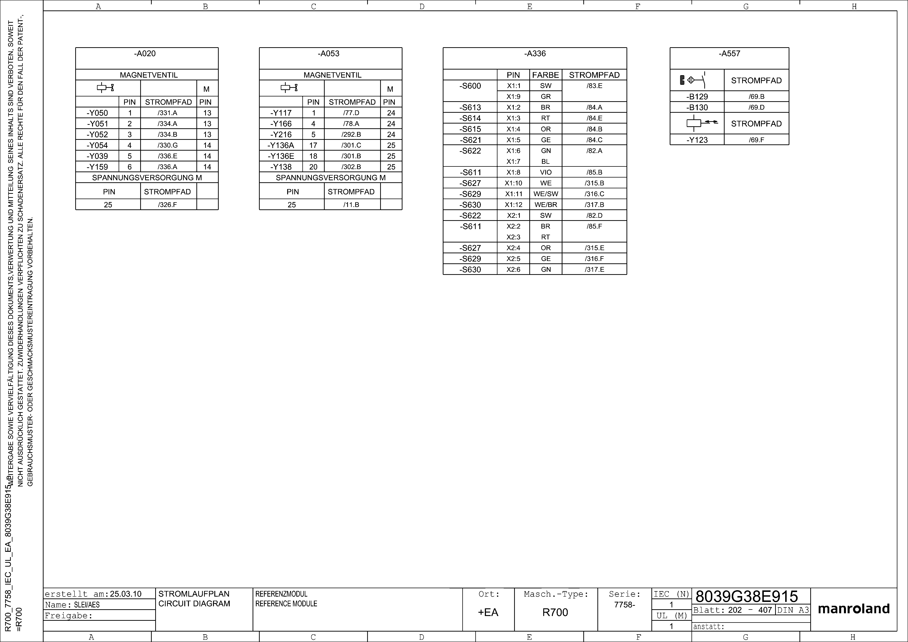

# +EA — Sheet 202 of 407 — REFERENZMODUL

**REFERENCE MODULE**

> Part of the manroland **R700** printing press IEC/UL circuit diagrams.
> Drawing class: **Stromlaufplan / Circuit diagram** (DIN A3).
> Document `+EA` covers the **Printing unit** machine section.

## At a glance

| Field | Value |
|---|---|
| Document | `+EA`  (8039G38E915) |
| Sheet | **202** of 407 |
| Section (DE) | REFERENZMODUL |
| Section (EN) | REFERENCE MODULE |
| Section type | REFERENCE_MODULE — Reference module |
| Machine type | `R700` |
| Series | `7758` |
| Created | 25.03.10 |
| Replaces | — |
| Columns used | A, B, C, D, E, F, G |
| Path numbers | — |
| Labels on sheet | 149 |
| Cross-refs out | 32 |
| Cross-refs in | 32 |

**Previous:** [+EA sheet 201](SHEET_0201.md) · **Next:** [+EA sheet 203](SHEET_0203.md) · **Document TOC:** [_TOC.md](_TOC.md)  (+EA) · **Master TOC:** [all sheets](../_MASTER_TOC.md)

## Sheet image (300 DPI, exact vector render)



_Rendered directly from the PDF vector layer at 300 DPI (1-bit), no OCR and no resampling. Use it to confirm anything ambiguous in the text below._

## Cross-references on this sheet

Each entry is a wire leaving this sheet. The printed token is `/sheet.column`; the link resolves to that sheet inside the same document.

| Ref | Target sheet | Col | Path | Destination on target | Target section | From col |
|---|---|---|---|---|---|---|
| `/83.E` | [+EA sheet 83](SHEET_0083.md) | E | — | — | AUSLEGERSTAPELSTEUERUNG: PROGRAMMSCHALTWERK | F |
| `/69.B` | [+EA sheet 69](SHEET_0069.md) | B | — | — | SCHMIERUNG | G |
| `/84.A` | [+EA sheet 84](SHEET_0084.md) | A | — | — | AUSLEGERSTAPELSTEUERUNG: PROGRAMMSCHALTWERK | F |
| `/69.D` | [+EA sheet 69](SHEET_0069.md) | D | — | — | SCHMIERUNG | G |
| `/331.A` | [+EA sheet 331](SHEET_0331.md) | A | — | — | OPTION: BOGENWEICHE | B |
| `/77.D` | [+EA sheet 77](SHEET_0077.md) | D | — | — | AUSLEGERSTAPELSTEUERUNG | C |
| `/84.E` | [+EA sheet 84](SHEET_0084.md) | E | — | — | AUSLEGERSTAPELSTEUERUNG: PROGRAMMSCHALTWERK | F |
| `/78.A` | [+EA sheet 78](SHEET_0078.md) | A | — | — | AUSLEGERSTAPELSTEUERUNG | C |
| `/334.A` | [+EA sheet 334](SHEET_0334.md) | A | — | — | OPTION: BOGENWEICHE | B |
| `/84.B` | [+EA sheet 84](SHEET_0084.md) | B | — | — | AUSLEGERSTAPELSTEUERUNG: PROGRAMMSCHALTWERK | F |
| `/334.B` | [+EA sheet 334](SHEET_0334.md) | B | — | — | OPTION: BOGENWEICHE | B |
| `/292.B` | [+EA sheet 292](SHEET_0292.md) | B | — | — | OPTION: PROBEBOGENENTNAHME HALBAUTOMATISCH | C |
| `/69.F` | [+EA sheet 69](SHEET_0069.md) | F | — | — | SCHMIERUNG | G |
| `/84.C` | [+EA sheet 84](SHEET_0084.md) | C | — | — | AUSLEGERSTAPELSTEUERUNG: PROGRAMMSCHALTWERK | F |
| `/330.G` | [+EA sheet 330](SHEET_0330.md) | G | — | — | OPTION: BOGENWEICHE | B |
| `/301.C` | [+EA sheet 301](SHEET_0301.md) | C | — | — | OPTION: ZWISCHENSTAPEL / | C |
| `/82.A` | [+EA sheet 82](SHEET_0082.md) | A | — | — | AUSLEGERSTAPELSTEUERUNG: PROGRAMMSCHALTWERK | F |
| `/336.E` | [+EA sheet 336](SHEET_0336.md) | E | — | — | OPTION: BOGENWEICHE | B |
| `/301.B` | [+EA sheet 301](SHEET_0301.md) | B | — | — | OPTION: ZWISCHENSTAPEL / | C |
| `/336.A` | [+EA sheet 336](SHEET_0336.md) | A | — | — | OPTION: BOGENWEICHE | B |
| `/302.B` | [+EA sheet 302](SHEET_0302.md) | B | — | — | OPTION: ZWISCHENSTAPEL / | C |
| `/85.B` | [+EA sheet 85](SHEET_0085.md) | B | — | — | AUSLEGERSTAPELSTEUERUNG: PROGRAMMSCHALTWERK | F |
| `/315.B` | [+EA sheet 315](SHEET_0315.md) | B | — | — | OPTION: LOGISTIK, AUSLEGER | F |
| `/316.C` | [+EA sheet 316](SHEET_0316.md) | C | — | — | OPTION: LOGISTIK, AUSLEGER | F |
| `/11.B` | [+EA sheet 11](SHEET_0011.md) | B | — | — | SPANNUNGSVERSORGUNG: 400V, 24V | C |
| `/317.B` | [+EA sheet 317](SHEET_0317.md) | B | — | — | OPTION: LOGISTIK, AUSLEGER | F |
| `/326.F` | [+EA sheet 326](SHEET_0326.md) | F | — | — | OPTION: BOGENWEICHE | B |
| `/82.D` | [+EA sheet 82](SHEET_0082.md) | D | — | — | AUSLEGERSTAPELSTEUERUNG: PROGRAMMSCHALTWERK | F |
| `/85.F` | [+EA sheet 85](SHEET_0085.md) | F | — | — | AUSLEGERSTAPELSTEUERUNG: PROGRAMMSCHALTWERK | F |
| `/315.E` | [+EA sheet 315](SHEET_0315.md) | E | — | — | OPTION: LOGISTIK, AUSLEGER | F |
| `/316.F` | [+EA sheet 316](SHEET_0316.md) | F | — | — | OPTION: LOGISTIK, AUSLEGER | F |
| `/317.E` | [+EA sheet 317](SHEET_0317.md) | E | — | — | OPTION: LOGISTIK, AUSLEGER | F |

### Incoming references (sheets that point here)

Every other sheet that sends a wire to this one. `Back-ref` is the token printed on *that* sheet; `Path` is its line number.

| From sheet | Cols | Back-ref | Path | Refs | What continues there |
|---|---|---|---|---|---|
| [+EA#11](SHEET_0011.md) | B | `/11.B` | — | 1 | A053 |
| [+EA#69](SHEET_0069.md) | B, D, F | `/69.B`, `/69.D`, `/69.F` | — | 3 | A557 |
| [+EA#77](SHEET_0077.md) | D | `/77.D` | — | 1 | A053 |
| [+EA#78](SHEET_0078.md) | A | `/78.A` | — | 1 | A053 |
| [+EA#82](SHEET_0082.md) | A, D | `/82.A`, `/82.D` | — | 2 | — |
| [+EA#83](SHEET_0083.md) | E | `/83.E` | — | 1 | — |
| [+EA#84](SHEET_0084.md) | B, D, E | `/84.B`, `/84.D`, `/84.E` | — | 4 | 1 |
| [+EA#85](SHEET_0085.md) | A, F | `/85.A`, `/85.F` | — | 2 | — |
| [+EA#292](SHEET_0292.md) | C | `/292.C` | — | 1 | A053 |
| [+EA#301](SHEET_0301.md) | B, C | `/301.B`, `/301.C` | — | 2 | A053 |
| [+EA#302](SHEET_0302.md) | B | `/302.B` | — | 1 | A053 |
| [+EA#315](SHEET_0315.md) | B, E | `/315.B`, `/315.E` | — | 2 | — |
| [+EA#316](SHEET_0316.md) | C, E | `/316.C`, `/316.E` | — | 2 | — |
| [+EA#317](SHEET_0317.md) | B, E | `/317.B`, `/317.E` | — | 2 | — |
| [+EA#326](SHEET_0326.md) | F | `/326.F` | — | 1 | A020 |
| [+EA#330](SHEET_0330.md) | G | `/330.G` | — | 1 | A020 |
| [+EA#331](SHEET_0331.md) | A | `/331.A` | — | 1 | A020 |
| [+EA#334](SHEET_0334.md) | A, C | `/334.A`, `/334.C` | — | 2 | A020 |
| [+EA#336](SHEET_0336.md) | A, E | `/336.A`, `/336.E` | — | 2 | A020 |


## Devices on this sheet

| Tag | Class | Class meaning (IEC) | Col | Sub | Terminal | Sign |
|---|---|---|---|---|---|---|
| `Y050` | Y | Magnetventil / solenoid valve, actuator | A | — | — | — |
| `Y051` | Y | Magnetventil / solenoid valve, actuator | A | — | — | — |
| `Y052` | Y | Magnetventil / solenoid valve, actuator | A | — | — | — |
| `Y054` | Y | Magnetventil / solenoid valve, actuator | A | — | — | — |
| `Y039` | Y | Magnetventil / solenoid valve, actuator | A | — | — | — |
| `Y159` | Y | Magnetventil / solenoid valve, actuator | A | — | — | — |
| `A020` | A | Baugruppe / assembly, module, PC board | A | — | — | — |
| `Y117` | Y | Magnetventil / solenoid valve, actuator | C | — | — | — |
| `Y166` | Y | Magnetventil / solenoid valve, actuator | C | — | — | — |
| `Y216` | Y | Magnetventil / solenoid valve, actuator | C | — | — | — |
| `Y138` | Y | Magnetventil / solenoid valve, actuator | C | — | — | — |
| `A053` | A | Baugruppe / assembly, module, PC board | C | — | — | — |
| `S600` | S | Schalter / switch | D | — | — | — |
| `X1:1` | X | Klemme / terminal, plug connector | E | — | 1 | — |
| `X1:9` | X | Klemme / terminal, plug connector | E | — | 9 | — |
| `X1:2` | X | Klemme / terminal, plug connector | E | — | 2 | — |
| `X1:3` | X | Klemme / terminal, plug connector | E | — | 3 | — |
| `X1:4` | X | Klemme / terminal, plug connector | E | — | 4 | — |
| `X1:5` | X | Klemme / terminal, plug connector | E | — | 5 | — |
| `X1:6` | X | Klemme / terminal, plug connector | E | — | 6 | — |
| `X1:7` | X | Klemme / terminal, plug connector | E | — | 7 | — |
| `X1:8` | X | Klemme / terminal, plug connector | E | — | 8 | — |
| `X1:10` | X | Klemme / terminal, plug connector | E | — | 10 | — |
| `X1:11` | X | Klemme / terminal, plug connector | E | — | 11 | — |
| `X1:12` | X | Klemme / terminal, plug connector | E | — | 12 | — |
| `X2:1` | X | Klemme / terminal, plug connector | E | — | 1 | — |
| `X2:2` | X | Klemme / terminal, plug connector | E | — | 2 | — |
| `X2:3` | X | Klemme / terminal, plug connector | E | — | 3 | — |
| `X2:4` | X | Klemme / terminal, plug connector | E | — | 4 | — |
| `X2:5` | X | Klemme / terminal, plug connector | E | — | 5 | — |
| `X2:6` | X | Klemme / terminal, plug connector | E | — | 6 | — |
| `S613` | S | Schalter / switch | D | — | — | — |
| `S614` | S | Schalter / switch | D | — | — | — |
| `S615` | S | Schalter / switch | D | — | — | — |
| `S621` | S | Schalter / switch | D | — | — | — |
| `S622` | S | Schalter / switch | D | — | — | — |
| `S611` | S | Schalter / switch | D | — | — | — |
| `S627` | S | Schalter / switch | D | — | — | — |
| `S629` | S | Schalter / switch | D | — | — | — |
| `S630` | S | Schalter / switch | D | — | — | — |
| `S622` | S | Schalter / switch | D | — | — | — |
| `S611` | S | Schalter / switch | D | — | — | — |
| `S627` | S | Schalter / switch | D | — | — | — |
| `S629` | S | Schalter / switch | D | — | — | — |
| `S630` | S | Schalter / switch | D | — | — | — |
| `A336` | A | Baugruppe / assembly, module, PC board | E | — | — | — |
| `B129` | B | Umformer / transducer, sensor | G | — | — | — |
| `B130` | B | Umformer / transducer, sensor | G | — | — | — |
| `Y123` | Y | Magnetventil / solenoid valve, actuator | G | — | — | — |
| `A557` | A | Baugruppe / assembly, module, PC board | G | — | — | — |

## Potentials / nets

_No named potentials on this sheet._

## Wire-end annotations (grouped as printed)

A wire that continues elsewhere is annotated with a small cluster: the destination description, the path/line number `#NN`, and the `/sheet.column` cross reference. Each row below is one such cluster exactly as it is grouped on the drawing.

| Col | Y | Path | Cross-ref | Text on the wire |
|---|---|---|---|---|
| A | 65.5 | — | — | `A020` |
| C | 65.5 | — | — | `A053` |
| E | 65.5 | — | — | `A336` |
| G | 65.5 | — | — | `A557` |
| E | 93.8 | — | — | `PIN FARBE STROMPFAD` |
| A | 94.2 | — | — | `MAGNETVENTIL` |
| C | 94.2 | — | — | `MAGNETVENTIL` |
| G | 100.9 | — | — | `STROMPFAD` |
| D | 108.0 | — | — | `S600` |
| E | 108.5 | — | — | `SW` |
| E | 108.7 | — | — | `X1:1` |
| F | 108.7 | — | `/83.E` | — |
| B | 112.5 | — | — | `M` |
| D | 112.5 | — | — | `M` |
| G | 122.2 | — | — | `B129 B130` |
| G | 122.8 | — | `/69.B` | — |
| E | 122.9 | — | — | `X1:9` |
| E | 122.9 | — | — | `GR` |
| A | 129.6 | — | — | `PIN` |
| B | 129.6 | — | — | `STROMPFAD` |
| B | 129.6 | — | — | `PIN` |
| C | 129.6 | — | — | `PIN` |
| C | 129.6 | — | — | `STROMPFAD` |
| D | 129.6 | — | — | `PIN` |
| D | 136.4 | — | — | `S613 S614 S615` |
| E | 137.0 | — | — | `X1:2` |
| F | 137.0 | — | `/84.A` | — |
| E | 137.1 | — | — | `BR` |
| G | 137.1 | — | `/69.D` | — |
| A | 143.5 | — | — | `Y050` |
| C | 143.5 | — | — | `Y136A Y136E Y117 Y166 Y216` |
| A | 143.8 | — | — | `2 3 4 5 6 1` |
| B | 143.8 | — | — | `13 13 13 14 14 14` |
| C | 143.8 | — | — | `17 18 20 4 5 1` |
| D | 143.8 | — | — | `24 24 24 25 25 25` |
| B | 144.1 | — | `/331.A` | — |
| C | 144.1 | — | `/77.D` | — |
| E | 151.2 | — | — | `X1:3` |
| E | 151.2 | — | — | `RT` |
| F | 151.2 | — | `/84.E` | — |
| G | 157.6 | — | — | `STROMPFAD` |
| A | 157.7 | — | — | `Y052 Y054 Y039 Y159 Y051` |
| B | 158.3 | — | `/334.A` | — |
| C | 158.3 | — | `/78.A` | — |
| E | 165.4 | — | — | `X1:4` |
| E | 165.4 | — | — | `OR` |
| F | 165.4 | — | `/84.B` | — |
| B | 172.5 | — | `/334.B` | — |
| C | 172.5 | — | `/292.B` | — |
| D | 178.9 | — | — | `S622 S621` |
| G | 179.0 | — | — | `Y123` |
| E | 179.6 | — | — | `X1:5` |
| E | 179.6 | — | — | `GE` |
| F | 179.6 | — | `/84.C` | — |
| G | 179.6 | — | `/69.F` | — |
| B | 186.7 | — | `/330.G` | — |
| C | 186.7 | — | `/301.C` | — |
| E | 193.7 | — | — | `X1:6` |
| F | 193.7 | — | `/82.A` | — |
| E | 193.8 | — | — | `GN` |
| B | 200.8 | — | `/336.E` | — |
| C | 200.8 | — | `/301.B` | — |
| E | 207.9 | — | — | `X1:7` |
| E | 207.9 | — | — | `BL` |
| C | 214.4 | — | — | `Y138` |
| B | 215.0 | — | `/336.A` | — |
| C | 215.0 | — | `/302.B` | — |
| D | 221.4 | — | — | `S627 S629 S630 S622 S611` |
| E | 222.1 | — | — | `X1:8` |
| E | 222.1 | — | — | `VIO` |
| F | 222.1 | — | `/85.B` | — |
| A | 228.8 | — | — | `SPANNUNGSVERSORGUNG M` |
| C | 228.8 | — | — | `SPANNUNGSVERSORGUNG M` |
| E | 236.1 | — | — | `WE` |
| F | 236.2 | — | `/315.B` | — |
| E | 236.3 | — | — | `X1:10` |
| B | 247.2 | — | — | `STROMPFAD` |
| C | 247.2 | — | — | `STROMPFAD` |
| A | 247.3 | — | — | `PIN` |
| C | 247.3 | — | — | `PIN` |
| E | 250.2 | — | — | `WE/SW` |
| E | 250.4 | — | — | `X1:11` |
| F | 250.4 | — | `/316.C` | — |
| A | 264.3 | — | — | `25` |
| C | 264.3 | — | — | `25` |
| E | 264.5 | — | — | `WE/BR` |
| B | 264.6 | — | `/326.F` | — |
| C | 264.6 | — | `/11.B` | — |
| E | 264.6 | — | — | `X1:12` |
| F | 264.6 | — | `/317.B` | — |
| E | 278.6 | — | — | `SW` |
| E | 278.8 | — | — | `X2:1` |
| F | 278.8 | — | `/82.D` | — |
| D | 292.3 | — | — | `S611` |
| E | 292.9 | — | — | `X2:2` |
| F | 292.9 | — | `/85.F` | — |
| E | 293.0 | — | — | `BR` |
| E | 307.1 | — | — | `X2:3` |
| E | 307.1 | — | — | `RT` |
| D | 320.6 | — | — | `S627 S629 S630` |
| E | 321.3 | — | — | `X2:4` |
| E | 321.3 | — | — | `OR` |
| F | 321.3 | — | `/315.E` | — |
| E | 335.5 | — | — | `X2:5` |
| E | 335.5 | — | — | `GE` |
| F | 335.5 | — | `/316.F` | — |
| E | 349.6 | — | — | `X2:6` |
| F | 349.6 | — | `/317.E` | — |
| E | 349.7 | — | — | `GN` |


## Reconstructed tables

This sheet carries tabular content (pin map / terminal assignment / index). The grid below was rebuilt from the drawing's own rule lines, so each row is exactly one physical row of the table.

### Table 1 — 9 data rows × 4 columns (at x=99.2, y=62.4) — **A020 MAGNETVENTIL M**

|  | PIN | STROMPFAD | PIN |
|---|---|---|---|
| `Y050` | `1` | `/331.A` | `13` |
| `Y051` | `2` | `/334.A` | `13` |
| `Y052` | `3` | `/334.B` | `13` |
| `Y054` | `4` | `/330.G` | `14` |
| `Y039` | `5` | `/336.E` | `14` |
| `Y159` | `6` | `/336.A` | `14` |
|  |  | `SPANNUNGSVERSORGUNG` | `M` |
| `PIN` |  | `STROMPFAD` |  |
| `25` |  | `/326.F` |  |


### Table 2 — 9 data rows × 4 columns (at x=340.2, y=62.4) — **A053 MAGNETVENTIL M**

|  | PIN | STROMPFAD | PIN |
|---|---|---|---|
| `Y117` | `1` | `/77.D` | `24` |
| `Y166` | `4` | `/78.A` | `24` |
| `Y216` | `5` | `/292.B` | `24` |
| `Y136A` | `17` | `/301.C` | `25` |
| `Y136E` | `18` | `/301.B` | `25` |
| `Y138` | `20` | `/302.B` | `25` |
|  |  | `SPANNUNGSVERSORGUNG` | `M` |
| `PIN` |  | `STROMPFAD` |  |
| `25` |  | `/11.B` |  |


### Table 3 — 17 data rows × 4 columns (at x=581.1, y=62.4) — **A336**

|  | PIN | FARBE | STROMPFAD |
|---|---|---|---|
| `S600` | `X1:1` | `SW` | `/83.E` |
|  | `X1:9` | `GR` |  |
| `S613` | `X1:2` | `BR` | `/84.A` |
| `S614` | `X1:3` | `RT` | `/84.E` |
| `S615` | `X1:4` | `OR` | `/84.B` |
| `S621` | `X1:5` | `GE` | `/84.C` |
| `S622` | `X1:6` | `GN` | `/82.A` |
|  | `X1:7` | `BL` |  |
| `S611` | `X1:8` | `VIO` | `/85.B` |
| `S627` | `X1:10` | `WE` | `/315.B` |
| `S629` | `X1:11` | `WE/SW` | `/316.C` |
| `S630` | `X1:12` | `WE/BR` | `/317.B` |
| `S622` | `X2:1` | `SW` | `/82.D` |
| `S611` | `X2:2 X2:3` | `BR RT` | `/85.F` |
| `S627` | `X2:4` | `OR` | `/315.E` |
| `S629` | `X2:5` | `GE` | `/316.F` |
| `S630` | `X2:6` | `GN` | `/317.E` |


### Table 4 — 4 data rows × 2 columns (at x=878.7, y=62.4) — **A557**

|  | STROMPFAD |
|---|---|
| `B129` | `/69.B` |
| `B130` | `/69.D` |
|  | `STROMPFAD` |
| `Y123` | `/69.F` |


## Notes and free text on this sheet

| Text | Col | Y (pt) |
|---|---|---|
| `PIN` | A | 129.63 |
| `PIN` | B | 129.63 |
| `M` | B | 112.55 |
| `MAGNETVENTIL` | A | 94.17 |
| `STROMPFAD` | B | 129.59 |
| `SPANNUNGSVERSORGUNG M` | A | 228.79 |
| `PIN` | C | 129.63 |
| `PIN` | D | 129.63 |
| `M` | D | 112.55 |
| `MAGNETVENTIL` | C | 94.17 |
| `STROMPFAD` | C | 129.59 |
| `SPANNUNGSVERSORGUNG M` | C | 228.79 |
| `Y136A` | C | 186.04 |
| `Y136E` | C | 200.21 |
| `PIN` | E | 93.94 |
| `STROMPFAD` | F | 93.85 |
| `FARBE` | E | 93.84 |
| `SW` | E | 108.5 |
| `GR` | E | 122.91 |
| `BR` | E | 137.05 |
| `RT` | E | 151.25 |
| `OR` | E | 165.43 |
| `GE` | E | 179.55 |
| `GN` | E | 193.78 |
| `BL` | E | 207.91 |
| `VIO` | E | 222.05 |
| `WE` | E | 236.06 |
| `WE/SW` | E | 250.23 |
| `WE/BR` | E | 264.5 |
| `STROMPFAD` | G | 100.94 |

## Complete label inventory (exact text from the drawing)

Every text object inside the drawing area of this sheet, in DIN reading order (column A→H, then top→bottom). This is the authoritative list: if a string is not here it is not printed on this sheet.

| Col | Y | X | Dir | Type | Text |
|---|---|---|---|---|---|
| A | 65.5 | 175.9 | → | device tag | `A020` |
| A | 94.2 | 157.3 | → | text | `MAGNETVENTIL` |
| A | 129.6 | 162.0 | → | text | `PIN` |
| A | 143.5 | 113.8 | → | device tag | `Y050` |
| A | 143.8 | 168.0 | → | number | `1` |
| A | 157.7 | 114.5 | → | device tag | `Y051` |
| A | 158.0 | 167.4 | → | number | `2` |
| A | 171.9 | 113.8 | → | device tag | `Y052` |
| A | 172.2 | 167.4 | → | number | `3` |
| A | 186.1 | 113.8 | → | device tag | `Y054` |
| A | 186.3 | 167.4 | → | number | `4` |
| A | 200.2 | 113.8 | → | device tag | `Y039` |
| A | 200.5 | 167.4 | → | number | `5` |
| A | 214.4 | 113.8 | → | device tag | `Y159` |
| A | 214.7 | 167.4 | → | number | `6` |
| A | 228.8 | 120.9 | → | text | `SPANNUNGSVERSORGUNG M` |
| A | 247.3 | 135.1 | → | text | `PIN` |
| A | 264.3 | 136.3 | → | number | `25` |
| B | 112.6 | 266.6 | → | text | `M` |
| B | 129.6 | 190.3 | → | text | `STROMPFAD` |
| B | 129.6 | 261.4 | → | text | `PIN` |
| B | 143.8 | 266.5 | → | number | `13` |
| B | 144.1 | 206.9 | → | cross-reference | `/331.A` |
| B | 158.0 | 266.5 | → | number | `13` |
| B | 158.3 | 206.9 | → | cross-reference | `/334.A` |
| B | 172.2 | 266.5 | → | number | `13` |
| B | 172.5 | 207.1 | → | cross-reference | `/334.B` |
| B | 186.3 | 266.5 | → | number | `14` |
| B | 186.7 | 206.8 | → | cross-reference | `/330.G` |
| B | 200.5 | 266.5 | → | number | `14` |
| B | 200.8 | 207.2 | → | cross-reference | `/336.E` |
| B | 214.7 | 266.5 | → | number | `14` |
| B | 215.0 | 206.9 | → | cross-reference | `/336.A` |
| B | 247.2 | 188.9 | → | text | `STROMPFAD` |
| B | 264.6 | 207.4 | → | cross-reference | `/326.F` |
| C | 65.5 | 416.8 | → | device tag | `A053` |
| C | 94.2 | 398.3 | → | text | `MAGNETVENTIL` |
| C | 129.6 | 402.9 | → | text | `PIN` |
| C | 129.6 | 431.3 | → | text | `STROMPFAD` |
| C | 143.5 | 354.8 | → | device tag | `Y117` |
| C | 143.8 | 408.9 | → | number | `1` |
| C | 144.1 | 450.3 | → | cross-reference | `/77.D` |
| C | 157.7 | 354.8 | → | device tag | `Y166` |
| C | 158.0 | 408.3 | → | number | `4` |
| C | 158.3 | 450.3 | → | cross-reference | `/78.A` |
| C | 171.9 | 354.8 | → | device tag | `Y216` |
| C | 172.2 | 408.3 | → | number | `5` |
| C | 172.5 | 448.0 | → | cross-reference | `/292.B` |
| C | 186.0 | 350.8 | → | text | `Y136A` |
| C | 186.3 | 405.4 | → | number | `17` |
| C | 186.7 | 447.9 | → | cross-reference | `/301.C` |
| C | 200.2 | 351.2 | → | text | `Y136E` |
| C | 200.5 | 405.4 | → | number | `18` |
| C | 200.8 | 448.0 | → | cross-reference | `/301.B` |
| C | 214.4 | 354.8 | → | device tag | `Y138` |
| C | 214.7 | 405.6 | → | number | `20` |
| C | 215.0 | 448.0 | → | cross-reference | `/302.B` |
| C | 228.8 | 361.8 | → | text | `SPANNUNGSVERSORGUNG M` |
| C | 247.2 | 429.9 | → | text | `STROMPFAD` |
| C | 247.3 | 376.0 | → | text | `PIN` |
| C | 264.3 | 377.3 | → | number | `25` |
| C | 264.6 | 450.4 | → | cross-reference | `/11.B` |
| D | 108.0 | 602.5 | → | device tag | `S600` |
| D | 112.6 | 507.5 | → | text | `M` |
| D | 129.6 | 502.3 | → | text | `PIN` |
| D | 136.4 | 602.5 | → | device tag | `S613` |
| D | 143.8 | 507.7 | → | number | `24` |
| D | 150.5 | 602.5 | → | device tag | `S614` |
| D | 158.0 | 507.7 | → | number | `24` |
| D | 164.7 | 602.5 | → | device tag | `S615` |
| D | 172.2 | 507.7 | → | number | `24` |
| D | 178.9 | 603.2 | → | device tag | `S621` |
| D | 186.3 | 507.7 | → | number | `25` |
| D | 193.1 | 602.5 | → | device tag | `S622` |
| D | 200.5 | 507.7 | → | number | `25` |
| D | 214.7 | 507.7 | → | number | `25` |
| D | 221.4 | 603.2 | → | device tag | `S611` |
| D | 235.6 | 602.5 | → | device tag | `S627` |
| D | 249.8 | 602.5 | → | device tag | `S629` |
| D | 263.9 | 602.5 | → | device tag | `S630` |
| D | 278.1 | 602.5 | → | device tag | `S622` |
| D | 292.3 | 603.2 | → | device tag | `S611` |
| D | 320.6 | 602.5 | → | device tag | `S627` |
| D | 334.8 | 602.5 | → | device tag | `S629` |
| D | 349.0 | 602.5 | → | device tag | `S630` |
| E | 65.5 | 687.5 | → | device tag | `A336` |
| E | 93.8 | 697.9 | → | text | `FARBE` |
| E | 93.9 | 664.6 | → | text | `PIN` |
| E | 108.5 | 708.2 | → | text | `SW` |
| E | 108.7 | 665.0 | → | device tag | `X1:1` |
| E | 122.9 | 664.3 | → | device tag | `X1:9` |
| E | 122.9 | 709.2 | → | text | `GR` |
| E | 137.0 | 664.4 | → | device tag | `X1:2` |
| E | 137.1 | 709.4 | → | text | `BR` |
| E | 151.2 | 664.3 | → | device tag | `X1:3` |
| E | 151.2 | 709.7 | → | text | `RT` |
| E | 165.4 | 664.3 | → | device tag | `X1:4` |
| E | 165.4 | 709.2 | → | text | `OR` |
| E | 179.6 | 664.3 | → | device tag | `X1:5` |
| E | 179.6 | 709.5 | → | text | `GE` |
| E | 193.7 | 664.3 | → | device tag | `X1:6` |
| E | 193.8 | 709.5 | → | text | `GN` |
| E | 207.9 | 664.3 | → | device tag | `X1:7` |
| E | 207.9 | 710.1 | → | text | `BL` |
| E | 222.1 | 664.3 | → | device tag | `X1:8` |
| E | 222.1 | 708.2 | → | text | `VIO` |
| E | 236.1 | 708.5 | → | text | `WE` |
| E | 236.3 | 661.9 | → | device tag | `X1:10` |
| E | 250.2 | 699.6 | → | text | `WE/SW` |
| E | 250.4 | 662.6 | → | device tag | `X1:11` |
| E | 264.5 | 701.0 | → | text | `WE/BR` |
| E | 264.6 | 662.0 | → | device tag | `X1:12` |
| E | 278.6 | 708.2 | → | text | `SW` |
| E | 278.8 | 665.0 | → | device tag | `X2:1` |
| E | 292.9 | 664.4 | → | device tag | `X2:2` |
| E | 293.0 | 709.4 | → | text | `BR` |
| E | 307.1 | 664.3 | → | device tag | `X2:3` |
| E | 307.2 | 709.7 | → | text | `RT` |
| E | 321.3 | 664.3 | → | device tag | `X2:4` |
| E | 321.3 | 709.2 | → | text | `OR` |
| E | 335.5 | 664.3 | → | device tag | `X2:5` |
| E | 335.5 | 709.5 | → | text | `GE` |
| E | 349.6 | 664.3 | → | device tag | `X2:6` |
| E | 349.7 | 709.5 | → | text | `GN` |
| F | 93.9 | 746.2 | → | text | `STROMPFAD` |
| F | 108.7 | 769.5 | → | cross-reference | `/83.E` |
| F | 137.0 | 769.2 | → | cross-reference | `/84.A` |
| F | 151.2 | 769.5 | → | cross-reference | `/84.E` |
| F | 165.4 | 769.3 | → | cross-reference | `/84.B` |
| F | 179.6 | 769.2 | → | cross-reference | `/84.C` |
| F | 193.7 | 769.2 | → | cross-reference | `/82.A` |
| F | 222.1 | 769.3 | → | cross-reference | `/85.B` |
| F | 236.2 | 766.9 | → | cross-reference | `/315.B` |
| F | 250.4 | 766.8 | → | cross-reference | `/316.C` |
| F | 264.6 | 766.9 | → | cross-reference | `/317.B` |
| F | 278.8 | 769.2 | → | cross-reference | `/82.D` |
| F | 292.9 | 769.6 | → | cross-reference | `/85.F` |
| F | 321.3 | 767.1 | → | cross-reference | `/315.E` |
| F | 335.5 | 767.2 | → | cross-reference | `/316.F` |
| F | 349.6 | 767.1 | → | cross-reference | `/317.E` |
| G | 65.5 | 942.7 | → | device tag | `A557` |
| G | 100.9 | 958.8 | → | text | `STROMPFAD` |
| G | 122.2 | 900.1 | → | device tag | `B129` |
| G | 122.8 | 981.9 | → | cross-reference | `/69.B` |
| G | 136.4 | 900.1 | → | device tag | `B130` |
| G | 137.1 | 981.8 | → | cross-reference | `/69.D` |
| G | 157.6 | 958.8 | → | text | `STROMPFAD` |
| G | 179.0 | 900.4 | → | device tag | `Y123` |
| G | 179.6 | 982.2 | → | cross-reference | `/69.F` |

## Reading-order text block

The same content as a plain block, grouped by DIN column — convenient to paste or to match against a visual description.

```text
=== Column A ===
  65.5  175.9  devtag       A020
  94.2  157.3  text         MAGNETVENTIL
 129.6  162.0  text         PIN
 143.5  113.8  devtag       Y050
 143.8  168.0  numeric      1
 157.7  114.5  devtag       Y051
 158.0  167.4  numeric      2
 171.9  113.8  devtag       Y052
 172.2  167.4  numeric      3
 186.1  113.8  devtag       Y054
 186.3  167.4  numeric      4
 200.2  113.8  devtag       Y039
 200.5  167.4  numeric      5
 214.4  113.8  devtag       Y159
 214.7  167.4  numeric      6
 228.8  120.9  text         SPANNUNGSVERSORGUNG M
 247.3  135.1  text         PIN
 264.3  136.3  numeric      25
=== Column B ===
 112.6  266.6  text         M
 129.6  190.3  text         STROMPFAD
 129.6  261.4  text         PIN
 143.8  266.5  numeric      13
 144.1  206.9  xref         /331.A
 158.0  266.5  numeric      13
 158.3  206.9  xref         /334.A
 172.2  266.5  numeric      13
 172.5  207.1  xref         /334.B
 186.3  266.5  numeric      14
 186.7  206.8  xref         /330.G
 200.5  266.5  numeric      14
 200.8  207.2  xref         /336.E
 214.7  266.5  numeric      14
 215.0  206.9  xref         /336.A
 247.2  188.9  text         STROMPFAD
 264.6  207.4  xref         /326.F
=== Column C ===
  65.5  416.8  devtag       A053
  94.2  398.3  text         MAGNETVENTIL
 129.6  402.9  text         PIN
 129.6  431.3  text         STROMPFAD
 143.5  354.8  devtag       Y117
 143.8  408.9  numeric      1
 144.1  450.3  xref         /77.D
 157.7  354.8  devtag       Y166
 158.0  408.3  numeric      4
 158.3  450.3  xref         /78.A
 171.9  354.8  devtag       Y216
 172.2  408.3  numeric      5
 172.5  448.0  xref         /292.B
 186.0  350.8  text         Y136A
 186.3  405.4  numeric      17
 186.7  447.9  xref         /301.C
 200.2  351.2  text         Y136E
 200.5  405.4  numeric      18
 200.8  448.0  xref         /301.B
 214.4  354.8  devtag       Y138
 214.7  405.6  numeric      20
 215.0  448.0  xref         /302.B
 228.8  361.8  text         SPANNUNGSVERSORGUNG M
 247.2  429.9  text         STROMPFAD
 247.3  376.0  text         PIN
 264.3  377.3  numeric      25
 264.6  450.4  xref         /11.B
=== Column D ===
 108.0  602.5  devtag       S600
 112.6  507.5  text         M
 129.6  502.3  text         PIN
 136.4  602.5  devtag       S613
 143.8  507.7  numeric      24
 150.5  602.5  devtag       S614
 158.0  507.7  numeric      24
 164.7  602.5  devtag       S615
 172.2  507.7  numeric      24
 178.9  603.2  devtag       S621
 186.3  507.7  numeric      25
 193.1  602.5  devtag       S622
 200.5  507.7  numeric      25
 214.7  507.7  numeric      25
 221.4  603.2  devtag       S611
 235.6  602.5  devtag       S627
 249.8  602.5  devtag       S629
 263.9  602.5  devtag       S630
 278.1  602.5  devtag       S622
 292.3  603.2  devtag       S611
 320.6  602.5  devtag       S627
 334.8  602.5  devtag       S629
 349.0  602.5  devtag       S630
=== Column E ===
  65.5  687.5  devtag       A336
  93.8  697.9  text         FARBE
  93.9  664.6  text         PIN
 108.5  708.2  text         SW
 108.7  665.0  devtag       X1:1
 122.9  664.3  devtag       X1:9
 122.9  709.2  text         GR
 137.0  664.4  devtag       X1:2
 137.1  709.4  text         BR
 151.2  664.3  devtag       X1:3
 151.2  709.7  text         RT
 165.4  664.3  devtag       X1:4
 165.4  709.2  text         OR
 179.6  664.3  devtag       X1:5
 179.6  709.5  text         GE
 193.7  664.3  devtag       X1:6
 193.8  709.5  text         GN
 207.9  664.3  devtag       X1:7
 207.9  710.1  text         BL
 222.1  664.3  devtag       X1:8
 222.1  708.2  text         VIO
 236.1  708.5  text         WE
 236.3  661.9  devtag       X1:10
 250.2  699.6  text         WE/SW
 250.4  662.6  devtag       X1:11
 264.5  701.0  text         WE/BR
 264.6  662.0  devtag       X1:12
 278.6  708.2  text         SW
 278.8  665.0  devtag       X2:1
 292.9  664.4  devtag       X2:2
 293.0  709.4  text         BR
 307.1  664.3  devtag       X2:3
 307.2  709.7  text         RT
 321.3  664.3  devtag       X2:4
 321.3  709.2  text         OR
 335.5  664.3  devtag       X2:5
 335.5  709.5  text         GE
 349.6  664.3  devtag       X2:6
 349.7  709.5  text         GN
=== Column F ===
  93.9  746.2  text         STROMPFAD
 108.7  769.5  xref         /83.E
 137.0  769.2  xref         /84.A
 151.2  769.5  xref         /84.E
 165.4  769.3  xref         /84.B
 179.6  769.2  xref         /84.C
 193.7  769.2  xref         /82.A
 222.1  769.3  xref         /85.B
 236.2  766.9  xref         /315.B
 250.4  766.8  xref         /316.C
 264.6  766.9  xref         /317.B
 278.8  769.2  xref         /82.D
 292.9  769.6  xref         /85.F
 321.3  767.1  xref         /315.E
 335.5  767.2  xref         /316.F
 349.6  767.1  xref         /317.E
=== Column G ===
  65.5  942.7  devtag       A557
 100.9  958.8  text         STROMPFAD
 122.2  900.1  devtag       B129
 122.8  981.9  xref         /69.B
 136.4  900.1  devtag       B130
 137.1  981.8  xref         /69.D
 157.6  958.8  text         STROMPFAD
 179.0  900.4  devtag       Y123
 179.6  982.2  xref         /69.F
```

---
_Generated from the PDF vector text layer; no OCR. Source: `R700_7758_IEC_UL_EA_8039G38E915_p`, sheet 202._
