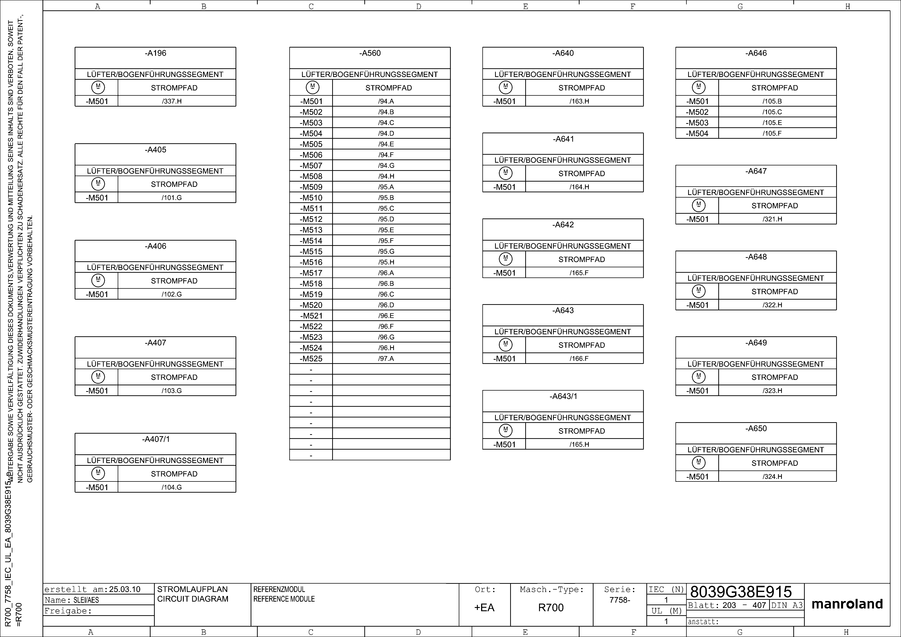

# +EA — Sheet 203 of 407 — REFERENZMODUL

**REFERENCE MODULE**

> Part of the manroland **R700** printing press IEC/UL circuit diagrams.
> Drawing class: **Stromlaufplan / Circuit diagram** (DIN A3).
> Document `+EA` covers the **Printing unit** machine section.

## At a glance

| Field | Value |
|---|---|
| Document | `+EA`  (8039G38E915) |
| Sheet | **203** of 407 |
| Section (DE) | REFERENZMODUL |
| Section (EN) | REFERENCE MODULE |
| Section type | REFERENCE_MODULE — Reference module |
| Machine type | `R700` |
| Series | `7758` |
| Created | 25.03.10 |
| Replaces | — |
| Columns used | A, B, C, D, E, F, G |
| Path numbers | — |
| Labels on sheet | 150 |
| Cross-refs out | 43 |
| Cross-refs in | 43 |

**Previous:** [+EA sheet 202](SHEET_0202.md) · **Next:** [+EA sheet 204](SHEET_0204.md) · **Document TOC:** [_TOC.md](_TOC.md)  (+EA) · **Master TOC:** [all sheets](../_MASTER_TOC.md)

## Sheet image (300 DPI, exact vector render)



_Rendered directly from the PDF vector layer at 300 DPI (1-bit), no OCR and no resampling. Use it to confirm anything ambiguous in the text below._

## Cross-references on this sheet

Each entry is a wire leaving this sheet. The printed token is `/sheet.column`; the link resolves to that sheet inside the same document.

| Ref | Target sheet | Col | Path | Destination on target | Target section | From col |
|---|---|---|---|---|---|---|
| `/94.A` | [+EA sheet 94](SHEET_0094.md) | A | — | — | BLASRAHMEN | D |
| `/105.B` | [+EA sheet 105](SHEET_0105.md) | B | — | — | BOGENFÜHRUNGSELEMENT | G |
| `/337.H` | [+EA sheet 337](SHEET_0337.md) | H | — | — | OPTION: BOGENWEICHE | B |
| `/163.H` | [+EA sheet 163](SHEET_0163.md) | H | — | — | VERLÄNGERUNG 1828,4MM | F |
| `/94.B` | [+EA sheet 94](SHEET_0094.md) | B | — | — | BLASRAHMEN | D |
| `/105.C` | [+EA sheet 105](SHEET_0105.md) | C | — | — | BOGENFÜHRUNGSELEMENT | G |
| `/105.E` | [+EA sheet 105](SHEET_0105.md) | E | — | — | BOGENFÜHRUNGSELEMENT | G |
| `/94.C` | [+EA sheet 94](SHEET_0094.md) | C | — | — | BLASRAHMEN | D |
| `/105.F` | [+EA sheet 105](SHEET_0105.md) | F | — | — | BOGENFÜHRUNGSELEMENT | G |
| `/94.D` | [+EA sheet 94](SHEET_0094.md) | D | — | — | BLASRAHMEN | D |
| `/94.E` | [+EA sheet 94](SHEET_0094.md) | E | — | — | BLASRAHMEN | D |
| `/94.F` | [+EA sheet 94](SHEET_0094.md) | F | — | — | BLASRAHMEN | D |
| `/94.G` | [+EA sheet 94](SHEET_0094.md) | G | — | — | BLASRAHMEN | D |
| `/94.H` | [+EA sheet 94](SHEET_0094.md) | H | — | — | BLASRAHMEN | D |
| `/95.A` | [+EA sheet 95](SHEET_0095.md) | A | — | — | BLASRAHMEN | D |
| `/164.H` | [+EA sheet 164](SHEET_0164.md) | H | — | — | VERLÄNGERUNG 1828,4MM | F |
| `/95.B` | [+EA sheet 95](SHEET_0095.md) | B | — | — | BLASRAHMEN | D |
| `/101.G` | [+EA sheet 101](SHEET_0101.md) | G | — | — | BOGENFÜHRUNGSELEMENT | B |
| `/95.C` | [+EA sheet 95](SHEET_0095.md) | C | — | — | BLASRAHMEN | D |
| `/95.D` | [+EA sheet 95](SHEET_0095.md) | D | — | — | BLASRAHMEN | D |
| `/321.H` | [+EA sheet 321](SHEET_0321.md) | H | — | — | OPTION: VERLÄNGERUNG 3656,8MM | G |
| `/95.E` | [+EA sheet 95](SHEET_0095.md) | E | — | — | BLASRAHMEN | D |
| `/95.F` | [+EA sheet 95](SHEET_0095.md) | F | — | — | BLASRAHMEN | D |
| `/95.G` | [+EA sheet 95](SHEET_0095.md) | G | — | — | BLASRAHMEN | D |
| `/95.H` | [+EA sheet 95](SHEET_0095.md) | H | — | — | BLASRAHMEN | D |
| `/96.A` | [+EA sheet 96](SHEET_0096.md) | A | — | — | BLASRAHMEN | D |
| `/165.F` | [+EA sheet 165](SHEET_0165.md) | F | — | — | VERLÄNGERUNG 1828,4MM | F |
| `/96.B` | [+EA sheet 96](SHEET_0096.md) | B | — | — | BLASRAHMEN | D |
| `/102.G` | [+EA sheet 102](SHEET_0102.md) | G | — | — | BOGENFÜHRUNGSELEMENT | B |
| `/96.C` | [+EA sheet 96](SHEET_0096.md) | C | — | — | BLASRAHMEN | D |
| `/96.D` | [+EA sheet 96](SHEET_0096.md) | D | — | — | BLASRAHMEN | D |
| `/322.H` | [+EA sheet 322](SHEET_0322.md) | H | — | — | OPTION: VERLÄNGERUNG 3656,8MM | G |
| `/96.E` | [+EA sheet 96](SHEET_0096.md) | E | — | — | BLASRAHMEN | D |
| `/96.F` | [+EA sheet 96](SHEET_0096.md) | F | — | — | BLASRAHMEN | D |
| `/96.G` | [+EA sheet 96](SHEET_0096.md) | G | — | — | BLASRAHMEN | D |
| `/96.H` | [+EA sheet 96](SHEET_0096.md) | H | — | — | BLASRAHMEN | D |
| `/97.A` | [+EA sheet 97](SHEET_0097.md) | A | — | — | BLASRAHMEN | D |
| `/166.F` | [+EA sheet 166](SHEET_0166.md) | F | — | — | VERLÄNGERUNG 1828,4MM | F |
| `/103.G` | [+EA sheet 103](SHEET_0103.md) | G | — | — | BOGENFÜHRUNGSELEMENT | B |
| `/323.H` | [+EA sheet 323](SHEET_0323.md) | H | — | — | OPTION: VERLÄNGERUNG 3656,8MM | G |
| `/165.H` | [+EA sheet 165](SHEET_0165.md) | H | — | — | VERLÄNGERUNG 1828,4MM | F |
| `/324.H` | [+EA sheet 324](SHEET_0324.md) | H | — | — | OPTION: VERLÄNGERUNG 3656,8MM | G |
| `/104.G` | [+EA sheet 104](SHEET_0104.md) | G | — | — | BOGENFÜHRUNGSELEMENT | B |

### Incoming references (sheets that point here)

Every other sheet that sends a wire to this one. `Back-ref` is the token printed on *that* sheet; `Path` is its line number.

| From sheet | Cols | Back-ref | Path | Refs | What continues there |
|---|---|---|---|---|---|
| [+EA#94](SHEET_0094.md) | A, B, C, D, E, F, G, H | `/94.A`, `/94.B`, `/94.C`, `/94.D`, `/94.E`, `/94.F`, `/94.G`, `/94.H` | — | 8 | A560 |
| [+EA#95](SHEET_0095.md) | A, B, C, D, E, F, G, H | `/95.A`, `/95.B`, `/95.C`, `/95.D`, `/95.E`, `/95.F`, `/95.G`, `/95.H` | — | 8 | A560 |
| [+EA#96](SHEET_0096.md) | A, B, C, D, E, F, G, H | `/96.A`, `/96.B`, `/96.C`, `/96.D`, `/96.E`, `/96.F`, `/96.G`, `/96.H` | — | 8 | A560 |
| [+EA#97](SHEET_0097.md) | A | `/97.A` | — | 1 | A560 |
| [+EA#101](SHEET_0101.md) | G | `/101.G` | — | 1 | A405 |
| [+EA#102](SHEET_0102.md) | G | `/102.G` | — | 1 | A406 |
| [+EA#103](SHEET_0103.md) | G | `/103.G` | — | 1 | A407 |
| [+EA#104](SHEET_0104.md) | G | `/104.G` | — | 1 | A407/1 |
| [+EA#105](SHEET_0105.md) | B, C, E, F | `/105.B`, `/105.C`, `/105.E`, `/105.F` | — | 4 | A646 |
| [+EA#163](SHEET_0163.md) | H | `/163.H` | — | 1 | A640 |
| [+EA#164](SHEET_0164.md) | H | `/164.H` | — | 1 | A641 |
| [+EA#165](SHEET_0165.md) | F, H | `/165.F`, `/165.H` | — | 2 | A642; A643/1 |
| [+EA#166](SHEET_0166.md) | F | `/166.F` | — | 1 | A643 |
| [+EA#321](SHEET_0321.md) | H | `/321.H` | — | 1 | A647 |
| [+EA#322](SHEET_0322.md) | H | `/322.H` | — | 1 | A648 |
| [+EA#323](SHEET_0323.md) | H | `/323.H` | — | 1 | A649 |
| [+EA#324](SHEET_0324.md) | H | `/324.H` | — | 1 | A650 |
| [+EA#337](SHEET_0337.md) | H | `/337.H` | — | 1 | A196 |


## Devices on this sheet

| Tag | Class | Class meaning (IEC) | Col | Sub | Terminal | Sign |
|---|---|---|---|---|---|---|
| `A560` | A | Baugruppe / assembly, module, PC board | D | — | — | — |
| `A405` | A | Baugruppe / assembly, module, PC board | B | — | — | — |
| `A406` | A | Baugruppe / assembly, module, PC board | B | — | — | — |
| `A407` | A | Baugruppe / assembly, module, PC board | B | — | — | — |
| `A407/1` | A | Baugruppe / assembly, module, PC board | B | 1 | — | — |
| `A196` | A | Baugruppe / assembly, module, PC board | B | — | — | — |
| `A646` | A | Baugruppe / assembly, module, PC board | G | — | — | — |
| `A640` | A | Baugruppe / assembly, module, PC board | E | — | — | — |
| `A641` | A | Baugruppe / assembly, module, PC board | E | — | — | — |
| `A642` | A | Baugruppe / assembly, module, PC board | E | — | — | — |
| `A643` | A | Baugruppe / assembly, module, PC board | E | — | — | — |
| `A643/1` | A | Baugruppe / assembly, module, PC board | E | 1 | — | — |
| `A647` | A | Baugruppe / assembly, module, PC board | G | — | — | — |
| `A648` | A | Baugruppe / assembly, module, PC board | G | — | — | — |
| `A649` | A | Baugruppe / assembly, module, PC board | G | — | — | — |
| `A650` | A | Baugruppe / assembly, module, PC board | G | — | — | — |

## Potentials / nets

| Potential | Count | Columns | Attached devices | Terminals |
|---|---|---|---|---|
| `M501` | 16 | A, C, E, G | — | — |
| `M502` | 2 | C, G | — | — |
| `M503` | 2 | C, G | — | — |
| `M504` | 2 | C, G | — | — |
| `M505` | 1 | C | — | — |
| `M506` | 1 | C | — | — |
| `M507` | 1 | C | — | — |
| `M508` | 1 | C | — | — |
| `M509` | 1 | C | — | — |
| `M510` | 1 | C | — | — |
| `M511` | 1 | C | — | — |
| `M512` | 1 | C | — | — |
| `M513` | 1 | C | — | — |
| `M514` | 1 | C | — | — |
| `M515` | 1 | C | — | — |
| `M516` | 1 | C | — | — |
| `M517` | 1 | C | — | — |
| `M518` | 1 | C | — | — |
| `M519` | 1 | C | — | — |
| `M520` | 1 | C | — | — |
| `M521` | 1 | C | — | — |
| `M522` | 1 | C | — | — |
| `M523` | 1 | C | — | — |
| `M524` | 1 | C | — | — |
| `M525` | 1 | C | — | — |


A potential such as `L24+/4` or `M24+` is a named supply/return rail; every place it appears on this sheet is electrically common.

## Wire-end annotations (grouped as printed)

A wire that continues elsewhere is annotated with a small cluster: the destination description, the path/line number `#NN`, and the `/sheet.column` cross reference. Each row below is one such cluster exactly as it is grouped on the drawing.

| Col | Y | Path | Cross-ref | Text on the wire |
|---|---|---|---|---|
| B | 65.5 | — | — | `A196` |
| D | 65.5 | — | — | `A560` |
| E | 65.5 | — | — | `A640` |
| G | 65.5 | — | — | `A646` |
| B | 94.2 | — | — | `LÜFTER/BOGENFÜHRUNGSSEGMENT` |
| D | 94.2 | — | — | `LÜFTER/BOGENFÜHRUNGSSEGMENT` |
| E | 94.2 | — | — | `LÜFTER/BOGENFÜHRUNGSSEGMENT` |
| G | 94.2 | — | — | `LÜFTER/BOGENFÜHRUNGSSEGMENT` |
| A | 110.0 | — | — | `M STROMPFAD` |
| C | 110.0 | — | — | `M STROMPFAD` |
| E | 110.0 | — | — | `M STROMPFAD` |
| G | 110.0 | — | — | `M STROMPFAD` |
| A | 129.3 | — | — | `M501` |
| C | 129.3 | — | — | `M502 M503 M504 M505 M506 M507 M508 M509 M510 M501` |
| E | 129.3 | — | — | `M501` |
| G | 129.3 | — | — | `M502 M503 M504 M501` |
| D | 129.9 | — | `/94.A` | — |
| G | 129.9 | — | `/105.B` | — |
| B | 130.0 | — | `/337.H` | — |
| F | 130.0 | — | `/163.H` | — |
| D | 144.1 | — | `/94.B` | — |
| G | 144.2 | — | `/105.C` | — |
| D | 158.3 | — | `/94.C` | — |
| G | 158.3 | — | `/105.E` | — |
| D | 172.5 | — | `/94.D` | — |
| G | 172.5 | — | `/105.F` | — |
| E | 178.9 | — | — | `A641` |
| D | 186.6 | — | `/94.E` | — |
| B | 193.1 | — | — | `A405` |
| D | 200.8 | — | `/94.F` | — |
| E | 207.5 | — | — | `LÜFTER/BOGENFÜHRUNGSSEGMENT` |
| D | 215.0 | — | `/94.G` | — |
| G | 221.4 | — | — | `A647` |
| B | 221.7 | — | — | `LÜFTER/BOGENFÜHRUNGSSEGMENT` |
| E | 223.4 | — | — | `M STROMPFAD` |
| D | 229.2 | — | `/94.H` | — |
| A | 237.6 | — | — | `M STROMPFAD` |
| E | 242.7 | — | — | `M501` |
| D | 243.3 | — | `/95.A` | — |
| F | 243.4 | — | `/164.H` | — |
| G | 250.1 | — | — | `LÜFTER/BOGENFÜHRUNGSSEGMENT` |
| A | 256.9 | — | — | `M501` |
| B | 257.5 | — | `/101.G` | — |
| D | 257.5 | — | `/95.B` | — |
| G | 265.9 | — | — | `M STROMPFAD` |
| C | 271.0 | — | — | `M512 M513 M514 M515 M516 M517 M518 M519 M520 M511` |
| D | 271.7 | — | `/95.C` | — |
| G | 285.2 | — | — | `M501` |
| D | 285.9 | — | `/95.D` | — |
| G | 285.9 | — | `/321.H` | — |
| E | 292.3 | — | — | `A642` |
| D | 300.0 | — | `/95.E` | — |
| D | 314.2 | — | `/95.F` | — |
| B | 320.6 | — | — | `A406` |
| E | 320.9 | — | — | `LÜFTER/BOGENFÜHRUNGSSEGMENT` |
| D | 328.4 | — | `/95.G` | — |
| G | 334.8 | — | — | `A648` |
| E | 336.8 | — | — | `M STROMPFAD` |
| D | 342.6 | — | `/95.H` | — |
| B | 349.3 | — | — | `LÜFTER/BOGENFÜHRUNGSSEGMENT` |
| E | 356.1 | — | — | `M501` |
| D | 356.7 | — | `/96.A` | — |
| F | 356.7 | — | `/165.F` | — |
| G | 363.4 | — | — | `LÜFTER/BOGENFÜHRUNGSSEGMENT` |
| A | 365.1 | — | — | `M STROMPFAD` |
| D | 370.9 | — | `/96.B` | — |
| G | 379.3 | — | — | `M STROMPFAD` |
| A | 384.4 | — | — | `M501` |
| B | 385.1 | — | `/102.G` | — |
| D | 385.1 | — | `/96.C` | — |
| G | 398.6 | — | — | `M501` |
| D | 399.3 | — | `/96.D` | — |
| G | 399.3 | — | `/322.H` | — |
| E | 405.7 | — | — | `A643` |
| C | 412.8 | — | — | `M522 M523 M524 M525 M521` |
| D | 413.4 | — | `/96.E` | — |
| D | 427.6 | — | `/96.F` | — |
| E | 434.3 | — | — | `LÜFTER/BOGENFÜHRUNGSSEGMENT` |
| D | 441.8 | — | `/96.G` | — |
| B | 448.2 | — | — | `A407` |
| G | 448.2 | — | — | `A649` |
| E | 450.2 | — | — | `M STROMPFAD` |
| D | 455.9 | — | `/96.H` | — |
| E | 469.4 | — | — | `M501` |
| D | 470.1 | — | `/97.A` | — |
| F | 470.1 | — | `/166.F` | — |
| B | 476.8 | — | — | `LÜFTER/BOGENFÜHRUNGSSEGMENT` |
| G | 476.8 | — | — | `LÜFTER/BOGENFÜHRUNGSSEGMENT` |
| A | 492.7 | — | — | `M STROMPFAD` |
| G | 492.7 | — | — | `M STROMPFAD` |
| A | 512.0 | — | — | `M501` |
| G | 512.0 | — | — | `M501` |
| B | 512.6 | — | `/103.G` | — |
| G | 512.6 | — | `/323.H` | — |
| E | 519.0 | — | — | `A643/1` |
| E | 547.7 | — | — | `LÜFTER/BOGENFÜHRUNGSSEGMENT` |
| G | 561.6 | — | — | `A650` |
| E | 563.6 | — | — | `M STROMPFAD` |
| B | 575.7 | — | — | `A407/1` |
| E | 582.8 | — | — | `M501` |
| F | 583.5 | — | `/165.H` | — |
| G | 590.2 | — | — | `LÜFTER/BOGENFÜHRUNGSSEGMENT` |
| B | 604.4 | — | — | `LÜFTER/BOGENFÜHRUNGSSEGMENT` |
| G | 606.1 | — | — | `M STROMPFAD` |
| A | 620.3 | — | — | `M STROMPFAD` |
| G | 625.4 | — | — | `M501` |
| G | 626.0 | — | `/324.H` | — |
| A | 639.5 | — | — | `M501` |
| B | 640.2 | — | `/104.G` | — |


## Reconstructed tables

This sheet carries tabular content (pin map / terminal assignment / index). The grid below was rebuilt from the drawing's own rule lines, so each row is exactly one physical row of the table.

### Table 1 — 26 data rows × 1 columns (at x=382.7, y=62.4)

| C1 |
|---|
| `M` |
| `M501` |
| `M502` |
| `M503` |
| `M504` |
| `M505` |
| `M506` |
| `M507` |
| `M508` |
| `M509` |
| `M510` |
| `M511` |
| `M512` |
| `M513` |
| `M514` |
| `M515` |
| `M516` |
| `M517` |
| `M518` |
| `M519` |
| `M520` |
| `M521` |
| `M522` |
| `M523` |
| `M524` |
| `M525` |


### Table 2 — 10 data rows × 1 columns (at x=637.8, y=62.4)

| C1 |
|---|
| `M` |
| `M501` |
| `M` |
| `M501` |
| `M` |
| `M501` |
| `M` |
| `M501` |
| `M` |
| `M501` |


### Table 3 — 13 data rows × 1 columns (at x=892.9, y=62.4)

| C1 |
|---|
| `M` |
| `M501` |
| `M502` |
| `M503` |
| `M504` |
| `M` |
| `M501` |
| `M` |
| `M501` |
| `M` |
| `M501` |
| `M` |
| `M501` |


## Notes and free text on this sheet

| Text | Col | Y (pt) |
|---|---|---|
| `LÜFTER/BOGENFÜHRUNGSSEGMENT` | D | 94.15 |
| `M` | C | 110.02 |
| `STROMPFAD` | D | 111.87 |
| `LÜFTER/BOGENFÜHRUNGSSEGMENT` | B | 221.71 |
| `M` | A | 237.58 |
| `STROMPFAD` | B | 239.43 |
| `LÜFTER/BOGENFÜHRUNGSSEGMENT` | G | 94.15 |
| `M` | G | 110.02 |
| `STROMPFAD` | G | 111.87 |
| `LÜFTER/BOGENFÜHRUNGSSEGMENT` | E | 94.15 |
| `M` | E | 110.02 |
| `STROMPFAD` | F | 111.87 |

## Complete label inventory (exact text from the drawing)

Every text object inside the drawing area of this sheet, in DIN reading order (column A→H, then top→bottom). This is the authoritative list: if a string is not here it is not printed on this sheet.

| Col | Y | X | Dir | Type | Text |
|---|---|---|---|---|---|
| A | 110.0 | 126.7 | → | text | `M` |
| A | 129.3 | 113.4 | → | potential | `M501` |
| A | 237.6 | 126.7 | → | text | `M` |
| A | 256.8 | 113.4 | → | potential | `M501` |
| A | 365.1 | 126.7 | → | text | `M` |
| A | 384.4 | 113.4 | → | potential | `M501` |
| A | 492.7 | 126.7 | → | text | `M` |
| A | 512.0 | 113.4 | → | potential | `M501` |
| A | 620.3 | 126.7 | → | text | `M` |
| A | 639.5 | 113.4 | → | potential | `M501` |
| B | 65.5 | 191.5 | → | device tag | `A196` |
| B | 94.2 | 115.1 | → | text | `LÜFTER/BOGENFÜHRUNGSSEGMENT` |
| B | 111.9 | 199.6 | → | text | `STROMPFAD` |
| B | 130.0 | 214.3 | → | cross-reference | `/337.H` |
| B | 193.1 | 191.5 | → | device tag | `A405` |
| B | 221.7 | 115.1 | → | text | `LÜFTER/BOGENFÜHRUNGSSEGMENT` |
| B | 239.4 | 199.6 | → | text | `STROMPFAD` |
| B | 257.5 | 213.9 | → | cross-reference | `/101.G` |
| B | 320.6 | 191.5 | → | device tag | `A406` |
| B | 349.3 | 115.1 | → | text | `LÜFTER/BOGENFÜHRUNGSSEGMENT` |
| B | 367.0 | 199.6 | → | text | `STROMPFAD` |
| B | 385.1 | 213.9 | → | cross-reference | `/102.G` |
| B | 448.2 | 191.5 | → | device tag | `A407` |
| B | 476.8 | 115.1 | → | text | `LÜFTER/BOGENFÜHRUNGSSEGMENT` |
| B | 494.5 | 199.6 | → | text | `STROMPFAD` |
| B | 512.6 | 213.9 | → | cross-reference | `/103.G` |
| B | 575.7 | 187.8 | → | device tag | `A407/1` |
| B | 604.4 | 115.1 | → | text | `LÜFTER/BOGENFÜHRUNGSSEGMENT` |
| B | 622.1 | 199.6 | → | text | `STROMPFAD` |
| B | 640.2 | 213.9 | → | cross-reference | `/104.G` |
| C | 110.0 | 410.2 | → | text | `M` |
| C | 129.3 | 396.9 | → | potential | `M501` |
| C | 143.5 | 396.1 | → | potential | `M502` |
| C | 157.6 | 396.1 | → | potential | `M503` |
| C | 171.8 | 396.1 | → | potential | `M504` |
| C | 186.0 | 396.1 | → | potential | `M505` |
| C | 200.2 | 396.1 | → | potential | `M506` |
| C | 214.3 | 396.1 | → | potential | `M507` |
| C | 228.5 | 396.1 | → | potential | `M508` |
| C | 242.7 | 396.1 | → | potential | `M509` |
| C | 256.8 | 396.1 | → | potential | `M510` |
| C | 271.0 | 396.9 | → | potential | `M511` |
| C | 285.2 | 396.1 | → | potential | `M512` |
| C | 299.4 | 396.1 | → | potential | `M513` |
| C | 313.5 | 396.1 | → | potential | `M514` |
| C | 327.7 | 396.1 | → | potential | `M515` |
| C | 341.9 | 396.1 | → | potential | `M516` |
| C | 356.1 | 396.1 | → | potential | `M517` |
| C | 370.2 | 396.1 | → | potential | `M518` |
| C | 384.4 | 396.1 | → | potential | `M519` |
| C | 398.6 | 396.1 | → | potential | `M520` |
| C | 412.8 | 396.9 | → | potential | `M521` |
| C | 426.9 | 396.1 | → | potential | `M522` |
| C | 441.1 | 396.1 | → | potential | `M523` |
| C | 455.3 | 396.1 | → | potential | `M524` |
| C | 469.4 | 396.1 | → | potential | `M525` |
| D | 65.5 | 474.9 | → | device tag | `A560` |
| D | 94.2 | 398.6 | → | text | `LÜFTER/BOGENFÜHRUNGSSEGMENT` |
| D | 111.9 | 483.0 | → | text | `STROMPFAD` |
| D | 129.9 | 499.9 | → | cross-reference | `/94.A` |
| D | 144.1 | 500.0 | → | cross-reference | `/94.B` |
| D | 158.3 | 499.9 | → | cross-reference | `/94.C` |
| D | 172.5 | 499.9 | → | cross-reference | `/94.D` |
| D | 186.6 | 500.2 | → | cross-reference | `/94.E` |
| D | 200.8 | 500.3 | → | cross-reference | `/94.F` |
| D | 215.0 | 499.7 | → | cross-reference | `/94.G` |
| D | 229.2 | 500.2 | → | cross-reference | `/94.H` |
| D | 243.3 | 499.9 | → | cross-reference | `/95.A` |
| D | 257.5 | 500.0 | → | cross-reference | `/95.B` |
| D | 271.7 | 499.9 | → | cross-reference | `/95.C` |
| D | 285.9 | 499.9 | → | cross-reference | `/95.D` |
| D | 300.0 | 500.2 | → | cross-reference | `/95.E` |
| D | 314.2 | 500.3 | → | cross-reference | `/95.F` |
| D | 328.4 | 499.7 | → | cross-reference | `/95.G` |
| D | 342.6 | 500.2 | → | cross-reference | `/95.H` |
| D | 356.7 | 499.9 | → | cross-reference | `/96.A` |
| D | 370.9 | 500.0 | → | cross-reference | `/96.B` |
| D | 385.1 | 499.9 | → | cross-reference | `/96.C` |
| D | 399.3 | 499.9 | → | cross-reference | `/96.D` |
| D | 413.4 | 500.2 | → | cross-reference | `/96.E` |
| D | 427.6 | 500.3 | → | cross-reference | `/96.F` |
| D | 441.8 | 499.7 | → | cross-reference | `/96.G` |
| D | 456.0 | 500.2 | → | cross-reference | `/96.H` |
| D | 470.1 | 499.9 | → | cross-reference | `/97.A` |
| E | 65.5 | 730.1 | → | device tag | `A640` |
| E | 94.2 | 653.7 | → | text | `LÜFTER/BOGENFÜHRUNGSSEGMENT` |
| E | 110.0 | 665.3 | → | text | `M` |
| E | 129.3 | 652.0 | → | potential | `M501` |
| E | 178.9 | 730.8 | → | device tag | `A641` |
| E | 207.5 | 653.7 | → | text | `LÜFTER/BOGENFÜHRUNGSSEGMENT` |
| E | 223.4 | 665.3 | → | text | `M` |
| E | 242.7 | 652.0 | → | potential | `M501` |
| E | 292.3 | 730.1 | → | device tag | `A642` |
| E | 320.9 | 653.7 | → | text | `LÜFTER/BOGENFÜHRUNGSSEGMENT` |
| E | 336.8 | 665.3 | → | text | `M` |
| E | 356.1 | 652.0 | → | potential | `M501` |
| E | 405.7 | 730.1 | → | device tag | `A643` |
| E | 434.3 | 653.7 | → | text | `LÜFTER/BOGENFÜHRUNGSSEGMENT` |
| E | 450.2 | 665.3 | → | text | `M` |
| E | 469.4 | 652.0 | → | potential | `M501` |
| E | 519.1 | 726.4 | → | device tag | `A643/1` |
| E | 547.7 | 653.7 | → | text | `LÜFTER/BOGENFÜHRUNGSSEGMENT` |
| E | 563.6 | 665.3 | → | text | `M` |
| E | 582.8 | 652.0 | → | potential | `M501` |
| F | 111.9 | 738.1 | → | text | `STROMPFAD` |
| F | 130.0 | 752.9 | → | cross-reference | `/163.H` |
| F | 225.3 | 738.1 | → | text | `STROMPFAD` |
| F | 243.4 | 752.9 | → | cross-reference | `/164.H` |
| F | 338.6 | 738.1 | → | text | `STROMPFAD` |
| F | 356.7 | 753.0 | → | cross-reference | `/165.F` |
| F | 452.0 | 738.1 | → | text | `STROMPFAD` |
| F | 470.1 | 753.0 | → | cross-reference | `/166.F` |
| F | 565.4 | 738.1 | → | text | `STROMPFAD` |
| F | 583.5 | 752.9 | → | cross-reference | `/165.H` |
| G | 65.5 | 985.2 | → | device tag | `A646` |
| G | 94.2 | 908.8 | → | text | `LÜFTER/BOGENFÜHRUNGSSEGMENT` |
| G | 110.0 | 920.4 | → | text | `M` |
| G | 111.9 | 993.3 | → | text | `STROMPFAD` |
| G | 129.3 | 907.1 | → | potential | `M501` |
| G | 129.9 | 1007.9 | → | cross-reference | `/105.B` |
| G | 143.5 | 906.4 | → | potential | `M502` |
| G | 144.1 | 1007.7 | → | cross-reference | `/105.C` |
| G | 157.6 | 906.4 | → | potential | `M503` |
| G | 158.3 | 1008.0 | → | cross-reference | `/105.E` |
| G | 171.8 | 906.4 | → | potential | `M504` |
| G | 172.5 | 1008.1 | → | cross-reference | `/105.F` |
| G | 221.4 | 985.2 | → | device tag | `A647` |
| G | 250.1 | 908.8 | → | text | `LÜFTER/BOGENFÜHRUNGSSEGMENT` |
| G | 265.9 | 920.4 | → | text | `M` |
| G | 267.8 | 993.3 | → | text | `STROMPFAD` |
| G | 285.2 | 907.1 | → | potential | `M501` |
| G | 285.9 | 1008.0 | → | cross-reference | `/321.H` |
| G | 334.8 | 985.2 | → | device tag | `A648` |
| G | 363.4 | 908.8 | → | text | `LÜFTER/BOGENFÜHRUNGSSEGMENT` |
| G | 379.3 | 920.4 | → | text | `M` |
| G | 381.2 | 993.3 | → | text | `STROMPFAD` |
| G | 398.6 | 907.1 | → | potential | `M501` |
| G | 399.3 | 1008.0 | → | cross-reference | `/322.H` |
| G | 448.2 | 985.2 | → | device tag | `A649` |
| G | 476.8 | 908.8 | → | text | `LÜFTER/BOGENFÜHRUNGSSEGMENT` |
| G | 492.7 | 920.4 | → | text | `M` |
| G | 494.5 | 993.3 | → | text | `STROMPFAD` |
| G | 512.0 | 907.1 | → | potential | `M501` |
| G | 512.7 | 1008.0 | → | cross-reference | `/323.H` |
| G | 561.6 | 985.2 | → | device tag | `A650` |
| G | 590.2 | 908.8 | → | text | `LÜFTER/BOGENFÜHRUNGSSEGMENT` |
| G | 606.1 | 920.4 | → | text | `M` |
| G | 607.9 | 993.3 | → | text | `STROMPFAD` |
| G | 625.3 | 907.1 | → | potential | `M501` |
| G | 626.0 | 1008.0 | → | cross-reference | `/324.H` |

## Reading-order text block

The same content as a plain block, grouped by DIN column — convenient to paste or to match against a visual description.

```text
=== Column A ===
 110.0  126.7  text         M
 129.3  113.4  net          M501
 237.6  126.7  text         M
 256.8  113.4  net          M501
 365.1  126.7  text         M
 384.4  113.4  net          M501
 492.7  126.7  text         M
 512.0  113.4  net          M501
 620.3  126.7  text         M
 639.5  113.4  net          M501
=== Column B ===
  65.5  191.5  devtag       A196
  94.2  115.1  text         LÜFTER/BOGENFÜHRUNGSSEGMENT
 111.9  199.6  text         STROMPFAD
 130.0  214.3  xref         /337.H
 193.1  191.5  devtag       A405
 221.7  115.1  text         LÜFTER/BOGENFÜHRUNGSSEGMENT
 239.4  199.6  text         STROMPFAD
 257.5  213.9  xref         /101.G
 320.6  191.5  devtag       A406
 349.3  115.1  text         LÜFTER/BOGENFÜHRUNGSSEGMENT
 367.0  199.6  text         STROMPFAD
 385.1  213.9  xref         /102.G
 448.2  191.5  devtag       A407
 476.8  115.1  text         LÜFTER/BOGENFÜHRUNGSSEGMENT
 494.5  199.6  text         STROMPFAD
 512.6  213.9  xref         /103.G
 575.7  187.8  devtag       A407/1
 604.4  115.1  text         LÜFTER/BOGENFÜHRUNGSSEGMENT
 622.1  199.6  text         STROMPFAD
 640.2  213.9  xref         /104.G
=== Column C ===
 110.0  410.2  text         M
 129.3  396.9  net          M501
 143.5  396.1  net          M502
 157.6  396.1  net          M503
 171.8  396.1  net          M504
 186.0  396.1  net          M505
 200.2  396.1  net          M506
 214.3  396.1  net          M507
 228.5  396.1  net          M508
 242.7  396.1  net          M509
 256.8  396.1  net          M510
 271.0  396.9  net          M511
 285.2  396.1  net          M512
 299.4  396.1  net          M513
 313.5  396.1  net          M514
 327.7  396.1  net          M515
 341.9  396.1  net          M516
 356.1  396.1  net          M517
 370.2  396.1  net          M518
 384.4  396.1  net          M519
 398.6  396.1  net          M520
 412.8  396.9  net          M521
 426.9  396.1  net          M522
 441.1  396.1  net          M523
 455.3  396.1  net          M524
 469.4  396.1  net          M525
=== Column D ===
  65.5  474.9  devtag       A560
  94.2  398.6  text         LÜFTER/BOGENFÜHRUNGSSEGMENT
 111.9  483.0  text         STROMPFAD
 129.9  499.9  xref         /94.A
 144.1  500.0  xref         /94.B
 158.3  499.9  xref         /94.C
 172.5  499.9  xref         /94.D
 186.6  500.2  xref         /94.E
 200.8  500.3  xref         /94.F
 215.0  499.7  xref         /94.G
 229.2  500.2  xref         /94.H
 243.3  499.9  xref         /95.A
 257.5  500.0  xref         /95.B
 271.7  499.9  xref         /95.C
 285.9  499.9  xref         /95.D
 300.0  500.2  xref         /95.E
 314.2  500.3  xref         /95.F
 328.4  499.7  xref         /95.G
 342.6  500.2  xref         /95.H
 356.7  499.9  xref         /96.A
 370.9  500.0  xref         /96.B
 385.1  499.9  xref         /96.C
 399.3  499.9  xref         /96.D
 413.4  500.2  xref         /96.E
 427.6  500.3  xref         /96.F
 441.8  499.7  xref         /96.G
 456.0  500.2  xref         /96.H
 470.1  499.9  xref         /97.A
=== Column E ===
  65.5  730.1  devtag       A640
  94.2  653.7  text         LÜFTER/BOGENFÜHRUNGSSEGMENT
 110.0  665.3  text         M
 129.3  652.0  net          M501
 178.9  730.8  devtag       A641
 207.5  653.7  text         LÜFTER/BOGENFÜHRUNGSSEGMENT
 223.4  665.3  text         M
 242.7  652.0  net          M501
 292.3  730.1  devtag       A642
 320.9  653.7  text         LÜFTER/BOGENFÜHRUNGSSEGMENT
 336.8  665.3  text         M
 356.1  652.0  net          M501
 405.7  730.1  devtag       A643
 434.3  653.7  text         LÜFTER/BOGENFÜHRUNGSSEGMENT
 450.2  665.3  text         M
 469.4  652.0  net          M501
 519.1  726.4  devtag       A643/1
 547.7  653.7  text         LÜFTER/BOGENFÜHRUNGSSEGMENT
 563.6  665.3  text         M
 582.8  652.0  net          M501
=== Column F ===
 111.9  738.1  text         STROMPFAD
 130.0  752.9  xref         /163.H
 225.3  738.1  text         STROMPFAD
 243.4  752.9  xref         /164.H
 338.6  738.1  text         STROMPFAD
 356.7  753.0  xref         /165.F
 452.0  738.1  text         STROMPFAD
 470.1  753.0  xref         /166.F
 565.4  738.1  text         STROMPFAD
 583.5  752.9  xref         /165.H
=== Column G ===
  65.5  985.2  devtag       A646
  94.2  908.8  text         LÜFTER/BOGENFÜHRUNGSSEGMENT
 110.0  920.4  text         M
 111.9  993.3  text         STROMPFAD
 129.3  907.1  net          M501
 129.9 1007.9  xref         /105.B
 143.5  906.4  net          M502
 144.1 1007.7  xref         /105.C
 157.6  906.4  net          M503
 158.3 1008.0  xref         /105.E
 171.8  906.4  net          M504
 172.5 1008.1  xref         /105.F
 221.4  985.2  devtag       A647
 250.1  908.8  text         LÜFTER/BOGENFÜHRUNGSSEGMENT
 265.9  920.4  text         M
 267.8  993.3  text         STROMPFAD
 285.2  907.1  net          M501
 285.9 1008.0  xref         /321.H
 334.8  985.2  devtag       A648
 363.4  908.8  text         LÜFTER/BOGENFÜHRUNGSSEGMENT
 379.3  920.4  text         M
 381.2  993.3  text         STROMPFAD
 398.6  907.1  net          M501
 399.3 1008.0  xref         /322.H
 448.2  985.2  devtag       A649
 476.8  908.8  text         LÜFTER/BOGENFÜHRUNGSSEGMENT
 492.7  920.4  text         M
 494.5  993.3  text         STROMPFAD
 512.0  907.1  net          M501
 512.7 1008.0  xref         /323.H
 561.6  985.2  devtag       A650
 590.2  908.8  text         LÜFTER/BOGENFÜHRUNGSSEGMENT
 606.1  920.4  text         M
 607.9  993.3  text         STROMPFAD
 625.3  907.1  net          M501
 626.0 1008.0  xref         /324.H
```

---
_Generated from the PDF vector text layer; no OCR. Source: `R700_7758_IEC_UL_EA_8039G38E915_p`, sheet 203._
