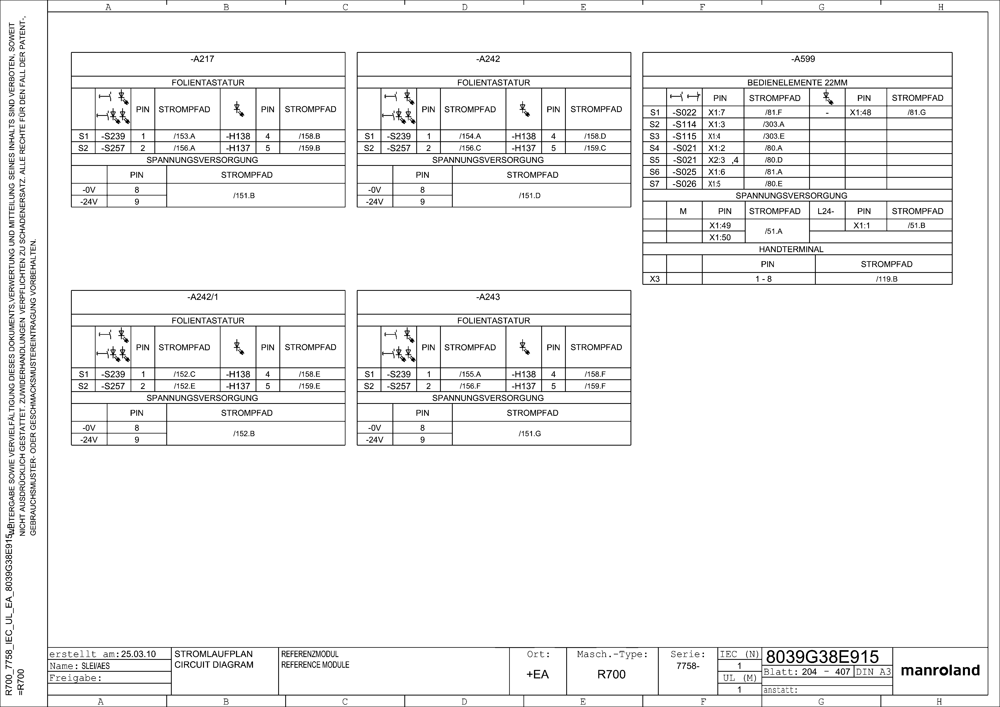

# +EA — Sheet 204 of 407 — REFERENZMODUL

**REFERENCE MODULE**

> Part of the manroland **R700** printing press IEC/UL circuit diagrams.
> Drawing class: **Stromlaufplan / Circuit diagram** (DIN A3).
> Document `+EA` covers the **Printing unit** machine section.

## At a glance

| Field | Value |
|---|---|
| Document | `+EA`  (8039G38E915) |
| Sheet | **204** of 407 |
| Section (DE) | REFERENZMODUL |
| Section (EN) | REFERENCE MODULE |
| Section type | REFERENCE_MODULE — Reference module |
| Machine type | `R700` |
| Series | `7758` |
| Created | 25.03.10 |
| Replaces | — |
| Columns used | A, B, C, D, E, F, G, H |
| Path numbers | — |
| Labels on sheet | 166 |
| Cross-refs out | 31 |
| Cross-refs in | 31 |

**Previous:** [+EA sheet 203](SHEET_0203.md) · **Next:** [+EA sheet 205](SHEET_0205.md) · **Document TOC:** [_TOC.md](_TOC.md)  (+EA) · **Master TOC:** [all sheets](../_MASTER_TOC.md)

## Sheet image (300 DPI, exact vector render)



_Rendered directly from the PDF vector layer at 300 DPI (1-bit), no OCR and no resampling. Use it to confirm anything ambiguous in the text below._

## Cross-references on this sheet

Each entry is a wire leaving this sheet. The printed token is `/sheet.column`; the link resolves to that sheet inside the same document.

| Ref | Target sheet | Col | Path | Destination on target | Target section | From col |
|---|---|---|---|---|---|---|
| `/81.F` | [+EA sheet 81](SHEET_0081.md) | F | — | — | AUSLEGERSTAPELSTEUERUNG: BEDIENKOMMANDOS | G |
| `/81.G` | [+EA sheet 81](SHEET_0081.md) | G | — | — | AUSLEGERSTAPELSTEUERUNG: BEDIENKOMMANDOS | H |
| `/303.A` | [+EA sheet 303](SHEET_0303.md) | A | — | — | OPTION: ZWISCHENSTAPEL / | G |
| `/153.A` | [+EA sheet 153](SHEET_0153.md) | A | — | — | ZUGANGSABSICHERUNG | B |
| `/158.B` | [+EA sheet 158](SHEET_0158.md) | B | — | — | ZUGANGSABSICHERUNG | C |
| `/154.A` | [+EA sheet 154](SHEET_0154.md) | A | — | — | ZUGANGSABSICHERUNG | D |
| `/303.E` | [+EA sheet 303](SHEET_0303.md) | E | — | — | OPTION: ZWISCHENSTAPEL / | G |
| `/158.D` | [+EA sheet 158](SHEET_0158.md) | D | — | — | ZUGANGSABSICHERUNG | E |
| `/80.A` | [+EA sheet 80](SHEET_0080.md) | A | — | — | AUSLEGERSTAPELSTEUERUNG: BEDIENKOMMANDOS | G |
| `/156.A` | [+EA sheet 156](SHEET_0156.md) | A | — | — | ZUGANGSABSICHERUNG | B |
| `/159.B` | [+EA sheet 159](SHEET_0159.md) | B | — | — | ZUGANGSABSICHERUNG | C |
| `/156.C` | [+EA sheet 156](SHEET_0156.md) | C | — | — | ZUGANGSABSICHERUNG | D |
| `/159.C` | [+EA sheet 159](SHEET_0159.md) | C | — | — | ZUGANGSABSICHERUNG | E |
| `/80.D` | [+EA sheet 80](SHEET_0080.md) | D | — | — | AUSLEGERSTAPELSTEUERUNG: BEDIENKOMMANDOS | G |
| `/81.A` | [+EA sheet 81](SHEET_0081.md) | A | — | — | AUSLEGERSTAPELSTEUERUNG: BEDIENKOMMANDOS | G |
| `/80.E` | [+EA sheet 80](SHEET_0080.md) | E | — | — | AUSLEGERSTAPELSTEUERUNG: BEDIENKOMMANDOS | G |
| `/151.B` | [+EA sheet 151](SHEET_0151.md) | B | — | — | ZUGANGSABSICHERUNG | B |
| `/151.D` | [+EA sheet 151](SHEET_0151.md) | D | — | — | ZUGANGSABSICHERUNG | E |
| `/51.B` | [+EA sheet 51](SHEET_0051.md) | B | — | — | MASCHINENBEDIENUNG: SPANNUNGSVERSORGUNG | H |
| `/51.A` | [+EA sheet 51](SHEET_0051.md) | A | — | — | MASCHINENBEDIENUNG: SPANNUNGSVERSORGUNG | G |
| `/119.B` | [+EA sheet 119](SHEET_0119.md) | B | — | — | PROZESSMAGAZIN: HANDTERMINAL | H |
| `/158.E` | [+EA sheet 158](SHEET_0158.md) | E | — | — | ZUGANGSABSICHERUNG | C |
| `/155.A` | [+EA sheet 155](SHEET_0155.md) | A | — | — | ZUGANGSABSICHERUNG | D |
| `/158.F` | [+EA sheet 158](SHEET_0158.md) | F | — | — | ZUGANGSABSICHERUNG | E |
| `/152.C` | [+EA sheet 152](SHEET_0152.md) | C | — | — | ZUGANGSABSICHERUNG | B |
| `/152.E` | [+EA sheet 152](SHEET_0152.md) | E | — | — | ZUGANGSABSICHERUNG | B |
| `/159.E` | [+EA sheet 159](SHEET_0159.md) | E | — | — | ZUGANGSABSICHERUNG | C |
| `/156.F` | [+EA sheet 156](SHEET_0156.md) | F | — | — | ZUGANGSABSICHERUNG | D |
| `/159.F` | [+EA sheet 159](SHEET_0159.md) | F | — | — | ZUGANGSABSICHERUNG | E |
| `/152.B` | [+EA sheet 152](SHEET_0152.md) | B | — | — | ZUGANGSABSICHERUNG | B |
| `/151.G` | [+EA sheet 151](SHEET_0151.md) | G | — | — | ZUGANGSABSICHERUNG | E |

### Incoming references (sheets that point here)

Every other sheet that sends a wire to this one. `Back-ref` is the token printed on *that* sheet; `Path` is its line number.

| From sheet | Cols | Back-ref | Path | Refs | What continues there |
|---|---|---|---|---|---|
| [+EA#51](SHEET_0051.md) | A, B | `/51.A`, `/51.B` | — | 2 | A599 |
| [+EA#80](SHEET_0080.md) | A, D, E | `/80.A`, `/80.D`, `/80.E` | — | 3 | A599 |
| [+EA#81](SHEET_0081.md) | B, F, G | `/81.B`, `/81.F`, `/81.G` | — | 3 | A599 |
| [+EA#119](SHEET_0119.md) | D | `/119.D` | — | 1 | 1 2 3 4 5 6 7 8 X3 A599 |
| [+EA#151](SHEET_0151.md) | B, D, G | `/151.B`, `/151.D`, `/151.G` | — | 3 | A217; A242; A243 |
| [+EA#152](SHEET_0152.md) | B, C, F | `/152.B`, `/152.C`, `/152.F` | — | 3 | A242/1 |
| [+EA#153](SHEET_0153.md) | A | `/153.A` | — | 1 | A217 |
| [+EA#154](SHEET_0154.md) | A | `/154.A` | — | 1 | A242 |
| [+EA#155](SHEET_0155.md) | A | `/155.A` | — | 1 | A243 |
| [+EA#156](SHEET_0156.md) | A, C, F | `/156.A`, `/156.C`, `/156.F` | — | 3 | A217; A242; A243 |
| [+EA#158](SHEET_0158.md) | B, D, E, F | `/158.B`, `/158.D`, `/158.E`, `/158.F` | — | 4 | A217; A242; A242/1; A243 |
| [+EA#159](SHEET_0159.md) | B, D, E, F | `/159.B`, `/159.D`, `/159.E`, `/159.F` | — | 4 | A217; A242; A242/1; A243 |
| [+EA#303](SHEET_0303.md) | B, E | `/303.B`, `/303.E` | — | 2 | A599 |


## Devices on this sheet

| Tag | Class | Class meaning (IEC) | Col | Sub | Terminal | Sign |
|---|---|---|---|---|---|---|
| `S1` | S | Schalter / switch | A | — | — | — |
| `S2` | S | Schalter / switch | A | — | — | — |
| `S239` | S | Schalter / switch | A | — | — | — |
| `S257` | S | Schalter / switch | A | — | — | — |
| `A242/1` | A | Baugruppe / assembly, module, PC board | B | 1 | — | — |
| `S1` | S | Schalter / switch | A | — | — | — |
| `S2` | S | Schalter / switch | A | — | — | — |
| `S239` | S | Schalter / switch | A | — | — | — |
| `S257` | S | Schalter / switch | A | — | — | — |
| `A217` | A | Baugruppe / assembly, module, PC board | B | — | — | — |
| `S1` | S | Schalter / switch | C | — | — | — |
| `S2` | S | Schalter / switch | C | — | — | — |
| `S239` | S | Schalter / switch | C | — | — | — |
| `S257` | S | Schalter / switch | C | — | — | — |
| `A243` | A | Baugruppe / assembly, module, PC board | D | — | — | — |
| `S1` | S | Schalter / switch | C | — | — | — |
| `S2` | S | Schalter / switch | C | — | — | — |
| `S239` | S | Schalter / switch | C | — | — | — |
| `S257` | S | Schalter / switch | C | — | — | — |
| `A242` | A | Baugruppe / assembly, module, PC board | D | — | — | — |
| `S1` | S | Schalter / switch | F | — | — | — |
| `S2` | S | Schalter / switch | F | — | — | — |
| `S3` | S | Schalter / switch | F | — | — | — |
| `S4` | S | Schalter / switch | F | — | — | — |
| `S6` | S | Schalter / switch | F | — | — | — |
| `S7` | S | Schalter / switch | F | — | — | — |
| `X3` | X | Klemme / terminal, plug connector | F | — | — | — |
| `S5` | S | Schalter / switch | F | — | — | — |
| `X1:48` | X | Klemme / terminal, plug connector | G | — | 48 | — |
| `X1:49` | X | Klemme / terminal, plug connector | F | — | 49 | — |
| `X1:50` | X | Klemme / terminal, plug connector | F | — | 50 | — |
| `X1:1` | X | Klemme / terminal, plug connector | G | — | 1 | — |
| `S022` | S | Schalter / switch | F | — | — | — |
| `S114` | S | Schalter / switch | F | — | — | — |
| `S115` | S | Schalter / switch | F | — | — | — |
| `S021` | S | Schalter / switch | F | — | — | — |
| `S025` | S | Schalter / switch | F | — | — | — |
| `S026` | S | Schalter / switch | F | — | — | — |
| `S021` | S | Schalter / switch | F | — | — | — |
| `X1:7` | X | Klemme / terminal, plug connector | F | — | 7 | — |
| `X1:3` | X | Klemme / terminal, plug connector | F | — | 3 | — |
| `X1:4` | X | Klemme / terminal, plug connector | F | — | 4 | — |
| `X1:2` | X | Klemme / terminal, plug connector | F | — | 2 | — |
| `X1:6` | X | Klemme / terminal, plug connector | F | — | 6 | — |
| `X1:5` | X | Klemme / terminal, plug connector | F | — | 5 | — |
| `A599` | A | Baugruppe / assembly, module, PC board | G | — | — | — |

## Potentials / nets

| Potential | Count | Columns | Attached devices | Terminals |
|---|---|---|---|---|
| `0V` | 4 | A, C | — | — |
| `24V` | 4 | A, C | — | — |
| `H137` | 4 | B, E | — | — |
| `H138` | 4 | B, E | — | — |
| `L24` | 1 | G | — | — |


A potential such as `L24+/4` or `M24+` is a named supply/return rail; every place it appears on this sheet is electrically common.

## Wire-end annotations (grouped as printed)

A wire that continues elsewhere is annotated with a small cluster: the destination description, the path/line number `#NN`, and the `/sheet.column` cross reference. Each row below is one such cluster exactly as it is grouped on the drawing.

| Col | Y | Path | Cross-ref | Text on the wire |
|---|---|---|---|---|
| B | 65.5 | — | — | `A217` |
| D | 65.5 | — | — | `A242` |
| G | 65.5 | — | — | `A599` |
| B | 94.2 | — | — | `FOLIENTASTATUR` |
| D | 94.2 | — | — | `FOLIENTASTATUR` |
| G | 94.2 | — | — | `BEDIENELEMENTE 22MM` |
| H | 112.3 | — | — | `STROMPFAD` |
| F | 112.6 | — | — | `PIN` |
| G | 112.6 | — | — | `STROMPFAD` |
| G | 112.6 | — | — | `PIN` |
| B | 125.8 | — | — | `PIN STROMPFAD PIN STROMPFAD` |
| D | 125.8 | — | — | `PIN STROMPFAD PIN STROMPFAD` |
| F | 129.3 | — | — | `S022 S114 S115` |
| F | 129.6 | — | — | `S2 S3 S4 S1` |
| F | 129.6 | — | — | `X1:7 X1:3` |
| G | 129.6 | — | — | `X1:48` |
| G | 129.9 | — | `/81.F` | — |
| H | 129.9 | — | `/81.G` | — |
| G | 144.1 | — | `/303.A` | — |
| B | 157.6 | — | — | `S239 S257 5` |
| B | 157.6 | — | — | `SPANNUNGSVERSORGUNG H138 H137` |
| D | 157.6 | — | — | `S239 S257 5` |
| D | 157.6 | — | — | `SPANNUNGSVERSORGUNG H138 H137` |
| B | 158.0 | — | — | `S2 S1 2 1 4` |
| D | 158.0 | — | — | `S2 S1 2 1 4` |
| B | 158.3 | — | `/153.A` | — |
| C | 158.3 | — | `/158.B` | — |
| D | 158.3 | — | `/154.A` | — |
| E | 158.3 | — | `/158.D` | — |
| G | 158.3 | — | `/303.E` | — |
| F | 159.1 | — | — | `X1:4 X1:2` |
| F | 171.8 | — | — | `S021` |
| G | 172.4 | — | `/80.A` | — |
| B | 172.5 | — | `/156.A` | — |
| C | 172.5 | — | `/159.B` | — |
| D | 172.5 | — | `/156.C` | — |
| E | 172.5 | — | `/159.C` | — |
| F | 185.7 | — | — | `X2:3 ,4` |
| F | 186.0 | — | — | `S021` |
| F | 186.3 | — | — | `S5` |
| G | 186.7 | — | `/80.D` | — |
| F | 200.1 | — | — | `S025 S026` |
| F | 200.5 | — | — | `S6 S7` |
| F | 200.5 | — | — | `X1:6` |
| G | 200.8 | — | `/81.A` | — |
| A | 204.0 | — | — | `PIN` |
| B | 204.0 | — | — | `STROMPFAD` |
| D | 204.0 | — | — | `PIN` |
| E | 204.0 | — | — | `STROMPFAD` |
| G | 215.0 | — | `/80.E` | — |
| F | 215.8 | — | — | `X1:5` |
| A | 221.7 | — | — | `0V 8 9` |
| C | 221.7 | — | — | `0V 8 9` |
| G | 228.8 | — | — | `SPANNUNGSVERSORGUNG` |
| B | 229.2 | — | `/151.B` | — |
| E | 229.2 | — | `/151.D` | — |
| A | 235.9 | — | — | `24V` |
| C | 235.9 | — | — | `24V` |
| F | 247.2 | — | — | `M` |
| G | 247.2 | — | — | `STROMPFAD L24` |
| H | 247.2 | — | — | `STROMPFAD` |
| G | 247.3 | — | — | `PIN PIN` |
| F | 264.2 | — | — | `X1:49 X1:50` |
| G | 264.2 | — | — | `X1:1` |
| H | 264.6 | — | `/51.B` | — |
| G | 271.7 | — | `/51.A` | — |
| G | 292.6 | — | — | `HANDTERMINAL` |
| G | 310.3 | — | — | `PIN` |
| H | 310.3 | — | — | `STROMPFAD` |
| F | 328.0 | — | — | `X3` |
| G | 328.0 | — | — | `1 8` |
| H | 328.4 | — | `/119.B` | — |
| B | 349.0 | — | — | `A242/1` |
| D | 349.0 | — | — | `A243` |
| B | 377.6 | — | — | `FOLIENTASTATUR` |
| D | 377.6 | — | — | `FOLIENTASTATUR` |
| B | 409.2 | — | — | `PIN STROMPFAD PIN STROMPFAD` |
| D | 409.2 | — | — | `PIN STROMPFAD PIN STROMPFAD` |
| B | 441.1 | — | — | `S239 S257 5` |
| B | 441.1 | — | — | `SPANNUNGSVERSORGUNG H138 H137` |
| D | 441.1 | — | — | `S239 S257 5` |
| D | 441.1 | — | — | `SPANNUNGSVERSORGUNG H138 H137` |
| B | 441.4 | — | — | `S2 S1 2 1 4` |
| D | 441.4 | — | — | `S2 S1 2 1 4` |
| B | 441.8 | — | `/152.C` | — |
| C | 441.8 | — | `/158.E` | — |
| D | 441.8 | — | `/155.A` | — |
| E | 441.8 | — | `/158.F` | — |
| B | 455.9 | — | `/152.E` | — |
| C | 455.9 | — | `/159.E` | — |
| D | 455.9 | — | `/156.F` | — |
| E | 455.9 | — | `/159.F` | — |
| A | 487.5 | — | — | `PIN` |
| B | 487.5 | — | — | `STROMPFAD` |
| D | 487.5 | — | — | `PIN` |
| E | 487.5 | — | — | `STROMPFAD` |
| A | 505.2 | — | — | `0V 8 9` |
| C | 505.2 | — | — | `0V 8 9` |
| B | 512.6 | — | `/152.B` | — |
| E | 512.6 | — | `/151.G` | — |
| A | 519.4 | — | — | `24V` |
| C | 519.4 | — | — | `24V` |


## Reconstructed tables

This sheet carries tabular content (pin map / terminal assignment / index). The grid below was rebuilt from the drawing's own rule lines, so each row is exactly one physical row of the table.

### Table 1 — 8 data rows × 1 columns (at x=85.0, y=62.4)

| C1 |
|---|
| `S1` |
| `S2` |
| `0V` |
| `24V` |
| `S1` |
| `S2` |
| `0V` |
| `24V` |


### Table 2 — 10 data rows × 2 columns (at x=127.6, y=62.4) — **PIN**

| S239 | 1 |
|---|---|
| `S257` | `2` |
|  | `PIN` |
|  | `8` |
|  | `9` |
|  | `PIN` |
| `S239` | `1` |
| `S257` | `2` |
|  | `PIN` |
|  | `8` |
|  | `9` |


### Table 3 — 13 data rows × 4 columns (at x=198.4, y=62.4) — **A217 FOLIENTASTATUR**

| STROMPFAD |  | PIN | STROMPFAD |
|---|---|---|---|
| `/153.A` | `H138` | `4` | `/158.B` |
| `/156.A` | `H137` | `5` | `/159.B` |
| `SPANNUNGSVERSORGUNG` |  |  |  |
|  | `STROMPFAD` |  |  |
|  | `/151.B` |  |  |
| `A242/1` |  |  |  |
| `FOLIENTASTATUR` |  |  |  |
| `STROMPFAD` |  | `PIN` | `STROMPFAD` |
| `/152.C` | `H138` | `4` | `/158.E` |
| `/152.E` | `H137` | `5` | `/159.E` |
| `SPANNUNGSVERSORGUNG` |  |  |  |
|  | `STROMPFAD` |  |  |
|  | `/152.B` |  |  |


### Table 4 — 8 data rows × 1 columns (at x=425.2, y=62.4)

| C1 |
|---|
| `S1` |
| `S2` |
| `0V` |
| `24V` |
| `S1` |
| `S2` |
| `0V` |
| `24V` |


### Table 5 — 10 data rows × 2 columns (at x=467.7, y=62.4) — **PIN**

| S239 | 1 |
|---|---|
| `S257` | `2` |
|  | `PIN` |
|  | `8` |
|  | `9` |
|  | `PIN` |
| `S239` | `1` |
| `S257` | `2` |
|  | `PIN` |
|  | `8` |
|  | `9` |


### Table 6 — 13 data rows × 4 columns (at x=538.6, y=62.4) — **A242 FOLIENTASTATUR**

| STROMPFAD |  | PIN | STROMPFAD |
|---|---|---|---|
| `/154.A` | `H138` | `4` | `/158.D` |
| `/156.C` | `H137` | `5` | `/159.C` |
| `SPANNUNGSVERSORGUNG` |  |  |  |
|  | `STROMPFAD` |  |  |
|  | `/151.D` |  |  |
| `A243` |  |  |  |
| `FOLIENTASTATUR` |  |  |  |
| `STROMPFAD` |  | `PIN` | `STROMPFAD` |
| `/155.A` | `H138` | `4` | `/158.F` |
| `/156.F` | `H137` | `5` | `/159.F` |
| `SPANNUNGSVERSORGUNG` |  |  |  |
|  | `STROMPFAD` |  |  |
|  | `/151.G` |  |  |


### Table 7 — 14 data rows × 4 columns (at x=765.4, y=62.4) — **A599 BEDIENELEMENTE**

|  |  | PIN | STROMPFAD |
|---|---|---|---|
| `S1` | `S022` | `X1:7` | `/81.F` |
| `S2` | `S114` | `X1:3` | `/303.A` |
| `S3` | `S115` | `X1:4` | `/303.E` |
| `S4` | `S021` | `X1:2` | `/80.A` |
| `S5` | `S021` | `,4 X2:3` | `/80.D` |
| `S6` | `S025` | `X1:6` | `/81.A` |
| `S7` | `S026` | `X1:5` | `/80.E` |
|  |  |  | `SPANNUNGSVERSORGUNG` |
|  | `M` | `PIN` | `STROMPFAD` |
|  |  | `X1:49` |  |
|  |  | `X1:50` | `/51.A` |
|  |  |  | `HANDTERMINAL` |
|  |  |  | `PIN` |
| `X3` |  |  | `1 8` |


### Table 8 — 5 data rows × 3 columns (at x=970.9, y=62.4) — **22MM**

|  | PIN | STROMPFAD |
|---|---|---|
|  | `X1:48` | `/81.G` |
| `L24` | `PIN` | `STROMPFAD` |
|  | `X1:1` | `/51.B` |
|  |  | `STROMPFAD` |
|  |  | `/119.B` |


## Notes and free text on this sheet

| Text | Col | Y (pt) |
|---|---|---|
| `FOLIENTASTATUR` | B | 377.64 |
| `PIN` | A | 409.55 |
| `STROMPFAD` | B | 409.51 |
| `PIN` | B | 409.55 |
| `STROMPFAD` | C | 409.23 |
| `SPANNUNGSVERSORGUNG` | B | 469.74 |
| `FOLIENTASTATUR` | D | 377.64 |
| `PIN` | D | 409.55 |
| `STROMPFAD` | D | 409.51 |
| `PIN` | E | 409.55 |
| `STROMPFAD` | E | 409.23 |
| `SPANNUNGSVERSORGUNG` | D | 469.74 |
| `PIN` | F | 112.62 |
| `M` | F | 247.2 |
| `BEDIENELEMENTE 22MM` | G | 94.16 |
| `STROMPFAD` | G | 112.58 |
| `SPANNUNGSVERSORGUNG` | G | 228.8 |
| `HANDTERMINAL` | G | 292.59 |
| `PIN` | G | 310.34 |
| `STROMPFAD` | H | 112.3 |
| `X2:3 ,4` | F | 185.72 |

## Complete label inventory (exact text from the drawing)

Every text object inside the drawing area of this sheet, in DIN reading order (column A→H, then top→bottom). This is the authoritative list: if a string is not here it is not printed on this sheet.

| Col | Y | X | Dir | Type | Text |
|---|---|---|---|---|---|
| A | 126.1 | 162.0 | → | text | `PIN` |
| A | 157.6 | 120.6 | → | device tag | `S239` |
| A | 158.0 | 94.0 | → | device tag | `S1` |
| A | 158.0 | 168.0 | → | number | `1` |
| A | 171.8 | 120.6 | → | device tag | `S257` |
| A | 172.1 | 93.1 | → | device tag | `S2` |
| A | 172.2 | 167.4 | → | number | `2` |
| A | 204.0 | 154.9 | → | text | `PIN` |
| A | 221.7 | 98.4 | → | potential | `0V` |
| A | 221.8 | 160.3 | → | number | `8` |
| A | 235.9 | 95.7 | → | potential | `24V` |
| A | 235.9 | 160.3 | → | number | `9` |
| A | 409.6 | 162.0 | → | text | `PIN` |
| A | 441.1 | 120.6 | → | device tag | `S239` |
| A | 441.4 | 94.0 | → | device tag | `S1` |
| A | 441.4 | 168.0 | → | number | `1` |
| A | 455.3 | 120.6 | → | device tag | `S257` |
| A | 455.6 | 93.1 | → | device tag | `S2` |
| A | 455.6 | 167.4 | → | number | `2` |
| A | 487.5 | 154.9 | → | text | `PIN` |
| A | 505.2 | 98.4 | → | potential | `0V` |
| A | 505.2 | 160.3 | → | number | `8` |
| A | 519.4 | 95.7 | → | potential | `24V` |
| A | 519.4 | 160.3 | → | number | `9` |
| B | 65.5 | 226.9 | → | device tag | `A217` |
| B | 94.2 | 204.4 | → | text | `FOLIENTASTATUR` |
| B | 126.0 | 188.9 | → | text | `STROMPFAD` |
| B | 126.1 | 310.8 | → | text | `PIN` |
| B | 157.6 | 269.1 | → | potential | `H138` |
| B | 158.0 | 316.2 | → | number | `4` |
| B | 158.3 | 206.9 | → | cross-reference | `/153.A` |
| B | 171.8 | 269.1 | → | potential | `H137` |
| B | 172.2 | 316.2 | → | number | `5` |
| B | 172.5 | 206.9 | → | cross-reference | `/156.A` |
| B | 186.3 | 174.5 | → | text | `SPANNUNGSVERSORGUNG` |
| B | 204.0 | 263.3 | → | text | `STROMPFAD` |
| B | 229.2 | 277.9 | → | cross-reference | `/151.B` |
| B | 349.0 | 223.2 | → | device tag | `A242/1` |
| B | 377.6 | 204.4 | → | text | `FOLIENTASTATUR` |
| B | 409.5 | 188.9 | → | text | `STROMPFAD` |
| B | 409.6 | 310.8 | → | text | `PIN` |
| B | 441.1 | 269.1 | → | potential | `H138` |
| B | 441.4 | 316.2 | → | number | `4` |
| B | 441.8 | 206.9 | → | cross-reference | `/152.C` |
| B | 455.3 | 269.1 | → | potential | `H137` |
| B | 455.6 | 316.2 | → | number | `5` |
| B | 455.9 | 207.2 | → | cross-reference | `/152.E` |
| B | 469.7 | 174.5 | → | text | `SPANNUNGSVERSORGUNG` |
| B | 487.5 | 263.3 | → | text | `STROMPFAD` |
| B | 512.6 | 277.9 | → | cross-reference | `/152.B` |
| C | 125.8 | 339.2 | → | text | `STROMPFAD` |
| C | 157.6 | 460.8 | → | device tag | `S239` |
| C | 158.0 | 434.1 | → | device tag | `S1` |
| C | 158.3 | 355.9 | → | cross-reference | `/158.B` |
| C | 171.8 | 460.8 | → | device tag | `S257` |
| C | 172.1 | 433.3 | → | device tag | `S2` |
| C | 172.5 | 355.9 | → | cross-reference | `/159.B` |
| C | 221.7 | 438.5 | → | potential | `0V` |
| C | 235.9 | 435.8 | → | potential | `24V` |
| C | 409.2 | 339.2 | → | text | `STROMPFAD` |
| C | 441.1 | 460.8 | → | device tag | `S239` |
| C | 441.4 | 434.1 | → | device tag | `S1` |
| C | 441.8 | 356.0 | → | cross-reference | `/158.E` |
| C | 455.3 | 460.8 | → | device tag | `S257` |
| C | 455.6 | 433.3 | → | device tag | `S2` |
| C | 455.9 | 356.0 | → | cross-reference | `/159.E` |
| C | 505.2 | 438.5 | → | potential | `0V` |
| C | 519.4 | 435.8 | → | potential | `24V` |
| D | 65.5 | 567.1 | → | device tag | `A242` |
| D | 94.2 | 544.5 | → | text | `FOLIENTASTATUR` |
| D | 126.0 | 529.1 | → | text | `STROMPFAD` |
| D | 126.1 | 502.2 | → | text | `PIN` |
| D | 158.0 | 508.1 | → | number | `1` |
| D | 158.3 | 547.1 | → | cross-reference | `/154.A` |
| D | 172.2 | 507.5 | → | number | `2` |
| D | 172.5 | 547.1 | → | cross-reference | `/156.C` |
| D | 186.3 | 514.6 | → | text | `SPANNUNGSVERSORGUNG` |
| D | 204.0 | 495.1 | → | text | `PIN` |
| D | 221.8 | 500.5 | → | number | `8` |
| D | 235.9 | 500.5 | → | number | `9` |
| D | 349.0 | 567.1 | → | device tag | `A243` |
| D | 377.6 | 544.5 | → | text | `FOLIENTASTATUR` |
| D | 409.5 | 529.1 | → | text | `STROMPFAD` |
| D | 409.6 | 502.2 | → | text | `PIN` |
| D | 441.4 | 508.1 | → | number | `1` |
| D | 441.8 | 547.1 | → | cross-reference | `/155.A` |
| D | 455.6 | 507.5 | → | number | `2` |
| D | 455.9 | 547.5 | → | cross-reference | `/156.F` |
| D | 469.7 | 514.6 | → | text | `SPANNUNGSVERSORGUNG` |
| D | 487.5 | 495.1 | → | text | `PIN` |
| D | 505.2 | 500.5 | → | number | `8` |
| D | 519.4 | 500.5 | → | number | `9` |
| E | 125.8 | 679.3 | → | text | `STROMPFAD` |
| E | 126.1 | 651.0 | → | text | `PIN` |
| E | 157.6 | 609.3 | → | potential | `H138` |
| E | 158.0 | 656.4 | → | number | `4` |
| E | 158.3 | 695.9 | → | cross-reference | `/158.D` |
| E | 171.8 | 609.3 | → | potential | `H137` |
| E | 172.2 | 656.4 | → | number | `5` |
| E | 172.5 | 695.9 | → | cross-reference | `/159.C` |
| E | 204.0 | 603.5 | → | text | `STROMPFAD` |
| E | 229.2 | 618.0 | → | cross-reference | `/151.D` |
| E | 409.2 | 679.3 | → | text | `STROMPFAD` |
| E | 409.6 | 651.0 | → | text | `PIN` |
| E | 441.1 | 609.3 | → | potential | `H138` |
| E | 441.4 | 656.4 | → | number | `4` |
| E | 441.8 | 696.3 | → | cross-reference | `/158.F` |
| E | 455.3 | 609.3 | → | potential | `H137` |
| E | 455.6 | 656.4 | → | number | `5` |
| E | 455.9 | 696.3 | → | cross-reference | `/159.F` |
| E | 487.5 | 603.5 | → | text | `STROMPFAD` |
| E | 512.6 | 617.8 | → | cross-reference | `/151.G` |
| F | 112.6 | 849.4 | → | text | `PIN` |
| F | 129.3 | 800.9 | → | device tag | `S022` |
| F | 129.6 | 774.3 | → | device tag | `S1` |
| F | 129.6 | 843.3 | → | device tag | `X1:7` |
| F | 143.5 | 800.9 | → | device tag | `S114` |
| F | 143.8 | 773.4 | → | device tag | `S2` |
| F | 143.8 | 843.3 | → | device tag | `X1:3` |
| F | 157.6 | 800.9 | → | device tag | `S115` |
| F | 158.0 | 773.4 | → | device tag | `S3` |
| F | 159.1 | 843.3 | → | device tag | `X1:4` |
| F | 171.8 | 801.6 | → | device tag | `S021` |
| F | 172.1 | 773.4 | → | device tag | `S4` |
| F | 172.1 | 843.3 | → | device tag | `X1:2` |
| F | 185.7 | 843.3 | → | text | `X2:3 ,4` |
| F | 186.0 | 801.6 | → | device tag | `S021` |
| F | 186.3 | 773.4 | → | device tag | `S5` |
| F | 200.1 | 800.9 | → | device tag | `S025` |
| F | 200.5 | 773.4 | → | device tag | `S6` |
| F | 200.5 | 843.3 | → | device tag | `X1:6` |
| F | 214.3 | 800.9 | → | device tag | `S026` |
| F | 214.7 | 773.4 | → | device tag | `S7` |
| F | 215.8 | 843.3 | → | device tag | `X1:5` |
| F | 247.2 | 809.4 | → | text | `M` |
| F | 247.3 | 855.1 | → | text | `PIN` |
| F | 264.2 | 844.7 | → | device tag | `X1:49` |
| F | 278.4 | 844.7 | → | device tag | `X1:50` |
| F | 328.0 | 773.7 | → | device tag | `X3` |
| G | 65.5 | 942.2 | → | device tag | `A599` |
| G | 94.2 | 890.1 | → | text | `BEDIENELEMENTE 22MM` |
| G | 112.6 | 891.9 | → | text | `STROMPFAD` |
| G | 112.6 | 1020.9 | → | text | `PIN` |
| G | 129.6 | 1012.0 | → | device tag | `X1:48` |
| G | 129.9 | 911.3 | → | cross-reference | `/81.F` |
| G | 144.1 | 908.5 | → | cross-reference | `/303.A` |
| G | 158.3 | 908.8 | → | cross-reference | `/303.E` |
| G | 172.5 | 910.9 | → | cross-reference | `/80.A` |
| G | 186.7 | 910.9 | → | cross-reference | `/80.D` |
| G | 200.8 | 910.9 | → | cross-reference | `/81.A` |
| G | 215.0 | 911.2 | → | cross-reference | `/80.E` |
| G | 228.8 | 876.0 | → | text | `SPANNUNGSVERSORGUNG` |
| G | 247.2 | 891.9 | → | text | `STROMPFAD` |
| G | 247.2 | 973.6 | → | potential | `L24` |
| G | 247.3 | 1020.9 | → | text | `PIN` |
| G | 264.2 | 1016.2 | → | device tag | `X1:1` |
| G | 271.7 | 910.9 | → | cross-reference | `/51.A` |
| G | 292.6 | 903.7 | → | text | `HANDTERMINAL` |
| G | 310.3 | 906.1 | → | text | `PIN` |
| G | 328.0 | 899.1 | → | number | `1 8` |
| H | 112.3 | 1062.0 | → | text | `STROMPFAD` |
| H | 130.0 | 1080.9 | → | cross-reference | `/81.G` |
| H | 247.2 | 1062.0 | → | text | `STROMPFAD` |
| H | 264.6 | 1081.1 | → | cross-reference | `/51.B` |
| H | 310.3 | 1025.1 | → | text | `STROMPFAD` |
| H | 328.4 | 1043.3 | → | cross-reference | `/119.B` |

## Reading-order text block

The same content as a plain block, grouped by DIN column — convenient to paste or to match against a visual description.

```text
=== Column A ===
 126.1  162.0  text         PIN
 157.6  120.6  devtag       S239
 158.0   94.0  devtag       S1
 158.0  168.0  numeric      1
 171.8  120.6  devtag       S257
 172.1   93.1  devtag       S2
 172.2  167.4  numeric      2
 204.0  154.9  text         PIN
 221.7   98.4  net          0V
 221.8  160.3  numeric      8
 235.9   95.7  net          24V
 235.9  160.3  numeric      9
 409.6  162.0  text         PIN
 441.1  120.6  devtag       S239
 441.4   94.0  devtag       S1
 441.4  168.0  numeric      1
 455.3  120.6  devtag       S257
 455.6   93.1  devtag       S2
 455.6  167.4  numeric      2
 487.5  154.9  text         PIN
 505.2   98.4  net          0V
 505.2  160.3  numeric      8
 519.4   95.7  net          24V
 519.4  160.3  numeric      9
=== Column B ===
  65.5  226.9  devtag       A217
  94.2  204.4  text         FOLIENTASTATUR
 126.0  188.9  text         STROMPFAD
 126.1  310.8  text         PIN
 157.6  269.1  net          H138
 158.0  316.2  numeric      4
 158.3  206.9  xref         /153.A
 171.8  269.1  net          H137
 172.2  316.2  numeric      5
 172.5  206.9  xref         /156.A
 186.3  174.5  text         SPANNUNGSVERSORGUNG
 204.0  263.3  text         STROMPFAD
 229.2  277.9  xref         /151.B
 349.0  223.2  devtag       A242/1
 377.6  204.4  text         FOLIENTASTATUR
 409.5  188.9  text         STROMPFAD
 409.6  310.8  text         PIN
 441.1  269.1  net          H138
 441.4  316.2  numeric      4
 441.8  206.9  xref         /152.C
 455.3  269.1  net          H137
 455.6  316.2  numeric      5
 455.9  207.2  xref         /152.E
 469.7  174.5  text         SPANNUNGSVERSORGUNG
 487.5  263.3  text         STROMPFAD
 512.6  277.9  xref         /152.B
=== Column C ===
 125.8  339.2  text         STROMPFAD
 157.6  460.8  devtag       S239
 158.0  434.1  devtag       S1
 158.3  355.9  xref         /158.B
 171.8  460.8  devtag       S257
 172.1  433.3  devtag       S2
 172.5  355.9  xref         /159.B
 221.7  438.5  net          0V
 235.9  435.8  net          24V
 409.2  339.2  text         STROMPFAD
 441.1  460.8  devtag       S239
 441.4  434.1  devtag       S1
 441.8  356.0  xref         /158.E
 455.3  460.8  devtag       S257
 455.6  433.3  devtag       S2
 455.9  356.0  xref         /159.E
 505.2  438.5  net          0V
 519.4  435.8  net          24V
=== Column D ===
  65.5  567.1  devtag       A242
  94.2  544.5  text         FOLIENTASTATUR
 126.0  529.1  text         STROMPFAD
 126.1  502.2  text         PIN
 158.0  508.1  numeric      1
 158.3  547.1  xref         /154.A
 172.2  507.5  numeric      2
 172.5  547.1  xref         /156.C
 186.3  514.6  text         SPANNUNGSVERSORGUNG
 204.0  495.1  text         PIN
 221.8  500.5  numeric      8
 235.9  500.5  numeric      9
 349.0  567.1  devtag       A243
 377.6  544.5  text         FOLIENTASTATUR
 409.5  529.1  text         STROMPFAD
 409.6  502.2  text         PIN
 441.4  508.1  numeric      1
 441.8  547.1  xref         /155.A
 455.6  507.5  numeric      2
 455.9  547.5  xref         /156.F
 469.7  514.6  text         SPANNUNGSVERSORGUNG
 487.5  495.1  text         PIN
 505.2  500.5  numeric      8
 519.4  500.5  numeric      9
=== Column E ===
 125.8  679.3  text         STROMPFAD
 126.1  651.0  text         PIN
 157.6  609.3  net          H138
 158.0  656.4  numeric      4
 158.3  695.9  xref         /158.D
 171.8  609.3  net          H137
 172.2  656.4  numeric      5
 172.5  695.9  xref         /159.C
 204.0  603.5  text         STROMPFAD
 229.2  618.0  xref         /151.D
 409.2  679.3  text         STROMPFAD
 409.6  651.0  text         PIN
 441.1  609.3  net          H138
 441.4  656.4  numeric      4
 441.8  696.3  xref         /158.F
 455.3  609.3  net          H137
 455.6  656.4  numeric      5
 455.9  696.3  xref         /159.F
 487.5  603.5  text         STROMPFAD
 512.6  617.8  xref         /151.G
=== Column F ===
 112.6  849.4  text         PIN
 129.3  800.9  devtag       S022
 129.6  774.3  devtag       S1
 129.6  843.3  devtag       X1:7
 143.5  800.9  devtag       S114
 143.8  773.4  devtag       S2
 143.8  843.3  devtag       X1:3
 157.6  800.9  devtag       S115
 158.0  773.4  devtag       S3
 159.1  843.3  devtag       X1:4
 171.8  801.6  devtag       S021
 172.1  773.4  devtag       S4
 172.1  843.3  devtag       X1:2
 185.7  843.3  text         X2:3 ,4
 186.0  801.6  devtag       S021
 186.3  773.4  devtag       S5
 200.1  800.9  devtag       S025
 200.5  773.4  devtag       S6
 200.5  843.3  devtag       X1:6
 214.3  800.9  devtag       S026
 214.7  773.4  devtag       S7
 215.8  843.3  devtag       X1:5
 247.2  809.4  text         M
 247.3  855.1  text         PIN
 264.2  844.7  devtag       X1:49
 278.4  844.7  devtag       X1:50
 328.0  773.7  devtag       X3
=== Column G ===
  65.5  942.2  devtag       A599
  94.2  890.1  text         BEDIENELEMENTE 22MM
 112.6  891.9  text         STROMPFAD
 112.6 1020.9  text         PIN
 129.6 1012.0  devtag       X1:48
 129.9  911.3  xref         /81.F
 144.1  908.5  xref         /303.A
 158.3  908.8  xref         /303.E
 172.5  910.9  xref         /80.A
 186.7  910.9  xref         /80.D
 200.8  910.9  xref         /81.A
 215.0  911.2  xref         /80.E
 228.8  876.0  text         SPANNUNGSVERSORGUNG
 247.2  891.9  text         STROMPFAD
 247.2  973.6  net          L24
 247.3 1020.9  text         PIN
 264.2 1016.2  devtag       X1:1
 271.7  910.9  xref         /51.A
 292.6  903.7  text         HANDTERMINAL
 310.3  906.1  text         PIN
 328.0  899.1  numeric      1 8
=== Column H ===
 112.3 1062.0  text         STROMPFAD
 130.0 1080.9  xref         /81.G
 247.2 1062.0  text         STROMPFAD
 264.6 1081.1  xref         /51.B
 310.3 1025.1  text         STROMPFAD
 328.4 1043.3  xref         /119.B
```

---
_Generated from the PDF vector text layer; no OCR. Source: `R700_7758_IEC_UL_EA_8039G38E915_p`, sheet 204._
