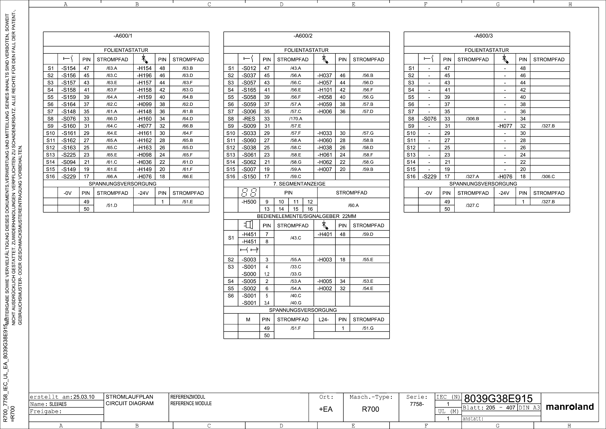

# +EA — Sheet 205 of 407 — REFERENZMODUL

**REFERENCE MODULE**

> Part of the manroland **R700** printing press IEC/UL circuit diagrams.
> Drawing class: **Stromlaufplan / Circuit diagram** (DIN A3).
> Document `+EA` covers the **Printing unit** machine section.

## At a glance

| Field | Value |
|---|---|
| Document | `+EA`  (8039G38E915) |
| Sheet | **205** of 407 |
| Section (DE) | REFERENZMODUL |
| Section (EN) | REFERENCE MODULE |
| Section type | REFERENCE_MODULE — Reference module |
| Machine type | `R700` |
| Series | `7758` |
| Created | 25.03.10 |
| Replaces | — |
| Columns used | A, B, C, D, E, F, G, H |
| Path numbers | — |
| Labels on sheet | 384 |
| Cross-refs out | 83 |
| Cross-refs in | 83 |

**Previous:** [+EA sheet 204](SHEET_0204.md) · **Next:** [+EA sheet 206](SHEET_0206.md) · **Document TOC:** [_TOC.md](_TOC.md)  (+EA) · **Master TOC:** [all sheets](../_MASTER_TOC.md)

## Sheet image (300 DPI, exact vector render)



_Rendered directly from the PDF vector layer at 300 DPI (1-bit), no OCR and no resampling. Use it to confirm anything ambiguous in the text below._

## Cross-references on this sheet

Each entry is a wire leaving this sheet. The printed token is `/sheet.column`; the link resolves to that sheet inside the same document.

| Ref | Target sheet | Col | Path | Destination on target | Target section | From col |
|---|---|---|---|---|---|---|
| `/63.A` | [+EA sheet 63](SHEET_0063.md) | A | — | — | MASCHINENBEDIENUNG: BEDIENUNGKOMMANDOS | B |
| `/63.B` | [+EA sheet 63](SHEET_0063.md) | B | — | — | MASCHINENBEDIENUNG: BEDIENUNGKOMMANDOS | C |
| `/43.A` | [+EA sheet 43](SHEET_0043.md) | A | — | — | BUSVERBINDUNGEN: SIGNALSCHLEIFE | D |
| `/56.A` | [+EA sheet 56](SHEET_0056.md) | A | — | — | MASCHINENBEDIENUNG: BEDIENUNGKOMMANDOS | D |
| `/56.B` | [+EA sheet 56](SHEET_0056.md) | B | — | — | MASCHINENBEDIENUNG: BEDIENUNGKOMMANDOS | E |
| `/63.C` | [+EA sheet 63](SHEET_0063.md) | C | — | — | MASCHINENBEDIENUNG: BEDIENUNGKOMMANDOS | B |
| `/63.D` | [+EA sheet 63](SHEET_0063.md) | D | — | — | MASCHINENBEDIENUNG: BEDIENUNGKOMMANDOS | C |
| `/63.E` | [+EA sheet 63](SHEET_0063.md) | E | — | — | MASCHINENBEDIENUNG: BEDIENUNGKOMMANDOS | B |
| `/63.F` | [+EA sheet 63](SHEET_0063.md) | F | — | — | MASCHINENBEDIENUNG: BEDIENUNGKOMMANDOS | C |
| `/56.C` | [+EA sheet 56](SHEET_0056.md) | C | — | — | MASCHINENBEDIENUNG: BEDIENUNGKOMMANDOS | D |
| `/56.D` | [+EA sheet 56](SHEET_0056.md) | D | — | — | MASCHINENBEDIENUNG: BEDIENUNGKOMMANDOS | E |
| `/56.E` | [+EA sheet 56](SHEET_0056.md) | E | — | — | MASCHINENBEDIENUNG: BEDIENUNGKOMMANDOS | D |
| `/63.F` | [+EA sheet 63](SHEET_0063.md) | F | — | — | MASCHINENBEDIENUNG: BEDIENUNGKOMMANDOS | B |
| `/63.G` | [+EA sheet 63](SHEET_0063.md) | G | — | — | MASCHINENBEDIENUNG: BEDIENUNGKOMMANDOS | C |
| `/56.F` | [+EA sheet 56](SHEET_0056.md) | F | — | — | MASCHINENBEDIENUNG: BEDIENUNGKOMMANDOS | E |
| `/64.A` | [+EA sheet 64](SHEET_0064.md) | A | — | — | MASCHINENBEDIENUNG: BEDIENUNGKOMMANDOS | B |
| `/64.B` | [+EA sheet 64](SHEET_0064.md) | B | — | — | MASCHINENBEDIENUNG: BEDIENUNGKOMMANDOS | C |
| `/56.F` | [+EA sheet 56](SHEET_0056.md) | F | — | — | MASCHINENBEDIENUNG: BEDIENUNGKOMMANDOS | D |
| `/56.G` | [+EA sheet 56](SHEET_0056.md) | G | — | — | MASCHINENBEDIENUNG: BEDIENUNGKOMMANDOS | E |
| `/57.A` | [+EA sheet 57](SHEET_0057.md) | A | — | — | MASCHINENBEDIENUNG: BEDIENUNGKOMMANDOS | D |
| `/57.B` | [+EA sheet 57](SHEET_0057.md) | B | — | — | MASCHINENBEDIENUNG: BEDIENUNGKOMMANDOS | E |
| `/62.C` | [+EA sheet 62](SHEET_0062.md) | C | — | — | MASCHINENBEDIENUNG: BEDIENUNGKOMMANDOS | B |
| `/62.D` | [+EA sheet 62](SHEET_0062.md) | D | — | — | MASCHINENBEDIENUNG: BEDIENUNGKOMMANDOS | C |
| `/61.A` | [+EA sheet 61](SHEET_0061.md) | A | — | — | MASCHINENBEDIENUNG: BEDIENUNGKOMMANDOS | B |
| `/61.B` | [+EA sheet 61](SHEET_0061.md) | B | — | — | MASCHINENBEDIENUNG: BEDIENUNGKOMMANDOS | C |
| `/57.C` | [+EA sheet 57](SHEET_0057.md) | C | — | — | MASCHINENBEDIENUNG: BEDIENUNGKOMMANDOS | D |
| `/57.D` | [+EA sheet 57](SHEET_0057.md) | D | — | — | MASCHINENBEDIENUNG: BEDIENUNGKOMMANDOS | E |
| `/170.A` | [+EA sheet 170](SHEET_0170.md) | A | — | — | RESERVE | D |
| `/306.B` | [+EA sheet 306](SHEET_0306.md) | B | — | — | OPTION: ZWISCHENSTAPEL / | G |
| `/66.D` | [+EA sheet 66](SHEET_0066.md) | D | — | — | MASCHINENBEDIENUNG: BEDIENUNGKOMMANDOS | B |
| `/64.D` | [+EA sheet 64](SHEET_0064.md) | D | — | — | MASCHINENBEDIENUNG: BEDIENUNGKOMMANDOS | C |
| `/66.B` | [+EA sheet 66](SHEET_0066.md) | B | — | — | MASCHINENBEDIENUNG: BEDIENUNGKOMMANDOS | C |
| `/57.E` | [+EA sheet 57](SHEET_0057.md) | E | — | — | MASCHINENBEDIENUNG: BEDIENUNGKOMMANDOS | D |
| `/327.B` | [+EA sheet 327](SHEET_0327.md) | B | — | — | OPTION: BOGENWEICHE | H |
| `/64.C` | [+EA sheet 64](SHEET_0064.md) | C | — | — | MASCHINENBEDIENUNG: BEDIENUNGKOMMANDOS | B |
| `/64.E` | [+EA sheet 64](SHEET_0064.md) | E | — | — | MASCHINENBEDIENUNG: BEDIENUNGKOMMANDOS | B |
| `/64.F` | [+EA sheet 64](SHEET_0064.md) | F | — | — | MASCHINENBEDIENUNG: BEDIENUNGKOMMANDOS | C |
| `/57.F` | [+EA sheet 57](SHEET_0057.md) | F | — | — | MASCHINENBEDIENUNG: BEDIENUNGKOMMANDOS | D |
| `/57.G` | [+EA sheet 57](SHEET_0057.md) | G | — | — | MASCHINENBEDIENUNG: BEDIENUNGKOMMANDOS | E |
| `/65.A` | [+EA sheet 65](SHEET_0065.md) | A | — | — | MASCHINENBEDIENUNG: BEDIENUNGKOMMANDOS | B |
| `/65.B` | [+EA sheet 65](SHEET_0065.md) | B | — | — | MASCHINENBEDIENUNG: BEDIENUNGKOMMANDOS | C |
| `/58.A` | [+EA sheet 58](SHEET_0058.md) | A | — | — | MASCHINENBEDIENUNG: BEDIENUNGKOMMANDOS | D |
| `/58.B` | [+EA sheet 58](SHEET_0058.md) | B | — | — | MASCHINENBEDIENUNG: BEDIENUNGKOMMANDOS | E |
| `/65.C` | [+EA sheet 65](SHEET_0065.md) | C | — | — | MASCHINENBEDIENUNG: BEDIENUNGKOMMANDOS | B |
| `/65.D` | [+EA sheet 65](SHEET_0065.md) | D | — | — | MASCHINENBEDIENUNG: BEDIENUNGKOMMANDOS | C |
| `/58.C` | [+EA sheet 58](SHEET_0058.md) | C | — | — | MASCHINENBEDIENUNG: BEDIENUNGKOMMANDOS | D |
| `/58.D` | [+EA sheet 58](SHEET_0058.md) | D | — | — | MASCHINENBEDIENUNG: BEDIENUNGKOMMANDOS | E |
| `/65.E` | [+EA sheet 65](SHEET_0065.md) | E | — | — | MASCHINENBEDIENUNG: BEDIENUNGKOMMANDOS | B |
| `/58.E` | [+EA sheet 58](SHEET_0058.md) | E | — | — | MASCHINENBEDIENUNG: BEDIENUNGKOMMANDOS | D |
| `/65.F` | [+EA sheet 65](SHEET_0065.md) | F | — | — | MASCHINENBEDIENUNG: BEDIENUNGKOMMANDOS | C |
| `/58.F` | [+EA sheet 58](SHEET_0058.md) | F | — | — | MASCHINENBEDIENUNG: BEDIENUNGKOMMANDOS | E |
| `/58.G` | [+EA sheet 58](SHEET_0058.md) | G | — | — | MASCHINENBEDIENUNG: BEDIENUNGKOMMANDOS | D |
| `/58.G` | [+EA sheet 58](SHEET_0058.md) | G | — | — | MASCHINENBEDIENUNG: BEDIENUNGKOMMANDOS | E |
| `/61.C` | [+EA sheet 61](SHEET_0061.md) | C | — | — | MASCHINENBEDIENUNG: BEDIENUNGKOMMANDOS | B |
| `/61.D` | [+EA sheet 61](SHEET_0061.md) | D | — | — | MASCHINENBEDIENUNG: BEDIENUNGKOMMANDOS | C |
| `/61.E` | [+EA sheet 61](SHEET_0061.md) | E | — | — | MASCHINENBEDIENUNG: BEDIENUNGKOMMANDOS | B |
| `/59.A` | [+EA sheet 59](SHEET_0059.md) | A | — | — | MASCHINENBEDIENUNG: BEDIENUNGKOMMANDOS | D |
| `/59.B` | [+EA sheet 59](SHEET_0059.md) | B | — | — | MASCHINENBEDIENUNG: BEDIENUNGKOMMANDOS | E |
| `/61.F` | [+EA sheet 61](SHEET_0061.md) | F | — | — | MASCHINENBEDIENUNG: BEDIENUNGKOMMANDOS | C |
| `/66.A` | [+EA sheet 66](SHEET_0066.md) | A | — | — | MASCHINENBEDIENUNG: BEDIENUNGKOMMANDOS | B |
| `/66.E` | [+EA sheet 66](SHEET_0066.md) | E | — | — | MASCHINENBEDIENUNG: BEDIENUNGKOMMANDOS | C |
| `/327.A` | [+EA sheet 327](SHEET_0327.md) | A | — | — | OPTION: BOGENWEICHE | G |
| `/59.C` | [+EA sheet 59](SHEET_0059.md) | C | — | — | MASCHINENBEDIENUNG: BEDIENUNGKOMMANDOS | D |
| `/306.C` | [+EA sheet 306](SHEET_0306.md) | C | — | — | OPTION: ZWISCHENSTAPEL / | H |
| `/51.E` | [+EA sheet 51](SHEET_0051.md) | E | — | — | MASCHINENBEDIENUNG: SPANNUNGSVERSORGUNG | C |
| `/327.B` | [+EA sheet 327](SHEET_0327.md) | B | — | — | OPTION: BOGENWEICHE | H |
| `/60.A` | [+EA sheet 60](SHEET_0060.md) | A | — | — | MASCHINENBEDIENUNG: BEDIENUNGKOMMANDOS | E |
| `/51.D` | [+EA sheet 51](SHEET_0051.md) | D | — | — | MASCHINENBEDIENUNG: SPANNUNGSVERSORGUNG | B |
| `/327.C` | [+EA sheet 327](SHEET_0327.md) | C | — | — | OPTION: BOGENWEICHE | G |
| `/59.D` | [+EA sheet 59](SHEET_0059.md) | D | — | — | MASCHINENBEDIENUNG: BEDIENUNGKOMMANDOS | E |
| `/43.C` | [+EA sheet 43](SHEET_0043.md) | C | — | — | BUSVERBINDUNGEN: SIGNALSCHLEIFE | D |
| `/55.A` | [+EA sheet 55](SHEET_0055.md) | A | — | — | MASCHINENBEDIENUNG: LAUFKOMMANDOS | D |
| `/55.E` | [+EA sheet 55](SHEET_0055.md) | E | — | — | MASCHINENBEDIENUNG: LAUFKOMMANDOS | E |
| `/33.C` | [+EA sheet 33](SHEET_0033.md) | C | — | — | BUSVERBINDUNGEN: NOT AUS | D |
| `/33.G` | [+EA sheet 33](SHEET_0033.md) | G | — | — | BUSVERBINDUNGEN: NOT AUS | D |
| `/53.A` | [+EA sheet 53](SHEET_0053.md) | A | — | — | MASCHINENBEDIENUNG: LAUFKOMMANDOS | D |
| `/53.E` | [+EA sheet 53](SHEET_0053.md) | E | — | — | MASCHINENBEDIENUNG: LAUFKOMMANDOS | E |
| `/54.A` | [+EA sheet 54](SHEET_0054.md) | A | — | — | MASCHINENBEDIENUNG: LAUFKOMMANDOS | D |
| `/54.E` | [+EA sheet 54](SHEET_0054.md) | E | — | — | MASCHINENBEDIENUNG: LAUFKOMMANDOS | E |
| `/40.C` | [+EA sheet 40](SHEET_0040.md) | C | — | — | BUSVERBINDUNGEN: STOP SICHERN | D |
| `/40.G` | [+EA sheet 40](SHEET_0040.md) | G | — | — | BUSVERBINDUNGEN: STOP SICHERN | D |
| `/51.F` | [+EA sheet 51](SHEET_0051.md) | F | — | — | MASCHINENBEDIENUNG: SPANNUNGSVERSORGUNG | E |
| `/51.G` | [+EA sheet 51](SHEET_0051.md) | G | — | — | MASCHINENBEDIENUNG: SPANNUNGSVERSORGUNG | E |

### Incoming references (sheets that point here)

Every other sheet that sends a wire to this one. `Back-ref` is the token printed on *that* sheet; `Path` is its line number.

| From sheet | Cols | Back-ref | Path | Refs | What continues there |
|---|---|---|---|---|---|
| [+EA#33](SHEET_0033.md) | C, G | `/33.C`, `/33.G` | — | 2 | A600/2 |
| [+EA#40](SHEET_0040.md) | D, G | `/40.D`, `/40.G` | — | 2 | A600/2 |
| [+EA#43](SHEET_0043.md) | A, D | `/43.A`, `/43.D` | — | 2 | A600/2 |
| [+EA#51](SHEET_0051.md) | D, E, F, G | `/51.D`, `/51.E`, `/51.F`, `/51.G` | — | 4 | A600/1; A600/2 |
| [+EA#53](SHEET_0053.md) | A, E | `/53.A`, `/53.E` | — | 2 | A600/2 |
| [+EA#54](SHEET_0054.md) | A, F | `/54.A`, `/54.F` | — | 2 | A600/2 |
| [+EA#55](SHEET_0055.md) | A, E | `/55.A`, `/55.E` | — | 2 | A600/2 |
| [+EA#56](SHEET_0056.md) | A, B, C, D, E, F, G | `/56.A`, `/56.B`, `/56.C`, `/56.D`, `/56.E`, `/56.F`, `/56.G` | — | 8 | A600/2 |
| [+EA#57](SHEET_0057.md) | A, B, C, D, E, F, G | `/57.A`, `/57.B`, `/57.C`, `/57.D`, `/57.E`, `/57.F`, `/57.G` | — | 7 | A600/2 |
| [+EA#58](SHEET_0058.md) | A, B, C, D, E, F, G, H | `/58.A`, `/58.B`, `/58.C`, `/58.D`, `/58.E`, `/58.F`, `/58.G`, `/58.H` | — | 8 | A600/2 |
| [+EA#59](SHEET_0059.md) | A, B, C, D | `/59.A`, `/59.B`, `/59.C`, `/59.D` | — | 4 | A600/2 |
| [+EA#60](SHEET_0060.md) | A | `/60.A` | — | 1 | A600/2 |
| [+EA#61](SHEET_0061.md) | A, B, C, D, E, F | `/61.A`, `/61.B`, `/61.C`, `/61.D`, `/61.E`, `/61.F` | — | 6 | A600/1 |
| [+EA#62](SHEET_0062.md) | C, D | `/62.C`, `/62.D` | — | 2 | A600/1 |
| [+EA#63](SHEET_0063.md) | A, B, C, D, E, F, G | `/63.A`, `/63.B`, `/63.C`, `/63.D`, `/63.E`, `/63.F`, `/63.G` | — | 8 | A600/1 |
| [+EA#64](SHEET_0064.md) | A, B, C, D, E, F | `/64.A`, `/64.B`, `/64.C`, `/64.D`, `/64.E`, `/64.F` | — | 6 | A600/1 |
| [+EA#65](SHEET_0065.md) | A, B, C, D, E, F | `/65.A`, `/65.B`, `/65.C`, `/65.D`, `/65.E`, `/65.F` | — | 6 | A600/1 |
| [+EA#66](SHEET_0066.md) | A, C, D, E | `/66.A`, `/66.C`, `/66.D`, `/66.E` | — | 4 | A600/1 |
| [+EA#170](SHEET_0170.md) | A | `/170.A` | — | 1 | A600/2 |
| [+EA#306](SHEET_0306.md) | B, C | `/306.B`, `/306.C` | — | 2 | A600/3 |
| [+EA#327](SHEET_0327.md) | A, B, C | `/327.A`, `/327.B`, `/327.C` | — | 4 | A600/3 |


## Devices on this sheet

| Tag | Class | Class meaning (IEC) | Col | Sub | Terminal | Sign |
|---|---|---|---|---|---|---|
| `S1` | S | Schalter / switch | A | — | — | — |
| `S2` | S | Schalter / switch | A | — | — | — |
| `S3` | S | Schalter / switch | A | — | — | — |
| `S4` | S | Schalter / switch | A | — | — | — |
| `S5` | S | Schalter / switch | A | — | — | — |
| `S6` | S | Schalter / switch | A | — | — | — |
| `S7` | S | Schalter / switch | A | — | — | — |
| `S8` | S | Schalter / switch | A | — | — | — |
| `S9` | S | Schalter / switch | A | — | — | — |
| `S10` | S | Schalter / switch | A | — | — | — |
| `S11` | S | Schalter / switch | A | — | — | — |
| `S12` | S | Schalter / switch | A | — | — | — |
| `S13` | S | Schalter / switch | A | — | — | — |
| `S14` | S | Schalter / switch | A | — | — | — |
| `S15` | S | Schalter / switch | A | — | — | — |
| `S16` | S | Schalter / switch | A | — | — | — |
| `S154` | S | Schalter / switch | A | — | — | — |
| `S156` | S | Schalter / switch | A | — | — | — |
| `S157` | S | Schalter / switch | A | — | — | — |
| `S158` | S | Schalter / switch | A | — | — | — |
| `S159` | S | Schalter / switch | A | — | — | — |
| `S164` | S | Schalter / switch | A | — | — | — |
| `S148` | S | Schalter / switch | A | — | — | — |
| `S076` | S | Schalter / switch | A | — | — | — |
| `S160` | S | Schalter / switch | A | — | — | — |
| `S161` | S | Schalter / switch | A | — | — | — |
| `S162` | S | Schalter / switch | A | — | — | — |
| `S163` | S | Schalter / switch | A | — | — | — |
| `S225` | S | Schalter / switch | A | — | — | — |
| `S094` | S | Schalter / switch | A | — | — | — |
| `S149` | S | Schalter / switch | A | — | — | — |
| `S229` | S | Schalter / switch | A | — | — | — |
| `A600/1` | A | Baugruppe / assembly, module, PC board | B | 1 | — | — |
| `S1` | S | Schalter / switch | F | — | — | — |
| `S2` | S | Schalter / switch | F | — | — | — |
| `S3` | S | Schalter / switch | F | — | — | — |
| `S4` | S | Schalter / switch | F | — | — | — |
| `S5` | S | Schalter / switch | F | — | — | — |
| `S6` | S | Schalter / switch | F | — | — | — |
| `S7` | S | Schalter / switch | F | — | — | — |
| `S8` | S | Schalter / switch | F | — | — | — |
| `S9` | S | Schalter / switch | F | — | — | — |
| `S10` | S | Schalter / switch | F | — | — | — |
| `S11` | S | Schalter / switch | F | — | — | — |
| `S12` | S | Schalter / switch | F | — | — | — |
| `S13` | S | Schalter / switch | F | — | — | — |
| `S14` | S | Schalter / switch | F | — | — | — |
| `S15` | S | Schalter / switch | F | — | — | — |
| `S16` | S | Schalter / switch | F | — | — | — |
| `S076` | S | Schalter / switch | F | — | — | — |
| `S229` | S | Schalter / switch | F | — | — | — |
| `A600/3` | A | Baugruppe / assembly, module, PC board | G | 3 | — | — |
| `S1` | S | Schalter / switch | C | — | — | — |
| `S2` | S | Schalter / switch | C | — | — | — |
| `S3` | S | Schalter / switch | C | — | — | — |
| `S4` | S | Schalter / switch | C | — | — | — |
| `S5` | S | Schalter / switch | C | — | — | — |
| `S6` | S | Schalter / switch | C | — | — | — |
| `S7` | S | Schalter / switch | C | — | — | — |
| `S8` | S | Schalter / switch | C | — | — | — |
| `S9` | S | Schalter / switch | C | — | — | — |
| `S10` | S | Schalter / switch | C | — | — | — |
| `S11` | S | Schalter / switch | C | — | — | — |
| `S12` | S | Schalter / switch | C | — | — | — |
| `S13` | S | Schalter / switch | C | — | — | — |
| `S14` | S | Schalter / switch | C | — | — | — |
| `S15` | S | Schalter / switch | C | — | — | — |
| `S16` | S | Schalter / switch | C | — | — | — |
| `S1` | S | Schalter / switch | C | — | — | — |
| `S2` | S | Schalter / switch | C | — | — | — |
| `S3` | S | Schalter / switch | C | — | — | — |
| `S012` | S | Schalter / switch | D | — | — | — |
| `S037` | S | Schalter / switch | D | — | — | — |
| `S057` | S | Schalter / switch | D | — | — | — |
| `S165` | S | Schalter / switch | D | — | — | — |
| `S058` | S | Schalter / switch | D | — | — | — |
| `S059` | S | Schalter / switch | D | — | — | — |
| `S006` | S | Schalter / switch | D | — | — | — |
| `S009` | S | Schalter / switch | D | — | — | — |
| `S033` | S | Schalter / switch | D | — | — | — |
| `S060` | S | Schalter / switch | D | — | — | — |
| `S038` | S | Schalter / switch | D | — | — | — |
| `S061` | S | Schalter / switch | D | — | — | — |
| `S062` | S | Schalter / switch | D | — | — | — |
| `S007` | S | Schalter / switch | D | — | — | — |
| `S150` | S | Schalter / switch | D | — | — | — |
| `S003` | S | Schalter / switch | D | — | — | — |
| `S001` | S | Schalter / switch | D | — | — | — |
| `S4` | S | Schalter / switch | C | — | — | — |
| `S5` | S | Schalter / switch | C | — | — | — |
| `S6` | S | Schalter / switch | C | — | — | — |
| `S000` | S | Schalter / switch | D | — | — | — |
| `S005` | S | Schalter / switch | D | — | — | — |
| `S002` | S | Schalter / switch | D | — | — | — |
| `S001` | S | Schalter / switch | D | — | — | — |
| `S001` | S | Schalter / switch | D | — | — | — |
| `A600/2` | A | Baugruppe / assembly, module, PC board | D | 2 | — | — |

## Potentials / nets

| Potential | Count | Columns | Attached devices | Terminals |
|---|---|---|---|---|
| `0V` | 2 | A, F | — | — |
| `24V` | 2 | B, G | — | — |
| `H002` | 1 | E | — | — |
| `H003` | 1 | E | — | — |
| `H005` | 1 | E | — | — |
| `H006` | 1 | E | — | — |
| `H007` | 1 | E | — | — |
| `H033` | 1 | E | — | — |
| `H036` | 1 | B | — | — |
| `H037` | 1 | E | — | — |
| `H038` | 1 | E | — | — |
| `H057` | 1 | E | — | — |
| `H058` | 1 | E | — | — |
| `H059` | 1 | E | — | — |
| `H060` | 1 | E | — | — |
| `H061` | 1 | E | — | — |
| `H062` | 1 | E | — | — |
| `H076` | 2 | B, G | — | — |
| `H077` | 2 | B, G | — | — |
| `H098` | 1 | B | — | — |
| `H099` | 1 | B | — | — |
| `H101` | 1 | E | — | — |
| `H148` | 1 | B | — | — |
| `H149` | 1 | B | — | — |
| `H154` | 1 | B | — | — |
| `H157` | 1 | B | — | — |
| `H158` | 1 | B | — | — |
| `H159` | 1 | B | — | — |
| `H160` | 1 | B | — | — |
| `H161` | 1 | B | — | — |
| `H162` | 1 | B | — | — |
| `H163` | 1 | B | — | — |
| `H196` | 1 | B | — | — |
| `H401` | 1 | E | — | — |
| `H451` | 2 | D | — | — |
| `H500` | 1 | D | — | — |
| `L24` | 1 | E | — | — |


A potential such as `L24+/4` or `M24+` is a named supply/return rail; every place it appears on this sheet is electrically common.

## Wire-end annotations (grouped as printed)

A wire that continues elsewhere is annotated with a small cluster: the destination description, the path/line number `#NN`, and the `/sheet.column` cross reference. Each row below is one such cluster exactly as it is grouped on the drawing.

| Col | Y | Path | Cross-ref | Text on the wire |
|---|---|---|---|---|
| B | 65.5 | — | — | `A600/1` |
| D | 65.5 | — | — | `A600/2` |
| G | 65.5 | — | — | `A600/3` |
| B | 94.2 | — | — | `FOLIENTASTATUR` |
| D | 94.2 | — | — | `FOLIENTASTATUR` |
| G | 94.2 | — | — | `FOLIENTASTATUR` |
| B | 112.6 | — | — | `PIN STROMPFAD` |
| C | 112.6 | — | — | `PIN STROMPFAD` |
| D | 112.6 | — | — | `PIN STROMPFAD` |
| E | 112.6 | — | — | `PIN STROMPFAD` |
| G | 112.6 | — | — | `PIN STROMPFAD` |
| H | 112.6 | — | — | `PIN STROMPFAD` |
| A | 129.3 | — | — | `S154 S156 S157 S158 S159 S164 S148 S076 S160` |
| B | 129.3 | — | — | `H154 H196 H157 H158 H159 H099 H148 H160 H077` |
| D | 129.3 | — | — | `S012 S037 S057 S165 S058 S059 S006` |
| A | 129.6 | — | — | `S10 S2 S3 S4 S5 S6 S7 S8 S9 S1` |
| A | 129.6 | — | — | `19 17 47 45 43 39 37 35 33 29 27 25 23 41 31 21` |
| B | 129.6 | — | — | `48` |
| C | 129.6 | — | — | `S10 S2 S3 S4 S5 S6 S7 S8 S9 S1` |
| D | 129.6 | — | — | `19 17 47 45 43 39 37 35 33 29 27 25 23 41 31 21` |
| F | 129.6 | — | — | `S10 S2 S3 S4 S5 S6 S7 S8 S9 S1` |
| F | 129.6 | — | — | `19 17 47 45 43 39 37 35 33 29 27 25 23 41 31 21` |
| G | 129.6 | — | — | `48` |
| B | 129.9 | — | `/63.A` | — |
| C | 129.9 | — | `/63.B` | — |
| D | 129.9 | — | `/43.A` | — |
| E | 143.4 | — | — | `H037 H057` |
| B | 143.8 | — | — | `46 44 42 40 38` |
| E | 143.8 | — | — | `46 44 42 40 38 36` |
| G | 143.8 | — | — | `46 44 42 40 38` |
| B | 144.1 | — | `/63.C` | — |
| C | 144.1 | — | `/63.D` | — |
| D | 144.1 | — | `/56.A` | — |
| E | 144.1 | — | `/56.B` | — |
| B | 158.3 | — | `/63.E` | — |
| C | 158.3 | — | `/63.F` | — |
| D | 158.3 | — | `/56.C` | — |
| E | 158.3 | — | `/56.D` | — |
| E | 171.8 | — | — | `H058 H059 H006 H101` |
| D | 172.4 | — | `/56.E` | — |
| B | 172.5 | — | `/63.F` | — |
| C | 172.5 | — | `/63.G` | — |
| E | 172.5 | — | `/56.F` | — |
| B | 186.6 | — | `/64.A` | — |
| C | 186.6 | — | `/64.B` | — |
| D | 186.6 | — | `/56.F` | — |
| E | 186.7 | — | `/56.G` | — |
| B | 200.8 | — | `/62.C` | — |
| C | 200.8 | — | `/62.D` | — |
| D | 200.8 | — | `/57.A` | — |
| E | 200.8 | — | `/57.B` | — |
| B | 214.7 | — | — | `36` |
| G | 214.7 | — | — | `36` |
| B | 215.0 | — | `/61.A` | — |
| C | 215.0 | — | `/61.B` | — |
| D | 215.0 | — | `/57.C` | — |
| E | 215.0 | — | `/57.D` | — |
| D | 228.5 | — | — | `S009 S033 S060 S038 RES` |
| F | 228.5 | — | — | `S076` |
| B | 228.8 | — | — | `34 32` |
| G | 228.8 | — | — | `34 32` |
| B | 229.2 | — | `/66.D` | — |
| C | 229.2 | — | `/64.D` | — |
| D | 229.2 | — | `/170.A` | — |
| G | 229.2 | — | `/306.B` | — |
| G | 242.7 | — | — | `H077` |
| B | 243.3 | — | `/64.C` | — |
| C | 243.3 | — | `/66.B` | — |
| D | 243.3 | — | `/57.E` | — |
| H | 243.3 | — | `/327.B` | — |
| A | 256.8 | — | — | `S162 S163 S225 S094 S149 S229 S161` |
| B | 256.8 | — | — | `H162 H163 H098 H036 H149 H076 H161` |
| E | 256.8 | — | — | `H033 H060 H038` |
| B | 257.2 | — | — | `30 28 26 24 22` |
| E | 257.2 | — | — | `30 28 26 24 22 20` |
| G | 257.2 | — | — | `30 28 26 24 22` |
| B | 257.5 | — | `/64.E` | — |
| C | 257.5 | — | `/64.F` | — |
| D | 257.5 | — | `/57.F` | — |
| E | 257.5 | — | `/57.G` | — |
| A | 271.4 | — | — | `S12 S13 S14 S15 S16 S11` |
| C | 271.4 | — | — | `S12 S13 S14 S15 S16 S11` |
| F | 271.4 | — | — | `S12 S13 S14 S15 S16 S11` |
| B | 271.7 | — | `/65.A` | — |
| C | 271.7 | — | `/65.B` | — |
| D | 271.7 | — | `/58.A` | — |
| E | 271.7 | — | `/58.B` | — |
| B | 285.9 | — | `/65.C` | — |
| C | 285.9 | — | `/65.D` | — |
| D | 285.9 | — | `/58.C` | — |
| E | 285.9 | — | `/58.D` | — |
| D | 299.4 | — | — | `S062 S007 S150 S061` |
| E | 299.4 | — | — | `H062 H007 H061` |
| B | 300.0 | — | `/65.E` | — |
| C | 300.0 | — | `/65.F` | — |
| D | 300.0 | — | `/58.E` | — |
| E | 300.0 | — | `/58.F` | — |
| B | 314.2 | — | `/61.C` | — |
| C | 314.2 | — | `/61.D` | — |
| D | 314.2 | — | `/58.G` | — |
| E | 314.2 | — | `/58.G` | — |
| B | 328.1 | — | — | `20` |
| G | 328.1 | — | — | `20` |
| B | 328.4 | — | `/61.E` | — |
| C | 328.4 | — | `/61.F` | — |
| D | 328.4 | — | `/59.A` | — |
| E | 328.4 | — | `/59.B` | — |
| F | 341.9 | — | — | `S229` |
| G | 341.9 | — | — | `H076` |
| B | 342.2 | — | — | `18` |
| G | 342.2 | — | — | `18` |
| B | 342.5 | — | `/66.A` | — |
| C | 342.5 | — | `/66.E` | — |
| D | 342.6 | — | `/59.C` | — |
| G | 342.6 | — | `/327.A` | — |
| H | 342.6 | — | `/306.C` | — |
| B | 356.4 | — | — | `SPANNUNGSVERSORGUNG` |
| D | 356.4 | — | — | `7. SEGMENTANZEIGE` |
| G | 356.4 | — | — | `SPANNUNGSVERSORGUNG` |
| D | 374.1 | — | — | `PIN` |
| E | 374.1 | — | — | `STROMPFAD` |
| B | 374.8 | — | — | `0V PIN STROMPFAD 24V PIN STROMPFAD` |
| G | 374.8 | — | — | `0V PIN STROMPFAD 24V PIN STROMPFAD` |
| D | 391.5 | — | — | `H500` |
| B | 391.8 | — | — | `49 50 1` |
| D | 391.8 | — | — | `13 10 14 15 11 12 16` |
| D | 391.8 | — | — | `9` |
| G | 391.8 | — | — | `49 50 1` |
| C | 392.1 | — | `/51.E` | — |
| H | 392.1 | — | `/327.B` | — |
| E | 399.2 | — | `/60.A` | — |
| B | 399.3 | — | `/51.D` | — |
| G | 399.3 | — | `/327.C` | — |
| D | 420.1 | — | — | `BEDIENELEMENTE/SIGNALGEBER 22MM` |
| E | 438.3 | — | — | `PIN PIN STROMPFAD` |
| D | 438.6 | — | — | `STROMPFAD` |
| D | 455.3 | — | — | `H451 H451` |
| E | 455.3 | — | — | `H401 48` |
| D | 455.6 | — | — | `S1 7 8` |
| E | 455.9 | — | `/59.D` | — |
| D | 463.0 | — | `/43.C` | — |
| D | 504.9 | — | — | `S003` |
| E | 504.9 | — | — | `H003` |
| C | 505.2 | — | — | `S2 S3` |
| D | 505.2 | — | — | `3` |
| E | 505.2 | — | — | `18` |
| D | 505.5 | — | `/55.A` | — |
| E | 505.5 | — | `/55.E` | — |
| D | 519.0 | — | — | `S001` |
| D | 519.7 | — | `/33.C` | — |
| D | 520.5 | — | — | `4` |
| D | 533.2 | — | — | `S000 S005 S002` |
| D | 533.9 | — | `/33.G` | — |
| D | 534.6 | — | — | `1,2` |
| E | 547.4 | — | — | `H005 H002` |
| C | 547.7 | — | — | `S4 S5 S6` |
| D | 547.7 | — | — | `2 6` |
| D | 547.7 | — | — | `5 34 32` |
| D | 548.0 | — | `/53.A` | — |
| E | 548.0 | — | `/53.E` | — |
| D | 562.2 | — | `/54.A` | — |
| E | 562.2 | — | `/54.E` | — |
| D | 575.7 | — | — | `S001 S001` |
| D | 576.4 | — | `/40.C` | — |
| D | 590.6 | — | `/40.G` | — |
| D | 591.4 | — | — | `3,4` |
| D | 604.4 | — | — | `SPANNUNGSVERSORGUNG` |
| D | 622.8 | — | — | `M PIN STROMPFAD L24 PIN STROMPFAD` |
| D | 639.9 | — | — | `49 50 1` |
| E | 640.2 | — | `/51.F`, `/51.G` | — |


## Reconstructed tables

This sheet carries tabular content (pin map / terminal assignment / index). The grid below was rebuilt from the drawing's own rule lines, so each row is exactly one physical row of the table.

### Table 1 — 20 data rows × 7 columns (at x=85.0, y=62.4) — **A600/1 FOLIENTASTATUR**

|  |  | PIN | STROMPFAD |  | PIN | STROMPFAD |
|---|---|---|---|---|---|---|
| `S1` | `S154` | `47` | `/63.A` | `H154` | `48` | `/63.B` |
| `S2` | `S156` | `45` | `/63.C` | `H196` | `46` | `/63.D` |
| `S3` | `S157` | `43` | `/63.E` | `H157` | `44` | `/63.F` |
| `S4` | `S158` | `41` | `/63.F` | `H158` | `42` | `/63.G` |
| `S5` | `S159` | `39` | `/64.A` | `H159` | `40` | `/64.B` |
| `S6` | `S164` | `37` | `/62.C` | `H099` | `38` | `/62.D` |
| `S7` | `S148` | `35` | `/61.A` | `H148` | `36` | `/61.B` |
| `S8` | `S076` | `33` | `/66.D` | `H160` | `34` | `/64.D` |
| `S9` | `S160` | `31` | `/64.C` | `H077` | `32` | `/66.B` |
| `S10` | `S161` | `29` | `/64.E` | `H161` | `30` | `/64.F` |
| `S11` | `S162` | `27` | `/65.A` | `H162` | `28` | `/65.B` |
| `S12` | `S163` | `25` | `/65.C` | `H163` | `26` | `/65.D` |
| `S13` | `S225` | `23` | `/65.E` | `H098` | `24` | `/65.F` |
| `S14` | `S094` | `21` | `/61.C` | `H036` | `22` | `/61.D` |
| `S15` | `S149` | `19` | `/61.E` | `H149` | `20` | `/61.F` |
| `S16` | `S229` | `17` | `/66.A` | `H076` | `18` | `/66.E` |
|  |  |  | `SPANNUNGSVERSORGUNG` |  |  |  |
|  | `0V` | `PIN` | `STROMPFAD` | `24V` | `PIN` | `STROMPFAD` |
|  |  | `49` |  |  | `1` | `/51.E` |
|  |  | `50` | `/51.D` |  |  |  |


### Table 2 — 24 data rows × 2 columns (at x=439.4, y=62.4)

| S1 | S012 |
|---|---|
| `S2` | `S037` |
| `S3` | `S057` |
| `S4` | `S165` |
| `S5` | `S058` |
| `S6` | `S059` |
| `S7` | `S006` |
| `S8` | `RES` |
| `S9` | `S009` |
| `S10` | `S033` |
| `S11` | `S060` |
| `S12` | `S038` |
| `S13` | `S061` |
| `S14` | `S062` |
| `S15` | `S007` |
| `S16` | `S150` |
|  | `H500` |
|  | `H451` |
| `S1` | `H451` |
| `S2` | `S003` |
| `S3` | `S001 S000` |
| `S4` | `S005` |
| `S5` | `S002` |
| `S6` | `S001 S001` |
|  | `M` |


### Table 3 — 33 data rows × 4 columns (at x=510.2, y=62.4) — **A600/2 FOLIENTASTATUR**

| PIN |  | STROMPFAD |  |
|---|---|---|---|
| `47` |  | `/43.A` |  |
| `45` |  | `/56.A` |  |
| `43` |  | `/56.C` |  |
| `41` |  | `/56.E` |  |
| `39` |  | `/56.F` |  |
| `37` |  | `/57.A` |  |
| `35` |  | `/57.C` |  |
| `33` |  | `/170.A` |  |
| `31` |  | `/57.E` |  |
| `29` |  | `/57.F` |  |
| `27` |  | `/58.A` |  |
| `25` |  | `/58.C` |  |
| `23` |  | `/58.E` |  |
| `21` |  | `/58.G` |  |
| `19` |  | `/59.A` |  |
| `17` |  | `/59.C` |  |
|  | `7.` | `SEGMENTANZEIGE` |  |
|  |  | `PIN` |  |
| `9` | `10` | `11` | `12` |
| `13` | `14` | `15` | `16` |
|  |  | `BEDIENELEMENTE/SIGNALGEBER` |  |
| `PIN` |  | `STROMPFAD` |  |
| `7` |  |  |  |
| `8` |  | `/43.C` |  |
| `3` |  | `/55.A` |  |
| `4 1,2` |  | `/33.C /33.G` |  |
| `2` |  | `/53.A` |  |
| `6` |  | `/54.A` |  |
| `5 3,4` |  | `/40.C /40.G` |  |
|  |  | `SPANNUNGSVERSORGUNG` |  |
| `PIN` |  | `STROMPFAD` |  |
| `49` |  | `/51.F` |  |
| `50` |  |  |  |


### Table 4 — 22 data rows × 3 columns (at x=623.6, y=62.4)

|  | PIN | STROMPFAD |
|---|---|---|
| `H037` | `46` | `/56.B` |
| `H057` | `44` | `/56.D` |
| `H101` | `42` | `/56.F` |
| `H058` | `40` | `/56.G` |
| `H059` | `38` | `/57.B` |
| `H006` | `36` | `/57.D` |
| `H033` | `30` | `/57.G` |
| `H060` | `28` | `/58.B` |
| `H038` | `26` | `/58.D` |
| `H061` | `24` | `/58.F` |
| `H062` | `22` | `/58.G` |
| `H007` | `20` | `/59.B` |
|  |  | `STROMPFAD` |
|  |  | `/60.A` |
|  | `22MM` |  |
|  | `PIN` | `STROMPFAD` |
| `H401` | `48` | `/59.D` |
| `H003` | `18` | `/55.E` |
| `H005` | `34` | `/53.E` |
| `H002` | `32` | `/54.E` |
| `L24` | `PIN` | `STROMPFAD` |
|  | `1` | `/51.G` |


### Table 5 — 20 data rows × 7 columns (at x=793.7, y=62.4) — **A600/3 FOLIENTASTATUR**

|  |  | PIN | STROMPFAD |  | PIN | STROMPFAD |
|---|---|---|---|---|---|---|
| `S1` |  | `47` |  |  | `48` |  |
| `S2` |  | `45` |  |  | `46` |  |
| `S3` |  | `43` |  |  | `44` |  |
| `S4` |  | `41` |  |  | `42` |  |
| `S5` |  | `39` |  |  | `40` |  |
| `S6` |  | `37` |  |  | `38` |  |
| `S7` |  | `35` |  |  | `36` |  |
| `S8` | `S076` | `33` | `/306.B` |  | `34` |  |
| `S9` |  | `31` |  | `H077` | `32` | `/327.B` |
| `S10` |  | `29` |  |  | `30` |  |
| `S11` |  | `27` |  |  | `28` |  |
| `S12` |  | `25` |  |  | `26` |  |
| `S13` |  | `23` |  |  | `24` |  |
| `S14` |  | `21` |  |  | `22` |  |
| `S15` |  | `19` |  |  | `20` |  |
| `S16` | `S229` | `17` | `/327.A` | `H076` | `18` | `/306.C` |
|  |  |  | `SPANNUNGSVERSORGUNG` |  |  |  |
|  | `0V` | `PIN` | `STROMPFAD` | `24V` | `PIN` | `STROMPFAD` |
|  |  | `49` |  |  | `1` | `/327.B` |
|  |  | `50` | `/327.C` |  |  |  |


## Notes and free text on this sheet

| Text | Col | Y (pt) |
|---|---|---|
| `PIN` | A | 112.62 |
| `STROMPFAD` | B | 112.58 |
| `FOLIENTASTATUR` | B | 94.17 |
| `PIN` | B | 112.62 |
| `STROMPFAD` | C | 112.58 |
| `SPANNUNGSVERSORGUNG` | B | 356.36 |
| `PIN` | F | 112.62 |
| `STROMPFAD` | G | 112.58 |
| `FOLIENTASTATUR` | G | 94.17 |
| `PIN` | G | 112.62 |
| `STROMPFAD` | H | 112.58 |
| `SPANNUNGSVERSORGUNG` | G | 356.36 |
| `PIN` | D | 112.62 |
| `STROMPFAD` | D | 112.58 |
| `FOLIENTASTATUR` | D | 94.17 |
| `PIN` | E | 112.62 |
| `STROMPFAD` | E | 112.58 |
| `7. SEGMENTANZEIGE` | D | 356.36 |
| `BEDIENELEMENTE/SIGNALGEBER 22MM` | D | 420.14 |
| `RES` | D | 228.52 |
| `SPANNUNGSVERSORGUNG` | D | 604.39 |
| `M` | D | 622.79 |

## Complete label inventory (exact text from the drawing)

Every text object inside the drawing area of this sheet, in DIN reading order (column A→H, then top→bottom). This is the authoritative list: if a string is not here it is not printed on this sheet.

| Col | Y | X | Dir | Type | Text |
|---|---|---|---|---|---|
| A | 112.6 | 162.0 | → | text | `PIN` |
| A | 129.3 | 120.6 | → | device tag | `S154` |
| A | 129.6 | 94.0 | → | device tag | `S1` |
| A | 129.6 | 164.7 | → | number | `47` |
| A | 143.5 | 120.6 | → | device tag | `S156` |
| A | 143.8 | 93.1 | → | device tag | `S2` |
| A | 143.8 | 164.7 | → | number | `45` |
| A | 157.6 | 120.6 | → | device tag | `S157` |
| A | 158.0 | 93.1 | → | device tag | `S3` |
| A | 158.0 | 164.7 | → | number | `43` |
| A | 171.8 | 120.6 | → | device tag | `S158` |
| A | 172.1 | 93.1 | → | device tag | `S4` |
| A | 172.2 | 165.5 | → | number | `41` |
| A | 186.0 | 120.6 | → | device tag | `S159` |
| A | 186.3 | 93.1 | → | device tag | `S5` |
| A | 186.3 | 164.7 | → | number | `39` |
| A | 200.1 | 120.6 | → | device tag | `S164` |
| A | 200.5 | 93.1 | → | device tag | `S6` |
| A | 200.5 | 164.7 | → | number | `37` |
| A | 214.3 | 120.6 | → | device tag | `S148` |
| A | 214.7 | 93.1 | → | device tag | `S7` |
| A | 214.7 | 164.7 | → | number | `35` |
| A | 228.5 | 120.6 | → | device tag | `S076` |
| A | 228.8 | 93.1 | → | device tag | `S8` |
| A | 228.8 | 164.7 | → | number | `33` |
| A | 242.7 | 120.6 | → | device tag | `S160` |
| A | 243.0 | 93.1 | → | device tag | `S9` |
| A | 243.0 | 165.5 | → | number | `31` |
| A | 256.8 | 121.3 | → | device tag | `S161` |
| A | 257.2 | 90.4 | → | device tag | `S10` |
| A | 257.2 | 164.7 | → | number | `29` |
| A | 271.0 | 120.6 | → | device tag | `S162` |
| A | 271.4 | 91.3 | → | device tag | `S11` |
| A | 271.4 | 164.7 | → | number | `27` |
| A | 285.2 | 120.6 | → | device tag | `S163` |
| A | 285.5 | 90.4 | → | device tag | `S12` |
| A | 285.5 | 164.7 | → | number | `25` |
| A | 299.4 | 120.6 | → | device tag | `S225` |
| A | 299.7 | 90.4 | → | device tag | `S13` |
| A | 299.7 | 164.7 | → | number | `23` |
| A | 313.5 | 120.6 | → | device tag | `S094` |
| A | 313.9 | 90.4 | → | device tag | `S14` |
| A | 313.9 | 165.5 | → | number | `21` |
| A | 327.7 | 120.6 | → | device tag | `S149` |
| A | 328.0 | 90.4 | → | device tag | `S15` |
| A | 328.1 | 164.4 | → | number | `19` |
| A | 341.9 | 120.6 | → | device tag | `S229` |
| A | 342.2 | 90.4 | → | device tag | `S16` |
| A | 342.2 | 164.4 | → | number | `17` |
| A | 374.8 | 125.3 | → | potential | `0V` |
| A | 374.8 | 160.6 | → | text | `PIN` |
| A | 391.8 | 164.7 | → | number | `49` |
| A | 406.0 | 164.7 | → | number | `50` |
| B | 65.5 | 223.2 | → | device tag | `A600/1` |
| B | 94.2 | 204.4 | → | text | `FOLIENTASTATUR` |
| B | 112.6 | 190.3 | → | text | `STROMPFAD` |
| B | 112.6 | 310.8 | → | text | `PIN` |
| B | 129.3 | 269.1 | → | potential | `H154` |
| B | 129.6 | 313.5 | → | number | `48` |
| B | 129.9 | 209.3 | → | cross-reference | `/63.A` |
| B | 143.5 | 269.1 | → | potential | `H196` |
| B | 143.8 | 313.5 | → | number | `46` |
| B | 144.1 | 209.3 | → | cross-reference | `/63.C` |
| B | 157.6 | 269.1 | → | potential | `H157` |
| B | 158.0 | 313.5 | → | number | `44` |
| B | 158.3 | 209.6 | → | cross-reference | `/63.E` |
| B | 171.8 | 269.1 | → | potential | `H158` |
| B | 172.2 | 313.5 | → | number | `42` |
| B | 172.5 | 209.8 | → | cross-reference | `/63.F` |
| B | 186.0 | 269.1 | → | potential | `H159` |
| B | 186.3 | 313.5 | → | number | `40` |
| B | 186.6 | 209.3 | → | cross-reference | `/64.A` |
| B | 200.1 | 269.1 | → | potential | `H099` |
| B | 200.5 | 313.5 | → | number | `38` |
| B | 200.8 | 209.3 | → | cross-reference | `/62.C` |
| B | 214.3 | 269.1 | → | potential | `H148` |
| B | 214.7 | 313.5 | → | number | `36` |
| B | 215.0 | 209.3 | → | cross-reference | `/61.A` |
| B | 228.5 | 269.1 | → | potential | `H160` |
| B | 228.8 | 313.5 | → | number | `34` |
| B | 229.2 | 209.3 | → | cross-reference | `/66.D` |
| B | 242.7 | 269.1 | → | potential | `H077` |
| B | 243.0 | 313.5 | → | number | `32` |
| B | 243.4 | 209.3 | → | cross-reference | `/64.C` |
| B | 256.8 | 269.9 | → | potential | `H161` |
| B | 257.2 | 313.5 | → | number | `30` |
| B | 257.5 | 209.6 | → | cross-reference | `/64.E` |
| B | 271.0 | 269.1 | → | potential | `H162` |
| B | 271.4 | 313.5 | → | number | `28` |
| B | 271.7 | 209.3 | → | cross-reference | `/65.A` |
| B | 285.2 | 269.1 | → | potential | `H163` |
| B | 285.5 | 313.5 | → | number | `26` |
| B | 285.9 | 209.3 | → | cross-reference | `/65.C` |
| B | 299.4 | 269.1 | → | potential | `H098` |
| B | 299.7 | 313.5 | → | number | `24` |
| B | 300.0 | 209.6 | → | cross-reference | `/65.E` |
| B | 313.5 | 269.1 | → | potential | `H036` |
| B | 313.9 | 313.5 | → | number | `22` |
| B | 314.2 | 209.3 | → | cross-reference | `/61.C` |
| B | 327.7 | 269.1 | → | potential | `H149` |
| B | 328.1 | 313.5 | → | number | `20` |
| B | 328.4 | 209.6 | → | cross-reference | `/61.E` |
| B | 341.9 | 269.1 | → | potential | `H076` |
| B | 342.2 | 313.2 | → | number | `18` |
| B | 342.5 | 209.3 | → | cross-reference | `/66.A` |
| B | 356.4 | 174.5 | → | text | `SPANNUNGSVERSORGUNG` |
| B | 374.8 | 190.3 | → | text | `STROMPFAD` |
| B | 374.8 | 271.4 | → | potential | `24V` |
| B | 374.8 | 310.8 | → | text | `PIN` |
| B | 391.8 | 316.8 | → | number | `1` |
| B | 399.3 | 209.3 | → | cross-reference | `/51.D` |
| C | 112.6 | 339.2 | → | text | `STROMPFAD` |
| C | 129.6 | 448.3 | → | device tag | `S1` |
| C | 129.9 | 358.3 | → | cross-reference | `/63.B` |
| C | 143.8 | 447.4 | → | device tag | `S2` |
| C | 144.1 | 358.2 | → | cross-reference | `/63.D` |
| C | 158.0 | 447.4 | → | device tag | `S3` |
| C | 158.3 | 358.6 | → | cross-reference | `/63.F` |
| C | 172.1 | 447.4 | → | device tag | `S4` |
| C | 172.5 | 358.0 | → | cross-reference | `/63.G` |
| C | 186.3 | 447.4 | → | device tag | `S5` |
| C | 186.6 | 358.3 | → | cross-reference | `/64.B` |
| C | 200.5 | 447.4 | → | device tag | `S6` |
| C | 200.8 | 358.2 | → | cross-reference | `/62.D` |
| C | 214.7 | 447.4 | → | device tag | `S7` |
| C | 215.0 | 358.3 | → | cross-reference | `/61.B` |
| C | 228.8 | 447.4 | → | device tag | `S8` |
| C | 229.2 | 358.2 | → | cross-reference | `/64.D` |
| C | 243.0 | 447.4 | → | device tag | `S9` |
| C | 243.3 | 358.3 | → | cross-reference | `/66.B` |
| C | 257.2 | 444.8 | → | device tag | `S10` |
| C | 257.5 | 358.6 | → | cross-reference | `/64.F` |
| C | 271.4 | 445.6 | → | device tag | `S11` |
| C | 271.7 | 358.3 | → | cross-reference | `/65.B` |
| C | 285.5 | 444.8 | → | device tag | `S12` |
| C | 285.9 | 358.2 | → | cross-reference | `/65.D` |
| C | 299.7 | 444.8 | → | device tag | `S13` |
| C | 300.0 | 358.6 | → | cross-reference | `/65.F` |
| C | 313.9 | 444.8 | → | device tag | `S14` |
| C | 314.2 | 358.2 | → | cross-reference | `/61.D` |
| C | 328.0 | 444.8 | → | device tag | `S15` |
| C | 328.4 | 358.6 | → | cross-reference | `/61.F` |
| C | 342.2 | 444.8 | → | device tag | `S16` |
| C | 342.5 | 358.4 | → | cross-reference | `/66.E` |
| C | 374.8 | 339.2 | → | text | `STROMPFAD` |
| C | 392.1 | 358.4 | → | cross-reference | `/51.E` |
| C | 462.7 | 448.3 | → | device tag | `S1` |
| C | 505.2 | 447.4 | → | device tag | `S2` |
| C | 519.4 | 447.4 | → | device tag | `S3` |
| C | 547.7 | 447.4 | → | device tag | `S4` |
| C | 561.9 | 447.4 | → | device tag | `S5` |
| C | 576.1 | 447.4 | → | device tag | `S6` |
| D | 65.5 | 576.9 | → | device tag | `A600/2` |
| D | 94.2 | 558.7 | → | text | `FOLIENTASTATUR` |
| D | 112.6 | 516.3 | → | text | `PIN` |
| D | 112.6 | 544.7 | → | text | `STROMPFAD` |
| D | 129.3 | 474.9 | → | device tag | `S012` |
| D | 129.6 | 519.0 | → | number | `47` |
| D | 129.9 | 570.8 | → | cross-reference | `/43.A` |
| D | 143.5 | 474.9 | → | device tag | `S037` |
| D | 143.8 | 519.0 | → | number | `45` |
| D | 144.1 | 570.8 | → | cross-reference | `/56.A` |
| D | 157.6 | 474.9 | → | device tag | `S057` |
| D | 158.0 | 519.0 | → | number | `43` |
| D | 158.3 | 570.8 | → | cross-reference | `/56.C` |
| D | 171.8 | 474.9 | → | device tag | `S165` |
| D | 172.2 | 519.9 | → | number | `41` |
| D | 172.5 | 571.0 | → | cross-reference | `/56.E` |
| D | 186.0 | 474.9 | → | device tag | `S058` |
| D | 186.3 | 519.0 | → | number | `39` |
| D | 186.6 | 571.2 | → | cross-reference | `/56.F` |
| D | 200.1 | 474.9 | → | device tag | `S059` |
| D | 200.5 | 519.0 | → | number | `37` |
| D | 200.8 | 570.8 | → | cross-reference | `/57.A` |
| D | 214.3 | 474.9 | → | device tag | `S006` |
| D | 214.7 | 519.0 | → | number | `35` |
| D | 215.0 | 570.8 | → | cross-reference | `/57.C` |
| D | 228.5 | 476.5 | → | text | `RES` |
| D | 228.8 | 519.0 | → | number | `33` |
| D | 229.2 | 568.3 | → | cross-reference | `/170.A` |
| D | 242.7 | 474.9 | → | device tag | `S009` |
| D | 243.0 | 519.9 | → | number | `31` |
| D | 243.3 | 571.0 | → | cross-reference | `/57.E` |
| D | 256.8 | 474.9 | → | device tag | `S033` |
| D | 257.2 | 519.0 | → | number | `29` |
| D | 257.5 | 571.2 | → | cross-reference | `/57.F` |
| D | 271.0 | 474.9 | → | device tag | `S060` |
| D | 271.4 | 519.0 | → | number | `27` |
| D | 271.7 | 570.8 | → | cross-reference | `/58.A` |
| D | 285.2 | 474.9 | → | device tag | `S038` |
| D | 285.5 | 519.0 | → | number | `25` |
| D | 285.9 | 570.8 | → | cross-reference | `/58.C` |
| D | 299.4 | 475.7 | → | device tag | `S061` |
| D | 299.7 | 519.0 | → | number | `23` |
| D | 300.0 | 571.0 | → | cross-reference | `/58.E` |
| D | 313.5 | 474.9 | → | device tag | `S062` |
| D | 313.9 | 519.9 | → | number | `21` |
| D | 314.2 | 570.6 | → | cross-reference | `/58.G` |
| D | 327.7 | 474.9 | → | device tag | `S007` |
| D | 328.1 | 518.7 | → | number | `19` |
| D | 328.4 | 570.8 | → | cross-reference | `/59.A` |
| D | 341.9 | 474.9 | → | device tag | `S150` |
| D | 342.2 | 518.7 | → | number | `17` |
| D | 342.6 | 570.8 | → | cross-reference | `/59.C` |
| D | 356.4 | 537.2 | → | text | `7. SEGMENTANZEIGE` |
| D | 374.1 | 558.9 | → | text | `PIN` |
| D | 391.5 | 474.7 | → | potential | `H500` |
| D | 391.8 | 521.7 | → | number | `9` |
| D | 391.8 | 547.1 | → | number | `10` |
| D | 391.8 | 576.3 | → | number | `11` |
| D | 391.8 | 603.8 | → | number | `12` |
| D | 406.0 | 518.7 | → | number | `13` |
| D | 406.0 | 547.1 | → | number | `14` |
| D | 406.0 | 575.4 | → | number | `15` |
| D | 406.0 | 603.8 | → | number | `16` |
| D | 420.1 | 505.0 | → | text | `BEDIENELEMENTE/SIGNALGEBER 22MM` |
| D | 438.6 | 516.3 | → | text | `PIN` |
| D | 438.6 | 544.7 | → | text | `STROMPFAD` |
| D | 455.3 | 475.4 | → | potential | `H451` |
| D | 455.6 | 521.7 | → | number | `7` |
| D | 463.0 | 570.8 | → | cross-reference | `/43.C` |
| D | 469.4 | 475.4 | → | potential | `H451` |
| D | 469.8 | 521.7 | → | number | `8` |
| D | 504.9 | 474.9 | → | device tag | `S003` |
| D | 505.2 | 521.7 | → | number | `3` |
| D | 505.5 | 570.8 | → | cross-reference | `/55.A` |
| D | 519.0 | 475.7 | → | device tag | `S001` |
| D | 519.7 | 570.8 | → | cross-reference | `/33.C` |
| D | 520.5 | 522.4 | → | number | `4` |
| D | 533.2 | 474.9 | → | device tag | `S000` |
| D | 533.9 | 570.6 | → | cross-reference | `/33.G` |
| D | 534.6 | 519.1 | → | number | `1,2` |
| D | 547.4 | 474.9 | → | device tag | `S005` |
| D | 547.7 | 521.7 | → | number | `2` |
| D | 548.0 | 570.8 | → | cross-reference | `/53.A` |
| D | 561.6 | 474.9 | → | device tag | `S002` |
| D | 561.9 | 521.7 | → | number | `6` |
| D | 562.2 | 570.8 | → | cross-reference | `/54.A` |
| D | 575.7 | 475.7 | → | device tag | `S001` |
| D | 576.4 | 570.8 | → | cross-reference | `/40.C` |
| D | 577.1 | 522.4 | → | number | `5` |
| D | 589.9 | 475.7 | → | device tag | `S001` |
| D | 590.6 | 570.6 | → | cross-reference | `/40.G` |
| D | 591.4 | 519.5 | → | number | `3,4` |
| D | 604.4 | 528.8 | → | text | `SPANNUNGSVERSORGUNG` |
| D | 622.8 | 483.4 | → | text | `M` |
| D | 622.8 | 544.7 | → | text | `STROMPFAD` |
| D | 622.9 | 514.9 | → | text | `PIN` |
| D | 639.9 | 519.0 | → | number | `49` |
| D | 640.2 | 571.2 | → | cross-reference | `/51.F` |
| D | 654.0 | 519.0 | → | number | `50` |
| E | 112.6 | 665.1 | → | text | `PIN` |
| E | 112.6 | 693.5 | → | text | `STROMPFAD` |
| E | 143.5 | 623.5 | → | potential | `H037` |
| E | 143.8 | 667.8 | → | number | `46` |
| E | 144.1 | 712.6 | → | cross-reference | `/56.B` |
| E | 157.6 | 623.5 | → | potential | `H057` |
| E | 158.0 | 667.8 | → | number | `44` |
| E | 158.3 | 712.5 | → | cross-reference | `/56.D` |
| E | 171.8 | 624.2 | → | potential | `H101` |
| E | 172.2 | 667.8 | → | number | `42` |
| E | 172.5 | 712.9 | → | cross-reference | `/56.F` |
| E | 186.0 | 623.5 | → | potential | `H058` |
| E | 186.3 | 667.8 | → | number | `40` |
| E | 186.6 | 712.3 | → | cross-reference | `/56.G` |
| E | 200.1 | 623.5 | → | potential | `H059` |
| E | 200.5 | 667.8 | → | number | `38` |
| E | 200.8 | 712.6 | → | cross-reference | `/57.B` |
| E | 214.3 | 623.5 | → | potential | `H006` |
| E | 214.7 | 667.8 | → | number | `36` |
| E | 215.0 | 712.5 | → | cross-reference | `/57.D` |
| E | 256.8 | 623.5 | → | potential | `H033` |
| E | 257.2 | 667.8 | → | number | `30` |
| E | 257.5 | 712.3 | → | cross-reference | `/57.G` |
| E | 271.0 | 623.5 | → | potential | `H060` |
| E | 271.4 | 667.8 | → | number | `28` |
| E | 271.7 | 712.6 | → | cross-reference | `/58.B` |
| E | 285.2 | 623.5 | → | potential | `H038` |
| E | 285.5 | 667.8 | → | number | `26` |
| E | 285.9 | 712.5 | → | cross-reference | `/58.D` |
| E | 299.4 | 624.2 | → | potential | `H061` |
| E | 299.7 | 667.8 | → | number | `24` |
| E | 300.0 | 712.9 | → | cross-reference | `/58.F` |
| E | 313.5 | 623.5 | → | potential | `H062` |
| E | 313.9 | 667.8 | → | number | `22` |
| E | 314.2 | 712.3 | → | cross-reference | `/58.G` |
| E | 327.7 | 623.5 | → | potential | `H007` |
| E | 328.1 | 667.8 | → | number | `20` |
| E | 328.4 | 712.6 | → | cross-reference | `/59.B` |
| E | 374.1 | 660.2 | → | text | `STROMPFAD` |
| E | 399.2 | 684.1 | → | cross-reference | `/60.A` |
| E | 438.3 | 693.5 | → | text | `STROMPFAD` |
| E | 438.6 | 665.1 | → | text | `PIN` |
| E | 455.3 | 624.2 | → | potential | `H401` |
| E | 455.6 | 667.8 | → | number | `48` |
| E | 456.0 | 712.5 | → | cross-reference | `/59.D` |
| E | 504.9 | 623.5 | → | potential | `H003` |
| E | 505.2 | 667.6 | → | number | `18` |
| E | 505.5 | 712.8 | → | cross-reference | `/55.E` |
| E | 547.4 | 623.5 | → | potential | `H005` |
| E | 547.7 | 667.8 | → | number | `34` |
| E | 548.0 | 712.8 | → | cross-reference | `/53.E` |
| E | 561.6 | 623.5 | → | potential | `H002` |
| E | 561.9 | 667.8 | → | number | `32` |
| E | 562.2 | 712.8 | → | cross-reference | `/54.E` |
| E | 622.8 | 626.3 | → | potential | `L24` |
| E | 622.8 | 693.5 | → | text | `STROMPFAD` |
| E | 622.9 | 665.1 | → | text | `PIN` |
| E | 639.9 | 671.1 | → | number | `1` |
| E | 640.2 | 712.3 | → | cross-reference | `/51.G` |
| F | 112.6 | 870.7 | → | text | `PIN` |
| F | 129.6 | 802.6 | → | device tag | `S1` |
| F | 129.6 | 873.4 | → | number | `47` |
| F | 143.8 | 801.8 | → | device tag | `S2` |
| F | 143.8 | 873.4 | → | number | `45` |
| F | 158.0 | 801.8 | → | device tag | `S3` |
| F | 158.0 | 873.4 | → | number | `43` |
| F | 172.1 | 801.8 | → | device tag | `S4` |
| F | 172.2 | 874.2 | → | number | `41` |
| F | 186.3 | 801.8 | → | device tag | `S5` |
| F | 186.3 | 873.4 | → | number | `39` |
| F | 200.5 | 801.8 | → | device tag | `S6` |
| F | 200.5 | 873.4 | → | number | `37` |
| F | 214.7 | 801.8 | → | device tag | `S7` |
| F | 214.7 | 873.4 | → | number | `35` |
| F | 228.5 | 829.3 | → | device tag | `S076` |
| F | 228.8 | 801.8 | → | device tag | `S8` |
| F | 228.8 | 873.4 | → | number | `33` |
| F | 243.0 | 801.8 | → | device tag | `S9` |
| F | 243.0 | 874.2 | → | number | `31` |
| F | 257.2 | 799.1 | → | device tag | `S10` |
| F | 257.2 | 873.4 | → | number | `29` |
| F | 271.4 | 799.9 | → | device tag | `S11` |
| F | 271.4 | 873.4 | → | number | `27` |
| F | 285.5 | 799.1 | → | device tag | `S12` |
| F | 285.5 | 873.4 | → | number | `25` |
| F | 299.7 | 799.1 | → | device tag | `S13` |
| F | 299.7 | 873.4 | → | number | `23` |
| F | 313.9 | 799.1 | → | device tag | `S14` |
| F | 313.9 | 874.2 | → | number | `21` |
| F | 328.0 | 799.1 | → | device tag | `S15` |
| F | 328.1 | 873.1 | → | number | `19` |
| F | 341.9 | 829.3 | → | device tag | `S229` |
| F | 342.2 | 799.1 | → | device tag | `S16` |
| F | 342.2 | 873.1 | → | number | `17` |
| F | 374.8 | 834.0 | → | potential | `0V` |
| F | 374.8 | 869.2 | → | text | `PIN` |
| F | 391.8 | 873.4 | → | number | `49` |
| F | 406.0 | 873.4 | → | number | `50` |
| G | 65.5 | 931.2 | → | device tag | `A600/3` |
| G | 94.2 | 913.0 | → | text | `FOLIENTASTATUR` |
| G | 112.6 | 899.0 | → | text | `STROMPFAD` |
| G | 112.6 | 1019.5 | → | text | `PIN` |
| G | 129.6 | 1022.2 | → | number | `48` |
| G | 143.8 | 1022.2 | → | number | `46` |
| G | 158.0 | 1022.2 | → | number | `44` |
| G | 172.2 | 1022.2 | → | number | `42` |
| G | 186.3 | 1022.2 | → | number | `40` |
| G | 200.5 | 1022.2 | → | number | `38` |
| G | 214.7 | 1022.2 | → | number | `36` |
| G | 228.8 | 1022.2 | → | number | `34` |
| G | 229.2 | 915.7 | → | cross-reference | `/306.B` |
| G | 242.7 | 977.8 | → | potential | `H077` |
| G | 243.0 | 1022.2 | → | number | `32` |
| G | 257.2 | 1022.2 | → | number | `30` |
| G | 271.4 | 1022.2 | → | number | `28` |
| G | 285.5 | 1022.2 | → | number | `26` |
| G | 299.7 | 1022.2 | → | number | `24` |
| G | 313.9 | 1022.2 | → | number | `22` |
| G | 328.1 | 1022.2 | → | number | `20` |
| G | 341.9 | 977.8 | → | potential | `H076` |
| G | 342.2 | 1021.9 | → | number | `18` |
| G | 342.5 | 915.6 | → | cross-reference | `/327.A` |
| G | 356.4 | 883.1 | → | text | `SPANNUNGSVERSORGUNG` |
| G | 374.8 | 899.0 | → | text | `STROMPFAD` |
| G | 374.8 | 980.1 | → | potential | `24V` |
| G | 374.8 | 1019.5 | → | text | `PIN` |
| G | 391.8 | 1025.4 | → | number | `1` |
| G | 399.3 | 915.6 | → | cross-reference | `/327.C` |
| H | 112.6 | 1047.8 | → | text | `STROMPFAD` |
| H | 243.3 | 1064.6 | → | cross-reference | `/327.B` |
| H | 342.6 | 1064.4 | → | cross-reference | `/306.C` |
| H | 374.8 | 1047.8 | → | text | `STROMPFAD` |
| H | 392.2 | 1064.6 | → | cross-reference | `/327.B` |

## Reading-order text block

The same content as a plain block, grouped by DIN column — convenient to paste or to match against a visual description.

```text
=== Column A ===
 112.6  162.0  text         PIN
 129.3  120.6  devtag       S154
 129.6   94.0  devtag       S1
 129.6  164.7  numeric      47
 143.5  120.6  devtag       S156
 143.8   93.1  devtag       S2
 143.8  164.7  numeric      45
 157.6  120.6  devtag       S157
 158.0   93.1  devtag       S3
 158.0  164.7  numeric      43
 171.8  120.6  devtag       S158
 172.1   93.1  devtag       S4
 172.2  165.5  numeric      41
 186.0  120.6  devtag       S159
 186.3   93.1  devtag       S5
 186.3  164.7  numeric      39
 200.1  120.6  devtag       S164
 200.5   93.1  devtag       S6
 200.5  164.7  numeric      37
 214.3  120.6  devtag       S148
 214.7   93.1  devtag       S7
 214.7  164.7  numeric      35
 228.5  120.6  devtag       S076
 228.8   93.1  devtag       S8
 228.8  164.7  numeric      33
 242.7  120.6  devtag       S160
 243.0   93.1  devtag       S9
 243.0  165.5  numeric      31
 256.8  121.3  devtag       S161
 257.2   90.4  devtag       S10
 257.2  164.7  numeric      29
 271.0  120.6  devtag       S162
 271.4   91.3  devtag       S11
 271.4  164.7  numeric      27
 285.2  120.6  devtag       S163
 285.5   90.4  devtag       S12
 285.5  164.7  numeric      25
 299.4  120.6  devtag       S225
 299.7   90.4  devtag       S13
 299.7  164.7  numeric      23
 313.5  120.6  devtag       S094
 313.9   90.4  devtag       S14
 313.9  165.5  numeric      21
 327.7  120.6  devtag       S149
 328.0   90.4  devtag       S15
 328.1  164.4  numeric      19
 341.9  120.6  devtag       S229
 342.2   90.4  devtag       S16
 342.2  164.4  numeric      17
 374.8  125.3  net          0V
 374.8  160.6  text         PIN
 391.8  164.7  numeric      49
 406.0  164.7  numeric      50
=== Column B ===
  65.5  223.2  devtag       A600/1
  94.2  204.4  text         FOLIENTASTATUR
 112.6  190.3  text         STROMPFAD
 112.6  310.8  text         PIN
 129.3  269.1  net          H154
 129.6  313.5  numeric      48
 129.9  209.3  xref         /63.A
 143.5  269.1  net          H196
 143.8  313.5  numeric      46
 144.1  209.3  xref         /63.C
 157.6  269.1  net          H157
 158.0  313.5  numeric      44
 158.3  209.6  xref         /63.E
 171.8  269.1  net          H158
 172.2  313.5  numeric      42
 172.5  209.8  xref         /63.F
 186.0  269.1  net          H159
 186.3  313.5  numeric      40
 186.6  209.3  xref         /64.A
 200.1  269.1  net          H099
 200.5  313.5  numeric      38
 200.8  209.3  xref         /62.C
 214.3  269.1  net          H148
 214.7  313.5  numeric      36
 215.0  209.3  xref         /61.A
 228.5  269.1  net          H160
 228.8  313.5  numeric      34
 229.2  209.3  xref         /66.D
 242.7  269.1  net          H077
 243.0  313.5  numeric      32
 243.4  209.3  xref         /64.C
 256.8  269.9  net          H161
 257.2  313.5  numeric      30
 257.5  209.6  xref         /64.E
 271.0  269.1  net          H162
 271.4  313.5  numeric      28
 271.7  209.3  xref         /65.A
 285.2  269.1  net          H163
 285.5  313.5  numeric      26
 285.9  209.3  xref         /65.C
 299.4  269.1  net          H098
 299.7  313.5  numeric      24
 300.0  209.6  xref         /65.E
 313.5  269.1  net          H036
 313.9  313.5  numeric      22
 314.2  209.3  xref         /61.C
 327.7  269.1  net          H149
 328.1  313.5  numeric      20
 328.4  209.6  xref         /61.E
 341.9  269.1  net          H076
 342.2  313.2  numeric      18
 342.5  209.3  xref         /66.A
 356.4  174.5  text         SPANNUNGSVERSORGUNG
 374.8  190.3  text         STROMPFAD
 374.8  271.4  net          24V
 374.8  310.8  text         PIN
 391.8  316.8  numeric      1
 399.3  209.3  xref         /51.D
=== Column C ===
 112.6  339.2  text         STROMPFAD
 129.6  448.3  devtag       S1
 129.9  358.3  xref         /63.B
 143.8  447.4  devtag       S2
 144.1  358.2  xref         /63.D
 158.0  447.4  devtag       S3
 158.3  358.6  xref         /63.F
 172.1  447.4  devtag       S4
 172.5  358.0  xref         /63.G
 186.3  447.4  devtag       S5
 186.6  358.3  xref         /64.B
 200.5  447.4  devtag       S6
 200.8  358.2  xref         /62.D
 214.7  447.4  devtag       S7
 215.0  358.3  xref         /61.B
 228.8  447.4  devtag       S8
 229.2  358.2  xref         /64.D
 243.0  447.4  devtag       S9
 243.3  358.3  xref         /66.B
 257.2  444.8  devtag       S10
 257.5  358.6  xref         /64.F
 271.4  445.6  devtag       S11
 271.7  358.3  xref         /65.B
 285.5  444.8  devtag       S12
 285.9  358.2  xref         /65.D
 299.7  444.8  devtag       S13
 300.0  358.6  xref         /65.F
 313.9  444.8  devtag       S14
 314.2  358.2  xref         /61.D
 328.0  444.8  devtag       S15
 328.4  358.6  xref         /61.F
 342.2  444.8  devtag       S16
 342.5  358.4  xref         /66.E
 374.8  339.2  text         STROMPFAD
 392.1  358.4  xref         /51.E
 462.7  448.3  devtag       S1
 505.2  447.4  devtag       S2
 519.4  447.4  devtag       S3
 547.7  447.4  devtag       S4
 561.9  447.4  devtag       S5
 576.1  447.4  devtag       S6
=== Column D ===
  65.5  576.9  devtag       A600/2
  94.2  558.7  text         FOLIENTASTATUR
 112.6  516.3  text         PIN
 112.6  544.7  text         STROMPFAD
 129.3  474.9  devtag       S012
 129.6  519.0  numeric      47
 129.9  570.8  xref         /43.A
 143.5  474.9  devtag       S037
 143.8  519.0  numeric      45
 144.1  570.8  xref         /56.A
 157.6  474.9  devtag       S057
 158.0  519.0  numeric      43
 158.3  570.8  xref         /56.C
 171.8  474.9  devtag       S165
 172.2  519.9  numeric      41
 172.5  571.0  xref         /56.E
 186.0  474.9  devtag       S058
 186.3  519.0  numeric      39
 186.6  571.2  xref         /56.F
 200.1  474.9  devtag       S059
 200.5  519.0  numeric      37
 200.8  570.8  xref         /57.A
 214.3  474.9  devtag       S006
 214.7  519.0  numeric      35
 215.0  570.8  xref         /57.C
 228.5  476.5  text         RES
 228.8  519.0  numeric      33
 229.2  568.3  xref         /170.A
 242.7  474.9  devtag       S009
 243.0  519.9  numeric      31
 243.3  571.0  xref         /57.E
 256.8  474.9  devtag       S033
 257.2  519.0  numeric      29
 257.5  571.2  xref         /57.F
 271.0  474.9  devtag       S060
 271.4  519.0  numeric      27
 271.7  570.8  xref         /58.A
 285.2  474.9  devtag       S038
 285.5  519.0  numeric      25
 285.9  570.8  xref         /58.C
 299.4  475.7  devtag       S061
 299.7  519.0  numeric      23
 300.0  571.0  xref         /58.E
 313.5  474.9  devtag       S062
 313.9  519.9  numeric      21
 314.2  570.6  xref         /58.G
 327.7  474.9  devtag       S007
 328.1  518.7  numeric      19
 328.4  570.8  xref         /59.A
 341.9  474.9  devtag       S150
 342.2  518.7  numeric      17
 342.6  570.8  xref         /59.C
 356.4  537.2  text         7. SEGMENTANZEIGE
 374.1  558.9  text         PIN
 391.5  474.7  net          H500
 391.8  521.7  numeric      9
 391.8  547.1  numeric      10
 391.8  576.3  numeric      11
 391.8  603.8  numeric      12
 406.0  518.7  numeric      13
 406.0  547.1  numeric      14
 406.0  575.4  numeric      15
 406.0  603.8  numeric      16
 420.1  505.0  text         BEDIENELEMENTE/SIGNALGEBER 22MM
 438.6  516.3  text         PIN
 438.6  544.7  text         STROMPFAD
 455.3  475.4  net          H451
 455.6  521.7  numeric      7
 463.0  570.8  xref         /43.C
 469.4  475.4  net          H451
 469.8  521.7  numeric      8
 504.9  474.9  devtag       S003
 505.2  521.7  numeric      3
 505.5  570.8  xref         /55.A
 519.0  475.7  devtag       S001
 519.7  570.8  xref         /33.C
 520.5  522.4  numeric      4
 533.2  474.9  devtag       S000
 533.9  570.6  xref         /33.G
 534.6  519.1  numeric      1,2
 547.4  474.9  devtag       S005
 547.7  521.7  numeric      2
 548.0  570.8  xref         /53.A
 561.6  474.9  devtag       S002
 561.9  521.7  numeric      6
 562.2  570.8  xref         /54.A
 575.7  475.7  devtag       S001
 576.4  570.8  xref         /40.C
 577.1  522.4  numeric      5
 589.9  475.7  devtag       S001
 590.6  570.6  xref         /40.G
 591.4  519.5  numeric      3,4
 604.4  528.8  text         SPANNUNGSVERSORGUNG
 622.8  483.4  text         M
 622.8  544.7  text         STROMPFAD
 622.9  514.9  text         PIN
 639.9  519.0  numeric      49
 640.2  571.2  xref         /51.F
 654.0  519.0  numeric      50
=== Column E ===
 112.6  665.1  text         PIN
 112.6  693.5  text         STROMPFAD
 143.5  623.5  net          H037
 143.8  667.8  numeric      46
 144.1  712.6  xref         /56.B
 157.6  623.5  net          H057
 158.0  667.8  numeric      44
 158.3  712.5  xref         /56.D
 171.8  624.2  net          H101
 172.2  667.8  numeric      42
 172.5  712.9  xref         /56.F
 186.0  623.5  net          H058
 186.3  667.8  numeric      40
 186.6  712.3  xref         /56.G
 200.1  623.5  net          H059
 200.5  667.8  numeric      38
 200.8  712.6  xref         /57.B
 214.3  623.5  net          H006
 214.7  667.8  numeric      36
 215.0  712.5  xref         /57.D
 256.8  623.5  net          H033
 257.2  667.8  numeric      30
 257.5  712.3  xref         /57.G
 271.0  623.5  net          H060
 271.4  667.8  numeric      28
 271.7  712.6  xref         /58.B
 285.2  623.5  net          H038
 285.5  667.8  numeric      26
 285.9  712.5  xref         /58.D
 299.4  624.2  net          H061
 299.7  667.8  numeric      24
 300.0  712.9  xref         /58.F
 313.5  623.5  net          H062
 313.9  667.8  numeric      22
 314.2  712.3  xref         /58.G
 327.7  623.5  net          H007
 328.1  667.8  numeric      20
 328.4  712.6  xref         /59.B
 374.1  660.2  text         STROMPFAD
 399.2  684.1  xref         /60.A
 438.3  693.5  text         STROMPFAD
 438.6  665.1  text         PIN
 455.3  624.2  net          H401
 455.6  667.8  numeric      48
 456.0  712.5  xref         /59.D
 504.9  623.5  net          H003
 505.2  667.6  numeric      18
 505.5  712.8  xref         /55.E
 547.4  623.5  net          H005
 547.7  667.8  numeric      34
 548.0  712.8  xref         /53.E
 561.6  623.5  net          H002
 561.9  667.8  numeric      32
 562.2  712.8  xref         /54.E
 622.8  626.3  net          L24
 622.8  693.5  text         STROMPFAD
 622.9  665.1  text         PIN
 639.9  671.1  numeric      1
 640.2  712.3  xref         /51.G
=== Column F ===
 112.6  870.7  text         PIN
 129.6  802.6  devtag       S1
 129.6  873.4  numeric      47
 143.8  801.8  devtag       S2
 143.8  873.4  numeric      45
 158.0  801.8  devtag       S3
 158.0  873.4  numeric      43
 172.1  801.8  devtag       S4
 172.2  874.2  numeric      41
 186.3  801.8  devtag       S5
 186.3  873.4  numeric      39
 200.5  801.8  devtag       S6
 200.5  873.4  numeric      37
 214.7  801.8  devtag       S7
 214.7  873.4  numeric      35
 228.5  829.3  devtag       S076
 228.8  801.8  devtag       S8
 228.8  873.4  numeric      33
 243.0  801.8  devtag       S9
 243.0  874.2  numeric      31
 257.2  799.1  devtag       S10
 257.2  873.4  numeric      29
 271.4  799.9  devtag       S11
 271.4  873.4  numeric      27
 285.5  799.1  devtag       S12
 285.5  873.4  numeric      25
 299.7  799.1  devtag       S13
 299.7  873.4  numeric      23
 313.9  799.1  devtag       S14
 313.9  874.2  numeric      21
 328.0  799.1  devtag       S15
 328.1  873.1  numeric      19
 341.9  829.3  devtag       S229
 342.2  799.1  devtag       S16
 342.2  873.1  numeric      17
 374.8  834.0  net          0V
 374.8  869.2  text         PIN
 391.8  873.4  numeric      49
 406.0  873.4  numeric      50
=== Column G ===
  65.5  931.2  devtag       A600/3
  94.2  913.0  text         FOLIENTASTATUR
 112.6  899.0  text         STROMPFAD
 112.6 1019.5  text         PIN
 129.6 1022.2  numeric      48
 143.8 1022.2  numeric      46
 158.0 1022.2  numeric      44
 172.2 1022.2  numeric      42
 186.3 1022.2  numeric      40
 200.5 1022.2  numeric      38
 214.7 1022.2  numeric      36
 228.8 1022.2  numeric      34
 229.2  915.7  xref         /306.B
 242.7  977.8  net          H077
 243.0 1022.2  numeric      32
 257.2 1022.2  numeric      30
 271.4 1022.2  numeric      28
 285.5 1022.2  numeric      26
 299.7 1022.2  numeric      24
 313.9 1022.2  numeric      22
 328.1 1022.2  numeric      20
 341.9  977.8  net          H076
 342.2 1021.9  numeric      18
 342.5  915.6  xref         /327.A
 356.4  883.1  text         SPANNUNGSVERSORGUNG
 374.8  899.0  text         STROMPFAD
 374.8  980.1  net          24V
 374.8 1019.5  text         PIN
 391.8 1025.4  numeric      1
 399.3  915.6  xref         /327.C
=== Column H ===
 112.6 1047.8  text         STROMPFAD
 243.3 1064.6  xref         /327.B
 342.6 1064.4  xref         /306.C
 374.8 1047.8  text         STROMPFAD
 392.2 1064.6  xref         /327.B
```

---
_Generated from the PDF vector text layer; no OCR. Source: `R700_7758_IEC_UL_EA_8039G38E915_p`, sheet 205._
