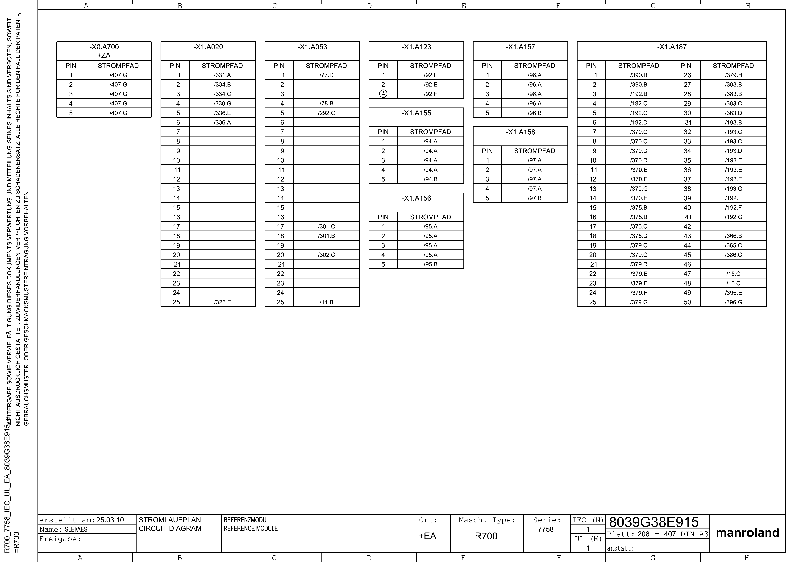

# +EA — Sheet 206 of 407 — REFERENZMODUL

**REFERENCE MODULE**

> Part of the manroland **R700** printing press IEC/UL circuit diagrams.
> Drawing class: **Stromlaufplan / Circuit diagram** (DIN A3).
> Document `+EA` covers the **Printing unit** machine section.

## At a glance

| Field | Value |
|---|---|
| Document | `+EA`  (8039G38E915) |
| Sheet | **206** of 407 |
| Section (DE) | REFERENZMODUL |
| Section (EN) | REFERENCE MODULE |
| Section type | REFERENCE_MODULE — Reference module |
| Machine type | `R700` |
| Series | `7758` |
| Created | 25.03.10 |
| Replaces | — |
| Columns used | A, B, C, D, E, F, G, H |
| Path numbers | — |
| Labels on sheet | 247 |
| Cross-refs out | 90 |
| Cross-refs in | 0 |

**Previous:** [+EA sheet 205](SHEET_0205.md) · **Next:** [+EA sheet 207](SHEET_0207.md) · **Document TOC:** [_TOC.md](_TOC.md)  (+EA) · **Master TOC:** [all sheets](../_MASTER_TOC.md)

## Sheet image (300 DPI, exact vector render)



_Rendered directly from the PDF vector layer at 300 DPI (1-bit), no OCR and no resampling. Use it to confirm anything ambiguous in the text below._

## Cross-references on this sheet

Each entry is a wire leaving this sheet. The printed token is `/sheet.column`; the link resolves to that sheet inside the same document.

| Ref | Target sheet | Col | Path | Destination on target | Target section | From col |
|---|---|---|---|---|---|---|
| `/92.E` | [+EA sheet 92](SHEET_0092.md) | E | — | — | BLASRAHMEN | E |
| `/96.A` | [+EA sheet 96](SHEET_0096.md) | A | — | — | BLASRAHMEN | F |
| `/331.A` | [+EA sheet 331](SHEET_0331.md) | A | — | — | OPTION: BOGENWEICHE | B |
| `/390.B` | [+EA sheet 390](SHEET_0390.md) | B | — | — | OPTION: ZWISCHENTROCKNER VORBEREITUNG; | G |
| `/407.G` | [+EA sheet 407](SHEET_0407.md) | G | — | — | OPTION: AIR STATION | A |
| `/77.D` | [+EA sheet 77](SHEET_0077.md) | D | — | — | AUSLEGERSTAPELSTEUERUNG | D |
| `/379.H` | [+EA sheet 379](SHEET_0379.md) | H | — | — | OPTION: ENDTROCKNER 2 VORBEREITUNG | H |
| `/92.E` | [+EA sheet 92](SHEET_0092.md) | E | — | — | BLASRAHMEN | E |
| `/96.A` | [+EA sheet 96](SHEET_0096.md) | A | — | — | BLASRAHMEN | F |
| `/334.B` | [+EA sheet 334](SHEET_0334.md) | B | — | — | OPTION: BOGENWEICHE | B |
| `/390.B` | [+EA sheet 390](SHEET_0390.md) | B | — | — | OPTION: ZWISCHENTROCKNER VORBEREITUNG; | G |
| `/383.B` | [+EA sheet 383](SHEET_0383.md) | B | — | — | OPTION: ENDTROCKNER 2 VORBEREITUNG | H |
| `/407.G` | [+EA sheet 407](SHEET_0407.md) | G | — | — | OPTION: AIR STATION | A |
| `/96.A` | [+EA sheet 96](SHEET_0096.md) | A | — | — | BLASRAHMEN | F |
| `/92.F` | [+EA sheet 92](SHEET_0092.md) | F | — | — | BLASRAHMEN | E |
| `/192.B` | [+EA sheet 192](SHEET_0192.md) | B | — | — | RESERVE | G |
| `/383.B` | [+EA sheet 383](SHEET_0383.md) | B | — | — | OPTION: ENDTROCKNER 2 VORBEREITUNG | H |
| `/407.G` | [+EA sheet 407](SHEET_0407.md) | G | — | — | OPTION: AIR STATION | A |
| `/334.C` | [+EA sheet 334](SHEET_0334.md) | C | — | — | OPTION: BOGENWEICHE | B |
| `/78.B` | [+EA sheet 78](SHEET_0078.md) | B | — | — | AUSLEGERSTAPELSTEUERUNG | D |
| `/96.A` | [+EA sheet 96](SHEET_0096.md) | A | — | — | BLASRAHMEN | F |
| `/407.G` | [+EA sheet 407](SHEET_0407.md) | G | — | — | OPTION: AIR STATION | A |
| `/330.G` | [+EA sheet 330](SHEET_0330.md) | G | — | — | OPTION: BOGENWEICHE | B |
| `/192.C` | [+EA sheet 192](SHEET_0192.md) | C | — | — | RESERVE | G |
| `/383.C` | [+EA sheet 383](SHEET_0383.md) | C | — | — | OPTION: ENDTROCKNER 2 VORBEREITUNG | H |
| `/96.B` | [+EA sheet 96](SHEET_0096.md) | B | — | — | BLASRAHMEN | F |
| `/336.E` | [+EA sheet 336](SHEET_0336.md) | E | — | — | OPTION: BOGENWEICHE | B |
| `/407.G` | [+EA sheet 407](SHEET_0407.md) | G | — | — | OPTION: AIR STATION | A |
| `/292.C` | [+EA sheet 292](SHEET_0292.md) | C | — | — | OPTION: PROBEBOGENENTNAHME HALBAUTOMATISCH | D |
| `/192.C` | [+EA sheet 192](SHEET_0192.md) | C | — | — | RESERVE | G |
| `/383.D` | [+EA sheet 383](SHEET_0383.md) | D | — | — | OPTION: ENDTROCKNER 2 VORBEREITUNG | H |
| `/336.A` | [+EA sheet 336](SHEET_0336.md) | A | — | — | OPTION: BOGENWEICHE | B |
| `/193.B` | [+EA sheet 193](SHEET_0193.md) | B | — | — | RESERVE | H |
| `/192.D` | [+EA sheet 192](SHEET_0192.md) | D | — | — | RESERVE | G |
| `/370.C` | [+EA sheet 370](SHEET_0370.md) | C | — | — | OPTION: ENDTROCKNER 1 VORBEREITUNG; | G |
| `/193.C` | [+EA sheet 193](SHEET_0193.md) | C | — | — | RESERVE | H |
| `/94.A` | [+EA sheet 94](SHEET_0094.md) | A | — | — | BLASRAHMEN | E |
| `/370.C` | [+EA sheet 370](SHEET_0370.md) | C | — | — | OPTION: ENDTROCKNER 1 VORBEREITUNG; | G |
| `/193.C` | [+EA sheet 193](SHEET_0193.md) | C | — | — | RESERVE | H |
| `/94.A` | [+EA sheet 94](SHEET_0094.md) | A | — | — | BLASRAHMEN | E |
| `/370.D` | [+EA sheet 370](SHEET_0370.md) | D | — | — | OPTION: ENDTROCKNER 1 VORBEREITUNG; | G |
| `/193.D` | [+EA sheet 193](SHEET_0193.md) | D | — | — | RESERVE | H |
| `/94.A` | [+EA sheet 94](SHEET_0094.md) | A | — | — | BLASRAHMEN | E |
| `/97.A` | [+EA sheet 97](SHEET_0097.md) | A | — | — | BLASRAHMEN | F |
| `/193.E` | [+EA sheet 193](SHEET_0193.md) | E | — | — | RESERVE | H |
| `/370.D` | [+EA sheet 370](SHEET_0370.md) | D | — | — | OPTION: ENDTROCKNER 1 VORBEREITUNG; | G |
| `/94.A` | [+EA sheet 94](SHEET_0094.md) | A | — | — | BLASRAHMEN | E |
| `/97.A` | [+EA sheet 97](SHEET_0097.md) | A | — | — | BLASRAHMEN | F |
| `/370.E` | [+EA sheet 370](SHEET_0370.md) | E | — | — | OPTION: ENDTROCKNER 1 VORBEREITUNG; | G |
| `/193.E` | [+EA sheet 193](SHEET_0193.md) | E | — | — | RESERVE | H |
| `/94.B` | [+EA sheet 94](SHEET_0094.md) | B | — | — | BLASRAHMEN | E |
| `/97.A` | [+EA sheet 97](SHEET_0097.md) | A | — | — | BLASRAHMEN | F |
| `/370.F` | [+EA sheet 370](SHEET_0370.md) | F | — | — | OPTION: ENDTROCKNER 1 VORBEREITUNG; | G |
| `/193.F` | [+EA sheet 193](SHEET_0193.md) | F | — | — | RESERVE | H |
| `/97.A` | [+EA sheet 97](SHEET_0097.md) | A | — | — | BLASRAHMEN | F |
| `/370.G` | [+EA sheet 370](SHEET_0370.md) | G | — | — | OPTION: ENDTROCKNER 1 VORBEREITUNG; | G |
| `/193.G` | [+EA sheet 193](SHEET_0193.md) | G | — | — | RESERVE | H |
| `/97.B` | [+EA sheet 97](SHEET_0097.md) | B | — | — | BLASRAHMEN | F |
| `/192.E` | [+EA sheet 192](SHEET_0192.md) | E | — | — | RESERVE | H |
| `/370.H` | [+EA sheet 370](SHEET_0370.md) | H | — | — | OPTION: ENDTROCKNER 1 VORBEREITUNG; | G |
| `/375.B` | [+EA sheet 375](SHEET_0375.md) | B | — | — | OPTION: ENDTROCKNER 1 VORBEREITUNG; | G |
| `/192.F` | [+EA sheet 192](SHEET_0192.md) | F | — | — | RESERVE | H |
| `/375.B` | [+EA sheet 375](SHEET_0375.md) | B | — | — | OPTION: ENDTROCKNER 1 VORBEREITUNG; | G |
| `/192.G` | [+EA sheet 192](SHEET_0192.md) | G | — | — | RESERVE | H |
| `/95.A` | [+EA sheet 95](SHEET_0095.md) | A | — | — | BLASRAHMEN | E |
| `/301.C` | [+EA sheet 301](SHEET_0301.md) | C | — | — | OPTION: ZWISCHENSTAPEL / | D |
| `/375.C` | [+EA sheet 375](SHEET_0375.md) | C | — | — | OPTION: ENDTROCKNER 1 VORBEREITUNG; | G |
| `/95.A` | [+EA sheet 95](SHEET_0095.md) | A | — | — | BLASRAHMEN | E |
| `/301.B` | [+EA sheet 301](SHEET_0301.md) | B | — | — | OPTION: ZWISCHENSTAPEL / | D |
| `/366.B` | [+EA sheet 366](SHEET_0366.md) | B | — | — | OPTION: TROCKNER VORBEREITUNG; | H |
| `/375.D` | [+EA sheet 375](SHEET_0375.md) | D | — | — | OPTION: ENDTROCKNER 1 VORBEREITUNG; | G |
| `/95.A` | [+EA sheet 95](SHEET_0095.md) | A | — | — | BLASRAHMEN | E |
| `/379.C` | [+EA sheet 379](SHEET_0379.md) | C | — | — | OPTION: ENDTROCKNER 2 VORBEREITUNG | G |
| `/365.C` | [+EA sheet 365](SHEET_0365.md) | C | — | — | OPTION: TROCKNER VORBEREITUNG; | H |
| `/95.A` | [+EA sheet 95](SHEET_0095.md) | A | — | — | BLASRAHMEN | E |
| `/302.C` | [+EA sheet 302](SHEET_0302.md) | C | — | — | OPTION: ZWISCHENSTAPEL / | D |
| `/379.C` | [+EA sheet 379](SHEET_0379.md) | C | — | — | OPTION: ENDTROCKNER 2 VORBEREITUNG | G |
| `/386.C` | [+EA sheet 386](SHEET_0386.md) | C | — | — | OPTION: ZWISCHENTROCKNER VORBEREITUNG; | H |
| `/95.B` | [+EA sheet 95](SHEET_0095.md) | B | — | — | BLASRAHMEN | E |
| `/379.D` | [+EA sheet 379](SHEET_0379.md) | D | — | — | OPTION: ENDTROCKNER 2 VORBEREITUNG | G |
| `/379.E` | [+EA sheet 379](SHEET_0379.md) | E | — | — | OPTION: ENDTROCKNER 2 VORBEREITUNG | G |
| `/15.C` | [+EA sheet 15](SHEET_0015.md) | C | — | — | SPANNUNGSVERSORGUNG: 400V, 24V | H |
| `/379.E` | [+EA sheet 379](SHEET_0379.md) | E | — | — | OPTION: ENDTROCKNER 2 VORBEREITUNG | G |
| `/15.C` | [+EA sheet 15](SHEET_0015.md) | C | — | — | SPANNUNGSVERSORGUNG: 400V, 24V | H |
| `/396.E` | [+EA sheet 396](SHEET_0396.md) | E | — | — | OPTION: ZWISCHENTROCKNER VORBEREITUNG; | H |
| `/379.F` | [+EA sheet 379](SHEET_0379.md) | F | — | — | OPTION: ENDTROCKNER 2 VORBEREITUNG | G |
| `/11.B` | [+EA sheet 11](SHEET_0011.md) | B | — | — | SPANNUNGSVERSORGUNG: 400V, 24V | D |
| `/326.F` | [+EA sheet 326](SHEET_0326.md) | F | — | — | OPTION: BOGENWEICHE | B |
| `/379.G` | [+EA sheet 379](SHEET_0379.md) | G | — | — | OPTION: ENDTROCKNER 2 VORBEREITUNG | G |
| `/396.G` | [+EA sheet 396](SHEET_0396.md) | G | — | — | OPTION: ZWISCHENTROCKNER VORBEREITUNG; | H |

## Devices on this sheet

| Tag | Class | Class meaning (IEC) | Col | Sub | Terminal | Sign |
|---|---|---|---|---|---|---|
| `X1.A157` | — | cross-device reference | F | — | — | — |
| `X1.A158` | — | cross-device reference | F | — | — | — |
| `X1.A187` | — | cross-device reference | G | — | — | — |
| `X1.A020` | — | cross-device reference | B | — | — | — |
| `X1.A053` | — | cross-device reference | C | — | — | — |
| `X1.A123` | — | cross-device reference | E | — | — | — |
| `X1.A155` | — | cross-device reference | E | — | — | — |
| `X1.A156` | — | cross-device reference | E | — | — | — |
| `X0.A700` | — | cross-device reference | A | — | — | — |

## Potentials / nets

_No named potentials on this sheet._

## Wire-end annotations (grouped as printed)

A wire that continues elsewhere is annotated with a small cluster: the destination description, the path/line number `#NN`, and the `/sheet.column` cross reference. Each row below is one such cluster exactly as it is grouped on the drawing.

| Col | Y | Path | Cross-ref | Text on the wire |
|---|---|---|---|---|
| A | 65.5 | — | — | `X0.A700` |
| B | 65.5 | — | — | `X1.A020` |
| C | 65.5 | — | — | `X1.A053` |
| E | 65.5 | — | — | `X1.A123` |
| F | 65.5 | — | — | `X1.A157` |
| G | 65.5 | — | — | `X1.A187` |
| A | 78.2 | — | — | `+ZA` |
| A | 94.2 | — | — | `PIN 2 3 4 5 1 STROMPFAD` |
| B | 94.2 | — | — | `PIN STROMPFAD` |
| C | 94.2 | — | — | `PIN STROMPFAD` |
| D | 94.2 | — | — | `PIN 2 1 STROMPFAD` |
| F | 94.2 | — | — | `PIN 2 3 4 5 1 STROMPFAD` |
| G | 94.2 | — | — | `PIN STROMPFAD` |
| H | 94.2 | — | — | `PIN STROMPFAD` |
| B | 108.4 | — | — | `2 3 4 5 6 7 8 9 1` |
| C | 108.4 | — | — | `2 3 4 5 6 7 8 9 1` |
| F | 108.4 | — | — | `2 3 4 5 6 7 8 9 1` |
| G | 108.4 | — | — | `26 27 28 29 30 32 33 34 35 36 37 38 39 40 42 43 44 45 46 47 48 49 50 31 41` |
| A | 108.7 | — | `/407.G` | — |
| B | 108.7 | — | `/331.A` | — |
| D | 108.7 | — | `/77.D` | — |
| E | 108.7 | — | `/92.E` | — |
| F | 108.7 | — | `/96.A` | — |
| G | 108.7 | — | `/390.B` | — |
| H | 108.7 | — | `/379.H` | — |
| E | 122.8 | — | `/92.E` | — |
| F | 122.8 | — | `/96.A` | — |
| A | 122.9 | — | `/407.G` | — |
| B | 122.9 | — | `/334.B` | — |
| G | 122.9 | — | `/390.B` | — |
| H | 122.9 | — | `/383.B` | — |
| E | 137.0 | — | `/92.F` | — |
| F | 137.0 | — | `/96.A` | — |
| G | 137.0 | — | `/192.B` | — |
| H | 137.0 | — | `/383.B` | — |
| A | 137.1 | — | `/407.G` | — |
| B | 137.1 | — | `/334.C` | — |
| A | 151.2 | — | `/407.G` | — |
| B | 151.2 | — | `/330.G` | — |
| D | 151.2 | — | `/78.B` | — |
| F | 151.2 | — | `/96.A` | — |
| G | 151.2 | — | `/192.C` | — |
| H | 151.2 | — | `/383.C` | — |
| E | 164.7 | — | — | `X1.A155` |
| A | 165.4 | — | `/407.G` | — |
| B | 165.4 | — | `/336.E` | — |
| D | 165.4 | — | `/292.C` | — |
| F | 165.4 | — | `/96.B` | — |
| G | 165.4 | — | `/192.C` | — |
| H | 165.4 | — | `/383.D` | — |
| B | 179.6 | — | `/336.A` | — |
| G | 179.6 | — | `/192.D` | — |
| H | 179.6 | — | `/193.B` | — |
| F | 193.1 | — | — | `X1.A158` |
| D | 193.4 | — | — | `PIN 2 3 4 5 1 STROMPFAD` |
| G | 193.8 | — | `/370.C` | — |
| H | 193.8 | — | `/193.C` | — |
| E | 207.9 | — | `/94.A` | — |
| G | 207.9 | — | `/370.C` | — |
| H | 207.9 | — | `/193.C` | — |
| F | 221.7 | — | — | `PIN 2 3 4 5 1 STROMPFAD` |
| E | 222.1 | — | `/94.A` | — |
| G | 222.1 | — | `/370.D` | — |
| H | 222.1 | — | `/193.D` | — |
| B | 235.9 | — | — | `10 12 13 14 15 16 17 18 19 20 11` |
| C | 235.9 | — | — | `10 12 13 14 15 16 17 18 19 20 11` |
| F | 235.9 | — | — | `10 12 13 14 15 16 17 18 19 20 11` |
| E | 236.2 | — | `/94.A` | — |
| F | 236.2 | — | `/97.A` | — |
| H | 236.2 | — | `/193.E` | — |
| G | 236.3 | — | `/370.D` | — |
| E | 250.4 | — | `/94.A` | — |
| F | 250.4 | — | `/97.A` | — |
| G | 250.4 | — | `/370.E` | — |
| H | 250.4 | — | `/193.E` | — |
| E | 264.6 | — | `/94.B` | — |
| F | 264.6 | — | `/97.A` | — |
| G | 264.6 | — | `/370.F` | — |
| H | 264.6 | — | `/193.F` | — |
| F | 278.8 | — | `/97.A` | — |
| G | 278.8 | — | `/370.G` | — |
| H | 278.8 | — | `/193.G` | — |
| E | 292.3 | — | — | `X1.A156` |
| F | 292.9 | — | `/97.B` | — |
| H | 292.9 | — | `/192.E` | — |
| G | 293.0 | — | `/370.H` | — |
| G | 307.1 | — | `/375.B` | — |
| H | 307.1 | — | `/192.F` | — |
| D | 320.9 | — | — | `PIN 2 3 4 5 1 STROMPFAD` |
| G | 321.3 | — | `/375.B` | — |
| H | 321.3 | — | `/192.G` | — |
| E | 335.4 | — | `/95.A` | — |
| D | 335.5 | — | `/301.C` | — |
| G | 335.5 | — | `/375.C` | — |
| D | 349.6 | — | `/301.B` | — |
| E | 349.6 | — | `/95.A` | — |
| H | 349.6 | — | `/366.B` | — |
| G | 349.7 | — | `/375.D` | — |
| E | 363.8 | — | `/95.A` | — |
| G | 363.8 | — | `/379.C` | — |
| H | 363.8 | — | `/365.C` | — |
| D | 378.0 | — | `/302.C` | — |
| E | 378.0 | — | `/95.A` | — |
| G | 378.0 | — | `/379.C` | — |
| H | 378.0 | — | `/386.C` | — |
| B | 391.8 | — | — | `22 23 24 25 21` |
| C | 391.8 | — | — | `22 23 24 25 21` |
| F | 391.8 | — | — | `22 23 24 25 21` |
| E | 392.1 | — | `/95.B` | — |
| G | 392.2 | — | `/379.D` | — |
| G | 406.3 | — | `/379.E` | — |
| H | 406.3 | — | `/15.C` | — |
| G | 420.5 | — | `/379.E` | — |
| H | 420.5 | — | `/15.C` | — |
| G | 434.7 | — | `/379.F` | — |
| H | 434.7 | — | `/396.E` | — |
| D | 448.8 | — | `/11.B` | — |
| B | 448.9 | — | `/326.F` | — |
| G | 448.9 | — | `/379.G` | — |
| H | 448.9 | — | `/396.G` | — |


## Reconstructed tables

This sheet carries tabular content (pin map / terminal assignment / index). The grid below was rebuilt from the drawing's own rule lines, so each row is exactly one physical row of the table.

### Table 1 — 5 data rows × 2 columns (at x=85.0, y=62.4) — **X0.A700 +ZA**

| PIN | STROMPFAD |
|---|---|
| `1` | `/407.G` |
| `2` | `/407.G` |
| `3` | `/407.G` |
| `4` | `/407.G` |
| `5` | `/407.G` |


### Table 2 — 25 data rows × 2 columns (at x=240.9, y=62.4) — **X1.A020**

| PIN | STROMPFAD |
|---|---|
| `1` | `/331.A` |
| `2` | `/334.B` |
| `3` | `/334.C` |
| `4` | `/330.G` |
| `5` | `/336.E` |
| `6` | `/336.A` |
| `7` |  |
| `8` |  |
| `9` |  |
| `10` |  |
| `11` |  |
| `12` |  |
| `13` |  |
| `14` |  |
| `15` |  |
| `16` |  |
| `17` |  |
| `18` |  |
| `19` |  |
| `20` |  |
| `21` |  |
| `22` |  |
| `23` |  |
| `24` |  |
| `25` | `/326.F` |


### Table 3 — 25 data rows × 2 columns (at x=396.9, y=62.4) — **X1.A053**

| PIN | STROMPFAD |
|---|---|
| `1` | `/77.D` |
| `2` |  |
| `3` |  |
| `4` | `/78.B` |
| `5` | `/292.C` |
| `6` |  |
| `7` |  |
| `8` |  |
| `9` |  |
| `10` |  |
| `11` |  |
| `12` |  |
| `13` |  |
| `14` |  |
| `15` |  |
| `16` |  |
| `17` | `/301.C` |
| `18` | `/301.B` |
| `19` |  |
| `20` | `/302.C` |
| `21` |  |
| `22` |  |
| `23` |  |
| `24` |  |
| `25` | `/11.B` |


### Table 4 — 17 data rows × 2 columns (at x=552.8, y=62.4) — **X1.A123**

| PIN | STROMPFAD |
|---|---|
| `1` | `/92.E` |
| `2` | `/92.E` |
|  | `/92.F` |
|  | `X1.A155` |
| `PIN` | `STROMPFAD` |
| `1` | `/94.A` |
| `2` | `/94.A` |
| `3` | `/94.A` |
| `4` | `/94.A` |
| `5` | `/94.B` |
|  | `X1.A156` |
| `PIN` | `STROMPFAD` |
| `1` | `/95.A` |
| `2` | `/95.A` |
| `3` | `/95.A` |
| `4` | `/95.A` |
| `5` | `/95.B` |


### Table 5 — 12 data rows × 2 columns (at x=708.7, y=62.4) — **X1.A157**

| PIN | STROMPFAD |
|---|---|
| `1` | `/96.A` |
| `2` | `/96.A` |
| `3` | `/96.A` |
| `4` | `/96.A` |
| `5` | `/96.B` |
|  | `X1.A158` |
| `PIN` | `STROMPFAD` |
| `1` | `/97.A` |
| `2` | `/97.A` |
| `3` | `/97.A` |
| `4` | `/97.A` |
| `5` | `/97.B` |


### Table 6 — 25 data rows × 4 columns (at x=864.6, y=62.4) — **X1.A187**

| PIN | STROMPFAD | PIN | STROMPFAD |
|---|---|---|---|
| `1` | `/390.B` | `26` | `/379.H` |
| `2` | `/390.B` | `27` | `/383.B` |
| `3` | `/192.B` | `28` | `/383.B` |
| `4` | `/192.C` | `29` | `/383.C` |
| `5` | `/192.C` | `30` | `/383.D` |
| `6` | `/192.D` | `31` | `/193.B` |
| `7` | `/370.C` | `32` | `/193.C` |
| `8` | `/370.C` | `33` | `/193.C` |
| `9` | `/370.D` | `34` | `/193.D` |
| `10` | `/370.D` | `35` | `/193.E` |
| `11` | `/370.E` | `36` | `/193.E` |
| `12` | `/370.F` | `37` | `/193.F` |
| `13` | `/370.G` | `38` | `/193.G` |
| `14` | `/370.H` | `39` | `/192.E` |
| `15` | `/375.B` | `40` | `/192.F` |
| `16` | `/375.B` | `41` | `/192.G` |
| `17` | `/375.C` | `42` |  |
| `18` | `/375.D` | `43` | `/366.B` |
| `19` | `/379.C` | `44` | `/365.C` |
| `20` | `/379.C` | `45` | `/386.C` |
| `21` | `/379.D` | `46` |  |
| `22` | `/379.E` | `47` | `/15.C` |
| `23` | `/379.E` | `48` | `/15.C` |
| `24` | `/379.F` | `49` | `/396.E` |
| `25` | `/379.G` | `50` | `/396.G` |


## Notes and free text on this sheet

| Text | Col | Y (pt) |
|---|---|---|
| `PIN` | E | 94.2 |
| `STROMPFAD` | F | 94.15 |
| `PIN` | F | 94.2 |
| `STROMPFAD` | G | 94.15 |
| `PIN` | G | 94.2 |
| `STROMPFAD` | H | 94.15 |
| `PIN` | B | 94.2 |
| `STROMPFAD` | B | 94.15 |
| `PIN` | C | 94.2 |
| `STROMPFAD` | D | 94.15 |
| `PIN` | D | 94.2 |
| `STROMPFAD` | E | 94.15 |
| `PIN` | A | 94.2 |
| `STROMPFAD` | A | 94.15 |
| `+ZA` | A | 78.18 |

## Complete label inventory (exact text from the drawing)

Every text object inside the drawing area of this sheet, in DIN reading order (column A→H, then top→bottom). This is the authoritative list: if a string is not here it is not printed on this sheet.

| Col | Y | X | Dir | Type | Text |
|---|---|---|---|---|---|
| A | 65.5 | 133.9 | → | device ref | `X0.A700` |
| A | 78.2 | 145.6 | → | text | `+ZA` |
| A | 94.2 | 98.2 | → | text | `PIN` |
| A | 94.2 | 146.4 | → | text | `STROMPFAD` |
| A | 108.4 | 104.2 | → | number | `1` |
| A | 108.7 | 164.3 | → | cross-reference | `/407.G` |
| A | 122.5 | 103.6 | → | number | `2` |
| A | 122.9 | 164.3 | → | cross-reference | `/407.G` |
| A | 136.7 | 103.6 | → | number | `3` |
| A | 137.1 | 164.3 | → | cross-reference | `/407.G` |
| A | 150.9 | 103.6 | → | number | `4` |
| A | 151.2 | 164.3 | → | cross-reference | `/407.G` |
| A | 165.1 | 103.6 | → | number | `5` |
| A | 165.4 | 164.3 | → | cross-reference | `/407.G` |
| B | 65.5 | 289.8 | → | device ref | `X1.A020` |
| B | 94.2 | 254.1 | → | text | `PIN` |
| B | 94.2 | 302.3 | → | text | `STROMPFAD` |
| B | 108.4 | 265.9 | → | number | `1` |
| B | 108.7 | 320.3 | → | cross-reference | `/331.A` |
| B | 122.5 | 264.2 | → | number | `2` |
| B | 122.9 | 320.5 | → | cross-reference | `/334.B` |
| B | 136.7 | 264.2 | → | number | `3` |
| B | 137.1 | 320.3 | → | cross-reference | `/334.C` |
| B | 150.9 | 264.2 | → | number | `4` |
| B | 151.2 | 320.2 | → | cross-reference | `/330.G` |
| B | 165.1 | 264.2 | → | number | `5` |
| B | 165.4 | 320.6 | → | cross-reference | `/336.E` |
| B | 179.2 | 264.2 | → | number | `6` |
| B | 179.6 | 320.3 | → | cross-reference | `/336.A` |
| B | 193.4 | 264.2 | → | number | `7` |
| B | 207.6 | 264.2 | → | number | `8` |
| B | 221.8 | 264.2 | → | number | `9` |
| B | 235.9 | 258.8 | → | number | `10` |
| B | 250.1 | 260.5 | → | number | `11` |
| B | 264.3 | 258.8 | → | number | `12` |
| B | 278.5 | 258.8 | → | number | `13` |
| B | 292.6 | 258.8 | → | number | `14` |
| B | 306.8 | 258.8 | → | number | `15` |
| B | 321.0 | 258.8 | → | number | `16` |
| B | 335.1 | 258.8 | → | number | `17` |
| B | 349.3 | 258.8 | → | number | `18` |
| B | 363.5 | 258.8 | → | number | `19` |
| B | 377.7 | 258.8 | → | number | `20` |
| B | 391.8 | 260.5 | → | number | `21` |
| B | 406.0 | 258.8 | → | number | `22` |
| B | 420.2 | 258.8 | → | number | `23` |
| B | 434.4 | 258.8 | → | number | `24` |
| B | 448.5 | 258.8 | → | number | `25` |
| B | 448.9 | 320.7 | → | cross-reference | `/326.F` |
| C | 65.5 | 445.7 | → | device ref | `X1.A053` |
| C | 94.2 | 410.0 | → | text | `PIN` |
| C | 108.4 | 421.8 | → | number | `1` |
| C | 122.5 | 420.1 | → | number | `2` |
| C | 136.7 | 420.1 | → | number | `3` |
| C | 150.9 | 420.1 | → | number | `4` |
| C | 165.1 | 420.1 | → | number | `5` |
| C | 179.2 | 420.1 | → | number | `6` |
| C | 193.4 | 420.1 | → | number | `7` |
| C | 207.6 | 420.1 | → | number | `8` |
| C | 221.8 | 420.1 | → | number | `9` |
| C | 235.9 | 414.7 | → | number | `10` |
| C | 250.1 | 416.4 | → | number | `11` |
| C | 264.3 | 414.7 | → | number | `12` |
| C | 278.5 | 414.7 | → | number | `13` |
| C | 292.6 | 414.7 | → | number | `14` |
| C | 306.8 | 414.7 | → | number | `15` |
| C | 321.0 | 414.7 | → | number | `16` |
| C | 335.1 | 414.7 | → | number | `17` |
| C | 349.3 | 414.7 | → | number | `18` |
| C | 363.5 | 414.7 | → | number | `19` |
| C | 377.7 | 414.7 | → | number | `20` |
| C | 391.8 | 416.4 | → | number | `21` |
| C | 406.0 | 414.7 | → | number | `22` |
| C | 420.2 | 414.7 | → | number | `23` |
| C | 434.4 | 414.7 | → | number | `24` |
| C | 448.5 | 414.7 | → | number | `25` |
| D | 94.2 | 458.2 | → | text | `STROMPFAD` |
| D | 94.2 | 565.9 | → | text | `PIN` |
| D | 108.4 | 571.9 | → | number | `1` |
| D | 108.7 | 478.6 | → | cross-reference | `/77.D` |
| D | 122.5 | 571.3 | → | number | `2` |
| D | 151.2 | 478.8 | → | cross-reference | `/78.B` |
| D | 165.4 | 476.2 | → | cross-reference | `/292.C` |
| D | 193.4 | 565.9 | → | text | `PIN` |
| D | 207.6 | 571.9 | → | number | `1` |
| D | 221.8 | 571.3 | → | number | `2` |
| D | 235.9 | 571.3 | → | number | `3` |
| D | 250.1 | 571.3 | → | number | `4` |
| D | 264.3 | 571.3 | → | number | `5` |
| D | 321.0 | 565.9 | → | text | `PIN` |
| D | 335.1 | 571.9 | → | number | `1` |
| D | 335.5 | 476.2 | → | cross-reference | `/301.C` |
| D | 349.3 | 571.3 | → | number | `2` |
| D | 349.6 | 476.4 | → | cross-reference | `/301.B` |
| D | 363.5 | 571.3 | → | number | `3` |
| D | 377.7 | 571.3 | → | number | `4` |
| D | 378.0 | 476.2 | → | cross-reference | `/302.C` |
| D | 391.8 | 571.3 | → | number | `5` |
| D | 448.8 | 478.8 | → | cross-reference | `/11.B` |
| E | 65.5 | 601.7 | → | device ref | `X1.A123` |
| E | 94.2 | 614.1 | → | text | `STROMPFAD` |
| E | 94.2 | 721.8 | → | text | `PIN` |
| E | 108.4 | 727.8 | → | number | `1` |
| E | 108.7 | 634.8 | → | cross-reference | `/92.E` |
| E | 122.5 | 727.2 | → | number | `2` |
| E | 122.8 | 634.8 | → | cross-reference | `/92.E` |
| E | 136.7 | 727.2 | → | number | `3` |
| E | 137.0 | 635.0 | → | cross-reference | `/92.F` |
| E | 150.9 | 727.2 | → | number | `4` |
| E | 164.7 | 601.7 | → | device ref | `X1.A155` |
| E | 165.1 | 727.2 | → | number | `5` |
| E | 193.4 | 614.1 | → | text | `STROMPFAD` |
| E | 207.9 | 634.5 | → | cross-reference | `/94.A` |
| E | 221.8 | 721.8 | → | text | `PIN` |
| E | 222.1 | 634.5 | → | cross-reference | `/94.A` |
| E | 235.9 | 727.8 | → | number | `1` |
| E | 236.2 | 634.5 | → | cross-reference | `/94.A` |
| E | 250.1 | 727.2 | → | number | `2` |
| E | 250.4 | 634.5 | → | cross-reference | `/94.A` |
| E | 264.3 | 727.2 | → | number | `3` |
| E | 264.6 | 634.7 | → | cross-reference | `/94.B` |
| E | 278.5 | 727.2 | → | number | `4` |
| E | 292.3 | 601.7 | → | device ref | `X1.A156` |
| E | 292.6 | 727.2 | → | number | `5` |
| E | 320.9 | 614.1 | → | text | `STROMPFAD` |
| E | 335.4 | 634.5 | → | cross-reference | `/95.A` |
| E | 349.6 | 634.5 | → | cross-reference | `/95.A` |
| E | 363.8 | 634.5 | → | cross-reference | `/95.A` |
| E | 378.0 | 634.5 | → | cross-reference | `/95.A` |
| E | 392.1 | 634.7 | → | cross-reference | `/95.B` |
| F | 65.5 | 757.6 | → | device ref | `X1.A157` |
| F | 94.2 | 770.0 | → | text | `STROMPFAD` |
| F | 94.2 | 877.7 | → | text | `PIN` |
| F | 108.4 | 889.5 | → | number | `1` |
| F | 108.7 | 790.4 | → | cross-reference | `/96.A` |
| F | 122.5 | 887.8 | → | number | `2` |
| F | 122.8 | 790.4 | → | cross-reference | `/96.A` |
| F | 136.7 | 887.8 | → | number | `3` |
| F | 137.0 | 790.4 | → | cross-reference | `/96.A` |
| F | 150.9 | 887.8 | → | number | `4` |
| F | 151.2 | 790.4 | → | cross-reference | `/96.A` |
| F | 165.1 | 887.8 | → | number | `5` |
| F | 165.4 | 790.6 | → | cross-reference | `/96.B` |
| F | 179.2 | 887.8 | → | number | `6` |
| F | 193.1 | 757.6 | → | device ref | `X1.A158` |
| F | 193.4 | 887.8 | → | number | `7` |
| F | 207.6 | 887.8 | → | number | `8` |
| F | 221.7 | 770.0 | → | text | `STROMPFAD` |
| F | 221.8 | 887.8 | → | number | `9` |
| F | 235.9 | 882.4 | → | number | `10` |
| F | 236.2 | 790.4 | → | cross-reference | `/97.A` |
| F | 250.1 | 884.1 | → | number | `11` |
| F | 250.4 | 790.4 | → | cross-reference | `/97.A` |
| F | 264.3 | 882.4 | → | number | `12` |
| F | 264.6 | 790.4 | → | cross-reference | `/97.A` |
| F | 278.5 | 882.4 | → | number | `13` |
| F | 278.8 | 790.4 | → | cross-reference | `/97.A` |
| F | 292.6 | 882.4 | → | number | `14` |
| F | 292.9 | 790.6 | → | cross-reference | `/97.B` |
| F | 306.8 | 882.4 | → | number | `15` |
| F | 321.0 | 882.4 | → | number | `16` |
| F | 335.1 | 882.4 | → | number | `17` |
| F | 349.3 | 882.4 | → | number | `18` |
| F | 363.5 | 882.4 | → | number | `19` |
| F | 377.7 | 882.4 | → | number | `20` |
| F | 391.8 | 884.1 | → | number | `21` |
| F | 406.0 | 882.4 | → | number | `22` |
| F | 420.2 | 882.4 | → | number | `23` |
| F | 434.4 | 882.4 | → | number | `24` |
| F | 448.5 | 882.4 | → | number | `25` |
| G | 65.5 | 984.3 | → | device ref | `X1.A187` |
| G | 94.2 | 925.9 | → | text | `STROMPFAD` |
| G | 94.2 | 1019.5 | → | text | `PIN` |
| G | 108.4 | 1024.2 | → | number | `26` |
| G | 108.7 | 944.1 | → | cross-reference | `/390.B` |
| G | 122.5 | 1024.2 | → | number | `27` |
| G | 122.9 | 944.1 | → | cross-reference | `/390.B` |
| G | 136.7 | 1024.2 | → | number | `28` |
| G | 137.0 | 944.1 | → | cross-reference | `/192.B` |
| G | 150.9 | 1024.2 | → | number | `29` |
| G | 151.2 | 943.9 | → | cross-reference | `/192.C` |
| G | 165.1 | 1024.2 | → | number | `30` |
| G | 165.4 | 943.9 | → | cross-reference | `/192.C` |
| G | 179.2 | 1025.9 | → | number | `31` |
| G | 179.6 | 943.9 | → | cross-reference | `/192.D` |
| G | 193.4 | 1024.2 | → | number | `32` |
| G | 193.8 | 943.9 | → | cross-reference | `/370.C` |
| G | 207.6 | 1024.2 | → | number | `33` |
| G | 207.9 | 943.9 | → | cross-reference | `/370.C` |
| G | 221.8 | 1024.2 | → | number | `34` |
| G | 222.1 | 943.9 | → | cross-reference | `/370.D` |
| G | 235.9 | 1024.2 | → | number | `35` |
| G | 236.3 | 943.9 | → | cross-reference | `/370.D` |
| G | 250.1 | 1024.2 | → | number | `36` |
| G | 250.4 | 944.2 | → | cross-reference | `/370.E` |
| G | 264.3 | 1024.2 | → | number | `37` |
| G | 264.6 | 944.4 | → | cross-reference | `/370.F` |
| G | 278.5 | 1024.2 | → | number | `38` |
| G | 278.8 | 943.8 | → | cross-reference | `/370.G` |
| G | 292.6 | 1024.2 | → | number | `39` |
| G | 293.0 | 944.2 | → | cross-reference | `/370.H` |
| G | 306.8 | 1024.2 | → | number | `40` |
| G | 307.1 | 944.1 | → | cross-reference | `/375.B` |
| G | 321.0 | 1025.9 | → | number | `41` |
| G | 321.3 | 944.1 | → | cross-reference | `/375.B` |
| G | 335.1 | 1024.2 | → | number | `42` |
| G | 335.5 | 943.9 | → | cross-reference | `/375.C` |
| G | 349.3 | 1024.2 | → | number | `43` |
| G | 349.7 | 943.9 | → | cross-reference | `/375.D` |
| G | 363.5 | 1024.2 | → | number | `44` |
| G | 363.8 | 943.9 | → | cross-reference | `/379.C` |
| G | 377.7 | 1024.2 | → | number | `45` |
| G | 378.0 | 943.9 | → | cross-reference | `/379.C` |
| G | 391.8 | 1024.2 | → | number | `46` |
| G | 392.2 | 943.9 | → | cross-reference | `/379.D` |
| G | 406.0 | 1024.2 | → | number | `47` |
| G | 406.3 | 944.2 | → | cross-reference | `/379.E` |
| G | 420.2 | 1024.2 | → | number | `48` |
| G | 420.5 | 944.2 | → | cross-reference | `/379.E` |
| G | 434.4 | 1024.2 | → | number | `49` |
| G | 434.7 | 944.4 | → | cross-reference | `/379.F` |
| G | 448.5 | 1024.2 | → | number | `50` |
| G | 448.9 | 943.8 | → | cross-reference | `/379.G` |
| H | 94.2 | 1067.7 | → | text | `STROMPFAD` |
| H | 108.7 | 1086.0 | → | cross-reference | `/379.H` |
| H | 122.9 | 1085.8 | → | cross-reference | `/383.B` |
| H | 137.0 | 1085.8 | → | cross-reference | `/383.B` |
| H | 151.2 | 1085.7 | → | cross-reference | `/383.C` |
| H | 165.4 | 1085.7 | → | cross-reference | `/383.D` |
| H | 179.6 | 1085.8 | → | cross-reference | `/193.B` |
| H | 193.8 | 1085.7 | → | cross-reference | `/193.C` |
| H | 207.9 | 1085.7 | → | cross-reference | `/193.C` |
| H | 222.1 | 1085.7 | → | cross-reference | `/193.D` |
| H | 236.2 | 1086.0 | → | cross-reference | `/193.E` |
| H | 250.4 | 1086.0 | → | cross-reference | `/193.E` |
| H | 264.6 | 1086.1 | → | cross-reference | `/193.F` |
| H | 278.8 | 1085.5 | → | cross-reference | `/193.G` |
| H | 292.9 | 1086.0 | → | cross-reference | `/192.E` |
| H | 307.1 | 1086.1 | → | cross-reference | `/192.F` |
| H | 321.3 | 1085.5 | → | cross-reference | `/192.G` |
| H | 349.6 | 1085.8 | → | cross-reference | `/366.B` |
| H | 363.8 | 1085.7 | → | cross-reference | `/365.C` |
| H | 378.0 | 1085.7 | → | cross-reference | `/386.C` |
| H | 406.3 | 1088.1 | → | cross-reference | `/15.C` |
| H | 420.5 | 1088.1 | → | cross-reference | `/15.C` |
| H | 434.7 | 1086.0 | → | cross-reference | `/396.E` |
| H | 448.9 | 1085.5 | → | cross-reference | `/396.G` |

## Reading-order text block

The same content as a plain block, grouped by DIN column — convenient to paste or to match against a visual description.

```text
=== Column A ===
  65.5  133.9  devref       X0.A700
  78.2  145.6  text         +ZA
  94.2   98.2  text         PIN
  94.2  146.4  text         STROMPFAD
 108.4  104.2  numeric      1
 108.7  164.3  xref         /407.G
 122.5  103.6  numeric      2
 122.9  164.3  xref         /407.G
 136.7  103.6  numeric      3
 137.1  164.3  xref         /407.G
 150.9  103.6  numeric      4
 151.2  164.3  xref         /407.G
 165.1  103.6  numeric      5
 165.4  164.3  xref         /407.G
=== Column B ===
  65.5  289.8  devref       X1.A020
  94.2  254.1  text         PIN
  94.2  302.3  text         STROMPFAD
 108.4  265.9  numeric      1
 108.7  320.3  xref         /331.A
 122.5  264.2  numeric      2
 122.9  320.5  xref         /334.B
 136.7  264.2  numeric      3
 137.1  320.3  xref         /334.C
 150.9  264.2  numeric      4
 151.2  320.2  xref         /330.G
 165.1  264.2  numeric      5
 165.4  320.6  xref         /336.E
 179.2  264.2  numeric      6
 179.6  320.3  xref         /336.A
 193.4  264.2  numeric      7
 207.6  264.2  numeric      8
 221.8  264.2  numeric      9
 235.9  258.8  numeric      10
 250.1  260.5  numeric      11
 264.3  258.8  numeric      12
 278.5  258.8  numeric      13
 292.6  258.8  numeric      14
 306.8  258.8  numeric      15
 321.0  258.8  numeric      16
 335.1  258.8  numeric      17
 349.3  258.8  numeric      18
 363.5  258.8  numeric      19
 377.7  258.8  numeric      20
 391.8  260.5  numeric      21
 406.0  258.8  numeric      22
 420.2  258.8  numeric      23
 434.4  258.8  numeric      24
 448.5  258.8  numeric      25
 448.9  320.7  xref         /326.F
=== Column C ===
  65.5  445.7  devref       X1.A053
  94.2  410.0  text         PIN
 108.4  421.8  numeric      1
 122.5  420.1  numeric      2
 136.7  420.1  numeric      3
 150.9  420.1  numeric      4
 165.1  420.1  numeric      5
 179.2  420.1  numeric      6
 193.4  420.1  numeric      7
 207.6  420.1  numeric      8
 221.8  420.1  numeric      9
 235.9  414.7  numeric      10
 250.1  416.4  numeric      11
 264.3  414.7  numeric      12
 278.5  414.7  numeric      13
 292.6  414.7  numeric      14
 306.8  414.7  numeric      15
 321.0  414.7  numeric      16
 335.1  414.7  numeric      17
 349.3  414.7  numeric      18
 363.5  414.7  numeric      19
 377.7  414.7  numeric      20
 391.8  416.4  numeric      21
 406.0  414.7  numeric      22
 420.2  414.7  numeric      23
 434.4  414.7  numeric      24
 448.5  414.7  numeric      25
=== Column D ===
  94.2  458.2  text         STROMPFAD
  94.2  565.9  text         PIN
 108.4  571.9  numeric      1
 108.7  478.6  xref         /77.D
 122.5  571.3  numeric      2
 151.2  478.8  xref         /78.B
 165.4  476.2  xref         /292.C
 193.4  565.9  text         PIN
 207.6  571.9  numeric      1
 221.8  571.3  numeric      2
 235.9  571.3  numeric      3
 250.1  571.3  numeric      4
 264.3  571.3  numeric      5
 321.0  565.9  text         PIN
 335.1  571.9  numeric      1
 335.5  476.2  xref         /301.C
 349.3  571.3  numeric      2
 349.6  476.4  xref         /301.B
 363.5  571.3  numeric      3
 377.7  571.3  numeric      4
 378.0  476.2  xref         /302.C
 391.8  571.3  numeric      5
 448.8  478.8  xref         /11.B
=== Column E ===
  65.5  601.7  devref       X1.A123
  94.2  614.1  text         STROMPFAD
  94.2  721.8  text         PIN
 108.4  727.8  numeric      1
 108.7  634.8  xref         /92.E
 122.5  727.2  numeric      2
 122.8  634.8  xref         /92.E
 136.7  727.2  numeric      3
 137.0  635.0  xref         /92.F
 150.9  727.2  numeric      4
 164.7  601.7  devref       X1.A155
 165.1  727.2  numeric      5
 193.4  614.1  text         STROMPFAD
 207.9  634.5  xref         /94.A
 221.8  721.8  text         PIN
 222.1  634.5  xref         /94.A
 235.9  727.8  numeric      1
 236.2  634.5  xref         /94.A
 250.1  727.2  numeric      2
 250.4  634.5  xref         /94.A
 264.3  727.2  numeric      3
 264.6  634.7  xref         /94.B
 278.5  727.2  numeric      4
 292.3  601.7  devref       X1.A156
 292.6  727.2  numeric      5
 320.9  614.1  text         STROMPFAD
 335.4  634.5  xref         /95.A
 349.6  634.5  xref         /95.A
 363.8  634.5  xref         /95.A
 378.0  634.5  xref         /95.A
 392.1  634.7  xref         /95.B
=== Column F ===
  65.5  757.6  devref       X1.A157
  94.2  770.0  text         STROMPFAD
  94.2  877.7  text         PIN
 108.4  889.5  numeric      1
 108.7  790.4  xref         /96.A
 122.5  887.8  numeric      2
 122.8  790.4  xref         /96.A
 136.7  887.8  numeric      3
 137.0  790.4  xref         /96.A
 150.9  887.8  numeric      4
 151.2  790.4  xref         /96.A
 165.1  887.8  numeric      5
 165.4  790.6  xref         /96.B
 179.2  887.8  numeric      6
 193.1  757.6  devref       X1.A158
 193.4  887.8  numeric      7
 207.6  887.8  numeric      8
 221.7  770.0  text         STROMPFAD
 221.8  887.8  numeric      9
 235.9  882.4  numeric      10
 236.2  790.4  xref         /97.A
 250.1  884.1  numeric      11
 250.4  790.4  xref         /97.A
 264.3  882.4  numeric      12
 264.6  790.4  xref         /97.A
 278.5  882.4  numeric      13
 278.8  790.4  xref         /97.A
 292.6  882.4  numeric      14
 292.9  790.6  xref         /97.B
 306.8  882.4  numeric      15
 321.0  882.4  numeric      16
 335.1  882.4  numeric      17
 349.3  882.4  numeric      18
 363.5  882.4  numeric      19
 377.7  882.4  numeric      20
 391.8  884.1  numeric      21
 406.0  882.4  numeric      22
 420.2  882.4  numeric      23
 434.4  882.4  numeric      24
 448.5  882.4  numeric      25
=== Column G ===
  65.5  984.3  devref       X1.A187
  94.2  925.9  text         STROMPFAD
  94.2 1019.5  text         PIN
 108.4 1024.2  numeric      26
 108.7  944.1  xref         /390.B
 122.5 1024.2  numeric      27
 122.9  944.1  xref         /390.B
 136.7 1024.2  numeric      28
 137.0  944.1  xref         /192.B
 150.9 1024.2  numeric      29
 151.2  943.9  xref         /192.C
 165.1 1024.2  numeric      30
 165.4  943.9  xref         /192.C
 179.2 1025.9  numeric      31
 179.6  943.9  xref         /192.D
 193.4 1024.2  numeric      32
 193.8  943.9  xref         /370.C
 207.6 1024.2  numeric      33
 207.9  943.9  xref         /370.C
 221.8 1024.2  numeric      34
 222.1  943.9  xref         /370.D
 235.9 1024.2  numeric      35
 236.3  943.9  xref         /370.D
 250.1 1024.2  numeric      36
 250.4  944.2  xref         /370.E
 264.3 1024.2  numeric      37
 264.6  944.4  xref         /370.F
 278.5 1024.2  numeric      38
 278.8  943.8  xref         /370.G
 292.6 1024.2  numeric      39
 293.0  944.2  xref         /370.H
 306.8 1024.2  numeric      40
 307.1  944.1  xref         /375.B
 321.0 1025.9  numeric      41
 321.3  944.1  xref         /375.B
 335.1 1024.2  numeric      42
 335.5  943.9  xref         /375.C
 349.3 1024.2  numeric      43
 349.7  943.9  xref         /375.D
 363.5 1024.2  numeric      44
 363.8  943.9  xref         /379.C
 377.7 1024.2  numeric      45
 378.0  943.9  xref         /379.C
 391.8 1024.2  numeric      46
 392.2  943.9  xref         /379.D
 406.0 1024.2  numeric      47
 406.3  944.2  xref         /379.E
 420.2 1024.2  numeric      48
 420.5  944.2  xref         /379.E
 434.4 1024.2  numeric      49
 434.7  944.4  xref         /379.F
 448.5 1024.2  numeric      50
 448.9  943.8  xref         /379.G
=== Column H ===
  94.2 1067.7  text         STROMPFAD
 108.7 1086.0  xref         /379.H
 122.9 1085.8  xref         /383.B
 137.0 1085.8  xref         /383.B
 151.2 1085.7  xref         /383.C
 165.4 1085.7  xref         /383.D
 179.6 1085.8  xref         /193.B
 193.8 1085.7  xref         /193.C
 207.9 1085.7  xref         /193.C
 222.1 1085.7  xref         /193.D
 236.2 1086.0  xref         /193.E
 250.4 1086.0  xref         /193.E
 264.6 1086.1  xref         /193.F
 278.8 1085.5  xref         /193.G
 292.9 1086.0  xref         /192.E
 307.1 1086.1  xref         /192.F
 321.3 1085.5  xref         /192.G
 349.6 1085.8  xref         /366.B
 363.8 1085.7  xref         /365.C
 378.0 1085.7  xref         /386.C
 406.3 1088.1  xref         /15.C
 420.5 1088.1  xref         /15.C
 434.7 1086.0  xref         /396.E
 448.9 1085.5  xref         /396.G
```

---
_Generated from the PDF vector text layer; no OCR. Source: `R700_7758_IEC_UL_EA_8039G38E915_p`, sheet 206._
