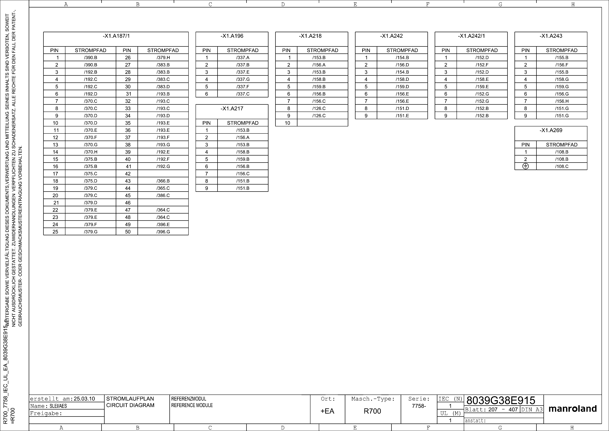

# +EA — Sheet 207 of 407 — REFERENZMODUL

**REFERENCE MODULE**

> Part of the manroland **R700** printing press IEC/UL circuit diagrams.
> Drawing class: **Stromlaufplan / Circuit diagram** (DIN A3).
> Document `+EA` covers the **Printing unit** machine section.

## At a glance

| Field | Value |
|---|---|
| Document | `+EA`  (8039G38E915) |
| Sheet | **207** of 407 |
| Section (DE) | REFERENZMODUL |
| Section (EN) | REFERENCE MODULE |
| Section type | REFERENCE_MODULE — Reference module |
| Machine type | `R700` |
| Series | `7758` |
| Created | 25.03.10 |
| Replaces | — |
| Columns used | A, B, C, D, E, F, G, H |
| Path numbers | — |
| Labels on sheet | 232 |
| Cross-refs out | 102 |
| Cross-refs in | 0 |

**Previous:** [+EA sheet 206](SHEET_0206.md) · **Next:** [+EA sheet 208](SHEET_0208.md) · **Document TOC:** [_TOC.md](_TOC.md)  (+EA) · **Master TOC:** [all sheets](../_MASTER_TOC.md)

## Sheet image (300 DPI, exact vector render)



_Rendered directly from the PDF vector layer at 300 DPI (1-bit), no OCR and no resampling. Use it to confirm anything ambiguous in the text below._

## Cross-references on this sheet

Each entry is a wire leaving this sheet. The printed token is `/sheet.column`; the link resolves to that sheet inside the same document.

| Ref | Target sheet | Col | Path | Destination on target | Target section | From col |
|---|---|---|---|---|---|---|
| `/390.B` | [+EA sheet 390](SHEET_0390.md) | B | — | — | OPTION: ZWISCHENTROCKNER VORBEREITUNG; | A |
| `/337.A` | [+EA sheet 337](SHEET_0337.md) | A | — | — | OPTION: BOGENWEICHE | C |
| `/153.B` | [+EA sheet 153](SHEET_0153.md) | B | — | — | ZUGANGSABSICHERUNG | E |
| `/154.B` | [+EA sheet 154](SHEET_0154.md) | B | — | — | ZUGANGSABSICHERUNG | F |
| `/155.B` | [+EA sheet 155](SHEET_0155.md) | B | — | — | ZUGANGSABSICHERUNG | H |
| `/379.H` | [+EA sheet 379](SHEET_0379.md) | H | — | — | OPTION: ENDTROCKNER 2 VORBEREITUNG | B |
| `/152.D` | [+EA sheet 152](SHEET_0152.md) | D | — | — | ZUGANGSABSICHERUNG | G |
| `/390.B` | [+EA sheet 390](SHEET_0390.md) | B | — | — | OPTION: ZWISCHENTROCKNER VORBEREITUNG; | A |
| `/383.B` | [+EA sheet 383](SHEET_0383.md) | B | — | — | OPTION: ENDTROCKNER 2 VORBEREITUNG | B |
| `/337.B` | [+EA sheet 337](SHEET_0337.md) | B | — | — | OPTION: BOGENWEICHE | C |
| `/156.A` | [+EA sheet 156](SHEET_0156.md) | A | — | — | ZUGANGSABSICHERUNG | D |
| `/152.F` | [+EA sheet 152](SHEET_0152.md) | F | — | — | ZUGANGSABSICHERUNG | G |
| `/156.F` | [+EA sheet 156](SHEET_0156.md) | F | — | — | ZUGANGSABSICHERUNG | H |
| `/156.D` | [+EA sheet 156](SHEET_0156.md) | D | — | — | ZUGANGSABSICHERUNG | F |
| `/192.B` | [+EA sheet 192](SHEET_0192.md) | B | — | — | RESERVE | A |
| `/383.B` | [+EA sheet 383](SHEET_0383.md) | B | — | — | OPTION: ENDTROCKNER 2 VORBEREITUNG | B |
| `/337.E` | [+EA sheet 337](SHEET_0337.md) | E | — | — | OPTION: BOGENWEICHE | C |
| `/153.B` | [+EA sheet 153](SHEET_0153.md) | B | — | — | ZUGANGSABSICHERUNG | E |
| `/154.B` | [+EA sheet 154](SHEET_0154.md) | B | — | — | ZUGANGSABSICHERUNG | F |
| `/155.B` | [+EA sheet 155](SHEET_0155.md) | B | — | — | ZUGANGSABSICHERUNG | H |
| `/152.D` | [+EA sheet 152](SHEET_0152.md) | D | — | — | ZUGANGSABSICHERUNG | G |
| `/158.B` | [+EA sheet 158](SHEET_0158.md) | B | — | — | ZUGANGSABSICHERUNG | E |
| `/158.E` | [+EA sheet 158](SHEET_0158.md) | E | — | — | ZUGANGSABSICHERUNG | G |
| `/337.G` | [+EA sheet 337](SHEET_0337.md) | G | — | — | OPTION: BOGENWEICHE | C |
| `/158.G` | [+EA sheet 158](SHEET_0158.md) | G | — | — | ZUGANGSABSICHERUNG | H |
| `/192.C` | [+EA sheet 192](SHEET_0192.md) | C | — | — | RESERVE | A |
| `/383.C` | [+EA sheet 383](SHEET_0383.md) | C | — | — | OPTION: ENDTROCKNER 2 VORBEREITUNG | B |
| `/158.D` | [+EA sheet 158](SHEET_0158.md) | D | — | — | ZUGANGSABSICHERUNG | F |
| `/159.B` | [+EA sheet 159](SHEET_0159.md) | B | — | — | ZUGANGSABSICHERUNG | E |
| `/159.E` | [+EA sheet 159](SHEET_0159.md) | E | — | — | ZUGANGSABSICHERUNG | G |
| `/337.F` | [+EA sheet 337](SHEET_0337.md) | F | — | — | OPTION: BOGENWEICHE | C |
| `/159.G` | [+EA sheet 159](SHEET_0159.md) | G | — | — | ZUGANGSABSICHERUNG | H |
| `/192.C` | [+EA sheet 192](SHEET_0192.md) | C | — | — | RESERVE | A |
| `/383.D` | [+EA sheet 383](SHEET_0383.md) | D | — | — | OPTION: ENDTROCKNER 2 VORBEREITUNG | B |
| `/159.D` | [+EA sheet 159](SHEET_0159.md) | D | — | — | ZUGANGSABSICHERUNG | F |
| `/193.B` | [+EA sheet 193](SHEET_0193.md) | B | — | — | RESERVE | B |
| `/156.B` | [+EA sheet 156](SHEET_0156.md) | B | — | — | ZUGANGSABSICHERUNG | E |
| `/156.E` | [+EA sheet 156](SHEET_0156.md) | E | — | — | ZUGANGSABSICHERUNG | F |
| `/152.G` | [+EA sheet 152](SHEET_0152.md) | G | — | — | ZUGANGSABSICHERUNG | G |
| `/156.G` | [+EA sheet 156](SHEET_0156.md) | G | — | — | ZUGANGSABSICHERUNG | H |
| `/192.D` | [+EA sheet 192](SHEET_0192.md) | D | — | — | RESERVE | A |
| `/337.C` | [+EA sheet 337](SHEET_0337.md) | C | — | — | OPTION: BOGENWEICHE | C |
| `/156.E` | [+EA sheet 156](SHEET_0156.md) | E | — | — | ZUGANGSABSICHERUNG | F |
| `/152.G` | [+EA sheet 152](SHEET_0152.md) | G | — | — | ZUGANGSABSICHERUNG | G |
| `/370.C` | [+EA sheet 370](SHEET_0370.md) | C | — | — | OPTION: ENDTROCKNER 1 VORBEREITUNG; | A |
| `/193.C` | [+EA sheet 193](SHEET_0193.md) | C | — | — | RESERVE | B |
| `/156.C` | [+EA sheet 156](SHEET_0156.md) | C | — | — | ZUGANGSABSICHERUNG | E |
| `/156.H` | [+EA sheet 156](SHEET_0156.md) | H | — | — | ZUGANGSABSICHERUNG | H |
| `/152.B` | [+EA sheet 152](SHEET_0152.md) | B | — | — | ZUGANGSABSICHERUNG | G |
| `/151.G` | [+EA sheet 151](SHEET_0151.md) | G | — | — | ZUGANGSABSICHERUNG | H |
| `/370.C` | [+EA sheet 370](SHEET_0370.md) | C | — | — | OPTION: ENDTROCKNER 1 VORBEREITUNG; | A |
| `/193.C` | [+EA sheet 193](SHEET_0193.md) | C | — | — | RESERVE | B |
| `/126.C` | [+EA sheet 126](SHEET_0126.md) | C | — | — | ZUGANGSABSICHERUNG | E |
| `/151.D` | [+EA sheet 151](SHEET_0151.md) | D | — | — | ZUGANGSABSICHERUNG | F |
| `/151.E` | [+EA sheet 151](SHEET_0151.md) | E | — | — | ZUGANGSABSICHERUNG | F |
| `/152.B` | [+EA sheet 152](SHEET_0152.md) | B | — | — | ZUGANGSABSICHERUNG | G |
| `/151.G` | [+EA sheet 151](SHEET_0151.md) | G | — | — | ZUGANGSABSICHERUNG | H |
| `/370.D` | [+EA sheet 370](SHEET_0370.md) | D | — | — | OPTION: ENDTROCKNER 1 VORBEREITUNG; | A |
| `/193.D` | [+EA sheet 193](SHEET_0193.md) | D | — | — | RESERVE | B |
| `/126.C` | [+EA sheet 126](SHEET_0126.md) | C | — | — | ZUGANGSABSICHERUNG | E |
| `/193.E` | [+EA sheet 193](SHEET_0193.md) | E | — | — | RESERVE | B |
| `/370.D` | [+EA sheet 370](SHEET_0370.md) | D | — | — | OPTION: ENDTROCKNER 1 VORBEREITUNG; | A |
| `/370.E` | [+EA sheet 370](SHEET_0370.md) | E | — | — | OPTION: ENDTROCKNER 1 VORBEREITUNG; | A |
| `/193.E` | [+EA sheet 193](SHEET_0193.md) | E | — | — | RESERVE | B |
| `/153.B` | [+EA sheet 153](SHEET_0153.md) | B | — | — | ZUGANGSABSICHERUNG | C |
| `/156.A` | [+EA sheet 156](SHEET_0156.md) | A | — | — | ZUGANGSABSICHERUNG | C |
| `/370.F` | [+EA sheet 370](SHEET_0370.md) | F | — | — | OPTION: ENDTROCKNER 1 VORBEREITUNG; | A |
| `/193.F` | [+EA sheet 193](SHEET_0193.md) | F | — | — | RESERVE | B |
| `/153.B` | [+EA sheet 153](SHEET_0153.md) | B | — | — | ZUGANGSABSICHERUNG | C |
| `/370.G` | [+EA sheet 370](SHEET_0370.md) | G | — | — | OPTION: ENDTROCKNER 1 VORBEREITUNG; | A |
| `/193.G` | [+EA sheet 193](SHEET_0193.md) | G | — | — | RESERVE | B |
| `/192.E` | [+EA sheet 192](SHEET_0192.md) | E | — | — | RESERVE | B |
| `/158.B` | [+EA sheet 158](SHEET_0158.md) | B | — | — | ZUGANGSABSICHERUNG | C |
| `/108.B` | [+EA sheet 108](SHEET_0108.md) | B | — | — | BLAS/SAUGLUFT MIT MOTORVENTILEINSTELLUNG | H |
| `/370.H` | [+EA sheet 370](SHEET_0370.md) | H | — | — | OPTION: ENDTROCKNER 1 VORBEREITUNG; | A |
| `/375.B` | [+EA sheet 375](SHEET_0375.md) | B | — | — | OPTION: ENDTROCKNER 1 VORBEREITUNG; | A |
| `/159.B` | [+EA sheet 159](SHEET_0159.md) | B | — | — | ZUGANGSABSICHERUNG | C |
| `/108.B` | [+EA sheet 108](SHEET_0108.md) | B | — | — | BLAS/SAUGLUFT MIT MOTORVENTILEINSTELLUNG | H |
| `/192.F` | [+EA sheet 192](SHEET_0192.md) | F | — | — | RESERVE | B |
| `/375.B` | [+EA sheet 375](SHEET_0375.md) | B | — | — | OPTION: ENDTROCKNER 1 VORBEREITUNG; | A |
| `/156.B` | [+EA sheet 156](SHEET_0156.md) | B | — | — | ZUGANGSABSICHERUNG | C |
| `/192.G` | [+EA sheet 192](SHEET_0192.md) | G | — | — | RESERVE | B |
| `/108.C` | [+EA sheet 108](SHEET_0108.md) | C | — | — | BLAS/SAUGLUFT MIT MOTORVENTILEINSTELLUNG | H |
| `/375.C` | [+EA sheet 375](SHEET_0375.md) | C | — | — | OPTION: ENDTROCKNER 1 VORBEREITUNG; | A |
| `/156.C` | [+EA sheet 156](SHEET_0156.md) | C | — | — | ZUGANGSABSICHERUNG | C |
| `/366.B` | [+EA sheet 366](SHEET_0366.md) | B | — | — | OPTION: TROCKNER VORBEREITUNG; | B |
| `/151.B` | [+EA sheet 151](SHEET_0151.md) | B | — | — | ZUGANGSABSICHERUNG | C |
| `/375.D` | [+EA sheet 375](SHEET_0375.md) | D | — | — | OPTION: ENDTROCKNER 1 VORBEREITUNG; | A |
| `/151.B` | [+EA sheet 151](SHEET_0151.md) | B | — | — | ZUGANGSABSICHERUNG | C |
| `/379.C` | [+EA sheet 379](SHEET_0379.md) | C | — | — | OPTION: ENDTROCKNER 2 VORBEREITUNG | A |
| `/365.C` | [+EA sheet 365](SHEET_0365.md) | C | — | — | OPTION: TROCKNER VORBEREITUNG; | B |
| `/379.C` | [+EA sheet 379](SHEET_0379.md) | C | — | — | OPTION: ENDTROCKNER 2 VORBEREITUNG | A |
| `/386.C` | [+EA sheet 386](SHEET_0386.md) | C | — | — | OPTION: ZWISCHENTROCKNER VORBEREITUNG; | B |
| `/379.D` | [+EA sheet 379](SHEET_0379.md) | D | — | — | OPTION: ENDTROCKNER 2 VORBEREITUNG | A |
| `/379.E` | [+EA sheet 379](SHEET_0379.md) | E | — | — | OPTION: ENDTROCKNER 2 VORBEREITUNG | A |
| `/364.C` | [+EA sheet 364](SHEET_0364.md) | C | — | — | OPTION: TROCKNER VORBEREITUNG; | B |
| `/379.E` | [+EA sheet 379](SHEET_0379.md) | E | — | — | OPTION: ENDTROCKNER 2 VORBEREITUNG | A |
| `/364.C` | [+EA sheet 364](SHEET_0364.md) | C | — | — | OPTION: TROCKNER VORBEREITUNG; | B |
| `/396.E` | [+EA sheet 396](SHEET_0396.md) | E | — | — | OPTION: ZWISCHENTROCKNER VORBEREITUNG; | B |
| `/379.F` | [+EA sheet 379](SHEET_0379.md) | F | — | — | OPTION: ENDTROCKNER 2 VORBEREITUNG | A |
| `/379.G` | [+EA sheet 379](SHEET_0379.md) | G | — | — | OPTION: ENDTROCKNER 2 VORBEREITUNG | A |
| `/396.G` | [+EA sheet 396](SHEET_0396.md) | G | — | — | OPTION: ZWISCHENTROCKNER VORBEREITUNG; | B |

## Devices on this sheet

| Tag | Class | Class meaning (IEC) | Col | Sub | Terminal | Sign |
|---|---|---|---|---|---|---|
| `X1.A196` | — | cross-device reference | C | — | — | — |
| `X1.A217` | — | cross-device reference | C | — | — | — |
| `X1.A218` | — | cross-device reference | D | — | — | — |
| `X1.A243` | — | cross-device reference | H | — | — | — |
| `X1.A269` | — | cross-device reference | H | — | — | — |
| `X1.A242` | — | cross-device reference | F | — | — | — |

## Potentials / nets

_No named potentials on this sheet._

## Wire-end annotations (grouped as printed)

A wire that continues elsewhere is annotated with a small cluster: the destination description, the path/line number `#NN`, and the `/sheet.column` cross reference. Each row below is one such cluster exactly as it is grouped on the drawing.

| Col | Y | Path | Cross-ref | Text on the wire |
|---|---|---|---|---|
| B | 65.5 | — | — | `X1.A187/1` |
| C | 65.5 | — | — | `X1.A196` |
| D | 65.5 | — | — | `X1.A218` |
| F | 65.5 | — | — | `X1.A242` |
| G | 65.5 | — | — | `X1.A242/1` |
| H | 65.5 | — | — | `X1.A243` |
| A | 94.2 | — | — | `PIN STROMPFAD` |
| B | 94.2 | — | — | `PIN STROMPFAD` |
| C | 94.2 | — | — | `PIN 2 3 4 5 6 1 STROMPFAD` |
| D | 94.2 | — | — | `PIN 10 2 3 4 5 6 7 8 9 1 STROMPFAD` |
| E | 94.2 | — | — | `PIN 2 3 4 5 6 7 8 9 1 STROMPFAD` |
| G | 94.2 | — | — | `PIN 2 3 4 5 6 7 8 9 1 STROMPFAD` |
| H | 94.2 | — | — | `PIN 2 3 4 5 6 7 8 9 1 STROMPFAD` |
| A | 108.4 | — | — | `2 3 4 5 6 7 8 9 1` |
| B | 108.4 | — | — | `26 27 28 29 30 32 33 34 35 36 37 38 39 40 42 43 44 45 46 47 48 49 50 31 41` |
| A | 108.7 | — | `/390.B` | — |
| B | 108.7 | — | `/379.H` | — |
| C | 108.7 | — | `/337.A` | — |
| E | 108.7 | — | `/153.B` | — |
| F | 108.7 | — | `/154.B` | — |
| G | 108.7 | — | `/152.D` | — |
| H | 108.7 | — | `/155.B` | — |
| A | 122.9 | — | `/390.B` | — |
| B | 122.9 | — | `/383.B` | — |
| C | 122.9 | — | `/337.B` | — |
| D | 122.9 | — | `/156.A` | — |
| F | 122.9 | — | `/156.D` | — |
| G | 122.9 | — | `/152.F` | — |
| H | 122.9 | — | `/156.F` | — |
| A | 137.0 | — | `/192.B` | — |
| B | 137.0 | — | `/383.B` | — |
| C | 137.0 | — | `/337.E` | — |
| E | 137.0 | — | `/153.B` | — |
| F | 137.0 | — | `/154.B` | — |
| H | 137.0 | — | `/155.B` | — |
| G | 137.1 | — | `/152.D` | — |
| A | 151.2 | — | `/192.C` | — |
| B | 151.2 | — | `/383.C` | — |
| C | 151.2 | — | `/337.G` | — |
| E | 151.2 | — | `/158.B` | — |
| F | 151.2 | — | `/158.D` | — |
| G | 151.2 | — | `/158.E` | — |
| H | 151.2 | — | `/158.G` | — |
| A | 165.4 | — | `/192.C` | — |
| B | 165.4 | — | `/383.D` | — |
| C | 165.4 | — | `/337.F` | — |
| E | 165.4 | — | `/159.B` | — |
| F | 165.4 | — | `/159.D` | — |
| G | 165.4 | — | `/159.E` | — |
| H | 165.4 | — | `/159.G` | — |
| A | 179.6 | — | `/192.D` | — |
| B | 179.6 | — | `/193.B` | — |
| C | 179.6 | — | `/337.C` | — |
| E | 179.6 | — | `/156.B` | — |
| F | 179.6 | — | `/156.E` | — |
| G | 179.6 | — | `/152.G` | — |
| H | 179.6 | — | `/156.G` | — |
| F | 193.7 | — | `/156.E` | — |
| G | 193.7 | — | `/152.G` | — |
| A | 193.8 | — | `/370.C` | — |
| B | 193.8 | — | `/193.C` | — |
| E | 193.8 | — | `/156.C` | — |
| H | 193.8 | — | `/156.H` | — |
| C | 207.2 | — | — | `X1.A217` |
| A | 207.9 | — | `/370.C` | — |
| B | 207.9 | — | `/193.C` | — |
| E | 207.9 | — | `/126.C` | — |
| F | 207.9 | — | `/151.D` | — |
| G | 207.9 | — | `/152.B` | — |
| H | 207.9 | — | `/151.G` | — |
| A | 222.1 | — | `/370.D` | — |
| B | 222.1 | — | `/193.D` | — |
| E | 222.1 | — | `/126.C` | — |
| F | 222.1 | — | `/151.E` | — |
| G | 222.1 | — | `/152.B` | — |
| H | 222.1 | — | `/151.G` | — |
| A | 235.9 | — | — | `10 12 13 14 15 16 17 18 19 20 11` |
| C | 235.9 | — | — | `PIN 2 3 4 5 6 7 8 9 1 STROMPFAD` |
| B | 236.2 | — | `/193.E` | — |
| A | 236.3 | — | `/370.D` | — |
| H | 249.8 | — | — | `X1.A269` |
| A | 250.4 | — | `/370.E` | — |
| B | 250.4 | — | `/193.E` | — |
| C | 250.4 | — | `/153.B` | — |
| A | 264.6 | — | `/370.F` | — |
| B | 264.6 | — | `/193.F` | — |
| C | 264.6 | — | `/156.A` | — |
| H | 278.4 | — | — | `PIN 2 1 STROMPFAD` |
| A | 278.8 | — | `/370.G` | — |
| B | 278.8 | — | `/193.G` | — |
| C | 278.8 | — | `/153.B` | — |
| B | 292.9 | — | `/192.E` | — |
| C | 292.9 | — | `/158.B` | — |
| H | 292.9 | — | `/108.B` | — |
| A | 293.0 | — | `/370.H` | — |
| A | 307.1 | — | `/375.B` | — |
| B | 307.1 | — | `/192.F` | — |
| C | 307.1 | — | `/159.B` | — |
| H | 307.1 | — | `/108.B` | — |
| A | 321.3 | — | `/375.B` | — |
| B | 321.3 | — | `/192.G` | — |
| C | 321.3 | — | `/156.B` | — |
| H | 321.3 | — | `/108.C` | — |
| A | 335.5 | — | `/375.C` | — |
| C | 335.5 | — | `/156.C` | — |
| B | 349.6 | — | `/366.B` | — |
| C | 349.6 | — | `/151.B` | — |
| A | 349.7 | — | `/375.D` | — |
| A | 363.8 | — | `/379.C` | — |
| B | 363.8 | — | `/365.C` | — |
| C | 363.8 | — | `/151.B` | — |
| A | 378.0 | — | `/379.C` | — |
| B | 378.0 | — | `/386.C` | — |
| A | 391.8 | — | — | `22 23 24 25 21` |
| A | 392.2 | — | `/379.D` | — |
| A | 406.3 | — | `/379.E` | — |
| B | 406.4 | — | `/364.C` | — |
| A | 420.5 | — | `/379.E` | — |
| B | 420.5 | — | `/364.C` | — |
| A | 434.7 | — | `/379.F` | — |
| B | 434.7 | — | `/396.E` | — |
| A | 448.9 | — | `/379.G` | — |
| B | 448.9 | — | `/396.G` | — |


## Reconstructed tables

This sheet carries tabular content (pin map / terminal assignment / index). The grid below was rebuilt from the drawing's own rule lines, so each row is exactly one physical row of the table.

### Table 1 — 25 data rows × 4 columns (at x=85.0, y=62.4) — **X1.A187/1**

| PIN | STROMPFAD | PIN | STROMPFAD |
|---|---|---|---|
| `1` | `/390.B` | `26` | `/379.H` |
| `2` | `/390.B` | `27` | `/383.B` |
| `3` | `/192.B` | `28` | `/383.B` |
| `4` | `/192.C` | `29` | `/383.C` |
| `5` | `/192.C` | `30` | `/383.D` |
| `6` | `/192.D` | `31` | `/193.B` |
| `7` | `/370.C` | `32` | `/193.C` |
| `8` | `/370.C` | `33` | `/193.C` |
| `9` | `/370.D` | `34` | `/193.D` |
| `10` | `/370.D` | `35` | `/193.E` |
| `11` | `/370.E` | `36` | `/193.E` |
| `12` | `/370.F` | `37` | `/193.F` |
| `13` | `/370.G` | `38` | `/193.G` |
| `14` | `/370.H` | `39` | `/192.E` |
| `15` | `/375.B` | `40` | `/192.F` |
| `16` | `/375.B` | `41` | `/192.G` |
| `17` | `/375.C` | `42` |  |
| `18` | `/375.D` | `43` | `/366.B` |
| `19` | `/379.C` | `44` | `/365.C` |
| `20` | `/379.C` | `45` | `/386.C` |
| `21` | `/379.D` | `46` |  |
| `22` | `/379.E` | `47` | `/364.C` |
| `23` | `/379.E` | `48` | `/364.C` |
| `24` | `/379.F` | `49` | `/396.E` |
| `25` | `/379.G` | `50` | `/396.G` |


### Table 2 — 17 data rows × 2 columns (at x=382.7, y=62.4) — **X1.A196**

| PIN | STROMPFAD |
|---|---|
| `1` | `/337.A` |
| `2` | `/337.B` |
| `3` | `/337.E` |
| `4` | `/337.G` |
| `5` | `/337.F` |
| `6` | `/337.C` |
|  | `X1.A217` |
| `PIN` | `STROMPFAD` |
| `1` | `/153.B` |
| `2` | `/156.A` |
| `3` | `/153.B` |
| `4` | `/158.B` |
| `5` | `/159.B` |
| `6` | `/156.B` |
| `7` | `/156.C` |
| `8` | `/151.B` |
| `9` | `/151.B` |


### Table 3 — 10 data rows × 2 columns (at x=538.6, y=62.4) — **X1.A218**

| PIN | STROMPFAD |
|---|---|
| `1` | `/153.B` |
| `2` | `/156.A` |
| `3` | `/153.B` |
| `4` | `/158.B` |
| `5` | `/159.B` |
| `6` | `/156.B` |
| `7` | `/156.C` |
| `8` | `/126.C` |
| `9` | `/126.C` |
| `10` |  |


### Table 4 — 9 data rows × 2 columns (at x=694.5, y=62.4) — **X1.A242**

| PIN | STROMPFAD |
|---|---|
| `1` | `/154.B` |
| `2` | `/156.D` |
| `3` | `/154.B` |
| `4` | `/158.D` |
| `5` | `/159.D` |
| `6` | `/156.E` |
| `7` | `/156.E` |
| `8` | `/151.D` |
| `9` | `/151.E` |


### Table 5 — 9 data rows × 2 columns (at x=850.4, y=62.4) — **X1.A242/1**

| PIN | STROMPFAD |
|---|---|
| `1` | `/152.D` |
| `2` | `/152.F` |
| `3` | `/152.D` |
| `4` | `/158.E` |
| `5` | `/159.E` |
| `6` | `/152.G` |
| `7` | `/152.G` |
| `8` | `/152.B` |
| `9` | `/152.B` |


### Table 6 — 14 data rows × 2 columns (at x=1006.3, y=62.4) — **X1.A243**

| PIN | STROMPFAD |
|---|---|
| `1` | `/155.B` |
| `2` | `/156.F` |
| `3` | `/155.B` |
| `4` | `/158.G` |
| `5` | `/159.G` |
| `6` | `/156.G` |
| `7` | `/156.H` |
| `8` | `/151.G` |
| `9` | `/151.G` |
|  | `X1.A269` |
| `PIN` | `STROMPFAD` |
| `1` | `/108.B` |
| `2` | `/108.B` |
|  | `/108.C` |


## Notes and free text on this sheet

| Text | Col | Y (pt) |
|---|---|---|
| `PIN` | A | 94.2 |
| `STROMPFAD` | A | 94.15 |
| `PIN` | B | 94.2 |
| `STROMPFAD` | B | 94.15 |
| `X1.A187/1` | B | 65.51 |
| `PIN` | C | 94.2 |
| `STROMPFAD` | C | 94.15 |
| `PIN` | D | 94.2 |
| `STROMPFAD` | E | 94.15 |
| `PIN` | G | 94.2 |
| `STROMPFAD` | H | 94.15 |
| `PIN` | E | 94.2 |
| `STROMPFAD` | F | 94.15 |
| `PIN` | F | 94.2 |
| `STROMPFAD` | G | 94.15 |
| `X1.A242/1` | G | 65.51 |

## Complete label inventory (exact text from the drawing)

Every text object inside the drawing area of this sheet, in DIN reading order (column A→H, then top→bottom). This is the authoritative list: if a string is not here it is not printed on this sheet.

| Col | Y | X | Dir | Type | Text |
|---|---|---|---|---|---|
| A | 94.2 | 98.2 | → | text | `PIN` |
| A | 94.2 | 146.4 | → | text | `STROMPFAD` |
| A | 108.4 | 110.0 | → | number | `1` |
| A | 108.7 | 164.6 | → | cross-reference | `/390.B` |
| A | 122.5 | 108.3 | → | number | `2` |
| A | 122.9 | 164.6 | → | cross-reference | `/390.B` |
| A | 136.7 | 108.3 | → | number | `3` |
| A | 137.0 | 164.6 | → | cross-reference | `/192.B` |
| A | 150.9 | 108.3 | → | number | `4` |
| A | 151.2 | 164.4 | → | cross-reference | `/192.C` |
| A | 165.1 | 108.3 | → | number | `5` |
| A | 165.4 | 164.4 | → | cross-reference | `/192.C` |
| A | 179.2 | 108.3 | → | number | `6` |
| A | 179.6 | 164.4 | → | cross-reference | `/192.D` |
| A | 193.4 | 108.3 | → | number | `7` |
| A | 193.8 | 164.4 | → | cross-reference | `/370.C` |
| A | 207.6 | 108.3 | → | number | `8` |
| A | 207.9 | 164.4 | → | cross-reference | `/370.C` |
| A | 221.8 | 108.3 | → | number | `9` |
| A | 222.1 | 164.4 | → | cross-reference | `/370.D` |
| A | 235.9 | 102.9 | → | number | `10` |
| A | 236.3 | 164.4 | → | cross-reference | `/370.D` |
| A | 250.1 | 104.6 | → | number | `11` |
| A | 250.4 | 164.7 | → | cross-reference | `/370.E` |
| A | 264.3 | 102.9 | → | number | `12` |
| A | 264.6 | 164.8 | → | cross-reference | `/370.F` |
| A | 278.5 | 102.9 | → | number | `13` |
| A | 278.8 | 164.3 | → | cross-reference | `/370.G` |
| A | 292.6 | 102.9 | → | number | `14` |
| A | 293.0 | 164.7 | → | cross-reference | `/370.H` |
| A | 306.8 | 102.9 | → | number | `15` |
| A | 307.1 | 164.6 | → | cross-reference | `/375.B` |
| A | 321.0 | 102.9 | → | number | `16` |
| A | 321.3 | 164.6 | → | cross-reference | `/375.B` |
| A | 335.1 | 102.9 | → | number | `17` |
| A | 335.5 | 164.4 | → | cross-reference | `/375.C` |
| A | 349.3 | 102.9 | → | number | `18` |
| A | 349.7 | 164.4 | → | cross-reference | `/375.D` |
| A | 363.5 | 102.9 | → | number | `19` |
| A | 363.8 | 164.4 | → | cross-reference | `/379.C` |
| A | 377.7 | 102.9 | → | number | `20` |
| A | 378.0 | 164.4 | → | cross-reference | `/379.C` |
| A | 391.8 | 104.6 | → | number | `21` |
| A | 392.2 | 164.4 | → | cross-reference | `/379.D` |
| A | 406.0 | 102.9 | → | number | `22` |
| A | 406.3 | 164.7 | → | cross-reference | `/379.E` |
| A | 420.2 | 102.9 | → | number | `23` |
| A | 420.5 | 164.7 | → | cross-reference | `/379.E` |
| A | 434.4 | 102.9 | → | number | `24` |
| A | 434.7 | 164.8 | → | cross-reference | `/379.F` |
| A | 448.5 | 102.9 | → | number | `25` |
| A | 448.9 | 164.3 | → | cross-reference | `/379.G` |
| B | 65.5 | 201.1 | → | text | `X1.A187/1` |
| B | 94.2 | 240.0 | → | text | `PIN` |
| B | 94.2 | 288.1 | → | text | `STROMPFAD` |
| B | 108.4 | 244.6 | → | number | `26` |
| B | 108.7 | 306.4 | → | cross-reference | `/379.H` |
| B | 122.5 | 244.6 | → | number | `27` |
| B | 122.9 | 306.3 | → | cross-reference | `/383.B` |
| B | 136.7 | 244.6 | → | number | `28` |
| B | 137.0 | 306.3 | → | cross-reference | `/383.B` |
| B | 150.9 | 244.6 | → | number | `29` |
| B | 151.2 | 306.1 | → | cross-reference | `/383.C` |
| B | 165.1 | 244.6 | → | number | `30` |
| B | 165.4 | 306.1 | → | cross-reference | `/383.D` |
| B | 179.2 | 246.3 | → | number | `31` |
| B | 179.6 | 306.3 | → | cross-reference | `/193.B` |
| B | 193.4 | 244.6 | → | number | `32` |
| B | 193.8 | 306.1 | → | cross-reference | `/193.C` |
| B | 207.6 | 244.6 | → | number | `33` |
| B | 207.9 | 306.1 | → | cross-reference | `/193.C` |
| B | 221.8 | 244.6 | → | number | `34` |
| B | 222.1 | 306.1 | → | cross-reference | `/193.D` |
| B | 235.9 | 244.6 | → | number | `35` |
| B | 236.2 | 306.4 | → | cross-reference | `/193.E` |
| B | 250.1 | 244.6 | → | number | `36` |
| B | 250.4 | 306.4 | → | cross-reference | `/193.E` |
| B | 264.3 | 244.6 | → | number | `37` |
| B | 264.6 | 306.6 | → | cross-reference | `/193.F` |
| B | 278.5 | 244.6 | → | number | `38` |
| B | 278.8 | 306.0 | → | cross-reference | `/193.G` |
| B | 292.6 | 244.6 | → | number | `39` |
| B | 292.9 | 306.4 | → | cross-reference | `/192.E` |
| B | 306.8 | 244.6 | → | number | `40` |
| B | 307.1 | 306.6 | → | cross-reference | `/192.F` |
| B | 321.0 | 246.3 | → | number | `41` |
| B | 321.3 | 306.0 | → | cross-reference | `/192.G` |
| B | 335.1 | 244.6 | → | number | `42` |
| B | 349.3 | 244.6 | → | number | `43` |
| B | 349.6 | 306.3 | → | cross-reference | `/366.B` |
| B | 363.5 | 244.6 | → | number | `44` |
| B | 363.8 | 306.1 | → | cross-reference | `/365.C` |
| B | 377.7 | 244.6 | → | number | `45` |
| B | 378.0 | 306.1 | → | cross-reference | `/386.C` |
| B | 391.8 | 244.6 | → | number | `46` |
| B | 406.0 | 244.6 | → | number | `47` |
| B | 406.4 | 306.1 | → | cross-reference | `/364.C` |
| B | 420.2 | 244.6 | → | number | `48` |
| B | 420.5 | 306.1 | → | cross-reference | `/364.C` |
| B | 434.4 | 244.6 | → | number | `49` |
| B | 434.7 | 306.4 | → | cross-reference | `/396.E` |
| B | 448.5 | 244.6 | → | number | `50` |
| B | 448.9 | 306.0 | → | cross-reference | `/396.G` |
| C | 65.5 | 431.6 | → | device ref | `X1.A196` |
| C | 94.2 | 395.9 | → | text | `PIN` |
| C | 94.2 | 444.0 | → | text | `STROMPFAD` |
| C | 108.4 | 401.8 | → | number | `1` |
| C | 108.7 | 462.0 | → | cross-reference | `/337.A` |
| C | 122.5 | 401.2 | → | number | `2` |
| C | 122.9 | 462.2 | → | cross-reference | `/337.B` |
| C | 136.7 | 401.2 | → | number | `3` |
| C | 137.0 | 462.3 | → | cross-reference | `/337.E` |
| C | 150.9 | 401.2 | → | number | `4` |
| C | 151.2 | 461.9 | → | cross-reference | `/337.G` |
| C | 165.1 | 401.2 | → | number | `5` |
| C | 165.4 | 462.5 | → | cross-reference | `/337.F` |
| C | 179.2 | 401.2 | → | number | `6` |
| C | 179.6 | 462.0 | → | cross-reference | `/337.C` |
| C | 207.2 | 431.6 | → | device ref | `X1.A217` |
| C | 235.9 | 395.9 | → | text | `PIN` |
| C | 235.9 | 444.0 | → | text | `STROMPFAD` |
| C | 250.1 | 401.8 | → | number | `1` |
| C | 250.4 | 462.2 | → | cross-reference | `/153.B` |
| C | 264.3 | 401.2 | → | number | `2` |
| C | 264.6 | 462.0 | → | cross-reference | `/156.A` |
| C | 278.5 | 401.2 | → | number | `3` |
| C | 278.8 | 462.2 | → | cross-reference | `/153.B` |
| C | 292.6 | 401.2 | → | number | `4` |
| C | 292.9 | 462.2 | → | cross-reference | `/158.B` |
| C | 306.8 | 401.2 | → | number | `5` |
| C | 307.1 | 462.2 | → | cross-reference | `/159.B` |
| C | 321.0 | 401.2 | → | number | `6` |
| C | 321.3 | 462.2 | → | cross-reference | `/156.B` |
| C | 335.1 | 401.2 | → | number | `7` |
| C | 335.5 | 462.0 | → | cross-reference | `/156.C` |
| C | 349.3 | 401.2 | → | number | `8` |
| C | 349.6 | 462.2 | → | cross-reference | `/151.B` |
| C | 363.5 | 401.2 | → | number | `9` |
| C | 363.8 | 462.2 | → | cross-reference | `/151.B` |
| D | 65.5 | 584.6 | → | device ref | `X1.A218` |
| D | 94.2 | 551.8 | → | text | `PIN` |
| D | 108.4 | 563.5 | → | number | `1` |
| D | 122.5 | 561.8 | → | number | `2` |
| D | 122.9 | 610.9 | → | cross-reference | `/156.A` |
| D | 136.7 | 561.8 | → | number | `3` |
| D | 150.9 | 561.8 | → | number | `4` |
| D | 165.1 | 561.8 | → | number | `5` |
| D | 179.2 | 561.8 | → | number | `6` |
| D | 193.4 | 561.8 | → | number | `7` |
| D | 207.6 | 561.8 | → | number | `8` |
| D | 221.8 | 561.8 | → | number | `9` |
| D | 235.9 | 556.4 | → | number | `10` |
| E | 94.2 | 600.0 | → | text | `STROMPFAD` |
| E | 94.2 | 707.7 | → | text | `PIN` |
| E | 108.4 | 713.6 | → | number | `1` |
| E | 108.7 | 611.0 | → | cross-reference | `/153.B` |
| E | 122.5 | 713.1 | → | number | `2` |
| E | 136.7 | 713.1 | → | number | `3` |
| E | 137.0 | 611.0 | → | cross-reference | `/153.B` |
| E | 150.9 | 713.1 | → | number | `4` |
| E | 151.2 | 611.0 | → | cross-reference | `/158.B` |
| E | 165.1 | 713.1 | → | number | `5` |
| E | 165.4 | 611.0 | → | cross-reference | `/159.B` |
| E | 179.2 | 713.1 | → | number | `6` |
| E | 179.6 | 611.0 | → | cross-reference | `/156.B` |
| E | 193.4 | 713.1 | → | number | `7` |
| E | 193.8 | 610.9 | → | cross-reference | `/156.C` |
| E | 207.6 | 713.1 | → | number | `8` |
| E | 207.9 | 610.9 | → | cross-reference | `/126.C` |
| E | 221.8 | 713.1 | → | number | `9` |
| E | 222.1 | 610.9 | → | cross-reference | `/126.C` |
| F | 65.5 | 743.4 | → | device ref | `X1.A242` |
| F | 94.2 | 755.9 | → | text | `STROMPFAD` |
| F | 94.2 | 863.6 | → | text | `PIN` |
| F | 108.4 | 869.5 | → | number | `1` |
| F | 108.7 | 774.0 | → | cross-reference | `/154.B` |
| F | 122.5 | 869.0 | → | number | `2` |
| F | 122.9 | 773.9 | → | cross-reference | `/156.D` |
| F | 136.7 | 869.0 | → | number | `3` |
| F | 137.0 | 774.0 | → | cross-reference | `/154.B` |
| F | 150.9 | 869.0 | → | number | `4` |
| F | 151.2 | 773.9 | → | cross-reference | `/158.D` |
| F | 165.1 | 869.0 | → | number | `5` |
| F | 165.4 | 773.9 | → | cross-reference | `/159.D` |
| F | 179.2 | 869.0 | → | number | `6` |
| F | 179.6 | 774.1 | → | cross-reference | `/156.E` |
| F | 193.4 | 869.0 | → | number | `7` |
| F | 193.7 | 774.1 | → | cross-reference | `/156.E` |
| F | 207.6 | 869.0 | → | number | `8` |
| F | 207.9 | 773.9 | → | cross-reference | `/151.D` |
| F | 221.8 | 869.0 | → | number | `9` |
| F | 222.1 | 774.1 | → | cross-reference | `/151.E` |
| G | 65.5 | 895.6 | → | text | `X1.A242/1` |
| G | 94.2 | 911.8 | → | text | `STROMPFAD` |
| G | 94.2 | 1019.5 | → | text | `PIN` |
| G | 108.4 | 1025.4 | → | number | `1` |
| G | 108.7 | 929.8 | → | cross-reference | `/152.D` |
| G | 122.5 | 1024.9 | → | number | `2` |
| G | 122.9 | 930.2 | → | cross-reference | `/152.F` |
| G | 136.7 | 1024.9 | → | number | `3` |
| G | 137.1 | 929.8 | → | cross-reference | `/152.D` |
| G | 150.9 | 1024.9 | → | number | `4` |
| G | 151.2 | 930.0 | → | cross-reference | `/158.E` |
| G | 165.1 | 1024.9 | → | number | `5` |
| G | 165.4 | 930.0 | → | cross-reference | `/159.E` |
| G | 179.2 | 1024.9 | → | number | `6` |
| G | 179.6 | 929.6 | → | cross-reference | `/152.G` |
| G | 193.4 | 1024.9 | → | number | `7` |
| G | 193.7 | 929.6 | → | cross-reference | `/152.G` |
| G | 207.6 | 1024.9 | → | number | `8` |
| G | 207.9 | 929.9 | → | cross-reference | `/152.B` |
| G | 221.8 | 1024.9 | → | number | `9` |
| G | 222.1 | 929.9 | → | cross-reference | `/152.B` |
| G | 278.4 | 1019.5 | → | text | `PIN` |
| G | 292.6 | 1025.4 | → | number | `1` |
| G | 306.8 | 1024.9 | → | number | `2` |
| H | 65.5 | 1055.2 | → | device ref | `X1.A243` |
| H | 94.2 | 1067.7 | → | text | `STROMPFAD` |
| H | 108.7 | 1085.8 | → | cross-reference | `/155.B` |
| H | 122.9 | 1086.1 | → | cross-reference | `/156.F` |
| H | 137.0 | 1085.8 | → | cross-reference | `/155.B` |
| H | 151.2 | 1085.5 | → | cross-reference | `/158.G` |
| H | 165.4 | 1085.5 | → | cross-reference | `/159.G` |
| H | 179.6 | 1085.5 | → | cross-reference | `/156.G` |
| H | 193.8 | 1086.0 | → | cross-reference | `/156.H` |
| H | 207.9 | 1085.5 | → | cross-reference | `/151.G` |
| H | 222.1 | 1085.5 | → | cross-reference | `/151.G` |
| H | 249.8 | 1055.2 | → | device ref | `X1.A269` |
| H | 278.4 | 1067.7 | → | text | `STROMPFAD` |
| H | 292.9 | 1085.8 | → | cross-reference | `/108.B` |
| H | 307.1 | 1085.8 | → | cross-reference | `/108.B` |
| H | 321.3 | 1085.7 | → | cross-reference | `/108.C` |

## Reading-order text block

The same content as a plain block, grouped by DIN column — convenient to paste or to match against a visual description.

```text
=== Column A ===
  94.2   98.2  text         PIN
  94.2  146.4  text         STROMPFAD
 108.4  110.0  numeric      1
 108.7  164.6  xref         /390.B
 122.5  108.3  numeric      2
 122.9  164.6  xref         /390.B
 136.7  108.3  numeric      3
 137.0  164.6  xref         /192.B
 150.9  108.3  numeric      4
 151.2  164.4  xref         /192.C
 165.1  108.3  numeric      5
 165.4  164.4  xref         /192.C
 179.2  108.3  numeric      6
 179.6  164.4  xref         /192.D
 193.4  108.3  numeric      7
 193.8  164.4  xref         /370.C
 207.6  108.3  numeric      8
 207.9  164.4  xref         /370.C
 221.8  108.3  numeric      9
 222.1  164.4  xref         /370.D
 235.9  102.9  numeric      10
 236.3  164.4  xref         /370.D
 250.1  104.6  numeric      11
 250.4  164.7  xref         /370.E
 264.3  102.9  numeric      12
 264.6  164.8  xref         /370.F
 278.5  102.9  numeric      13
 278.8  164.3  xref         /370.G
 292.6  102.9  numeric      14
 293.0  164.7  xref         /370.H
 306.8  102.9  numeric      15
 307.1  164.6  xref         /375.B
 321.0  102.9  numeric      16
 321.3  164.6  xref         /375.B
 335.1  102.9  numeric      17
 335.5  164.4  xref         /375.C
 349.3  102.9  numeric      18
 349.7  164.4  xref         /375.D
 363.5  102.9  numeric      19
 363.8  164.4  xref         /379.C
 377.7  102.9  numeric      20
 378.0  164.4  xref         /379.C
 391.8  104.6  numeric      21
 392.2  164.4  xref         /379.D
 406.0  102.9  numeric      22
 406.3  164.7  xref         /379.E
 420.2  102.9  numeric      23
 420.5  164.7  xref         /379.E
 434.4  102.9  numeric      24
 434.7  164.8  xref         /379.F
 448.5  102.9  numeric      25
 448.9  164.3  xref         /379.G
=== Column B ===
  65.5  201.1  text         X1.A187/1
  94.2  240.0  text         PIN
  94.2  288.1  text         STROMPFAD
 108.4  244.6  numeric      26
 108.7  306.4  xref         /379.H
 122.5  244.6  numeric      27
 122.9  306.3  xref         /383.B
 136.7  244.6  numeric      28
 137.0  306.3  xref         /383.B
 150.9  244.6  numeric      29
 151.2  306.1  xref         /383.C
 165.1  244.6  numeric      30
 165.4  306.1  xref         /383.D
 179.2  246.3  numeric      31
 179.6  306.3  xref         /193.B
 193.4  244.6  numeric      32
 193.8  306.1  xref         /193.C
 207.6  244.6  numeric      33
 207.9  306.1  xref         /193.C
 221.8  244.6  numeric      34
 222.1  306.1  xref         /193.D
 235.9  244.6  numeric      35
 236.2  306.4  xref         /193.E
 250.1  244.6  numeric      36
 250.4  306.4  xref         /193.E
 264.3  244.6  numeric      37
 264.6  306.6  xref         /193.F
 278.5  244.6  numeric      38
 278.8  306.0  xref         /193.G
 292.6  244.6  numeric      39
 292.9  306.4  xref         /192.E
 306.8  244.6  numeric      40
 307.1  306.6  xref         /192.F
 321.0  246.3  numeric      41
 321.3  306.0  xref         /192.G
 335.1  244.6  numeric      42
 349.3  244.6  numeric      43
 349.6  306.3  xref         /366.B
 363.5  244.6  numeric      44
 363.8  306.1  xref         /365.C
 377.7  244.6  numeric      45
 378.0  306.1  xref         /386.C
 391.8  244.6  numeric      46
 406.0  244.6  numeric      47
 406.4  306.1  xref         /364.C
 420.2  244.6  numeric      48
 420.5  306.1  xref         /364.C
 434.4  244.6  numeric      49
 434.7  306.4  xref         /396.E
 448.5  244.6  numeric      50
 448.9  306.0  xref         /396.G
=== Column C ===
  65.5  431.6  devref       X1.A196
  94.2  395.9  text         PIN
  94.2  444.0  text         STROMPFAD
 108.4  401.8  numeric      1
 108.7  462.0  xref         /337.A
 122.5  401.2  numeric      2
 122.9  462.2  xref         /337.B
 136.7  401.2  numeric      3
 137.0  462.3  xref         /337.E
 150.9  401.2  numeric      4
 151.2  461.9  xref         /337.G
 165.1  401.2  numeric      5
 165.4  462.5  xref         /337.F
 179.2  401.2  numeric      6
 179.6  462.0  xref         /337.C
 207.2  431.6  devref       X1.A217
 235.9  395.9  text         PIN
 235.9  444.0  text         STROMPFAD
 250.1  401.8  numeric      1
 250.4  462.2  xref         /153.B
 264.3  401.2  numeric      2
 264.6  462.0  xref         /156.A
 278.5  401.2  numeric      3
 278.8  462.2  xref         /153.B
 292.6  401.2  numeric      4
 292.9  462.2  xref         /158.B
 306.8  401.2  numeric      5
 307.1  462.2  xref         /159.B
 321.0  401.2  numeric      6
 321.3  462.2  xref         /156.B
 335.1  401.2  numeric      7
 335.5  462.0  xref         /156.C
 349.3  401.2  numeric      8
 349.6  462.2  xref         /151.B
 363.5  401.2  numeric      9
 363.8  462.2  xref         /151.B
=== Column D ===
  65.5  584.6  devref       X1.A218
  94.2  551.8  text         PIN
 108.4  563.5  numeric      1
 122.5  561.8  numeric      2
 122.9  610.9  xref         /156.A
 136.7  561.8  numeric      3
 150.9  561.8  numeric      4
 165.1  561.8  numeric      5
 179.2  561.8  numeric      6
 193.4  561.8  numeric      7
 207.6  561.8  numeric      8
 221.8  561.8  numeric      9
 235.9  556.4  numeric      10
=== Column E ===
  94.2  600.0  text         STROMPFAD
  94.2  707.7  text         PIN
 108.4  713.6  numeric      1
 108.7  611.0  xref         /153.B
 122.5  713.1  numeric      2
 136.7  713.1  numeric      3
 137.0  611.0  xref         /153.B
 150.9  713.1  numeric      4
 151.2  611.0  xref         /158.B
 165.1  713.1  numeric      5
 165.4  611.0  xref         /159.B
 179.2  713.1  numeric      6
 179.6  611.0  xref         /156.B
 193.4  713.1  numeric      7
 193.8  610.9  xref         /156.C
 207.6  713.1  numeric      8
 207.9  610.9  xref         /126.C
 221.8  713.1  numeric      9
 222.1  610.9  xref         /126.C
=== Column F ===
  65.5  743.4  devref       X1.A242
  94.2  755.9  text         STROMPFAD
  94.2  863.6  text         PIN
 108.4  869.5  numeric      1
 108.7  774.0  xref         /154.B
 122.5  869.0  numeric      2
 122.9  773.9  xref         /156.D
 136.7  869.0  numeric      3
 137.0  774.0  xref         /154.B
 150.9  869.0  numeric      4
 151.2  773.9  xref         /158.D
 165.1  869.0  numeric      5
 165.4  773.9  xref         /159.D
 179.2  869.0  numeric      6
 179.6  774.1  xref         /156.E
 193.4  869.0  numeric      7
 193.7  774.1  xref         /156.E
 207.6  869.0  numeric      8
 207.9  773.9  xref         /151.D
 221.8  869.0  numeric      9
 222.1  774.1  xref         /151.E
=== Column G ===
  65.5  895.6  text         X1.A242/1
  94.2  911.8  text         STROMPFAD
  94.2 1019.5  text         PIN
 108.4 1025.4  numeric      1
 108.7  929.8  xref         /152.D
 122.5 1024.9  numeric      2
 122.9  930.2  xref         /152.F
 136.7 1024.9  numeric      3
 137.1  929.8  xref         /152.D
 150.9 1024.9  numeric      4
 151.2  930.0  xref         /158.E
 165.1 1024.9  numeric      5
 165.4  930.0  xref         /159.E
 179.2 1024.9  numeric      6
 179.6  929.6  xref         /152.G
 193.4 1024.9  numeric      7
 193.7  929.6  xref         /152.G
 207.6 1024.9  numeric      8
 207.9  929.9  xref         /152.B
 221.8 1024.9  numeric      9
 222.1  929.9  xref         /152.B
 278.4 1019.5  text         PIN
 292.6 1025.4  numeric      1
 306.8 1024.9  numeric      2
=== Column H ===
  65.5 1055.2  devref       X1.A243
  94.2 1067.7  text         STROMPFAD
 108.7 1085.8  xref         /155.B
 122.9 1086.1  xref         /156.F
 137.0 1085.8  xref         /155.B
 151.2 1085.5  xref         /158.G
 165.4 1085.5  xref         /159.G
 179.6 1085.5  xref         /156.G
 193.8 1086.0  xref         /156.H
 207.9 1085.5  xref         /151.G
 222.1 1085.5  xref         /151.G
 249.8 1055.2  devref       X1.A269
 278.4 1067.7  text         STROMPFAD
 292.9 1085.8  xref         /108.B
 307.1 1085.8  xref         /108.B
 321.3 1085.7  xref         /108.C
```

---
_Generated from the PDF vector text layer; no OCR. Source: `R700_7758_IEC_UL_EA_8039G38E915_p`, sheet 207._
