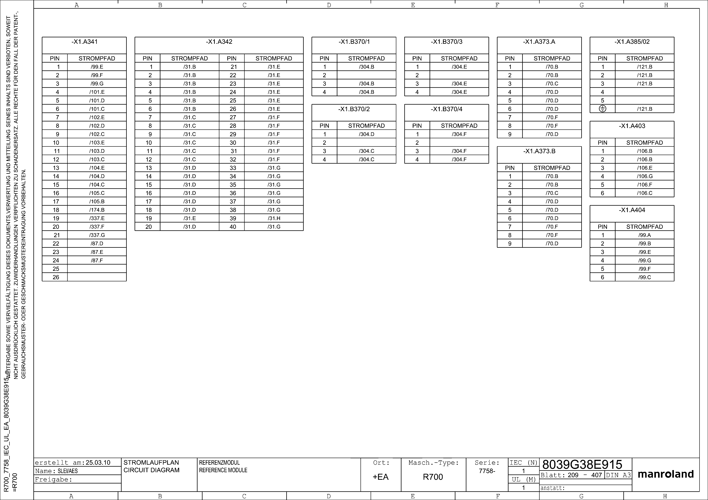

# +EA — Sheet 209 of 407 — REFERENZMODUL

**REFERENCE MODULE**

> Part of the manroland **R700** printing press IEC/UL circuit diagrams.
> Drawing class: **Stromlaufplan / Circuit diagram** (DIN A3).
> Document `+EA` covers the **Printing unit** machine section.

## At a glance

| Field | Value |
|---|---|
| Document | `+EA`  (8039G38E915) |
| Sheet | **209** of 407 |
| Section (DE) | REFERENZMODUL |
| Section (EN) | REFERENCE MODULE |
| Section type | REFERENCE_MODULE — Reference module |
| Machine type | `R700` |
| Series | `7758` |
| Created | 25.03.10 |
| Replaces | — |
| Columns used | A, B, C, D, E, F, G, H |
| Path numbers | — |
| Labels on sheet | 262 |
| Cross-refs out | 110 |
| Cross-refs in | 0 |

**Previous:** [+EA sheet 208](SHEET_0208.md) · **Next:** [+EA sheet 210](SHEET_0210.md) · **Document TOC:** [_TOC.md](_TOC.md)  (+EA) · **Master TOC:** [all sheets](../_MASTER_TOC.md)

## Sheet image (300 DPI, exact vector render)



_Rendered directly from the PDF vector layer at 300 DPI (1-bit), no OCR and no resampling. Use it to confirm anything ambiguous in the text below._

## Cross-references on this sheet

Each entry is a wire leaving this sheet. The printed token is `/sheet.column`; the link resolves to that sheet inside the same document.

| Ref | Target sheet | Col | Path | Destination on target | Target section | From col |
|---|---|---|---|---|---|---|
| `/99.E` | [+EA sheet 99](SHEET_0099.md) | E | — | — | BOGENFÜHRUNGSELEMENT | A |
| `/31.B` | [+EA sheet 31](SHEET_0031.md) | B | — | — | BUSVERBINDUNGEN: SICHERHEITSBUS | B |
| `/31.E` | [+EA sheet 31](SHEET_0031.md) | E | — | — | BUSVERBINDUNGEN: SICHERHEITSBUS | C |
| `/70.B` | [+EA sheet 70](SHEET_0070.md) | B | — | — | AUSLEGERSTAPELMOTOR | G |
| `/304.B` | [+EA sheet 304](SHEET_0304.md) | B | — | — | OPTION: ZWISCHENSTAPEL / | D |
| `/304.E` | [+EA sheet 304](SHEET_0304.md) | E | — | — | OPTION: ZWISCHENSTAPEL / | F |
| `/121.B` | [+EA sheet 121](SHEET_0121.md) | B | — | — | TROCKENBESTÄUBER | H |
| `/31.B` | [+EA sheet 31](SHEET_0031.md) | B | — | — | BUSVERBINDUNGEN: SICHERHEITSBUS | B |
| `/31.E` | [+EA sheet 31](SHEET_0031.md) | E | — | — | BUSVERBINDUNGEN: SICHERHEITSBUS | C |
| `/70.B` | [+EA sheet 70](SHEET_0070.md) | B | — | — | AUSLEGERSTAPELMOTOR | G |
| `/99.F` | [+EA sheet 99](SHEET_0099.md) | F | — | — | BOGENFÜHRUNGSELEMENT | A |
| `/121.B` | [+EA sheet 121](SHEET_0121.md) | B | — | — | TROCKENBESTÄUBER | H |
| `/31.B` | [+EA sheet 31](SHEET_0031.md) | B | — | — | BUSVERBINDUNGEN: SICHERHEITSBUS | B |
| `/31.E` | [+EA sheet 31](SHEET_0031.md) | E | — | — | BUSVERBINDUNGEN: SICHERHEITSBUS | C |
| `/99.G` | [+EA sheet 99](SHEET_0099.md) | G | — | — | BOGENFÜHRUNGSELEMENT | A |
| `/304.B` | [+EA sheet 304](SHEET_0304.md) | B | — | — | OPTION: ZWISCHENSTAPEL / | D |
| `/304.E` | [+EA sheet 304](SHEET_0304.md) | E | — | — | OPTION: ZWISCHENSTAPEL / | F |
| `/121.B` | [+EA sheet 121](SHEET_0121.md) | B | — | — | TROCKENBESTÄUBER | H |
| `/70.C` | [+EA sheet 70](SHEET_0070.md) | C | — | — | AUSLEGERSTAPELMOTOR | G |
| `/31.B` | [+EA sheet 31](SHEET_0031.md) | B | — | — | BUSVERBINDUNGEN: SICHERHEITSBUS | B |
| `/31.E` | [+EA sheet 31](SHEET_0031.md) | E | — | — | BUSVERBINDUNGEN: SICHERHEITSBUS | C |
| `/101.E` | [+EA sheet 101](SHEET_0101.md) | E | — | — | BOGENFÜHRUNGSELEMENT | A |
| `/304.B` | [+EA sheet 304](SHEET_0304.md) | B | — | — | OPTION: ZWISCHENSTAPEL / | D |
| `/304.E` | [+EA sheet 304](SHEET_0304.md) | E | — | — | OPTION: ZWISCHENSTAPEL / | F |
| `/70.D` | [+EA sheet 70](SHEET_0070.md) | D | — | — | AUSLEGERSTAPELMOTOR | G |
| `/31.B` | [+EA sheet 31](SHEET_0031.md) | B | — | — | BUSVERBINDUNGEN: SICHERHEITSBUS | B |
| `/31.E` | [+EA sheet 31](SHEET_0031.md) | E | — | — | BUSVERBINDUNGEN: SICHERHEITSBUS | C |
| `/70.D` | [+EA sheet 70](SHEET_0070.md) | D | — | — | AUSLEGERSTAPELMOTOR | G |
| `/101.D` | [+EA sheet 101](SHEET_0101.md) | D | — | — | BOGENFÜHRUNGSELEMENT | A |
| `/31.B` | [+EA sheet 31](SHEET_0031.md) | B | — | — | BUSVERBINDUNGEN: SICHERHEITSBUS | B |
| `/31.E` | [+EA sheet 31](SHEET_0031.md) | E | — | — | BUSVERBINDUNGEN: SICHERHEITSBUS | C |
| `/121.B` | [+EA sheet 121](SHEET_0121.md) | B | — | — | TROCKENBESTÄUBER | H |
| `/70.D` | [+EA sheet 70](SHEET_0070.md) | D | — | — | AUSLEGERSTAPELMOTOR | G |
| `/101.C` | [+EA sheet 101](SHEET_0101.md) | C | — | — | BOGENFÜHRUNGSELEMENT | A |
| `/102.E` | [+EA sheet 102](SHEET_0102.md) | E | — | — | BOGENFÜHRUNGSELEMENT | A |
| `/31.F` | [+EA sheet 31](SHEET_0031.md) | F | — | — | BUSVERBINDUNGEN: SICHERHEITSBUS | C |
| `/70.F` | [+EA sheet 70](SHEET_0070.md) | F | — | — | AUSLEGERSTAPELMOTOR | G |
| `/31.C` | [+EA sheet 31](SHEET_0031.md) | C | — | — | BUSVERBINDUNGEN: SICHERHEITSBUS | B |
| `/31.F` | [+EA sheet 31](SHEET_0031.md) | F | — | — | BUSVERBINDUNGEN: SICHERHEITSBUS | C |
| `/70.F` | [+EA sheet 70](SHEET_0070.md) | F | — | — | AUSLEGERSTAPELMOTOR | G |
| `/31.C` | [+EA sheet 31](SHEET_0031.md) | C | — | — | BUSVERBINDUNGEN: SICHERHEITSBUS | B |
| `/102.D` | [+EA sheet 102](SHEET_0102.md) | D | — | — | BOGENFÜHRUNGSELEMENT | A |
| `/31.F` | [+EA sheet 31](SHEET_0031.md) | F | — | — | BUSVERBINDUNGEN: SICHERHEITSBUS | C |
| `/304.F` | [+EA sheet 304](SHEET_0304.md) | F | — | — | OPTION: ZWISCHENSTAPEL / | F |
| `/31.C` | [+EA sheet 31](SHEET_0031.md) | C | — | — | BUSVERBINDUNGEN: SICHERHEITSBUS | B |
| `/70.D` | [+EA sheet 70](SHEET_0070.md) | D | — | — | AUSLEGERSTAPELMOTOR | G |
| `/102.C` | [+EA sheet 102](SHEET_0102.md) | C | — | — | BOGENFÜHRUNGSELEMENT | A |
| `/304.D` | [+EA sheet 304](SHEET_0304.md) | D | — | — | OPTION: ZWISCHENSTAPEL / | D |
| `/103.E` | [+EA sheet 103](SHEET_0103.md) | E | — | — | BOGENFÜHRUNGSELEMENT | A |
| `/31.F` | [+EA sheet 31](SHEET_0031.md) | F | — | — | BUSVERBINDUNGEN: SICHERHEITSBUS | C |
| `/31.C` | [+EA sheet 31](SHEET_0031.md) | C | — | — | BUSVERBINDUNGEN: SICHERHEITSBUS | B |
| `/31.F` | [+EA sheet 31](SHEET_0031.md) | F | — | — | BUSVERBINDUNGEN: SICHERHEITSBUS | C |
| `/106.B` | [+EA sheet 106](SHEET_0106.md) | B | — | — | BOGENFÜHRUNGSELEMENT | H |
| `/304.F` | [+EA sheet 304](SHEET_0304.md) | F | — | — | OPTION: ZWISCHENSTAPEL / | F |
| `/31.C` | [+EA sheet 31](SHEET_0031.md) | C | — | — | BUSVERBINDUNGEN: SICHERHEITSBUS | B |
| `/103.D` | [+EA sheet 103](SHEET_0103.md) | D | — | — | BOGENFÜHRUNGSELEMENT | A |
| `/304.C` | [+EA sheet 304](SHEET_0304.md) | C | — | — | OPTION: ZWISCHENSTAPEL / | D |
| `/31.F` | [+EA sheet 31](SHEET_0031.md) | F | — | — | BUSVERBINDUNGEN: SICHERHEITSBUS | C |
| `/106.B` | [+EA sheet 106](SHEET_0106.md) | B | — | — | BOGENFÜHRUNGSELEMENT | H |
| `/304.F` | [+EA sheet 304](SHEET_0304.md) | F | — | — | OPTION: ZWISCHENSTAPEL / | F |
| `/31.C` | [+EA sheet 31](SHEET_0031.md) | C | — | — | BUSVERBINDUNGEN: SICHERHEITSBUS | B |
| `/103.C` | [+EA sheet 103](SHEET_0103.md) | C | — | — | BOGENFÜHRUNGSELEMENT | A |
| `/304.C` | [+EA sheet 304](SHEET_0304.md) | C | — | — | OPTION: ZWISCHENSTAPEL / | D |
| `/104.E` | [+EA sheet 104](SHEET_0104.md) | E | — | — | BOGENFÜHRUNGSELEMENT | A |
| `/31.G` | [+EA sheet 31](SHEET_0031.md) | G | — | — | BUSVERBINDUNGEN: SICHERHEITSBUS | C |
| `/106.E` | [+EA sheet 106](SHEET_0106.md) | E | — | — | BOGENFÜHRUNGSELEMENT | H |
| `/31.D` | [+EA sheet 31](SHEET_0031.md) | D | — | — | BUSVERBINDUNGEN: SICHERHEITSBUS | B |
| `/70.B` | [+EA sheet 70](SHEET_0070.md) | B | — | — | AUSLEGERSTAPELMOTOR | G |
| `/31.G` | [+EA sheet 31](SHEET_0031.md) | G | — | — | BUSVERBINDUNGEN: SICHERHEITSBUS | C |
| `/31.D` | [+EA sheet 31](SHEET_0031.md) | D | — | — | BUSVERBINDUNGEN: SICHERHEITSBUS | B |
| `/106.G` | [+EA sheet 106](SHEET_0106.md) | G | — | — | BOGENFÜHRUNGSELEMENT | H |
| `/104.D` | [+EA sheet 104](SHEET_0104.md) | D | — | — | BOGENFÜHRUNGSELEMENT | A |
| `/70.B` | [+EA sheet 70](SHEET_0070.md) | B | — | — | AUSLEGERSTAPELMOTOR | G |
| `/31.G` | [+EA sheet 31](SHEET_0031.md) | G | — | — | BUSVERBINDUNGEN: SICHERHEITSBUS | C |
| `/106.F` | [+EA sheet 106](SHEET_0106.md) | F | — | — | BOGENFÜHRUNGSELEMENT | H |
| `/31.D` | [+EA sheet 31](SHEET_0031.md) | D | — | — | BUSVERBINDUNGEN: SICHERHEITSBUS | B |
| `/104.C` | [+EA sheet 104](SHEET_0104.md) | C | — | — | BOGENFÜHRUNGSELEMENT | A |
| `/31.G` | [+EA sheet 31](SHEET_0031.md) | G | — | — | BUSVERBINDUNGEN: SICHERHEITSBUS | C |
| `/105.C` | [+EA sheet 105](SHEET_0105.md) | C | — | — | BOGENFÜHRUNGSELEMENT | A |
| `/31.D` | [+EA sheet 31](SHEET_0031.md) | D | — | — | BUSVERBINDUNGEN: SICHERHEITSBUS | B |
| `/70.C` | [+EA sheet 70](SHEET_0070.md) | C | — | — | AUSLEGERSTAPELMOTOR | G |
| `/106.C` | [+EA sheet 106](SHEET_0106.md) | C | — | — | BOGENFÜHRUNGSELEMENT | H |
| `/105.B` | [+EA sheet 105](SHEET_0105.md) | B | — | — | BOGENFÜHRUNGSELEMENT | A |
| `/31.G` | [+EA sheet 31](SHEET_0031.md) | G | — | — | BUSVERBINDUNGEN: SICHERHEITSBUS | C |
| `/31.D` | [+EA sheet 31](SHEET_0031.md) | D | — | — | BUSVERBINDUNGEN: SICHERHEITSBUS | B |
| `/70.D` | [+EA sheet 70](SHEET_0070.md) | D | — | — | AUSLEGERSTAPELMOTOR | G |
| `/174.B` | [+EA sheet 174](SHEET_0174.md) | B | — | — | RESERVE | A |
| `/31.G` | [+EA sheet 31](SHEET_0031.md) | G | — | — | BUSVERBINDUNGEN: SICHERHEITSBUS | C |
| `/31.D` | [+EA sheet 31](SHEET_0031.md) | D | — | — | BUSVERBINDUNGEN: SICHERHEITSBUS | B |
| `/70.D` | [+EA sheet 70](SHEET_0070.md) | D | — | — | AUSLEGERSTAPELMOTOR | G |
| `/31.E` | [+EA sheet 31](SHEET_0031.md) | E | — | — | BUSVERBINDUNGEN: SICHERHEITSBUS | B |
| `/337.E` | [+EA sheet 337](SHEET_0337.md) | E | — | — | OPTION: BOGENWEICHE | A |
| `/31.H` | [+EA sheet 31](SHEET_0031.md) | H | — | — | BUSVERBINDUNGEN: SICHERHEITSBUS | C |
| `/70.D` | [+EA sheet 70](SHEET_0070.md) | D | — | — | AUSLEGERSTAPELMOTOR | G |
| `/70.F` | [+EA sheet 70](SHEET_0070.md) | F | — | — | AUSLEGERSTAPELMOTOR | G |
| `/337.F` | [+EA sheet 337](SHEET_0337.md) | F | — | — | OPTION: BOGENWEICHE | A |
| `/31.G` | [+EA sheet 31](SHEET_0031.md) | G | — | — | BUSVERBINDUNGEN: SICHERHEITSBUS | C |
| `/31.D` | [+EA sheet 31](SHEET_0031.md) | D | — | — | BUSVERBINDUNGEN: SICHERHEITSBUS | B |
| `/99.A` | [+EA sheet 99](SHEET_0099.md) | A | — | — | BOGENFÜHRUNGSELEMENT | H |
| `/70.F` | [+EA sheet 70](SHEET_0070.md) | F | — | — | AUSLEGERSTAPELMOTOR | G |
| `/337.G` | [+EA sheet 337](SHEET_0337.md) | G | — | — | OPTION: BOGENWEICHE | A |
| `/99.B` | [+EA sheet 99](SHEET_0099.md) | B | — | — | BOGENFÜHRUNGSELEMENT | H |
| `/87.D` | [+EA sheet 87](SHEET_0087.md) | D | — | — | SAUGWALZE | A |
| `/70.D` | [+EA sheet 70](SHEET_0070.md) | D | — | — | AUSLEGERSTAPELMOTOR | G |
| `/87.E` | [+EA sheet 87](SHEET_0087.md) | E | — | — | SAUGWALZE | A |
| `/99.E` | [+EA sheet 99](SHEET_0099.md) | E | — | — | BOGENFÜHRUNGSELEMENT | H |
| `/87.F` | [+EA sheet 87](SHEET_0087.md) | F | — | — | SAUGWALZE | A |
| `/99.G` | [+EA sheet 99](SHEET_0099.md) | G | — | — | BOGENFÜHRUNGSELEMENT | H |
| `/99.F` | [+EA sheet 99](SHEET_0099.md) | F | — | — | BOGENFÜHRUNGSELEMENT | H |
| `/99.C` | [+EA sheet 99](SHEET_0099.md) | C | — | — | BOGENFÜHRUNGSELEMENT | H |

## Devices on this sheet

| Tag | Class | Class meaning (IEC) | Col | Sub | Terminal | Sign |
|---|---|---|---|---|---|---|
| `X1.A341` | — | cross-device reference | A | — | — | — |
| `X1.A342` | — | cross-device reference | C | — | — | — |
| `X1.A373.A` | — | cross-device reference | F | — | — | — |
| `X1.A373.B` | — | cross-device reference | G | — | — | — |
| `X1.A403` | — | cross-device reference | H | — | — | — |
| `X1.A404` | — | cross-device reference | H | — | — | — |

## Potentials / nets

_No named potentials on this sheet._

## Wire-end annotations (grouped as printed)

A wire that continues elsewhere is annotated with a small cluster: the destination description, the path/line number `#NN`, and the `/sheet.column` cross reference. Each row below is one such cluster exactly as it is grouped on the drawing.

| Col | Y | Path | Cross-ref | Text on the wire |
|---|---|---|---|---|
| A | 65.5 | — | — | `X1.A341` |
| C | 65.5 | — | — | `X1.A342` |
| D | 65.5 | — | — | `X1.B370/1` |
| E | 65.5 | — | — | `X1.B370/3` |
| F | 65.5 | — | — | `X1.A373.A` |
| H | 65.5 | — | — | `X1.A385/02` |
| A | 94.2 | — | — | `PIN STROMPFAD` |
| B | 94.2 | — | — | `PIN STROMPFAD` |
| C | 94.2 | — | — | `PIN STROMPFAD` |
| D | 94.2 | — | — | `PIN 2 3 4 1 STROMPFAD` |
| E | 94.2 | — | — | `PIN 2 3 4 1 STROMPFAD` |
| F | 94.2 | — | — | `PIN 2 3 4 5 6 7 8 9 1 STROMPFAD` |
| H | 94.2 | — | — | `PIN 2 3 4 5 1 STROMPFAD` |
| A | 108.4 | — | — | `2 3 4 5 6 7 8 9 1` |
| B | 108.4 | — | — | `2 3 4 5 6 7 8 9 1` |
| C | 108.4 | — | — | `22 21` |
| A | 108.7 | — | `/99.E` | — |
| B | 108.7 | — | `/31.B` | — |
| C | 108.7 | — | `/31.E` | — |
| D | 108.7 | — | `/304.B` | — |
| F | 108.7 | — | `/304.E` | — |
| G | 108.7 | — | `/70.B` | — |
| H | 108.7 | — | `/121.B` | — |
| B | 122.8 | — | `/31.B` | — |
| C | 122.8 | — | `/31.E` | — |
| G | 122.8 | — | `/70.B` | — |
| A | 122.9 | — | `/99.F` | — |
| H | 122.9 | — | `/121.B` | — |
| C | 136.7 | — | — | `23 24 25 26 27 28 29 30 32 33 34 35 36 37 38 39 40 31` |
| A | 137.0 | — | `/99.G` | — |
| B | 137.0 | — | `/31.B` | — |
| C | 137.0 | — | `/31.E` | — |
| D | 137.0 | — | `/304.B` | — |
| F | 137.0 | — | `/304.E` | — |
| H | 137.0 | — | `/121.B` | — |
| G | 137.1 | — | `/70.C` | — |
| A | 151.2 | — | `/101.E` | — |
| B | 151.2 | — | `/31.B` | — |
| C | 151.2 | — | `/31.E` | — |
| D | 151.2 | — | `/304.B` | — |
| F | 151.2 | — | `/304.E` | — |
| G | 151.2 | — | `/70.D` | — |
| A | 165.4 | — | `/101.D` | — |
| B | 165.4 | — | `/31.B` | — |
| C | 165.4 | — | `/31.E` | — |
| G | 165.4 | — | `/70.D` | — |
| D | 178.9 | — | — | `X1.B370/2` |
| E | 178.9 | — | — | `X1.B370/4` |
| B | 179.5 | — | `/31.B` | — |
| C | 179.5 | — | `/31.E` | — |
| A | 179.6 | — | `/101.C` | — |
| G | 179.6 | — | `/70.D` | — |
| H | 179.6 | — | `/121.B` | — |
| A | 193.7 | — | `/102.E` | — |
| C | 193.7 | — | `/31.F` | — |
| G | 193.7 | — | `/70.F` | — |
| B | 193.8 | — | `/31.C` | — |
| H | 207.2 | — | — | `X1.A403` |
| D | 207.5 | — | — | `PIN 2 3 4 1 STROMPFAD` |
| E | 207.5 | — | — | `PIN 2 3 4 1 STROMPFAD` |
| A | 207.9 | — | `/102.D` | — |
| B | 207.9 | — | `/31.C` | — |
| C | 207.9 | — | `/31.F` | — |
| G | 207.9 | — | `/70.F` | — |
| A | 222.1 | — | `/102.C` | — |
| B | 222.1 | — | `/31.C` | — |
| C | 222.1 | — | `/31.F` | — |
| D | 222.1 | — | `/304.D` | — |
| F | 222.1 | — | `/304.F` | — |
| G | 222.1 | — | `/70.D` | — |
| A | 235.9 | — | — | `10 12 13 14 15 16 17 18 19 20 11` |
| B | 235.9 | — | — | `10 12 13 14 15 16 17 18 19 11` |
| H | 235.9 | — | — | `PIN 2 3 4 5 6 1 STROMPFAD` |
| A | 236.2 | — | `/103.E` | — |
| C | 236.2 | — | `/31.F` | — |
| B | 236.3 | — | `/31.C` | — |
| G | 249.8 | — | — | `X1.A373.B` |
| A | 250.4 | — | `/103.D` | — |
| B | 250.4 | — | `/31.C` | — |
| C | 250.4 | — | `/31.F` | — |
| D | 250.4 | — | `/304.C` | — |
| F | 250.4 | — | `/304.F` | — |
| H | 250.4 | — | `/106.B` | — |
| A | 264.6 | — | `/103.C` | — |
| B | 264.6 | — | `/31.C` | — |
| C | 264.6 | — | `/31.F` | — |
| D | 264.6 | — | `/304.C` | — |
| F | 264.6 | — | `/304.F` | — |
| H | 264.6 | — | `/106.B` | — |
| F | 278.4 | — | — | `PIN 2 3 4 5 6 7 8 9 1 STROMPFAD` |
| A | 278.8 | — | `/104.E` | — |
| B | 278.8 | — | `/31.D` | — |
| C | 278.8 | — | `/31.G` | — |
| H | 278.8 | — | `/106.E` | — |
| C | 292.9 | — | `/31.G` | — |
| G | 292.9 | — | `/70.B` | — |
| A | 293.0 | — | `/104.D` | — |
| B | 293.0 | — | `/31.D` | — |
| H | 293.0 | — | `/106.G` | — |
| A | 307.1 | — | `/104.C` | — |
| B | 307.1 | — | `/31.D` | — |
| C | 307.1 | — | `/31.G` | — |
| G | 307.1 | — | `/70.B` | — |
| H | 307.1 | — | `/106.F` | — |
| A | 321.3 | — | `/105.C` | — |
| B | 321.3 | — | `/31.D` | — |
| C | 321.3 | — | `/31.G` | — |
| G | 321.3 | — | `/70.C` | — |
| H | 321.3 | — | `/106.C` | — |
| A | 335.5 | — | `/105.B` | — |
| B | 335.5 | — | `/31.D` | — |
| C | 335.5 | — | `/31.G` | — |
| G | 335.5 | — | `/70.D` | — |
| H | 349.0 | — | — | `X1.A404` |
| A | 349.6 | — | `/174.B` | — |
| B | 349.6 | — | `/31.D` | — |
| C | 349.6 | — | `/31.G` | — |
| G | 349.6 | — | `/70.D` | — |
| A | 363.8 | — | `/337.E` | — |
| B | 363.8 | — | `/31.E` | — |
| C | 363.8 | — | `/31.H` | — |
| G | 363.8 | — | `/70.D` | — |
| H | 377.6 | — | — | `PIN 2 3 4 5 6 1 STROMPFAD` |
| B | 377.7 | — | — | `20` |
| A | 378.0 | — | `/337.F` | — |
| B | 378.0 | — | `/31.D` | — |
| C | 378.0 | — | `/31.G` | — |
| G | 378.0 | — | `/70.F` | — |
| A | 391.8 | — | — | `22 23 24 25 26 21` |
| G | 392.1 | — | `/70.F` | — |
| H | 392.1 | — | `/99.A` | — |
| A | 392.2 | — | `/337.G` | — |
| A | 406.3 | — | `/87.D` | — |
| G | 406.3 | — | `/70.D` | — |
| H | 406.3 | — | `/99.B` | — |
| A | 420.5 | — | `/87.E` | — |
| H | 420.5 | — | `/99.E` | — |
| A | 434.7 | — | `/87.F` | — |
| H | 434.7 | — | `/99.G` | — |
| H | 448.8 | — | `/99.F` | — |
| H | 463.0 | — | `/99.C` | — |


## Reconstructed tables

This sheet carries tabular content (pin map / terminal assignment / index). The grid below was rebuilt from the drawing's own rule lines, so each row is exactly one physical row of the table.

### Table 1 — 26 data rows × 2 columns (at x=70.9, y=62.4) — **X1.A341**

| PIN | STROMPFAD |
|---|---|
| `1` | `/99.E` |
| `2` | `/99.F` |
| `3` | `/99.G` |
| `4` | `/101.E` |
| `5` | `/101.D` |
| `6` | `/101.C` |
| `7` | `/102.E` |
| `8` | `/102.D` |
| `9` | `/102.C` |
| `10` | `/103.E` |
| `11` | `/103.D` |
| `12` | `/103.C` |
| `13` | `/104.E` |
| `14` | `/104.D` |
| `15` | `/104.C` |
| `16` | `/105.C` |
| `17` | `/105.B` |
| `18` | `/174.B` |
| `19` | `/337.E` |
| `20` | `/337.F` |
| `21` | `/337.G` |
| `22` | `/87.D` |
| `23` | `/87.E` |
| `24` | `/87.F` |
| `25` |  |
| `26` |  |


### Table 2 — 20 data rows × 4 columns (at x=226.8, y=62.4) — **X1.A342**

| PIN | STROMPFAD | PIN | STROMPFAD |
|---|---|---|---|
| `1` | `/31.B` | `21` | `/31.E` |
| `2` | `/31.B` | `22` | `/31.E` |
| `3` | `/31.B` | `23` | `/31.E` |
| `4` | `/31.B` | `24` | `/31.E` |
| `5` | `/31.B` | `25` | `/31.E` |
| `6` | `/31.B` | `26` | `/31.E` |
| `7` | `/31.C` | `27` | `/31.F` |
| `8` | `/31.C` | `28` | `/31.F` |
| `9` | `/31.C` | `29` | `/31.F` |
| `10` | `/31.C` | `30` | `/31.F` |
| `11` | `/31.C` | `31` | `/31.F` |
| `12` | `/31.C` | `32` | `/31.F` |
| `13` | `/31.D` | `33` | `/31.G` |
| `14` | `/31.D` | `34` | `/31.G` |
| `15` | `/31.D` | `35` | `/31.G` |
| `16` | `/31.D` | `36` | `/31.G` |
| `17` | `/31.D` | `37` | `/31.G` |
| `18` | `/31.D` | `38` | `/31.G` |
| `19` | `/31.E` | `39` | `/31.H` |
| `20` | `/31.D` | `40` | `/31.G` |


### Table 3 — 10 data rows × 2 columns (at x=524.4, y=62.4) — **X1.B370/1**

| PIN | STROMPFAD |
|---|---|
| `1` | `/304.B` |
| `2` |  |
| `3` | `/304.B` |
| `4` | `/304.B` |
|  | `X1.B370/2` |
| `PIN` | `STROMPFAD` |
| `1` | `/304.D` |
| `2` |  |
| `3` | `/304.C` |
| `4` | `/304.C` |


### Table 4 — 10 data rows × 2 columns (at x=680.3, y=62.4) — **X1.B370/3**

| PIN | STROMPFAD |
|---|---|
| `1` | `/304.E` |
| `2` |  |
| `3` | `/304.E` |
| `4` | `/304.E` |
|  | `X1.B370/4` |
| `PIN` | `STROMPFAD` |
| `1` | `/304.F` |
| `2` |  |
| `3` | `/304.F` |
| `4` | `/304.F` |


### Table 5 — 20 data rows × 2 columns (at x=836.2, y=62.4) — **X1.A373.A**

| PIN | STROMPFAD |
|---|---|
| `1` | `/70.B` |
| `2` | `/70.B` |
| `3` | `/70.C` |
| `4` | `/70.D` |
| `5` | `/70.D` |
| `6` | `/70.D` |
| `7` | `/70.F` |
| `8` | `/70.F` |
| `9` | `/70.D` |
|  | `X1.A373.B` |
| `PIN` | `STROMPFAD` |
| `1` | `/70.B` |
| `2` | `/70.B` |
| `3` | `/70.C` |
| `4` | `/70.D` |
| `5` | `/70.D` |
| `6` | `/70.D` |
| `7` | `/70.F` |
| `8` | `/70.F` |
| `9` | `/70.D` |


### Table 6 — 22 data rows × 2 columns (at x=992.1, y=62.4) — **X1.A385/02**

| PIN | STROMPFAD |
|---|---|
| `1` | `/121.B` |
| `2` | `/121.B` |
| `3` | `/121.B` |
| `4` |  |
| `5` |  |
|  | `/121.B` |
|  | `X1.A403` |
| `PIN` | `STROMPFAD` |
| `1` | `/106.B` |
| `2` | `/106.B` |
| `3` | `/106.E` |
| `4` | `/106.G` |
| `5` | `/106.F` |
| `6` | `/106.C` |
|  | `X1.A404` |
| `PIN` | `STROMPFAD` |
| `1` | `/99.A` |
| `2` | `/99.B` |
| `3` | `/99.E` |
| `4` | `/99.G` |
| `5` | `/99.F` |
| `6` | `/99.C` |


## Notes and free text on this sheet

| Text | Col | Y (pt) |
|---|---|---|
| `PIN` | A | 94.2 |
| `STROMPFAD` | A | 94.15 |
| `PIN` | B | 94.2 |
| `STROMPFAD` | B | 94.15 |
| `PIN` | C | 94.2 |
| `STROMPFAD` | C | 94.15 |
| `PIN` | D | 94.2 |
| `STROMPFAD` | D | 94.15 |
| `X1.B370/1` | D | 65.51 |
| `X1.B370/2` | D | 178.9 |
| `PIN` | E | 94.2 |
| `STROMPFAD` | F | 94.15 |
| `X1.B370/3` | E | 65.51 |
| `X1.B370/4` | E | 178.9 |
| `PIN` | F | 94.2 |
| `STROMPFAD` | G | 94.15 |
| `PIN` | G | 94.2 |
| `STROMPFAD` | H | 94.15 |
| `X1.A385/02` | H | 65.51 |

## Complete label inventory (exact text from the drawing)

Every text object inside the drawing area of this sheet, in DIN reading order (column A→H, then top→bottom). This is the authoritative list: if a string is not here it is not printed on this sheet.

| Col | Y | X | Dir | Type | Text |
|---|---|---|---|---|---|
| A | 65.5 | 120.5 | → | device ref | `X1.A341` |
| A | 94.2 | 84.0 | → | text | `PIN` |
| A | 94.2 | 132.2 | → | text | `STROMPFAD` |
| A | 108.4 | 95.8 | → | number | `1` |
| A | 108.7 | 152.9 | → | cross-reference | `/99.E` |
| A | 122.5 | 94.1 | → | number | `2` |
| A | 122.9 | 153.1 | → | cross-reference | `/99.F` |
| A | 136.7 | 94.1 | → | number | `3` |
| A | 137.0 | 152.5 | → | cross-reference | `/99.G` |
| A | 150.9 | 94.1 | → | number | `4` |
| A | 151.2 | 150.5 | → | cross-reference | `/101.E` |
| A | 165.1 | 94.1 | → | number | `5` |
| A | 165.4 | 150.2 | → | cross-reference | `/101.D` |
| A | 179.2 | 94.1 | → | number | `6` |
| A | 179.6 | 150.2 | → | cross-reference | `/101.C` |
| A | 193.4 | 94.1 | → | number | `7` |
| A | 193.7 | 150.5 | → | cross-reference | `/102.E` |
| A | 207.6 | 94.1 | → | number | `8` |
| A | 207.9 | 150.2 | → | cross-reference | `/102.D` |
| A | 221.8 | 94.1 | → | number | `9` |
| A | 222.1 | 150.2 | → | cross-reference | `/102.C` |
| A | 235.9 | 88.7 | → | number | `10` |
| A | 236.2 | 150.5 | → | cross-reference | `/103.E` |
| A | 250.1 | 90.4 | → | number | `11` |
| A | 250.4 | 150.2 | → | cross-reference | `/103.D` |
| A | 264.3 | 88.7 | → | number | `12` |
| A | 264.6 | 150.2 | → | cross-reference | `/103.C` |
| A | 278.5 | 88.7 | → | number | `13` |
| A | 278.8 | 150.5 | → | cross-reference | `/104.E` |
| A | 292.6 | 88.7 | → | number | `14` |
| A | 293.0 | 150.2 | → | cross-reference | `/104.D` |
| A | 306.8 | 88.7 | → | number | `15` |
| A | 307.1 | 150.2 | → | cross-reference | `/104.C` |
| A | 321.0 | 88.7 | → | number | `16` |
| A | 321.3 | 150.2 | → | cross-reference | `/105.C` |
| A | 335.1 | 88.7 | → | number | `17` |
| A | 335.5 | 150.4 | → | cross-reference | `/105.B` |
| A | 349.3 | 88.7 | → | number | `18` |
| A | 349.6 | 150.4 | → | cross-reference | `/174.B` |
| A | 363.5 | 88.7 | → | number | `19` |
| A | 363.8 | 150.5 | → | cross-reference | `/337.E` |
| A | 377.7 | 88.7 | → | number | `20` |
| A | 378.0 | 150.7 | → | cross-reference | `/337.F` |
| A | 391.8 | 90.4 | → | number | `21` |
| A | 392.2 | 150.1 | → | cross-reference | `/337.G` |
| A | 406.0 | 88.7 | → | number | `22` |
| A | 406.3 | 152.6 | → | cross-reference | `/87.D` |
| A | 420.2 | 88.7 | → | number | `23` |
| A | 420.5 | 152.9 | → | cross-reference | `/87.E` |
| A | 434.4 | 88.7 | → | number | `24` |
| A | 434.7 | 153.1 | → | cross-reference | `/87.F` |
| A | 448.5 | 88.7 | → | number | `25` |
| A | 462.7 | 88.7 | → | number | `26` |
| B | 94.2 | 240.0 | → | text | `PIN` |
| B | 94.2 | 288.1 | → | text | `STROMPFAD` |
| B | 108.4 | 251.7 | → | number | `1` |
| B | 108.7 | 308.7 | → | cross-reference | `/31.B` |
| B | 122.5 | 250.0 | → | number | `2` |
| B | 122.8 | 308.7 | → | cross-reference | `/31.B` |
| B | 136.7 | 250.0 | → | number | `3` |
| B | 137.0 | 308.7 | → | cross-reference | `/31.B` |
| B | 150.9 | 250.0 | → | number | `4` |
| B | 151.2 | 308.7 | → | cross-reference | `/31.B` |
| B | 165.1 | 250.0 | → | number | `5` |
| B | 165.4 | 308.7 | → | cross-reference | `/31.B` |
| B | 179.2 | 250.0 | → | number | `6` |
| B | 179.5 | 308.7 | → | cross-reference | `/31.B` |
| B | 193.4 | 250.0 | → | number | `7` |
| B | 193.7 | 308.6 | → | cross-reference | `/31.C` |
| B | 207.6 | 250.0 | → | number | `8` |
| B | 207.9 | 308.6 | → | cross-reference | `/31.C` |
| B | 221.8 | 250.0 | → | number | `9` |
| B | 222.1 | 308.6 | → | cross-reference | `/31.C` |
| B | 235.9 | 244.6 | → | number | `10` |
| B | 236.3 | 308.6 | → | cross-reference | `/31.C` |
| B | 250.1 | 246.3 | → | number | `11` |
| B | 250.4 | 308.6 | → | cross-reference | `/31.C` |
| B | 264.3 | 244.6 | → | number | `12` |
| B | 264.6 | 308.6 | → | cross-reference | `/31.C` |
| B | 278.5 | 244.6 | → | number | `13` |
| B | 278.8 | 308.6 | → | cross-reference | `/31.D` |
| B | 292.6 | 244.6 | → | number | `14` |
| B | 293.0 | 308.6 | → | cross-reference | `/31.D` |
| B | 306.8 | 244.6 | → | number | `15` |
| B | 307.1 | 308.6 | → | cross-reference | `/31.D` |
| B | 321.0 | 244.6 | → | number | `16` |
| B | 321.3 | 308.6 | → | cross-reference | `/31.D` |
| B | 335.1 | 244.6 | → | number | `17` |
| B | 335.5 | 308.6 | → | cross-reference | `/31.D` |
| B | 349.3 | 244.6 | → | number | `18` |
| B | 349.7 | 308.6 | → | cross-reference | `/31.D` |
| B | 363.5 | 244.6 | → | number | `19` |
| B | 363.8 | 308.8 | → | cross-reference | `/31.E` |
| B | 377.7 | 244.6 | → | number | `20` |
| B | 378.0 | 308.6 | → | cross-reference | `/31.D` |
| C | 65.5 | 346.5 | → | device ref | `X1.A342` |
| C | 94.2 | 381.7 | → | text | `PIN` |
| C | 94.2 | 429.9 | → | text | `STROMPFAD` |
| C | 108.4 | 388.1 | → | number | `21` |
| C | 108.7 | 450.6 | → | cross-reference | `/31.E` |
| C | 122.5 | 386.4 | → | number | `22` |
| C | 122.8 | 450.6 | → | cross-reference | `/31.E` |
| C | 136.7 | 386.4 | → | number | `23` |
| C | 137.0 | 450.6 | → | cross-reference | `/31.E` |
| C | 150.9 | 386.4 | → | number | `24` |
| C | 151.2 | 450.6 | → | cross-reference | `/31.E` |
| C | 165.1 | 386.4 | → | number | `25` |
| C | 165.4 | 450.6 | → | cross-reference | `/31.E` |
| C | 179.2 | 386.4 | → | number | `26` |
| C | 179.5 | 450.6 | → | cross-reference | `/31.E` |
| C | 193.4 | 386.4 | → | number | `27` |
| C | 193.7 | 450.7 | → | cross-reference | `/31.F` |
| C | 207.6 | 386.4 | → | number | `28` |
| C | 207.9 | 450.7 | → | cross-reference | `/31.F` |
| C | 221.8 | 386.4 | → | number | `29` |
| C | 222.1 | 450.7 | → | cross-reference | `/31.F` |
| C | 235.9 | 386.4 | → | number | `30` |
| C | 236.2 | 450.7 | → | cross-reference | `/31.F` |
| C | 250.1 | 388.1 | → | number | `31` |
| C | 250.4 | 450.7 | → | cross-reference | `/31.F` |
| C | 264.3 | 386.4 | → | number | `32` |
| C | 264.6 | 450.7 | → | cross-reference | `/31.F` |
| C | 278.5 | 386.4 | → | number | `33` |
| C | 278.8 | 450.1 | → | cross-reference | `/31.G` |
| C | 292.6 | 386.4 | → | number | `34` |
| C | 292.9 | 450.1 | → | cross-reference | `/31.G` |
| C | 306.8 | 386.4 | → | number | `35` |
| C | 307.1 | 450.1 | → | cross-reference | `/31.G` |
| C | 321.0 | 386.4 | → | number | `36` |
| C | 321.3 | 450.1 | → | cross-reference | `/31.G` |
| C | 335.1 | 386.4 | → | number | `37` |
| C | 335.5 | 450.1 | → | cross-reference | `/31.G` |
| C | 349.3 | 386.4 | → | number | `38` |
| C | 349.6 | 450.1 | → | cross-reference | `/31.G` |
| C | 363.5 | 386.4 | → | number | `39` |
| C | 363.8 | 450.6 | → | cross-reference | `/31.H` |
| C | 377.7 | 386.4 | → | number | `40` |
| C | 378.0 | 450.1 | → | cross-reference | `/31.G` |
| D | 65.5 | 569.6 | → | text | `X1.B370/1` |
| D | 94.2 | 537.6 | → | text | `PIN` |
| D | 94.2 | 585.8 | → | text | `STROMPFAD` |
| D | 108.4 | 543.5 | → | number | `1` |
| D | 108.7 | 603.9 | → | cross-reference | `/304.B` |
| D | 122.5 | 543.0 | → | number | `2` |
| D | 136.7 | 543.0 | → | number | `3` |
| D | 137.0 | 603.9 | → | cross-reference | `/304.B` |
| D | 150.9 | 543.0 | → | number | `4` |
| D | 151.2 | 603.9 | → | cross-reference | `/304.B` |
| D | 178.9 | 568.9 | → | text | `X1.B370/2` |
| D | 207.5 | 585.8 | → | text | `STROMPFAD` |
| D | 207.6 | 537.6 | → | text | `PIN` |
| D | 221.8 | 543.5 | → | number | `1` |
| D | 222.1 | 603.8 | → | cross-reference | `/304.D` |
| D | 235.9 | 543.0 | → | number | `2` |
| D | 250.1 | 543.0 | → | number | `3` |
| D | 250.4 | 603.8 | → | cross-reference | `/304.C` |
| D | 264.3 | 543.0 | → | number | `4` |
| D | 264.6 | 603.8 | → | cross-reference | `/304.C` |
| E | 65.5 | 724.8 | → | text | `X1.B370/3` |
| E | 94.2 | 693.5 | → | text | `PIN` |
| E | 108.4 | 699.4 | → | number | `1` |
| E | 122.5 | 698.9 | → | number | `2` |
| E | 136.7 | 698.9 | → | number | `3` |
| E | 150.9 | 698.9 | → | number | `4` |
| E | 178.9 | 724.8 | → | text | `X1.B370/4` |
| E | 207.6 | 693.5 | → | text | `PIN` |
| E | 221.8 | 699.4 | → | number | `1` |
| E | 235.9 | 698.9 | → | number | `2` |
| E | 250.1 | 698.9 | → | number | `3` |
| E | 264.3 | 698.9 | → | number | `4` |
| F | 65.5 | 879.7 | → | device ref | `X1.A373.A` |
| F | 94.2 | 741.7 | → | text | `STROMPFAD` |
| F | 94.2 | 849.4 | → | text | `PIN` |
| F | 108.4 | 855.4 | → | number | `1` |
| F | 108.7 | 760.0 | → | cross-reference | `/304.E` |
| F | 122.5 | 854.8 | → | number | `2` |
| F | 136.7 | 854.8 | → | number | `3` |
| F | 137.0 | 760.0 | → | cross-reference | `/304.E` |
| F | 150.9 | 854.8 | → | number | `4` |
| F | 151.2 | 760.0 | → | cross-reference | `/304.E` |
| F | 165.1 | 854.8 | → | number | `5` |
| F | 179.2 | 854.8 | → | number | `6` |
| F | 193.4 | 854.8 | → | number | `7` |
| F | 207.5 | 741.7 | → | text | `STROMPFAD` |
| F | 207.6 | 854.8 | → | number | `8` |
| F | 221.8 | 854.8 | → | number | `9` |
| F | 222.1 | 760.1 | → | cross-reference | `/304.F` |
| F | 250.4 | 760.1 | → | cross-reference | `/304.F` |
| F | 264.6 | 760.1 | → | cross-reference | `/304.F` |
| F | 278.4 | 849.4 | → | text | `PIN` |
| F | 292.6 | 855.4 | → | number | `1` |
| F | 306.8 | 854.8 | → | number | `2` |
| F | 321.0 | 854.8 | → | number | `3` |
| F | 335.1 | 854.8 | → | number | `4` |
| F | 349.3 | 854.8 | → | number | `5` |
| F | 363.5 | 854.8 | → | number | `6` |
| F | 377.7 | 854.8 | → | number | `7` |
| F | 391.8 | 854.8 | → | number | `8` |
| F | 406.0 | 854.8 | → | number | `9` |
| G | 94.2 | 897.6 | → | text | `STROMPFAD` |
| G | 94.2 | 1005.3 | → | text | `PIN` |
| G | 108.4 | 1011.3 | → | number | `1` |
| G | 108.7 | 918.1 | → | cross-reference | `/70.B` |
| G | 122.5 | 1010.7 | → | number | `2` |
| G | 122.8 | 918.1 | → | cross-reference | `/70.B` |
| G | 136.7 | 1010.7 | → | number | `3` |
| G | 137.1 | 918.0 | → | cross-reference | `/70.C` |
| G | 150.9 | 1010.7 | → | number | `4` |
| G | 151.2 | 918.0 | → | cross-reference | `/70.D` |
| G | 165.1 | 1010.7 | → | number | `5` |
| G | 165.4 | 918.0 | → | cross-reference | `/70.D` |
| G | 179.6 | 918.0 | → | cross-reference | `/70.D` |
| G | 193.7 | 918.4 | → | cross-reference | `/70.F` |
| G | 207.9 | 918.4 | → | cross-reference | `/70.F` |
| G | 222.1 | 918.0 | → | cross-reference | `/70.D` |
| G | 235.9 | 1005.3 | → | text | `PIN` |
| G | 249.8 | 880.2 | → | device ref | `X1.A373.B` |
| G | 250.1 | 1011.3 | → | number | `1` |
| G | 264.3 | 1010.7 | → | number | `2` |
| G | 278.4 | 897.6 | → | text | `STROMPFAD` |
| G | 278.5 | 1010.7 | → | number | `3` |
| G | 292.6 | 1010.7 | → | number | `4` |
| G | 292.9 | 918.1 | → | cross-reference | `/70.B` |
| G | 306.8 | 1010.7 | → | number | `5` |
| G | 307.1 | 918.1 | → | cross-reference | `/70.B` |
| G | 321.0 | 1010.7 | → | number | `6` |
| G | 321.3 | 918.0 | → | cross-reference | `/70.C` |
| G | 335.5 | 918.0 | → | cross-reference | `/70.D` |
| G | 349.7 | 918.0 | → | cross-reference | `/70.D` |
| G | 363.8 | 918.0 | → | cross-reference | `/70.D` |
| G | 377.7 | 1005.3 | → | text | `PIN` |
| G | 378.0 | 918.4 | → | cross-reference | `/70.F` |
| G | 391.8 | 1011.3 | → | number | `1` |
| G | 392.2 | 918.4 | → | cross-reference | `/70.F` |
| G | 406.0 | 1010.7 | → | number | `2` |
| G | 406.3 | 918.0 | → | cross-reference | `/70.D` |
| G | 420.2 | 1010.7 | → | number | `3` |
| G | 434.4 | 1010.7 | → | number | `4` |
| G | 448.5 | 1010.7 | → | number | `5` |
| G | 462.7 | 1010.7 | → | number | `6` |
| H | 65.5 | 1033.7 | → | text | `X1.A385/02` |
| H | 94.2 | 1053.5 | → | text | `STROMPFAD` |
| H | 108.7 | 1071.6 | → | cross-reference | `/121.B` |
| H | 122.9 | 1071.6 | → | cross-reference | `/121.B` |
| H | 137.0 | 1071.6 | → | cross-reference | `/121.B` |
| H | 179.6 | 1071.6 | → | cross-reference | `/121.B` |
| H | 207.2 | 1041.0 | → | device ref | `X1.A403` |
| H | 235.9 | 1053.5 | → | text | `STROMPFAD` |
| H | 250.4 | 1071.6 | → | cross-reference | `/106.B` |
| H | 264.6 | 1071.6 | → | cross-reference | `/106.B` |
| H | 278.8 | 1071.8 | → | cross-reference | `/106.E` |
| H | 293.0 | 1071.4 | → | cross-reference | `/106.G` |
| H | 307.1 | 1071.9 | → | cross-reference | `/106.F` |
| H | 321.3 | 1071.5 | → | cross-reference | `/106.C` |
| H | 349.0 | 1041.0 | → | device ref | `X1.A404` |
| H | 377.6 | 1053.5 | → | text | `STROMPFAD` |
| H | 392.1 | 1073.9 | → | cross-reference | `/99.A` |
| H | 406.3 | 1074.0 | → | cross-reference | `/99.B` |
| H | 420.5 | 1074.2 | → | cross-reference | `/99.E` |
| H | 434.7 | 1073.8 | → | cross-reference | `/99.G` |
| H | 448.8 | 1074.3 | → | cross-reference | `/99.F` |
| H | 463.0 | 1073.9 | → | cross-reference | `/99.C` |

## Reading-order text block

The same content as a plain block, grouped by DIN column — convenient to paste or to match against a visual description.

```text
=== Column A ===
  65.5  120.5  devref       X1.A341
  94.2   84.0  text         PIN
  94.2  132.2  text         STROMPFAD
 108.4   95.8  numeric      1
 108.7  152.9  xref         /99.E
 122.5   94.1  numeric      2
 122.9  153.1  xref         /99.F
 136.7   94.1  numeric      3
 137.0  152.5  xref         /99.G
 150.9   94.1  numeric      4
 151.2  150.5  xref         /101.E
 165.1   94.1  numeric      5
 165.4  150.2  xref         /101.D
 179.2   94.1  numeric      6
 179.6  150.2  xref         /101.C
 193.4   94.1  numeric      7
 193.7  150.5  xref         /102.E
 207.6   94.1  numeric      8
 207.9  150.2  xref         /102.D
 221.8   94.1  numeric      9
 222.1  150.2  xref         /102.C
 235.9   88.7  numeric      10
 236.2  150.5  xref         /103.E
 250.1   90.4  numeric      11
 250.4  150.2  xref         /103.D
 264.3   88.7  numeric      12
 264.6  150.2  xref         /103.C
 278.5   88.7  numeric      13
 278.8  150.5  xref         /104.E
 292.6   88.7  numeric      14
 293.0  150.2  xref         /104.D
 306.8   88.7  numeric      15
 307.1  150.2  xref         /104.C
 321.0   88.7  numeric      16
 321.3  150.2  xref         /105.C
 335.1   88.7  numeric      17
 335.5  150.4  xref         /105.B
 349.3   88.7  numeric      18
 349.6  150.4  xref         /174.B
 363.5   88.7  numeric      19
 363.8  150.5  xref         /337.E
 377.7   88.7  numeric      20
 378.0  150.7  xref         /337.F
 391.8   90.4  numeric      21
 392.2  150.1  xref         /337.G
 406.0   88.7  numeric      22
 406.3  152.6  xref         /87.D
 420.2   88.7  numeric      23
 420.5  152.9  xref         /87.E
 434.4   88.7  numeric      24
 434.7  153.1  xref         /87.F
 448.5   88.7  numeric      25
 462.7   88.7  numeric      26
=== Column B ===
  94.2  240.0  text         PIN
  94.2  288.1  text         STROMPFAD
 108.4  251.7  numeric      1
 108.7  308.7  xref         /31.B
 122.5  250.0  numeric      2
 122.8  308.7  xref         /31.B
 136.7  250.0  numeric      3
 137.0  308.7  xref         /31.B
 150.9  250.0  numeric      4
 151.2  308.7  xref         /31.B
 165.1  250.0  numeric      5
 165.4  308.7  xref         /31.B
 179.2  250.0  numeric      6
 179.5  308.7  xref         /31.B
 193.4  250.0  numeric      7
 193.7  308.6  xref         /31.C
 207.6  250.0  numeric      8
 207.9  308.6  xref         /31.C
 221.8  250.0  numeric      9
 222.1  308.6  xref         /31.C
 235.9  244.6  numeric      10
 236.3  308.6  xref         /31.C
 250.1  246.3  numeric      11
 250.4  308.6  xref         /31.C
 264.3  244.6  numeric      12
 264.6  308.6  xref         /31.C
 278.5  244.6  numeric      13
 278.8  308.6  xref         /31.D
 292.6  244.6  numeric      14
 293.0  308.6  xref         /31.D
 306.8  244.6  numeric      15
 307.1  308.6  xref         /31.D
 321.0  244.6  numeric      16
 321.3  308.6  xref         /31.D
 335.1  244.6  numeric      17
 335.5  308.6  xref         /31.D
 349.3  244.6  numeric      18
 349.7  308.6  xref         /31.D
 363.5  244.6  numeric      19
 363.8  308.8  xref         /31.E
 377.7  244.6  numeric      20
 378.0  308.6  xref         /31.D
=== Column C ===
  65.5  346.5  devref       X1.A342
  94.2  381.7  text         PIN
  94.2  429.9  text         STROMPFAD
 108.4  388.1  numeric      21
 108.7  450.6  xref         /31.E
 122.5  386.4  numeric      22
 122.8  450.6  xref         /31.E
 136.7  386.4  numeric      23
 137.0  450.6  xref         /31.E
 150.9  386.4  numeric      24
 151.2  450.6  xref         /31.E
 165.1  386.4  numeric      25
 165.4  450.6  xref         /31.E
 179.2  386.4  numeric      26
 179.5  450.6  xref         /31.E
 193.4  386.4  numeric      27
 193.7  450.7  xref         /31.F
 207.6  386.4  numeric      28
 207.9  450.7  xref         /31.F
 221.8  386.4  numeric      29
 222.1  450.7  xref         /31.F
 235.9  386.4  numeric      30
 236.2  450.7  xref         /31.F
 250.1  388.1  numeric      31
 250.4  450.7  xref         /31.F
 264.3  386.4  numeric      32
 264.6  450.7  xref         /31.F
 278.5  386.4  numeric      33
 278.8  450.1  xref         /31.G
 292.6  386.4  numeric      34
 292.9  450.1  xref         /31.G
 306.8  386.4  numeric      35
 307.1  450.1  xref         /31.G
 321.0  386.4  numeric      36
 321.3  450.1  xref         /31.G
 335.1  386.4  numeric      37
 335.5  450.1  xref         /31.G
 349.3  386.4  numeric      38
 349.6  450.1  xref         /31.G
 363.5  386.4  numeric      39
 363.8  450.6  xref         /31.H
 377.7  386.4  numeric      40
 378.0  450.1  xref         /31.G
=== Column D ===
  65.5  569.6  text         X1.B370/1
  94.2  537.6  text         PIN
  94.2  585.8  text         STROMPFAD
 108.4  543.5  numeric      1
 108.7  603.9  xref         /304.B
 122.5  543.0  numeric      2
 136.7  543.0  numeric      3
 137.0  603.9  xref         /304.B
 150.9  543.0  numeric      4
 151.2  603.9  xref         /304.B
 178.9  568.9  text         X1.B370/2
 207.5  585.8  text         STROMPFAD
 207.6  537.6  text         PIN
 221.8  543.5  numeric      1
 222.1  603.8  xref         /304.D
 235.9  543.0  numeric      2
 250.1  543.0  numeric      3
 250.4  603.8  xref         /304.C
 264.3  543.0  numeric      4
 264.6  603.8  xref         /304.C
=== Column E ===
  65.5  724.8  text         X1.B370/3
  94.2  693.5  text         PIN
 108.4  699.4  numeric      1
 122.5  698.9  numeric      2
 136.7  698.9  numeric      3
 150.9  698.9  numeric      4
 178.9  724.8  text         X1.B370/4
 207.6  693.5  text         PIN
 221.8  699.4  numeric      1
 235.9  698.9  numeric      2
 250.1  698.9  numeric      3
 264.3  698.9  numeric      4
=== Column F ===
  65.5  879.7  devref       X1.A373.A
  94.2  741.7  text         STROMPFAD
  94.2  849.4  text         PIN
 108.4  855.4  numeric      1
 108.7  760.0  xref         /304.E
 122.5  854.8  numeric      2
 136.7  854.8  numeric      3
 137.0  760.0  xref         /304.E
 150.9  854.8  numeric      4
 151.2  760.0  xref         /304.E
 165.1  854.8  numeric      5
 179.2  854.8  numeric      6
 193.4  854.8  numeric      7
 207.5  741.7  text         STROMPFAD
 207.6  854.8  numeric      8
 221.8  854.8  numeric      9
 222.1  760.1  xref         /304.F
 250.4  760.1  xref         /304.F
 264.6  760.1  xref         /304.F
 278.4  849.4  text         PIN
 292.6  855.4  numeric      1
 306.8  854.8  numeric      2
 321.0  854.8  numeric      3
 335.1  854.8  numeric      4
 349.3  854.8  numeric      5
 363.5  854.8  numeric      6
 377.7  854.8  numeric      7
 391.8  854.8  numeric      8
 406.0  854.8  numeric      9
=== Column G ===
  94.2  897.6  text         STROMPFAD
  94.2 1005.3  text         PIN
 108.4 1011.3  numeric      1
 108.7  918.1  xref         /70.B
 122.5 1010.7  numeric      2
 122.8  918.1  xref         /70.B
 136.7 1010.7  numeric      3
 137.1  918.0  xref         /70.C
 150.9 1010.7  numeric      4
 151.2  918.0  xref         /70.D
 165.1 1010.7  numeric      5
 165.4  918.0  xref         /70.D
 179.6  918.0  xref         /70.D
 193.7  918.4  xref         /70.F
 207.9  918.4  xref         /70.F
 222.1  918.0  xref         /70.D
 235.9 1005.3  text         PIN
 249.8  880.2  devref       X1.A373.B
 250.1 1011.3  numeric      1
 264.3 1010.7  numeric      2
 278.4  897.6  text         STROMPFAD
 278.5 1010.7  numeric      3
 292.6 1010.7  numeric      4
 292.9  918.1  xref         /70.B
 306.8 1010.7  numeric      5
 307.1  918.1  xref         /70.B
 321.0 1010.7  numeric      6
 321.3  918.0  xref         /70.C
 335.5  918.0  xref         /70.D
 349.7  918.0  xref         /70.D
 363.8  918.0  xref         /70.D
 377.7 1005.3  text         PIN
 378.0  918.4  xref         /70.F
 391.8 1011.3  numeric      1
 392.2  918.4  xref         /70.F
 406.0 1010.7  numeric      2
 406.3  918.0  xref         /70.D
 420.2 1010.7  numeric      3
 434.4 1010.7  numeric      4
 448.5 1010.7  numeric      5
 462.7 1010.7  numeric      6
=== Column H ===
  65.5 1033.7  text         X1.A385/02
  94.2 1053.5  text         STROMPFAD
 108.7 1071.6  xref         /121.B
 122.9 1071.6  xref         /121.B
 137.0 1071.6  xref         /121.B
 179.6 1071.6  xref         /121.B
 207.2 1041.0  devref       X1.A403
 235.9 1053.5  text         STROMPFAD
 250.4 1071.6  xref         /106.B
 264.6 1071.6  xref         /106.B
 278.8 1071.8  xref         /106.E
 293.0 1071.4  xref         /106.G
 307.1 1071.9  xref         /106.F
 321.3 1071.5  xref         /106.C
 349.0 1041.0  devref       X1.A404
 377.6 1053.5  text         STROMPFAD
 392.1 1073.9  xref         /99.A
 406.3 1074.0  xref         /99.B
 420.5 1074.2  xref         /99.E
 434.7 1073.8  xref         /99.G
 448.8 1074.3  xref         /99.F
 463.0 1073.9  xref         /99.C
```

---
_Generated from the PDF vector text layer; no OCR. Source: `R700_7758_IEC_UL_EA_8039G38E915_p`, sheet 209._
