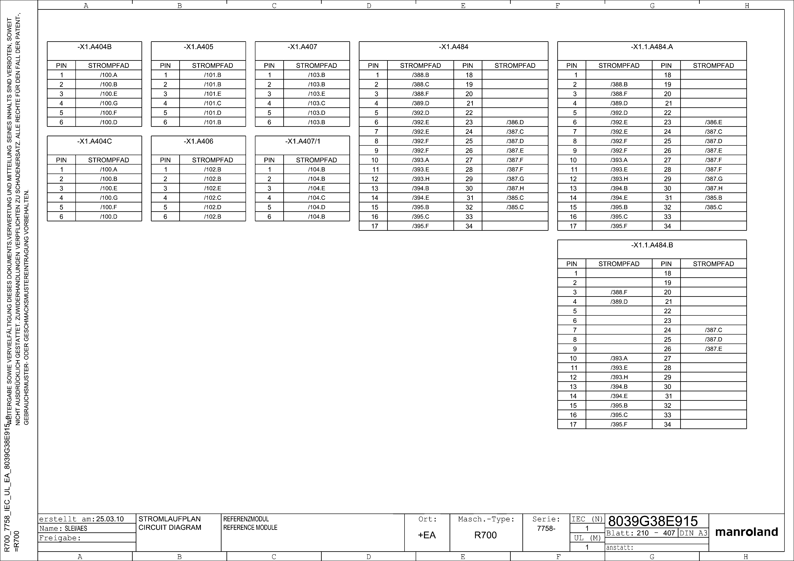

# +EA — Sheet 210 of 407 — REFERENZMODUL

**REFERENCE MODULE**

> Part of the manroland **R700** printing press IEC/UL circuit diagrams.
> Drawing class: **Stromlaufplan / Circuit diagram** (DIN A3).
> Document `+EA` covers the **Printing unit** machine section.

## At a glance

| Field | Value |
|---|---|
| Document | `+EA`  (8039G38E915) |
| Sheet | **210** of 407 |
| Section (DE) | REFERENZMODUL |
| Section (EN) | REFERENCE MODULE |
| Section type | REFERENCE_MODULE — Reference module |
| Machine type | `R700` |
| Series | `7758` |
| Created | 25.03.10 |
| Replaces | — |
| Columns used | A, B, C, D, E, F, G, H |
| Path numbers | — |
| Labels on sheet | 273 |
| Cross-refs out | 102 |
| Cross-refs in | 0 |

**Previous:** [+EA sheet 209](SHEET_0209.md) · **Next:** [+EA sheet 211](SHEET_0211.md) · **Document TOC:** [_TOC.md](_TOC.md)  (+EA) · **Master TOC:** [all sheets](../_MASTER_TOC.md)

## Sheet image (300 DPI, exact vector render)



_Rendered directly from the PDF vector layer at 300 DPI (1-bit), no OCR and no resampling. Use it to confirm anything ambiguous in the text below._

## Cross-references on this sheet

Each entry is a wire leaving this sheet. The printed token is `/sheet.column`; the link resolves to that sheet inside the same document.

| Ref | Target sheet | Col | Path | Destination on target | Target section | From col |
|---|---|---|---|---|---|---|
| `/100.A` | [+EA sheet 100](SHEET_0100.md) | A | — | — | BOGENFÜHRUNGSELEMENT | A |
| `/101.B` | [+EA sheet 101](SHEET_0101.md) | B | — | — | BOGENFÜHRUNGSELEMENT | B |
| `/103.B` | [+EA sheet 103](SHEET_0103.md) | B | — | — | BOGENFÜHRUNGSELEMENT | C |
| `/388.B` | [+EA sheet 388](SHEET_0388.md) | B | — | — | OPTION: ZWISCHENTROCKNER VORBEREITUNG; | E |
| `/100.B` | [+EA sheet 100](SHEET_0100.md) | B | — | — | BOGENFÜHRUNGSELEMENT | A |
| `/101.B` | [+EA sheet 101](SHEET_0101.md) | B | — | — | BOGENFÜHRUNGSELEMENT | B |
| `/103.B` | [+EA sheet 103](SHEET_0103.md) | B | — | — | BOGENFÜHRUNGSELEMENT | C |
| `/388.B` | [+EA sheet 388](SHEET_0388.md) | B | — | — | OPTION: ZWISCHENTROCKNER VORBEREITUNG; | G |
| `/388.C` | [+EA sheet 388](SHEET_0388.md) | C | — | — | OPTION: ZWISCHENTROCKNER VORBEREITUNG; | E |
| `/100.E` | [+EA sheet 100](SHEET_0100.md) | E | — | — | BOGENFÜHRUNGSELEMENT | A |
| `/101.E` | [+EA sheet 101](SHEET_0101.md) | E | — | — | BOGENFÜHRUNGSELEMENT | B |
| `/103.E` | [+EA sheet 103](SHEET_0103.md) | E | — | — | BOGENFÜHRUNGSELEMENT | C |
| `/388.F` | [+EA sheet 388](SHEET_0388.md) | F | — | — | OPTION: ZWISCHENTROCKNER VORBEREITUNG; | E |
| `/388.F` | [+EA sheet 388](SHEET_0388.md) | F | — | — | OPTION: ZWISCHENTROCKNER VORBEREITUNG; | G |
| `/100.G` | [+EA sheet 100](SHEET_0100.md) | G | — | — | BOGENFÜHRUNGSELEMENT | A |
| `/101.C` | [+EA sheet 101](SHEET_0101.md) | C | — | — | BOGENFÜHRUNGSELEMENT | B |
| `/103.C` | [+EA sheet 103](SHEET_0103.md) | C | — | — | BOGENFÜHRUNGSELEMENT | C |
| `/389.D` | [+EA sheet 389](SHEET_0389.md) | D | — | — | OPTION: ZWISCHENTROCKNER VORBEREITUNG; | E |
| `/389.D` | [+EA sheet 389](SHEET_0389.md) | D | — | — | OPTION: ZWISCHENTROCKNER VORBEREITUNG; | G |
| `/100.F` | [+EA sheet 100](SHEET_0100.md) | F | — | — | BOGENFÜHRUNGSELEMENT | A |
| `/101.D` | [+EA sheet 101](SHEET_0101.md) | D | — | — | BOGENFÜHRUNGSELEMENT | B |
| `/103.D` | [+EA sheet 103](SHEET_0103.md) | D | — | — | BOGENFÜHRUNGSELEMENT | C |
| `/392.D` | [+EA sheet 392](SHEET_0392.md) | D | — | — | OPTION: ZWISCHENTROCKNER VORBEREITUNG; | E |
| `/392.D` | [+EA sheet 392](SHEET_0392.md) | D | — | — | OPTION: ZWISCHENTROCKNER VORBEREITUNG; | G |
| `/101.B` | [+EA sheet 101](SHEET_0101.md) | B | — | — | BOGENFÜHRUNGSELEMENT | B |
| `/103.B` | [+EA sheet 103](SHEET_0103.md) | B | — | — | BOGENFÜHRUNGSELEMENT | C |
| `/392.E` | [+EA sheet 392](SHEET_0392.md) | E | — | — | OPTION: ZWISCHENTROCKNER VORBEREITUNG; | E |
| `/392.E` | [+EA sheet 392](SHEET_0392.md) | E | — | — | OPTION: ZWISCHENTROCKNER VORBEREITUNG; | G |
| `/386.E` | [+EA sheet 386](SHEET_0386.md) | E | — | — | OPTION: ZWISCHENTROCKNER VORBEREITUNG; | H |
| `/100.D` | [+EA sheet 100](SHEET_0100.md) | D | — | — | BOGENFÜHRUNGSELEMENT | A |
| `/386.D` | [+EA sheet 386](SHEET_0386.md) | D | — | — | OPTION: ZWISCHENTROCKNER VORBEREITUNG; | F |
| `/392.E` | [+EA sheet 392](SHEET_0392.md) | E | — | — | OPTION: ZWISCHENTROCKNER VORBEREITUNG; | E |
| `/392.E` | [+EA sheet 392](SHEET_0392.md) | E | — | — | OPTION: ZWISCHENTROCKNER VORBEREITUNG; | G |
| `/387.C` | [+EA sheet 387](SHEET_0387.md) | C | — | — | OPTION: ZWISCHENTROCKNER VORBEREITUNG; | F |
| `/387.C` | [+EA sheet 387](SHEET_0387.md) | C | — | — | OPTION: ZWISCHENTROCKNER VORBEREITUNG; | H |
| `/392.F` | [+EA sheet 392](SHEET_0392.md) | F | — | — | OPTION: ZWISCHENTROCKNER VORBEREITUNG; | E |
| `/392.F` | [+EA sheet 392](SHEET_0392.md) | F | — | — | OPTION: ZWISCHENTROCKNER VORBEREITUNG; | G |
| `/387.D` | [+EA sheet 387](SHEET_0387.md) | D | — | — | OPTION: ZWISCHENTROCKNER VORBEREITUNG; | F |
| `/387.D` | [+EA sheet 387](SHEET_0387.md) | D | — | — | OPTION: ZWISCHENTROCKNER VORBEREITUNG; | H |
| `/387.E` | [+EA sheet 387](SHEET_0387.md) | E | — | — | OPTION: ZWISCHENTROCKNER VORBEREITUNG; | F |
| `/387.E` | [+EA sheet 387](SHEET_0387.md) | E | — | — | OPTION: ZWISCHENTROCKNER VORBEREITUNG; | H |
| `/392.F` | [+EA sheet 392](SHEET_0392.md) | F | — | — | OPTION: ZWISCHENTROCKNER VORBEREITUNG; | E |
| `/392.F` | [+EA sheet 392](SHEET_0392.md) | F | — | — | OPTION: ZWISCHENTROCKNER VORBEREITUNG; | G |
| `/393.A` | [+EA sheet 393](SHEET_0393.md) | A | — | — | OPTION: ZWISCHENTROCKNER VORBEREITUNG; | E |
| `/393.A` | [+EA sheet 393](SHEET_0393.md) | A | — | — | OPTION: ZWISCHENTROCKNER VORBEREITUNG; | G |
| `/387.F` | [+EA sheet 387](SHEET_0387.md) | F | — | — | OPTION: ZWISCHENTROCKNER VORBEREITUNG; | F |
| `/387.F` | [+EA sheet 387](SHEET_0387.md) | F | — | — | OPTION: ZWISCHENTROCKNER VORBEREITUNG; | H |
| `/100.A` | [+EA sheet 100](SHEET_0100.md) | A | — | — | BOGENFÜHRUNGSELEMENT | A |
| `/102.B` | [+EA sheet 102](SHEET_0102.md) | B | — | — | BOGENFÜHRUNGSELEMENT | B |
| `/104.B` | [+EA sheet 104](SHEET_0104.md) | B | — | — | BOGENFÜHRUNGSELEMENT | C |
| `/393.E` | [+EA sheet 393](SHEET_0393.md) | E | — | — | OPTION: ZWISCHENTROCKNER VORBEREITUNG; | E |
| `/393.E` | [+EA sheet 393](SHEET_0393.md) | E | — | — | OPTION: ZWISCHENTROCKNER VORBEREITUNG; | G |
| `/387.F` | [+EA sheet 387](SHEET_0387.md) | F | — | — | OPTION: ZWISCHENTROCKNER VORBEREITUNG; | F |
| `/387.F` | [+EA sheet 387](SHEET_0387.md) | F | — | — | OPTION: ZWISCHENTROCKNER VORBEREITUNG; | H |
| `/100.B` | [+EA sheet 100](SHEET_0100.md) | B | — | — | BOGENFÜHRUNGSELEMENT | A |
| `/102.B` | [+EA sheet 102](SHEET_0102.md) | B | — | — | BOGENFÜHRUNGSELEMENT | B |
| `/104.B` | [+EA sheet 104](SHEET_0104.md) | B | — | — | BOGENFÜHRUNGSELEMENT | C |
| `/387.G` | [+EA sheet 387](SHEET_0387.md) | G | — | — | OPTION: ZWISCHENTROCKNER VORBEREITUNG; | F |
| `/387.G` | [+EA sheet 387](SHEET_0387.md) | G | — | — | OPTION: ZWISCHENTROCKNER VORBEREITUNG; | H |
| `/393.H` | [+EA sheet 393](SHEET_0393.md) | H | — | — | OPTION: ZWISCHENTROCKNER VORBEREITUNG; | E |
| `/393.H` | [+EA sheet 393](SHEET_0393.md) | H | — | — | OPTION: ZWISCHENTROCKNER VORBEREITUNG; | G |
| `/100.E` | [+EA sheet 100](SHEET_0100.md) | E | — | — | BOGENFÜHRUNGSELEMENT | A |
| `/102.E` | [+EA sheet 102](SHEET_0102.md) | E | — | — | BOGENFÜHRUNGSELEMENT | B |
| `/104.E` | [+EA sheet 104](SHEET_0104.md) | E | — | — | BOGENFÜHRUNGSELEMENT | C |
| `/394.B` | [+EA sheet 394](SHEET_0394.md) | B | — | — | OPTION: ZWISCHENTROCKNER VORBEREITUNG; | E |
| `/394.B` | [+EA sheet 394](SHEET_0394.md) | B | — | — | OPTION: ZWISCHENTROCKNER VORBEREITUNG; | G |
| `/387.H` | [+EA sheet 387](SHEET_0387.md) | H | — | — | OPTION: ZWISCHENTROCKNER VORBEREITUNG; | F |
| `/387.H` | [+EA sheet 387](SHEET_0387.md) | H | — | — | OPTION: ZWISCHENTROCKNER VORBEREITUNG; | H |
| `/394.E` | [+EA sheet 394](SHEET_0394.md) | E | — | — | OPTION: ZWISCHENTROCKNER VORBEREITUNG; | E |
| `/394.E` | [+EA sheet 394](SHEET_0394.md) | E | — | — | OPTION: ZWISCHENTROCKNER VORBEREITUNG; | G |
| `/385.B` | [+EA sheet 385](SHEET_0385.md) | B | — | — | OPTION: ZWISCHENTROCKNER VORBEREITUNG; | H |
| `/100.G` | [+EA sheet 100](SHEET_0100.md) | G | — | — | BOGENFÜHRUNGSELEMENT | A |
| `/102.C` | [+EA sheet 102](SHEET_0102.md) | C | — | — | BOGENFÜHRUNGSELEMENT | B |
| `/104.C` | [+EA sheet 104](SHEET_0104.md) | C | — | — | BOGENFÜHRUNGSELEMENT | C |
| `/385.C` | [+EA sheet 385](SHEET_0385.md) | C | — | — | OPTION: ZWISCHENTROCKNER VORBEREITUNG; | F |
| `/395.B` | [+EA sheet 395](SHEET_0395.md) | B | — | — | OPTION: ZWISCHENTROCKNER VORBEREITUNG; | E |
| `/395.B` | [+EA sheet 395](SHEET_0395.md) | B | — | — | OPTION: ZWISCHENTROCKNER VORBEREITUNG; | G |
| `/100.F` | [+EA sheet 100](SHEET_0100.md) | F | — | — | BOGENFÜHRUNGSELEMENT | A |
| `/102.D` | [+EA sheet 102](SHEET_0102.md) | D | — | — | BOGENFÜHRUNGSELEMENT | B |
| `/104.D` | [+EA sheet 104](SHEET_0104.md) | D | — | — | BOGENFÜHRUNGSELEMENT | C |
| `/385.C` | [+EA sheet 385](SHEET_0385.md) | C | — | — | OPTION: ZWISCHENTROCKNER VORBEREITUNG; | F |
| `/385.C` | [+EA sheet 385](SHEET_0385.md) | C | — | — | OPTION: ZWISCHENTROCKNER VORBEREITUNG; | H |
| `/102.B` | [+EA sheet 102](SHEET_0102.md) | B | — | — | BOGENFÜHRUNGSELEMENT | B |
| `/104.B` | [+EA sheet 104](SHEET_0104.md) | B | — | — | BOGENFÜHRUNGSELEMENT | C |
| `/100.D` | [+EA sheet 100](SHEET_0100.md) | D | — | — | BOGENFÜHRUNGSELEMENT | A |
| `/395.C` | [+EA sheet 395](SHEET_0395.md) | C | — | — | OPTION: ZWISCHENTROCKNER VORBEREITUNG; | E |
| `/395.C` | [+EA sheet 395](SHEET_0395.md) | C | — | — | OPTION: ZWISCHENTROCKNER VORBEREITUNG; | G |
| `/395.F` | [+EA sheet 395](SHEET_0395.md) | F | — | — | OPTION: ZWISCHENTROCKNER VORBEREITUNG; | E |
| `/395.F` | [+EA sheet 395](SHEET_0395.md) | F | — | — | OPTION: ZWISCHENTROCKNER VORBEREITUNG; | G |
| `/388.F` | [+EA sheet 388](SHEET_0388.md) | F | — | — | OPTION: ZWISCHENTROCKNER VORBEREITUNG; | G |
| `/389.D` | [+EA sheet 389](SHEET_0389.md) | D | — | — | OPTION: ZWISCHENTROCKNER VORBEREITUNG; | G |
| `/387.C` | [+EA sheet 387](SHEET_0387.md) | C | — | — | OPTION: ZWISCHENTROCKNER VORBEREITUNG; | H |
| `/387.D` | [+EA sheet 387](SHEET_0387.md) | D | — | — | OPTION: ZWISCHENTROCKNER VORBEREITUNG; | H |
| `/387.E` | [+EA sheet 387](SHEET_0387.md) | E | — | — | OPTION: ZWISCHENTROCKNER VORBEREITUNG; | H |
| `/393.A` | [+EA sheet 393](SHEET_0393.md) | A | — | — | OPTION: ZWISCHENTROCKNER VORBEREITUNG; | G |
| `/393.E` | [+EA sheet 393](SHEET_0393.md) | E | — | — | OPTION: ZWISCHENTROCKNER VORBEREITUNG; | G |
| `/393.H` | [+EA sheet 393](SHEET_0393.md) | H | — | — | OPTION: ZWISCHENTROCKNER VORBEREITUNG; | G |
| `/394.B` | [+EA sheet 394](SHEET_0394.md) | B | — | — | OPTION: ZWISCHENTROCKNER VORBEREITUNG; | G |
| `/394.E` | [+EA sheet 394](SHEET_0394.md) | E | — | — | OPTION: ZWISCHENTROCKNER VORBEREITUNG; | G |
| `/395.B` | [+EA sheet 395](SHEET_0395.md) | B | — | — | OPTION: ZWISCHENTROCKNER VORBEREITUNG; | G |
| `/395.C` | [+EA sheet 395](SHEET_0395.md) | C | — | — | OPTION: ZWISCHENTROCKNER VORBEREITUNG; | G |
| `/395.F` | [+EA sheet 395](SHEET_0395.md) | F | — | — | OPTION: ZWISCHENTROCKNER VORBEREITUNG; | G |

## Devices on this sheet

| Tag | Class | Class meaning (IEC) | Col | Sub | Terminal | Sign |
|---|---|---|---|---|---|---|
| `X1.A404B` | — | cross-device reference | A | — | — | — |
| `X1.A404C` | — | cross-device reference | A | — | — | — |
| `X1.A405` | — | cross-device reference | B | — | — | — |
| `X1.A406` | — | cross-device reference | B | — | — | — |
| `X1.A407` | — | cross-device reference | C | — | — | — |
| `X1.A484` | — | cross-device reference | E | — | — | — |
| `X1.1.A484.A` | — | cross-device reference | G | — | — | — |
| `X1.1.A484.B` | — | cross-device reference | G | — | — | — |

## Potentials / nets

_No named potentials on this sheet._

## Wire-end annotations (grouped as printed)

A wire that continues elsewhere is annotated with a small cluster: the destination description, the path/line number `#NN`, and the `/sheet.column` cross reference. Each row below is one such cluster exactly as it is grouped on the drawing.

| Col | Y | Path | Cross-ref | Text on the wire |
|---|---|---|---|---|
| A | 65.5 | — | — | `X1.A404B` |
| B | 65.5 | — | — | `X1.A405` |
| C | 65.5 | — | — | `X1.A407` |
| E | 65.5 | — | — | `X1.A484` |
| G | 65.5 | — | — | `X1.1.A484.A` |
| A | 94.2 | — | — | `PIN 2 3 4 5 6 1 STROMPFAD` |
| B | 94.2 | — | — | `PIN 2 3 4 5 6 1 STROMPFAD` |
| C | 94.2 | — | — | `PIN 2 3 4 5 6 1 STROMPFAD` |
| D | 94.2 | — | — | `PIN STROMPFAD` |
| E | 94.2 | — | — | `PIN 18 19 20 22 23 24 25 26 27 28 29 30 32 33 34 21 31 STROMPFAD` |
| F | 94.2 | — | — | `PIN STROMPFAD` |
| G | 94.2 | — | — | `PIN 18 19 20 22 23 24 25 26 27 28 29 30 32 33 34 21 31 STROMPFAD` |
| D | 108.4 | — | — | `2 3 4 5 6 7 8 9 1` |
| F | 108.4 | — | — | `2 3 4 5 6 7 8 9 1` |
| A | 108.7 | — | `/100.A` | — |
| B | 108.7 | — | `/101.B` | — |
| C | 108.7 | — | `/103.B` | — |
| E | 108.7 | — | `/388.B` | — |
| A | 122.9 | — | `/100.B` | — |
| B | 122.9 | — | `/101.B` | — |
| C | 122.9 | — | `/103.B` | — |
| E | 122.9 | — | `/388.C` | — |
| G | 122.9 | — | `/388.B` | — |
| A | 137.0 | — | `/100.E` | — |
| B | 137.0 | — | `/101.E` | — |
| C | 137.0 | — | `/103.E` | — |
| E | 137.0 | — | `/388.F` | — |
| G | 137.0 | — | `/388.F` | — |
| A | 151.2 | — | `/100.G` | — |
| B | 151.2 | — | `/101.C` | — |
| C | 151.2 | — | `/103.C` | — |
| E | 151.2 | — | `/389.D` | — |
| G | 151.2 | — | `/389.D` | — |
| A | 165.4 | — | `/100.F` | — |
| B | 165.4 | — | `/101.D` | — |
| C | 165.4 | — | `/103.D` | — |
| E | 165.4 | — | `/392.D` | — |
| G | 165.4 | — | `/392.D` | — |
| A | 179.6 | — | `/100.D` | — |
| B | 179.6 | — | `/101.B` | — |
| C | 179.6 | — | `/103.B` | — |
| E | 179.6 | — | `/392.E` | — |
| F | 179.6 | — | `/386.D` | — |
| G | 179.6 | — | `/392.E` | — |
| H | 179.6 | — | `/386.E` | — |
| E | 193.7 | — | `/392.E` | — |
| G | 193.7 | — | `/392.E` | — |
| F | 193.8 | — | `/387.C` | — |
| H | 193.8 | — | `/387.C` | — |
| A | 207.2 | — | — | `X1.A404C` |
| B | 207.2 | — | — | `X1.A406` |
| C | 207.2 | — | — | `X1.A407/1` |
| E | 207.9 | — | `/392.F` | — |
| F | 207.9 | — | `/387.D` | — |
| G | 207.9 | — | `/392.F` | — |
| H | 207.9 | — | `/387.D` | — |
| E | 222.1 | — | `/392.F` | — |
| F | 222.1 | — | `/387.E` | — |
| G | 222.1 | — | `/392.F` | — |
| H | 222.1 | — | `/387.E` | — |
| A | 235.9 | — | — | `PIN 2 3 4 5 6 1 STROMPFAD` |
| B | 235.9 | — | — | `PIN 2 3 4 5 6 1 STROMPFAD` |
| C | 235.9 | — | — | `PIN 2 3 4 5 6 1 STROMPFAD` |
| D | 235.9 | — | — | `10 12 13 14 15 16 17 11` |
| F | 235.9 | — | — | `10 12 13 14 15 16 17 11` |
| E | 236.2 | — | `/393.A` | — |
| G | 236.2 | — | `/393.A` | — |
| F | 236.3 | — | `/387.F` | — |
| H | 236.3 | — | `/387.F` | — |
| A | 250.4 | — | `/100.A` | — |
| B | 250.4 | — | `/102.B` | — |
| C | 250.4 | — | `/104.B` | — |
| E | 250.4 | — | `/393.E` | — |
| F | 250.4 | — | `/387.F` | — |
| G | 250.4 | — | `/393.E` | — |
| H | 250.4 | — | `/387.F` | — |
| A | 264.6 | — | `/100.B` | — |
| B | 264.6 | — | `/102.B` | — |
| C | 264.6 | — | `/104.B` | — |
| E | 264.6 | — | `/393.H` | — |
| F | 264.6 | — | `/387.G` | — |
| G | 264.6 | — | `/393.H` | — |
| H | 264.6 | — | `/387.G` | — |
| A | 278.8 | — | `/100.E` | — |
| B | 278.8 | — | `/102.E` | — |
| C | 278.8 | — | `/104.E` | — |
| E | 278.8 | — | `/394.B` | — |
| F | 278.8 | — | `/387.H` | — |
| G | 278.8 | — | `/394.B` | — |
| H | 278.8 | — | `/387.H` | — |
| E | 292.9 | — | `/394.E` | — |
| G | 292.9 | — | `/394.E` | — |
| H | 292.9 | — | `/385.B` | — |
| A | 293.0 | — | `/100.G` | — |
| B | 293.0 | — | `/102.C` | — |
| C | 293.0 | — | `/104.C` | — |
| F | 293.0 | — | `/385.C` | — |
| A | 307.1 | — | `/100.F` | — |
| B | 307.1 | — | `/102.D` | — |
| C | 307.1 | — | `/104.D` | — |
| E | 307.1 | — | `/395.B` | — |
| F | 307.1 | — | `/385.C` | — |
| G | 307.1 | — | `/395.B` | — |
| H | 307.1 | — | `/385.C` | — |
| A | 321.3 | — | `/100.D` | — |
| B | 321.3 | — | `/102.B` | — |
| C | 321.3 | — | `/104.B` | — |
| E | 321.3 | — | `/395.C` | — |
| G | 321.3 | — | `/395.C` | — |
| E | 335.5 | — | `/395.F` | — |
| G | 335.5 | — | `/395.F` | — |
| G | 363.1 | — | — | `X1.1.A484.B` |
| F | 391.8 | — | — | `PIN STROMPFAD` |
| G | 391.8 | — | — | `PIN 18 19 20 22 23 24 25 26 27 28 29 30 32 33 34 21 31 STROMPFAD` |
| F | 406.0 | — | — | `2 3 4 5 6 7 8 9 1` |
| G | 434.7 | — | `/388.F` | — |
| G | 448.9 | — | `/389.D` | — |
| H | 491.4 | — | `/387.C` | — |
| H | 505.6 | — | `/387.D` | — |
| H | 519.7 | — | `/387.E` | — |
| F | 533.6 | — | — | `10 12 13 14 15 16 17 11` |
| G | 533.9 | — | `/393.A` | — |
| G | 548.1 | — | `/393.E` | — |
| G | 562.3 | — | `/393.H` | — |
| G | 576.4 | — | `/394.B` | — |
| G | 590.6 | — | `/394.E` | — |
| G | 604.8 | — | `/395.B` | — |
| G | 619.0 | — | `/395.C` | — |
| G | 633.1 | — | `/395.F` | — |


## Reconstructed tables

This sheet carries tabular content (pin map / terminal assignment / index). The grid below was rebuilt from the drawing's own rule lines, so each row is exactly one physical row of the table.

### Table 1 — 14 data rows × 2 columns (at x=70.9, y=62.4) — **X1.A404B**

| PIN | STROMPFAD |
|---|---|
| `1` | `/100.A` |
| `2` | `/100.B` |
| `3` | `/100.E` |
| `4` | `/100.G` |
| `5` | `/100.F` |
| `6` | `/100.D` |
|  | `X1.A404C` |
| `PIN` | `STROMPFAD` |
| `1` | `/100.A` |
| `2` | `/100.B` |
| `3` | `/100.E` |
| `4` | `/100.G` |
| `5` | `/100.F` |
| `6` | `/100.D` |


### Table 2 — 14 data rows × 2 columns (at x=226.8, y=62.4) — **X1.A405**

| PIN | STROMPFAD |
|---|---|
| `1` | `/101.B` |
| `2` | `/101.B` |
| `3` | `/101.E` |
| `4` | `/101.C` |
| `5` | `/101.D` |
| `6` | `/101.B` |
|  | `X1.A406` |
| `PIN` | `STROMPFAD` |
| `1` | `/102.B` |
| `2` | `/102.B` |
| `3` | `/102.E` |
| `4` | `/102.C` |
| `5` | `/102.D` |
| `6` | `/102.B` |


### Table 3 — 14 data rows × 2 columns (at x=382.7, y=62.4) — **X1.A407**

| PIN | STROMPFAD |
|---|---|
| `1` | `/103.B` |
| `2` | `/103.B` |
| `3` | `/103.E` |
| `4` | `/103.C` |
| `5` | `/103.D` |
| `6` | `/103.B` |
|  | `X1.A407/1` |
| `PIN` | `STROMPFAD` |
| `1` | `/104.B` |
| `2` | `/104.B` |
| `3` | `/104.E` |
| `4` | `/104.C` |
| `5` | `/104.D` |
| `6` | `/104.B` |


### Table 4 — 17 data rows × 4 columns (at x=538.6, y=62.4) — **X1.A484**

| PIN | STROMPFAD | PIN | STROMPFAD |
|---|---|---|---|
| `1` | `/388.B` | `18` |  |
| `2` | `/388.C` | `19` |  |
| `3` | `/388.F` | `20` |  |
| `4` | `/389.D` | `21` |  |
| `5` | `/392.D` | `22` |  |
| `6` | `/392.E` | `23` | `/386.D` |
| `7` | `/392.E` | `24` | `/387.C` |
| `8` | `/392.F` | `25` | `/387.D` |
| `9` | `/392.F` | `26` | `/387.E` |
| `10` | `/393.A` | `27` | `/387.F` |
| `11` | `/393.E` | `28` | `/387.F` |
| `12` | `/393.H` | `29` | `/387.G` |
| `13` | `/394.B` | `30` | `/387.H` |
| `14` | `/394.E` | `31` | `/385.C` |
| `15` | `/395.B` | `32` | `/385.C` |
| `16` | `/395.C` | `33` |  |
| `17` | `/395.F` | `34` |  |


### Table 5 — 36 data rows × 4 columns (at x=836.2, y=62.4) — **X1.1.A484.A**

| PIN | STROMPFAD | PIN | STROMPFAD |
|---|---|---|---|
| `1` |  | `18` |  |
| `2` | `/388.B` | `19` |  |
| `3` | `/388.F` | `20` |  |
| `4` | `/389.D` | `21` |  |
| `5` | `/392.D` | `22` |  |
| `6` | `/392.E` | `23` | `/386.E` |
| `7` | `/392.E` | `24` | `/387.C` |
| `8` | `/392.F` | `25` | `/387.D` |
| `9` | `/392.F` | `26` | `/387.E` |
| `10` | `/393.A` | `27` | `/387.F` |
| `11` | `/393.E` | `28` | `/387.F` |
| `12` | `/393.H` | `29` | `/387.G` |
| `13` | `/394.B` | `30` | `/387.H` |
| `14` | `/394.E` | `31` | `/385.B` |
| `15` | `/395.B` | `32` | `/385.C` |
| `16` | `/395.C` | `33` |  |
| `17` | `/395.F` | `34` |  |
|  |  | `X1.1.A484.B` |  |
| `PIN` | `STROMPFAD` | `PIN` | `STROMPFAD` |
| `1` |  | `18` |  |
| `2` |  | `19` |  |
| `3` | `/388.F` | `20` |  |
| `4` | `/389.D` | `21` |  |
| `5` |  | `22` |  |
| `6` |  | `23` |  |
| `7` |  | `24` | `/387.C` |
| `8` |  | `25` | `/387.D` |
| `9` |  | `26` | `/387.E` |
| `10` | `/393.A` | `27` |  |
| `11` | `/393.E` | `28` |  |
| `12` | `/393.H` | `29` |  |
| `13` | `/394.B` | `30` |  |
| `14` | `/394.E` | `31` |  |
| `15` | `/395.B` | `32` |  |
| `16` | `/395.C` | `33` |  |
| `17` | `/395.F` | `34` |  |


## Notes and free text on this sheet

| Text | Col | Y (pt) |
|---|---|---|
| `PIN` | A | 94.2 |
| `STROMPFAD` | A | 94.15 |
| `PIN` | B | 94.2 |
| `STROMPFAD` | B | 94.15 |
| `PIN` | C | 235.93 |
| `STROMPFAD` | C | 235.89 |
| `X1.A407/1` | C | 207.24 |
| `PIN` | D | 94.2 |
| `STROMPFAD` | E | 94.15 |
| `PIN` | E | 94.2 |
| `STROMPFAD` | F | 94.15 |
| `PIN` | F | 94.2 |
| `STROMPFAD` | G | 94.15 |
| `PIN` | G | 94.2 |
| `STROMPFAD` | H | 94.15 |

## Complete label inventory (exact text from the drawing)

Every text object inside the drawing area of this sheet, in DIN reading order (column A→H, then top→bottom). This is the authoritative list: if a string is not here it is not printed on this sheet.

| Col | Y | X | Dir | Type | Text |
|---|---|---|---|---|---|
| A | 65.5 | 116.2 | → | device ref | `X1.A404B` |
| A | 94.2 | 84.0 | → | text | `PIN` |
| A | 94.2 | 132.2 | → | text | `STROMPFAD` |
| A | 108.4 | 90.0 | → | number | `1` |
| A | 108.7 | 150.2 | → | cross-reference | `/100.A` |
| A | 122.5 | 89.4 | → | number | `2` |
| A | 122.9 | 150.4 | → | cross-reference | `/100.B` |
| A | 136.7 | 89.4 | → | number | `3` |
| A | 137.0 | 150.5 | → | cross-reference | `/100.E` |
| A | 150.9 | 89.4 | → | number | `4` |
| A | 151.2 | 150.1 | → | cross-reference | `/100.G` |
| A | 165.1 | 89.4 | → | number | `5` |
| A | 165.4 | 150.7 | → | cross-reference | `/100.F` |
| A | 179.2 | 89.4 | → | number | `6` |
| A | 179.6 | 150.2 | → | cross-reference | `/100.D` |
| A | 207.2 | 115.9 | → | device ref | `X1.A404C` |
| A | 235.9 | 84.0 | → | text | `PIN` |
| A | 235.9 | 132.2 | → | text | `STROMPFAD` |
| A | 250.1 | 90.0 | → | number | `1` |
| A | 250.4 | 150.2 | → | cross-reference | `/100.A` |
| A | 264.3 | 89.4 | → | number | `2` |
| A | 264.6 | 150.4 | → | cross-reference | `/100.B` |
| A | 278.5 | 89.4 | → | number | `3` |
| A | 278.8 | 150.5 | → | cross-reference | `/100.E` |
| A | 292.6 | 89.4 | → | number | `4` |
| A | 293.0 | 150.1 | → | cross-reference | `/100.G` |
| A | 306.8 | 89.4 | → | number | `5` |
| A | 307.1 | 150.7 | → | cross-reference | `/100.F` |
| A | 321.0 | 89.4 | → | number | `6` |
| A | 321.3 | 150.2 | → | cross-reference | `/100.D` |
| B | 65.5 | 275.7 | → | device ref | `X1.A405` |
| B | 94.2 | 240.0 | → | text | `PIN` |
| B | 94.2 | 288.1 | → | text | `STROMPFAD` |
| B | 108.4 | 245.9 | → | number | `1` |
| B | 108.7 | 306.3 | → | cross-reference | `/101.B` |
| B | 122.5 | 245.3 | → | number | `2` |
| B | 122.9 | 306.3 | → | cross-reference | `/101.B` |
| B | 136.7 | 245.3 | → | number | `3` |
| B | 137.0 | 306.4 | → | cross-reference | `/101.E` |
| B | 150.9 | 245.3 | → | number | `4` |
| B | 151.2 | 306.1 | → | cross-reference | `/101.C` |
| B | 165.1 | 245.3 | → | number | `5` |
| B | 165.4 | 306.1 | → | cross-reference | `/101.D` |
| B | 179.2 | 245.3 | → | number | `6` |
| B | 179.6 | 306.3 | → | cross-reference | `/101.B` |
| B | 207.2 | 275.7 | → | device ref | `X1.A406` |
| B | 235.9 | 240.0 | → | text | `PIN` |
| B | 235.9 | 288.1 | → | text | `STROMPFAD` |
| B | 250.1 | 245.9 | → | number | `1` |
| B | 250.4 | 306.3 | → | cross-reference | `/102.B` |
| B | 264.3 | 245.3 | → | number | `2` |
| B | 264.6 | 306.3 | → | cross-reference | `/102.B` |
| B | 278.5 | 245.3 | → | number | `3` |
| B | 278.8 | 306.4 | → | cross-reference | `/102.E` |
| B | 292.6 | 245.3 | → | number | `4` |
| B | 293.0 | 306.1 | → | cross-reference | `/102.C` |
| B | 306.8 | 245.3 | → | number | `5` |
| B | 307.1 | 306.1 | → | cross-reference | `/102.D` |
| B | 321.0 | 245.3 | → | number | `6` |
| B | 321.3 | 306.3 | → | cross-reference | `/102.B` |
| C | 65.5 | 431.6 | → | device ref | `X1.A407` |
| C | 94.2 | 395.9 | → | text | `PIN` |
| C | 94.2 | 444.0 | → | text | `STROMPFAD` |
| C | 108.4 | 401.8 | → | number | `1` |
| C | 108.7 | 462.2 | → | cross-reference | `/103.B` |
| C | 122.5 | 401.2 | → | number | `2` |
| C | 122.9 | 462.2 | → | cross-reference | `/103.B` |
| C | 136.7 | 401.2 | → | number | `3` |
| C | 137.0 | 462.3 | → | cross-reference | `/103.E` |
| C | 150.9 | 401.2 | → | number | `4` |
| C | 151.2 | 462.0 | → | cross-reference | `/103.C` |
| C | 165.1 | 401.2 | → | number | `5` |
| C | 165.4 | 462.0 | → | cross-reference | `/103.D` |
| C | 179.2 | 401.2 | → | number | `6` |
| C | 179.6 | 462.2 | → | cross-reference | `/103.B` |
| C | 207.2 | 427.9 | → | text | `X1.A407/1` |
| C | 235.9 | 395.9 | → | text | `PIN` |
| C | 235.9 | 444.0 | → | text | `STROMPFAD` |
| C | 250.1 | 401.8 | → | number | `1` |
| C | 250.4 | 462.2 | → | cross-reference | `/104.B` |
| C | 264.3 | 401.2 | → | number | `2` |
| C | 264.6 | 462.2 | → | cross-reference | `/104.B` |
| C | 278.5 | 401.2 | → | number | `3` |
| C | 278.8 | 462.3 | → | cross-reference | `/104.E` |
| C | 292.6 | 401.2 | → | number | `4` |
| C | 293.0 | 462.0 | → | cross-reference | `/104.C` |
| C | 306.8 | 401.2 | → | number | `5` |
| C | 307.1 | 462.0 | → | cross-reference | `/104.D` |
| C | 321.0 | 401.2 | → | number | `6` |
| C | 321.3 | 462.2 | → | cross-reference | `/104.B` |
| D | 94.2 | 551.8 | → | text | `PIN` |
| D | 108.4 | 563.5 | → | number | `1` |
| D | 122.5 | 561.8 | → | number | `2` |
| D | 136.7 | 561.8 | → | number | `3` |
| D | 150.9 | 561.8 | → | number | `4` |
| D | 165.1 | 561.8 | → | number | `5` |
| D | 179.2 | 561.8 | → | number | `6` |
| D | 193.4 | 561.8 | → | number | `7` |
| D | 207.6 | 561.8 | → | number | `8` |
| D | 221.8 | 561.8 | → | number | `9` |
| D | 235.9 | 556.4 | → | number | `10` |
| D | 250.1 | 558.1 | → | number | `11` |
| D | 264.3 | 556.4 | → | number | `12` |
| D | 278.5 | 556.4 | → | number | `13` |
| D | 292.6 | 556.4 | → | number | `14` |
| D | 306.8 | 556.4 | → | number | `15` |
| D | 321.0 | 556.4 | → | number | `16` |
| D | 335.1 | 556.4 | → | number | `17` |
| E | 65.5 | 658.3 | → | device ref | `X1.A484` |
| E | 94.2 | 600.0 | → | text | `STROMPFAD` |
| E | 94.2 | 693.5 | → | text | `PIN` |
| E | 108.4 | 698.2 | → | number | `18` |
| E | 108.7 | 618.1 | → | cross-reference | `/388.B` |
| E | 122.5 | 698.2 | → | number | `19` |
| E | 122.9 | 618.0 | → | cross-reference | `/388.C` |
| E | 136.7 | 698.2 | → | number | `20` |
| E | 137.0 | 618.4 | → | cross-reference | `/388.F` |
| E | 150.9 | 699.9 | → | number | `21` |
| E | 151.2 | 618.0 | → | cross-reference | `/389.D` |
| E | 165.1 | 698.2 | → | number | `22` |
| E | 165.4 | 618.0 | → | cross-reference | `/392.D` |
| E | 179.2 | 698.2 | → | number | `23` |
| E | 179.6 | 618.2 | → | cross-reference | `/392.E` |
| E | 193.4 | 698.2 | → | number | `24` |
| E | 193.7 | 618.2 | → | cross-reference | `/392.E` |
| E | 207.6 | 698.2 | → | number | `25` |
| E | 207.9 | 618.4 | → | cross-reference | `/392.F` |
| E | 221.8 | 698.2 | → | number | `26` |
| E | 222.1 | 618.4 | → | cross-reference | `/392.F` |
| E | 235.9 | 698.2 | → | number | `27` |
| E | 236.2 | 618.0 | → | cross-reference | `/393.A` |
| E | 250.1 | 698.2 | → | number | `28` |
| E | 250.4 | 618.2 | → | cross-reference | `/393.E` |
| E | 264.3 | 698.2 | → | number | `29` |
| E | 264.6 | 618.2 | → | cross-reference | `/393.H` |
| E | 278.5 | 698.2 | → | number | `30` |
| E | 278.8 | 618.1 | → | cross-reference | `/394.B` |
| E | 292.6 | 699.9 | → | number | `31` |
| E | 292.9 | 618.2 | → | cross-reference | `/394.E` |
| E | 306.8 | 698.2 | → | number | `32` |
| E | 307.1 | 618.1 | → | cross-reference | `/395.B` |
| E | 321.0 | 698.2 | → | number | `33` |
| E | 321.3 | 618.0 | → | cross-reference | `/395.C` |
| E | 335.1 | 698.2 | → | number | `34` |
| E | 335.5 | 618.4 | → | cross-reference | `/395.F` |
| F | 94.2 | 741.7 | → | text | `STROMPFAD` |
| F | 94.2 | 849.4 | → | text | `PIN` |
| F | 108.4 | 861.2 | → | number | `1` |
| F | 122.5 | 859.5 | → | number | `2` |
| F | 136.7 | 859.5 | → | number | `3` |
| F | 150.9 | 859.5 | → | number | `4` |
| F | 165.1 | 859.5 | → | number | `5` |
| F | 179.2 | 859.5 | → | number | `6` |
| F | 179.6 | 759.7 | → | cross-reference | `/386.D` |
| F | 193.4 | 859.5 | → | number | `7` |
| F | 193.8 | 759.7 | → | cross-reference | `/387.C` |
| F | 207.6 | 859.5 | → | number | `8` |
| F | 207.9 | 759.7 | → | cross-reference | `/387.D` |
| F | 221.8 | 859.5 | → | number | `9` |
| F | 222.1 | 760.0 | → | cross-reference | `/387.E` |
| F | 235.9 | 854.1 | → | number | `10` |
| F | 236.3 | 760.1 | → | cross-reference | `/387.F` |
| F | 250.1 | 855.8 | → | number | `11` |
| F | 250.4 | 760.1 | → | cross-reference | `/387.F` |
| F | 264.3 | 854.1 | → | number | `12` |
| F | 264.6 | 759.5 | → | cross-reference | `/387.G` |
| F | 278.5 | 854.1 | → | number | `13` |
| F | 278.8 | 760.0 | → | cross-reference | `/387.H` |
| F | 292.6 | 854.1 | → | number | `14` |
| F | 293.0 | 759.7 | → | cross-reference | `/385.C` |
| F | 306.8 | 854.1 | → | number | `15` |
| F | 307.1 | 759.7 | → | cross-reference | `/385.C` |
| F | 321.0 | 854.1 | → | number | `16` |
| F | 335.1 | 854.1 | → | number | `17` |
| F | 391.8 | 849.4 | → | text | `PIN` |
| F | 406.0 | 861.2 | → | number | `1` |
| F | 420.2 | 859.5 | → | number | `2` |
| F | 434.4 | 859.5 | → | number | `3` |
| F | 448.5 | 859.5 | → | number | `4` |
| F | 462.7 | 859.5 | → | number | `5` |
| F | 476.9 | 859.5 | → | number | `6` |
| F | 491.0 | 859.5 | → | number | `7` |
| F | 505.2 | 859.5 | → | number | `8` |
| F | 519.4 | 859.5 | → | number | `9` |
| F | 533.6 | 854.1 | → | number | `10` |
| F | 547.7 | 855.8 | → | number | `11` |
| F | 561.9 | 854.1 | → | number | `12` |
| F | 576.1 | 854.1 | → | number | `13` |
| F | 590.3 | 854.1 | → | number | `14` |
| F | 604.4 | 854.1 | → | number | `15` |
| F | 618.6 | 854.1 | → | number | `16` |
| F | 632.8 | 854.1 | → | number | `17` |
| G | 65.5 | 946.2 | → | device ref | `X1.1.A484.A` |
| G | 94.2 | 897.6 | → | text | `STROMPFAD` |
| G | 94.2 | 991.1 | → | text | `PIN` |
| G | 108.4 | 995.8 | → | number | `18` |
| G | 122.5 | 995.8 | → | number | `19` |
| G | 122.9 | 915.7 | → | cross-reference | `/388.B` |
| G | 136.7 | 995.8 | → | number | `20` |
| G | 137.0 | 916.0 | → | cross-reference | `/388.F` |
| G | 150.9 | 997.5 | → | number | `21` |
| G | 151.2 | 915.6 | → | cross-reference | `/389.D` |
| G | 165.1 | 995.8 | → | number | `22` |
| G | 165.4 | 915.6 | → | cross-reference | `/392.D` |
| G | 179.2 | 995.8 | → | number | `23` |
| G | 179.6 | 915.9 | → | cross-reference | `/392.E` |
| G | 193.4 | 995.8 | → | number | `24` |
| G | 193.7 | 915.9 | → | cross-reference | `/392.E` |
| G | 207.6 | 995.8 | → | number | `25` |
| G | 207.9 | 916.0 | → | cross-reference | `/392.F` |
| G | 221.8 | 995.8 | → | number | `26` |
| G | 222.1 | 916.0 | → | cross-reference | `/392.F` |
| G | 235.9 | 995.8 | → | number | `27` |
| G | 236.2 | 915.6 | → | cross-reference | `/393.A` |
| G | 250.1 | 995.8 | → | number | `28` |
| G | 250.4 | 915.9 | → | cross-reference | `/393.E` |
| G | 264.3 | 995.8 | → | number | `29` |
| G | 264.6 | 915.9 | → | cross-reference | `/393.H` |
| G | 278.5 | 995.8 | → | number | `30` |
| G | 278.8 | 915.7 | → | cross-reference | `/394.B` |
| G | 292.6 | 997.5 | → | number | `31` |
| G | 292.9 | 915.9 | → | cross-reference | `/394.E` |
| G | 306.8 | 995.8 | → | number | `32` |
| G | 307.1 | 915.7 | → | cross-reference | `/395.B` |
| G | 321.0 | 995.8 | → | number | `33` |
| G | 321.3 | 915.6 | → | cross-reference | `/395.C` |
| G | 335.1 | 995.8 | → | number | `34` |
| G | 335.5 | 916.0 | → | cross-reference | `/395.F` |
| G | 363.2 | 946.6 | → | device ref | `X1.1.A484.B` |
| G | 391.8 | 897.6 | → | text | `STROMPFAD` |
| G | 391.8 | 991.1 | → | text | `PIN` |
| G | 406.0 | 995.8 | → | number | `18` |
| G | 420.2 | 995.8 | → | number | `19` |
| G | 434.4 | 995.8 | → | number | `20` |
| G | 434.7 | 916.0 | → | cross-reference | `/388.F` |
| G | 448.5 | 997.5 | → | number | `21` |
| G | 448.9 | 915.6 | → | cross-reference | `/389.D` |
| G | 462.7 | 995.8 | → | number | `22` |
| G | 476.9 | 995.8 | → | number | `23` |
| G | 491.0 | 995.8 | → | number | `24` |
| G | 505.2 | 995.8 | → | number | `25` |
| G | 519.4 | 995.8 | → | number | `26` |
| G | 533.6 | 995.8 | → | number | `27` |
| G | 533.9 | 915.6 | → | cross-reference | `/393.A` |
| G | 547.7 | 995.8 | → | number | `28` |
| G | 548.1 | 915.9 | → | cross-reference | `/393.E` |
| G | 561.9 | 995.8 | → | number | `29` |
| G | 562.3 | 915.9 | → | cross-reference | `/393.H` |
| G | 576.1 | 995.8 | → | number | `30` |
| G | 576.4 | 915.7 | → | cross-reference | `/394.B` |
| G | 590.3 | 997.5 | → | number | `31` |
| G | 590.6 | 915.9 | → | cross-reference | `/394.E` |
| G | 604.4 | 995.8 | → | number | `32` |
| G | 604.8 | 915.7 | → | cross-reference | `/395.B` |
| G | 618.6 | 995.8 | → | number | `33` |
| G | 619.0 | 915.6 | → | cross-reference | `/395.C` |
| G | 632.8 | 995.8 | → | number | `34` |
| G | 633.1 | 916.0 | → | cross-reference | `/395.F` |
| H | 94.2 | 1039.3 | → | text | `STROMPFAD` |
| H | 179.6 | 1057.6 | → | cross-reference | `/386.E` |
| H | 193.8 | 1057.3 | → | cross-reference | `/387.C` |
| H | 207.9 | 1057.3 | → | cross-reference | `/387.D` |
| H | 222.1 | 1057.6 | → | cross-reference | `/387.E` |
| H | 236.3 | 1057.7 | → | cross-reference | `/387.F` |
| H | 250.4 | 1057.7 | → | cross-reference | `/387.F` |
| H | 264.6 | 1057.2 | → | cross-reference | `/387.G` |
| H | 278.8 | 1057.6 | → | cross-reference | `/387.H` |
| H | 292.9 | 1057.5 | → | cross-reference | `/385.B` |
| H | 307.1 | 1057.3 | → | cross-reference | `/385.C` |
| H | 391.8 | 1039.3 | → | text | `STROMPFAD` |
| H | 491.4 | 1057.3 | → | cross-reference | `/387.C` |
| H | 505.6 | 1057.3 | → | cross-reference | `/387.D` |
| H | 519.7 | 1057.6 | → | cross-reference | `/387.E` |

## Reading-order text block

The same content as a plain block, grouped by DIN column — convenient to paste or to match against a visual description.

```text
=== Column A ===
  65.5  116.2  devref       X1.A404B
  94.2   84.0  text         PIN
  94.2  132.2  text         STROMPFAD
 108.4   90.0  numeric      1
 108.7  150.2  xref         /100.A
 122.5   89.4  numeric      2
 122.9  150.4  xref         /100.B
 136.7   89.4  numeric      3
 137.0  150.5  xref         /100.E
 150.9   89.4  numeric      4
 151.2  150.1  xref         /100.G
 165.1   89.4  numeric      5
 165.4  150.7  xref         /100.F
 179.2   89.4  numeric      6
 179.6  150.2  xref         /100.D
 207.2  115.9  devref       X1.A404C
 235.9   84.0  text         PIN
 235.9  132.2  text         STROMPFAD
 250.1   90.0  numeric      1
 250.4  150.2  xref         /100.A
 264.3   89.4  numeric      2
 264.6  150.4  xref         /100.B
 278.5   89.4  numeric      3
 278.8  150.5  xref         /100.E
 292.6   89.4  numeric      4
 293.0  150.1  xref         /100.G
 306.8   89.4  numeric      5
 307.1  150.7  xref         /100.F
 321.0   89.4  numeric      6
 321.3  150.2  xref         /100.D
=== Column B ===
  65.5  275.7  devref       X1.A405
  94.2  240.0  text         PIN
  94.2  288.1  text         STROMPFAD
 108.4  245.9  numeric      1
 108.7  306.3  xref         /101.B
 122.5  245.3  numeric      2
 122.9  306.3  xref         /101.B
 136.7  245.3  numeric      3
 137.0  306.4  xref         /101.E
 150.9  245.3  numeric      4
 151.2  306.1  xref         /101.C
 165.1  245.3  numeric      5
 165.4  306.1  xref         /101.D
 179.2  245.3  numeric      6
 179.6  306.3  xref         /101.B
 207.2  275.7  devref       X1.A406
 235.9  240.0  text         PIN
 235.9  288.1  text         STROMPFAD
 250.1  245.9  numeric      1
 250.4  306.3  xref         /102.B
 264.3  245.3  numeric      2
 264.6  306.3  xref         /102.B
 278.5  245.3  numeric      3
 278.8  306.4  xref         /102.E
 292.6  245.3  numeric      4
 293.0  306.1  xref         /102.C
 306.8  245.3  numeric      5
 307.1  306.1  xref         /102.D
 321.0  245.3  numeric      6
 321.3  306.3  xref         /102.B
=== Column C ===
  65.5  431.6  devref       X1.A407
  94.2  395.9  text         PIN
  94.2  444.0  text         STROMPFAD
 108.4  401.8  numeric      1
 108.7  462.2  xref         /103.B
 122.5  401.2  numeric      2
 122.9  462.2  xref         /103.B
 136.7  401.2  numeric      3
 137.0  462.3  xref         /103.E
 150.9  401.2  numeric      4
 151.2  462.0  xref         /103.C
 165.1  401.2  numeric      5
 165.4  462.0  xref         /103.D
 179.2  401.2  numeric      6
 179.6  462.2  xref         /103.B
 207.2  427.9  text         X1.A407/1
 235.9  395.9  text         PIN
 235.9  444.0  text         STROMPFAD
 250.1  401.8  numeric      1
 250.4  462.2  xref         /104.B
 264.3  401.2  numeric      2
 264.6  462.2  xref         /104.B
 278.5  401.2  numeric      3
 278.8  462.3  xref         /104.E
 292.6  401.2  numeric      4
 293.0  462.0  xref         /104.C
 306.8  401.2  numeric      5
 307.1  462.0  xref         /104.D
 321.0  401.2  numeric      6
 321.3  462.2  xref         /104.B
=== Column D ===
  94.2  551.8  text         PIN
 108.4  563.5  numeric      1
 122.5  561.8  numeric      2
 136.7  561.8  numeric      3
 150.9  561.8  numeric      4
 165.1  561.8  numeric      5
 179.2  561.8  numeric      6
 193.4  561.8  numeric      7
 207.6  561.8  numeric      8
 221.8  561.8  numeric      9
 235.9  556.4  numeric      10
 250.1  558.1  numeric      11
 264.3  556.4  numeric      12
 278.5  556.4  numeric      13
 292.6  556.4  numeric      14
 306.8  556.4  numeric      15
 321.0  556.4  numeric      16
 335.1  556.4  numeric      17
=== Column E ===
  65.5  658.3  devref       X1.A484
  94.2  600.0  text         STROMPFAD
  94.2  693.5  text         PIN
 108.4  698.2  numeric      18
 108.7  618.1  xref         /388.B
 122.5  698.2  numeric      19
 122.9  618.0  xref         /388.C
 136.7  698.2  numeric      20
 137.0  618.4  xref         /388.F
 150.9  699.9  numeric      21
 151.2  618.0  xref         /389.D
 165.1  698.2  numeric      22
 165.4  618.0  xref         /392.D
 179.2  698.2  numeric      23
 179.6  618.2  xref         /392.E
 193.4  698.2  numeric      24
 193.7  618.2  xref         /392.E
 207.6  698.2  numeric      25
 207.9  618.4  xref         /392.F
 221.8  698.2  numeric      26
 222.1  618.4  xref         /392.F
 235.9  698.2  numeric      27
 236.2  618.0  xref         /393.A
 250.1  698.2  numeric      28
 250.4  618.2  xref         /393.E
 264.3  698.2  numeric      29
 264.6  618.2  xref         /393.H
 278.5  698.2  numeric      30
 278.8  618.1  xref         /394.B
 292.6  699.9  numeric      31
 292.9  618.2  xref         /394.E
 306.8  698.2  numeric      32
 307.1  618.1  xref         /395.B
 321.0  698.2  numeric      33
 321.3  618.0  xref         /395.C
 335.1  698.2  numeric      34
 335.5  618.4  xref         /395.F
=== Column F ===
  94.2  741.7  text         STROMPFAD
  94.2  849.4  text         PIN
 108.4  861.2  numeric      1
 122.5  859.5  numeric      2
 136.7  859.5  numeric      3
 150.9  859.5  numeric      4
 165.1  859.5  numeric      5
 179.2  859.5  numeric      6
 179.6  759.7  xref         /386.D
 193.4  859.5  numeric      7
 193.8  759.7  xref         /387.C
 207.6  859.5  numeric      8
 207.9  759.7  xref         /387.D
 221.8  859.5  numeric      9
 222.1  760.0  xref         /387.E
 235.9  854.1  numeric      10
 236.3  760.1  xref         /387.F
 250.1  855.8  numeric      11
 250.4  760.1  xref         /387.F
 264.3  854.1  numeric      12
 264.6  759.5  xref         /387.G
 278.5  854.1  numeric      13
 278.8  760.0  xref         /387.H
 292.6  854.1  numeric      14
 293.0  759.7  xref         /385.C
 306.8  854.1  numeric      15
 307.1  759.7  xref         /385.C
 321.0  854.1  numeric      16
 335.1  854.1  numeric      17
 391.8  849.4  text         PIN
 406.0  861.2  numeric      1
 420.2  859.5  numeric      2
 434.4  859.5  numeric      3
 448.5  859.5  numeric      4
 462.7  859.5  numeric      5
 476.9  859.5  numeric      6
 491.0  859.5  numeric      7
 505.2  859.5  numeric      8
 519.4  859.5  numeric      9
 533.6  854.1  numeric      10
 547.7  855.8  numeric      11
 561.9  854.1  numeric      12
 576.1  854.1  numeric      13
 590.3  854.1  numeric      14
 604.4  854.1  numeric      15
 618.6  854.1  numeric      16
 632.8  854.1  numeric      17
=== Column G ===
  65.5  946.2  devref       X1.1.A484.A
  94.2  897.6  text         STROMPFAD
  94.2  991.1  text         PIN
 108.4  995.8  numeric      18
 122.5  995.8  numeric      19
 122.9  915.7  xref         /388.B
 136.7  995.8  numeric      20
 137.0  916.0  xref         /388.F
 150.9  997.5  numeric      21
 151.2  915.6  xref         /389.D
 165.1  995.8  numeric      22
 165.4  915.6  xref         /392.D
 179.2  995.8  numeric      23
 179.6  915.9  xref         /392.E
 193.4  995.8  numeric      24
 193.7  915.9  xref         /392.E
 207.6  995.8  numeric      25
 207.9  916.0  xref         /392.F
 221.8  995.8  numeric      26
 222.1  916.0  xref         /392.F
 235.9  995.8  numeric      27
 236.2  915.6  xref         /393.A
 250.1  995.8  numeric      28
 250.4  915.9  xref         /393.E
 264.3  995.8  numeric      29
 264.6  915.9  xref         /393.H
 278.5  995.8  numeric      30
 278.8  915.7  xref         /394.B
 292.6  997.5  numeric      31
 292.9  915.9  xref         /394.E
 306.8  995.8  numeric      32
 307.1  915.7  xref         /395.B
 321.0  995.8  numeric      33
 321.3  915.6  xref         /395.C
 335.1  995.8  numeric      34
 335.5  916.0  xref         /395.F
 363.2  946.6  devref       X1.1.A484.B
 391.8  897.6  text         STROMPFAD
 391.8  991.1  text         PIN
 406.0  995.8  numeric      18
 420.2  995.8  numeric      19
 434.4  995.8  numeric      20
 434.7  916.0  xref         /388.F
 448.5  997.5  numeric      21
 448.9  915.6  xref         /389.D
 462.7  995.8  numeric      22
 476.9  995.8  numeric      23
 491.0  995.8  numeric      24
 505.2  995.8  numeric      25
 519.4  995.8  numeric      26
 533.6  995.8  numeric      27
 533.9  915.6  xref         /393.A
 547.7  995.8  numeric      28
 548.1  915.9  xref         /393.E
 561.9  995.8  numeric      29
 562.3  915.9  xref         /393.H
 576.1  995.8  numeric      30
 576.4  915.7  xref         /394.B
 590.3  997.5  numeric      31
 590.6  915.9  xref         /394.E
 604.4  995.8  numeric      32
 604.8  915.7  xref         /395.B
 618.6  995.8  numeric      33
 619.0  915.6  xref         /395.C
 632.8  995.8  numeric      34
 633.1  916.0  xref         /395.F
=== Column H ===
  94.2 1039.3  text         STROMPFAD
 179.6 1057.6  xref         /386.E
 193.8 1057.3  xref         /387.C
 207.9 1057.3  xref         /387.D
 222.1 1057.6  xref         /387.E
 236.3 1057.7  xref         /387.F
 250.4 1057.7  xref         /387.F
 264.6 1057.2  xref         /387.G
 278.8 1057.6  xref         /387.H
 292.9 1057.5  xref         /385.B
 307.1 1057.3  xref         /385.C
 391.8 1039.3  text         STROMPFAD
 491.4 1057.3  xref         /387.C
 505.6 1057.3  xref         /387.D
 519.7 1057.6  xref         /387.E
```

---
_Generated from the PDF vector text layer; no OCR. Source: `R700_7758_IEC_UL_EA_8039G38E915_p`, sheet 210._
