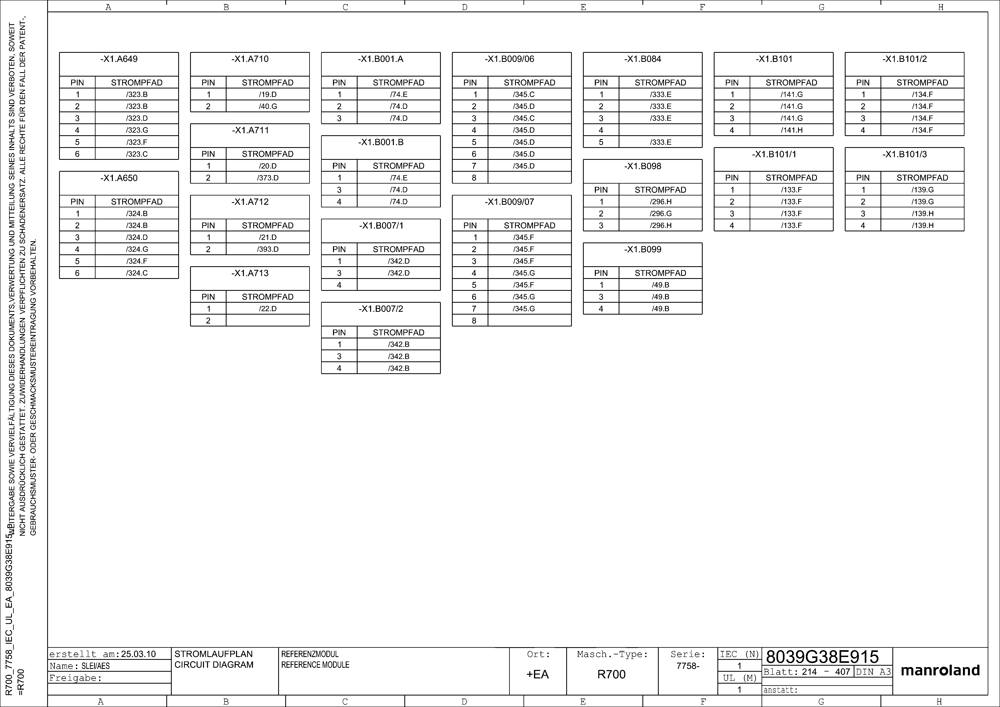

# +EA — Sheet 214 of 407 — REFERENZMODUL

**REFERENCE MODULE**

> Part of the manroland **R700** printing press IEC/UL circuit diagrams.
> Drawing class: **Stromlaufplan / Circuit diagram** (DIN A3).
> Document `+EA` covers the **Printing unit** machine section.

## At a glance

| Field | Value |
|---|---|
| Document | `+EA`  (8039G38E915) |
| Sheet | **214** of 407 |
| Section (DE) | REFERENZMODUL |
| Section (EN) | REFERENCE MODULE |
| Section type | REFERENCE_MODULE — Reference module |
| Machine type | `R700` |
| Series | `7758` |
| Created | 25.03.10 |
| Replaces | — |
| Columns used | A, B, C, D, E, F, G, H |
| Path numbers | — |
| Labels on sheet | 202 |
| Cross-refs out | 70 |
| Cross-refs in | 0 |

**Previous:** [+EA sheet 213](SHEET_0213.md) · **Next:** [+EA sheet 215](SHEET_0215.md) · **Document TOC:** [_TOC.md](_TOC.md)  (+EA) · **Master TOC:** [all sheets](../_MASTER_TOC.md)

## Sheet image (300 DPI, exact vector render)



_Rendered directly from the PDF vector layer at 300 DPI (1-bit), no OCR and no resampling. Use it to confirm anything ambiguous in the text below._

## Cross-references on this sheet

Each entry is a wire leaving this sheet. The printed token is `/sheet.column`; the link resolves to that sheet inside the same document.

| Ref | Target sheet | Col | Path | Destination on target | Target section | From col |
|---|---|---|---|---|---|---|
| `/74.E` | [+EA sheet 74](SHEET_0074.md) | E | — | — | AUSLEGERSTAPELSTEUERUNG | C |
| `/323.B` | [+EA sheet 323](SHEET_0323.md) | B | — | — | OPTION: VERLÄNGERUNG 3656,8MM | A |
| `/333.E` | [+EA sheet 333](SHEET_0333.md) | E | — | — | OPTION: BOGENWEICHE | F |
| `/134.F` | [+EA sheet 134](SHEET_0134.md) | F | — | — | ZUGANGSABSICHERUNG | H |
| `/19.D` | [+EA sheet 19](SHEET_0019.md) | D | — | — | SPANNUNGSVERSORGUNG: 400V, 24V | B |
| `/141.G` | [+EA sheet 141](SHEET_0141.md) | G | — | — | ZUGANGSABSICHERUNG | G |
| `/345.C` | [+EA sheet 345](SHEET_0345.md) | C | — | — | OPTION: INLINEOBSERVER | E |
| `/323.B` | [+EA sheet 323](SHEET_0323.md) | B | — | — | OPTION: VERLÄNGERUNG 3656,8MM | A |
| `/333.E` | [+EA sheet 333](SHEET_0333.md) | E | — | — | OPTION: BOGENWEICHE | F |
| `/40.G` | [+EA sheet 40](SHEET_0040.md) | G | — | — | BUSVERBINDUNGEN: STOP SICHERN | B |
| `/134.F` | [+EA sheet 134](SHEET_0134.md) | F | — | — | ZUGANGSABSICHERUNG | H |
| `/74.D` | [+EA sheet 74](SHEET_0074.md) | D | — | — | AUSLEGERSTAPELSTEUERUNG | C |
| `/141.G` | [+EA sheet 141](SHEET_0141.md) | G | — | — | ZUGANGSABSICHERUNG | G |
| `/345.D` | [+EA sheet 345](SHEET_0345.md) | D | — | — | OPTION: INLINEOBSERVER | E |
| `/333.E` | [+EA sheet 333](SHEET_0333.md) | E | — | — | OPTION: BOGENWEICHE | F |
| `/134.F` | [+EA sheet 134](SHEET_0134.md) | F | — | — | ZUGANGSABSICHERUNG | H |
| `/74.D` | [+EA sheet 74](SHEET_0074.md) | D | — | — | AUSLEGERSTAPELSTEUERUNG | C |
| `/141.G` | [+EA sheet 141](SHEET_0141.md) | G | — | — | ZUGANGSABSICHERUNG | G |
| `/323.D` | [+EA sheet 323](SHEET_0323.md) | D | — | — | OPTION: VERLÄNGERUNG 3656,8MM | A |
| `/345.C` | [+EA sheet 345](SHEET_0345.md) | C | — | — | OPTION: INLINEOBSERVER | E |
| `/323.G` | [+EA sheet 323](SHEET_0323.md) | G | — | — | OPTION: VERLÄNGERUNG 3656,8MM | A |
| `/134.F` | [+EA sheet 134](SHEET_0134.md) | F | — | — | ZUGANGSABSICHERUNG | H |
| `/345.D` | [+EA sheet 345](SHEET_0345.md) | D | — | — | OPTION: INLINEOBSERVER | E |
| `/141.H` | [+EA sheet 141](SHEET_0141.md) | H | — | — | ZUGANGSABSICHERUNG | G |
| `/333.E` | [+EA sheet 333](SHEET_0333.md) | E | — | — | OPTION: BOGENWEICHE | F |
| `/323.F` | [+EA sheet 323](SHEET_0323.md) | F | — | — | OPTION: VERLÄNGERUNG 3656,8MM | A |
| `/345.D` | [+EA sheet 345](SHEET_0345.md) | D | — | — | OPTION: INLINEOBSERVER | E |
| `/323.C` | [+EA sheet 323](SHEET_0323.md) | C | — | — | OPTION: VERLÄNGERUNG 3656,8MM | A |
| `/345.D` | [+EA sheet 345](SHEET_0345.md) | D | — | — | OPTION: INLINEOBSERVER | E |
| `/20.D` | [+EA sheet 20](SHEET_0020.md) | D | — | — | SPANNUNGSVERSORGUNG: 400V, 24V | B |
| `/345.D` | [+EA sheet 345](SHEET_0345.md) | D | — | — | OPTION: INLINEOBSERVER | E |
| `/74.E` | [+EA sheet 74](SHEET_0074.md) | E | — | — | AUSLEGERSTAPELSTEUERUNG | C |
| `/373.D` | [+EA sheet 373](SHEET_0373.md) | D | — | — | OPTION: ENDTROCKNER 1 VORBEREITUNG; | B |
| `/133.F` | [+EA sheet 133](SHEET_0133.md) | F | — | — | ZUGANGSABSICHERUNG | G |
| `/74.D` | [+EA sheet 74](SHEET_0074.md) | D | — | — | AUSLEGERSTAPELSTEUERUNG | C |
| `/139.G` | [+EA sheet 139](SHEET_0139.md) | G | — | — | ZUGANGSABSICHERUNG | H |
| `/133.F` | [+EA sheet 133](SHEET_0133.md) | F | — | — | ZUGANGSABSICHERUNG | G |
| `/139.G` | [+EA sheet 139](SHEET_0139.md) | G | — | — | ZUGANGSABSICHERUNG | H |
| `/74.D` | [+EA sheet 74](SHEET_0074.md) | D | — | — | AUSLEGERSTAPELSTEUERUNG | C |
| `/296.H` | [+EA sheet 296](SHEET_0296.md) | H | — | — | OPTION: ZWISCHENSTAPEL / | F |
| `/324.B` | [+EA sheet 324](SHEET_0324.md) | B | — | — | OPTION: VERLÄNGERUNG 3656,8MM | A |
| `/133.F` | [+EA sheet 133](SHEET_0133.md) | F | — | — | ZUGANGSABSICHERUNG | G |
| `/296.G` | [+EA sheet 296](SHEET_0296.md) | G | — | — | OPTION: ZWISCHENSTAPEL / | F |
| `/139.H` | [+EA sheet 139](SHEET_0139.md) | H | — | — | ZUGANGSABSICHERUNG | H |
| `/324.B` | [+EA sheet 324](SHEET_0324.md) | B | — | — | OPTION: VERLÄNGERUNG 3656,8MM | A |
| `/133.F` | [+EA sheet 133](SHEET_0133.md) | F | — | — | ZUGANGSABSICHERUNG | G |
| `/296.H` | [+EA sheet 296](SHEET_0296.md) | H | — | — | OPTION: ZWISCHENSTAPEL / | F |
| `/139.H` | [+EA sheet 139](SHEET_0139.md) | H | — | — | ZUGANGSABSICHERUNG | H |
| `/345.F` | [+EA sheet 345](SHEET_0345.md) | F | — | — | OPTION: INLINEOBSERVER | E |
| `/324.D` | [+EA sheet 324](SHEET_0324.md) | D | — | — | OPTION: VERLÄNGERUNG 3656,8MM | A |
| `/21.D` | [+EA sheet 21](SHEET_0021.md) | D | — | — | SPANNUNGSVERSORGUNG: 400V, 24V | B |
| `/345.F` | [+EA sheet 345](SHEET_0345.md) | F | — | — | OPTION: INLINEOBSERVER | E |
| `/324.G` | [+EA sheet 324](SHEET_0324.md) | G | — | — | OPTION: VERLÄNGERUNG 3656,8MM | A |
| `/393.D` | [+EA sheet 393](SHEET_0393.md) | D | — | — | OPTION: ZWISCHENTROCKNER VORBEREITUNG; | B |
| `/324.F` | [+EA sheet 324](SHEET_0324.md) | F | — | — | OPTION: VERLÄNGERUNG 3656,8MM | A |
| `/345.F` | [+EA sheet 345](SHEET_0345.md) | F | — | — | OPTION: INLINEOBSERVER | E |
| `/342.D` | [+EA sheet 342](SHEET_0342.md) | D | — | — | OPTION: BOGENWEICHE | C |
| `/345.G` | [+EA sheet 345](SHEET_0345.md) | G | — | — | OPTION: INLINEOBSERVER | E |
| `/324.C` | [+EA sheet 324](SHEET_0324.md) | C | — | — | OPTION: VERLÄNGERUNG 3656,8MM | A |
| `/342.D` | [+EA sheet 342](SHEET_0342.md) | D | — | — | OPTION: BOGENWEICHE | C |
| `/49.B` | [+EA sheet 49](SHEET_0049.md) | B | — | — | SCHUTZ | F |
| `/345.F` | [+EA sheet 345](SHEET_0345.md) | F | — | — | OPTION: INLINEOBSERVER | E |
| `/22.D` | [+EA sheet 22](SHEET_0022.md) | D | — | STROMPFAD PIN 1 2 | SPANNUNGSVERSORGUNG: 400V, 24V | B |
| `/49.B` | [+EA sheet 49](SHEET_0049.md) | B | — | — | SCHUTZ | F |
| `/345.G` | [+EA sheet 345](SHEET_0345.md) | G | — | — | OPTION: INLINEOBSERVER | E |
| `/49.B` | [+EA sheet 49](SHEET_0049.md) | B | — | — | SCHUTZ | F |
| `/345.G` | [+EA sheet 345](SHEET_0345.md) | G | — | — | OPTION: INLINEOBSERVER | E |
| `/342.B` | [+EA sheet 342](SHEET_0342.md) | B | — | — | OPTION: BOGENWEICHE | C |
| `/342.B` | [+EA sheet 342](SHEET_0342.md) | B | — | — | OPTION: BOGENWEICHE | C |
| `/342.B` | [+EA sheet 342](SHEET_0342.md) | B | — | — | OPTION: BOGENWEICHE | C |

## Devices on this sheet

| Tag | Class | Class meaning (IEC) | Col | Sub | Terminal | Sign |
|---|---|---|---|---|---|---|
| `X1.A649` | — | cross-device reference | A | — | — | — |
| `X1.A650` | — | cross-device reference | A | — | — | — |
| `X1.B101` | — | cross-device reference | G | — | — | — |
| `X1.B098` | — | cross-device reference | F | — | — | — |
| `X1.B099` | — | cross-device reference | F | — | — | — |
| `X1.B084` | — | cross-device reference | F | — | — | — |
| `X1.B001.A` | — | cross-device reference | C | — | — | — |
| `X1.B001.B` | — | cross-device reference | C | — | — | — |
| `X1.A711` | — | cross-device reference | B | — | — | — |
| `X1.A712` | — | cross-device reference | B | — | — | — |
| `X1.A710` | — | cross-device reference | B | — | — | — |
| `X1.A713` | — | cross-device reference | B | — | — | — |

## Potentials / nets

_No named potentials on this sheet._

## Wire-end annotations (grouped as printed)

A wire that continues elsewhere is annotated with a small cluster: the destination description, the path/line number `#NN`, and the `/sheet.column` cross reference. Each row below is one such cluster exactly as it is grouped on the drawing.

| Col | Y | Path | Cross-ref | Text on the wire |
|---|---|---|---|---|
| A | 65.5 | — | — | `X1.A649` |
| B | 65.5 | — | — | `X1.A710` |
| C | 65.5 | — | — | `X1.B001.A` |
| D | 65.5 | — | — | `X1.B009/06` |
| F | 65.5 | — | — | `X1.B084` |
| G | 65.5 | — | — | `X1.B101` |
| H | 65.5 | — | — | `X1.B101/2` |
| A | 94.2 | — | — | `PIN 2 3 4 5 6 1 STROMPFAD` |
| B | 94.2 | — | — | `PIN 2 1 STROMPFAD` |
| C | 94.2 | — | — | `PIN 2 3 1 STROMPFAD` |
| D | 94.2 | — | — | `PIN 2 3 4 5 6 7 8 1 STROMPFAD` |
| E | 94.2 | — | — | `PIN 2 3 4 5 1 STROMPFAD` |
| G | 94.2 | — | — | `PIN 2 3 4 1 STROMPFAD` |
| H | 94.2 | — | — | `PIN 2 3 4 1 STROMPFAD` |
| A | 108.7 | — | `/323.B` | — |
| B | 108.7 | — | `/19.D` | — |
| C | 108.7 | — | `/74.E` | — |
| E | 108.7 | — | `/345.C` | — |
| F | 108.7 | — | `/333.E` | — |
| G | 108.7 | — | `/141.G` | — |
| H | 108.7 | — | `/134.F` | — |
| A | 122.9 | — | `/323.B` | — |
| B | 122.9 | — | `/40.G` | — |
| C | 122.9 | — | `/74.D` | — |
| E | 122.9 | — | `/345.D` | — |
| F | 122.9 | — | `/333.E` | — |
| G | 122.9 | — | `/141.G` | — |
| H | 122.9 | — | `/134.F` | — |
| F | 137.0 | — | `/333.E` | — |
| H | 137.0 | — | `/134.F` | — |
| A | 137.1 | — | `/323.D` | — |
| C | 137.1 | — | `/74.D` | — |
| E | 137.1 | — | `/345.C` | — |
| G | 137.1 | — | `/141.G` | — |
| B | 150.6 | — | — | `X1.A711` |
| A | 151.2 | — | `/323.G` | — |
| E | 151.2 | — | `/345.D` | — |
| G | 151.2 | — | `/141.H` | — |
| H | 151.2 | — | `/134.F` | — |
| C | 164.7 | — | — | `X1.B001.B` |
| A | 165.4 | — | `/323.F` | — |
| E | 165.4 | — | `/345.D` | — |
| F | 165.4 | — | `/333.E` | — |
| G | 178.9 | — | — | `X1.B101/1` |
| H | 178.9 | — | — | `X1.B101/3` |
| B | 179.2 | — | — | `PIN 2 1 STROMPFAD` |
| A | 179.6 | — | `/323.C` | — |
| E | 179.6 | — | `/345.D` | — |
| F | 193.1 | — | — | `X1.B098` |
| C | 193.4 | — | — | `PIN 3 4 1 STROMPFAD` |
| B | 193.8 | — | `/20.D` | — |
| E | 193.8 | — | `/345.D` | — |
| A | 207.2 | — | — | `X1.A650` |
| G | 207.5 | — | — | `PIN 2 3 4 1 STROMPFAD` |
| H | 207.5 | — | — | `PIN 2 3 4 1 STROMPFAD` |
| B | 207.9 | — | `/373.D` | — |
| C | 207.9 | — | `/74.E` | — |
| E | 221.7 | — | — | `PIN 2 3 1 STROMPFAD` |
| C | 222.1 | — | `/74.D` | — |
| G | 222.1 | — | `/133.F` | — |
| H | 222.1 | — | `/139.G` | — |
| B | 235.6 | — | — | `X1.A712` |
| D | 235.6 | — | — | `X1.B009/07` |
| A | 235.9 | — | — | `PIN 2 3 4 5 6 1 STROMPFAD` |
| C | 236.3 | — | `/74.D` | — |
| F | 236.3 | — | `/296.H` | — |
| G | 236.3 | — | `/133.F` | — |
| H | 236.3 | — | `/139.G` | — |
| A | 250.4 | — | `/324.B` | — |
| F | 250.4 | — | `/296.G` | — |
| G | 250.4 | — | `/133.F` | — |
| H | 250.4 | — | `/139.H` | — |
| C | 263.9 | — | — | `X1.B007/1` |
| B | 264.2 | — | — | `PIN 2 1 STROMPFAD` |
| D | 264.2 | — | — | `PIN 2 3 4 5 6 7 8 1 STROMPFAD` |
| A | 264.6 | — | `/324.B` | — |
| F | 264.6 | — | `/296.H` | — |
| G | 264.6 | — | `/133.F` | — |
| H | 264.6 | — | `/139.H` | — |
| A | 278.8 | — | `/324.D` | — |
| B | 278.8 | — | `/21.D` | — |
| E | 278.8 | — | `/345.F` | — |
| F | 292.3 | — | — | `X1.B099` |
| C | 292.6 | — | — | `PIN 3 4 1 STROMPFAD` |
| E | 292.9 | — | `/345.F` | — |
| A | 293.0 | — | `/324.G` | — |
| B | 293.0 | — | `/393.D` | — |
| A | 307.1 | — | `/324.F` | — |
| C | 307.1 | — | `/342.D` | — |
| E | 307.1 | — | `/345.F` | — |
| B | 320.6 | — | — | `X1.A713` |
| E | 320.9 | — | — | `PIN 3 4 1 STROMPFAD` |
| A | 321.3 | — | `/324.C` | — |
| C | 321.3 | — | `/342.D` | — |
| E | 321.3 | — | `/345.G` | — |
| F | 335.4 | — | `/49.B` | — |
| E | 335.5 | — | `/345.F` | — |
| B | 349.3 | — | `/22.D` | `PIN 2 1 STROMPFAD` |
| E | 349.6 | — | `/345.G` | — |
| F | 349.6 | — | `/49.B` | — |
| C | 363.1 | — | — | `X1.B007/2` |
| E | 363.8 | — | `/345.G` | — |
| F | 363.8 | — | `/49.B` | — |
| C | 391.8 | — | — | `PIN 3 4 1 STROMPFAD` |
| C | 406.3 | — | `/342.B` | — |
| C | 420.5 | — | `/342.B` | — |
| C | 434.7 | — | `/342.B` | — |


## Reconstructed tables

This sheet carries tabular content (pin map / terminal assignment / index). The grid below was rebuilt from the drawing's own rule lines, so each row is exactly one physical row of the table.

### Table 1 — 14 data rows × 2 columns (at x=70.9, y=62.4) — **X1.A649**

| PIN | STROMPFAD |
|---|---|
| `1` | `/323.B` |
| `2` | `/323.B` |
| `3` | `/323.D` |
| `4` | `/323.G` |
| `5` | `/323.F` |
| `6` | `/323.C` |
|  | `X1.A650` |
| `PIN` | `STROMPFAD` |
| `1` | `/324.B` |
| `2` | `/324.B` |
| `3` | `/324.D` |
| `4` | `/324.G` |
| `5` | `/324.F` |
| `6` | `/324.C` |


### Table 2 — 14 data rows × 2 columns (at x=226.8, y=62.4) — **X1.A710**

| PIN | STROMPFAD |
|---|---|
| `1` | `/19.D` |
| `2` | `/40.G` |
|  | `X1.A711` |
| `PIN` | `STROMPFAD` |
| `1` | `/20.D` |
| `2` | `/373.D` |
|  | `X1.A712` |
| `PIN` | `STROMPFAD` |
| `1` | `/21.D` |
| `2` | `/393.D` |
|  | `X1.A713` |
| `PIN` | `STROMPFAD` |
| `1` | `/22.D` |
| `2` |  |


### Table 3 — 18 data rows × 2 columns (at x=382.7, y=62.4) — **X1.B001.A**

| PIN | STROMPFAD |
|---|---|
| `1` | `/74.E` |
| `2` | `/74.D` |
| `3` | `/74.D` |
|  | `X1.B001.B` |
| `PIN` | `STROMPFAD` |
| `1` | `/74.E` |
| `3` | `/74.D` |
| `4` | `/74.D` |
|  | `X1.B007/1` |
| `PIN` | `STROMPFAD` |
| `1` | `/342.D` |
| `3` | `/342.D` |
| `4` |  |
|  | `X1.B007/2` |
| `PIN` | `STROMPFAD` |
| `1` | `/342.B` |
| `3` | `/342.B` |
| `4` | `/342.B` |


### Table 4 — 18 data rows × 2 columns (at x=538.6, y=62.4) — **X1.B009/06**

| PIN | STROMPFAD |
|---|---|
| `1` | `/345.C` |
| `2` | `/345.D` |
| `3` | `/345.C` |
| `4` | `/345.D` |
| `5` | `/345.D` |
| `6` | `/345.D` |
| `7` | `/345.D` |
| `8` |  |
|  | `X1.B009/07` |
| `PIN` | `STROMPFAD` |
| `1` | `/345.F` |
| `2` | `/345.F` |
| `3` | `/345.F` |
| `4` | `/345.G` |
| `5` | `/345.F` |
| `6` | `/345.G` |
| `7` | `/345.G` |
| `8` |  |


### Table 5 — 15 data rows × 2 columns (at x=694.5, y=62.4) — **X1.B084**

| PIN | STROMPFAD |
|---|---|
| `1` | `/333.E` |
| `2` | `/333.E` |
| `3` | `/333.E` |
| `4` |  |
| `5` | `/333.E` |
|  | `X1.B098` |
| `PIN` | `STROMPFAD` |
| `1` | `/296.H` |
| `2` | `/296.G` |
| `3` | `/296.H` |
|  | `X1.B099` |
| `PIN` | `STROMPFAD` |
| `1` | `/49.B` |
| `3` | `/49.B` |
| `4` | `/49.B` |


### Table 6 — 10 data rows × 2 columns (at x=850.4, y=62.4) — **X1.B101**

| PIN | STROMPFAD |
|---|---|
| `1` | `/141.G` |
| `2` | `/141.G` |
| `3` | `/141.G` |
| `4` | `/141.H` |
|  | `X1.B101/1` |
| `PIN` | `STROMPFAD` |
| `1` | `/133.F` |
| `2` | `/133.F` |
| `3` | `/133.F` |
| `4` | `/133.F` |


### Table 7 — 10 data rows × 2 columns (at x=1006.3, y=62.4) — **X1.B101/2**

| PIN | STROMPFAD |
|---|---|
| `1` | `/134.F` |
| `2` | `/134.F` |
| `3` | `/134.F` |
| `4` | `/134.F` |
|  | `X1.B101/3` |
| `PIN` | `STROMPFAD` |
| `1` | `/139.G` |
| `2` | `/139.G` |
| `3` | `/139.H` |
| `4` | `/139.H` |


## Notes and free text on this sheet

| Text | Col | Y (pt) |
|---|---|---|
| `PIN` | A | 94.2 |
| `STROMPFAD` | A | 94.15 |
| `PIN` | D | 94.2 |
| `STROMPFAD` | E | 94.15 |
| `X1.B009/06` | D | 65.51 |
| `X1.B009/07` | D | 235.58 |
| `PIN` | F | 94.2 |
| `STROMPFAD` | G | 94.15 |
| `X1.B101/1` | G | 178.9 |
| `PIN` | E | 221.76 |
| `STROMPFAD` | F | 221.71 |
| `PIN` | G | 94.2 |
| `STROMPFAD` | H | 94.15 |
| `X1.B101/2` | H | 65.51 |
| `X1.B101/3` | H | 178.9 |
| `PIN` | C | 94.2 |
| `STROMPFAD` | C | 94.15 |
| `X1.B007/1` | C | 263.94 |
| `X1.B007/2` | C | 363.15 |
| `PIN` | B | 179.24 |
| `STROMPFAD` | B | 179.19 |

## Complete label inventory (exact text from the drawing)

Every text object inside the drawing area of this sheet, in DIN reading order (column A→H, then top→bottom). This is the authoritative list: if a string is not here it is not printed on this sheet.

| Col | Y | X | Dir | Type | Text |
|---|---|---|---|---|---|
| A | 65.5 | 119.8 | → | device ref | `X1.A649` |
| A | 94.2 | 84.0 | → | text | `PIN` |
| A | 94.2 | 132.2 | → | text | `STROMPFAD` |
| A | 108.4 | 90.0 | → | number | `1` |
| A | 108.7 | 150.4 | → | cross-reference | `/323.B` |
| A | 122.5 | 89.4 | → | number | `2` |
| A | 122.9 | 150.4 | → | cross-reference | `/323.B` |
| A | 136.7 | 89.4 | → | number | `3` |
| A | 137.1 | 150.2 | → | cross-reference | `/323.D` |
| A | 150.9 | 89.4 | → | number | `4` |
| A | 151.2 | 150.1 | → | cross-reference | `/323.G` |
| A | 165.1 | 89.4 | → | number | `5` |
| A | 165.4 | 150.7 | → | cross-reference | `/323.F` |
| A | 179.2 | 89.4 | → | number | `6` |
| A | 179.6 | 150.2 | → | cross-reference | `/323.C` |
| A | 207.2 | 119.8 | → | device ref | `X1.A650` |
| A | 235.9 | 84.0 | → | text | `PIN` |
| A | 235.9 | 132.2 | → | text | `STROMPFAD` |
| A | 250.1 | 90.0 | → | number | `1` |
| A | 250.4 | 150.4 | → | cross-reference | `/324.B` |
| A | 264.3 | 89.4 | → | number | `2` |
| A | 264.6 | 150.4 | → | cross-reference | `/324.B` |
| A | 278.5 | 89.4 | → | number | `3` |
| A | 278.8 | 150.2 | → | cross-reference | `/324.D` |
| A | 292.6 | 89.4 | → | number | `4` |
| A | 293.0 | 150.1 | → | cross-reference | `/324.G` |
| A | 306.8 | 89.4 | → | number | `5` |
| A | 307.1 | 150.7 | → | cross-reference | `/324.F` |
| A | 321.0 | 89.4 | → | number | `6` |
| A | 321.3 | 150.2 | → | cross-reference | `/324.C` |
| B | 65.5 | 275.7 | → | device ref | `X1.A710` |
| B | 94.2 | 240.0 | → | text | `PIN` |
| B | 94.2 | 288.1 | → | text | `STROMPFAD` |
| B | 108.4 | 245.9 | → | number | `1` |
| B | 108.7 | 308.6 | → | cross-reference | `/19.D` |
| B | 122.5 | 245.3 | → | number | `2` |
| B | 122.9 | 308.4 | → | cross-reference | `/40.G` |
| B | 150.5 | 276.4 | → | device ref | `X1.A711` |
| B | 179.2 | 240.0 | → | text | `PIN` |
| B | 179.2 | 288.1 | → | text | `STROMPFAD` |
| B | 193.4 | 245.9 | → | number | `1` |
| B | 193.7 | 308.6 | → | cross-reference | `/20.D` |
| B | 207.6 | 245.3 | → | number | `2` |
| B | 207.9 | 306.1 | → | cross-reference | `/373.D` |
| B | 235.6 | 275.7 | → | device ref | `X1.A712` |
| B | 264.2 | 288.1 | → | text | `STROMPFAD` |
| B | 264.3 | 240.0 | → | text | `PIN` |
| B | 278.5 | 245.9 | → | number | `1` |
| B | 278.8 | 308.6 | → | cross-reference | `/21.D` |
| B | 292.6 | 245.3 | → | number | `2` |
| B | 293.0 | 306.1 | → | cross-reference | `/393.D` |
| B | 320.6 | 275.7 | → | device ref | `X1.A713` |
| B | 349.3 | 240.0 | → | text | `PIN` |
| B | 349.3 | 288.1 | → | text | `STROMPFAD` |
| B | 363.5 | 245.9 | → | number | `1` |
| B | 363.8 | 308.6 | → | cross-reference | `/22.D` |
| B | 377.7 | 245.3 | → | number | `2` |
| C | 65.5 | 426.2 | → | device ref | `X1.B001.A` |
| C | 94.2 | 395.9 | → | text | `PIN` |
| C | 94.2 | 444.0 | → | text | `STROMPFAD` |
| C | 108.4 | 401.8 | → | number | `1` |
| C | 108.7 | 464.7 | → | cross-reference | `/74.E` |
| C | 122.5 | 401.2 | → | number | `2` |
| C | 122.9 | 464.5 | → | cross-reference | `/74.D` |
| C | 136.7 | 401.2 | → | number | `3` |
| C | 137.1 | 464.5 | → | cross-reference | `/74.D` |
| C | 164.7 | 426.6 | → | device ref | `X1.B001.B` |
| C | 193.4 | 395.9 | → | text | `PIN` |
| C | 193.4 | 444.0 | → | text | `STROMPFAD` |
| C | 207.6 | 401.8 | → | number | `1` |
| C | 207.9 | 464.7 | → | cross-reference | `/74.E` |
| C | 221.8 | 401.2 | → | number | `3` |
| C | 222.1 | 464.5 | → | cross-reference | `/74.D` |
| C | 235.9 | 401.2 | → | number | `4` |
| C | 236.3 | 464.5 | → | cross-reference | `/74.D` |
| C | 263.9 | 427.9 | → | text | `X1.B007/1` |
| C | 292.6 | 395.9 | → | text | `PIN` |
| C | 292.6 | 444.0 | → | text | `STROMPFAD` |
| C | 306.8 | 401.8 | → | number | `1` |
| C | 307.1 | 462.0 | → | cross-reference | `/342.D` |
| C | 321.0 | 401.2 | → | number | `3` |
| C | 321.3 | 462.0 | → | cross-reference | `/342.D` |
| C | 335.1 | 401.2 | → | number | `4` |
| C | 363.1 | 427.2 | → | text | `X1.B007/2` |
| C | 391.8 | 395.9 | → | text | `PIN` |
| C | 391.8 | 444.0 | → | text | `STROMPFAD` |
| C | 406.0 | 401.8 | → | number | `1` |
| C | 406.3 | 462.2 | → | cross-reference | `/342.B` |
| C | 420.2 | 401.2 | → | number | `3` |
| C | 420.5 | 462.2 | → | cross-reference | `/342.B` |
| C | 434.4 | 401.2 | → | number | `4` |
| C | 434.7 | 462.2 | → | cross-reference | `/342.B` |
| D | 65.5 | 577.3 | → | text | `X1.B009/06` |
| D | 94.2 | 551.8 | → | text | `PIN` |
| D | 108.4 | 563.5 | → | number | `1` |
| D | 122.5 | 561.8 | → | number | `2` |
| D | 136.7 | 561.8 | → | number | `3` |
| D | 150.9 | 561.8 | → | number | `4` |
| D | 165.1 | 561.8 | → | number | `5` |
| D | 179.2 | 561.8 | → | number | `6` |
| D | 193.4 | 561.8 | → | number | `7` |
| D | 207.6 | 561.8 | → | number | `8` |
| D | 235.6 | 577.3 | → | text | `X1.B009/07` |
| D | 264.3 | 551.8 | → | text | `PIN` |
| D | 278.5 | 563.5 | → | number | `1` |
| D | 292.6 | 561.8 | → | number | `2` |
| D | 306.8 | 561.8 | → | number | `3` |
| D | 321.0 | 561.8 | → | number | `4` |
| D | 335.1 | 561.8 | → | number | `5` |
| D | 349.3 | 561.8 | → | number | `6` |
| D | 363.5 | 561.8 | → | number | `7` |
| D | 377.7 | 561.8 | → | number | `8` |
| E | 94.2 | 600.0 | → | text | `STROMPFAD` |
| E | 94.2 | 707.7 | → | text | `PIN` |
| E | 108.4 | 713.6 | → | number | `1` |
| E | 108.7 | 610.9 | → | cross-reference | `/345.C` |
| E | 122.5 | 713.1 | → | number | `2` |
| E | 122.9 | 610.9 | → | cross-reference | `/345.D` |
| E | 136.7 | 713.1 | → | number | `3` |
| E | 137.1 | 610.9 | → | cross-reference | `/345.C` |
| E | 150.9 | 713.1 | → | number | `4` |
| E | 151.2 | 610.9 | → | cross-reference | `/345.D` |
| E | 165.1 | 713.1 | → | number | `5` |
| E | 165.4 | 610.9 | → | cross-reference | `/345.D` |
| E | 179.6 | 610.9 | → | cross-reference | `/345.D` |
| E | 193.8 | 610.9 | → | cross-reference | `/345.D` |
| E | 221.8 | 707.7 | → | text | `PIN` |
| E | 235.9 | 713.6 | → | number | `1` |
| E | 250.1 | 713.1 | → | number | `2` |
| E | 264.2 | 600.0 | → | text | `STROMPFAD` |
| E | 264.3 | 713.1 | → | number | `3` |
| E | 278.8 | 611.3 | → | cross-reference | `/345.F` |
| E | 293.0 | 611.3 | → | cross-reference | `/345.F` |
| E | 307.1 | 611.3 | → | cross-reference | `/345.F` |
| E | 321.0 | 707.7 | → | text | `PIN` |
| E | 321.3 | 610.7 | → | cross-reference | `/345.G` |
| E | 335.1 | 713.6 | → | number | `1` |
| E | 335.5 | 611.3 | → | cross-reference | `/345.F` |
| E | 349.3 | 713.1 | → | number | `3` |
| E | 349.7 | 610.7 | → | cross-reference | `/345.G` |
| E | 363.5 | 713.1 | → | number | `4` |
| E | 363.8 | 610.7 | → | cross-reference | `/345.G` |
| F | 65.5 | 743.4 | → | device ref | `X1.B084` |
| F | 94.2 | 755.9 | → | text | `STROMPFAD` |
| F | 94.2 | 863.6 | → | text | `PIN` |
| F | 108.4 | 869.5 | → | number | `1` |
| F | 108.7 | 774.1 | → | cross-reference | `/333.E` |
| F | 122.5 | 869.0 | → | number | `2` |
| F | 122.9 | 774.1 | → | cross-reference | `/333.E` |
| F | 136.7 | 869.0 | → | number | `3` |
| F | 137.0 | 774.1 | → | cross-reference | `/333.E` |
| F | 150.9 | 869.0 | → | number | `4` |
| F | 165.4 | 774.1 | → | cross-reference | `/333.E` |
| F | 193.1 | 743.4 | → | device ref | `X1.B098` |
| F | 207.6 | 863.6 | → | text | `PIN` |
| F | 221.7 | 755.9 | → | text | `STROMPFAD` |
| F | 221.8 | 869.5 | → | number | `1` |
| F | 235.9 | 869.0 | → | number | `2` |
| F | 236.3 | 774.1 | → | cross-reference | `/296.H` |
| F | 250.1 | 869.0 | → | number | `3` |
| F | 250.4 | 773.7 | → | cross-reference | `/296.G` |
| F | 264.3 | 869.0 | → | number | `4` |
| F | 264.6 | 774.1 | → | cross-reference | `/296.H` |
| F | 292.3 | 743.4 | → | device ref | `X1.B099` |
| F | 320.9 | 755.9 | → | text | `STROMPFAD` |
| F | 335.4 | 776.4 | → | cross-reference | `/49.B` |
| F | 349.6 | 776.4 | → | cross-reference | `/49.B` |
| F | 363.8 | 776.4 | → | cross-reference | `/49.B` |
| G | 65.5 | 900.0 | → | device ref | `X1.B101` |
| G | 94.2 | 911.8 | → | text | `STROMPFAD` |
| G | 94.2 | 1019.5 | → | text | `PIN` |
| G | 108.4 | 1025.4 | → | number | `1` |
| G | 108.7 | 929.6 | → | cross-reference | `/141.G` |
| G | 122.5 | 1024.9 | → | number | `2` |
| G | 122.9 | 929.6 | → | cross-reference | `/141.G` |
| G | 136.7 | 1024.9 | → | number | `3` |
| G | 137.1 | 929.6 | → | cross-reference | `/141.G` |
| G | 150.9 | 1024.9 | → | number | `4` |
| G | 151.2 | 930.0 | → | cross-reference | `/141.H` |
| G | 178.9 | 895.6 | → | text | `X1.B101/1` |
| G | 207.5 | 911.8 | → | text | `STROMPFAD` |
| G | 207.6 | 1019.5 | → | text | `PIN` |
| G | 221.8 | 1025.4 | → | number | `1` |
| G | 222.1 | 930.2 | → | cross-reference | `/133.F` |
| G | 235.9 | 1024.9 | → | number | `2` |
| G | 236.3 | 930.2 | → | cross-reference | `/133.F` |
| G | 250.1 | 1024.9 | → | number | `3` |
| G | 250.4 | 930.2 | → | cross-reference | `/133.F` |
| G | 264.3 | 1024.9 | → | number | `4` |
| G | 264.6 | 930.2 | → | cross-reference | `/133.F` |
| H | 65.5 | 1050.8 | → | text | `X1.B101/2` |
| H | 94.2 | 1067.7 | → | text | `STROMPFAD` |
| H | 108.7 | 1086.1 | → | cross-reference | `/134.F` |
| H | 122.9 | 1086.1 | → | cross-reference | `/134.F` |
| H | 137.0 | 1086.1 | → | cross-reference | `/134.F` |
| H | 151.2 | 1086.1 | → | cross-reference | `/134.F` |
| H | 178.9 | 1050.8 | → | text | `X1.B101/3` |
| H | 207.5 | 1067.7 | → | text | `STROMPFAD` |
| H | 222.1 | 1085.5 | → | cross-reference | `/139.G` |
| H | 236.3 | 1085.5 | → | cross-reference | `/139.G` |
| H | 250.4 | 1086.0 | → | cross-reference | `/139.H` |
| H | 264.6 | 1086.0 | → | cross-reference | `/139.H` |

## Reading-order text block

The same content as a plain block, grouped by DIN column — convenient to paste or to match against a visual description.

```text
=== Column A ===
  65.5  119.8  devref       X1.A649
  94.2   84.0  text         PIN
  94.2  132.2  text         STROMPFAD
 108.4   90.0  numeric      1
 108.7  150.4  xref         /323.B
 122.5   89.4  numeric      2
 122.9  150.4  xref         /323.B
 136.7   89.4  numeric      3
 137.1  150.2  xref         /323.D
 150.9   89.4  numeric      4
 151.2  150.1  xref         /323.G
 165.1   89.4  numeric      5
 165.4  150.7  xref         /323.F
 179.2   89.4  numeric      6
 179.6  150.2  xref         /323.C
 207.2  119.8  devref       X1.A650
 235.9   84.0  text         PIN
 235.9  132.2  text         STROMPFAD
 250.1   90.0  numeric      1
 250.4  150.4  xref         /324.B
 264.3   89.4  numeric      2
 264.6  150.4  xref         /324.B
 278.5   89.4  numeric      3
 278.8  150.2  xref         /324.D
 292.6   89.4  numeric      4
 293.0  150.1  xref         /324.G
 306.8   89.4  numeric      5
 307.1  150.7  xref         /324.F
 321.0   89.4  numeric      6
 321.3  150.2  xref         /324.C
=== Column B ===
  65.5  275.7  devref       X1.A710
  94.2  240.0  text         PIN
  94.2  288.1  text         STROMPFAD
 108.4  245.9  numeric      1
 108.7  308.6  xref         /19.D
 122.5  245.3  numeric      2
 122.9  308.4  xref         /40.G
 150.5  276.4  devref       X1.A711
 179.2  240.0  text         PIN
 179.2  288.1  text         STROMPFAD
 193.4  245.9  numeric      1
 193.7  308.6  xref         /20.D
 207.6  245.3  numeric      2
 207.9  306.1  xref         /373.D
 235.6  275.7  devref       X1.A712
 264.2  288.1  text         STROMPFAD
 264.3  240.0  text         PIN
 278.5  245.9  numeric      1
 278.8  308.6  xref         /21.D
 292.6  245.3  numeric      2
 293.0  306.1  xref         /393.D
 320.6  275.7  devref       X1.A713
 349.3  240.0  text         PIN
 349.3  288.1  text         STROMPFAD
 363.5  245.9  numeric      1
 363.8  308.6  xref         /22.D
 377.7  245.3  numeric      2
=== Column C ===
  65.5  426.2  devref       X1.B001.A
  94.2  395.9  text         PIN
  94.2  444.0  text         STROMPFAD
 108.4  401.8  numeric      1
 108.7  464.7  xref         /74.E
 122.5  401.2  numeric      2
 122.9  464.5  xref         /74.D
 136.7  401.2  numeric      3
 137.1  464.5  xref         /74.D
 164.7  426.6  devref       X1.B001.B
 193.4  395.9  text         PIN
 193.4  444.0  text         STROMPFAD
 207.6  401.8  numeric      1
 207.9  464.7  xref         /74.E
 221.8  401.2  numeric      3
 222.1  464.5  xref         /74.D
 235.9  401.2  numeric      4
 236.3  464.5  xref         /74.D
 263.9  427.9  text         X1.B007/1
 292.6  395.9  text         PIN
 292.6  444.0  text         STROMPFAD
 306.8  401.8  numeric      1
 307.1  462.0  xref         /342.D
 321.0  401.2  numeric      3
 321.3  462.0  xref         /342.D
 335.1  401.2  numeric      4
 363.1  427.2  text         X1.B007/2
 391.8  395.9  text         PIN
 391.8  444.0  text         STROMPFAD
 406.0  401.8  numeric      1
 406.3  462.2  xref         /342.B
 420.2  401.2  numeric      3
 420.5  462.2  xref         /342.B
 434.4  401.2  numeric      4
 434.7  462.2  xref         /342.B
=== Column D ===
  65.5  577.3  text         X1.B009/06
  94.2  551.8  text         PIN
 108.4  563.5  numeric      1
 122.5  561.8  numeric      2
 136.7  561.8  numeric      3
 150.9  561.8  numeric      4
 165.1  561.8  numeric      5
 179.2  561.8  numeric      6
 193.4  561.8  numeric      7
 207.6  561.8  numeric      8
 235.6  577.3  text         X1.B009/07
 264.3  551.8  text         PIN
 278.5  563.5  numeric      1
 292.6  561.8  numeric      2
 306.8  561.8  numeric      3
 321.0  561.8  numeric      4
 335.1  561.8  numeric      5
 349.3  561.8  numeric      6
 363.5  561.8  numeric      7
 377.7  561.8  numeric      8
=== Column E ===
  94.2  600.0  text         STROMPFAD
  94.2  707.7  text         PIN
 108.4  713.6  numeric      1
 108.7  610.9  xref         /345.C
 122.5  713.1  numeric      2
 122.9  610.9  xref         /345.D
 136.7  713.1  numeric      3
 137.1  610.9  xref         /345.C
 150.9  713.1  numeric      4
 151.2  610.9  xref         /345.D
 165.1  713.1  numeric      5
 165.4  610.9  xref         /345.D
 179.6  610.9  xref         /345.D
 193.8  610.9  xref         /345.D
 221.8  707.7  text         PIN
 235.9  713.6  numeric      1
 250.1  713.1  numeric      2
 264.2  600.0  text         STROMPFAD
 264.3  713.1  numeric      3
 278.8  611.3  xref         /345.F
 293.0  611.3  xref         /345.F
 307.1  611.3  xref         /345.F
 321.0  707.7  text         PIN
 321.3  610.7  xref         /345.G
 335.1  713.6  numeric      1
 335.5  611.3  xref         /345.F
 349.3  713.1  numeric      3
 349.7  610.7  xref         /345.G
 363.5  713.1  numeric      4
 363.8  610.7  xref         /345.G
=== Column F ===
  65.5  743.4  devref       X1.B084
  94.2  755.9  text         STROMPFAD
  94.2  863.6  text         PIN
 108.4  869.5  numeric      1
 108.7  774.1  xref         /333.E
 122.5  869.0  numeric      2
 122.9  774.1  xref         /333.E
 136.7  869.0  numeric      3
 137.0  774.1  xref         /333.E
 150.9  869.0  numeric      4
 165.4  774.1  xref         /333.E
 193.1  743.4  devref       X1.B098
 207.6  863.6  text         PIN
 221.7  755.9  text         STROMPFAD
 221.8  869.5  numeric      1
 235.9  869.0  numeric      2
 236.3  774.1  xref         /296.H
 250.1  869.0  numeric      3
 250.4  773.7  xref         /296.G
 264.3  869.0  numeric      4
 264.6  774.1  xref         /296.H
 292.3  743.4  devref       X1.B099
 320.9  755.9  text         STROMPFAD
 335.4  776.4  xref         /49.B
 349.6  776.4  xref         /49.B
 363.8  776.4  xref         /49.B
=== Column G ===
  65.5  900.0  devref       X1.B101
  94.2  911.8  text         STROMPFAD
  94.2 1019.5  text         PIN
 108.4 1025.4  numeric      1
 108.7  929.6  xref         /141.G
 122.5 1024.9  numeric      2
 122.9  929.6  xref         /141.G
 136.7 1024.9  numeric      3
 137.1  929.6  xref         /141.G
 150.9 1024.9  numeric      4
 151.2  930.0  xref         /141.H
 178.9  895.6  text         X1.B101/1
 207.5  911.8  text         STROMPFAD
 207.6 1019.5  text         PIN
 221.8 1025.4  numeric      1
 222.1  930.2  xref         /133.F
 235.9 1024.9  numeric      2
 236.3  930.2  xref         /133.F
 250.1 1024.9  numeric      3
 250.4  930.2  xref         /133.F
 264.3 1024.9  numeric      4
 264.6  930.2  xref         /133.F
=== Column H ===
  65.5 1050.8  text         X1.B101/2
  94.2 1067.7  text         STROMPFAD
 108.7 1086.1  xref         /134.F
 122.9 1086.1  xref         /134.F
 137.0 1086.1  xref         /134.F
 151.2 1086.1  xref         /134.F
 178.9 1050.8  text         X1.B101/3
 207.5 1067.7  text         STROMPFAD
 222.1 1085.5  xref         /139.G
 236.3 1085.5  xref         /139.G
 250.4 1086.0  xref         /139.H
 264.6 1086.0  xref         /139.H
```

---
_Generated from the PDF vector text layer; no OCR. Source: `R700_7758_IEC_UL_EA_8039G38E915_p`, sheet 214._
