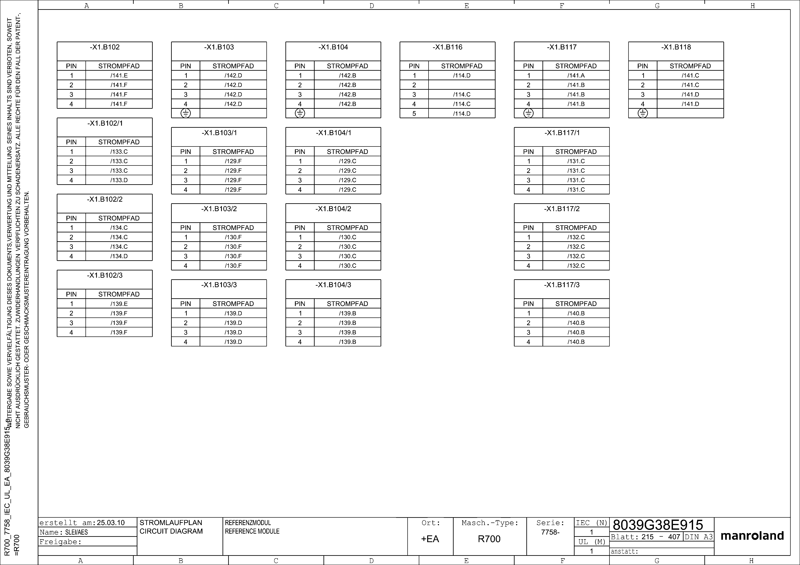

# +EA — Sheet 215 of 407 — REFERENZMODUL

**REFERENCE MODULE**

> Part of the manroland **R700** printing press IEC/UL circuit diagrams.
> Drawing class: **Stromlaufplan / Circuit diagram** (DIN A3).
> Document `+EA` covers the **Printing unit** machine section.

## At a glance

| Field | Value |
|---|---|
| Document | `+EA`  (8039G38E915) |
| Sheet | **215** of 407 |
| Section (DE) | REFERENZMODUL |
| Section (EN) | REFERENCE MODULE |
| Section type | REFERENCE_MODULE — Reference module |
| Machine type | `R700` |
| Series | `7758` |
| Created | 25.03.10 |
| Replaces | — |
| Columns used | A, B, C, D, E, F, G |
| Path numbers | — |
| Labels on sheet | 199 |
| Cross-refs out | 72 |
| Cross-refs in | 0 |

**Previous:** [+EA sheet 214](SHEET_0214.md) · **Next:** [+EA sheet 216](SHEET_0216.md) · **Document TOC:** [_TOC.md](_TOC.md)  (+EA) · **Master TOC:** [all sheets](../_MASTER_TOC.md)

## Sheet image (300 DPI, exact vector render)



_Rendered directly from the PDF vector layer at 300 DPI (1-bit), no OCR and no resampling. Use it to confirm anything ambiguous in the text below._

## Cross-references on this sheet

Each entry is a wire leaving this sheet. The printed token is `/sheet.column`; the link resolves to that sheet inside the same document.

| Ref | Target sheet | Col | Path | Destination on target | Target section | From col |
|---|---|---|---|---|---|---|
| `/141.E` | [+EA sheet 141](SHEET_0141.md) | E | — | — | ZUGANGSABSICHERUNG | A |
| `/142.B` | [+EA sheet 142](SHEET_0142.md) | B | — | — | ZUGANGSABSICHERUNG | D |
| `/141.A` | [+EA sheet 141](SHEET_0141.md) | A | — | — | ZUGANGSABSICHERUNG | F |
| `/142.D` | [+EA sheet 142](SHEET_0142.md) | D | — | — | ZUGANGSABSICHERUNG | C |
| `/114.D` | [+EA sheet 114](SHEET_0114.md) | D | — | — | FEHLBOGENKONTROLLE | E |
| `/141.C` | [+EA sheet 141](SHEET_0141.md) | C | — | — | ZUGANGSABSICHERUNG | G |
| `/142.B` | [+EA sheet 142](SHEET_0142.md) | B | — | — | ZUGANGSABSICHERUNG | D |
| `/141.B` | [+EA sheet 141](SHEET_0141.md) | B | — | — | ZUGANGSABSICHERUNG | F |
| `/141.F` | [+EA sheet 141](SHEET_0141.md) | F | — | — | ZUGANGSABSICHERUNG | A |
| `/142.D` | [+EA sheet 142](SHEET_0142.md) | D | — | — | ZUGANGSABSICHERUNG | C |
| `/141.C` | [+EA sheet 141](SHEET_0141.md) | C | — | — | ZUGANGSABSICHERUNG | G |
| `/141.F` | [+EA sheet 141](SHEET_0141.md) | F | — | — | ZUGANGSABSICHERUNG | A |
| `/142.B` | [+EA sheet 142](SHEET_0142.md) | B | — | — | ZUGANGSABSICHERUNG | D |
| `/141.B` | [+EA sheet 141](SHEET_0141.md) | B | — | — | ZUGANGSABSICHERUNG | F |
| `/142.D` | [+EA sheet 142](SHEET_0142.md) | D | — | — | ZUGANGSABSICHERUNG | C |
| `/114.C` | [+EA sheet 114](SHEET_0114.md) | C | — | — | FEHLBOGENKONTROLLE | E |
| `/141.D` | [+EA sheet 141](SHEET_0141.md) | D | — | — | ZUGANGSABSICHERUNG | G |
| `/142.B` | [+EA sheet 142](SHEET_0142.md) | B | — | — | ZUGANGSABSICHERUNG | D |
| `/141.B` | [+EA sheet 141](SHEET_0141.md) | B | — | — | ZUGANGSABSICHERUNG | F |
| `/141.F` | [+EA sheet 141](SHEET_0141.md) | F | — | — | ZUGANGSABSICHERUNG | A |
| `/142.D` | [+EA sheet 142](SHEET_0142.md) | D | — | — | ZUGANGSABSICHERUNG | C |
| `/114.C` | [+EA sheet 114](SHEET_0114.md) | C | — | — | FEHLBOGENKONTROLLE | E |
| `/141.D` | [+EA sheet 141](SHEET_0141.md) | D | — | — | ZUGANGSABSICHERUNG | G |
| `/114.D` | [+EA sheet 114](SHEET_0114.md) | D | — | — | FEHLBOGENKONTROLLE | E |
| `/133.C` | [+EA sheet 133](SHEET_0133.md) | C | — | — | ZUGANGSABSICHERUNG | A |
| `/129.F` | [+EA sheet 129](SHEET_0129.md) | F | — | — | ZUGANGSABSICHERUNG | C |
| `/133.C` | [+EA sheet 133](SHEET_0133.md) | C | — | — | ZUGANGSABSICHERUNG | A |
| `/129.C` | [+EA sheet 129](SHEET_0129.md) | C | — | — | ZUGANGSABSICHERUNG | D |
| `/131.C` | [+EA sheet 131](SHEET_0131.md) | C | — | — | ZUGANGSABSICHERUNG | F |
| `/129.F` | [+EA sheet 129](SHEET_0129.md) | F | — | — | ZUGANGSABSICHERUNG | C |
| `/133.C` | [+EA sheet 133](SHEET_0133.md) | C | — | — | ZUGANGSABSICHERUNG | A |
| `/129.C` | [+EA sheet 129](SHEET_0129.md) | C | — | — | ZUGANGSABSICHERUNG | D |
| `/131.C` | [+EA sheet 131](SHEET_0131.md) | C | — | — | ZUGANGSABSICHERUNG | F |
| `/129.F` | [+EA sheet 129](SHEET_0129.md) | F | — | — | ZUGANGSABSICHERUNG | C |
| `/133.D` | [+EA sheet 133](SHEET_0133.md) | D | — | — | ZUGANGSABSICHERUNG | A |
| `/129.C` | [+EA sheet 129](SHEET_0129.md) | C | — | — | ZUGANGSABSICHERUNG | D |
| `/131.C` | [+EA sheet 131](SHEET_0131.md) | C | — | — | ZUGANGSABSICHERUNG | F |
| `/129.F` | [+EA sheet 129](SHEET_0129.md) | F | — | — | ZUGANGSABSICHERUNG | C |
| `/129.C` | [+EA sheet 129](SHEET_0129.md) | C | — | — | ZUGANGSABSICHERUNG | D |
| `/131.C` | [+EA sheet 131](SHEET_0131.md) | C | — | — | ZUGANGSABSICHERUNG | F |
| `/134.C` | [+EA sheet 134](SHEET_0134.md) | C | — | — | ZUGANGSABSICHERUNG | A |
| `/130.F` | [+EA sheet 130](SHEET_0130.md) | F | — | — | ZUGANGSABSICHERUNG | C |
| `/134.C` | [+EA sheet 134](SHEET_0134.md) | C | — | — | ZUGANGSABSICHERUNG | A |
| `/130.C` | [+EA sheet 130](SHEET_0130.md) | C | — | — | ZUGANGSABSICHERUNG | D |
| `/132.C` | [+EA sheet 132](SHEET_0132.md) | C | — | — | ZUGANGSABSICHERUNG | F |
| `/130.F` | [+EA sheet 130](SHEET_0130.md) | F | — | — | ZUGANGSABSICHERUNG | C |
| `/134.C` | [+EA sheet 134](SHEET_0134.md) | C | — | — | ZUGANGSABSICHERUNG | A |
| `/130.C` | [+EA sheet 130](SHEET_0130.md) | C | — | — | ZUGANGSABSICHERUNG | D |
| `/132.C` | [+EA sheet 132](SHEET_0132.md) | C | — | — | ZUGANGSABSICHERUNG | F |
| `/130.F` | [+EA sheet 130](SHEET_0130.md) | F | — | — | ZUGANGSABSICHERUNG | C |
| `/134.D` | [+EA sheet 134](SHEET_0134.md) | D | — | — | ZUGANGSABSICHERUNG | A |
| `/130.C` | [+EA sheet 130](SHEET_0130.md) | C | — | — | ZUGANGSABSICHERUNG | D |
| `/132.C` | [+EA sheet 132](SHEET_0132.md) | C | — | — | ZUGANGSABSICHERUNG | F |
| `/130.F` | [+EA sheet 130](SHEET_0130.md) | F | — | — | ZUGANGSABSICHERUNG | C |
| `/130.C` | [+EA sheet 130](SHEET_0130.md) | C | — | — | ZUGANGSABSICHERUNG | D |
| `/132.C` | [+EA sheet 132](SHEET_0132.md) | C | — | — | ZUGANGSABSICHERUNG | F |
| `/139.E` | [+EA sheet 139](SHEET_0139.md) | E | — | — | ZUGANGSABSICHERUNG | A |
| `/139.B` | [+EA sheet 139](SHEET_0139.md) | B | — | — | ZUGANGSABSICHERUNG | D |
| `/140.B` | [+EA sheet 140](SHEET_0140.md) | B | — | — | ZUGANGSABSICHERUNG | F |
| `/139.F` | [+EA sheet 139](SHEET_0139.md) | F | — | — | ZUGANGSABSICHERUNG | A |
| `/139.D` | [+EA sheet 139](SHEET_0139.md) | D | — | — | ZUGANGSABSICHERUNG | C |
| `/139.B` | [+EA sheet 139](SHEET_0139.md) | B | — | — | ZUGANGSABSICHERUNG | D |
| `/140.B` | [+EA sheet 140](SHEET_0140.md) | B | — | — | ZUGANGSABSICHERUNG | F |
| `/139.F` | [+EA sheet 139](SHEET_0139.md) | F | — | — | ZUGANGSABSICHERUNG | A |
| `/139.D` | [+EA sheet 139](SHEET_0139.md) | D | — | — | ZUGANGSABSICHERUNG | C |
| `/139.B` | [+EA sheet 139](SHEET_0139.md) | B | — | — | ZUGANGSABSICHERUNG | D |
| `/140.B` | [+EA sheet 140](SHEET_0140.md) | B | — | — | ZUGANGSABSICHERUNG | F |
| `/139.F` | [+EA sheet 139](SHEET_0139.md) | F | — | — | ZUGANGSABSICHERUNG | A |
| `/139.D` | [+EA sheet 139](SHEET_0139.md) | D | — | — | ZUGANGSABSICHERUNG | C |
| `/139.B` | [+EA sheet 139](SHEET_0139.md) | B | — | — | ZUGANGSABSICHERUNG | D |
| `/140.B` | [+EA sheet 140](SHEET_0140.md) | B | — | — | ZUGANGSABSICHERUNG | F |
| `/139.D` | [+EA sheet 139](SHEET_0139.md) | D | — | — | ZUGANGSABSICHERUNG | C |

## Devices on this sheet

| Tag | Class | Class meaning (IEC) | Col | Sub | Terminal | Sign |
|---|---|---|---|---|---|---|
| `X1.B102` | — | cross-device reference | A | — | — | — |
| `X1.B103` | — | cross-device reference | B | — | — | — |
| `X1.B104` | — | cross-device reference | D | — | — | — |
| `X1.B116` | — | cross-device reference | E | — | — | — |
| `X1.B117` | — | cross-device reference | F | — | — | — |
| `X1.B118` | — | cross-device reference | G | — | — | — |

## Potentials / nets

_No named potentials on this sheet._

## Wire-end annotations (grouped as printed)

A wire that continues elsewhere is annotated with a small cluster: the destination description, the path/line number `#NN`, and the `/sheet.column` cross reference. Each row below is one such cluster exactly as it is grouped on the drawing.

| Col | Y | Path | Cross-ref | Text on the wire |
|---|---|---|---|---|
| A | 65.5 | — | — | `X1.B102` |
| B | 65.5 | — | — | `X1.B103` |
| D | 65.5 | — | — | `X1.B104` |
| E | 65.5 | — | — | `X1.B116` |
| F | 65.5 | — | — | `X1.B117` |
| G | 65.5 | — | — | `X1.B118` |
| A | 94.2 | — | — | `PIN 2 3 4 1 STROMPFAD` |
| B | 94.2 | — | — | `PIN 2 3 4 1 STROMPFAD` |
| D | 94.2 | — | — | `PIN 2 3 4 1 STROMPFAD` |
| E | 94.2 | — | — | `PIN 2 3 4 5 1 STROMPFAD` |
| F | 94.2 | — | — | `PIN 2 3 4 1 STROMPFAD` |
| G | 94.2 | — | — | `PIN 2 3 4 1 STROMPFAD` |
| A | 108.7 | — | `/141.E` | — |
| C | 108.7 | — | `/142.D` | — |
| D | 108.7 | — | `/142.B` | — |
| E | 108.7 | — | `/114.D` | — |
| F | 108.7 | — | `/141.A` | — |
| G | 108.7 | — | `/141.C` | — |
| A | 122.9 | — | `/141.F` | — |
| C | 122.9 | — | `/142.D` | — |
| D | 122.9 | — | `/142.B` | — |
| F | 122.9 | — | `/141.B` | — |
| G | 122.9 | — | `/141.C` | — |
| A | 137.0 | — | `/141.F` | — |
| D | 137.0 | — | `/142.B` | — |
| F | 137.0 | — | `/141.B` | — |
| C | 137.1 | — | `/142.D` | — |
| E | 137.1 | — | `/114.C` | — |
| G | 137.1 | — | `/141.D` | — |
| A | 151.2 | — | `/141.F` | — |
| C | 151.2 | — | `/142.D` | — |
| D | 151.2 | — | `/142.B` | — |
| E | 151.2 | — | `/114.C` | — |
| F | 151.2 | — | `/141.B` | — |
| G | 151.2 | — | `/141.D` | — |
| E | 165.4 | — | `/114.D` | — |
| A | 178.9 | — | — | `X1.B102/1` |
| B | 193.1 | — | — | `X1.B103/1` |
| D | 193.1 | — | — | `X1.B104/1` |
| F | 193.1 | — | — | `X1.B117/1` |
| A | 207.5 | — | — | `PIN 2 3 4 1 STROMPFAD` |
| B | 221.7 | — | — | `PIN 2 3 4 1 STROMPFAD` |
| D | 221.7 | — | — | `PIN 2 3 4 1 STROMPFAD` |
| F | 221.7 | — | — | `PIN 2 3 4 1 STROMPFAD` |
| A | 222.1 | — | `/133.C` | — |
| A | 236.3 | — | `/133.C` | — |
| C | 236.3 | — | `/129.F` | — |
| D | 236.3 | — | `/129.C` | — |
| F | 236.3 | — | `/131.C` | — |
| A | 250.4 | — | `/133.C` | — |
| C | 250.4 | — | `/129.F` | — |
| D | 250.4 | — | `/129.C` | — |
| F | 250.4 | — | `/131.C` | — |
| A | 264.6 | — | `/133.D` | — |
| C | 264.6 | — | `/129.F` | — |
| D | 264.6 | — | `/129.C` | — |
| F | 264.6 | — | `/131.C` | — |
| C | 278.8 | — | `/129.F` | — |
| D | 278.8 | — | `/129.C` | — |
| F | 278.8 | — | `/131.C` | — |
| A | 292.3 | — | — | `X1.B102/2` |
| B | 306.5 | — | — | `X1.B103/2` |
| D | 306.5 | — | — | `X1.B104/2` |
| F | 306.5 | — | — | `X1.B117/2` |
| A | 320.9 | — | — | `PIN 2 3 4 1 STROMPFAD` |
| B | 335.1 | — | — | `PIN 2 3 4 1 STROMPFAD` |
| D | 335.1 | — | — | `PIN 2 3 4 1 STROMPFAD` |
| F | 335.1 | — | — | `PIN 2 3 4 1 STROMPFAD` |
| A | 335.5 | — | `/134.C` | — |
| C | 349.6 | — | `/130.F` | — |
| A | 349.7 | — | `/134.C` | — |
| D | 349.7 | — | `/130.C` | — |
| F | 349.7 | — | `/132.C` | — |
| A | 363.8 | — | `/134.C` | — |
| C | 363.8 | — | `/130.F` | — |
| D | 363.8 | — | `/130.C` | — |
| F | 363.8 | — | `/132.C` | — |
| A | 378.0 | — | `/134.D` | — |
| C | 378.0 | — | `/130.F` | — |
| D | 378.0 | — | `/130.C` | — |
| F | 378.0 | — | `/132.C` | — |
| C | 392.2 | — | `/130.F` | — |
| D | 392.2 | — | `/130.C` | — |
| F | 392.2 | — | `/132.C` | — |
| A | 405.7 | — | — | `X1.B102/3` |
| B | 419.8 | — | — | `X1.B103/3` |
| D | 419.8 | — | — | `X1.B104/3` |
| F | 419.8 | — | — | `X1.B117/3` |
| A | 434.3 | — | — | `PIN 2 3 4 1 STROMPFAD` |
| B | 448.5 | — | — | `PIN 2 3 4 1 STROMPFAD` |
| D | 448.5 | — | — | `PIN 2 3 4 1 STROMPFAD` |
| F | 448.5 | — | — | `PIN 2 3 4 1 STROMPFAD` |
| A | 448.9 | — | `/139.E` | — |
| A | 463.0 | — | `/139.F` | — |
| D | 463.0 | — | `/139.B` | — |
| F | 463.0 | — | `/140.B` | — |
| C | 463.1 | — | `/139.D` | — |
| A | 477.2 | — | `/139.F` | — |
| C | 477.2 | — | `/139.D` | — |
| D | 477.2 | — | `/139.B` | — |
| F | 477.2 | — | `/140.B` | — |
| A | 491.4 | — | `/139.F` | — |
| C | 491.4 | — | `/139.D` | — |
| D | 491.4 | — | `/139.B` | — |
| F | 491.4 | — | `/140.B` | — |
| D | 505.5 | — | `/139.B` | — |
| F | 505.5 | — | `/140.B` | — |
| C | 505.6 | — | `/139.D` | — |


## Reconstructed tables

This sheet carries tabular content (pin map / terminal assignment / index). The grid below was rebuilt from the drawing's own rule lines, so each row is exactly one physical row of the table.

### Table 1 — 22 data rows × 2 columns (at x=85.0, y=62.4) — **X1.B102**

| PIN | STROMPFAD |
|---|---|
| `1` | `/141.E` |
| `2` | `/141.F` |
| `3` | `/141.F` |
| `4` | `/141.F` |
|  | `X1.B102/1` |
| `PIN` | `STROMPFAD` |
| `1` | `/133.C` |
| `2` | `/133.C` |
| `3` | `/133.C` |
| `4` | `/133.D` |
|  | `X1.B102/2` |
| `PIN` | `STROMPFAD` |
| `1` | `/134.C` |
| `2` | `/134.C` |
| `3` | `/134.C` |
| `4` | `/134.D` |
|  | `X1.B102/3` |
| `PIN` | `STROMPFAD` |
| `1` | `/139.E` |
| `2` | `/139.F` |
| `3` | `/139.F` |
| `4` | `/139.F` |


### Table 2 — 22 data rows × 2 columns (at x=255.1, y=62.4) — **X1.B103**

| PIN | STROMPFAD |
|---|---|
| `1` | `/142.D` |
| `2` | `/142.D` |
| `3` | `/142.D` |
| `4` | `/142.D` |
|  | `X1.B103/1` |
| `PIN` | `STROMPFAD` |
| `1` | `/129.F` |
| `2` | `/129.F` |
| `3` | `/129.F` |
| `4` | `/129.F` |
|  | `X1.B103/2` |
| `PIN` | `STROMPFAD` |
| `1` | `/130.F` |
| `2` | `/130.F` |
| `3` | `/130.F` |
| `4` | `/130.F` |
|  | `X1.B103/3` |
| `PIN` | `STROMPFAD` |
| `1` | `/139.D` |
| `2` | `/139.D` |
| `3` | `/139.D` |
| `4` | `/139.D` |


### Table 3 — 22 data rows × 2 columns (at x=425.2, y=62.4) — **X1.B104**

| PIN | STROMPFAD |
|---|---|
| `1` | `/142.B` |
| `2` | `/142.B` |
| `3` | `/142.B` |
| `4` | `/142.B` |
|  | `X1.B104/1` |
| `PIN` | `STROMPFAD` |
| `1` | `/129.C` |
| `2` | `/129.C` |
| `3` | `/129.C` |
| `4` | `/129.C` |
|  | `X1.B104/2` |
| `PIN` | `STROMPFAD` |
| `1` | `/130.C` |
| `2` | `/130.C` |
| `3` | `/130.C` |
| `4` | `/130.C` |
|  | `X1.B104/3` |
| `PIN` | `STROMPFAD` |
| `1` | `/139.B` |
| `2` | `/139.B` |
| `3` | `/139.B` |
| `4` | `/139.B` |


### Table 4 — 5 data rows × 2 columns (at x=595.3, y=62.4) — **X1.B116**

| PIN | STROMPFAD |
|---|---|
| `1` | `/114.D` |
| `2` |  |
| `3` | `/114.C` |
| `4` | `/114.C` |
| `5` | `/114.D` |


### Table 5 — 22 data rows × 2 columns (at x=765.4, y=62.4) — **X1.B117**

| PIN | STROMPFAD |
|---|---|
| `1` | `/141.A` |
| `2` | `/141.B` |
| `3` | `/141.B` |
| `4` | `/141.B` |
|  | `X1.B117/1` |
| `PIN` | `STROMPFAD` |
| `1` | `/131.C` |
| `2` | `/131.C` |
| `3` | `/131.C` |
| `4` | `/131.C` |
|  | `X1.B117/2` |
| `PIN` | `STROMPFAD` |
| `1` | `/132.C` |
| `2` | `/132.C` |
| `3` | `/132.C` |
| `4` | `/132.C` |
|  | `X1.B117/3` |
| `PIN` | `STROMPFAD` |
| `1` | `/140.B` |
| `2` | `/140.B` |
| `3` | `/140.B` |
| `4` | `/140.B` |


### Table 6 — 4 data rows × 2 columns (at x=935.4, y=62.4) — **X1.B118**

| PIN | STROMPFAD |
|---|---|
| `1` | `/141.C` |
| `2` | `/141.C` |
| `3` | `/141.D` |
| `4` | `/141.D` |


## Notes and free text on this sheet

| Text | Col | Y (pt) |
|---|---|---|
| `PIN` | A | 94.2 |
| `STROMPFAD` | A | 94.15 |
| `X1.B102/1` | A | 178.9 |
| `X1.B102/2` | A | 292.28 |
| `X1.B102/3` | A | 405.67 |
| `PIN` | B | 94.2 |
| `STROMPFAD` | C | 94.15 |
| `X1.B103/1` | B | 193.07 |
| `X1.B103/2` | B | 306.46 |
| `X1.B103/3` | B | 419.84 |
| `PIN` | C | 94.2 |
| `STROMPFAD` | D | 94.15 |
| `X1.B104/1` | D | 193.07 |
| `X1.B104/2` | D | 306.46 |
| `X1.B104/3` | D | 419.84 |
| `PIN` | D | 94.2 |
| `STROMPFAD` | E | 94.15 |
| `PIN` | F | 94.2 |
| `STROMPFAD` | F | 94.15 |
| `X1.B117/1` | F | 193.07 |
| `X1.B117/2` | F | 306.46 |
| `X1.B117/3` | F | 419.84 |
| `PIN` | G | 94.2 |
| `STROMPFAD` | G | 94.15 |

## Complete label inventory (exact text from the drawing)

Every text object inside the drawing area of this sheet, in DIN reading order (column A→H, then top→bottom). This is the authoritative list: if a string is not here it is not printed on this sheet.

| Col | Y | X | Dir | Type | Text |
|---|---|---|---|---|---|
| A | 65.5 | 133.9 | → | device ref | `X1.B102` |
| A | 94.2 | 98.2 | → | text | `PIN` |
| A | 94.2 | 146.4 | → | text | `STROMPFAD` |
| A | 108.4 | 104.2 | → | number | `1` |
| A | 108.7 | 164.7 | → | cross-reference | `/141.E` |
| A | 122.5 | 103.6 | → | number | `2` |
| A | 122.9 | 164.8 | → | cross-reference | `/141.F` |
| A | 136.7 | 103.6 | → | number | `3` |
| A | 137.0 | 164.8 | → | cross-reference | `/141.F` |
| A | 150.9 | 103.6 | → | number | `4` |
| A | 151.2 | 164.8 | → | cross-reference | `/141.F` |
| A | 178.9 | 130.3 | → | text | `X1.B102/1` |
| A | 207.5 | 146.4 | → | text | `STROMPFAD` |
| A | 207.6 | 98.2 | → | text | `PIN` |
| A | 221.8 | 104.2 | → | number | `1` |
| A | 222.1 | 164.4 | → | cross-reference | `/133.C` |
| A | 235.9 | 103.6 | → | number | `2` |
| A | 236.3 | 164.4 | → | cross-reference | `/133.C` |
| A | 250.1 | 103.6 | → | number | `3` |
| A | 250.4 | 164.4 | → | cross-reference | `/133.C` |
| A | 264.3 | 103.6 | → | number | `4` |
| A | 264.6 | 164.4 | → | cross-reference | `/133.D` |
| A | 292.3 | 129.5 | → | text | `X1.B102/2` |
| A | 320.9 | 146.4 | → | text | `STROMPFAD` |
| A | 321.0 | 98.2 | → | text | `PIN` |
| A | 335.1 | 104.2 | → | number | `1` |
| A | 335.5 | 164.4 | → | cross-reference | `/134.C` |
| A | 349.3 | 103.6 | → | number | `2` |
| A | 349.7 | 164.4 | → | cross-reference | `/134.C` |
| A | 363.5 | 103.6 | → | number | `3` |
| A | 363.8 | 164.4 | → | cross-reference | `/134.C` |
| A | 377.7 | 103.6 | → | number | `4` |
| A | 378.0 | 164.4 | → | cross-reference | `/134.D` |
| A | 405.7 | 129.5 | → | text | `X1.B102/3` |
| A | 434.3 | 146.4 | → | text | `STROMPFAD` |
| A | 434.4 | 98.2 | → | text | `PIN` |
| A | 448.5 | 104.2 | → | number | `1` |
| A | 448.8 | 164.7 | → | cross-reference | `/139.E` |
| A | 462.7 | 103.6 | → | number | `2` |
| A | 463.0 | 164.8 | → | cross-reference | `/139.F` |
| A | 476.9 | 103.6 | → | number | `3` |
| A | 477.2 | 164.8 | → | cross-reference | `/139.F` |
| A | 491.0 | 103.6 | → | number | `4` |
| A | 491.4 | 164.8 | → | cross-reference | `/139.F` |
| B | 65.5 | 304.0 | → | device ref | `X1.B103` |
| B | 94.2 | 268.3 | → | text | `PIN` |
| B | 108.4 | 274.3 | → | number | `1` |
| B | 122.5 | 273.7 | → | number | `2` |
| B | 136.7 | 273.7 | → | number | `3` |
| B | 150.9 | 273.7 | → | number | `4` |
| B | 193.1 | 300.3 | → | text | `X1.B103/1` |
| B | 221.8 | 268.3 | → | text | `PIN` |
| B | 235.9 | 274.3 | → | number | `1` |
| B | 250.1 | 273.7 | → | number | `2` |
| B | 264.3 | 273.7 | → | number | `3` |
| B | 278.5 | 273.7 | → | number | `4` |
| B | 306.5 | 299.6 | → | text | `X1.B103/2` |
| B | 335.1 | 268.3 | → | text | `PIN` |
| B | 349.3 | 274.3 | → | number | `1` |
| B | 363.5 | 273.7 | → | number | `2` |
| B | 377.7 | 273.7 | → | number | `3` |
| B | 391.8 | 273.7 | → | number | `4` |
| B | 419.8 | 299.6 | → | text | `X1.B103/3` |
| B | 448.5 | 268.3 | → | text | `PIN` |
| B | 462.7 | 274.3 | → | number | `1` |
| B | 476.9 | 273.7 | → | number | `2` |
| B | 491.0 | 273.7 | → | number | `3` |
| B | 505.2 | 273.7 | → | number | `4` |
| C | 94.2 | 316.5 | → | text | `STROMPFAD` |
| C | 94.2 | 438.4 | → | text | `PIN` |
| C | 108.4 | 444.3 | → | number | `1` |
| C | 108.7 | 334.5 | → | cross-reference | `/142.D` |
| C | 122.5 | 443.8 | → | number | `2` |
| C | 122.9 | 334.5 | → | cross-reference | `/142.D` |
| C | 136.7 | 443.8 | → | number | `3` |
| C | 137.1 | 334.5 | → | cross-reference | `/142.D` |
| C | 150.9 | 443.8 | → | number | `4` |
| C | 151.2 | 334.5 | → | cross-reference | `/142.D` |
| C | 221.7 | 316.5 | → | text | `STROMPFAD` |
| C | 221.8 | 438.4 | → | text | `PIN` |
| C | 235.9 | 444.3 | → | number | `1` |
| C | 236.3 | 334.9 | → | cross-reference | `/129.F` |
| C | 250.1 | 443.8 | → | number | `2` |
| C | 250.4 | 334.9 | → | cross-reference | `/129.F` |
| C | 264.3 | 443.8 | → | number | `3` |
| C | 264.6 | 334.9 | → | cross-reference | `/129.F` |
| C | 278.5 | 443.8 | → | number | `4` |
| C | 278.8 | 334.9 | → | cross-reference | `/129.F` |
| C | 335.1 | 316.5 | → | text | `STROMPFAD` |
| C | 335.1 | 438.4 | → | text | `PIN` |
| C | 349.3 | 444.3 | → | number | `1` |
| C | 349.6 | 334.9 | → | cross-reference | `/130.F` |
| C | 363.5 | 443.8 | → | number | `2` |
| C | 363.8 | 334.9 | → | cross-reference | `/130.F` |
| C | 377.7 | 443.8 | → | number | `3` |
| C | 378.0 | 334.9 | → | cross-reference | `/130.F` |
| C | 391.8 | 443.8 | → | number | `4` |
| C | 392.2 | 334.9 | → | cross-reference | `/130.F` |
| C | 448.5 | 316.5 | → | text | `STROMPFAD` |
| C | 448.5 | 438.4 | → | text | `PIN` |
| C | 462.7 | 444.3 | → | number | `1` |
| C | 463.0 | 334.5 | → | cross-reference | `/139.D` |
| C | 476.9 | 443.8 | → | number | `2` |
| C | 477.2 | 334.5 | → | cross-reference | `/139.D` |
| C | 491.0 | 443.8 | → | number | `3` |
| C | 491.4 | 334.5 | → | cross-reference | `/139.D` |
| C | 505.2 | 443.8 | → | number | `4` |
| C | 505.6 | 334.5 | → | cross-reference | `/139.D` |
| D | 65.5 | 474.1 | → | device ref | `X1.B104` |
| D | 94.2 | 486.6 | → | text | `STROMPFAD` |
| D | 94.2 | 608.5 | → | text | `PIN` |
| D | 108.4 | 614.4 | → | number | `1` |
| D | 108.7 | 504.7 | → | cross-reference | `/142.B` |
| D | 122.5 | 613.8 | → | number | `2` |
| D | 122.9 | 504.7 | → | cross-reference | `/142.B` |
| D | 136.7 | 613.8 | → | number | `3` |
| D | 137.0 | 504.7 | → | cross-reference | `/142.B` |
| D | 150.9 | 613.8 | → | number | `4` |
| D | 151.2 | 504.7 | → | cross-reference | `/142.B` |
| D | 165.1 | 613.8 | → | number | `5` |
| D | 193.1 | 470.4 | → | text | `X1.B104/1` |
| D | 221.7 | 486.6 | → | text | `STROMPFAD` |
| D | 236.3 | 504.6 | → | cross-reference | `/129.C` |
| D | 250.4 | 504.6 | → | cross-reference | `/129.C` |
| D | 264.6 | 504.6 | → | cross-reference | `/129.C` |
| D | 278.8 | 504.6 | → | cross-reference | `/129.C` |
| D | 306.5 | 469.7 | → | text | `X1.B104/2` |
| D | 335.1 | 486.6 | → | text | `STROMPFAD` |
| D | 349.7 | 504.6 | → | cross-reference | `/130.C` |
| D | 363.8 | 504.6 | → | cross-reference | `/130.C` |
| D | 378.0 | 504.6 | → | cross-reference | `/130.C` |
| D | 392.2 | 504.6 | → | cross-reference | `/130.C` |
| D | 419.8 | 469.7 | → | text | `X1.B104/3` |
| D | 448.5 | 486.6 | → | text | `STROMPFAD` |
| D | 463.0 | 504.7 | → | cross-reference | `/139.B` |
| D | 477.2 | 504.7 | → | cross-reference | `/139.B` |
| D | 491.4 | 504.7 | → | cross-reference | `/139.B` |
| D | 505.5 | 504.7 | → | cross-reference | `/139.B` |
| E | 65.5 | 644.2 | → | device ref | `X1.B116` |
| E | 94.2 | 656.6 | → | text | `STROMPFAD` |
| E | 108.7 | 674.6 | → | cross-reference | `/114.D` |
| E | 137.1 | 674.6 | → | cross-reference | `/114.C` |
| E | 151.2 | 674.6 | → | cross-reference | `/114.C` |
| E | 165.4 | 674.6 | → | cross-reference | `/114.D` |
| F | 65.5 | 814.3 | → | device ref | `X1.B117` |
| F | 94.2 | 778.5 | → | text | `PIN` |
| F | 94.2 | 826.7 | → | text | `STROMPFAD` |
| F | 108.4 | 784.5 | → | number | `1` |
| F | 108.7 | 844.7 | → | cross-reference | `/141.A` |
| F | 122.5 | 783.9 | → | number | `2` |
| F | 122.9 | 844.9 | → | cross-reference | `/141.B` |
| F | 136.7 | 783.9 | → | number | `3` |
| F | 137.0 | 844.9 | → | cross-reference | `/141.B` |
| F | 150.9 | 783.9 | → | number | `4` |
| F | 151.2 | 844.9 | → | cross-reference | `/141.B` |
| F | 193.1 | 810.6 | → | text | `X1.B117/1` |
| F | 221.7 | 826.7 | → | text | `STROMPFAD` |
| F | 221.8 | 778.5 | → | text | `PIN` |
| F | 235.9 | 784.5 | → | number | `1` |
| F | 236.3 | 844.7 | → | cross-reference | `/131.C` |
| F | 250.1 | 783.9 | → | number | `2` |
| F | 250.4 | 844.7 | → | cross-reference | `/131.C` |
| F | 264.3 | 783.9 | → | number | `3` |
| F | 264.6 | 844.7 | → | cross-reference | `/131.C` |
| F | 278.5 | 783.9 | → | number | `4` |
| F | 278.8 | 844.7 | → | cross-reference | `/131.C` |
| F | 306.5 | 809.9 | → | text | `X1.B117/2` |
| F | 335.1 | 778.5 | → | text | `PIN` |
| F | 335.1 | 826.7 | → | text | `STROMPFAD` |
| F | 349.3 | 784.5 | → | number | `1` |
| F | 349.7 | 844.7 | → | cross-reference | `/132.C` |
| F | 363.5 | 783.9 | → | number | `2` |
| F | 363.8 | 844.7 | → | cross-reference | `/132.C` |
| F | 377.7 | 783.9 | → | number | `3` |
| F | 378.0 | 844.7 | → | cross-reference | `/132.C` |
| F | 391.8 | 783.9 | → | number | `4` |
| F | 392.2 | 844.7 | → | cross-reference | `/132.C` |
| F | 419.8 | 809.9 | → | text | `X1.B117/3` |
| F | 448.5 | 778.5 | → | text | `PIN` |
| F | 448.5 | 826.7 | → | text | `STROMPFAD` |
| F | 462.7 | 784.5 | → | number | `1` |
| F | 463.0 | 844.9 | → | cross-reference | `/140.B` |
| F | 476.9 | 783.9 | → | number | `2` |
| F | 477.2 | 844.9 | → | cross-reference | `/140.B` |
| F | 491.0 | 783.9 | → | number | `3` |
| F | 491.4 | 844.9 | → | cross-reference | `/140.B` |
| F | 505.2 | 783.9 | → | number | `4` |
| F | 505.5 | 844.9 | → | cross-reference | `/140.B` |
| G | 65.5 | 984.3 | → | device ref | `X1.B118` |
| G | 94.2 | 948.6 | → | text | `PIN` |
| G | 94.2 | 996.8 | → | text | `STROMPFAD` |
| G | 108.4 | 954.6 | → | number | `1` |
| G | 108.7 | 1014.8 | → | cross-reference | `/141.C` |
| G | 122.5 | 954.0 | → | number | `2` |
| G | 122.9 | 1014.8 | → | cross-reference | `/141.C` |
| G | 136.7 | 954.0 | → | number | `3` |
| G | 137.1 | 1014.8 | → | cross-reference | `/141.D` |
| G | 150.9 | 954.0 | → | number | `4` |
| G | 151.2 | 1014.8 | → | cross-reference | `/141.D` |

## Reading-order text block

The same content as a plain block, grouped by DIN column — convenient to paste or to match against a visual description.

```text
=== Column A ===
  65.5  133.9  devref       X1.B102
  94.2   98.2  text         PIN
  94.2  146.4  text         STROMPFAD
 108.4  104.2  numeric      1
 108.7  164.7  xref         /141.E
 122.5  103.6  numeric      2
 122.9  164.8  xref         /141.F
 136.7  103.6  numeric      3
 137.0  164.8  xref         /141.F
 150.9  103.6  numeric      4
 151.2  164.8  xref         /141.F
 178.9  130.3  text         X1.B102/1
 207.5  146.4  text         STROMPFAD
 207.6   98.2  text         PIN
 221.8  104.2  numeric      1
 222.1  164.4  xref         /133.C
 235.9  103.6  numeric      2
 236.3  164.4  xref         /133.C
 250.1  103.6  numeric      3
 250.4  164.4  xref         /133.C
 264.3  103.6  numeric      4
 264.6  164.4  xref         /133.D
 292.3  129.5  text         X1.B102/2
 320.9  146.4  text         STROMPFAD
 321.0   98.2  text         PIN
 335.1  104.2  numeric      1
 335.5  164.4  xref         /134.C
 349.3  103.6  numeric      2
 349.7  164.4  xref         /134.C
 363.5  103.6  numeric      3
 363.8  164.4  xref         /134.C
 377.7  103.6  numeric      4
 378.0  164.4  xref         /134.D
 405.7  129.5  text         X1.B102/3
 434.3  146.4  text         STROMPFAD
 434.4   98.2  text         PIN
 448.5  104.2  numeric      1
 448.8  164.7  xref         /139.E
 462.7  103.6  numeric      2
 463.0  164.8  xref         /139.F
 476.9  103.6  numeric      3
 477.2  164.8  xref         /139.F
 491.0  103.6  numeric      4
 491.4  164.8  xref         /139.F
=== Column B ===
  65.5  304.0  devref       X1.B103
  94.2  268.3  text         PIN
 108.4  274.3  numeric      1
 122.5  273.7  numeric      2
 136.7  273.7  numeric      3
 150.9  273.7  numeric      4
 193.1  300.3  text         X1.B103/1
 221.8  268.3  text         PIN
 235.9  274.3  numeric      1
 250.1  273.7  numeric      2
 264.3  273.7  numeric      3
 278.5  273.7  numeric      4
 306.5  299.6  text         X1.B103/2
 335.1  268.3  text         PIN
 349.3  274.3  numeric      1
 363.5  273.7  numeric      2
 377.7  273.7  numeric      3
 391.8  273.7  numeric      4
 419.8  299.6  text         X1.B103/3
 448.5  268.3  text         PIN
 462.7  274.3  numeric      1
 476.9  273.7  numeric      2
 491.0  273.7  numeric      3
 505.2  273.7  numeric      4
=== Column C ===
  94.2  316.5  text         STROMPFAD
  94.2  438.4  text         PIN
 108.4  444.3  numeric      1
 108.7  334.5  xref         /142.D
 122.5  443.8  numeric      2
 122.9  334.5  xref         /142.D
 136.7  443.8  numeric      3
 137.1  334.5  xref         /142.D
 150.9  443.8  numeric      4
 151.2  334.5  xref         /142.D
 221.7  316.5  text         STROMPFAD
 221.8  438.4  text         PIN
 235.9  444.3  numeric      1
 236.3  334.9  xref         /129.F
 250.1  443.8  numeric      2
 250.4  334.9  xref         /129.F
 264.3  443.8  numeric      3
 264.6  334.9  xref         /129.F
 278.5  443.8  numeric      4
 278.8  334.9  xref         /129.F
 335.1  316.5  text         STROMPFAD
 335.1  438.4  text         PIN
 349.3  444.3  numeric      1
 349.6  334.9  xref         /130.F
 363.5  443.8  numeric      2
 363.8  334.9  xref         /130.F
 377.7  443.8  numeric      3
 378.0  334.9  xref         /130.F
 391.8  443.8  numeric      4
 392.2  334.9  xref         /130.F
 448.5  316.5  text         STROMPFAD
 448.5  438.4  text         PIN
 462.7  444.3  numeric      1
 463.0  334.5  xref         /139.D
 476.9  443.8  numeric      2
 477.2  334.5  xref         /139.D
 491.0  443.8  numeric      3
 491.4  334.5  xref         /139.D
 505.2  443.8  numeric      4
 505.6  334.5  xref         /139.D
=== Column D ===
  65.5  474.1  devref       X1.B104
  94.2  486.6  text         STROMPFAD
  94.2  608.5  text         PIN
 108.4  614.4  numeric      1
 108.7  504.7  xref         /142.B
 122.5  613.8  numeric      2
 122.9  504.7  xref         /142.B
 136.7  613.8  numeric      3
 137.0  504.7  xref         /142.B
 150.9  613.8  numeric      4
 151.2  504.7  xref         /142.B
 165.1  613.8  numeric      5
 193.1  470.4  text         X1.B104/1
 221.7  486.6  text         STROMPFAD
 236.3  504.6  xref         /129.C
 250.4  504.6  xref         /129.C
 264.6  504.6  xref         /129.C
 278.8  504.6  xref         /129.C
 306.5  469.7  text         X1.B104/2
 335.1  486.6  text         STROMPFAD
 349.7  504.6  xref         /130.C
 363.8  504.6  xref         /130.C
 378.0  504.6  xref         /130.C
 392.2  504.6  xref         /130.C
 419.8  469.7  text         X1.B104/3
 448.5  486.6  text         STROMPFAD
 463.0  504.7  xref         /139.B
 477.2  504.7  xref         /139.B
 491.4  504.7  xref         /139.B
 505.5  504.7  xref         /139.B
=== Column E ===
  65.5  644.2  devref       X1.B116
  94.2  656.6  text         STROMPFAD
 108.7  674.6  xref         /114.D
 137.1  674.6  xref         /114.C
 151.2  674.6  xref         /114.C
 165.4  674.6  xref         /114.D
=== Column F ===
  65.5  814.3  devref       X1.B117
  94.2  778.5  text         PIN
  94.2  826.7  text         STROMPFAD
 108.4  784.5  numeric      1
 108.7  844.7  xref         /141.A
 122.5  783.9  numeric      2
 122.9  844.9  xref         /141.B
 136.7  783.9  numeric      3
 137.0  844.9  xref         /141.B
 150.9  783.9  numeric      4
 151.2  844.9  xref         /141.B
 193.1  810.6  text         X1.B117/1
 221.7  826.7  text         STROMPFAD
 221.8  778.5  text         PIN
 235.9  784.5  numeric      1
 236.3  844.7  xref         /131.C
 250.1  783.9  numeric      2
 250.4  844.7  xref         /131.C
 264.3  783.9  numeric      3
 264.6  844.7  xref         /131.C
 278.5  783.9  numeric      4
 278.8  844.7  xref         /131.C
 306.5  809.9  text         X1.B117/2
 335.1  778.5  text         PIN
 335.1  826.7  text         STROMPFAD
 349.3  784.5  numeric      1
 349.7  844.7  xref         /132.C
 363.5  783.9  numeric      2
 363.8  844.7  xref         /132.C
 377.7  783.9  numeric      3
 378.0  844.7  xref         /132.C
 391.8  783.9  numeric      4
 392.2  844.7  xref         /132.C
 419.8  809.9  text         X1.B117/3
 448.5  778.5  text         PIN
 448.5  826.7  text         STROMPFAD
 462.7  784.5  numeric      1
 463.0  844.9  xref         /140.B
 476.9  783.9  numeric      2
 477.2  844.9  xref         /140.B
 491.0  783.9  numeric      3
 491.4  844.9  xref         /140.B
 505.2  783.9  numeric      4
 505.5  844.9  xref         /140.B
=== Column G ===
  65.5  984.3  devref       X1.B118
  94.2  948.6  text         PIN
  94.2  996.8  text         STROMPFAD
 108.4  954.6  numeric      1
 108.7 1014.8  xref         /141.C
 122.5  954.0  numeric      2
 122.9 1014.8  xref         /141.C
 136.7  954.0  numeric      3
 137.1 1014.8  xref         /141.D
 150.9  954.0  numeric      4
 151.2 1014.8  xref         /141.D
```

---
_Generated from the PDF vector text layer; no OCR. Source: `R700_7758_IEC_UL_EA_8039G38E915_p`, sheet 215._
