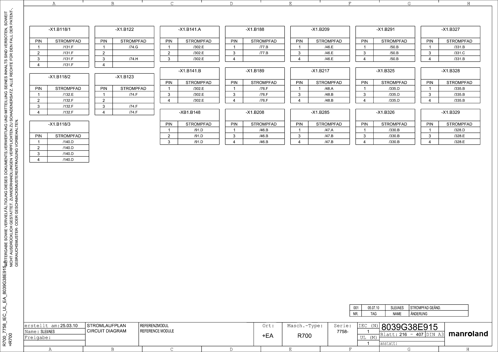

# +EA — Sheet 216 of 407 — REFERENZMODUL

**REFERENCE MODULE**

> Part of the manroland **R700** printing press IEC/UL circuit diagrams.
> Drawing class: **Stromlaufplan / Circuit diagram** (DIN A3).
> Document `+EA` covers the **Printing unit** machine section.

## At a glance

| Field | Value |
|---|---|
| Document | `+EA`  (8039G38E915) |
| Sheet | **216** of 407 |
| Section (DE) | REFERENZMODUL |
| Section (EN) | REFERENCE MODULE |
| Section type | REFERENCE_MODULE — Reference module |
| Machine type | `R700` |
| Series | `7758` |
| Created | 25.03.10 |
| Replaces | — |
| Columns used | A, B, C, D, E, F, G, H |
| Path numbers | — |
| Labels on sheet | 194 |
| Cross-refs out | 61 |
| Cross-refs in | 0 |

**Previous:** [+EA sheet 215](SHEET_0215.md) · **Next:** [+EA sheet 217](SHEET_0217.md) · **Document TOC:** [_TOC.md](_TOC.md)  (+EA) · **Master TOC:** [all sheets](../_MASTER_TOC.md)

## Sheet image (300 DPI, exact vector render)



_Rendered directly from the PDF vector layer at 300 DPI (1-bit), no OCR and no resampling. Use it to confirm anything ambiguous in the text below._

## Cross-references on this sheet

Each entry is a wire leaving this sheet. The printed token is `/sheet.column`; the link resolves to that sheet inside the same document.

| Ref | Target sheet | Col | Path | Destination on target | Target section | From col |
|---|---|---|---|---|---|---|
| `/77.B` | [+EA sheet 77](SHEET_0077.md) | B | — | — | AUSLEGERSTAPELSTEUERUNG | E |
| `/46.E` | [+EA sheet 46](SHEET_0046.md) | E | — | — | SCHUTZ | F |
| `/50.B` | [+EA sheet 50](SHEET_0050.md) | B | — | — | SCHUTZ | G |
| `/302.E` | [+EA sheet 302](SHEET_0302.md) | E | — | — | OPTION: ZWISCHENSTAPEL / | C |
| `/331.B` | [+EA sheet 331](SHEET_0331.md) | B | — | — | OPTION: BOGENWEICHE | H |
| `/131.F` | [+EA sheet 131](SHEET_0131.md) | F | — | — | ZUGANGSABSICHERUNG | A |
| `/74.G` | [+EA sheet 74](SHEET_0074.md) | G | — | — | AUSLEGERSTAPELSTEUERUNG | B |
| `/77.B` | [+EA sheet 77](SHEET_0077.md) | B | — | — | AUSLEGERSTAPELSTEUERUNG | E |
| `/46.E` | [+EA sheet 46](SHEET_0046.md) | E | — | — | SCHUTZ | F |
| `/50.B` | [+EA sheet 50](SHEET_0050.md) | B | — | — | SCHUTZ | G |
| `/302.E` | [+EA sheet 302](SHEET_0302.md) | E | — | — | OPTION: ZWISCHENSTAPEL / | C |
| `/131.F` | [+EA sheet 131](SHEET_0131.md) | F | — | — | ZUGANGSABSICHERUNG | A |
| `/331.C` | [+EA sheet 331](SHEET_0331.md) | C | — | — | OPTION: BOGENWEICHE | H |
| `/46.E` | [+EA sheet 46](SHEET_0046.md) | E | — | — | SCHUTZ | F |
| `/50.B` | [+EA sheet 50](SHEET_0050.md) | B | — | — | SCHUTZ | G |
| `/131.F` | [+EA sheet 131](SHEET_0131.md) | F | — | — | ZUGANGSABSICHERUNG | A |
| `/302.E` | [+EA sheet 302](SHEET_0302.md) | E | — | — | OPTION: ZWISCHENSTAPEL / | C |
| `/331.B` | [+EA sheet 331](SHEET_0331.md) | B | — | — | OPTION: BOGENWEICHE | H |
| `/74.H` | [+EA sheet 74](SHEET_0074.md) | H | — | — | AUSLEGERSTAPELSTEUERUNG | B |
| `/131.F` | [+EA sheet 131](SHEET_0131.md) | F | — | — | ZUGANGSABSICHERUNG | A |
| `/48.A` | [+EA sheet 48](SHEET_0048.md) | A | — | — | SCHUTZ | F |
| `/302.E` | [+EA sheet 302](SHEET_0302.md) | E | — | — | OPTION: ZWISCHENSTAPEL / | C |
| `/76.F` | [+EA sheet 76](SHEET_0076.md) | F | — | — | AUSLEGERSTAPELSTEUERUNG | E |
| `/335.B` | [+EA sheet 335](SHEET_0335.md) | B | — | — | OPTION: BOGENWEICHE | H |
| `/335.D` | [+EA sheet 335](SHEET_0335.md) | D | — | — | OPTION: BOGENWEICHE | G |
| `/48.B` | [+EA sheet 48](SHEET_0048.md) | B | — | — | SCHUTZ | F |
| `/132.E` | [+EA sheet 132](SHEET_0132.md) | E | — | — | ZUGANGSABSICHERUNG | A |
| `/74.F` | [+EA sheet 74](SHEET_0074.md) | F | — | — | AUSLEGERSTAPELSTEUERUNG | B |
| `/302.E` | [+EA sheet 302](SHEET_0302.md) | E | — | — | OPTION: ZWISCHENSTAPEL / | C |
| `/76.F` | [+EA sheet 76](SHEET_0076.md) | F | — | — | AUSLEGERSTAPELSTEUERUNG | E |
| `/335.B` | [+EA sheet 335](SHEET_0335.md) | B | — | — | OPTION: BOGENWEICHE | H |
| `/335.D` | [+EA sheet 335](SHEET_0335.md) | D | — | — | OPTION: BOGENWEICHE | G |
| `/48.B` | [+EA sheet 48](SHEET_0048.md) | B | — | — | SCHUTZ | F |
| `/302.E` | [+EA sheet 302](SHEET_0302.md) | E | — | — | OPTION: ZWISCHENSTAPEL / | C |
| `/76.F` | [+EA sheet 76](SHEET_0076.md) | F | — | — | AUSLEGERSTAPELSTEUERUNG | E |
| `/335.B` | [+EA sheet 335](SHEET_0335.md) | B | — | — | OPTION: BOGENWEICHE | H |
| `/132.F` | [+EA sheet 132](SHEET_0132.md) | F | — | — | ZUGANGSABSICHERUNG | A |
| `/335.D` | [+EA sheet 335](SHEET_0335.md) | D | — | — | OPTION: BOGENWEICHE | G |
| `/74.F` | [+EA sheet 74](SHEET_0074.md) | F | — | — | AUSLEGERSTAPELSTEUERUNG | B |
| `/132.F` | [+EA sheet 132](SHEET_0132.md) | F | — | — | ZUGANGSABSICHERUNG | A |
| `/74.F` | [+EA sheet 74](SHEET_0074.md) | F | — | — | AUSLEGERSTAPELSTEUERUNG | B |
| `/132.F` | [+EA sheet 132](SHEET_0132.md) | F | — | — | ZUGANGSABSICHERUNG | A |
| `/46.B` | [+EA sheet 46](SHEET_0046.md) | B | — | — | SCHUTZ | E |
| `/47.A` | [+EA sheet 47](SHEET_0047.md) | A | — | — | SCHUTZ | F |
| `/330.B` | [+EA sheet 330](SHEET_0330.md) | B | — | — | OPTION: BOGENWEICHE | G |
| `/91.D` | [+EA sheet 91](SHEET_0091.md) | D | — | — | BLASROHRE (BLASRAHMEN) | C |
| `/328.D` | [+EA sheet 328](SHEET_0328.md) | D | — | — | OPTION: BOGENWEICHE | H |
| `/46.B` | [+EA sheet 46](SHEET_0046.md) | B | — | — | SCHUTZ | E |
| `/47.B` | [+EA sheet 47](SHEET_0047.md) | B | — | — | SCHUTZ | F |
| `/330.B` | [+EA sheet 330](SHEET_0330.md) | B | — | — | OPTION: BOGENWEICHE | G |
| `/328.E` | [+EA sheet 328](SHEET_0328.md) | E | — | — | OPTION: BOGENWEICHE | H |
| `/91.D` | [+EA sheet 91](SHEET_0091.md) | D | — | — | BLASROHRE (BLASRAHMEN) | C |
| `/46.B` | [+EA sheet 46](SHEET_0046.md) | B | — | — | SCHUTZ | E |
| `/47.B` | [+EA sheet 47](SHEET_0047.md) | B | — | — | SCHUTZ | F |
| `/330.B` | [+EA sheet 330](SHEET_0330.md) | B | — | — | OPTION: BOGENWEICHE | G |
| `/328.E` | [+EA sheet 328](SHEET_0328.md) | E | — | — | OPTION: BOGENWEICHE | H |
| `/91.D` | [+EA sheet 91](SHEET_0091.md) | D | — | — | BLASROHRE (BLASRAHMEN) | C |
| `/140.D` | [+EA sheet 140](SHEET_0140.md) | D | — | — | ZUGANGSABSICHERUNG | A |
| `/140.D` | [+EA sheet 140](SHEET_0140.md) | D | — | — | ZUGANGSABSICHERUNG | A |
| `/140.D` | [+EA sheet 140](SHEET_0140.md) | D | — | — | ZUGANGSABSICHERUNG | A |
| `/140.D` | [+EA sheet 140](SHEET_0140.md) | D | — | — | ZUGANGSABSICHERUNG | A |

## Devices on this sheet

| Tag | Class | Class meaning (IEC) | Col | Sub | Terminal | Sign |
|---|---|---|---|---|---|---|
| `X1.B327` | — | cross-device reference | H | — | — | — |
| `X1.B291` | — | cross-device reference | G | — | — | — |
| `X1.B325` | — | cross-device reference | G | — | — | — |
| `X1.B326` | — | cross-device reference | G | — | — | — |
| `X1.B329` | — | cross-device reference | H | — | — | — |
| `X1.B328` | — | cross-device reference | H | — | — | — |
| `X1.B141.A` | — | cross-device reference | C | — | — | — |
| `X1.B141.B` | — | cross-device reference | C | — | — | — |
| `XB1.B148` | — | cross-device reference | C | — | — | — |
| `X1.B188` | — | cross-device reference | D | — | — | — |
| `X1.B189` | — | cross-device reference | D | — | — | — |
| `X1.B208` | — | cross-device reference | D | — | — | — |
| `X1.B209` | — | cross-device reference | F | — | — | — |
| `X1.B217` | — | cross-device reference | F | — | — | — |
| `X1.B285` | — | cross-device reference | F | — | — | — |
| `X1.B122` | — | cross-device reference | B | — | — | — |
| `X1.B123` | — | cross-device reference | B | — | — | — |
| `NR.` | — | cross-device reference | F | — | — | — |
| `05.07.10` | — | cross-device reference | F | — | — | — |

## Potentials / nets

_No named potentials on this sheet._

## Wire-end annotations (grouped as printed)

A wire that continues elsewhere is annotated with a small cluster: the destination description, the path/line number `#NN`, and the `/sheet.column` cross reference. Each row below is one such cluster exactly as it is grouped on the drawing.

| Col | Y | Path | Cross-ref | Text on the wire |
|---|---|---|---|---|
| A | 65.5 | — | — | `X1.B118/1` |
| B | 65.5 | — | — | `X1.B122` |
| C | 65.5 | — | — | `X1.B141.A` |
| D | 65.5 | — | — | `X1.B188` |
| F | 65.5 | — | — | `X1.B209` |
| G | 65.5 | — | — | `X1.B291` |
| H | 65.5 | — | — | `X1.B327` |
| A | 94.2 | — | — | `PIN 2 3 4 1 STROMPFAD` |
| B | 94.2 | — | — | `PIN 2 3 4 1 STROMPFAD` |
| C | 94.2 | — | — | `PIN 2 3 1 STROMPFAD` |
| D | 94.2 | — | — | `PIN 3 4 1 STROMPFAD` |
| E | 94.2 | — | — | `PIN 3 4 1 STROMPFAD` |
| G | 94.2 | — | — | `PIN 3 4 1 STROMPFAD` |
| H | 94.2 | — | — | `PIN 3 4 1 STROMPFAD` |
| A | 108.7 | — | `/131.F` | — |
| B | 108.7 | — | `/74.G` | — |
| C | 108.7 | — | `/302.E` | — |
| E | 108.7 | — | `/77.B` | — |
| F | 108.7 | — | `/46.E` | — |
| G | 108.7 | — | `/50.B` | — |
| H | 108.7 | — | `/331.B` | — |
| E | 122.8 | — | `/77.B` | — |
| F | 122.8 | — | `/46.E` | — |
| G | 122.8 | — | `/50.B` | — |
| A | 122.9 | — | `/131.F` | — |
| C | 122.9 | — | `/302.E` | — |
| H | 122.9 | — | `/331.C` | — |
| A | 137.0 | — | `/131.F` | — |
| C | 137.0 | — | `/302.E` | — |
| F | 137.0 | — | `/46.E` | — |
| G | 137.0 | — | `/50.B` | — |
| H | 137.0 | — | `/331.B` | — |
| B | 137.1 | — | `/74.H` | — |
| A | 151.2 | — | `/131.F` | — |
| C | 164.7 | — | — | `X1.B141.B` |
| D | 164.7 | — | — | `X1.B189` |
| F | 164.7 | — | — | `X1.B217` |
| G | 164.7 | — | — | `X1.B325` |
| H | 164.7 | — | — | `X1.B328` |
| A | 178.9 | — | — | `X1.B118/2` |
| B | 178.9 | — | — | `X1.B123` |
| C | 193.4 | — | — | `PIN 3 4 1 STROMPFAD` |
| D | 193.4 | — | — | `PIN 3 4 1 STROMPFAD` |
| E | 193.4 | — | — | `PIN 3 4 1 STROMPFAD` |
| G | 193.4 | — | — | `PIN 3 4 1 STROMPFAD` |
| H | 193.4 | — | — | `PIN 3 4 1 STROMPFAD` |
| A | 207.5 | — | — | `PIN 2 3 4 1 STROMPFAD` |
| B | 207.5 | — | — | `PIN 2 3 4 1 STROMPFAD` |
| C | 207.9 | — | `/302.E` | — |
| E | 207.9 | — | `/76.F` | — |
| F | 207.9 | — | `/48.A` | — |
| G | 207.9 | — | `/335.D` | — |
| H | 207.9 | — | `/335.B` | — |
| A | 222.1 | — | `/132.E` | — |
| B | 222.1 | — | `/74.F` | — |
| C | 222.1 | — | `/302.E` | — |
| E | 222.1 | — | `/76.F` | — |
| F | 222.1 | — | `/48.B` | — |
| G | 222.1 | — | `/335.D` | — |
| H | 222.1 | — | `/335.B` | — |
| C | 236.2 | — | `/302.E` | — |
| E | 236.2 | — | `/76.F` | — |
| F | 236.2 | — | `/48.B` | — |
| H | 236.2 | — | `/335.B` | — |
| A | 236.3 | — | `/132.F` | — |
| G | 236.3 | — | `/335.D` | — |
| A | 250.4 | — | `/132.F` | — |
| B | 250.4 | — | `/74.F` | — |
| C | 263.9 | — | — | `XB1.B148` |
| D | 263.9 | — | — | `X1.B208` |
| F | 263.9 | — | — | `X1.B285` |
| G | 263.9 | — | — | `X1.B326` |
| H | 263.9 | — | — | `X1.B329` |
| A | 264.6 | — | `/132.F` | — |
| B | 264.6 | — | `/74.F` | — |
| A | 292.3 | — | — | `X1.B118/3` |
| C | 292.6 | — | — | `PIN 2 3 1 STROMPFAD` |
| D | 292.6 | — | — | `PIN 3 4 1 STROMPFAD` |
| E | 292.6 | — | — | `PIN 3 4 1 STROMPFAD` |
| G | 292.6 | — | — | `PIN 3 4 1 STROMPFAD` |
| H | 292.6 | — | — | `PIN 3 4 1 STROMPFAD` |
| C | 307.1 | — | `/91.D` | — |
| E | 307.1 | — | `/46.B` | — |
| F | 307.1 | — | `/47.A` | — |
| G | 307.1 | — | `/330.B` | — |
| H | 307.1 | — | `/328.D` | — |
| A | 320.9 | — | — | `PIN 2 3 4 1 STROMPFAD` |
| C | 321.3 | — | `/91.D` | — |
| E | 321.3 | — | `/46.B` | — |
| F | 321.3 | — | `/47.B` | — |
| G | 321.3 | — | `/330.B` | — |
| H | 321.3 | — | `/328.E` | — |
| E | 335.4 | — | `/46.B` | — |
| F | 335.4 | — | `/47.B` | — |
| A | 335.5 | — | `/140.D` | — |
| C | 335.5 | — | `/91.D` | — |
| G | 335.5 | — | `/330.B` | — |
| H | 335.5 | — | `/328.E` | — |
| A | 349.7 | — | `/140.D` | — |
| A | 363.8 | — | `/140.D` | — |
| A | 378.0 | — | `/140.D` | — |
| G | 733.0 | — | — | `001 05.07.10 SLEI/AES STROMPFAD GEÄND.` |
| G | 747.1 | — | — | `NR. TAG NAME ÄNDERUNG` |


## Reconstructed tables

This sheet carries tabular content (pin map / terminal assignment / index). The grid below was rebuilt from the drawing's own rule lines, so each row is exactly one physical row of the table.

### Table 1 — 16 data rows × 2 columns (at x=70.9, y=62.4) — **X1.B118/1**

| PIN | STROMPFAD |
|---|---|
| `1` | `/131.F` |
| `2` | `/131.F` |
| `3` | `/131.F` |
| `4` | `/131.F` |
|  | `X1.B118/2` |
| `PIN` | `STROMPFAD` |
| `1` | `/132.E` |
| `2` | `/132.F` |
| `3` | `/132.F` |
| `4` | `/132.F` |
|  | `X1.B118/3` |
| `PIN` | `STROMPFAD` |
| `1` | `/140.D` |
| `2` | `/140.D` |
| `3` | `/140.D` |
| `4` | `/140.D` |


### Table 2 — 10 data rows × 2 columns (at x=226.8, y=62.4) — **X1.B122**

| PIN | STROMPFAD |
|---|---|
| `1` | `/74.G` |
| `2` |  |
| `3` | `/74.H` |
| `4` |  |
|  | `X1.B123` |
| `PIN` | `STROMPFAD` |
| `1` | `/74.F` |
| `2` |  |
| `3` | `/74.F` |
| `4` | `/74.F` |


### Table 3 — 13 data rows × 2 columns (at x=382.7, y=62.4) — **X1.B141.A**

| PIN | STROMPFAD |
|---|---|
| `1` | `/302.E` |
| `2` | `/302.E` |
| `3` | `/302.E` |
|  | `X1.B141.B` |
| `PIN` | `STROMPFAD` |
| `1` | `/302.E` |
| `3` | `/302.E` |
| `4` | `/302.E` |
|  | `XB1.B148` |
| `PIN` | `STROMPFAD` |
| `1` | `/91.D` |
| `2` | `/91.D` |
| `3` | `/91.D` |


### Table 4 — 13 data rows × 2 columns (at x=538.6, y=62.4) — **X1.B188**

| PIN | STROMPFAD |
|---|---|
| `1` | `/77.B` |
| `3` | `/77.B` |
| `4` |  |
|  | `X1.B189` |
| `PIN` | `STROMPFAD` |
| `1` | `/76.F` |
| `3` | `/76.F` |
| `4` | `/76.F` |
|  | `X1.B208` |
| `PIN` | `STROMPFAD` |
| `1` | `/46.B` |
| `3` | `/46.B` |
| `4` | `/46.B` |


### Table 5 — 13 data rows × 2 columns (at x=694.5, y=62.4) — **X1.B209**

| PIN | STROMPFAD |
|---|---|
| `1` | `/46.E` |
| `3` | `/46.E` |
| `4` | `/46.E` |
|  | `X1.B217` |
| `PIN` | `STROMPFAD` |
| `1` | `/48.A` |
| `3` | `/48.B` |
| `4` | `/48.B` |
|  | `X1.B285` |
| `PIN` | `STROMPFAD` |
| `1` | `/47.A` |
| `3` | `/47.B` |
| `4` | `/47.B` |


### Table 6 — 13 data rows × 2 columns (at x=850.4, y=62.4) — **X1.B291**

| PIN | STROMPFAD |
|---|---|
| `1` | `/50.B` |
| `3` | `/50.B` |
| `4` | `/50.B` |
|  | `X1.B325` |
| `PIN` | `STROMPFAD` |
| `1` | `/335.D` |
| `3` | `/335.D` |
| `4` | `/335.D` |
|  | `X1.B326` |
| `PIN` | `STROMPFAD` |
| `1` | `/330.B` |
| `3` | `/330.B` |
| `4` | `/330.B` |


### Table 7 — 13 data rows × 2 columns (at x=1006.3, y=62.4) — **X1.B327**

| PIN | STROMPFAD |
|---|---|
| `1` | `/331.B` |
| `3` | `/331.C` |
| `4` | `/331.B` |
|  | `X1.B328` |
| `PIN` | `STROMPFAD` |
| `1` | `/335.B` |
| `3` | `/335.B` |
| `4` | `/335.B` |
|  | `X1.B329` |
| `PIN` | `STROMPFAD` |
| `1` | `/328.D` |
| `3` | `/328.E` |
| `4` | `/328.E` |


## Notes and free text on this sheet

| Text | Col | Y (pt) |
|---|---|---|
| `PIN` | G | 94.2 |
| `STROMPFAD` | H | 94.15 |
| `PIN` | F | 94.2 |
| `STROMPFAD` | G | 94.15 |
| `PIN` | C | 94.2 |
| `STROMPFAD` | C | 94.15 |
| `PIN` | D | 94.2 |
| `STROMPFAD` | E | 94.15 |
| `PIN` | E | 94.2 |
| `STROMPFAD` | F | 94.15 |
| `PIN` | A | 94.2 |
| `STROMPFAD` | A | 94.15 |
| `X1.B118/1` | A | 65.51 |
| `X1.B118/2` | A | 178.9 |
| `X1.B118/3` | A | 292.28 |
| `PIN` | B | 94.2 |
| `STROMPFAD` | B | 94.15 |
| `TAG` | F | 747.27 |
| `NAME` | G | 747.25 |
| `ÄNDERUNG` | G | 747.31 |
| `SLEI/AES` | G | 733.13 |
| `STROMPFAD GEÄND.` | G | 733.12 |

## Complete label inventory (exact text from the drawing)

Every text object inside the drawing area of this sheet, in DIN reading order (column A→H, then top→bottom). This is the authoritative list: if a string is not here it is not printed on this sheet.

| Col | Y | X | Dir | Type | Text |
|---|---|---|---|---|---|
| A | 65.5 | 116.1 | → | text | `X1.B118/1` |
| A | 94.2 | 84.0 | → | text | `PIN` |
| A | 94.2 | 132.2 | → | text | `STROMPFAD` |
| A | 108.4 | 90.0 | → | number | `1` |
| A | 108.7 | 150.7 | → | cross-reference | `/131.F` |
| A | 122.5 | 89.4 | → | number | `2` |
| A | 122.9 | 150.7 | → | cross-reference | `/131.F` |
| A | 136.7 | 89.4 | → | number | `3` |
| A | 137.0 | 150.7 | → | cross-reference | `/131.F` |
| A | 150.9 | 89.4 | → | number | `4` |
| A | 151.2 | 150.7 | → | cross-reference | `/131.F` |
| A | 178.9 | 115.4 | → | text | `X1.B118/2` |
| A | 207.5 | 132.2 | → | text | `STROMPFAD` |
| A | 207.6 | 84.0 | → | text | `PIN` |
| A | 221.8 | 90.0 | → | number | `1` |
| A | 222.1 | 150.5 | → | cross-reference | `/132.E` |
| A | 235.9 | 89.4 | → | number | `2` |
| A | 236.3 | 150.7 | → | cross-reference | `/132.F` |
| A | 250.1 | 89.4 | → | number | `3` |
| A | 250.4 | 150.7 | → | cross-reference | `/132.F` |
| A | 264.3 | 89.4 | → | number | `4` |
| A | 264.6 | 150.7 | → | cross-reference | `/132.F` |
| A | 292.3 | 115.4 | → | text | `X1.B118/3` |
| A | 320.9 | 132.2 | → | text | `STROMPFAD` |
| A | 321.0 | 84.0 | → | text | `PIN` |
| A | 335.1 | 90.0 | → | number | `1` |
| A | 335.5 | 150.2 | → | cross-reference | `/140.D` |
| A | 349.3 | 89.4 | → | number | `2` |
| A | 349.7 | 150.2 | → | cross-reference | `/140.D` |
| A | 363.5 | 89.4 | → | number | `3` |
| A | 363.8 | 150.2 | → | cross-reference | `/140.D` |
| A | 377.7 | 89.4 | → | number | `4` |
| A | 378.0 | 150.2 | → | cross-reference | `/140.D` |
| B | 65.5 | 275.7 | → | device ref | `X1.B122` |
| B | 94.2 | 240.0 | → | text | `PIN` |
| B | 94.2 | 288.1 | → | text | `STROMPFAD` |
| B | 108.4 | 245.9 | → | number | `1` |
| B | 108.7 | 308.4 | → | cross-reference | `/74.G` |
| B | 122.5 | 245.3 | → | number | `2` |
| B | 136.7 | 245.3 | → | number | `3` |
| B | 137.1 | 308.8 | → | cross-reference | `/74.H` |
| B | 150.9 | 245.3 | → | number | `4` |
| B | 178.9 | 275.7 | → | device ref | `X1.B123` |
| B | 207.5 | 288.1 | → | text | `STROMPFAD` |
| B | 207.6 | 240.0 | → | text | `PIN` |
| B | 221.8 | 245.9 | → | number | `1` |
| B | 222.1 | 309.0 | → | cross-reference | `/74.F` |
| B | 235.9 | 245.3 | → | number | `2` |
| B | 250.1 | 245.3 | → | number | `3` |
| B | 250.4 | 309.0 | → | cross-reference | `/74.F` |
| B | 264.3 | 245.3 | → | number | `4` |
| B | 264.6 | 309.0 | → | cross-reference | `/74.F` |
| C | 65.5 | 426.2 | → | device ref | `X1.B141.A` |
| C | 94.2 | 395.9 | → | text | `PIN` |
| C | 94.2 | 444.0 | → | text | `STROMPFAD` |
| C | 108.4 | 401.8 | → | number | `1` |
| C | 108.7 | 462.3 | → | cross-reference | `/302.E` |
| C | 122.5 | 401.2 | → | number | `2` |
| C | 122.9 | 462.3 | → | cross-reference | `/302.E` |
| C | 136.7 | 401.2 | → | number | `3` |
| C | 137.0 | 462.3 | → | cross-reference | `/302.E` |
| C | 164.7 | 426.6 | → | device ref | `X1.B141.B` |
| C | 193.4 | 395.9 | → | text | `PIN` |
| C | 193.4 | 444.0 | → | text | `STROMPFAD` |
| C | 207.6 | 401.8 | → | number | `1` |
| C | 207.9 | 462.3 | → | cross-reference | `/302.E` |
| C | 221.8 | 401.2 | → | number | `3` |
| C | 222.1 | 462.3 | → | cross-reference | `/302.E` |
| C | 235.9 | 401.2 | → | number | `4` |
| C | 236.2 | 462.3 | → | cross-reference | `/302.E` |
| C | 263.9 | 428.0 | → | device ref | `XB1.B148` |
| C | 292.6 | 395.9 | → | text | `PIN` |
| C | 292.6 | 444.0 | → | text | `STROMPFAD` |
| C | 306.8 | 401.8 | → | number | `1` |
| C | 307.1 | 464.5 | → | cross-reference | `/91.D` |
| C | 321.0 | 401.2 | → | number | `2` |
| C | 321.3 | 464.5 | → | cross-reference | `/91.D` |
| C | 335.1 | 401.2 | → | number | `3` |
| C | 335.5 | 464.5 | → | cross-reference | `/91.D` |
| D | 65.5 | 587.5 | → | device ref | `X1.B188` |
| D | 94.2 | 551.8 | → | text | `PIN` |
| D | 108.4 | 557.7 | → | number | `1` |
| D | 122.5 | 557.1 | → | number | `3` |
| D | 136.7 | 557.1 | → | number | `4` |
| D | 164.7 | 587.5 | → | device ref | `X1.B189` |
| D | 193.4 | 551.8 | → | text | `PIN` |
| D | 207.6 | 557.7 | → | number | `1` |
| D | 221.8 | 557.1 | → | number | `3` |
| D | 235.9 | 557.1 | → | number | `4` |
| D | 263.9 | 587.5 | → | device ref | `X1.B208` |
| D | 292.6 | 551.8 | → | text | `PIN` |
| D | 306.8 | 557.7 | → | number | `1` |
| D | 321.0 | 557.1 | → | number | `3` |
| D | 335.1 | 557.1 | → | number | `4` |
| E | 94.2 | 600.0 | → | text | `STROMPFAD` |
| E | 94.2 | 707.7 | → | text | `PIN` |
| E | 108.4 | 713.6 | → | number | `1` |
| E | 108.7 | 620.5 | → | cross-reference | `/77.B` |
| E | 122.5 | 713.1 | → | number | `3` |
| E | 122.8 | 620.5 | → | cross-reference | `/77.B` |
| E | 136.7 | 713.1 | → | number | `4` |
| E | 193.4 | 600.0 | → | text | `STROMPFAD` |
| E | 193.4 | 707.7 | → | text | `PIN` |
| E | 207.6 | 713.6 | → | number | `1` |
| E | 207.9 | 620.8 | → | cross-reference | `/76.F` |
| E | 221.8 | 713.1 | → | number | `3` |
| E | 222.1 | 620.8 | → | cross-reference | `/76.F` |
| E | 235.9 | 713.1 | → | number | `4` |
| E | 236.2 | 620.8 | → | cross-reference | `/76.F` |
| E | 292.6 | 600.0 | → | text | `STROMPFAD` |
| E | 292.6 | 707.7 | → | text | `PIN` |
| E | 306.8 | 713.6 | → | number | `1` |
| E | 307.1 | 620.5 | → | cross-reference | `/46.B` |
| E | 321.0 | 713.1 | → | number | `3` |
| E | 321.3 | 620.5 | → | cross-reference | `/46.B` |
| E | 335.1 | 713.1 | → | number | `4` |
| E | 335.4 | 620.5 | → | cross-reference | `/46.B` |
| F | 65.5 | 743.4 | → | device ref | `X1.B209` |
| F | 94.2 | 755.9 | → | text | `STROMPFAD` |
| F | 94.2 | 863.6 | → | text | `PIN` |
| F | 108.4 | 869.5 | → | number | `1` |
| F | 108.7 | 776.6 | → | cross-reference | `/46.E` |
| F | 122.5 | 869.0 | → | number | `3` |
| F | 122.8 | 776.6 | → | cross-reference | `/46.E` |
| F | 136.7 | 869.0 | → | number | `4` |
| F | 137.0 | 776.6 | → | cross-reference | `/46.E` |
| F | 164.7 | 743.4 | → | device ref | `X1.B217` |
| F | 193.4 | 755.9 | → | text | `STROMPFAD` |
| F | 193.4 | 863.6 | → | text | `PIN` |
| F | 207.6 | 869.5 | → | number | `1` |
| F | 207.9 | 776.3 | → | cross-reference | `/48.A` |
| F | 221.8 | 869.0 | → | number | `3` |
| F | 222.1 | 776.4 | → | cross-reference | `/48.B` |
| F | 235.9 | 869.0 | → | number | `4` |
| F | 236.2 | 776.4 | → | cross-reference | `/48.B` |
| F | 263.9 | 743.4 | → | device ref | `X1.B285` |
| F | 292.6 | 755.9 | → | text | `STROMPFAD` |
| F | 292.6 | 863.6 | → | text | `PIN` |
| F | 306.8 | 869.5 | → | number | `1` |
| F | 307.1 | 776.3 | → | cross-reference | `/47.A` |
| F | 321.0 | 869.0 | → | number | `3` |
| F | 321.3 | 776.4 | → | cross-reference | `/47.B` |
| F | 335.1 | 869.0 | → | number | `4` |
| F | 335.4 | 776.4 | → | cross-reference | `/47.B` |
| F | 733.0 | 845.2 | → | number | `001` |
| F | 733.1 | 879.3 | → | device ref | `05.07.10` |
| F | 747.1 | 844.2 | → | device ref | `NR.` |
| F | 747.3 | 885.8 | → | text | `TAG` |
| G | 65.5 | 900.0 | → | device ref | `X1.B291` |
| G | 94.2 | 911.8 | → | text | `STROMPFAD` |
| G | 94.2 | 1019.5 | → | text | `PIN` |
| G | 108.4 | 1025.4 | → | number | `1` |
| G | 108.7 | 932.3 | → | cross-reference | `/50.B` |
| G | 122.5 | 1024.9 | → | number | `3` |
| G | 122.8 | 932.3 | → | cross-reference | `/50.B` |
| G | 136.7 | 1024.9 | → | number | `4` |
| G | 137.0 | 932.3 | → | cross-reference | `/50.B` |
| G | 164.7 | 899.3 | → | device ref | `X1.B325` |
| G | 193.4 | 911.8 | → | text | `STROMPFAD` |
| G | 193.4 | 1019.5 | → | text | `PIN` |
| G | 207.6 | 1025.4 | → | number | `1` |
| G | 207.9 | 929.8 | → | cross-reference | `/335.D` |
| G | 221.8 | 1024.9 | → | number | `3` |
| G | 222.1 | 929.8 | → | cross-reference | `/335.D` |
| G | 235.9 | 1024.9 | → | number | `4` |
| G | 236.3 | 929.8 | → | cross-reference | `/335.D` |
| G | 263.9 | 899.3 | → | device ref | `X1.B326` |
| G | 292.6 | 911.8 | → | text | `STROMPFAD` |
| G | 292.6 | 1019.5 | → | text | `PIN` |
| G | 306.8 | 1025.4 | → | number | `1` |
| G | 307.1 | 929.9 | → | cross-reference | `/330.B` |
| G | 321.0 | 1024.9 | → | number | `3` |
| G | 321.3 | 929.9 | → | cross-reference | `/330.B` |
| G | 335.1 | 1024.9 | → | number | `4` |
| G | 335.5 | 929.9 | → | cross-reference | `/330.B` |
| G | 733.1 | 934.0 | → | text | `SLEI/AES` |
| G | 733.1 | 980.9 | → | text | `STROMPFAD GEÄND.` |
| G | 747.3 | 939.2 | → | text | `NAME` |
| G | 747.3 | 981.8 | → | text | `ÄNDERUNG` |
| H | 65.5 | 1055.2 | → | device ref | `X1.B327` |
| H | 94.2 | 1067.7 | → | text | `STROMPFAD` |
| H | 108.7 | 1085.8 | → | cross-reference | `/331.B` |
| H | 122.9 | 1085.7 | → | cross-reference | `/331.C` |
| H | 137.0 | 1085.8 | → | cross-reference | `/331.B` |
| H | 164.7 | 1055.2 | → | device ref | `X1.B328` |
| H | 193.4 | 1067.7 | → | text | `STROMPFAD` |
| H | 207.9 | 1085.8 | → | cross-reference | `/335.B` |
| H | 222.1 | 1085.8 | → | cross-reference | `/335.B` |
| H | 236.2 | 1085.8 | → | cross-reference | `/335.B` |
| H | 263.9 | 1055.2 | → | device ref | `X1.B329` |
| H | 292.6 | 1067.7 | → | text | `STROMPFAD` |
| H | 307.1 | 1085.7 | → | cross-reference | `/328.D` |
| H | 321.3 | 1086.0 | → | cross-reference | `/328.E` |
| H | 335.5 | 1086.0 | → | cross-reference | `/328.E` |

## Reading-order text block

The same content as a plain block, grouped by DIN column — convenient to paste or to match against a visual description.

```text
=== Column A ===
  65.5  116.1  text         X1.B118/1
  94.2   84.0  text         PIN
  94.2  132.2  text         STROMPFAD
 108.4   90.0  numeric      1
 108.7  150.7  xref         /131.F
 122.5   89.4  numeric      2
 122.9  150.7  xref         /131.F
 136.7   89.4  numeric      3
 137.0  150.7  xref         /131.F
 150.9   89.4  numeric      4
 151.2  150.7  xref         /131.F
 178.9  115.4  text         X1.B118/2
 207.5  132.2  text         STROMPFAD
 207.6   84.0  text         PIN
 221.8   90.0  numeric      1
 222.1  150.5  xref         /132.E
 235.9   89.4  numeric      2
 236.3  150.7  xref         /132.F
 250.1   89.4  numeric      3
 250.4  150.7  xref         /132.F
 264.3   89.4  numeric      4
 264.6  150.7  xref         /132.F
 292.3  115.4  text         X1.B118/3
 320.9  132.2  text         STROMPFAD
 321.0   84.0  text         PIN
 335.1   90.0  numeric      1
 335.5  150.2  xref         /140.D
 349.3   89.4  numeric      2
 349.7  150.2  xref         /140.D
 363.5   89.4  numeric      3
 363.8  150.2  xref         /140.D
 377.7   89.4  numeric      4
 378.0  150.2  xref         /140.D
=== Column B ===
  65.5  275.7  devref       X1.B122
  94.2  240.0  text         PIN
  94.2  288.1  text         STROMPFAD
 108.4  245.9  numeric      1
 108.7  308.4  xref         /74.G
 122.5  245.3  numeric      2
 136.7  245.3  numeric      3
 137.1  308.8  xref         /74.H
 150.9  245.3  numeric      4
 178.9  275.7  devref       X1.B123
 207.5  288.1  text         STROMPFAD
 207.6  240.0  text         PIN
 221.8  245.9  numeric      1
 222.1  309.0  xref         /74.F
 235.9  245.3  numeric      2
 250.1  245.3  numeric      3
 250.4  309.0  xref         /74.F
 264.3  245.3  numeric      4
 264.6  309.0  xref         /74.F
=== Column C ===
  65.5  426.2  devref       X1.B141.A
  94.2  395.9  text         PIN
  94.2  444.0  text         STROMPFAD
 108.4  401.8  numeric      1
 108.7  462.3  xref         /302.E
 122.5  401.2  numeric      2
 122.9  462.3  xref         /302.E
 136.7  401.2  numeric      3
 137.0  462.3  xref         /302.E
 164.7  426.6  devref       X1.B141.B
 193.4  395.9  text         PIN
 193.4  444.0  text         STROMPFAD
 207.6  401.8  numeric      1
 207.9  462.3  xref         /302.E
 221.8  401.2  numeric      3
 222.1  462.3  xref         /302.E
 235.9  401.2  numeric      4
 236.2  462.3  xref         /302.E
 263.9  428.0  devref       XB1.B148
 292.6  395.9  text         PIN
 292.6  444.0  text         STROMPFAD
 306.8  401.8  numeric      1
 307.1  464.5  xref         /91.D
 321.0  401.2  numeric      2
 321.3  464.5  xref         /91.D
 335.1  401.2  numeric      3
 335.5  464.5  xref         /91.D
=== Column D ===
  65.5  587.5  devref       X1.B188
  94.2  551.8  text         PIN
 108.4  557.7  numeric      1
 122.5  557.1  numeric      3
 136.7  557.1  numeric      4
 164.7  587.5  devref       X1.B189
 193.4  551.8  text         PIN
 207.6  557.7  numeric      1
 221.8  557.1  numeric      3
 235.9  557.1  numeric      4
 263.9  587.5  devref       X1.B208
 292.6  551.8  text         PIN
 306.8  557.7  numeric      1
 321.0  557.1  numeric      3
 335.1  557.1  numeric      4
=== Column E ===
  94.2  600.0  text         STROMPFAD
  94.2  707.7  text         PIN
 108.4  713.6  numeric      1
 108.7  620.5  xref         /77.B
 122.5  713.1  numeric      3
 122.8  620.5  xref         /77.B
 136.7  713.1  numeric      4
 193.4  600.0  text         STROMPFAD
 193.4  707.7  text         PIN
 207.6  713.6  numeric      1
 207.9  620.8  xref         /76.F
 221.8  713.1  numeric      3
 222.1  620.8  xref         /76.F
 235.9  713.1  numeric      4
 236.2  620.8  xref         /76.F
 292.6  600.0  text         STROMPFAD
 292.6  707.7  text         PIN
 306.8  713.6  numeric      1
 307.1  620.5  xref         /46.B
 321.0  713.1  numeric      3
 321.3  620.5  xref         /46.B
 335.1  713.1  numeric      4
 335.4  620.5  xref         /46.B
=== Column F ===
  65.5  743.4  devref       X1.B209
  94.2  755.9  text         STROMPFAD
  94.2  863.6  text         PIN
 108.4  869.5  numeric      1
 108.7  776.6  xref         /46.E
 122.5  869.0  numeric      3
 122.8  776.6  xref         /46.E
 136.7  869.0  numeric      4
 137.0  776.6  xref         /46.E
 164.7  743.4  devref       X1.B217
 193.4  755.9  text         STROMPFAD
 193.4  863.6  text         PIN
 207.6  869.5  numeric      1
 207.9  776.3  xref         /48.A
 221.8  869.0  numeric      3
 222.1  776.4  xref         /48.B
 235.9  869.0  numeric      4
 236.2  776.4  xref         /48.B
 263.9  743.4  devref       X1.B285
 292.6  755.9  text         STROMPFAD
 292.6  863.6  text         PIN
 306.8  869.5  numeric      1
 307.1  776.3  xref         /47.A
 321.0  869.0  numeric      3
 321.3  776.4  xref         /47.B
 335.1  869.0  numeric      4
 335.4  776.4  xref         /47.B
 733.0  845.2  numeric      001
 733.1  879.3  devref       05.07.10
 747.1  844.2  devref       NR.
 747.3  885.8  text         TAG
=== Column G ===
  65.5  900.0  devref       X1.B291
  94.2  911.8  text         STROMPFAD
  94.2 1019.5  text         PIN
 108.4 1025.4  numeric      1
 108.7  932.3  xref         /50.B
 122.5 1024.9  numeric      3
 122.8  932.3  xref         /50.B
 136.7 1024.9  numeric      4
 137.0  932.3  xref         /50.B
 164.7  899.3  devref       X1.B325
 193.4  911.8  text         STROMPFAD
 193.4 1019.5  text         PIN
 207.6 1025.4  numeric      1
 207.9  929.8  xref         /335.D
 221.8 1024.9  numeric      3
 222.1  929.8  xref         /335.D
 235.9 1024.9  numeric      4
 236.3  929.8  xref         /335.D
 263.9  899.3  devref       X1.B326
 292.6  911.8  text         STROMPFAD
 292.6 1019.5  text         PIN
 306.8 1025.4  numeric      1
 307.1  929.9  xref         /330.B
 321.0 1024.9  numeric      3
 321.3  929.9  xref         /330.B
 335.1 1024.9  numeric      4
 335.5  929.9  xref         /330.B
 733.1  934.0  text         SLEI/AES
 733.1  980.9  text         STROMPFAD GEÄND.
 747.3  939.2  text         NAME
 747.3  981.8  text         ÄNDERUNG
=== Column H ===
  65.5 1055.2  devref       X1.B327
  94.2 1067.7  text         STROMPFAD
 108.7 1085.8  xref         /331.B
 122.9 1085.7  xref         /331.C
 137.0 1085.8  xref         /331.B
 164.7 1055.2  devref       X1.B328
 193.4 1067.7  text         STROMPFAD
 207.9 1085.8  xref         /335.B
 222.1 1085.8  xref         /335.B
 236.2 1085.8  xref         /335.B
 263.9 1055.2  devref       X1.B329
 292.6 1067.7  text         STROMPFAD
 307.1 1085.7  xref         /328.D
 321.3 1086.0  xref         /328.E
 335.5 1086.0  xref         /328.E
```

---
_Generated from the PDF vector text layer; no OCR. Source: `R700_7758_IEC_UL_EA_8039G38E915_p`, sheet 216._
