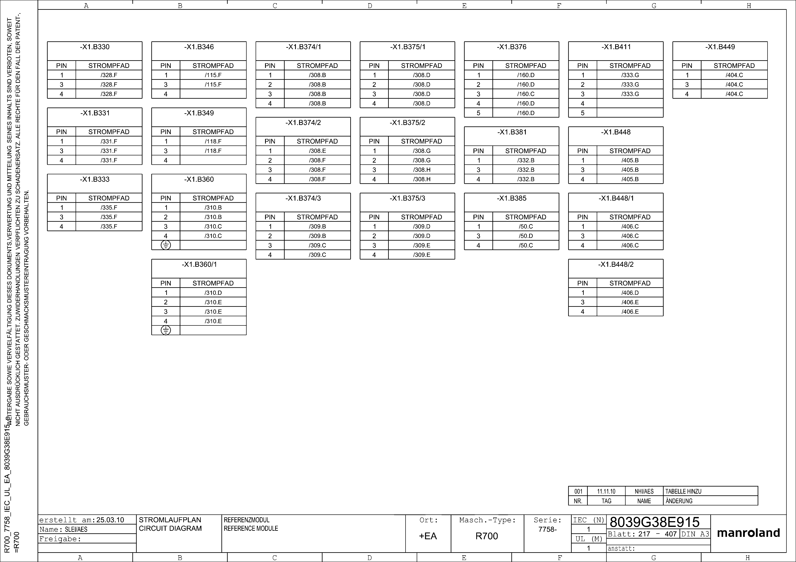

# +EA — Sheet 217 of 407 — REFERENZMODUL

**REFERENCE MODULE**

> Part of the manroland **R700** printing press IEC/UL circuit diagrams.
> Drawing class: **Stromlaufplan / Circuit diagram** (DIN A3).
> Document `+EA` covers the **Printing unit** machine section.

## At a glance

| Field | Value |
|---|---|
| Document | `+EA`  (8039G38E915) |
| Sheet | **217** of 407 |
| Section (DE) | REFERENZMODUL |
| Section (EN) | REFERENCE MODULE |
| Section type | REFERENCE_MODULE — Reference module |
| Machine type | `R700` |
| Series | `7758` |
| Created | 25.03.10 |
| Replaces | — |
| Columns used | A, B, C, D, E, F, G, H |
| Path numbers | — |
| Labels on sheet | 217 |
| Cross-refs out | 71 |
| Cross-refs in | 0 |

**Previous:** [+EA sheet 216](SHEET_0216.md) · **Next:** [+EA sheet 218](SHEET_0218.md) · **Document TOC:** [_TOC.md](_TOC.md)  (+EA) · **Master TOC:** [all sheets](../_MASTER_TOC.md)

## Sheet image (300 DPI, exact vector render)



_Rendered directly from the PDF vector layer at 300 DPI (1-bit), no OCR and no resampling. Use it to confirm anything ambiguous in the text below._

## Cross-references on this sheet

Each entry is a wire leaving this sheet. The printed token is `/sheet.column`; the link resolves to that sheet inside the same document.

| Ref | Target sheet | Col | Path | Destination on target | Target section | From col |
|---|---|---|---|---|---|---|
| `/308.B` | [+EA sheet 308](SHEET_0308.md) | B | — | — | OPTION: KLAPPPODEST B SEITE | C |
| `/328.F` | [+EA sheet 328](SHEET_0328.md) | F | — | — | OPTION: BOGENWEICHE | A |
| `/115.F` | [+EA sheet 115](SHEET_0115.md) | F | — | — | FORMATEINSTELLUNG: SAUGWALZE | B |
| `/333.G` | [+EA sheet 333](SHEET_0333.md) | G | — | — | OPTION: BOGENWEICHE | G |
| `/308.D` | [+EA sheet 308](SHEET_0308.md) | D | — | — | OPTION: KLAPPPODEST B SEITE | E |
| `/160.D` | [+EA sheet 160](SHEET_0160.md) | D | — | — | ZUGANGSABSICHERUNG | F |
| `/404.C` | [+EA sheet 404](SHEET_0404.md) | C | — | — | OPTION: SCHNITTSTELLE UV ENDTROCKNER | H |
| `/308.B` | [+EA sheet 308](SHEET_0308.md) | B | — | — | OPTION: KLAPPPODEST B SEITE | C |
| `/328.F` | [+EA sheet 328](SHEET_0328.md) | F | — | — | OPTION: BOGENWEICHE | A |
| `/115.F` | [+EA sheet 115](SHEET_0115.md) | F | — | — | FORMATEINSTELLUNG: SAUGWALZE | B |
| `/333.G` | [+EA sheet 333](SHEET_0333.md) | G | — | — | OPTION: BOGENWEICHE | G |
| `/308.D` | [+EA sheet 308](SHEET_0308.md) | D | — | — | OPTION: KLAPPPODEST B SEITE | E |
| `/160.D` | [+EA sheet 160](SHEET_0160.md) | D | — | — | ZUGANGSABSICHERUNG | F |
| `/404.C` | [+EA sheet 404](SHEET_0404.md) | C | — | — | OPTION: SCHNITTSTELLE UV ENDTROCKNER | H |
| `/328.F` | [+EA sheet 328](SHEET_0328.md) | F | — | — | OPTION: BOGENWEICHE | A |
| `/308.B` | [+EA sheet 308](SHEET_0308.md) | B | — | — | OPTION: KLAPPPODEST B SEITE | C |
| `/333.G` | [+EA sheet 333](SHEET_0333.md) | G | — | — | OPTION: BOGENWEICHE | G |
| `/308.D` | [+EA sheet 308](SHEET_0308.md) | D | — | — | OPTION: KLAPPPODEST B SEITE | E |
| `/160.C` | [+EA sheet 160](SHEET_0160.md) | C | — | — | ZUGANGSABSICHERUNG | F |
| `/404.C` | [+EA sheet 404](SHEET_0404.md) | C | — | — | OPTION: SCHNITTSTELLE UV ENDTROCKNER | H |
| `/308.B` | [+EA sheet 308](SHEET_0308.md) | B | — | — | OPTION: KLAPPPODEST B SEITE | C |
| `/308.D` | [+EA sheet 308](SHEET_0308.md) | D | — | — | OPTION: KLAPPPODEST B SEITE | E |
| `/160.D` | [+EA sheet 160](SHEET_0160.md) | D | — | — | ZUGANGSABSICHERUNG | F |
| `/160.D` | [+EA sheet 160](SHEET_0160.md) | D | — | — | ZUGANGSABSICHERUNG | F |
| `/331.F` | [+EA sheet 331](SHEET_0331.md) | F | — | — | OPTION: BOGENWEICHE | A |
| `/118.F` | [+EA sheet 118](SHEET_0118.md) | F | — | — | FORMATEINSTELLUNG: GREIFERÖFFNUNGSKURVE | B |
| `/308.E` | [+EA sheet 308](SHEET_0308.md) | E | — | — | OPTION: KLAPPPODEST B SEITE | C |
| `/331.F` | [+EA sheet 331](SHEET_0331.md) | F | — | — | OPTION: BOGENWEICHE | A |
| `/118.F` | [+EA sheet 118](SHEET_0118.md) | F | — | — | FORMATEINSTELLUNG: GREIFERÖFFNUNGSKURVE | B |
| `/308.G` | [+EA sheet 308](SHEET_0308.md) | G | — | — | OPTION: KLAPPPODEST B SEITE | E |
| `/332.B` | [+EA sheet 332](SHEET_0332.md) | B | — | — | OPTION: BOGENWEICHE | F |
| `/405.B` | [+EA sheet 405](SHEET_0405.md) | B | — | — | OPTION: SCHNITTSTELLE UV ENDTROCKNER | G |
| `/331.F` | [+EA sheet 331](SHEET_0331.md) | F | — | — | OPTION: BOGENWEICHE | A |
| `/308.F` | [+EA sheet 308](SHEET_0308.md) | F | — | — | OPTION: KLAPPPODEST B SEITE | C |
| `/308.G` | [+EA sheet 308](SHEET_0308.md) | G | — | — | OPTION: KLAPPPODEST B SEITE | E |
| `/332.B` | [+EA sheet 332](SHEET_0332.md) | B | — | — | OPTION: BOGENWEICHE | F |
| `/405.B` | [+EA sheet 405](SHEET_0405.md) | B | — | — | OPTION: SCHNITTSTELLE UV ENDTROCKNER | G |
| `/308.F` | [+EA sheet 308](SHEET_0308.md) | F | — | — | OPTION: KLAPPPODEST B SEITE | C |
| `/308.H` | [+EA sheet 308](SHEET_0308.md) | H | — | — | OPTION: KLAPPPODEST B SEITE | E |
| `/332.B` | [+EA sheet 332](SHEET_0332.md) | B | — | — | OPTION: BOGENWEICHE | F |
| `/405.B` | [+EA sheet 405](SHEET_0405.md) | B | — | — | OPTION: SCHNITTSTELLE UV ENDTROCKNER | G |
| `/308.F` | [+EA sheet 308](SHEET_0308.md) | F | — | — | OPTION: KLAPPPODEST B SEITE | C |
| `/308.H` | [+EA sheet 308](SHEET_0308.md) | H | — | — | OPTION: KLAPPPODEST B SEITE | E |
| `/310.B` | [+EA sheet 310](SHEET_0310.md) | B | — | — | OPTION: AUTOMATISCHE STAPELAUFFAHRT STOP / | B |
| `/335.F` | [+EA sheet 335](SHEET_0335.md) | F | — | — | OPTION: BOGENWEICHE | A |
| `/310.B` | [+EA sheet 310](SHEET_0310.md) | B | — | — | OPTION: AUTOMATISCHE STAPELAUFFAHRT STOP / | B |
| `/335.F` | [+EA sheet 335](SHEET_0335.md) | F | — | — | OPTION: BOGENWEICHE | A |
| `/309.B` | [+EA sheet 309](SHEET_0309.md) | B | — | — | OPTION: KLAPPPODEST B SEITE | C |
| `/335.F` | [+EA sheet 335](SHEET_0335.md) | F | — | — | OPTION: BOGENWEICHE | A |
| `/50.C` | [+EA sheet 50](SHEET_0050.md) | C | — | — | SCHUTZ | F |
| `/310.C` | [+EA sheet 310](SHEET_0310.md) | C | — | — | OPTION: AUTOMATISCHE STAPELAUFFAHRT STOP / | B |
| `/309.D` | [+EA sheet 309](SHEET_0309.md) | D | — | — | OPTION: KLAPPPODEST B SEITE | E |
| `/406.C` | [+EA sheet 406](SHEET_0406.md) | C | — | — | OPTION: SCHNITTSTELLE UV ENDTROCKNER | G |
| `/309.B` | [+EA sheet 309](SHEET_0309.md) | B | — | — | OPTION: KLAPPPODEST B SEITE | C |
| `/50.D` | [+EA sheet 50](SHEET_0050.md) | D | — | — | SCHUTZ | F |
| `/310.C` | [+EA sheet 310](SHEET_0310.md) | C | — | — | OPTION: AUTOMATISCHE STAPELAUFFAHRT STOP / | B |
| `/309.D` | [+EA sheet 309](SHEET_0309.md) | D | — | — | OPTION: KLAPPPODEST B SEITE | E |
| `/406.C` | [+EA sheet 406](SHEET_0406.md) | C | — | — | OPTION: SCHNITTSTELLE UV ENDTROCKNER | G |
| `/309.E` | [+EA sheet 309](SHEET_0309.md) | E | — | — | OPTION: KLAPPPODEST B SEITE | E |
| `/309.C` | [+EA sheet 309](SHEET_0309.md) | C | — | — | OPTION: KLAPPPODEST B SEITE | C |
| `/50.C` | [+EA sheet 50](SHEET_0050.md) | C | — | — | SCHUTZ | F |
| `/406.C` | [+EA sheet 406](SHEET_0406.md) | C | — | — | OPTION: SCHNITTSTELLE UV ENDTROCKNER | G |
| `/309.E` | [+EA sheet 309](SHEET_0309.md) | E | — | — | OPTION: KLAPPPODEST B SEITE | E |
| `/309.C` | [+EA sheet 309](SHEET_0309.md) | C | — | — | OPTION: KLAPPPODEST B SEITE | C |
| `/310.D` | [+EA sheet 310](SHEET_0310.md) | D | — | — | OPTION: AUTOMATISCHE STAPELAUFFAHRT STOP / | B |
| `/406.D` | [+EA sheet 406](SHEET_0406.md) | D | — | — | OPTION: SCHNITTSTELLE UV ENDTROCKNER | G |
| `/310.E` | [+EA sheet 310](SHEET_0310.md) | E | — | — | OPTION: AUTOMATISCHE STAPELAUFFAHRT STOP / | B |
| `/406.E` | [+EA sheet 406](SHEET_0406.md) | E | — | — | OPTION: SCHNITTSTELLE UV ENDTROCKNER | G |
| `/310.E` | [+EA sheet 310](SHEET_0310.md) | E | — | — | OPTION: AUTOMATISCHE STAPELAUFFAHRT STOP / | B |
| `/406.E` | [+EA sheet 406](SHEET_0406.md) | E | — | — | OPTION: SCHNITTSTELLE UV ENDTROCKNER | G |
| `/310.E` | [+EA sheet 310](SHEET_0310.md) | E | — | — | OPTION: AUTOMATISCHE STAPELAUFFAHRT STOP / | B |

## Devices on this sheet

| Tag | Class | Class meaning (IEC) | Col | Sub | Terminal | Sign |
|---|---|---|---|---|---|---|
| `X1.B346` | — | cross-device reference | B | — | — | — |
| `X1.B349` | — | cross-device reference | B | — | — | — |
| `X1.B330` | — | cross-device reference | A | — | — | — |
| `X1.B331` | — | cross-device reference | A | — | — | — |
| `X1.B333` | — | cross-device reference | A | — | — | — |
| `X1.B360` | — | cross-device reference | B | — | — | — |
| `X1.B376` | — | cross-device reference | F | — | — | — |
| `X1.B381` | — | cross-device reference | F | — | — | — |
| `X1.B385` | — | cross-device reference | F | — | — | — |
| `X1.B411` | — | cross-device reference | G | — | — | — |
| `X1.B448` | — | cross-device reference | G | — | — | — |
| `X1.B449` | — | cross-device reference | H | — | — | — |
| `NR.` | — | cross-device reference | F | — | — | — |
| `11.11.10` | — | cross-device reference | F | — | — | — |

## Potentials / nets

_No named potentials on this sheet._

## Wire-end annotations (grouped as printed)

A wire that continues elsewhere is annotated with a small cluster: the destination description, the path/line number `#NN`, and the `/sheet.column` cross reference. Each row below is one such cluster exactly as it is grouped on the drawing.

| Col | Y | Path | Cross-ref | Text on the wire |
|---|---|---|---|---|
| A | 65.5 | — | — | `X1.B330` |
| B | 65.5 | — | — | `X1.B346` |
| C | 65.5 | — | — | `X1.B374/1` |
| D | 65.5 | — | — | `X1.B375/1` |
| F | 65.5 | — | — | `X1.B376` |
| G | 65.5 | — | — | `X1.B411` |
| H | 65.5 | — | — | `X1.B449` |
| A | 94.2 | — | — | `PIN 3 4 1 STROMPFAD` |
| B | 94.2 | — | — | `PIN 3 4 1 STROMPFAD` |
| C | 94.2 | — | — | `PIN 2 3 4 1 STROMPFAD` |
| D | 94.2 | — | — | `PIN 2 3 4 1 STROMPFAD` |
| E | 94.2 | — | — | `PIN 2 3 4 5 1 STROMPFAD` |
| G | 94.2 | — | — | `PIN 2 3 4 5 1 STROMPFAD` |
| H | 94.2 | — | — | `PIN 3 4 1 STROMPFAD` |
| A | 108.7 | — | `/328.F` | — |
| B | 108.7 | — | `/115.F` | — |
| C | 108.7 | — | `/308.B` | — |
| E | 108.7 | — | `/308.D` | — |
| F | 108.7 | — | `/160.D` | — |
| G | 108.7 | — | `/333.G` | — |
| H | 108.7 | — | `/404.C` | — |
| A | 122.9 | — | `/328.F` | — |
| B | 122.9 | — | `/115.F` | — |
| C | 122.9 | — | `/308.B` | — |
| E | 122.9 | — | `/308.D` | — |
| F | 122.9 | — | `/160.D` | — |
| G | 122.9 | — | `/333.G` | — |
| H | 122.9 | — | `/404.C` | — |
| A | 137.0 | — | `/328.F` | — |
| C | 137.0 | — | `/308.B` | — |
| E | 137.1 | — | `/308.D` | — |
| F | 137.1 | — | `/160.C` | — |
| G | 137.1 | — | `/333.G` | — |
| H | 137.1 | — | `/404.C` | — |
| C | 151.2 | — | `/308.B` | — |
| E | 151.2 | — | `/308.D` | — |
| F | 151.2 | — | `/160.D` | — |
| A | 164.7 | — | — | `X1.B331` |
| B | 164.7 | — | — | `X1.B349` |
| F | 165.4 | — | `/160.D` | — |
| C | 178.9 | — | — | `X1.B374/2` |
| D | 178.9 | — | — | `X1.B375/2` |
| F | 193.1 | — | — | `X1.B381` |
| G | 193.1 | — | — | `X1.B448` |
| A | 193.4 | — | — | `PIN 3 4 1 STROMPFAD` |
| B | 193.4 | — | — | `PIN 3 4 1 STROMPFAD` |
| C | 207.5 | — | — | `PIN 2 3 4 1 STROMPFAD` |
| D | 207.5 | — | — | `PIN 2 3 4 1 STROMPFAD` |
| A | 207.9 | — | `/331.F` | — |
| B | 207.9 | — | `/118.F` | — |
| E | 221.7 | — | — | `PIN 3 4 1 STROMPFAD` |
| G | 221.7 | — | — | `PIN 3 4 1 STROMPFAD` |
| A | 222.1 | — | `/331.F` | — |
| B | 222.1 | — | `/118.F` | — |
| C | 222.1 | — | `/308.E` | — |
| E | 222.1 | — | `/308.G` | — |
| F | 236.2 | — | `/332.B` | — |
| G | 236.2 | — | `/405.B` | — |
| A | 236.3 | — | `/331.F` | — |
| C | 236.3 | — | `/308.F` | — |
| E | 236.3 | — | `/308.G` | — |
| C | 250.4 | — | `/308.F` | — |
| E | 250.4 | — | `/308.H` | — |
| F | 250.4 | — | `/332.B` | — |
| G | 250.4 | — | `/405.B` | — |
| A | 263.9 | — | — | `X1.B333` |
| B | 263.9 | — | — | `X1.B360` |
| C | 264.6 | — | `/308.F` | — |
| E | 264.6 | — | `/308.H` | — |
| F | 264.6 | — | `/332.B` | — |
| G | 264.6 | — | `/405.B` | — |
| C | 292.3 | — | — | `X1.B374/3` |
| D | 292.3 | — | — | `X1.B375/3` |
| F | 292.3 | — | — | `X1.B385` |
| G | 292.3 | — | — | `X1.B448/1` |
| A | 292.6 | — | — | `PIN 3 4 1 STROMPFAD` |
| B | 292.6 | — | — | `PIN 2 3 4 1 STROMPFAD` |
| A | 307.1 | — | `/335.F` | — |
| B | 307.1 | — | `/310.B` | — |
| C | 320.9 | — | — | `PIN 2 3 4 1 STROMPFAD` |
| D | 320.9 | — | — | `PIN 2 3 4 1 STROMPFAD` |
| E | 320.9 | — | — | `PIN 3 4 1 STROMPFAD` |
| G | 320.9 | — | — | `PIN 3 4 1 STROMPFAD` |
| A | 321.3 | — | `/335.F` | — |
| B | 321.3 | — | `/310.B` | — |
| A | 335.5 | — | `/335.F` | — |
| B | 335.5 | — | `/310.C` | — |
| C | 335.5 | — | `/309.B` | — |
| E | 335.5 | — | `/309.D` | — |
| F | 335.5 | — | `/50.C` | — |
| G | 335.5 | — | `/406.C` | — |
| C | 349.6 | — | `/309.B` | — |
| F | 349.6 | — | `/50.D` | — |
| B | 349.7 | — | `/310.C` | — |
| E | 349.7 | — | `/309.D` | — |
| G | 349.7 | — | `/406.C` | — |
| C | 363.8 | — | `/309.C` | — |
| E | 363.8 | — | `/309.E` | — |
| F | 363.8 | — | `/50.C` | — |
| G | 363.8 | — | `/406.C` | — |
| C | 378.0 | — | `/309.C` | — |
| E | 378.0 | — | `/309.E` | — |
| B | 391.5 | — | — | `X1.B360/1` |
| G | 391.5 | — | — | `X1.B448/2` |
| B | 420.1 | — | — | `PIN 2 3 4 1 STROMPFAD` |
| G | 420.1 | — | — | `PIN 3 4 1 STROMPFAD` |
| B | 434.7 | — | `/310.D` | — |
| G | 434.7 | — | `/406.D` | — |
| B | 448.9 | — | `/310.E` | — |
| G | 448.9 | — | `/406.E` | — |
| B | 463.0 | — | `/310.E` | — |
| G | 463.0 | — | `/406.E` | — |
| B | 477.2 | — | `/310.E` | — |
| G | 733.0 | — | — | `001 11.11.10 NHI/AES TABELLE HINZU` |
| G | 747.1 | — | — | `NR. TAG NAME ÄNDERUNG` |


## Reconstructed tables

This sheet carries tabular content (pin map / terminal assignment / index). The grid below was rebuilt from the drawing's own rule lines, so each row is exactly one physical row of the table.

### Table 1 — 13 data rows × 2 columns (at x=70.9, y=62.4) — **X1.B330**

| PIN | STROMPFAD |
|---|---|
| `1` | `/328.F` |
| `3` | `/328.F` |
| `4` | `/328.F` |
|  | `X1.B331` |
| `PIN` | `STROMPFAD` |
| `1` | `/331.F` |
| `3` | `/331.F` |
| `4` | `/331.F` |
|  | `X1.B333` |
| `PIN` | `STROMPFAD` |
| `1` | `/335.F` |
| `3` | `/335.F` |
| `4` | `/335.F` |


### Table 2 — 20 data rows × 2 columns (at x=226.8, y=62.4) — **X1.B346**

| PIN | STROMPFAD |
|---|---|
| `1` | `/115.F` |
| `3` | `/115.F` |
| `4` |  |
|  | `X1.B349` |
| `PIN` | `STROMPFAD` |
| `1` | `/118.F` |
| `3` | `/118.F` |
| `4` |  |
|  | `X1.B360` |
| `PIN` | `STROMPFAD` |
| `1` | `/310.B` |
| `2` | `/310.B` |
| `3` | `/310.C` |
| `4` | `/310.C` |
|  | `X1.B360/1` |
| `PIN` | `STROMPFAD` |
| `1` | `/310.D` |
| `2` | `/310.E` |
| `3` | `/310.E` |
| `4` | `/310.E` |


### Table 3 — 16 data rows × 2 columns (at x=382.7, y=62.4) — **X1.B374/1**

| PIN | STROMPFAD |
|---|---|
| `1` | `/308.B` |
| `2` | `/308.B` |
| `3` | `/308.B` |
| `4` | `/308.B` |
|  | `X1.B374/2` |
| `PIN` | `STROMPFAD` |
| `1` | `/308.E` |
| `2` | `/308.F` |
| `3` | `/308.F` |
| `4` | `/308.F` |
|  | `X1.B374/3` |
| `PIN` | `STROMPFAD` |
| `1` | `/309.B` |
| `2` | `/309.B` |
| `3` | `/309.C` |
| `4` | `/309.C` |


### Table 4 — 16 data rows × 2 columns (at x=538.6, y=62.4) — **X1.B375/1**

| PIN | STROMPFAD |
|---|---|
| `1` | `/308.D` |
| `2` | `/308.D` |
| `3` | `/308.D` |
| `4` | `/308.D` |
|  | `X1.B375/2` |
| `PIN` | `STROMPFAD` |
| `1` | `/308.G` |
| `2` | `/308.G` |
| `3` | `/308.H` |
| `4` | `/308.H` |
|  | `X1.B375/3` |
| `PIN` | `STROMPFAD` |
| `1` | `/309.D` |
| `2` | `/309.D` |
| `3` | `/309.E` |
| `4` | `/309.E` |


### Table 5 — 15 data rows × 2 columns (at x=694.5, y=62.4) — **X1.B376**

| PIN | STROMPFAD |
|---|---|
| `1` | `/160.D` |
| `2` | `/160.D` |
| `3` | `/160.C` |
| `4` | `/160.D` |
| `5` | `/160.D` |
|  | `X1.B381` |
| `PIN` | `STROMPFAD` |
| `1` | `/332.B` |
| `3` | `/332.B` |
| `4` | `/332.B` |
|  | `X1.B385` |
| `PIN` | `STROMPFAD` |
| `1` | `/50.C` |
| `3` | `/50.D` |
| `4` | `/50.C` |


### Table 6 — 20 data rows × 2 columns (at x=850.4, y=62.4) — **X1.B411**

| PIN | STROMPFAD |
|---|---|
| `1` | `/333.G` |
| `2` | `/333.G` |
| `3` | `/333.G` |
| `4` |  |
| `5` |  |
|  | `X1.B448` |
| `PIN` | `STROMPFAD` |
| `1` | `/405.B` |
| `3` | `/405.B` |
| `4` | `/405.B` |
|  | `X1.B448/1` |
| `PIN` | `STROMPFAD` |
| `1` | `/406.C` |
| `3` | `/406.C` |
| `4` | `/406.C` |
|  | `X1.B448/2` |
| `PIN` | `STROMPFAD` |
| `1` | `/406.D` |
| `3` | `/406.E` |
| `4` | `/406.E` |


### Table 7 — 3 data rows × 2 columns (at x=1006.3, y=62.4) — **X1.B449**

| PIN | STROMPFAD |
|---|---|
| `1` | `/404.C` |
| `3` | `/404.C` |
| `4` | `/404.C` |


## Notes and free text on this sheet

| Text | Col | Y (pt) |
|---|---|---|
| `PIN` | B | 94.2 |
| `STROMPFAD` | B | 94.15 |
| `PIN` | A | 94.2 |
| `STROMPFAD` | A | 94.15 |
| `X1.B360/1` | B | 391.49 |
| `PIN` | C | 94.2 |
| `STROMPFAD` | C | 94.15 |
| `X1.B374/1` | C | 65.51 |
| `X1.B374/2` | C | 178.9 |
| `X1.B374/3` | C | 292.28 |
| `PIN` | D | 94.2 |
| `STROMPFAD` | E | 94.15 |
| `X1.B375/1` | D | 65.51 |
| `X1.B375/2` | D | 178.9 |
| `X1.B375/3` | D | 292.28 |
| `PIN` | E | 94.2 |
| `STROMPFAD` | F | 94.15 |
| `PIN` | F | 94.2 |
| `STROMPFAD` | G | 94.15 |
| `X1.B448/1` | G | 292.28 |
| `X1.B448/2` | G | 391.49 |
| `PIN` | G | 94.2 |
| `STROMPFAD` | H | 94.15 |
| `TAG` | G | 747.27 |
| `NAME` | G | 747.25 |
| `ÄNDERUNG` | G | 747.31 |
| `NHI/AES` | G | 733.11 |
| `TABELLE HINZU` | G | 733.14 |

## Complete label inventory (exact text from the drawing)

Every text object inside the drawing area of this sheet, in DIN reading order (column A→H, then top→bottom). This is the authoritative list: if a string is not here it is not printed on this sheet.

| Col | Y | X | Dir | Type | Text |
|---|---|---|---|---|---|
| A | 65.5 | 119.8 | → | device ref | `X1.B330` |
| A | 94.2 | 84.0 | → | text | `PIN` |
| A | 94.2 | 132.2 | → | text | `STROMPFAD` |
| A | 108.4 | 90.0 | → | number | `1` |
| A | 108.7 | 150.7 | → | cross-reference | `/328.F` |
| A | 122.5 | 89.4 | → | number | `3` |
| A | 122.9 | 150.7 | → | cross-reference | `/328.F` |
| A | 136.7 | 89.4 | → | number | `4` |
| A | 137.0 | 150.7 | → | cross-reference | `/328.F` |
| A | 164.7 | 120.5 | → | device ref | `X1.B331` |
| A | 193.4 | 84.0 | → | text | `PIN` |
| A | 193.4 | 132.2 | → | text | `STROMPFAD` |
| A | 207.6 | 90.0 | → | number | `1` |
| A | 207.9 | 150.7 | → | cross-reference | `/331.F` |
| A | 221.8 | 89.4 | → | number | `3` |
| A | 222.1 | 150.7 | → | cross-reference | `/331.F` |
| A | 235.9 | 89.4 | → | number | `4` |
| A | 236.3 | 150.7 | → | cross-reference | `/331.F` |
| A | 263.9 | 119.8 | → | device ref | `X1.B333` |
| A | 292.6 | 84.0 | → | text | `PIN` |
| A | 292.6 | 132.2 | → | text | `STROMPFAD` |
| A | 306.8 | 90.0 | → | number | `1` |
| A | 307.1 | 150.7 | → | cross-reference | `/335.F` |
| A | 321.0 | 89.4 | → | number | `3` |
| A | 321.3 | 150.7 | → | cross-reference | `/335.F` |
| A | 335.1 | 89.4 | → | number | `4` |
| A | 335.5 | 150.7 | → | cross-reference | `/335.F` |
| B | 65.5 | 275.7 | → | device ref | `X1.B346` |
| B | 94.2 | 240.0 | → | text | `PIN` |
| B | 94.2 | 288.1 | → | text | `STROMPFAD` |
| B | 108.4 | 245.9 | → | number | `1` |
| B | 108.7 | 306.6 | → | cross-reference | `/115.F` |
| B | 122.5 | 245.3 | → | number | `3` |
| B | 122.9 | 306.6 | → | cross-reference | `/115.F` |
| B | 136.7 | 245.3 | → | number | `4` |
| B | 164.7 | 275.7 | → | device ref | `X1.B349` |
| B | 193.4 | 240.0 | → | text | `PIN` |
| B | 193.4 | 288.1 | → | text | `STROMPFAD` |
| B | 207.6 | 245.9 | → | number | `1` |
| B | 207.9 | 306.6 | → | cross-reference | `/118.F` |
| B | 221.8 | 245.3 | → | number | `3` |
| B | 222.1 | 306.6 | → | cross-reference | `/118.F` |
| B | 235.9 | 245.3 | → | number | `4` |
| B | 263.9 | 275.7 | → | device ref | `X1.B360` |
| B | 292.6 | 240.0 | → | text | `PIN` |
| B | 292.6 | 288.1 | → | text | `STROMPFAD` |
| B | 306.8 | 245.9 | → | number | `1` |
| B | 307.1 | 306.3 | → | cross-reference | `/310.B` |
| B | 321.0 | 245.3 | → | number | `2` |
| B | 321.3 | 306.3 | → | cross-reference | `/310.B` |
| B | 335.1 | 245.3 | → | number | `3` |
| B | 335.5 | 306.1 | → | cross-reference | `/310.C` |
| B | 349.3 | 245.3 | → | number | `4` |
| B | 349.7 | 306.1 | → | cross-reference | `/310.C` |
| B | 391.5 | 272.0 | → | text | `X1.B360/1` |
| B | 420.1 | 288.1 | → | text | `STROMPFAD` |
| B | 420.2 | 240.0 | → | text | `PIN` |
| B | 434.4 | 245.9 | → | number | `1` |
| B | 434.7 | 306.1 | → | cross-reference | `/310.D` |
| B | 448.5 | 245.3 | → | number | `2` |
| B | 448.8 | 306.4 | → | cross-reference | `/310.E` |
| B | 462.7 | 245.3 | → | number | `3` |
| B | 463.0 | 306.4 | → | cross-reference | `/310.E` |
| B | 476.9 | 245.3 | → | number | `4` |
| B | 477.2 | 306.4 | → | cross-reference | `/310.E` |
| C | 65.5 | 427.9 | → | text | `X1.B374/1` |
| C | 94.2 | 395.9 | → | text | `PIN` |
| C | 94.2 | 444.0 | → | text | `STROMPFAD` |
| C | 108.4 | 401.8 | → | number | `1` |
| C | 108.7 | 462.2 | → | cross-reference | `/308.B` |
| C | 122.5 | 401.2 | → | number | `2` |
| C | 122.9 | 462.2 | → | cross-reference | `/308.B` |
| C | 136.7 | 401.2 | → | number | `3` |
| C | 137.0 | 462.2 | → | cross-reference | `/308.B` |
| C | 150.9 | 401.2 | → | number | `4` |
| C | 151.2 | 462.2 | → | cross-reference | `/308.B` |
| C | 178.9 | 427.2 | → | text | `X1.B374/2` |
| C | 207.5 | 444.0 | → | text | `STROMPFAD` |
| C | 207.6 | 395.9 | → | text | `PIN` |
| C | 221.8 | 401.8 | → | number | `1` |
| C | 222.1 | 462.3 | → | cross-reference | `/308.E` |
| C | 235.9 | 401.2 | → | number | `2` |
| C | 236.3 | 462.5 | → | cross-reference | `/308.F` |
| C | 250.1 | 401.2 | → | number | `3` |
| C | 250.4 | 462.5 | → | cross-reference | `/308.F` |
| C | 264.3 | 401.2 | → | number | `4` |
| C | 264.6 | 462.5 | → | cross-reference | `/308.F` |
| C | 292.3 | 427.2 | → | text | `X1.B374/3` |
| C | 320.9 | 444.0 | → | text | `STROMPFAD` |
| C | 321.0 | 395.9 | → | text | `PIN` |
| C | 335.1 | 401.8 | → | number | `1` |
| C | 335.5 | 462.2 | → | cross-reference | `/309.B` |
| C | 349.3 | 401.2 | → | number | `2` |
| C | 349.6 | 462.2 | → | cross-reference | `/309.B` |
| C | 363.5 | 401.2 | → | number | `3` |
| C | 363.8 | 462.0 | → | cross-reference | `/309.C` |
| C | 377.7 | 401.2 | → | number | `4` |
| C | 378.0 | 462.0 | → | cross-reference | `/309.C` |
| D | 65.5 | 583.8 | → | text | `X1.B375/1` |
| D | 94.2 | 551.8 | → | text | `PIN` |
| D | 108.4 | 557.7 | → | number | `1` |
| D | 122.5 | 557.1 | → | number | `2` |
| D | 136.7 | 557.1 | → | number | `3` |
| D | 150.9 | 557.1 | → | number | `4` |
| D | 178.9 | 583.1 | → | text | `X1.B375/2` |
| D | 207.6 | 551.8 | → | text | `PIN` |
| D | 221.8 | 557.7 | → | number | `1` |
| D | 235.9 | 557.1 | → | number | `2` |
| D | 250.1 | 557.1 | → | number | `3` |
| D | 264.3 | 557.1 | → | number | `4` |
| D | 292.3 | 583.1 | → | text | `X1.B375/3` |
| D | 321.0 | 551.8 | → | text | `PIN` |
| D | 335.1 | 557.7 | → | number | `1` |
| D | 349.3 | 557.1 | → | number | `2` |
| D | 363.5 | 557.1 | → | number | `3` |
| D | 377.7 | 557.1 | → | number | `4` |
| E | 94.2 | 600.0 | → | text | `STROMPFAD` |
| E | 94.2 | 707.7 | → | text | `PIN` |
| E | 108.4 | 713.6 | → | number | `1` |
| E | 108.7 | 618.0 | → | cross-reference | `/308.D` |
| E | 122.5 | 713.1 | → | number | `2` |
| E | 122.9 | 618.0 | → | cross-reference | `/308.D` |
| E | 136.7 | 713.1 | → | number | `3` |
| E | 137.1 | 618.0 | → | cross-reference | `/308.D` |
| E | 150.9 | 713.1 | → | number | `4` |
| E | 151.2 | 618.0 | → | cross-reference | `/308.D` |
| E | 165.1 | 713.1 | → | number | `5` |
| E | 207.5 | 600.0 | → | text | `STROMPFAD` |
| E | 221.8 | 707.7 | → | text | `PIN` |
| E | 222.1 | 617.8 | → | cross-reference | `/308.G` |
| E | 235.9 | 713.6 | → | number | `1` |
| E | 236.3 | 617.8 | → | cross-reference | `/308.G` |
| E | 250.1 | 713.1 | → | number | `3` |
| E | 250.4 | 618.2 | → | cross-reference | `/308.H` |
| E | 264.3 | 713.1 | → | number | `4` |
| E | 264.6 | 618.2 | → | cross-reference | `/308.H` |
| E | 320.9 | 600.0 | → | text | `STROMPFAD` |
| E | 321.0 | 707.7 | → | text | `PIN` |
| E | 335.1 | 713.6 | → | number | `1` |
| E | 335.5 | 618.0 | → | cross-reference | `/309.D` |
| E | 349.3 | 713.1 | → | number | `3` |
| E | 349.7 | 618.0 | → | cross-reference | `/309.D` |
| E | 363.5 | 713.1 | → | number | `4` |
| E | 363.8 | 618.2 | → | cross-reference | `/309.E` |
| E | 378.0 | 618.2 | → | cross-reference | `/309.E` |
| F | 65.5 | 743.4 | → | device ref | `X1.B376` |
| F | 94.2 | 755.9 | → | text | `STROMPFAD` |
| F | 94.2 | 863.6 | → | text | `PIN` |
| F | 108.4 | 869.5 | → | number | `1` |
| F | 108.7 | 773.9 | → | cross-reference | `/160.D` |
| F | 122.5 | 869.0 | → | number | `2` |
| F | 122.9 | 773.9 | → | cross-reference | `/160.D` |
| F | 136.7 | 869.0 | → | number | `3` |
| F | 137.1 | 773.9 | → | cross-reference | `/160.C` |
| F | 150.9 | 869.0 | → | number | `4` |
| F | 151.2 | 773.9 | → | cross-reference | `/160.D` |
| F | 165.1 | 869.0 | → | number | `5` |
| F | 165.4 | 773.9 | → | cross-reference | `/160.D` |
| F | 193.1 | 744.1 | → | device ref | `X1.B381` |
| F | 221.7 | 755.9 | → | text | `STROMPFAD` |
| F | 221.8 | 863.6 | → | text | `PIN` |
| F | 235.9 | 869.5 | → | number | `1` |
| F | 236.2 | 774.0 | → | cross-reference | `/332.B` |
| F | 250.1 | 869.0 | → | number | `3` |
| F | 250.4 | 774.0 | → | cross-reference | `/332.B` |
| F | 264.3 | 869.0 | → | number | `4` |
| F | 264.6 | 774.0 | → | cross-reference | `/332.B` |
| F | 292.3 | 743.4 | → | device ref | `X1.B385` |
| F | 320.9 | 755.9 | → | text | `STROMPFAD` |
| F | 321.0 | 863.6 | → | text | `PIN` |
| F | 335.1 | 869.5 | → | number | `1` |
| F | 335.5 | 776.3 | → | cross-reference | `/50.C` |
| F | 349.3 | 869.0 | → | number | `3` |
| F | 349.7 | 776.3 | → | cross-reference | `/50.D` |
| F | 363.5 | 869.0 | → | number | `4` |
| F | 363.8 | 776.3 | → | cross-reference | `/50.C` |
| F | 420.2 | 863.6 | → | text | `PIN` |
| F | 434.4 | 869.5 | → | number | `1` |
| F | 448.5 | 869.0 | → | number | `3` |
| F | 462.7 | 869.0 | → | number | `4` |
| F | 733.0 | 859.4 | → | number | `001` |
| F | 733.1 | 893.2 | → | device ref | `11.11.10` |
| F | 747.1 | 858.4 | → | device ref | `NR.` |
| G | 65.5 | 900.0 | → | device ref | `X1.B411` |
| G | 94.2 | 911.8 | → | text | `STROMPFAD` |
| G | 94.2 | 1019.5 | → | text | `PIN` |
| G | 108.4 | 1025.4 | → | number | `1` |
| G | 108.7 | 929.6 | → | cross-reference | `/333.G` |
| G | 122.5 | 1024.9 | → | number | `3` |
| G | 122.9 | 929.6 | → | cross-reference | `/333.G` |
| G | 136.7 | 1024.9 | → | number | `4` |
| G | 137.1 | 929.6 | → | cross-reference | `/333.G` |
| G | 193.1 | 899.3 | → | device ref | `X1.B448` |
| G | 221.7 | 911.8 | → | text | `STROMPFAD` |
| G | 236.2 | 929.9 | → | cross-reference | `/405.B` |
| G | 250.4 | 929.9 | → | cross-reference | `/405.B` |
| G | 264.6 | 929.9 | → | cross-reference | `/405.B` |
| G | 292.3 | 895.6 | → | text | `X1.B448/1` |
| G | 320.9 | 911.8 | → | text | `STROMPFAD` |
| G | 335.5 | 929.8 | → | cross-reference | `/406.C` |
| G | 349.7 | 929.8 | → | cross-reference | `/406.C` |
| G | 363.8 | 929.8 | → | cross-reference | `/406.C` |
| G | 391.5 | 894.9 | → | text | `X1.B448/2` |
| G | 420.1 | 911.8 | → | text | `STROMPFAD` |
| G | 434.7 | 929.8 | → | cross-reference | `/406.D` |
| G | 448.8 | 930.0 | → | cross-reference | `/406.E` |
| G | 463.0 | 930.0 | → | cross-reference | `/406.E` |
| G | 733.1 | 949.5 | → | text | `NHI/AES` |
| G | 733.1 | 995.4 | → | text | `TABELLE HINZU` |
| G | 747.3 | 900.0 | → | text | `TAG` |
| G | 747.3 | 953.4 | → | text | `NAME` |
| G | 747.3 | 996.0 | → | text | `ÄNDERUNG` |
| H | 65.5 | 1055.2 | → | device ref | `X1.B449` |
| H | 94.2 | 1067.7 | → | text | `STROMPFAD` |
| H | 108.7 | 1085.7 | → | cross-reference | `/404.C` |
| H | 122.9 | 1085.7 | → | cross-reference | `/404.C` |
| H | 137.1 | 1085.7 | → | cross-reference | `/404.C` |

## Reading-order text block

The same content as a plain block, grouped by DIN column — convenient to paste or to match against a visual description.

```text
=== Column A ===
  65.5  119.8  devref       X1.B330
  94.2   84.0  text         PIN
  94.2  132.2  text         STROMPFAD
 108.4   90.0  numeric      1
 108.7  150.7  xref         /328.F
 122.5   89.4  numeric      3
 122.9  150.7  xref         /328.F
 136.7   89.4  numeric      4
 137.0  150.7  xref         /328.F
 164.7  120.5  devref       X1.B331
 193.4   84.0  text         PIN
 193.4  132.2  text         STROMPFAD
 207.6   90.0  numeric      1
 207.9  150.7  xref         /331.F
 221.8   89.4  numeric      3
 222.1  150.7  xref         /331.F
 235.9   89.4  numeric      4
 236.3  150.7  xref         /331.F
 263.9  119.8  devref       X1.B333
 292.6   84.0  text         PIN
 292.6  132.2  text         STROMPFAD
 306.8   90.0  numeric      1
 307.1  150.7  xref         /335.F
 321.0   89.4  numeric      3
 321.3  150.7  xref         /335.F
 335.1   89.4  numeric      4
 335.5  150.7  xref         /335.F
=== Column B ===
  65.5  275.7  devref       X1.B346
  94.2  240.0  text         PIN
  94.2  288.1  text         STROMPFAD
 108.4  245.9  numeric      1
 108.7  306.6  xref         /115.F
 122.5  245.3  numeric      3
 122.9  306.6  xref         /115.F
 136.7  245.3  numeric      4
 164.7  275.7  devref       X1.B349
 193.4  240.0  text         PIN
 193.4  288.1  text         STROMPFAD
 207.6  245.9  numeric      1
 207.9  306.6  xref         /118.F
 221.8  245.3  numeric      3
 222.1  306.6  xref         /118.F
 235.9  245.3  numeric      4
 263.9  275.7  devref       X1.B360
 292.6  240.0  text         PIN
 292.6  288.1  text         STROMPFAD
 306.8  245.9  numeric      1
 307.1  306.3  xref         /310.B
 321.0  245.3  numeric      2
 321.3  306.3  xref         /310.B
 335.1  245.3  numeric      3
 335.5  306.1  xref         /310.C
 349.3  245.3  numeric      4
 349.7  306.1  xref         /310.C
 391.5  272.0  text         X1.B360/1
 420.1  288.1  text         STROMPFAD
 420.2  240.0  text         PIN
 434.4  245.9  numeric      1
 434.7  306.1  xref         /310.D
 448.5  245.3  numeric      2
 448.8  306.4  xref         /310.E
 462.7  245.3  numeric      3
 463.0  306.4  xref         /310.E
 476.9  245.3  numeric      4
 477.2  306.4  xref         /310.E
=== Column C ===
  65.5  427.9  text         X1.B374/1
  94.2  395.9  text         PIN
  94.2  444.0  text         STROMPFAD
 108.4  401.8  numeric      1
 108.7  462.2  xref         /308.B
 122.5  401.2  numeric      2
 122.9  462.2  xref         /308.B
 136.7  401.2  numeric      3
 137.0  462.2  xref         /308.B
 150.9  401.2  numeric      4
 151.2  462.2  xref         /308.B
 178.9  427.2  text         X1.B374/2
 207.5  444.0  text         STROMPFAD
 207.6  395.9  text         PIN
 221.8  401.8  numeric      1
 222.1  462.3  xref         /308.E
 235.9  401.2  numeric      2
 236.3  462.5  xref         /308.F
 250.1  401.2  numeric      3
 250.4  462.5  xref         /308.F
 264.3  401.2  numeric      4
 264.6  462.5  xref         /308.F
 292.3  427.2  text         X1.B374/3
 320.9  444.0  text         STROMPFAD
 321.0  395.9  text         PIN
 335.1  401.8  numeric      1
 335.5  462.2  xref         /309.B
 349.3  401.2  numeric      2
 349.6  462.2  xref         /309.B
 363.5  401.2  numeric      3
 363.8  462.0  xref         /309.C
 377.7  401.2  numeric      4
 378.0  462.0  xref         /309.C
=== Column D ===
  65.5  583.8  text         X1.B375/1
  94.2  551.8  text         PIN
 108.4  557.7  numeric      1
 122.5  557.1  numeric      2
 136.7  557.1  numeric      3
 150.9  557.1  numeric      4
 178.9  583.1  text         X1.B375/2
 207.6  551.8  text         PIN
 221.8  557.7  numeric      1
 235.9  557.1  numeric      2
 250.1  557.1  numeric      3
 264.3  557.1  numeric      4
 292.3  583.1  text         X1.B375/3
 321.0  551.8  text         PIN
 335.1  557.7  numeric      1
 349.3  557.1  numeric      2
 363.5  557.1  numeric      3
 377.7  557.1  numeric      4
=== Column E ===
  94.2  600.0  text         STROMPFAD
  94.2  707.7  text         PIN
 108.4  713.6  numeric      1
 108.7  618.0  xref         /308.D
 122.5  713.1  numeric      2
 122.9  618.0  xref         /308.D
 136.7  713.1  numeric      3
 137.1  618.0  xref         /308.D
 150.9  713.1  numeric      4
 151.2  618.0  xref         /308.D
 165.1  713.1  numeric      5
 207.5  600.0  text         STROMPFAD
 221.8  707.7  text         PIN
 222.1  617.8  xref         /308.G
 235.9  713.6  numeric      1
 236.3  617.8  xref         /308.G
 250.1  713.1  numeric      3
 250.4  618.2  xref         /308.H
 264.3  713.1  numeric      4
 264.6  618.2  xref         /308.H
 320.9  600.0  text         STROMPFAD
 321.0  707.7  text         PIN
 335.1  713.6  numeric      1
 335.5  618.0  xref         /309.D
 349.3  713.1  numeric      3
 349.7  618.0  xref         /309.D
 363.5  713.1  numeric      4
 363.8  618.2  xref         /309.E
 378.0  618.2  xref         /309.E
=== Column F ===
  65.5  743.4  devref       X1.B376
  94.2  755.9  text         STROMPFAD
  94.2  863.6  text         PIN
 108.4  869.5  numeric      1
 108.7  773.9  xref         /160.D
 122.5  869.0  numeric      2
 122.9  773.9  xref         /160.D
 136.7  869.0  numeric      3
 137.1  773.9  xref         /160.C
 150.9  869.0  numeric      4
 151.2  773.9  xref         /160.D
 165.1  869.0  numeric      5
 165.4  773.9  xref         /160.D
 193.1  744.1  devref       X1.B381
 221.7  755.9  text         STROMPFAD
 221.8  863.6  text         PIN
 235.9  869.5  numeric      1
 236.2  774.0  xref         /332.B
 250.1  869.0  numeric      3
 250.4  774.0  xref         /332.B
 264.3  869.0  numeric      4
 264.6  774.0  xref         /332.B
 292.3  743.4  devref       X1.B385
 320.9  755.9  text         STROMPFAD
 321.0  863.6  text         PIN
 335.1  869.5  numeric      1
 335.5  776.3  xref         /50.C
 349.3  869.0  numeric      3
 349.7  776.3  xref         /50.D
 363.5  869.0  numeric      4
 363.8  776.3  xref         /50.C
 420.2  863.6  text         PIN
 434.4  869.5  numeric      1
 448.5  869.0  numeric      3
 462.7  869.0  numeric      4
 733.0  859.4  numeric      001
 733.1  893.2  devref       11.11.10
 747.1  858.4  devref       NR.
=== Column G ===
  65.5  900.0  devref       X1.B411
  94.2  911.8  text         STROMPFAD
  94.2 1019.5  text         PIN
 108.4 1025.4  numeric      1
 108.7  929.6  xref         /333.G
 122.5 1024.9  numeric      3
 122.9  929.6  xref         /333.G
 136.7 1024.9  numeric      4
 137.1  929.6  xref         /333.G
 193.1  899.3  devref       X1.B448
 221.7  911.8  text         STROMPFAD
 236.2  929.9  xref         /405.B
 250.4  929.9  xref         /405.B
 264.6  929.9  xref         /405.B
 292.3  895.6  text         X1.B448/1
 320.9  911.8  text         STROMPFAD
 335.5  929.8  xref         /406.C
 349.7  929.8  xref         /406.C
 363.8  929.8  xref         /406.C
 391.5  894.9  text         X1.B448/2
 420.1  911.8  text         STROMPFAD
 434.7  929.8  xref         /406.D
 448.8  930.0  xref         /406.E
 463.0  930.0  xref         /406.E
 733.1  949.5  text         NHI/AES
 733.1  995.4  text         TABELLE HINZU
 747.3  900.0  text         TAG
 747.3  953.4  text         NAME
 747.3  996.0  text         ÄNDERUNG
=== Column H ===
  65.5 1055.2  devref       X1.B449
  94.2 1067.7  text         STROMPFAD
 108.7 1085.7  xref         /404.C
 122.9 1085.7  xref         /404.C
 137.1 1085.7  xref         /404.C
```

---
_Generated from the PDF vector text layer; no OCR. Source: `R700_7758_IEC_UL_EA_8039G38E915_p`, sheet 217._
