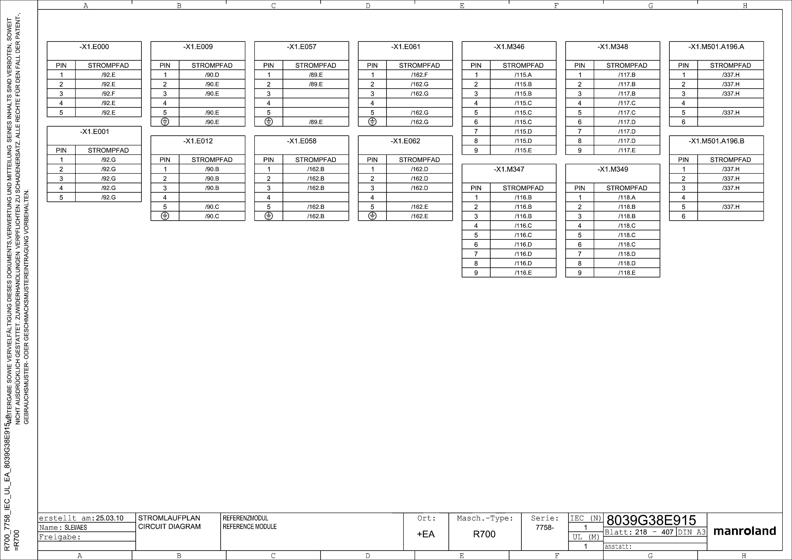

# +EA — Sheet 218 of 407 — REFERENZMODUL

**REFERENCE MODULE**

> Part of the manroland **R700** printing press IEC/UL circuit diagrams.
> Drawing class: **Stromlaufplan / Circuit diagram** (DIN A3).
> Document `+EA` covers the **Printing unit** machine section.

## At a glance

| Field | Value |
|---|---|
| Document | `+EA`  (8039G38E915) |
| Sheet | **218** of 407 |
| Section (DE) | REFERENZMODUL |
| Section (EN) | REFERENCE MODULE |
| Section type | REFERENCE_MODULE — Reference module |
| Machine type | `R700` |
| Series | `7758` |
| Created | 25.03.10 |
| Replaces | — |
| Columns used | A, B, C, D, E, F, G, H |
| Path numbers | — |
| Labels on sheet | 212 |
| Cross-refs out | 82 |
| Cross-refs in | 0 |

**Previous:** [+EA sheet 217](SHEET_0217.md) · **Next:** [+EA sheet 219](SHEET_0219.md) · **Document TOC:** [_TOC.md](_TOC.md)  (+EA) · **Master TOC:** [all sheets](../_MASTER_TOC.md)

## Sheet image (300 DPI, exact vector render)



_Rendered directly from the PDF vector layer at 300 DPI (1-bit), no OCR and no resampling. Use it to confirm anything ambiguous in the text below._

## Cross-references on this sheet

Each entry is a wire leaving this sheet. The printed token is `/sheet.column`; the link resolves to that sheet inside the same document.

| Ref | Target sheet | Col | Path | Destination on target | Target section | From col |
|---|---|---|---|---|---|---|
| `/92.E` | [+EA sheet 92](SHEET_0092.md) | E | — | — | BLASRAHMEN | A |
| `/89.E` | [+EA sheet 89](SHEET_0089.md) | E | — | — | BELEUCHTUNG | C |
| `/115.A` | [+EA sheet 115](SHEET_0115.md) | A | — | — | FORMATEINSTELLUNG: SAUGWALZE | F |
| `/117.B` | [+EA sheet 117](SHEET_0117.md) | B | — | — | FORMATEINSTELLUNG: BOGENGERADESTOSSER | G |
| `/162.F` | [+EA sheet 162](SHEET_0162.md) | F | — | — | VERLÄNGERUNG 1828,4MM | E |
| `/90.D` | [+EA sheet 90](SHEET_0090.md) | D | — | — | BELEUCHTUNG | B |
| `/337.H` | [+EA sheet 337](SHEET_0337.md) | H | — | — | OPTION: BOGENWEICHE | H |
| `/92.E` | [+EA sheet 92](SHEET_0092.md) | E | — | — | BLASRAHMEN | A |
| `/90.E` | [+EA sheet 90](SHEET_0090.md) | E | — | — | BELEUCHTUNG | B |
| `/89.E` | [+EA sheet 89](SHEET_0089.md) | E | — | — | BELEUCHTUNG | C |
| `/115.B` | [+EA sheet 115](SHEET_0115.md) | B | — | — | FORMATEINSTELLUNG: SAUGWALZE | F |
| `/117.B` | [+EA sheet 117](SHEET_0117.md) | B | — | — | FORMATEINSTELLUNG: BOGENGERADESTOSSER | G |
| `/162.G` | [+EA sheet 162](SHEET_0162.md) | G | — | — | VERLÄNGERUNG 1828,4MM | E |
| `/337.H` | [+EA sheet 337](SHEET_0337.md) | H | — | — | OPTION: BOGENWEICHE | H |
| `/90.E` | [+EA sheet 90](SHEET_0090.md) | E | — | — | BELEUCHTUNG | B |
| `/92.F` | [+EA sheet 92](SHEET_0092.md) | F | — | — | BLASRAHMEN | A |
| `/115.B` | [+EA sheet 115](SHEET_0115.md) | B | — | — | FORMATEINSTELLUNG: SAUGWALZE | F |
| `/117.B` | [+EA sheet 117](SHEET_0117.md) | B | — | — | FORMATEINSTELLUNG: BOGENGERADESTOSSER | G |
| `/162.G` | [+EA sheet 162](SHEET_0162.md) | G | — | — | VERLÄNGERUNG 1828,4MM | E |
| `/337.H` | [+EA sheet 337](SHEET_0337.md) | H | — | — | OPTION: BOGENWEICHE | H |
| `/92.E` | [+EA sheet 92](SHEET_0092.md) | E | — | — | BLASRAHMEN | A |
| `/115.C` | [+EA sheet 115](SHEET_0115.md) | C | — | — | FORMATEINSTELLUNG: SAUGWALZE | F |
| `/117.C` | [+EA sheet 117](SHEET_0117.md) | C | — | — | FORMATEINSTELLUNG: BOGENGERADESTOSSER | G |
| `/92.E` | [+EA sheet 92](SHEET_0092.md) | E | — | — | BLASRAHMEN | A |
| `/90.E` | [+EA sheet 90](SHEET_0090.md) | E | — | — | BELEUCHTUNG | B |
| `/162.G` | [+EA sheet 162](SHEET_0162.md) | G | — | — | VERLÄNGERUNG 1828,4MM | E |
| `/115.C` | [+EA sheet 115](SHEET_0115.md) | C | — | — | FORMATEINSTELLUNG: SAUGWALZE | F |
| `/117.C` | [+EA sheet 117](SHEET_0117.md) | C | — | — | FORMATEINSTELLUNG: BOGENGERADESTOSSER | G |
| `/337.H` | [+EA sheet 337](SHEET_0337.md) | H | — | — | OPTION: BOGENWEICHE | H |
| `/90.E` | [+EA sheet 90](SHEET_0090.md) | E | — | — | BELEUCHTUNG | B |
| `/89.E` | [+EA sheet 89](SHEET_0089.md) | E | — | — | BELEUCHTUNG | C |
| `/162.G` | [+EA sheet 162](SHEET_0162.md) | G | — | — | VERLÄNGERUNG 1828,4MM | E |
| `/115.C` | [+EA sheet 115](SHEET_0115.md) | C | — | — | FORMATEINSTELLUNG: SAUGWALZE | F |
| `/117.D` | [+EA sheet 117](SHEET_0117.md) | D | — | — | FORMATEINSTELLUNG: BOGENGERADESTOSSER | G |
| `/115.D` | [+EA sheet 115](SHEET_0115.md) | D | — | — | FORMATEINSTELLUNG: SAUGWALZE | F |
| `/117.D` | [+EA sheet 117](SHEET_0117.md) | D | — | — | FORMATEINSTELLUNG: BOGENGERADESTOSSER | G |
| `/115.D` | [+EA sheet 115](SHEET_0115.md) | D | — | — | FORMATEINSTELLUNG: SAUGWALZE | F |
| `/117.D` | [+EA sheet 117](SHEET_0117.md) | D | — | — | FORMATEINSTELLUNG: BOGENGERADESTOSSER | G |
| `/115.E` | [+EA sheet 115](SHEET_0115.md) | E | — | — | FORMATEINSTELLUNG: SAUGWALZE | F |
| `/117.E` | [+EA sheet 117](SHEET_0117.md) | E | — | — | FORMATEINSTELLUNG: BOGENGERADESTOSSER | G |
| `/92.G` | [+EA sheet 92](SHEET_0092.md) | G | — | — | BLASRAHMEN | A |
| `/90.B` | [+EA sheet 90](SHEET_0090.md) | B | — | — | BELEUCHTUNG | B |
| `/162.B` | [+EA sheet 162](SHEET_0162.md) | B | — | — | VERLÄNGERUNG 1828,4MM | C |
| `/92.G` | [+EA sheet 92](SHEET_0092.md) | G | — | — | BLASRAHMEN | A |
| `/162.D` | [+EA sheet 162](SHEET_0162.md) | D | — | — | VERLÄNGERUNG 1828,4MM | E |
| `/337.H` | [+EA sheet 337](SHEET_0337.md) | H | — | — | OPTION: BOGENWEICHE | H |
| `/90.B` | [+EA sheet 90](SHEET_0090.md) | B | — | — | BELEUCHTUNG | B |
| `/162.B` | [+EA sheet 162](SHEET_0162.md) | B | — | — | VERLÄNGERUNG 1828,4MM | C |
| `/92.G` | [+EA sheet 92](SHEET_0092.md) | G | — | — | BLASRAHMEN | A |
| `/162.D` | [+EA sheet 162](SHEET_0162.md) | D | — | — | VERLÄNGERUNG 1828,4MM | E |
| `/337.H` | [+EA sheet 337](SHEET_0337.md) | H | — | — | OPTION: BOGENWEICHE | H |
| `/90.B` | [+EA sheet 90](SHEET_0090.md) | B | — | — | BELEUCHTUNG | B |
| `/92.G` | [+EA sheet 92](SHEET_0092.md) | G | — | — | BLASRAHMEN | A |
| `/162.B` | [+EA sheet 162](SHEET_0162.md) | B | — | — | VERLÄNGERUNG 1828,4MM | C |
| `/162.D` | [+EA sheet 162](SHEET_0162.md) | D | — | — | VERLÄNGERUNG 1828,4MM | E |
| `/337.H` | [+EA sheet 337](SHEET_0337.md) | H | — | — | OPTION: BOGENWEICHE | H |
| `/116.B` | [+EA sheet 116](SHEET_0116.md) | B | — | — | FORMATEINSTELLUNG: BOGENGERADESTOSSER | F |
| `/118.A` | [+EA sheet 118](SHEET_0118.md) | A | — | — | FORMATEINSTELLUNG: GREIFERÖFFNUNGSKURVE | G |
| `/92.G` | [+EA sheet 92](SHEET_0092.md) | G | — | — | BLASRAHMEN | A |
| `/162.B` | [+EA sheet 162](SHEET_0162.md) | B | — | — | VERLÄNGERUNG 1828,4MM | C |
| `/162.E` | [+EA sheet 162](SHEET_0162.md) | E | — | — | VERLÄNGERUNG 1828,4MM | E |
| `/116.B` | [+EA sheet 116](SHEET_0116.md) | B | — | — | FORMATEINSTELLUNG: BOGENGERADESTOSSER | F |
| `/118.B` | [+EA sheet 118](SHEET_0118.md) | B | — | — | FORMATEINSTELLUNG: GREIFERÖFFNUNGSKURVE | G |
| `/90.C` | [+EA sheet 90](SHEET_0090.md) | C | — | — | BELEUCHTUNG | B |
| `/337.H` | [+EA sheet 337](SHEET_0337.md) | H | — | — | OPTION: BOGENWEICHE | H |
| `/162.B` | [+EA sheet 162](SHEET_0162.md) | B | — | — | VERLÄNGERUNG 1828,4MM | C |
| `/162.E` | [+EA sheet 162](SHEET_0162.md) | E | — | — | VERLÄNGERUNG 1828,4MM | E |
| `/116.B` | [+EA sheet 116](SHEET_0116.md) | B | — | — | FORMATEINSTELLUNG: BOGENGERADESTOSSER | F |
| `/118.B` | [+EA sheet 118](SHEET_0118.md) | B | — | — | FORMATEINSTELLUNG: GREIFERÖFFNUNGSKURVE | G |
| `/90.C` | [+EA sheet 90](SHEET_0090.md) | C | — | — | BELEUCHTUNG | B |
| `/116.C` | [+EA sheet 116](SHEET_0116.md) | C | — | — | FORMATEINSTELLUNG: BOGENGERADESTOSSER | F |
| `/118.C` | [+EA sheet 118](SHEET_0118.md) | C | — | — | FORMATEINSTELLUNG: GREIFERÖFFNUNGSKURVE | G |
| `/116.C` | [+EA sheet 116](SHEET_0116.md) | C | — | — | FORMATEINSTELLUNG: BOGENGERADESTOSSER | F |
| `/118.C` | [+EA sheet 118](SHEET_0118.md) | C | — | — | FORMATEINSTELLUNG: GREIFERÖFFNUNGSKURVE | G |
| `/116.D` | [+EA sheet 116](SHEET_0116.md) | D | — | — | FORMATEINSTELLUNG: BOGENGERADESTOSSER | F |
| `/118.C` | [+EA sheet 118](SHEET_0118.md) | C | — | — | FORMATEINSTELLUNG: GREIFERÖFFNUNGSKURVE | G |
| `/116.D` | [+EA sheet 116](SHEET_0116.md) | D | — | — | FORMATEINSTELLUNG: BOGENGERADESTOSSER | F |
| `/118.D` | [+EA sheet 118](SHEET_0118.md) | D | — | — | FORMATEINSTELLUNG: GREIFERÖFFNUNGSKURVE | G |
| `/116.D` | [+EA sheet 116](SHEET_0116.md) | D | — | — | FORMATEINSTELLUNG: BOGENGERADESTOSSER | F |
| `/118.D` | [+EA sheet 118](SHEET_0118.md) | D | — | — | FORMATEINSTELLUNG: GREIFERÖFFNUNGSKURVE | G |
| `/116.E` | [+EA sheet 116](SHEET_0116.md) | E | — | — | FORMATEINSTELLUNG: BOGENGERADESTOSSER | F |
| `/118.E` | [+EA sheet 118](SHEET_0118.md) | E | — | — | FORMATEINSTELLUNG: GREIFERÖFFNUNGSKURVE | G |

## Devices on this sheet

| Tag | Class | Class meaning (IEC) | Col | Sub | Terminal | Sign |
|---|---|---|---|---|---|---|
| `X1.E000` | — | cross-device reference | A | — | — | — |
| `X1.E001` | — | cross-device reference | A | — | — | — |
| `X1.E009` | — | cross-device reference | B | — | — | — |
| `X1.E012` | — | cross-device reference | B | — | — | — |
| `X1.E057` | — | cross-device reference | C | — | — | — |
| `X1.E058` | — | cross-device reference | C | — | — | — |
| `X1.E062` | — | cross-device reference | D | — | — | — |
| `X1.E061` | — | cross-device reference | D | — | — | — |
| `X1.M346` | — | cross-device reference | F | — | — | — |
| `X1.M347` | — | cross-device reference | F | — | — | — |
| `X1.M348` | — | cross-device reference | G | — | — | — |
| `X1.M349` | — | cross-device reference | G | — | — | — |
| `X1.M501.A196.A` | — | cross-device reference | H | — | — | — |
| `X1.M501.A196.B` | — | cross-device reference | H | — | — | — |

## Potentials / nets

_No named potentials on this sheet._

## Wire-end annotations (grouped as printed)

A wire that continues elsewhere is annotated with a small cluster: the destination description, the path/line number `#NN`, and the `/sheet.column` cross reference. Each row below is one such cluster exactly as it is grouped on the drawing.

| Col | Y | Path | Cross-ref | Text on the wire |
|---|---|---|---|---|
| A | 65.5 | — | — | `X1.E000` |
| B | 65.5 | — | — | `X1.E009` |
| C | 65.5 | — | — | `X1.E057` |
| D | 65.5 | — | — | `X1.E061` |
| F | 65.5 | — | — | `X1.M346` |
| G | 65.5 | — | — | `X1.M348` |
| H | 65.5 | — | — | `X1.M501.A196.A` |
| A | 94.2 | — | — | `PIN 2 3 4 5 1 STROMPFAD` |
| B | 94.2 | — | — | `PIN 2 3 4 5 1 STROMPFAD` |
| C | 94.2 | — | — | `PIN 2 3 4 5 1 STROMPFAD` |
| D | 94.2 | — | — | `PIN 2 3 4 5 1 STROMPFAD` |
| E | 94.2 | — | — | `PIN 2 3 4 5 6 7 8 9 1 STROMPFAD` |
| G | 94.2 | — | — | `PIN 2 3 4 5 6 7 8 9 1 STROMPFAD` |
| H | 94.2 | — | — | `PIN 2 3 4 5 6 1 STROMPFAD` |
| A | 108.7 | — | `/92.E` | — |
| B | 108.7 | — | `/90.D` | — |
| C | 108.7 | — | `/89.E` | — |
| E | 108.7 | — | `/162.F` | — |
| F | 108.7 | — | `/115.A` | — |
| G | 108.7 | — | `/117.B` | — |
| H | 108.7 | — | `/337.H` | — |
| A | 122.8 | — | `/92.E` | — |
| B | 122.8 | — | `/90.E` | — |
| C | 122.8 | — | `/89.E` | — |
| E | 122.9 | — | `/162.G` | — |
| F | 122.9 | — | `/115.B` | — |
| G | 122.9 | — | `/117.B` | — |
| H | 122.9 | — | `/337.H` | — |
| A | 137.0 | — | `/92.F` | — |
| B | 137.0 | — | `/90.E` | — |
| F | 137.0 | — | `/115.B` | — |
| G | 137.0 | — | `/117.B` | — |
| E | 137.1 | — | `/162.G` | — |
| H | 137.1 | — | `/337.H` | — |
| A | 151.2 | — | `/92.E` | — |
| F | 151.2 | — | `/115.C` | — |
| G | 151.2 | — | `/117.C` | — |
| A | 165.4 | — | `/92.E` | — |
| B | 165.4 | — | `/90.E` | — |
| E | 165.4 | — | `/162.G` | — |
| F | 165.4 | — | `/115.C` | — |
| G | 165.4 | — | `/117.C` | — |
| H | 165.4 | — | `/337.H` | — |
| B | 179.5 | — | `/90.E` | — |
| C | 179.5 | — | `/89.E` | — |
| E | 179.6 | — | `/162.G` | — |
| F | 179.6 | — | `/115.C` | — |
| G | 179.6 | — | `/117.D` | — |
| A | 193.1 | — | — | `X1.E001` |
| F | 193.8 | — | `/115.D` | — |
| G | 193.8 | — | `/117.D` | — |
| B | 207.2 | — | — | `X1.E012` |
| C | 207.2 | — | — | `X1.E058` |
| D | 207.2 | — | — | `X1.E062` |
| H | 207.2 | — | — | `X1.M501.A196.B` |
| F | 207.9 | — | `/115.D` | — |
| G | 207.9 | — | `/117.D` | — |
| A | 221.7 | — | — | `PIN 2 3 4 5 1 STROMPFAD` |
| F | 222.1 | — | `/115.E` | — |
| G | 222.1 | — | `/117.E` | — |
| B | 235.9 | — | — | `PIN 2 3 4 5 1 STROMPFAD` |
| C | 235.9 | — | — | `PIN 2 3 4 5 1 STROMPFAD` |
| D | 235.9 | — | — | `PIN 2 3 4 5 1 STROMPFAD` |
| H | 235.9 | — | — | `PIN 2 3 4 5 6 1 STROMPFAD` |
| A | 236.2 | — | `/92.G` | — |
| F | 249.8 | — | — | `X1.M347` |
| G | 249.8 | — | — | `X1.M349` |
| A | 250.4 | — | `/92.G` | — |
| B | 250.4 | — | `/90.B` | — |
| C | 250.4 | — | `/162.B` | — |
| E | 250.4 | — | `/162.D` | — |
| H | 250.4 | — | `/337.H` | — |
| A | 264.6 | — | `/92.G` | — |
| B | 264.6 | — | `/90.B` | — |
| C | 264.6 | — | `/162.B` | — |
| E | 264.6 | — | `/162.D` | — |
| H | 264.6 | — | `/337.H` | — |
| E | 278.4 | — | — | `PIN 2 3 4 5 6 7 8 9 1 STROMPFAD` |
| G | 278.4 | — | — | `PIN 2 3 4 5 6 7 8 9 1 STROMPFAD` |
| A | 278.8 | — | `/92.G` | — |
| B | 278.8 | — | `/90.B` | — |
| C | 278.8 | — | `/162.B` | — |
| E | 278.8 | — | `/162.D` | — |
| H | 278.8 | — | `/337.H` | — |
| A | 292.9 | — | `/92.G` | — |
| F | 292.9 | — | `/116.B` | — |
| G | 292.9 | — | `/118.A` | — |
| B | 307.1 | — | `/90.C` | — |
| C | 307.1 | — | `/162.B` | — |
| E | 307.1 | — | `/162.E` | — |
| F | 307.1 | — | `/116.B` | — |
| G | 307.1 | — | `/118.B` | — |
| H | 307.1 | — | `/337.H` | — |
| B | 321.3 | — | `/90.C` | — |
| C | 321.3 | — | `/162.B` | — |
| E | 321.3 | — | `/162.E` | — |
| F | 321.3 | — | `/116.B` | — |
| G | 321.3 | — | `/118.B` | — |
| F | 335.5 | — | `/116.C` | — |
| G | 335.5 | — | `/118.C` | — |
| F | 349.7 | — | `/116.C` | — |
| G | 349.7 | — | `/118.C` | — |
| F | 363.8 | — | `/116.D` | — |
| G | 363.8 | — | `/118.C` | — |
| F | 378.0 | — | `/116.D` | — |
| G | 378.0 | — | `/118.D` | — |
| F | 392.2 | — | `/116.D` | — |
| G | 392.2 | — | `/118.D` | — |
| F | 406.3 | — | `/116.E` | — |
| G | 406.3 | — | `/118.E` | — |


## Reconstructed tables

This sheet carries tabular content (pin map / terminal assignment / index). The grid below was rebuilt from the drawing's own rule lines, so each row is exactly one physical row of the table.

### Table 1 — 12 data rows × 2 columns (at x=70.9, y=62.4) — **X1.E000**

| PIN | STROMPFAD |
|---|---|
| `1` | `/92.E` |
| `2` | `/92.E` |
| `3` | `/92.F` |
| `4` | `/92.E` |
| `5` | `/92.E` |
|  | `X1.E001` |
| `PIN` | `STROMPFAD` |
| `1` | `/92.G` |
| `2` | `/92.G` |
| `3` | `/92.G` |
| `4` | `/92.G` |
| `5` | `/92.G` |


### Table 2 — 14 data rows × 2 columns (at x=226.8, y=62.4) — **X1.E009**

| PIN | STROMPFAD |
|---|---|
| `1` | `/90.D` |
| `2` | `/90.E` |
| `3` | `/90.E` |
| `4` |  |
| `5` | `/90.E` |
|  | `/90.E` |
|  | `X1.E012` |
| `PIN` | `STROMPFAD` |
| `1` | `/90.B` |
| `2` | `/90.B` |
| `3` | `/90.B` |
| `4` |  |
| `5` | `/90.C` |
|  | `/90.C` |


### Table 3 — 14 data rows × 2 columns (at x=382.7, y=62.4) — **X1.E057**

| PIN | STROMPFAD |
|---|---|
| `1` | `/89.E` |
| `2` | `/89.E` |
| `3` |  |
| `4` |  |
| `5` |  |
|  | `/89.E` |
|  | `X1.E058` |
| `PIN` | `STROMPFAD` |
| `1` | `/162.B` |
| `2` | `/162.B` |
| `3` | `/162.B` |
| `4` |  |
| `5` | `/162.B` |
|  | `/162.B` |


### Table 4 — 14 data rows × 2 columns (at x=538.6, y=62.4) — **X1.E061**

| PIN | STROMPFAD |
|---|---|
| `1` | `/162.F` |
| `2` | `/162.G` |
| `3` | `/162.G` |
| `4` |  |
| `5` | `/162.G` |
|  | `/162.G` |
|  | `X1.E062` |
| `PIN` | `STROMPFAD` |
| `1` | `/162.D` |
| `2` | `/162.D` |
| `3` | `/162.D` |
| `4` |  |
| `5` | `/162.E` |
|  | `/162.E` |


### Table 5 — 20 data rows × 2 columns (at x=694.5, y=62.4) — **X1.M346**

| PIN | STROMPFAD |
|---|---|
| `1` | `/115.A` |
| `2` | `/115.B` |
| `3` | `/115.B` |
| `4` | `/115.C` |
| `5` | `/115.C` |
| `6` | `/115.C` |
| `7` | `/115.D` |
| `8` | `/115.D` |
| `9` | `/115.E` |
|  | `X1.M347` |
| `PIN` | `STROMPFAD` |
| `1` | `/116.B` |
| `2` | `/116.B` |
| `3` | `/116.B` |
| `4` | `/116.C` |
| `5` | `/116.C` |
| `6` | `/116.D` |
| `7` | `/116.D` |
| `8` | `/116.D` |
| `9` | `/116.E` |


### Table 6 — 20 data rows × 2 columns (at x=850.4, y=62.4) — **X1.M348**

| PIN | STROMPFAD |
|---|---|
| `1` | `/117.B` |
| `2` | `/117.B` |
| `3` | `/117.B` |
| `4` | `/117.C` |
| `5` | `/117.C` |
| `6` | `/117.D` |
| `7` | `/117.D` |
| `8` | `/117.D` |
| `9` | `/117.E` |
|  | `X1.M349` |
| `PIN` | `STROMPFAD` |
| `1` | `/118.A` |
| `2` | `/118.B` |
| `3` | `/118.B` |
| `4` | `/118.C` |
| `5` | `/118.C` |
| `6` | `/118.C` |
| `7` | `/118.D` |
| `8` | `/118.D` |
| `9` | `/118.E` |


### Table 7 — 14 data rows × 2 columns (at x=1006.3, y=62.4) — **X1.M501.A196.A**

| PIN | STROMPFAD |
|---|---|
| `1` | `/337.H` |
| `2` | `/337.H` |
| `3` | `/337.H` |
| `4` |  |
| `5` | `/337.H` |
| `6` |  |
|  | `X1.M501.A196.B` |
| `PIN` | `STROMPFAD` |
| `1` | `/337.H` |
| `2` | `/337.H` |
| `3` | `/337.H` |
| `4` |  |
| `5` | `/337.H` |
| `6` |  |


## Notes and free text on this sheet

| Text | Col | Y (pt) |
|---|---|---|
| `PIN` | A | 94.2 |
| `STROMPFAD` | A | 94.15 |
| `PIN` | B | 94.2 |
| `STROMPFAD` | B | 94.15 |
| `PIN` | C | 94.2 |
| `STROMPFAD` | C | 94.15 |
| `PIN` | D | 235.93 |
| `STROMPFAD` | E | 235.89 |
| `PIN` | E | 94.2 |
| `STROMPFAD` | F | 94.15 |
| `PIN` | F | 94.2 |
| `STROMPFAD` | G | 94.15 |
| `PIN` | G | 94.2 |
| `STROMPFAD` | H | 94.15 |

## Complete label inventory (exact text from the drawing)

Every text object inside the drawing area of this sheet, in DIN reading order (column A→H, then top→bottom). This is the authoritative list: if a string is not here it is not printed on this sheet.

| Col | Y | X | Dir | Type | Text |
|---|---|---|---|---|---|
| A | 65.5 | 119.8 | → | device ref | `X1.E000` |
| A | 94.2 | 84.0 | → | text | `PIN` |
| A | 94.2 | 132.2 | → | text | `STROMPFAD` |
| A | 108.4 | 90.0 | → | number | `1` |
| A | 108.7 | 152.9 | → | cross-reference | `/92.E` |
| A | 122.5 | 89.4 | → | number | `2` |
| A | 122.8 | 152.9 | → | cross-reference | `/92.E` |
| A | 136.7 | 89.4 | → | number | `3` |
| A | 137.0 | 153.1 | → | cross-reference | `/92.F` |
| A | 150.9 | 89.4 | → | number | `4` |
| A | 151.2 | 152.9 | → | cross-reference | `/92.E` |
| A | 165.1 | 89.4 | → | number | `5` |
| A | 165.4 | 152.9 | → | cross-reference | `/92.E` |
| A | 193.1 | 120.5 | → | device ref | `X1.E001` |
| A | 221.7 | 132.2 | → | text | `STROMPFAD` |
| A | 221.8 | 84.0 | → | text | `PIN` |
| A | 235.9 | 90.0 | → | number | `1` |
| A | 236.3 | 152.5 | → | cross-reference | `/92.G` |
| A | 250.1 | 89.4 | → | number | `2` |
| A | 250.4 | 152.5 | → | cross-reference | `/92.G` |
| A | 264.3 | 89.4 | → | number | `3` |
| A | 264.6 | 152.5 | → | cross-reference | `/92.G` |
| A | 278.5 | 89.4 | → | number | `4` |
| A | 278.8 | 152.5 | → | cross-reference | `/92.G` |
| A | 292.6 | 89.4 | → | number | `5` |
| A | 292.9 | 152.5 | → | cross-reference | `/92.G` |
| B | 65.5 | 275.7 | → | device ref | `X1.E009` |
| B | 94.2 | 240.0 | → | text | `PIN` |
| B | 94.2 | 288.1 | → | text | `STROMPFAD` |
| B | 108.4 | 245.9 | → | number | `1` |
| B | 108.7 | 308.6 | → | cross-reference | `/90.D` |
| B | 122.5 | 245.3 | → | number | `2` |
| B | 122.8 | 308.8 | → | cross-reference | `/90.E` |
| B | 136.7 | 245.3 | → | number | `3` |
| B | 137.0 | 308.8 | → | cross-reference | `/90.E` |
| B | 150.9 | 245.3 | → | number | `4` |
| B | 165.1 | 245.3 | → | number | `5` |
| B | 165.4 | 308.8 | → | cross-reference | `/90.E` |
| B | 179.5 | 308.8 | → | cross-reference | `/90.E` |
| B | 207.2 | 275.7 | → | device ref | `X1.E012` |
| B | 235.9 | 240.0 | → | text | `PIN` |
| B | 235.9 | 288.1 | → | text | `STROMPFAD` |
| B | 250.1 | 245.9 | → | number | `1` |
| B | 250.4 | 308.7 | → | cross-reference | `/90.B` |
| B | 264.3 | 245.3 | → | number | `2` |
| B | 264.6 | 308.7 | → | cross-reference | `/90.B` |
| B | 278.5 | 245.3 | → | number | `3` |
| B | 278.8 | 308.7 | → | cross-reference | `/90.B` |
| B | 292.6 | 245.3 | → | number | `4` |
| B | 306.8 | 245.3 | → | number | `5` |
| B | 307.1 | 308.6 | → | cross-reference | `/90.C` |
| B | 321.3 | 308.6 | → | cross-reference | `/90.C` |
| C | 65.5 | 431.6 | → | device ref | `X1.E057` |
| C | 94.2 | 395.9 | → | text | `PIN` |
| C | 94.2 | 444.0 | → | text | `STROMPFAD` |
| C | 108.4 | 401.8 | → | number | `1` |
| C | 108.7 | 464.7 | → | cross-reference | `/89.E` |
| C | 122.5 | 401.2 | → | number | `2` |
| C | 122.8 | 464.7 | → | cross-reference | `/89.E` |
| C | 136.7 | 401.2 | → | number | `3` |
| C | 150.9 | 401.2 | → | number | `4` |
| C | 165.1 | 401.2 | → | number | `5` |
| C | 179.5 | 464.7 | → | cross-reference | `/89.E` |
| C | 207.2 | 431.6 | → | device ref | `X1.E058` |
| C | 235.9 | 395.9 | → | text | `PIN` |
| C | 235.9 | 444.0 | → | text | `STROMPFAD` |
| C | 250.1 | 401.8 | → | number | `1` |
| C | 250.4 | 462.2 | → | cross-reference | `/162.B` |
| C | 264.3 | 401.2 | → | number | `2` |
| C | 264.6 | 462.2 | → | cross-reference | `/162.B` |
| C | 278.5 | 401.2 | → | number | `3` |
| C | 278.8 | 462.2 | → | cross-reference | `/162.B` |
| C | 292.6 | 401.2 | → | number | `4` |
| C | 306.8 | 401.2 | → | number | `5` |
| C | 307.1 | 462.2 | → | cross-reference | `/162.B` |
| C | 321.3 | 462.2 | → | cross-reference | `/162.B` |
| D | 65.5 | 588.2 | → | device ref | `X1.E061` |
| D | 94.2 | 551.8 | → | text | `PIN` |
| D | 108.4 | 557.7 | → | number | `1` |
| D | 122.5 | 557.1 | → | number | `2` |
| D | 136.7 | 557.1 | → | number | `3` |
| D | 150.9 | 557.1 | → | number | `4` |
| D | 165.1 | 557.1 | → | number | `5` |
| D | 207.2 | 587.5 | → | device ref | `X1.E062` |
| D | 235.9 | 551.8 | → | text | `PIN` |
| D | 250.1 | 557.7 | → | number | `1` |
| D | 264.3 | 557.1 | → | number | `2` |
| D | 278.5 | 557.1 | → | number | `3` |
| D | 292.6 | 557.1 | → | number | `4` |
| D | 306.8 | 557.1 | → | number | `5` |
| E | 94.2 | 600.0 | → | text | `STROMPFAD` |
| E | 94.2 | 707.7 | → | text | `PIN` |
| E | 108.4 | 713.6 | → | number | `1` |
| E | 108.7 | 618.4 | → | cross-reference | `/162.F` |
| E | 122.5 | 713.1 | → | number | `2` |
| E | 122.9 | 617.8 | → | cross-reference | `/162.G` |
| E | 136.7 | 713.1 | → | number | `3` |
| E | 137.1 | 617.8 | → | cross-reference | `/162.G` |
| E | 150.9 | 713.1 | → | number | `4` |
| E | 165.1 | 713.1 | → | number | `5` |
| E | 165.4 | 617.8 | → | cross-reference | `/162.G` |
| E | 179.2 | 713.1 | → | number | `6` |
| E | 179.6 | 617.8 | → | cross-reference | `/162.G` |
| E | 193.4 | 713.1 | → | number | `7` |
| E | 207.6 | 713.1 | → | number | `8` |
| E | 221.8 | 713.1 | → | number | `9` |
| E | 235.9 | 600.0 | → | text | `STROMPFAD` |
| E | 250.4 | 618.0 | → | cross-reference | `/162.D` |
| E | 264.6 | 618.0 | → | cross-reference | `/162.D` |
| E | 278.4 | 707.7 | → | text | `PIN` |
| E | 278.8 | 618.0 | → | cross-reference | `/162.D` |
| E | 292.6 | 713.6 | → | number | `1` |
| E | 306.8 | 713.1 | → | number | `2` |
| E | 307.1 | 618.2 | → | cross-reference | `/162.E` |
| E | 321.0 | 713.1 | → | number | `3` |
| E | 321.3 | 618.2 | → | cross-reference | `/162.E` |
| E | 335.1 | 713.1 | → | number | `4` |
| E | 349.3 | 713.1 | → | number | `5` |
| E | 363.5 | 713.1 | → | number | `6` |
| E | 377.7 | 713.1 | → | number | `7` |
| E | 391.8 | 713.1 | → | number | `8` |
| E | 406.0 | 713.1 | → | number | `9` |
| F | 65.5 | 742.5 | → | device ref | `X1.M346` |
| F | 94.2 | 755.9 | → | text | `STROMPFAD` |
| F | 94.2 | 863.6 | → | text | `PIN` |
| F | 108.4 | 869.5 | → | number | `1` |
| F | 108.7 | 773.9 | → | cross-reference | `/115.A` |
| F | 122.5 | 869.0 | → | number | `2` |
| F | 122.9 | 774.0 | → | cross-reference | `/115.B` |
| F | 136.7 | 869.0 | → | number | `3` |
| F | 137.0 | 774.0 | → | cross-reference | `/115.B` |
| F | 150.9 | 869.0 | → | number | `4` |
| F | 151.2 | 773.9 | → | cross-reference | `/115.C` |
| F | 165.1 | 869.0 | → | number | `5` |
| F | 165.4 | 773.9 | → | cross-reference | `/115.C` |
| F | 179.2 | 869.0 | → | number | `6` |
| F | 179.6 | 773.9 | → | cross-reference | `/115.C` |
| F | 193.4 | 869.0 | → | number | `7` |
| F | 193.8 | 773.9 | → | cross-reference | `/115.D` |
| F | 207.6 | 869.0 | → | number | `8` |
| F | 207.9 | 773.9 | → | cross-reference | `/115.D` |
| F | 221.8 | 869.0 | → | number | `9` |
| F | 222.1 | 774.1 | → | cross-reference | `/115.E` |
| F | 249.8 | 742.5 | → | device ref | `X1.M347` |
| F | 278.4 | 755.9 | → | text | `STROMPFAD` |
| F | 278.4 | 863.6 | → | text | `PIN` |
| F | 292.6 | 869.5 | → | number | `1` |
| F | 292.9 | 774.0 | → | cross-reference | `/116.B` |
| F | 306.8 | 869.0 | → | number | `2` |
| F | 307.1 | 774.0 | → | cross-reference | `/116.B` |
| F | 321.0 | 869.0 | → | number | `3` |
| F | 321.3 | 774.0 | → | cross-reference | `/116.B` |
| F | 335.1 | 869.0 | → | number | `4` |
| F | 335.5 | 773.9 | → | cross-reference | `/116.C` |
| F | 349.3 | 869.0 | → | number | `5` |
| F | 349.7 | 773.9 | → | cross-reference | `/116.C` |
| F | 363.5 | 869.0 | → | number | `6` |
| F | 363.8 | 773.9 | → | cross-reference | `/116.D` |
| F | 377.7 | 869.0 | → | number | `7` |
| F | 378.0 | 773.9 | → | cross-reference | `/116.D` |
| F | 391.8 | 869.0 | → | number | `8` |
| F | 392.2 | 773.9 | → | cross-reference | `/116.D` |
| F | 406.0 | 869.0 | → | number | `9` |
| F | 406.3 | 774.1 | → | cross-reference | `/116.E` |
| G | 65.5 | 898.4 | → | device ref | `X1.M348` |
| G | 94.2 | 911.8 | → | text | `STROMPFAD` |
| G | 94.2 | 1019.5 | → | text | `PIN` |
| G | 108.4 | 1025.4 | → | number | `1` |
| G | 108.7 | 929.9 | → | cross-reference | `/117.B` |
| G | 122.5 | 1024.9 | → | number | `2` |
| G | 122.9 | 929.9 | → | cross-reference | `/117.B` |
| G | 136.7 | 1024.9 | → | number | `3` |
| G | 137.0 | 929.9 | → | cross-reference | `/117.B` |
| G | 150.9 | 1024.9 | → | number | `4` |
| G | 151.2 | 929.8 | → | cross-reference | `/117.C` |
| G | 165.1 | 1024.9 | → | number | `5` |
| G | 165.4 | 929.8 | → | cross-reference | `/117.C` |
| G | 179.2 | 1024.9 | → | number | `6` |
| G | 179.6 | 929.8 | → | cross-reference | `/117.D` |
| G | 193.8 | 929.8 | → | cross-reference | `/117.D` |
| G | 207.9 | 929.8 | → | cross-reference | `/117.D` |
| G | 222.1 | 930.0 | → | cross-reference | `/117.E` |
| G | 235.9 | 1019.5 | → | text | `PIN` |
| G | 249.8 | 898.4 | → | device ref | `X1.M349` |
| G | 250.1 | 1025.4 | → | number | `1` |
| G | 264.3 | 1024.9 | → | number | `2` |
| G | 278.4 | 911.8 | → | text | `STROMPFAD` |
| G | 278.5 | 1024.9 | → | number | `3` |
| G | 292.6 | 1024.9 | → | number | `4` |
| G | 292.9 | 929.8 | → | cross-reference | `/118.A` |
| G | 306.8 | 1024.9 | → | number | `5` |
| G | 307.1 | 929.9 | → | cross-reference | `/118.B` |
| G | 321.0 | 1024.9 | → | number | `6` |
| G | 321.3 | 929.9 | → | cross-reference | `/118.B` |
| G | 335.5 | 929.8 | → | cross-reference | `/118.C` |
| G | 349.7 | 929.8 | → | cross-reference | `/118.C` |
| G | 363.8 | 929.8 | → | cross-reference | `/118.C` |
| G | 378.0 | 929.8 | → | cross-reference | `/118.D` |
| G | 392.2 | 929.8 | → | cross-reference | `/118.D` |
| G | 406.3 | 930.0 | → | cross-reference | `/118.E` |
| H | 65.5 | 1035.1 | → | device ref | `X1.M501.A196.A` |
| H | 94.2 | 1067.7 | → | text | `STROMPFAD` |
| H | 108.7 | 1086.0 | → | cross-reference | `/337.H` |
| H | 122.9 | 1086.0 | → | cross-reference | `/337.H` |
| H | 137.1 | 1086.0 | → | cross-reference | `/337.H` |
| H | 165.4 | 1086.0 | → | cross-reference | `/337.H` |
| H | 207.2 | 1035.5 | → | device ref | `X1.M501.A196.B` |
| H | 235.9 | 1067.7 | → | text | `STROMPFAD` |
| H | 250.4 | 1086.0 | → | cross-reference | `/337.H` |
| H | 264.6 | 1086.0 | → | cross-reference | `/337.H` |
| H | 278.8 | 1086.0 | → | cross-reference | `/337.H` |
| H | 307.1 | 1086.0 | → | cross-reference | `/337.H` |

## Reading-order text block

The same content as a plain block, grouped by DIN column — convenient to paste or to match against a visual description.

```text
=== Column A ===
  65.5  119.8  devref       X1.E000
  94.2   84.0  text         PIN
  94.2  132.2  text         STROMPFAD
 108.4   90.0  numeric      1
 108.7  152.9  xref         /92.E
 122.5   89.4  numeric      2
 122.8  152.9  xref         /92.E
 136.7   89.4  numeric      3
 137.0  153.1  xref         /92.F
 150.9   89.4  numeric      4
 151.2  152.9  xref         /92.E
 165.1   89.4  numeric      5
 165.4  152.9  xref         /92.E
 193.1  120.5  devref       X1.E001
 221.7  132.2  text         STROMPFAD
 221.8   84.0  text         PIN
 235.9   90.0  numeric      1
 236.3  152.5  xref         /92.G
 250.1   89.4  numeric      2
 250.4  152.5  xref         /92.G
 264.3   89.4  numeric      3
 264.6  152.5  xref         /92.G
 278.5   89.4  numeric      4
 278.8  152.5  xref         /92.G
 292.6   89.4  numeric      5
 292.9  152.5  xref         /92.G
=== Column B ===
  65.5  275.7  devref       X1.E009
  94.2  240.0  text         PIN
  94.2  288.1  text         STROMPFAD
 108.4  245.9  numeric      1
 108.7  308.6  xref         /90.D
 122.5  245.3  numeric      2
 122.8  308.8  xref         /90.E
 136.7  245.3  numeric      3
 137.0  308.8  xref         /90.E
 150.9  245.3  numeric      4
 165.1  245.3  numeric      5
 165.4  308.8  xref         /90.E
 179.5  308.8  xref         /90.E
 207.2  275.7  devref       X1.E012
 235.9  240.0  text         PIN
 235.9  288.1  text         STROMPFAD
 250.1  245.9  numeric      1
 250.4  308.7  xref         /90.B
 264.3  245.3  numeric      2
 264.6  308.7  xref         /90.B
 278.5  245.3  numeric      3
 278.8  308.7  xref         /90.B
 292.6  245.3  numeric      4
 306.8  245.3  numeric      5
 307.1  308.6  xref         /90.C
 321.3  308.6  xref         /90.C
=== Column C ===
  65.5  431.6  devref       X1.E057
  94.2  395.9  text         PIN
  94.2  444.0  text         STROMPFAD
 108.4  401.8  numeric      1
 108.7  464.7  xref         /89.E
 122.5  401.2  numeric      2
 122.8  464.7  xref         /89.E
 136.7  401.2  numeric      3
 150.9  401.2  numeric      4
 165.1  401.2  numeric      5
 179.5  464.7  xref         /89.E
 207.2  431.6  devref       X1.E058
 235.9  395.9  text         PIN
 235.9  444.0  text         STROMPFAD
 250.1  401.8  numeric      1
 250.4  462.2  xref         /162.B
 264.3  401.2  numeric      2
 264.6  462.2  xref         /162.B
 278.5  401.2  numeric      3
 278.8  462.2  xref         /162.B
 292.6  401.2  numeric      4
 306.8  401.2  numeric      5
 307.1  462.2  xref         /162.B
 321.3  462.2  xref         /162.B
=== Column D ===
  65.5  588.2  devref       X1.E061
  94.2  551.8  text         PIN
 108.4  557.7  numeric      1
 122.5  557.1  numeric      2
 136.7  557.1  numeric      3
 150.9  557.1  numeric      4
 165.1  557.1  numeric      5
 207.2  587.5  devref       X1.E062
 235.9  551.8  text         PIN
 250.1  557.7  numeric      1
 264.3  557.1  numeric      2
 278.5  557.1  numeric      3
 292.6  557.1  numeric      4
 306.8  557.1  numeric      5
=== Column E ===
  94.2  600.0  text         STROMPFAD
  94.2  707.7  text         PIN
 108.4  713.6  numeric      1
 108.7  618.4  xref         /162.F
 122.5  713.1  numeric      2
 122.9  617.8  xref         /162.G
 136.7  713.1  numeric      3
 137.1  617.8  xref         /162.G
 150.9  713.1  numeric      4
 165.1  713.1  numeric      5
 165.4  617.8  xref         /162.G
 179.2  713.1  numeric      6
 179.6  617.8  xref         /162.G
 193.4  713.1  numeric      7
 207.6  713.1  numeric      8
 221.8  713.1  numeric      9
 235.9  600.0  text         STROMPFAD
 250.4  618.0  xref         /162.D
 264.6  618.0  xref         /162.D
 278.4  707.7  text         PIN
 278.8  618.0  xref         /162.D
 292.6  713.6  numeric      1
 306.8  713.1  numeric      2
 307.1  618.2  xref         /162.E
 321.0  713.1  numeric      3
 321.3  618.2  xref         /162.E
 335.1  713.1  numeric      4
 349.3  713.1  numeric      5
 363.5  713.1  numeric      6
 377.7  713.1  numeric      7
 391.8  713.1  numeric      8
 406.0  713.1  numeric      9
=== Column F ===
  65.5  742.5  devref       X1.M346
  94.2  755.9  text         STROMPFAD
  94.2  863.6  text         PIN
 108.4  869.5  numeric      1
 108.7  773.9  xref         /115.A
 122.5  869.0  numeric      2
 122.9  774.0  xref         /115.B
 136.7  869.0  numeric      3
 137.0  774.0  xref         /115.B
 150.9  869.0  numeric      4
 151.2  773.9  xref         /115.C
 165.1  869.0  numeric      5
 165.4  773.9  xref         /115.C
 179.2  869.0  numeric      6
 179.6  773.9  xref         /115.C
 193.4  869.0  numeric      7
 193.8  773.9  xref         /115.D
 207.6  869.0  numeric      8
 207.9  773.9  xref         /115.D
 221.8  869.0  numeric      9
 222.1  774.1  xref         /115.E
 249.8  742.5  devref       X1.M347
 278.4  755.9  text         STROMPFAD
 278.4  863.6  text         PIN
 292.6  869.5  numeric      1
 292.9  774.0  xref         /116.B
 306.8  869.0  numeric      2
 307.1  774.0  xref         /116.B
 321.0  869.0  numeric      3
 321.3  774.0  xref         /116.B
 335.1  869.0  numeric      4
 335.5  773.9  xref         /116.C
 349.3  869.0  numeric      5
 349.7  773.9  xref         /116.C
 363.5  869.0  numeric      6
 363.8  773.9  xref         /116.D
 377.7  869.0  numeric      7
 378.0  773.9  xref         /116.D
 391.8  869.0  numeric      8
 392.2  773.9  xref         /116.D
 406.0  869.0  numeric      9
 406.3  774.1  xref         /116.E
=== Column G ===
  65.5  898.4  devref       X1.M348
  94.2  911.8  text         STROMPFAD
  94.2 1019.5  text         PIN
 108.4 1025.4  numeric      1
 108.7  929.9  xref         /117.B
 122.5 1024.9  numeric      2
 122.9  929.9  xref         /117.B
 136.7 1024.9  numeric      3
 137.0  929.9  xref         /117.B
 150.9 1024.9  numeric      4
 151.2  929.8  xref         /117.C
 165.1 1024.9  numeric      5
 165.4  929.8  xref         /117.C
 179.2 1024.9  numeric      6
 179.6  929.8  xref         /117.D
 193.8  929.8  xref         /117.D
 207.9  929.8  xref         /117.D
 222.1  930.0  xref         /117.E
 235.9 1019.5  text         PIN
 249.8  898.4  devref       X1.M349
 250.1 1025.4  numeric      1
 264.3 1024.9  numeric      2
 278.4  911.8  text         STROMPFAD
 278.5 1024.9  numeric      3
 292.6 1024.9  numeric      4
 292.9  929.8  xref         /118.A
 306.8 1024.9  numeric      5
 307.1  929.9  xref         /118.B
 321.0 1024.9  numeric      6
 321.3  929.9  xref         /118.B
 335.5  929.8  xref         /118.C
 349.7  929.8  xref         /118.C
 363.8  929.8  xref         /118.C
 378.0  929.8  xref         /118.D
 392.2  929.8  xref         /118.D
 406.3  930.0  xref         /118.E
=== Column H ===
  65.5 1035.1  devref       X1.M501.A196.A
  94.2 1067.7  text         STROMPFAD
 108.7 1086.0  xref         /337.H
 122.9 1086.0  xref         /337.H
 137.1 1086.0  xref         /337.H
 165.4 1086.0  xref         /337.H
 207.2 1035.5  devref       X1.M501.A196.B
 235.9 1067.7  text         STROMPFAD
 250.4 1086.0  xref         /337.H
 264.6 1086.0  xref         /337.H
 278.8 1086.0  xref         /337.H
 307.1 1086.0  xref         /337.H
```

---
_Generated from the PDF vector text layer; no OCR. Source: `R700_7758_IEC_UL_EA_8039G38E915_p`, sheet 218._
