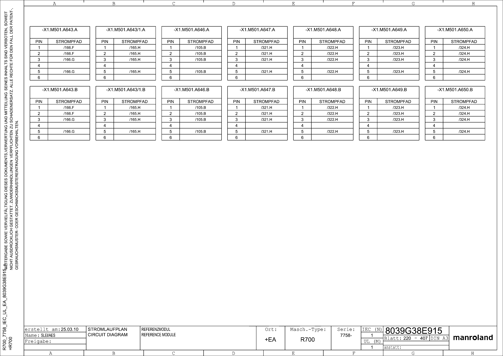

# +EA — Sheet 220 of 407 — REFERENZMODUL

**REFERENCE MODULE**

> Part of the manroland **R700** printing press IEC/UL circuit diagrams.
> Drawing class: **Stromlaufplan / Circuit diagram** (DIN A3).
> Document `+EA` covers the **Printing unit** machine section.

## At a glance

| Field | Value |
|---|---|
| Document | `+EA`  (8039G38E915) |
| Sheet | **220** of 407 |
| Section (DE) | REFERENZMODUL |
| Section (EN) | REFERENCE MODULE |
| Section type | REFERENCE_MODULE — Reference module |
| Machine type | `R700` |
| Series | `7758` |
| Created | 25.03.10 |
| Replaces | — |
| Columns used | A, B, C, D, E, F, G, H |
| Path numbers | — |
| Labels on sheet | 182 |
| Cross-refs out | 56 |
| Cross-refs in | 0 |

**Previous:** [+EA sheet 219](SHEET_0219.md) · **Next:** [+EA sheet 221](SHEET_0221.md) · **Document TOC:** [_TOC.md](_TOC.md)  (+EA) · **Master TOC:** [all sheets](../_MASTER_TOC.md)

## Sheet image (300 DPI, exact vector render)



_Rendered directly from the PDF vector layer at 300 DPI (1-bit), no OCR and no resampling. Use it to confirm anything ambiguous in the text below._

## Cross-references on this sheet

Each entry is a wire leaving this sheet. The printed token is `/sheet.column`; the link resolves to that sheet inside the same document.

| Ref | Target sheet | Col | Path | Destination on target | Target section | From col |
|---|---|---|---|---|---|---|
| `/105.B` | [+EA sheet 105](SHEET_0105.md) | B | — | — | BOGENFÜHRUNGSELEMENT | C |
| `/166.F` | [+EA sheet 166](SHEET_0166.md) | F | — | — | VERLÄNGERUNG 1828,4MM | A |
| `/165.H` | [+EA sheet 165](SHEET_0165.md) | H | — | — | VERLÄNGERUNG 1828,4MM | B |
| `/321.H` | [+EA sheet 321](SHEET_0321.md) | H | — | — | OPTION: VERLÄNGERUNG 3656,8MM | E |
| `/322.H` | [+EA sheet 322](SHEET_0322.md) | H | — | — | OPTION: VERLÄNGERUNG 3656,8MM | F |
| `/323.H` | [+EA sheet 323](SHEET_0323.md) | H | — | — | OPTION: VERLÄNGERUNG 3656,8MM | G |
| `/324.H` | [+EA sheet 324](SHEET_0324.md) | H | — | — | OPTION: VERLÄNGERUNG 3656,8MM | H |
| `/105.B` | [+EA sheet 105](SHEET_0105.md) | B | — | — | BOGENFÜHRUNGSELEMENT | C |
| `/166.F` | [+EA sheet 166](SHEET_0166.md) | F | — | — | VERLÄNGERUNG 1828,4MM | A |
| `/165.H` | [+EA sheet 165](SHEET_0165.md) | H | — | — | VERLÄNGERUNG 1828,4MM | B |
| `/321.H` | [+EA sheet 321](SHEET_0321.md) | H | — | — | OPTION: VERLÄNGERUNG 3656,8MM | E |
| `/322.H` | [+EA sheet 322](SHEET_0322.md) | H | — | — | OPTION: VERLÄNGERUNG 3656,8MM | F |
| `/323.H` | [+EA sheet 323](SHEET_0323.md) | H | — | — | OPTION: VERLÄNGERUNG 3656,8MM | G |
| `/324.H` | [+EA sheet 324](SHEET_0324.md) | H | — | — | OPTION: VERLÄNGERUNG 3656,8MM | H |
| `/105.B` | [+EA sheet 105](SHEET_0105.md) | B | — | — | BOGENFÜHRUNGSELEMENT | C |
| `/166.G` | [+EA sheet 166](SHEET_0166.md) | G | — | — | VERLÄNGERUNG 1828,4MM | A |
| `/165.H` | [+EA sheet 165](SHEET_0165.md) | H | — | — | VERLÄNGERUNG 1828,4MM | B |
| `/321.H` | [+EA sheet 321](SHEET_0321.md) | H | — | — | OPTION: VERLÄNGERUNG 3656,8MM | E |
| `/322.H` | [+EA sheet 322](SHEET_0322.md) | H | — | — | OPTION: VERLÄNGERUNG 3656,8MM | F |
| `/323.H` | [+EA sheet 323](SHEET_0323.md) | H | — | — | OPTION: VERLÄNGERUNG 3656,8MM | G |
| `/324.H` | [+EA sheet 324](SHEET_0324.md) | H | — | — | OPTION: VERLÄNGERUNG 3656,8MM | H |
| `/105.B` | [+EA sheet 105](SHEET_0105.md) | B | — | — | BOGENFÜHRUNGSELEMENT | C |
| `/166.G` | [+EA sheet 166](SHEET_0166.md) | G | — | — | VERLÄNGERUNG 1828,4MM | A |
| `/165.H` | [+EA sheet 165](SHEET_0165.md) | H | — | — | VERLÄNGERUNG 1828,4MM | B |
| `/321.H` | [+EA sheet 321](SHEET_0321.md) | H | — | — | OPTION: VERLÄNGERUNG 3656,8MM | E |
| `/322.H` | [+EA sheet 322](SHEET_0322.md) | H | — | — | OPTION: VERLÄNGERUNG 3656,8MM | F |
| `/323.H` | [+EA sheet 323](SHEET_0323.md) | H | — | — | OPTION: VERLÄNGERUNG 3656,8MM | G |
| `/324.H` | [+EA sheet 324](SHEET_0324.md) | H | — | — | OPTION: VERLÄNGERUNG 3656,8MM | H |
| `/105.B` | [+EA sheet 105](SHEET_0105.md) | B | — | — | BOGENFÜHRUNGSELEMENT | C |
| `/166.F` | [+EA sheet 166](SHEET_0166.md) | F | — | — | VERLÄNGERUNG 1828,4MM | A |
| `/165.H` | [+EA sheet 165](SHEET_0165.md) | H | — | — | VERLÄNGERUNG 1828,4MM | B |
| `/321.H` | [+EA sheet 321](SHEET_0321.md) | H | — | — | OPTION: VERLÄNGERUNG 3656,8MM | E |
| `/322.H` | [+EA sheet 322](SHEET_0322.md) | H | — | — | OPTION: VERLÄNGERUNG 3656,8MM | F |
| `/323.H` | [+EA sheet 323](SHEET_0323.md) | H | — | — | OPTION: VERLÄNGERUNG 3656,8MM | G |
| `/324.H` | [+EA sheet 324](SHEET_0324.md) | H | — | — | OPTION: VERLÄNGERUNG 3656,8MM | H |
| `/105.B` | [+EA sheet 105](SHEET_0105.md) | B | — | — | BOGENFÜHRUNGSELEMENT | C |
| `/166.F` | [+EA sheet 166](SHEET_0166.md) | F | — | — | VERLÄNGERUNG 1828,4MM | A |
| `/165.H` | [+EA sheet 165](SHEET_0165.md) | H | — | — | VERLÄNGERUNG 1828,4MM | B |
| `/321.H` | [+EA sheet 321](SHEET_0321.md) | H | — | — | OPTION: VERLÄNGERUNG 3656,8MM | E |
| `/322.H` | [+EA sheet 322](SHEET_0322.md) | H | — | — | OPTION: VERLÄNGERUNG 3656,8MM | F |
| `/323.H` | [+EA sheet 323](SHEET_0323.md) | H | — | — | OPTION: VERLÄNGERUNG 3656,8MM | G |
| `/324.H` | [+EA sheet 324](SHEET_0324.md) | H | — | — | OPTION: VERLÄNGERUNG 3656,8MM | H |
| `/105.B` | [+EA sheet 105](SHEET_0105.md) | B | — | — | BOGENFÜHRUNGSELEMENT | C |
| `/166.G` | [+EA sheet 166](SHEET_0166.md) | G | — | — | VERLÄNGERUNG 1828,4MM | A |
| `/165.H` | [+EA sheet 165](SHEET_0165.md) | H | — | — | VERLÄNGERUNG 1828,4MM | B |
| `/321.H` | [+EA sheet 321](SHEET_0321.md) | H | — | — | OPTION: VERLÄNGERUNG 3656,8MM | E |
| `/322.H` | [+EA sheet 322](SHEET_0322.md) | H | — | — | OPTION: VERLÄNGERUNG 3656,8MM | F |
| `/323.H` | [+EA sheet 323](SHEET_0323.md) | H | — | — | OPTION: VERLÄNGERUNG 3656,8MM | G |
| `/324.H` | [+EA sheet 324](SHEET_0324.md) | H | — | — | OPTION: VERLÄNGERUNG 3656,8MM | H |
| `/105.B` | [+EA sheet 105](SHEET_0105.md) | B | — | — | BOGENFÜHRUNGSELEMENT | C |
| `/166.G` | [+EA sheet 166](SHEET_0166.md) | G | — | — | VERLÄNGERUNG 1828,4MM | A |
| `/165.H` | [+EA sheet 165](SHEET_0165.md) | H | — | — | VERLÄNGERUNG 1828,4MM | B |
| `/321.H` | [+EA sheet 321](SHEET_0321.md) | H | — | — | OPTION: VERLÄNGERUNG 3656,8MM | E |
| `/322.H` | [+EA sheet 322](SHEET_0322.md) | H | — | — | OPTION: VERLÄNGERUNG 3656,8MM | F |
| `/323.H` | [+EA sheet 323](SHEET_0323.md) | H | — | — | OPTION: VERLÄNGERUNG 3656,8MM | G |
| `/324.H` | [+EA sheet 324](SHEET_0324.md) | H | — | — | OPTION: VERLÄNGERUNG 3656,8MM | H |

## Devices on this sheet

| Tag | Class | Class meaning (IEC) | Col | Sub | Terminal | Sign |
|---|---|---|---|---|---|---|
| `X1.M501.A643.A` | — | cross-device reference | A | — | — | — |
| `X1.M501.A643.B` | — | cross-device reference | A | — | — | — |
| `X1.M501.A646.A` | — | cross-device reference | C | — | — | — |
| `X1.M501.A646.B` | — | cross-device reference | C | — | — | — |
| `X1.M501.A647.A` | — | cross-device reference | D | — | — | — |
| `X1.M501.A647.B` | — | cross-device reference | D | — | — | — |
| `X1.M501.A648.A` | — | cross-device reference | E | — | — | — |
| `X1.M501.A648.B` | — | cross-device reference | F | — | — | — |
| `X1.M501.A650.A` | — | cross-device reference | H | — | — | — |
| `X1.M501.A650.B` | — | cross-device reference | H | — | — | — |
| `X1.M501.A649.A` | — | cross-device reference | G | — | — | — |
| `X1.M501.A649.B` | — | cross-device reference | G | — | — | — |

## Potentials / nets

_No named potentials on this sheet._

## Wire-end annotations (grouped as printed)

A wire that continues elsewhere is annotated with a small cluster: the destination description, the path/line number `#NN`, and the `/sheet.column` cross reference. Each row below is one such cluster exactly as it is grouped on the drawing.

| Col | Y | Path | Cross-ref | Text on the wire |
|---|---|---|---|---|
| A | 65.5 | — | — | `X1.M501.A643.A` |
| B | 65.5 | — | — | `X1.M501.A643/1.A` |
| C | 65.5 | — | — | `X1.M501.A646.A` |
| D | 65.5 | — | — | `X1.M501.A647.A` |
| E | 65.5 | — | — | `X1.M501.A648.A` |
| G | 65.5 | — | — | `X1.M501.A649.A` |
| H | 65.5 | — | — | `X1.M501.A650.A` |
| A | 94.2 | — | — | `PIN 2 3 4 5 6 1 STROMPFAD` |
| B | 94.2 | — | — | `PIN 2 3 4 5 6 1 STROMPFAD` |
| C | 94.2 | — | — | `PIN 2 3 4 5 6 1 STROMPFAD` |
| D | 94.2 | — | — | `PIN 2 3 4 5 6 1 STROMPFAD` |
| E | 94.2 | — | — | `PIN 2 3 4 5 6 1 STROMPFAD` |
| G | 94.2 | — | — | `PIN 2 3 4 5 6 1 STROMPFAD` |
| H | 94.2 | — | — | `PIN 2 3 4 5 6 1 STROMPFAD` |
| A | 108.7 | — | `/166.F` | — |
| B | 108.7 | — | `/165.H` | — |
| C | 108.7 | — | `/105.B` | — |
| E | 108.7 | — | `/321.H` | — |
| F | 108.7 | — | `/322.H` | — |
| G | 108.7 | — | `/323.H` | — |
| H | 108.7 | — | `/324.H` | — |
| A | 122.9 | — | `/166.F` | — |
| B | 122.9 | — | `/165.H` | — |
| C | 122.9 | — | `/105.B` | — |
| E | 122.9 | — | `/321.H` | — |
| F | 122.9 | — | `/322.H` | — |
| G | 122.9 | — | `/323.H` | — |
| H | 122.9 | — | `/324.H` | — |
| C | 137.0 | — | `/105.B` | — |
| A | 137.1 | — | `/166.G` | — |
| B | 137.1 | — | `/165.H` | — |
| E | 137.1 | — | `/321.H` | — |
| F | 137.1 | — | `/322.H` | — |
| G | 137.1 | — | `/323.H` | — |
| H | 137.1 | — | `/324.H` | — |
| A | 165.4 | — | `/166.G` | — |
| B | 165.4 | — | `/165.H` | — |
| C | 165.4 | — | `/105.B` | — |
| E | 165.4 | — | `/321.H` | — |
| F | 165.4 | — | `/322.H` | — |
| G | 165.4 | — | `/323.H` | — |
| H | 165.4 | — | `/324.H` | — |
| A | 207.2 | — | — | `X1.M501.A643.B` |
| B | 207.2 | — | — | `X1.M501.A643/1.B` |
| C | 207.2 | — | — | `X1.M501.A646.B` |
| D | 207.2 | — | — | `X1.M501.A647.B` |
| F | 207.2 | — | — | `X1.M501.A648.B` |
| G | 207.2 | — | — | `X1.M501.A649.B` |
| H | 207.2 | — | — | `X1.M501.A650.B` |
| A | 235.9 | — | — | `PIN 2 3 4 5 6 1 STROMPFAD` |
| B | 235.9 | — | — | `PIN 2 3 4 5 6 1 STROMPFAD` |
| C | 235.9 | — | — | `PIN 2 3 4 5 6 1 STROMPFAD` |
| D | 235.9 | — | — | `PIN 2 3 4 5 6 1 STROMPFAD` |
| E | 235.9 | — | — | `PIN 2 3 4 5 6 1 STROMPFAD` |
| G | 235.9 | — | — | `PIN 2 3 4 5 6 1 STROMPFAD` |
| H | 235.9 | — | — | `PIN 2 3 4 5 6 1 STROMPFAD` |
| A | 250.4 | — | `/166.F` | — |
| B | 250.4 | — | `/165.H` | — |
| C | 250.4 | — | `/105.B` | — |
| E | 250.4 | — | `/321.H` | — |
| F | 250.4 | — | `/322.H` | — |
| G | 250.4 | — | `/323.H` | — |
| H | 250.4 | — | `/324.H` | — |
| A | 264.6 | — | `/166.F` | — |
| B | 264.6 | — | `/165.H` | — |
| C | 264.6 | — | `/105.B` | — |
| E | 264.6 | — | `/321.H` | — |
| F | 264.6 | — | `/322.H` | — |
| G | 264.6 | — | `/323.H` | — |
| H | 264.6 | — | `/324.H` | — |
| A | 278.8 | — | `/166.G` | — |
| B | 278.8 | — | `/165.H` | — |
| C | 278.8 | — | `/105.B` | — |
| E | 278.8 | — | `/321.H` | — |
| F | 278.8 | — | `/322.H` | — |
| G | 278.8 | — | `/323.H` | — |
| H | 278.8 | — | `/324.H` | — |
| A | 307.1 | — | `/166.G` | — |
| B | 307.1 | — | `/165.H` | — |
| C | 307.1 | — | `/105.B` | — |
| E | 307.1 | — | `/321.H` | — |
| F | 307.1 | — | `/322.H` | — |
| G | 307.1 | — | `/323.H` | — |
| H | 307.1 | — | `/324.H` | — |


## Reconstructed tables

This sheet carries tabular content (pin map / terminal assignment / index). The grid below was rebuilt from the drawing's own rule lines, so each row is exactly one physical row of the table.

### Table 1 — 14 data rows × 2 columns (at x=70.9, y=62.4) — **X1.M501.A643.A**

| PIN | STROMPFAD |
|---|---|
| `1` | `/166.F` |
| `2` | `/166.F` |
| `3` | `/166.G` |
| `4` |  |
| `5` | `/166.G` |
| `6` |  |
|  | `X1.M501.A643.B` |
| `PIN` | `STROMPFAD` |
| `1` | `/166.F` |
| `2` | `/166.F` |
| `3` | `/166.G` |
| `4` |  |
| `5` | `/166.G` |
| `6` |  |


### Table 2 — 14 data rows × 2 columns (at x=226.8, y=62.4) — **X1.M501.A643/1.A**

| PIN | STROMPFAD |
|---|---|
| `1` | `/165.H` |
| `2` | `/165.H` |
| `3` | `/165.H` |
| `4` |  |
| `5` | `/165.H` |
| `6` |  |
|  | `X1.M501.A643/1.B` |
| `PIN` | `STROMPFAD` |
| `1` | `/165.H` |
| `2` | `/165.H` |
| `3` | `/165.H` |
| `4` |  |
| `5` | `/165.H` |
| `6` |  |


### Table 3 — 14 data rows × 2 columns (at x=382.7, y=62.4) — **X1.M501.A646.A**

| PIN | STROMPFAD |
|---|---|
| `1` | `/105.B` |
| `2` | `/105.B` |
| `3` | `/105.B` |
| `4` |  |
| `5` | `/105.B` |
| `6` |  |
|  | `X1.M501.A646.B` |
| `PIN` | `STROMPFAD` |
| `1` | `/105.B` |
| `2` | `/105.B` |
| `3` | `/105.B` |
| `4` |  |
| `5` | `/105.B` |
| `6` |  |


### Table 4 — 14 data rows × 2 columns (at x=538.6, y=62.4) — **X1.M501.A647.A**

| PIN | STROMPFAD |
|---|---|
| `1` | `/321.H` |
| `2` | `/321.H` |
| `3` | `/321.H` |
| `4` |  |
| `5` | `/321.H` |
| `6` |  |
|  | `X1.M501.A647.B` |
| `PIN` | `STROMPFAD` |
| `1` | `/321.H` |
| `2` | `/321.H` |
| `3` | `/321.H` |
| `4` |  |
| `5` | `/321.H` |
| `6` |  |


### Table 5 — 14 data rows × 2 columns (at x=694.5, y=62.4) — **X1.M501.A648.A**

| PIN | STROMPFAD |
|---|---|
| `1` | `/322.H` |
| `2` | `/322.H` |
| `3` | `/322.H` |
| `4` |  |
| `5` | `/322.H` |
| `6` |  |
|  | `X1.M501.A648.B` |
| `PIN` | `STROMPFAD` |
| `1` | `/322.H` |
| `2` | `/322.H` |
| `3` | `/322.H` |
| `4` |  |
| `5` | `/322.H` |
| `6` |  |


### Table 6 — 14 data rows × 2 columns (at x=850.4, y=62.4) — **X1.M501.A649.A**

| PIN | STROMPFAD |
|---|---|
| `1` | `/323.H` |
| `2` | `/323.H` |
| `3` | `/323.H` |
| `4` |  |
| `5` | `/323.H` |
| `6` |  |
|  | `X1.M501.A649.B` |
| `PIN` | `STROMPFAD` |
| `1` | `/323.H` |
| `2` | `/323.H` |
| `3` | `/323.H` |
| `4` |  |
| `5` | `/323.H` |
| `6` |  |


### Table 7 — 14 data rows × 2 columns (at x=1006.3, y=62.4) — **X1.M501.A650.A**

| PIN | STROMPFAD |
|---|---|
| `1` | `/324.H` |
| `2` | `/324.H` |
| `3` | `/324.H` |
| `4` |  |
| `5` | `/324.H` |
| `6` |  |
|  | `X1.M501.A650.B` |
| `PIN` | `STROMPFAD` |
| `1` | `/324.H` |
| `2` | `/324.H` |
| `3` | `/324.H` |
| `4` |  |
| `5` | `/324.H` |
| `6` |  |


## Notes and free text on this sheet

| Text | Col | Y (pt) |
|---|---|---|
| `PIN` | A | 94.2 |
| `STROMPFAD` | A | 94.15 |
| `PIN` | B | 94.2 |
| `STROMPFAD` | B | 94.15 |
| `X1.M501.A643/1.A` | B | 65.51 |
| `X1.M501.A643/1.B` | B | 207.25 |
| `PIN` | C | 94.2 |
| `STROMPFAD` | C | 94.15 |
| `PIN` | D | 94.2 |
| `STROMPFAD` | E | 94.15 |
| `PIN` | E | 94.2 |
| `STROMPFAD` | F | 94.15 |
| `PIN` | G | 94.2 |
| `STROMPFAD` | H | 94.15 |
| `PIN` | F | 94.2 |
| `STROMPFAD` | G | 94.15 |

## Complete label inventory (exact text from the drawing)

Every text object inside the drawing area of this sheet, in DIN reading order (column A→H, then top→bottom). This is the authoritative list: if a string is not here it is not printed on this sheet.

| Col | Y | X | Dir | Type | Text |
|---|---|---|---|---|---|
| A | 65.5 | 99.6 | → | device ref | `X1.M501.A643.A` |
| A | 94.2 | 84.0 | → | text | `PIN` |
| A | 94.2 | 132.2 | → | text | `STROMPFAD` |
| A | 108.4 | 90.0 | → | number | `1` |
| A | 108.7 | 150.7 | → | cross-reference | `/166.F` |
| A | 122.5 | 89.4 | → | number | `2` |
| A | 122.9 | 150.7 | → | cross-reference | `/166.F` |
| A | 136.7 | 89.4 | → | number | `3` |
| A | 137.1 | 150.1 | → | cross-reference | `/166.G` |
| A | 150.9 | 89.4 | → | number | `4` |
| A | 165.1 | 89.4 | → | number | `5` |
| A | 165.4 | 150.1 | → | cross-reference | `/166.G` |
| A | 179.2 | 89.4 | → | number | `6` |
| A | 207.2 | 100.1 | → | device ref | `X1.M501.A643.B` |
| A | 235.9 | 84.0 | → | text | `PIN` |
| A | 235.9 | 132.2 | → | text | `STROMPFAD` |
| A | 250.1 | 90.0 | → | number | `1` |
| A | 250.4 | 150.7 | → | cross-reference | `/166.F` |
| A | 264.3 | 89.4 | → | number | `2` |
| A | 264.6 | 150.7 | → | cross-reference | `/166.F` |
| A | 278.5 | 89.4 | → | number | `3` |
| A | 278.8 | 150.1 | → | cross-reference | `/166.G` |
| A | 292.6 | 89.4 | → | number | `4` |
| A | 306.8 | 89.4 | → | number | `5` |
| A | 307.1 | 150.1 | → | cross-reference | `/166.G` |
| A | 321.0 | 89.4 | → | number | `6` |
| B | 65.5 | 251.1 | → | text | `X1.M501.A643/1.A` |
| B | 94.2 | 240.0 | → | text | `PIN` |
| B | 94.2 | 288.1 | → | text | `STROMPFAD` |
| B | 108.4 | 245.9 | → | number | `1` |
| B | 108.7 | 306.4 | → | cross-reference | `/165.H` |
| B | 122.5 | 245.3 | → | number | `2` |
| B | 122.9 | 306.4 | → | cross-reference | `/165.H` |
| B | 136.7 | 245.3 | → | number | `3` |
| B | 137.1 | 306.4 | → | cross-reference | `/165.H` |
| B | 150.9 | 245.3 | → | number | `4` |
| B | 165.1 | 245.3 | → | number | `5` |
| B | 165.4 | 306.4 | → | cross-reference | `/165.H` |
| B | 179.2 | 245.3 | → | number | `6` |
| B | 207.2 | 251.6 | → | text | `X1.M501.A643/1.B` |
| B | 235.9 | 240.0 | → | text | `PIN` |
| B | 235.9 | 288.1 | → | text | `STROMPFAD` |
| B | 250.1 | 245.9 | → | number | `1` |
| B | 250.4 | 306.4 | → | cross-reference | `/165.H` |
| B | 264.3 | 245.3 | → | number | `2` |
| B | 264.6 | 306.4 | → | cross-reference | `/165.H` |
| B | 278.5 | 245.3 | → | number | `3` |
| B | 278.8 | 306.4 | → | cross-reference | `/165.H` |
| B | 292.6 | 245.3 | → | number | `4` |
| B | 306.8 | 245.3 | → | number | `5` |
| B | 307.1 | 306.4 | → | cross-reference | `/165.H` |
| B | 321.0 | 245.3 | → | number | `6` |
| C | 65.5 | 411.4 | → | device ref | `X1.M501.A646.A` |
| C | 94.2 | 395.9 | → | text | `PIN` |
| C | 94.2 | 444.0 | → | text | `STROMPFAD` |
| C | 108.4 | 401.8 | → | number | `1` |
| C | 108.7 | 462.2 | → | cross-reference | `/105.B` |
| C | 122.5 | 401.2 | → | number | `2` |
| C | 122.9 | 462.2 | → | cross-reference | `/105.B` |
| C | 136.7 | 401.2 | → | number | `3` |
| C | 137.0 | 462.2 | → | cross-reference | `/105.B` |
| C | 150.9 | 401.2 | → | number | `4` |
| C | 165.1 | 401.2 | → | number | `5` |
| C | 165.4 | 462.2 | → | cross-reference | `/105.B` |
| C | 179.2 | 401.2 | → | number | `6` |
| C | 207.2 | 411.9 | → | device ref | `X1.M501.A646.B` |
| C | 235.9 | 395.9 | → | text | `PIN` |
| C | 235.9 | 444.0 | → | text | `STROMPFAD` |
| C | 250.1 | 401.8 | → | number | `1` |
| C | 250.4 | 462.2 | → | cross-reference | `/105.B` |
| C | 264.3 | 401.2 | → | number | `2` |
| C | 264.6 | 462.2 | → | cross-reference | `/105.B` |
| C | 278.5 | 401.2 | → | number | `3` |
| C | 278.8 | 462.2 | → | cross-reference | `/105.B` |
| C | 292.6 | 401.2 | → | number | `4` |
| C | 306.8 | 401.2 | → | number | `5` |
| C | 307.1 | 462.2 | → | cross-reference | `/105.B` |
| C | 321.0 | 401.2 | → | number | `6` |
| D | 65.5 | 567.4 | → | device ref | `X1.M501.A647.A` |
| D | 94.2 | 551.8 | → | text | `PIN` |
| D | 108.4 | 557.7 | → | number | `1` |
| D | 122.5 | 557.1 | → | number | `2` |
| D | 136.7 | 557.1 | → | number | `3` |
| D | 150.9 | 557.1 | → | number | `4` |
| D | 165.1 | 557.1 | → | number | `5` |
| D | 179.2 | 557.1 | → | number | `6` |
| D | 207.2 | 567.8 | → | device ref | `X1.M501.A647.B` |
| D | 235.9 | 551.8 | → | text | `PIN` |
| D | 250.1 | 557.7 | → | number | `1` |
| D | 264.3 | 557.1 | → | number | `2` |
| D | 278.5 | 557.1 | → | number | `3` |
| D | 292.6 | 557.1 | → | number | `4` |
| D | 306.8 | 557.1 | → | number | `5` |
| D | 321.0 | 557.1 | → | number | `6` |
| E | 65.5 | 723.3 | → | device ref | `X1.M501.A648.A` |
| E | 94.2 | 600.0 | → | text | `STROMPFAD` |
| E | 94.2 | 707.7 | → | text | `PIN` |
| E | 108.4 | 713.6 | → | number | `1` |
| E | 108.7 | 618.2 | → | cross-reference | `/321.H` |
| E | 122.5 | 713.1 | → | number | `2` |
| E | 122.9 | 618.2 | → | cross-reference | `/321.H` |
| E | 136.7 | 713.1 | → | number | `3` |
| E | 137.1 | 618.2 | → | cross-reference | `/321.H` |
| E | 150.9 | 713.1 | → | number | `4` |
| E | 165.1 | 713.1 | → | number | `5` |
| E | 165.4 | 618.2 | → | cross-reference | `/321.H` |
| E | 179.2 | 713.1 | → | number | `6` |
| E | 235.9 | 600.0 | → | text | `STROMPFAD` |
| E | 235.9 | 707.7 | → | text | `PIN` |
| E | 250.1 | 713.6 | → | number | `1` |
| E | 250.4 | 618.2 | → | cross-reference | `/321.H` |
| E | 264.3 | 713.1 | → | number | `2` |
| E | 264.6 | 618.2 | → | cross-reference | `/321.H` |
| E | 278.5 | 713.1 | → | number | `3` |
| E | 278.8 | 618.2 | → | cross-reference | `/321.H` |
| E | 292.6 | 713.1 | → | number | `4` |
| E | 306.8 | 713.1 | → | number | `5` |
| E | 307.1 | 618.2 | → | cross-reference | `/321.H` |
| E | 321.0 | 713.1 | → | number | `6` |
| F | 94.2 | 755.9 | → | text | `STROMPFAD` |
| F | 94.2 | 863.6 | → | text | `PIN` |
| F | 108.4 | 869.5 | → | number | `1` |
| F | 108.7 | 774.1 | → | cross-reference | `/322.H` |
| F | 122.5 | 869.0 | → | number | `2` |
| F | 122.9 | 774.1 | → | cross-reference | `/322.H` |
| F | 136.7 | 869.0 | → | number | `3` |
| F | 137.1 | 774.1 | → | cross-reference | `/322.H` |
| F | 150.9 | 869.0 | → | number | `4` |
| F | 165.1 | 869.0 | → | number | `5` |
| F | 165.4 | 774.1 | → | cross-reference | `/322.H` |
| F | 179.2 | 869.0 | → | number | `6` |
| F | 207.2 | 723.7 | → | device ref | `X1.M501.A648.B` |
| F | 235.9 | 755.9 | → | text | `STROMPFAD` |
| F | 235.9 | 863.6 | → | text | `PIN` |
| F | 250.1 | 869.5 | → | number | `1` |
| F | 250.4 | 774.1 | → | cross-reference | `/322.H` |
| F | 264.3 | 869.0 | → | number | `2` |
| F | 264.6 | 774.1 | → | cross-reference | `/322.H` |
| F | 278.5 | 869.0 | → | number | `3` |
| F | 278.8 | 774.1 | → | cross-reference | `/322.H` |
| F | 292.6 | 869.0 | → | number | `4` |
| F | 306.8 | 869.0 | → | number | `5` |
| F | 307.1 | 774.1 | → | cross-reference | `/322.H` |
| F | 321.0 | 869.0 | → | number | `6` |
| G | 65.5 | 879.2 | → | device ref | `X1.M501.A649.A` |
| G | 94.2 | 911.8 | → | text | `STROMPFAD` |
| G | 94.2 | 1019.5 | → | text | `PIN` |
| G | 108.4 | 1025.4 | → | number | `1` |
| G | 108.7 | 930.0 | → | cross-reference | `/323.H` |
| G | 122.5 | 1024.9 | → | number | `2` |
| G | 122.9 | 930.0 | → | cross-reference | `/323.H` |
| G | 136.7 | 1024.9 | → | number | `3` |
| G | 137.1 | 930.0 | → | cross-reference | `/323.H` |
| G | 150.9 | 1024.9 | → | number | `4` |
| G | 165.1 | 1024.9 | → | number | `5` |
| G | 165.4 | 930.0 | → | cross-reference | `/323.H` |
| G | 179.2 | 1024.9 | → | number | `6` |
| G | 207.2 | 879.6 | → | device ref | `X1.M501.A649.B` |
| G | 235.9 | 911.8 | → | text | `STROMPFAD` |
| G | 235.9 | 1019.5 | → | text | `PIN` |
| G | 250.1 | 1025.4 | → | number | `1` |
| G | 250.4 | 930.0 | → | cross-reference | `/323.H` |
| G | 264.3 | 1024.9 | → | number | `2` |
| G | 264.6 | 930.0 | → | cross-reference | `/323.H` |
| G | 278.5 | 1024.9 | → | number | `3` |
| G | 278.8 | 930.0 | → | cross-reference | `/323.H` |
| G | 292.6 | 1024.9 | → | number | `4` |
| G | 306.8 | 1024.9 | → | number | `5` |
| G | 307.1 | 930.0 | → | cross-reference | `/323.H` |
| G | 321.0 | 1024.9 | → | number | `6` |
| H | 65.5 | 1035.1 | → | device ref | `X1.M501.A650.A` |
| H | 94.2 | 1067.7 | → | text | `STROMPFAD` |
| H | 108.7 | 1086.0 | → | cross-reference | `/324.H` |
| H | 122.9 | 1086.0 | → | cross-reference | `/324.H` |
| H | 137.1 | 1086.0 | → | cross-reference | `/324.H` |
| H | 165.4 | 1086.0 | → | cross-reference | `/324.H` |
| H | 207.2 | 1035.5 | → | device ref | `X1.M501.A650.B` |
| H | 235.9 | 1067.7 | → | text | `STROMPFAD` |
| H | 250.4 | 1086.0 | → | cross-reference | `/324.H` |
| H | 264.6 | 1086.0 | → | cross-reference | `/324.H` |
| H | 278.8 | 1086.0 | → | cross-reference | `/324.H` |
| H | 307.1 | 1086.0 | → | cross-reference | `/324.H` |

## Reading-order text block

The same content as a plain block, grouped by DIN column — convenient to paste or to match against a visual description.

```text
=== Column A ===
  65.5   99.6  devref       X1.M501.A643.A
  94.2   84.0  text         PIN
  94.2  132.2  text         STROMPFAD
 108.4   90.0  numeric      1
 108.7  150.7  xref         /166.F
 122.5   89.4  numeric      2
 122.9  150.7  xref         /166.F
 136.7   89.4  numeric      3
 137.1  150.1  xref         /166.G
 150.9   89.4  numeric      4
 165.1   89.4  numeric      5
 165.4  150.1  xref         /166.G
 179.2   89.4  numeric      6
 207.2  100.1  devref       X1.M501.A643.B
 235.9   84.0  text         PIN
 235.9  132.2  text         STROMPFAD
 250.1   90.0  numeric      1
 250.4  150.7  xref         /166.F
 264.3   89.4  numeric      2
 264.6  150.7  xref         /166.F
 278.5   89.4  numeric      3
 278.8  150.1  xref         /166.G
 292.6   89.4  numeric      4
 306.8   89.4  numeric      5
 307.1  150.1  xref         /166.G
 321.0   89.4  numeric      6
=== Column B ===
  65.5  251.1  text         X1.M501.A643/1.A
  94.2  240.0  text         PIN
  94.2  288.1  text         STROMPFAD
 108.4  245.9  numeric      1
 108.7  306.4  xref         /165.H
 122.5  245.3  numeric      2
 122.9  306.4  xref         /165.H
 136.7  245.3  numeric      3
 137.1  306.4  xref         /165.H
 150.9  245.3  numeric      4
 165.1  245.3  numeric      5
 165.4  306.4  xref         /165.H
 179.2  245.3  numeric      6
 207.2  251.6  text         X1.M501.A643/1.B
 235.9  240.0  text         PIN
 235.9  288.1  text         STROMPFAD
 250.1  245.9  numeric      1
 250.4  306.4  xref         /165.H
 264.3  245.3  numeric      2
 264.6  306.4  xref         /165.H
 278.5  245.3  numeric      3
 278.8  306.4  xref         /165.H
 292.6  245.3  numeric      4
 306.8  245.3  numeric      5
 307.1  306.4  xref         /165.H
 321.0  245.3  numeric      6
=== Column C ===
  65.5  411.4  devref       X1.M501.A646.A
  94.2  395.9  text         PIN
  94.2  444.0  text         STROMPFAD
 108.4  401.8  numeric      1
 108.7  462.2  xref         /105.B
 122.5  401.2  numeric      2
 122.9  462.2  xref         /105.B
 136.7  401.2  numeric      3
 137.0  462.2  xref         /105.B
 150.9  401.2  numeric      4
 165.1  401.2  numeric      5
 165.4  462.2  xref         /105.B
 179.2  401.2  numeric      6
 207.2  411.9  devref       X1.M501.A646.B
 235.9  395.9  text         PIN
 235.9  444.0  text         STROMPFAD
 250.1  401.8  numeric      1
 250.4  462.2  xref         /105.B
 264.3  401.2  numeric      2
 264.6  462.2  xref         /105.B
 278.5  401.2  numeric      3
 278.8  462.2  xref         /105.B
 292.6  401.2  numeric      4
 306.8  401.2  numeric      5
 307.1  462.2  xref         /105.B
 321.0  401.2  numeric      6
=== Column D ===
  65.5  567.4  devref       X1.M501.A647.A
  94.2  551.8  text         PIN
 108.4  557.7  numeric      1
 122.5  557.1  numeric      2
 136.7  557.1  numeric      3
 150.9  557.1  numeric      4
 165.1  557.1  numeric      5
 179.2  557.1  numeric      6
 207.2  567.8  devref       X1.M501.A647.B
 235.9  551.8  text         PIN
 250.1  557.7  numeric      1
 264.3  557.1  numeric      2
 278.5  557.1  numeric      3
 292.6  557.1  numeric      4
 306.8  557.1  numeric      5
 321.0  557.1  numeric      6
=== Column E ===
  65.5  723.3  devref       X1.M501.A648.A
  94.2  600.0  text         STROMPFAD
  94.2  707.7  text         PIN
 108.4  713.6  numeric      1
 108.7  618.2  xref         /321.H
 122.5  713.1  numeric      2
 122.9  618.2  xref         /321.H
 136.7  713.1  numeric      3
 137.1  618.2  xref         /321.H
 150.9  713.1  numeric      4
 165.1  713.1  numeric      5
 165.4  618.2  xref         /321.H
 179.2  713.1  numeric      6
 235.9  600.0  text         STROMPFAD
 235.9  707.7  text         PIN
 250.1  713.6  numeric      1
 250.4  618.2  xref         /321.H
 264.3  713.1  numeric      2
 264.6  618.2  xref         /321.H
 278.5  713.1  numeric      3
 278.8  618.2  xref         /321.H
 292.6  713.1  numeric      4
 306.8  713.1  numeric      5
 307.1  618.2  xref         /321.H
 321.0  713.1  numeric      6
=== Column F ===
  94.2  755.9  text         STROMPFAD
  94.2  863.6  text         PIN
 108.4  869.5  numeric      1
 108.7  774.1  xref         /322.H
 122.5  869.0  numeric      2
 122.9  774.1  xref         /322.H
 136.7  869.0  numeric      3
 137.1  774.1  xref         /322.H
 150.9  869.0  numeric      4
 165.1  869.0  numeric      5
 165.4  774.1  xref         /322.H
 179.2  869.0  numeric      6
 207.2  723.7  devref       X1.M501.A648.B
 235.9  755.9  text         STROMPFAD
 235.9  863.6  text         PIN
 250.1  869.5  numeric      1
 250.4  774.1  xref         /322.H
 264.3  869.0  numeric      2
 264.6  774.1  xref         /322.H
 278.5  869.0  numeric      3
 278.8  774.1  xref         /322.H
 292.6  869.0  numeric      4
 306.8  869.0  numeric      5
 307.1  774.1  xref         /322.H
 321.0  869.0  numeric      6
=== Column G ===
  65.5  879.2  devref       X1.M501.A649.A
  94.2  911.8  text         STROMPFAD
  94.2 1019.5  text         PIN
 108.4 1025.4  numeric      1
 108.7  930.0  xref         /323.H
 122.5 1024.9  numeric      2
 122.9  930.0  xref         /323.H
 136.7 1024.9  numeric      3
 137.1  930.0  xref         /323.H
 150.9 1024.9  numeric      4
 165.1 1024.9  numeric      5
 165.4  930.0  xref         /323.H
 179.2 1024.9  numeric      6
 207.2  879.6  devref       X1.M501.A649.B
 235.9  911.8  text         STROMPFAD
 235.9 1019.5  text         PIN
 250.1 1025.4  numeric      1
 250.4  930.0  xref         /323.H
 264.3 1024.9  numeric      2
 264.6  930.0  xref         /323.H
 278.5 1024.9  numeric      3
 278.8  930.0  xref         /323.H
 292.6 1024.9  numeric      4
 306.8 1024.9  numeric      5
 307.1  930.0  xref         /323.H
 321.0 1024.9  numeric      6
=== Column H ===
  65.5 1035.1  devref       X1.M501.A650.A
  94.2 1067.7  text         STROMPFAD
 108.7 1086.0  xref         /324.H
 122.9 1086.0  xref         /324.H
 137.1 1086.0  xref         /324.H
 165.4 1086.0  xref         /324.H
 207.2 1035.5  devref       X1.M501.A650.B
 235.9 1067.7  text         STROMPFAD
 250.4 1086.0  xref         /324.H
 264.6 1086.0  xref         /324.H
 278.8 1086.0  xref         /324.H
 307.1 1086.0  xref         /324.H
```

---
_Generated from the PDF vector text layer; no OCR. Source: `R700_7758_IEC_UL_EA_8039G38E915_p`, sheet 220._
