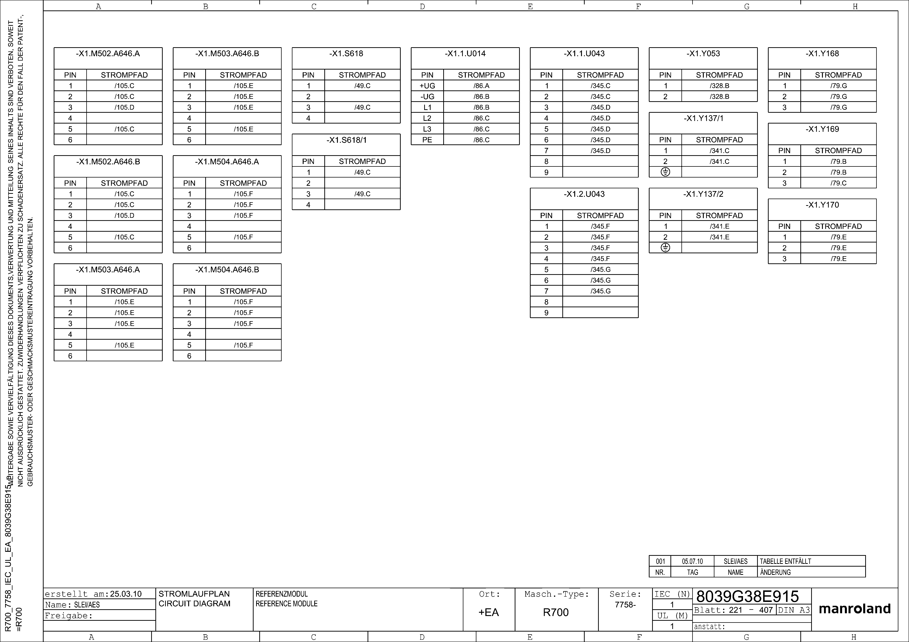

# +EA — Sheet 221 of 407 — REFERENZMODUL

**REFERENCE MODULE**

> Part of the manroland **R700** printing press IEC/UL circuit diagrams.
> Drawing class: **Stromlaufplan / Circuit diagram** (DIN A3).
> Document `+EA` covers the **Printing unit** machine section.

## At a glance

| Field | Value |
|---|---|
| Document | `+EA`  (8039G38E915) |
| Sheet | **221** of 407 |
| Section (DE) | REFERENZMODUL |
| Section (EN) | REFERENCE MODULE |
| Section type | REFERENCE_MODULE — Reference module |
| Machine type | `R700` |
| Series | `7758` |
| Created | 25.03.10 |
| Replaces | — |
| Columns used | A, B, C, D, E, F, G, H |
| Path numbers | — |
| Labels on sheet | 205 |
| Cross-refs out | 63 |
| Cross-refs in | 0 |

**Previous:** [+EA sheet 220](SHEET_0220.md) · **Next:** [+EA sheet 222](SHEET_0222.md) · **Document TOC:** [_TOC.md](_TOC.md)  (+EA) · **Master TOC:** [all sheets](../_MASTER_TOC.md)

## Sheet image (300 DPI, exact vector render)



_Rendered directly from the PDF vector layer at 300 DPI (1-bit), no OCR and no resampling. Use it to confirm anything ambiguous in the text below._

## Cross-references on this sheet

Each entry is a wire leaving this sheet. The printed token is `/sheet.column`; the link resolves to that sheet inside the same document.

| Ref | Target sheet | Col | Path | Destination on target | Target section | From col |
|---|---|---|---|---|---|---|
| `/86.A` | [+EA sheet 86](SHEET_0086.md) | A | — | — | SAUGWALZE | E |
| `/105.E` | [+EA sheet 105](SHEET_0105.md) | E | — | — | BOGENFÜHRUNGSELEMENT | B |
| `/328.B` | [+EA sheet 328](SHEET_0328.md) | B | — | — | OPTION: BOGENWEICHE | G |
| `/79.G` | [+EA sheet 79](SHEET_0079.md) | G | — | — | AUSLEGERSTAPELSTEUERUNG | H |
| `/49.C` | [+EA sheet 49](SHEET_0049.md) | C | — | — | SCHUTZ | C |
| `/105.C` | [+EA sheet 105](SHEET_0105.md) | C | — | — | BOGENFÜHRUNGSELEMENT | A |
| `/345.C` | [+EA sheet 345](SHEET_0345.md) | C | — | — | OPTION: INLINEOBSERVER | F |
| `/86.B` | [+EA sheet 86](SHEET_0086.md) | B | — | — | SAUGWALZE | E |
| `/105.E` | [+EA sheet 105](SHEET_0105.md) | E | — | — | BOGENFÜHRUNGSELEMENT | B |
| `/328.B` | [+EA sheet 328](SHEET_0328.md) | B | — | — | OPTION: BOGENWEICHE | G |
| `/79.G` | [+EA sheet 79](SHEET_0079.md) | G | — | — | AUSLEGERSTAPELSTEUERUNG | H |
| `/105.C` | [+EA sheet 105](SHEET_0105.md) | C | — | — | BOGENFÜHRUNGSELEMENT | A |
| `/345.C` | [+EA sheet 345](SHEET_0345.md) | C | — | — | OPTION: INLINEOBSERVER | F |
| `/86.B` | [+EA sheet 86](SHEET_0086.md) | B | — | — | SAUGWALZE | E |
| `/105.E` | [+EA sheet 105](SHEET_0105.md) | E | — | — | BOGENFÜHRUNGSELEMENT | B |
| `/79.G` | [+EA sheet 79](SHEET_0079.md) | G | — | — | AUSLEGERSTAPELSTEUERUNG | H |
| `/49.C` | [+EA sheet 49](SHEET_0049.md) | C | — | — | SCHUTZ | C |
| `/105.D` | [+EA sheet 105](SHEET_0105.md) | D | — | — | BOGENFÜHRUNGSELEMENT | A |
| `/345.D` | [+EA sheet 345](SHEET_0345.md) | D | — | — | OPTION: INLINEOBSERVER | F |
| `/86.C` | [+EA sheet 86](SHEET_0086.md) | C | — | — | SAUGWALZE | E |
| `/345.D` | [+EA sheet 345](SHEET_0345.md) | D | — | — | OPTION: INLINEOBSERVER | F |
| `/105.E` | [+EA sheet 105](SHEET_0105.md) | E | — | — | BOGENFÜHRUNGSELEMENT | B |
| `/86.C` | [+EA sheet 86](SHEET_0086.md) | C | — | — | SAUGWALZE | E |
| `/105.C` | [+EA sheet 105](SHEET_0105.md) | C | — | — | BOGENFÜHRUNGSELEMENT | A |
| `/345.D` | [+EA sheet 345](SHEET_0345.md) | D | — | — | OPTION: INLINEOBSERVER | F |
| `/86.C` | [+EA sheet 86](SHEET_0086.md) | C | — | — | SAUGWALZE | E |
| `/345.D` | [+EA sheet 345](SHEET_0345.md) | D | — | — | OPTION: INLINEOBSERVER | F |
| `/345.D` | [+EA sheet 345](SHEET_0345.md) | D | — | — | OPTION: INLINEOBSERVER | F |
| `/341.C` | [+EA sheet 341](SHEET_0341.md) | C | — | — | OPTION: BOGENWEICHE | G |
| `/79.B` | [+EA sheet 79](SHEET_0079.md) | B | — | — | AUSLEGERSTAPELSTEUERUNG | H |
| `/341.C` | [+EA sheet 341](SHEET_0341.md) | C | — | — | OPTION: BOGENWEICHE | G |
| `/79.B` | [+EA sheet 79](SHEET_0079.md) | B | — | — | AUSLEGERSTAPELSTEUERUNG | H |
| `/49.C` | [+EA sheet 49](SHEET_0049.md) | C | — | — | SCHUTZ | C |
| `/79.C` | [+EA sheet 79](SHEET_0079.md) | C | — | — | AUSLEGERSTAPELSTEUERUNG | H |
| `/105.F` | [+EA sheet 105](SHEET_0105.md) | F | — | — | BOGENFÜHRUNGSELEMENT | B |
| `/49.C` | [+EA sheet 49](SHEET_0049.md) | C | — | — | SCHUTZ | C |
| `/105.C` | [+EA sheet 105](SHEET_0105.md) | C | — | — | BOGENFÜHRUNGSELEMENT | A |
| `/105.F` | [+EA sheet 105](SHEET_0105.md) | F | — | — | BOGENFÜHRUNGSELEMENT | B |
| `/105.C` | [+EA sheet 105](SHEET_0105.md) | C | — | — | BOGENFÜHRUNGSELEMENT | A |
| `/105.F` | [+EA sheet 105](SHEET_0105.md) | F | — | — | BOGENFÜHRUNGSELEMENT | B |
| `/105.D` | [+EA sheet 105](SHEET_0105.md) | D | — | — | BOGENFÜHRUNGSELEMENT | A |
| `/341.E` | [+EA sheet 341](SHEET_0341.md) | E | — | — | OPTION: BOGENWEICHE | G |
| `/345.F` | [+EA sheet 345](SHEET_0345.md) | F | — | — | OPTION: INLINEOBSERVER | F |
| `/79.E` | [+EA sheet 79](SHEET_0079.md) | E | — | — | AUSLEGERSTAPELSTEUERUNG | H |
| `/341.E` | [+EA sheet 341](SHEET_0341.md) | E | — | — | OPTION: BOGENWEICHE | G |
| `/105.F` | [+EA sheet 105](SHEET_0105.md) | F | — | — | BOGENFÜHRUNGSELEMENT | B |
| `/345.F` | [+EA sheet 345](SHEET_0345.md) | F | — | — | OPTION: INLINEOBSERVER | F |
| `/105.C` | [+EA sheet 105](SHEET_0105.md) | C | — | — | BOGENFÜHRUNGSELEMENT | A |
| `/79.E` | [+EA sheet 79](SHEET_0079.md) | E | — | — | AUSLEGERSTAPELSTEUERUNG | H |
| `/345.F` | [+EA sheet 345](SHEET_0345.md) | F | — | — | OPTION: INLINEOBSERVER | F |
| `/79.E` | [+EA sheet 79](SHEET_0079.md) | E | — | — | AUSLEGERSTAPELSTEUERUNG | H |
| `/345.F` | [+EA sheet 345](SHEET_0345.md) | F | — | — | OPTION: INLINEOBSERVER | F |
| `/345.G` | [+EA sheet 345](SHEET_0345.md) | G | — | — | OPTION: INLINEOBSERVER | F |
| `/345.G` | [+EA sheet 345](SHEET_0345.md) | G | — | — | OPTION: INLINEOBSERVER | F |
| `/345.G` | [+EA sheet 345](SHEET_0345.md) | G | — | — | OPTION: INLINEOBSERVER | F |
| `/105.E` | [+EA sheet 105](SHEET_0105.md) | E | — | — | BOGENFÜHRUNGSELEMENT | A |
| `/105.F` | [+EA sheet 105](SHEET_0105.md) | F | — | — | BOGENFÜHRUNGSELEMENT | B |
| `/105.E` | [+EA sheet 105](SHEET_0105.md) | E | — | — | BOGENFÜHRUNGSELEMENT | A |
| `/105.F` | [+EA sheet 105](SHEET_0105.md) | F | — | — | BOGENFÜHRUNGSELEMENT | B |
| `/105.E` | [+EA sheet 105](SHEET_0105.md) | E | — | — | BOGENFÜHRUNGSELEMENT | A |
| `/105.F` | [+EA sheet 105](SHEET_0105.md) | F | — | — | BOGENFÜHRUNGSELEMENT | B |
| `/105.E` | [+EA sheet 105](SHEET_0105.md) | E | — | — | BOGENFÜHRUNGSELEMENT | A |
| `/105.F` | [+EA sheet 105](SHEET_0105.md) | F | — | — | BOGENFÜHRUNGSELEMENT | B |

## Devices on this sheet

| Tag | Class | Class meaning (IEC) | Col | Sub | Terminal | Sign |
|---|---|---|---|---|---|---|
| `X1.1.U043` | — | cross-device reference | F | — | — | — |
| `X1.2.U043` | — | cross-device reference | F | — | — | — |
| `X1.Y053` | — | cross-device reference | G | — | — | — |
| `X1.Y168` | — | cross-device reference | H | — | — | — |
| `X1.Y169` | — | cross-device reference | H | — | — | — |
| `X1.Y170` | — | cross-device reference | H | — | — | — |
| `X1.M502.A646.A` | — | cross-device reference | A | — | — | — |
| `X1.M502.A646.B` | — | cross-device reference | A | — | — | — |
| `X1.M503.A646.A` | — | cross-device reference | A | — | — | — |
| `X1.M504.A646.A` | — | cross-device reference | B | — | — | — |
| `X1.M504.A646.B` | — | cross-device reference | B | — | — | — |
| `X1.M503.A646.B` | — | cross-device reference | B | — | — | — |
| `NR.` | — | cross-device reference | F | — | — | — |
| `05.07.10` | — | cross-device reference | F | — | — | — |
| `X1.S618` | — | cross-device reference | C | — | — | — |
| `X1.1.U014` | — | cross-device reference | D | — | — | — |

## Potentials / nets

| Potential | Count | Columns | Attached devices | Terminals |
|---|---|---|---|---|
| `L1` | 1 | D | — | — |
| `L2` | 1 | D | — | — |
| `L3` | 1 | D | — | — |
| `PE` | 1 | D | — | — |


A potential such as `L24+/4` or `M24+` is a named supply/return rail; every place it appears on this sheet is electrically common.

## Wire-end annotations (grouped as printed)

A wire that continues elsewhere is annotated with a small cluster: the destination description, the path/line number `#NN`, and the `/sheet.column` cross reference. Each row below is one such cluster exactly as it is grouped on the drawing.

| Col | Y | Path | Cross-ref | Text on the wire |
|---|---|---|---|---|
| A | 65.5 | — | — | `X1.M502.A646.A` |
| B | 65.5 | — | — | `X1.M503.A646.B` |
| C | 65.5 | — | — | `X1.S618` |
| D | 65.5 | — | — | `X1.1.U014` |
| F | 65.5 | — | — | `X1.1.U043` |
| G | 65.6 | — | — | `X1.Y053` |
| H | 65.6 | — | — | `X1.Y168` |
| A | 94.2 | — | — | `PIN 2 3 4 5 6 1 STROMPFAD` |
| B | 94.2 | — | — | `PIN 2 3 4 5 6 1 STROMPFAD` |
| C | 94.2 | — | — | `PIN 2 3 4 1 STROMPFAD` |
| D | 94.2 | — | — | `+UG PIN STROMPFAD` |
| E | 94.2 | — | — | `PIN 2 3 4 5 6 7 8 9 1 STROMPFAD` |
| G | 94.2 | — | — | `PIN 2 1 STROMPFAD` |
| H | 94.2 | — | — | `PIN 2 3 1 STROMPFAD` |
| A | 108.7 | — | `/105.C` | — |
| B | 108.7 | — | `/105.E` | — |
| C | 108.7 | — | `/49.C` | — |
| E | 108.7 | — | `/86.A` | — |
| F | 108.7 | — | `/345.C` | — |
| G | 108.7 | — | `/328.B` | — |
| H | 108.7 | — | `/79.G` | — |
| D | 122.5 | — | — | `UG` |
| E | 122.8 | — | `/86.B` | — |
| A | 122.9 | — | `/105.C` | — |
| B | 122.9 | — | `/105.E` | — |
| F | 122.9 | — | `/345.C` | — |
| G | 122.9 | — | `/328.B` | — |
| H | 122.9 | — | `/79.G` | — |
| D | 136.7 | — | — | `PE L2 L3 L1` |
| B | 137.0 | — | `/105.E` | — |
| E | 137.0 | — | `/86.B` | — |
| H | 137.0 | — | `/79.G` | — |
| A | 137.1 | — | `/105.D` | — |
| C | 137.1 | — | `/49.C` | — |
| F | 137.1 | — | `/345.D` | — |
| G | 150.6 | — | — | `X1.Y137/1` |
| E | 151.2 | — | `/86.C` | — |
| F | 151.2 | — | `/345.D` | — |
| H | 164.8 | — | — | `X1.Y169` |
| A | 165.4 | — | `/105.C` | — |
| B | 165.4 | — | `/105.E` | — |
| E | 165.4 | — | `/86.C` | — |
| F | 165.4 | — | `/345.D` | — |
| C | 178.9 | — | — | `X1.S618/1` |
| G | 179.2 | — | — | `PIN 2 1 STROMPFAD` |
| E | 179.6 | — | `/86.C` | — |
| F | 179.6 | — | `/345.D` | — |
| H | 193.4 | — | — | `PIN 2 3 1 STROMPFAD` |
| F | 193.8 | — | `/345.D` | — |
| G | 193.8 | — | `/341.C` | — |
| A | 207.2 | — | — | `X1.M502.A646.B` |
| B | 207.2 | — | — | `X1.M504.A646.A` |
| C | 207.5 | — | — | `PIN 2 3 4 1 STROMPFAD` |
| G | 207.9 | — | `/341.C` | — |
| H | 207.9 | — | `/79.B` | — |
| C | 222.1 | — | `/49.C` | — |
| H | 222.1 | — | `/79.B` | — |
| A | 235.9 | — | — | `PIN 2 3 4 5 6 1 STROMPFAD` |
| B | 235.9 | — | — | `PIN 2 3 4 5 6 1 STROMPFAD` |
| H | 236.3 | — | `/79.C` | — |
| F | 249.8 | — | — | `X1.2.U043` |
| G | 249.8 | — | — | `X1.Y137/2` |
| A | 250.4 | — | `/105.C` | — |
| B | 250.4 | — | `/105.F` | — |
| C | 250.4 | — | `/49.C` | — |
| H | 264.0 | — | — | `X1.Y170` |
| A | 264.6 | — | `/105.C` | — |
| B | 264.6 | — | `/105.F` | — |
| E | 278.4 | — | — | `PIN 2 3 4 5 6 7 8 9 1 STROMPFAD` |
| G | 278.4 | — | — | `PIN 2 1 STROMPFAD` |
| A | 278.8 | — | `/105.D` | — |
| B | 278.8 | — | `/105.F` | — |
| H | 292.6 | — | — | `PIN 2 3 1 STROMPFAD` |
| F | 292.9 | — | `/345.F` | — |
| G | 292.9 | — | `/341.E` | — |
| A | 307.1 | — | `/105.C` | — |
| B | 307.1 | — | `/105.F` | — |
| F | 307.1 | — | `/345.F` | — |
| G | 307.1 | — | `/341.E` | — |
| H | 307.1 | — | `/79.E` | — |
| F | 321.3 | — | `/345.F` | — |
| H | 321.3 | — | `/79.E` | — |
| H | 335.4 | — | `/79.E` | — |
| F | 335.5 | — | `/345.F` | — |
| A | 349.0 | — | — | `X1.M503.A646.A` |
| B | 349.0 | — | — | `X1.M504.A646.B` |
| F | 349.6 | — | `/345.G` | — |
| F | 363.8 | — | `/345.G` | — |
| A | 377.6 | — | — | `PIN 2 3 4 5 6 1 STROMPFAD` |
| B | 377.6 | — | — | `PIN 2 3 4 5 6 1 STROMPFAD` |
| F | 378.0 | — | `/345.G` | — |
| A | 392.1 | — | `/105.E` | — |
| B | 392.2 | — | `/105.F` | — |
| A | 406.3 | — | `/105.E` | — |
| B | 406.3 | — | `/105.F` | — |
| A | 420.5 | — | `/105.E` | — |
| B | 420.5 | — | `/105.F` | — |
| A | 448.9 | — | `/105.E` | — |
| B | 448.9 | — | `/105.F` | — |
| G | 733.0 | — | — | `001 05.07.10 SLEI/AES TABELLE ENTFÄLLT` |
| G | 747.1 | — | — | `NR. TAG NAME ÄNDERUNG` |


## Reconstructed tables

This sheet carries tabular content (pin map / terminal assignment / index). The grid below was rebuilt from the drawing's own rule lines, so each row is exactly one physical row of the table.

### Table 1 — 22 data rows × 2 columns (at x=70.9, y=62.4) — **X1.M502.A646.A**

| PIN | STROMPFAD |
|---|---|
| `1` | `/105.C` |
| `2` | `/105.C` |
| `3` | `/105.D` |
| `4` |  |
| `5` | `/105.C` |
| `6` |  |
|  | `X1.M502.A646.B` |
| `PIN` | `STROMPFAD` |
| `1` | `/105.C` |
| `2` | `/105.C` |
| `3` | `/105.D` |
| `4` |  |
| `5` | `/105.C` |
| `6` |  |
|  | `X1.M503.A646.A` |
| `PIN` | `STROMPFAD` |
| `1` | `/105.E` |
| `2` | `/105.E` |
| `3` | `/105.E` |
| `4` |  |
| `5` | `/105.E` |
| `6` |  |


### Table 2 — 22 data rows × 2 columns (at x=226.8, y=62.4) — **X1.M503.A646.B**

| PIN | STROMPFAD |
|---|---|
| `1` | `/105.E` |
| `2` | `/105.E` |
| `3` | `/105.E` |
| `4` |  |
| `5` | `/105.E` |
| `6` |  |
|  | `X1.M504.A646.A` |
| `PIN` | `STROMPFAD` |
| `1` | `/105.F` |
| `2` | `/105.F` |
| `3` | `/105.F` |
| `4` |  |
| `5` | `/105.F` |
| `6` |  |
|  | `X1.M504.A646.B` |
| `PIN` | `STROMPFAD` |
| `1` | `/105.F` |
| `2` | `/105.F` |
| `3` | `/105.F` |
| `4` |  |
| `5` | `/105.F` |
| `6` |  |


### Table 3 — 10 data rows × 2 columns (at x=382.7, y=62.4) — **X1.S618**

| PIN | STROMPFAD |
|---|---|
| `1` | `/49.C` |
| `2` |  |
| `3` | `/49.C` |
| `4` |  |
|  | `X1.S618/1` |
| `PIN` | `STROMPFAD` |
| `1` | `/49.C` |
| `2` |  |
| `3` | `/49.C` |
| `4` |  |


### Table 4 — 6 data rows × 2 columns (at x=538.6, y=62.4) — **X1.1.U014**

| PIN | STROMPFAD |
|---|---|
| `+UG` | `/86.A` |
| `UG` | `/86.B` |
| `L1` | `/86.B` |
| `L2` | `/86.C` |
| `L3` | `/86.C` |
| `PE` | `/86.C` |


### Table 5 — 20 data rows × 2 columns (at x=694.5, y=62.4) — **X1.1.U043**

| PIN | STROMPFAD |
|---|---|
| `1` | `/345.C` |
| `2` | `/345.C` |
| `3` | `/345.D` |
| `4` | `/345.D` |
| `5` | `/345.D` |
| `6` | `/345.D` |
| `7` | `/345.D` |
| `8` |  |
| `9` |  |
|  | `X1.2.U043` |
| `PIN` | `STROMPFAD` |
| `1` | `/345.F` |
| `2` | `/345.F` |
| `3` | `/345.F` |
| `4` | `/345.F` |
| `5` | `/345.G` |
| `6` | `/345.G` |
| `7` | `/345.G` |
| `8` |  |
| `9` |  |


### Table 6 — 10 data rows × 2 columns (at x=850.4, y=62.4) — **X1.Y053**

| PIN | STROMPFAD |
|---|---|
| `1` | `/328.B` |
| `2` | `/328.B` |
|  | `X1.Y137/1` |
| `PIN` | `STROMPFAD` |
| `1` | `/341.C` |
| `2` | `/341.C` |
|  | `X1.Y137/2` |
| `PIN` | `STROMPFAD` |
| `1` | `/341.E` |
| `2` | `/341.E` |


### Table 7 — 13 data rows × 2 columns (at x=1006.3, y=62.4) — **X1.Y168**

| PIN | STROMPFAD |
|---|---|
| `1` | `/79.G` |
| `2` | `/79.G` |
| `3` | `/79.G` |
|  | `X1.Y169` |
| `PIN` | `STROMPFAD` |
| `1` | `/79.B` |
| `2` | `/79.B` |
| `3` | `/79.C` |
|  | `X1.Y170` |
| `PIN` | `STROMPFAD` |
| `1` | `/79.E` |
| `2` | `/79.E` |
| `3` | `/79.E` |


## Notes and free text on this sheet

| Text | Col | Y (pt) |
|---|---|---|
| `PIN` | E | 94.2 |
| `STROMPFAD` | F | 94.15 |
| `PIN` | F | 94.2 |
| `STROMPFAD` | G | 94.15 |
| `X1.Y137/1` | G | 150.59 |
| `X1.Y137/2` | G | 249.81 |
| `PIN` | G | 94.2 |
| `STROMPFAD` | H | 94.15 |
| `PIN` | A | 94.2 |
| `STROMPFAD` | A | 94.15 |
| `PIN` | B | 235.93 |
| `STROMPFAD` | B | 235.89 |
| `TAG` | G | 747.27 |
| `NAME` | G | 747.25 |
| `ÄNDERUNG` | G | 747.31 |
| `SLEI/AES` | G | 733.13 |
| `TABELLE ENTFÄLLT` | G | 733.15 |
| `PIN` | C | 94.2 |
| `STROMPFAD` | C | 94.15 |
| `X1.S618/1` | C | 178.9 |
| `PIN` | D | 94.2 |
| `STROMPFAD` | E | 94.15 |
| `+UG` | D | 108.33 |
| `UG` | D | 122.46 |

## Complete label inventory (exact text from the drawing)

Every text object inside the drawing area of this sheet, in DIN reading order (column A→H, then top→bottom). This is the authoritative list: if a string is not here it is not printed on this sheet.

| Col | Y | X | Dir | Type | Text |
|---|---|---|---|---|---|
| A | 65.5 | 99.6 | → | device ref | `X1.M502.A646.A` |
| A | 94.2 | 84.0 | → | text | `PIN` |
| A | 94.2 | 132.2 | → | text | `STROMPFAD` |
| A | 108.4 | 90.0 | → | number | `1` |
| A | 108.7 | 150.2 | → | cross-reference | `/105.C` |
| A | 122.5 | 89.4 | → | number | `2` |
| A | 122.9 | 150.2 | → | cross-reference | `/105.C` |
| A | 136.7 | 89.4 | → | number | `3` |
| A | 137.1 | 150.2 | → | cross-reference | `/105.D` |
| A | 150.9 | 89.4 | → | number | `4` |
| A | 165.1 | 89.4 | → | number | `5` |
| A | 165.4 | 150.2 | → | cross-reference | `/105.C` |
| A | 179.2 | 89.4 | → | number | `6` |
| A | 207.2 | 100.1 | → | device ref | `X1.M502.A646.B` |
| A | 235.9 | 84.0 | → | text | `PIN` |
| A | 235.9 | 132.2 | → | text | `STROMPFAD` |
| A | 250.1 | 90.0 | → | number | `1` |
| A | 250.4 | 150.2 | → | cross-reference | `/105.C` |
| A | 264.3 | 89.4 | → | number | `2` |
| A | 264.6 | 150.2 | → | cross-reference | `/105.C` |
| A | 278.5 | 89.4 | → | number | `3` |
| A | 278.8 | 150.2 | → | cross-reference | `/105.D` |
| A | 292.6 | 89.4 | → | number | `4` |
| A | 306.8 | 89.4 | → | number | `5` |
| A | 307.1 | 150.2 | → | cross-reference | `/105.C` |
| A | 321.0 | 89.4 | → | number | `6` |
| A | 349.0 | 99.6 | → | device ref | `X1.M503.A646.A` |
| A | 377.6 | 132.2 | → | text | `STROMPFAD` |
| A | 377.7 | 84.0 | → | text | `PIN` |
| A | 391.8 | 90.0 | → | number | `1` |
| A | 392.2 | 150.5 | → | cross-reference | `/105.E` |
| A | 406.0 | 89.4 | → | number | `2` |
| A | 406.3 | 150.5 | → | cross-reference | `/105.E` |
| A | 420.2 | 89.4 | → | number | `3` |
| A | 420.5 | 150.5 | → | cross-reference | `/105.E` |
| A | 434.4 | 89.4 | → | number | `4` |
| A | 448.5 | 89.4 | → | number | `5` |
| A | 448.8 | 150.5 | → | cross-reference | `/105.E` |
| A | 462.7 | 89.4 | → | number | `6` |
| B | 65.5 | 256.0 | → | device ref | `X1.M503.A646.B` |
| B | 94.2 | 240.0 | → | text | `PIN` |
| B | 94.2 | 288.1 | → | text | `STROMPFAD` |
| B | 108.4 | 245.9 | → | number | `1` |
| B | 108.7 | 306.4 | → | cross-reference | `/105.E` |
| B | 122.5 | 245.3 | → | number | `2` |
| B | 122.9 | 306.4 | → | cross-reference | `/105.E` |
| B | 136.7 | 245.3 | → | number | `3` |
| B | 137.0 | 306.4 | → | cross-reference | `/105.E` |
| B | 150.9 | 245.3 | → | number | `4` |
| B | 165.1 | 245.3 | → | number | `5` |
| B | 165.4 | 306.4 | → | cross-reference | `/105.E` |
| B | 179.2 | 245.3 | → | number | `6` |
| B | 207.2 | 255.5 | → | device ref | `X1.M504.A646.A` |
| B | 235.9 | 240.0 | → | text | `PIN` |
| B | 235.9 | 288.1 | → | text | `STROMPFAD` |
| B | 250.1 | 245.9 | → | number | `1` |
| B | 250.4 | 306.6 | → | cross-reference | `/105.F` |
| B | 264.3 | 245.3 | → | number | `2` |
| B | 264.6 | 306.6 | → | cross-reference | `/105.F` |
| B | 278.5 | 245.3 | → | number | `3` |
| B | 278.8 | 306.6 | → | cross-reference | `/105.F` |
| B | 292.6 | 245.3 | → | number | `4` |
| B | 306.8 | 245.3 | → | number | `5` |
| B | 307.1 | 306.6 | → | cross-reference | `/105.F` |
| B | 321.0 | 245.3 | → | number | `6` |
| B | 349.0 | 256.0 | → | device ref | `X1.M504.A646.B` |
| B | 377.6 | 288.1 | → | text | `STROMPFAD` |
| B | 377.7 | 240.0 | → | text | `PIN` |
| B | 391.8 | 245.9 | → | number | `1` |
| B | 392.2 | 306.6 | → | cross-reference | `/105.F` |
| B | 406.0 | 245.3 | → | number | `2` |
| B | 406.3 | 306.6 | → | cross-reference | `/105.F` |
| B | 420.2 | 245.3 | → | number | `3` |
| B | 420.5 | 306.6 | → | cross-reference | `/105.F` |
| B | 434.4 | 245.3 | → | number | `4` |
| B | 448.5 | 245.3 | → | number | `5` |
| B | 448.9 | 306.6 | → | cross-reference | `/105.F` |
| B | 462.7 | 245.3 | → | number | `6` |
| C | 65.5 | 431.6 | → | device ref | `X1.S618` |
| C | 94.2 | 395.9 | → | text | `PIN` |
| C | 94.2 | 444.0 | → | text | `STROMPFAD` |
| C | 108.4 | 401.8 | → | number | `1` |
| C | 108.7 | 464.5 | → | cross-reference | `/49.C` |
| C | 122.5 | 401.2 | → | number | `2` |
| C | 136.7 | 401.2 | → | number | `3` |
| C | 137.1 | 464.5 | → | cross-reference | `/49.C` |
| C | 150.9 | 401.2 | → | number | `4` |
| C | 178.9 | 427.9 | → | text | `X1.S618/1` |
| C | 207.5 | 444.0 | → | text | `STROMPFAD` |
| C | 207.6 | 395.9 | → | text | `PIN` |
| C | 221.8 | 401.8 | → | number | `1` |
| C | 222.1 | 464.5 | → | cross-reference | `/49.C` |
| C | 235.9 | 401.2 | → | number | `2` |
| C | 250.1 | 401.2 | → | number | `3` |
| C | 250.4 | 464.5 | → | cross-reference | `/49.C` |
| C | 264.3 | 401.2 | → | number | `4` |
| D | 65.5 | 582.8 | → | device ref | `X1.1.U014` |
| D | 94.2 | 551.8 | → | text | `PIN` |
| D | 108.3 | 549.6 | → | text | `+UG` |
| D | 122.5 | 550.9 | → | text | `UG` |
| D | 136.7 | 555.0 | → | potential | `L1` |
| D | 150.9 | 554.2 | → | potential | `L2` |
| D | 165.1 | 554.2 | → | potential | `L3` |
| D | 179.2 | 553.2 | → | potential | `PE` |
| E | 94.2 | 600.0 | → | text | `STROMPFAD` |
| E | 94.2 | 707.7 | → | text | `PIN` |
| E | 108.4 | 713.6 | → | number | `1` |
| E | 108.7 | 620.4 | → | cross-reference | `/86.A` |
| E | 122.5 | 713.1 | → | number | `2` |
| E | 122.8 | 620.5 | → | cross-reference | `/86.B` |
| E | 136.7 | 713.1 | → | number | `3` |
| E | 137.0 | 620.5 | → | cross-reference | `/86.B` |
| E | 150.9 | 713.1 | → | number | `4` |
| E | 151.2 | 620.4 | → | cross-reference | `/86.C` |
| E | 165.1 | 713.1 | → | number | `5` |
| E | 165.4 | 620.4 | → | cross-reference | `/86.C` |
| E | 179.2 | 713.1 | → | number | `6` |
| E | 179.6 | 620.4 | → | cross-reference | `/86.C` |
| E | 193.4 | 713.1 | → | number | `7` |
| E | 207.6 | 713.1 | → | number | `8` |
| E | 221.8 | 713.1 | → | number | `9` |
| E | 278.4 | 707.7 | → | text | `PIN` |
| E | 292.6 | 713.6 | → | number | `1` |
| E | 306.8 | 713.1 | → | number | `2` |
| E | 321.0 | 713.1 | → | number | `3` |
| E | 335.1 | 713.1 | → | number | `4` |
| E | 349.3 | 713.1 | → | number | `5` |
| E | 363.5 | 713.1 | → | number | `6` |
| E | 377.7 | 713.1 | → | number | `7` |
| E | 391.8 | 713.1 | → | number | `8` |
| E | 406.0 | 713.1 | → | number | `9` |
| F | 65.5 | 738.7 | → | device ref | `X1.1.U043` |
| F | 94.2 | 755.9 | → | text | `STROMPFAD` |
| F | 94.2 | 863.6 | → | text | `PIN` |
| F | 108.4 | 869.5 | → | number | `1` |
| F | 108.7 | 773.9 | → | cross-reference | `/345.C` |
| F | 122.5 | 869.0 | → | number | `2` |
| F | 122.9 | 773.9 | → | cross-reference | `/345.C` |
| F | 137.1 | 773.9 | → | cross-reference | `/345.D` |
| F | 151.2 | 773.9 | → | cross-reference | `/345.D` |
| F | 165.4 | 773.9 | → | cross-reference | `/345.D` |
| F | 179.2 | 863.6 | → | text | `PIN` |
| F | 179.6 | 773.9 | → | cross-reference | `/345.D` |
| F | 193.4 | 869.5 | → | number | `1` |
| F | 193.8 | 773.9 | → | cross-reference | `/345.D` |
| F | 207.6 | 869.0 | → | number | `2` |
| F | 249.8 | 738.7 | → | device ref | `X1.2.U043` |
| F | 278.4 | 755.9 | → | text | `STROMPFAD` |
| F | 278.4 | 863.6 | → | text | `PIN` |
| F | 292.6 | 869.5 | → | number | `1` |
| F | 293.0 | 774.3 | → | cross-reference | `/345.F` |
| F | 306.8 | 869.0 | → | number | `2` |
| F | 307.1 | 774.3 | → | cross-reference | `/345.F` |
| F | 321.3 | 774.3 | → | cross-reference | `/345.F` |
| F | 335.5 | 774.3 | → | cross-reference | `/345.F` |
| F | 349.7 | 773.7 | → | cross-reference | `/345.G` |
| F | 363.8 | 773.7 | → | cross-reference | `/345.G` |
| F | 378.0 | 773.7 | → | cross-reference | `/345.G` |
| F | 733.0 | 859.4 | → | number | `001` |
| F | 733.1 | 893.5 | → | device ref | `05.07.10` |
| F | 747.1 | 858.4 | → | device ref | `NR.` |
| G | 65.6 | 899.6 | → | device ref | `X1.Y053` |
| G | 94.2 | 911.8 | → | text | `STROMPFAD` |
| G | 94.2 | 1019.5 | → | text | `PIN` |
| G | 108.4 | 1025.4 | → | number | `1` |
| G | 108.7 | 929.9 | → | cross-reference | `/328.B` |
| G | 122.5 | 1024.9 | → | number | `2` |
| G | 122.9 | 929.9 | → | cross-reference | `/328.B` |
| G | 136.7 | 1024.9 | → | number | `3` |
| G | 150.6 | 895.9 | → | text | `X1.Y137/1` |
| G | 179.2 | 911.8 | → | text | `STROMPFAD` |
| G | 193.4 | 1019.5 | → | text | `PIN` |
| G | 193.8 | 929.8 | → | cross-reference | `/341.C` |
| G | 207.6 | 1025.4 | → | number | `1` |
| G | 207.9 | 929.8 | → | cross-reference | `/341.C` |
| G | 221.8 | 1024.9 | → | number | `2` |
| G | 235.9 | 1024.9 | → | number | `3` |
| G | 249.8 | 895.2 | → | text | `X1.Y137/2` |
| G | 278.4 | 911.8 | → | text | `STROMPFAD` |
| G | 292.6 | 1019.5 | → | text | `PIN` |
| G | 292.9 | 930.0 | → | cross-reference | `/341.E` |
| G | 306.8 | 1025.4 | → | number | `1` |
| G | 307.1 | 930.0 | → | cross-reference | `/341.E` |
| G | 321.0 | 1024.9 | → | number | `2` |
| G | 335.1 | 1024.9 | → | number | `3` |
| G | 733.1 | 948.2 | → | text | `SLEI/AES` |
| G | 733.2 | 995.4 | → | text | `TABELLE ENTFÄLLT` |
| G | 747.3 | 900.0 | → | text | `TAG` |
| G | 747.3 | 953.4 | → | text | `NAME` |
| G | 747.3 | 996.0 | → | text | `ÄNDERUNG` |
| H | 65.6 | 1055.5 | → | device ref | `X1.Y168` |
| H | 94.2 | 1067.7 | → | text | `STROMPFAD` |
| H | 108.7 | 1087.9 | → | cross-reference | `/79.G` |
| H | 122.9 | 1087.9 | → | cross-reference | `/79.G` |
| H | 137.0 | 1087.9 | → | cross-reference | `/79.G` |
| H | 164.8 | 1055.5 | → | device ref | `X1.Y169` |
| H | 193.4 | 1067.7 | → | text | `STROMPFAD` |
| H | 207.9 | 1088.2 | → | cross-reference | `/79.B` |
| H | 222.1 | 1088.2 | → | cross-reference | `/79.B` |
| H | 236.3 | 1088.1 | → | cross-reference | `/79.C` |
| H | 264.0 | 1055.5 | → | device ref | `X1.Y170` |
| H | 292.6 | 1067.7 | → | text | `STROMPFAD` |
| H | 307.1 | 1088.4 | → | cross-reference | `/79.E` |
| H | 321.3 | 1088.4 | → | cross-reference | `/79.E` |
| H | 335.4 | 1088.4 | → | cross-reference | `/79.E` |

## Reading-order text block

The same content as a plain block, grouped by DIN column — convenient to paste or to match against a visual description.

```text
=== Column A ===
  65.5   99.6  devref       X1.M502.A646.A
  94.2   84.0  text         PIN
  94.2  132.2  text         STROMPFAD
 108.4   90.0  numeric      1
 108.7  150.2  xref         /105.C
 122.5   89.4  numeric      2
 122.9  150.2  xref         /105.C
 136.7   89.4  numeric      3
 137.1  150.2  xref         /105.D
 150.9   89.4  numeric      4
 165.1   89.4  numeric      5
 165.4  150.2  xref         /105.C
 179.2   89.4  numeric      6
 207.2  100.1  devref       X1.M502.A646.B
 235.9   84.0  text         PIN
 235.9  132.2  text         STROMPFAD
 250.1   90.0  numeric      1
 250.4  150.2  xref         /105.C
 264.3   89.4  numeric      2
 264.6  150.2  xref         /105.C
 278.5   89.4  numeric      3
 278.8  150.2  xref         /105.D
 292.6   89.4  numeric      4
 306.8   89.4  numeric      5
 307.1  150.2  xref         /105.C
 321.0   89.4  numeric      6
 349.0   99.6  devref       X1.M503.A646.A
 377.6  132.2  text         STROMPFAD
 377.7   84.0  text         PIN
 391.8   90.0  numeric      1
 392.2  150.5  xref         /105.E
 406.0   89.4  numeric      2
 406.3  150.5  xref         /105.E
 420.2   89.4  numeric      3
 420.5  150.5  xref         /105.E
 434.4   89.4  numeric      4
 448.5   89.4  numeric      5
 448.8  150.5  xref         /105.E
 462.7   89.4  numeric      6
=== Column B ===
  65.5  256.0  devref       X1.M503.A646.B
  94.2  240.0  text         PIN
  94.2  288.1  text         STROMPFAD
 108.4  245.9  numeric      1
 108.7  306.4  xref         /105.E
 122.5  245.3  numeric      2
 122.9  306.4  xref         /105.E
 136.7  245.3  numeric      3
 137.0  306.4  xref         /105.E
 150.9  245.3  numeric      4
 165.1  245.3  numeric      5
 165.4  306.4  xref         /105.E
 179.2  245.3  numeric      6
 207.2  255.5  devref       X1.M504.A646.A
 235.9  240.0  text         PIN
 235.9  288.1  text         STROMPFAD
 250.1  245.9  numeric      1
 250.4  306.6  xref         /105.F
 264.3  245.3  numeric      2
 264.6  306.6  xref         /105.F
 278.5  245.3  numeric      3
 278.8  306.6  xref         /105.F
 292.6  245.3  numeric      4
 306.8  245.3  numeric      5
 307.1  306.6  xref         /105.F
 321.0  245.3  numeric      6
 349.0  256.0  devref       X1.M504.A646.B
 377.6  288.1  text         STROMPFAD
 377.7  240.0  text         PIN
 391.8  245.9  numeric      1
 392.2  306.6  xref         /105.F
 406.0  245.3  numeric      2
 406.3  306.6  xref         /105.F
 420.2  245.3  numeric      3
 420.5  306.6  xref         /105.F
 434.4  245.3  numeric      4
 448.5  245.3  numeric      5
 448.9  306.6  xref         /105.F
 462.7  245.3  numeric      6
=== Column C ===
  65.5  431.6  devref       X1.S618
  94.2  395.9  text         PIN
  94.2  444.0  text         STROMPFAD
 108.4  401.8  numeric      1
 108.7  464.5  xref         /49.C
 122.5  401.2  numeric      2
 136.7  401.2  numeric      3
 137.1  464.5  xref         /49.C
 150.9  401.2  numeric      4
 178.9  427.9  text         X1.S618/1
 207.5  444.0  text         STROMPFAD
 207.6  395.9  text         PIN
 221.8  401.8  numeric      1
 222.1  464.5  xref         /49.C
 235.9  401.2  numeric      2
 250.1  401.2  numeric      3
 250.4  464.5  xref         /49.C
 264.3  401.2  numeric      4
=== Column D ===
  65.5  582.8  devref       X1.1.U014
  94.2  551.8  text         PIN
 108.3  549.6  text         +UG
 122.5  550.9  text         UG
 136.7  555.0  net          L1
 150.9  554.2  net          L2
 165.1  554.2  net          L3
 179.2  553.2  net          PE
=== Column E ===
  94.2  600.0  text         STROMPFAD
  94.2  707.7  text         PIN
 108.4  713.6  numeric      1
 108.7  620.4  xref         /86.A
 122.5  713.1  numeric      2
 122.8  620.5  xref         /86.B
 136.7  713.1  numeric      3
 137.0  620.5  xref         /86.B
 150.9  713.1  numeric      4
 151.2  620.4  xref         /86.C
 165.1  713.1  numeric      5
 165.4  620.4  xref         /86.C
 179.2  713.1  numeric      6
 179.6  620.4  xref         /86.C
 193.4  713.1  numeric      7
 207.6  713.1  numeric      8
 221.8  713.1  numeric      9
 278.4  707.7  text         PIN
 292.6  713.6  numeric      1
 306.8  713.1  numeric      2
 321.0  713.1  numeric      3
 335.1  713.1  numeric      4
 349.3  713.1  numeric      5
 363.5  713.1  numeric      6
 377.7  713.1  numeric      7
 391.8  713.1  numeric      8
 406.0  713.1  numeric      9
=== Column F ===
  65.5  738.7  devref       X1.1.U043
  94.2  755.9  text         STROMPFAD
  94.2  863.6  text         PIN
 108.4  869.5  numeric      1
 108.7  773.9  xref         /345.C
 122.5  869.0  numeric      2
 122.9  773.9  xref         /345.C
 137.1  773.9  xref         /345.D
 151.2  773.9  xref         /345.D
 165.4  773.9  xref         /345.D
 179.2  863.6  text         PIN
 179.6  773.9  xref         /345.D
 193.4  869.5  numeric      1
 193.8  773.9  xref         /345.D
 207.6  869.0  numeric      2
 249.8  738.7  devref       X1.2.U043
 278.4  755.9  text         STROMPFAD
 278.4  863.6  text         PIN
 292.6  869.5  numeric      1
 293.0  774.3  xref         /345.F
 306.8  869.0  numeric      2
 307.1  774.3  xref         /345.F
 321.3  774.3  xref         /345.F
 335.5  774.3  xref         /345.F
 349.7  773.7  xref         /345.G
 363.8  773.7  xref         /345.G
 378.0  773.7  xref         /345.G
 733.0  859.4  numeric      001
 733.1  893.5  devref       05.07.10
 747.1  858.4  devref       NR.
=== Column G ===
  65.6  899.6  devref       X1.Y053
  94.2  911.8  text         STROMPFAD
  94.2 1019.5  text         PIN
 108.4 1025.4  numeric      1
 108.7  929.9  xref         /328.B
 122.5 1024.9  numeric      2
 122.9  929.9  xref         /328.B
 136.7 1024.9  numeric      3
 150.6  895.9  text         X1.Y137/1
 179.2  911.8  text         STROMPFAD
 193.4 1019.5  text         PIN
 193.8  929.8  xref         /341.C
 207.6 1025.4  numeric      1
 207.9  929.8  xref         /341.C
 221.8 1024.9  numeric      2
 235.9 1024.9  numeric      3
 249.8  895.2  text         X1.Y137/2
 278.4  911.8  text         STROMPFAD
 292.6 1019.5  text         PIN
 292.9  930.0  xref         /341.E
 306.8 1025.4  numeric      1
 307.1  930.0  xref         /341.E
 321.0 1024.9  numeric      2
 335.1 1024.9  numeric      3
 733.1  948.2  text         SLEI/AES
 733.2  995.4  text         TABELLE ENTFÄLLT
 747.3  900.0  text         TAG
 747.3  953.4  text         NAME
 747.3  996.0  text         ÄNDERUNG
=== Column H ===
  65.6 1055.5  devref       X1.Y168
  94.2 1067.7  text         STROMPFAD
 108.7 1087.9  xref         /79.G
 122.9 1087.9  xref         /79.G
 137.0 1087.9  xref         /79.G
 164.8 1055.5  devref       X1.Y169
 193.4 1067.7  text         STROMPFAD
 207.9 1088.2  xref         /79.B
 222.1 1088.2  xref         /79.B
 236.3 1088.1  xref         /79.C
 264.0 1055.5  devref       X1.Y170
 292.6 1067.7  text         STROMPFAD
 307.1 1088.4  xref         /79.E
 321.3 1088.4  xref         /79.E
 335.4 1088.4  xref         /79.E
```

---
_Generated from the PDF vector text layer; no OCR. Source: `R700_7758_IEC_UL_EA_8039G38E915_p`, sheet 221._
