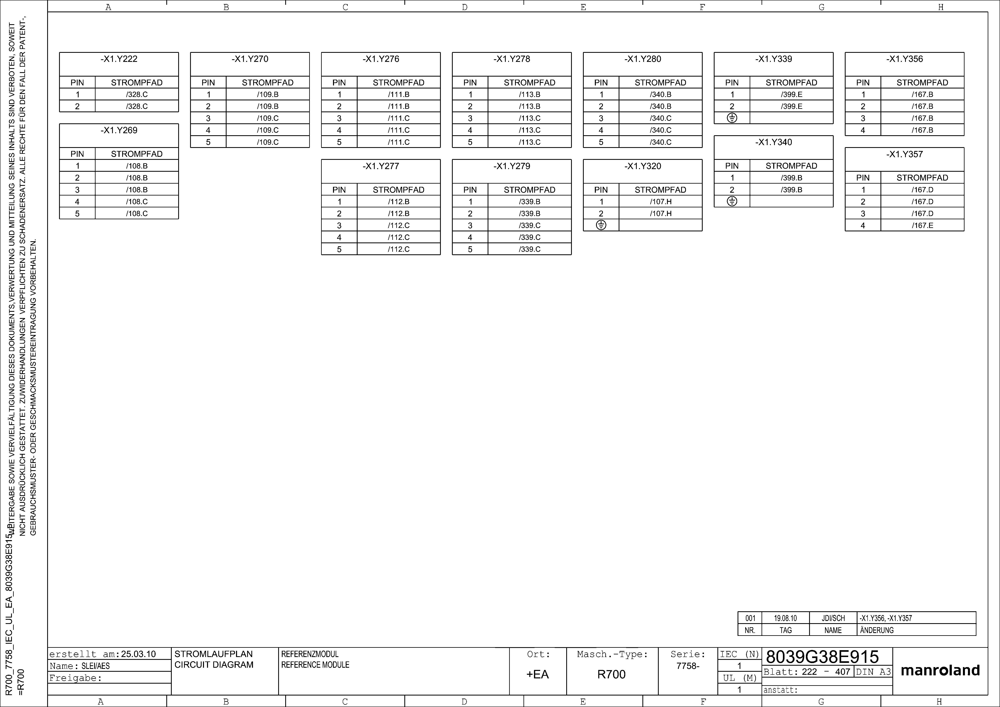

# +EA — Sheet 222 of 407 — REFERENZMODUL

**REFERENCE MODULE**

> Part of the manroland **R700** printing press IEC/UL circuit diagrams.
> Drawing class: **Stromlaufplan / Circuit diagram** (DIN A3).
> Document `+EA` covers the **Printing unit** machine section.

## At a glance

| Field | Value |
|---|---|
| Document | `+EA`  (8039G38E915) |
| Sheet | **222** of 407 |
| Section (DE) | REFERENZMODUL |
| Section (EN) | REFERENCE MODULE |
| Section type | REFERENCE_MODULE — Reference module |
| Machine type | `R700` |
| Series | `7758` |
| Created | 25.03.10 |
| Replaces | — |
| Columns used | A, B, C, D, E, F, G, H |
| Path numbers | — |
| Labels on sheet | 149 |
| Cross-refs out | 51 |
| Cross-refs in | 0 |

**Previous:** [+EA sheet 221](SHEET_0221.md) · **Next:** [+EA sheet 223](SHEET_0223.md) · **Document TOC:** [_TOC.md](_TOC.md)  (+EA) · **Master TOC:** [all sheets](../_MASTER_TOC.md)

## Sheet image (300 DPI, exact vector render)



_Rendered directly from the PDF vector layer at 300 DPI (1-bit), no OCR and no resampling. Use it to confirm anything ambiguous in the text below._

## Cross-references on this sheet

Each entry is a wire leaving this sheet. The printed token is `/sheet.column`; the link resolves to that sheet inside the same document.

| Ref | Target sheet | Col | Path | Destination on target | Target section | From col |
|---|---|---|---|---|---|---|
| `/109.B` | [+EA sheet 109](SHEET_0109.md) | B | — | — | BLAS/SAUGLUFT MIT MOTORVENTILEINSTELLUNG | B |
| `/111.B` | [+EA sheet 111](SHEET_0111.md) | B | — | — | BLAS/SAUGLUFT MIT MOTORVENTILEINSTELLUNG | C |
| `/113.B` | [+EA sheet 113](SHEET_0113.md) | B | — | — | BLAS/SAUGLUFT MIT MOTORVENTILEINSTELLUNG | E |
| `/340.B` | [+EA sheet 340](SHEET_0340.md) | B | — | — | OPTION: BOGENWEICHE | F |
| `/399.E` | [+EA sheet 399](SHEET_0399.md) | E | — | — | OPTION: DÜNNDRUCKEINRICHTUNG | G |
| `/167.B` | [+EA sheet 167](SHEET_0167.md) | B | — | — | BOGENFÜHRUNGSELEMENT (BLASROHRE) | H |
| `/328.C` | [+EA sheet 328](SHEET_0328.md) | C | — | — | OPTION: BOGENWEICHE | A |
| `/109.B` | [+EA sheet 109](SHEET_0109.md) | B | — | — | BLAS/SAUGLUFT MIT MOTORVENTILEINSTELLUNG | B |
| `/111.B` | [+EA sheet 111](SHEET_0111.md) | B | — | — | BLAS/SAUGLUFT MIT MOTORVENTILEINSTELLUNG | C |
| `/113.B` | [+EA sheet 113](SHEET_0113.md) | B | — | — | BLAS/SAUGLUFT MIT MOTORVENTILEINSTELLUNG | E |
| `/340.B` | [+EA sheet 340](SHEET_0340.md) | B | — | — | OPTION: BOGENWEICHE | F |
| `/399.E` | [+EA sheet 399](SHEET_0399.md) | E | — | — | OPTION: DÜNNDRUCKEINRICHTUNG | G |
| `/167.B` | [+EA sheet 167](SHEET_0167.md) | B | — | — | BOGENFÜHRUNGSELEMENT (BLASROHRE) | H |
| `/328.C` | [+EA sheet 328](SHEET_0328.md) | C | — | — | OPTION: BOGENWEICHE | A |
| `/167.B` | [+EA sheet 167](SHEET_0167.md) | B | — | — | BOGENFÜHRUNGSELEMENT (BLASROHRE) | H |
| `/109.C` | [+EA sheet 109](SHEET_0109.md) | C | — | — | BLAS/SAUGLUFT MIT MOTORVENTILEINSTELLUNG | B |
| `/111.C` | [+EA sheet 111](SHEET_0111.md) | C | — | — | BLAS/SAUGLUFT MIT MOTORVENTILEINSTELLUNG | C |
| `/113.C` | [+EA sheet 113](SHEET_0113.md) | C | — | — | BLAS/SAUGLUFT MIT MOTORVENTILEINSTELLUNG | E |
| `/340.C` | [+EA sheet 340](SHEET_0340.md) | C | — | — | OPTION: BOGENWEICHE | F |
| `/167.B` | [+EA sheet 167](SHEET_0167.md) | B | — | — | BOGENFÜHRUNGSELEMENT (BLASROHRE) | H |
| `/109.C` | [+EA sheet 109](SHEET_0109.md) | C | — | — | BLAS/SAUGLUFT MIT MOTORVENTILEINSTELLUNG | B |
| `/111.C` | [+EA sheet 111](SHEET_0111.md) | C | — | — | BLAS/SAUGLUFT MIT MOTORVENTILEINSTELLUNG | C |
| `/113.C` | [+EA sheet 113](SHEET_0113.md) | C | — | — | BLAS/SAUGLUFT MIT MOTORVENTILEINSTELLUNG | E |
| `/340.C` | [+EA sheet 340](SHEET_0340.md) | C | — | — | OPTION: BOGENWEICHE | F |
| `/109.C` | [+EA sheet 109](SHEET_0109.md) | C | — | — | BLAS/SAUGLUFT MIT MOTORVENTILEINSTELLUNG | B |
| `/111.C` | [+EA sheet 111](SHEET_0111.md) | C | — | — | BLAS/SAUGLUFT MIT MOTORVENTILEINSTELLUNG | C |
| `/113.C` | [+EA sheet 113](SHEET_0113.md) | C | — | — | BLAS/SAUGLUFT MIT MOTORVENTILEINSTELLUNG | E |
| `/340.C` | [+EA sheet 340](SHEET_0340.md) | C | — | — | OPTION: BOGENWEICHE | F |
| `/108.B` | [+EA sheet 108](SHEET_0108.md) | B | — | — | BLAS/SAUGLUFT MIT MOTORVENTILEINSTELLUNG | A |
| `/108.B` | [+EA sheet 108](SHEET_0108.md) | B | — | — | BLAS/SAUGLUFT MIT MOTORVENTILEINSTELLUNG | A |
| `/399.B` | [+EA sheet 399](SHEET_0399.md) | B | — | — | OPTION: DÜNNDRUCKEINRICHTUNG | G |
| `/108.B` | [+EA sheet 108](SHEET_0108.md) | B | — | — | BLAS/SAUGLUFT MIT MOTORVENTILEINSTELLUNG | A |
| `/399.B` | [+EA sheet 399](SHEET_0399.md) | B | — | — | OPTION: DÜNNDRUCKEINRICHTUNG | G |
| `/167.D` | [+EA sheet 167](SHEET_0167.md) | D | — | — | BOGENFÜHRUNGSELEMENT (BLASROHRE) | H |
| `/112.B` | [+EA sheet 112](SHEET_0112.md) | B | — | — | BLAS/SAUGLUFT MIT MOTORVENTILEINSTELLUNG | C |
| `/339.B` | [+EA sheet 339](SHEET_0339.md) | B | — | — | OPTION: BOGENWEICHE | E |
| `/108.C` | [+EA sheet 108](SHEET_0108.md) | C | — | — | BLAS/SAUGLUFT MIT MOTORVENTILEINSTELLUNG | A |
| `/107.H` | [+EA sheet 107](SHEET_0107.md) | H | — | — | BOGENGLÄTTER | F |
| `/167.D` | [+EA sheet 167](SHEET_0167.md) | D | — | — | BOGENFÜHRUNGSELEMENT (BLASROHRE) | H |
| `/112.B` | [+EA sheet 112](SHEET_0112.md) | B | — | — | BLAS/SAUGLUFT MIT MOTORVENTILEINSTELLUNG | C |
| `/339.B` | [+EA sheet 339](SHEET_0339.md) | B | — | — | OPTION: BOGENWEICHE | E |
| `/108.C` | [+EA sheet 108](SHEET_0108.md) | C | — | — | BLAS/SAUGLUFT MIT MOTORVENTILEINSTELLUNG | A |
| `/107.H` | [+EA sheet 107](SHEET_0107.md) | H | — | — | BOGENGLÄTTER | F |
| `/167.D` | [+EA sheet 167](SHEET_0167.md) | D | — | — | BOGENFÜHRUNGSELEMENT (BLASROHRE) | H |
| `/167.E` | [+EA sheet 167](SHEET_0167.md) | E | — | — | BOGENFÜHRUNGSELEMENT (BLASROHRE) | H |
| `/112.C` | [+EA sheet 112](SHEET_0112.md) | C | — | — | BLAS/SAUGLUFT MIT MOTORVENTILEINSTELLUNG | C |
| `/339.C` | [+EA sheet 339](SHEET_0339.md) | C | — | — | OPTION: BOGENWEICHE | E |
| `/112.C` | [+EA sheet 112](SHEET_0112.md) | C | — | — | BLAS/SAUGLUFT MIT MOTORVENTILEINSTELLUNG | C |
| `/339.C` | [+EA sheet 339](SHEET_0339.md) | C | — | — | OPTION: BOGENWEICHE | E |
| `/112.C` | [+EA sheet 112](SHEET_0112.md) | C | — | — | BLAS/SAUGLUFT MIT MOTORVENTILEINSTELLUNG | C |
| `/339.C` | [+EA sheet 339](SHEET_0339.md) | C | — | — | OPTION: BOGENWEICHE | E |

## Devices on this sheet

| Tag | Class | Class meaning (IEC) | Col | Sub | Terminal | Sign |
|---|---|---|---|---|---|---|
| `X1.Y222` | — | cross-device reference | A | — | — | — |
| `X1.Y269` | — | cross-device reference | A | — | — | — |
| `X1.Y270` | — | cross-device reference | B | — | — | — |
| `X1.Y276` | — | cross-device reference | C | — | — | — |
| `X1.Y277` | — | cross-device reference | C | — | — | — |
| `X1.Y278` | — | cross-device reference | D | — | — | — |
| `X1.Y279` | — | cross-device reference | D | — | — | — |
| `X1.Y280` | — | cross-device reference | F | — | — | — |
| `X1.Y320` | — | cross-device reference | F | — | — | — |
| `X1.Y339` | — | cross-device reference | G | — | — | — |
| `X1.Y340` | — | cross-device reference | G | — | — | — |
| `X1.Y356` | — | cross-device reference | H | — | — | — |
| `X1.Y357` | — | cross-device reference | H | — | — | — |
| `NR.` | — | cross-device reference | F | — | — | — |
| `19.08.10` | — | cross-device reference | G | — | — | — |

## Potentials / nets

_No named potentials on this sheet._

## Wire-end annotations (grouped as printed)

A wire that continues elsewhere is annotated with a small cluster: the destination description, the path/line number `#NN`, and the `/sheet.column` cross reference. Each row below is one such cluster exactly as it is grouped on the drawing.

| Col | Y | Path | Cross-ref | Text on the wire |
|---|---|---|---|---|
| A | 65.6 | — | — | `X1.Y222` |
| B | 65.6 | — | — | `X1.Y270` |
| C | 65.6 | — | — | `X1.Y276` |
| D | 65.6 | — | — | `X1.Y278` |
| F | 65.6 | — | — | `X1.Y280` |
| G | 65.6 | — | — | `X1.Y339` |
| H | 65.6 | — | — | `X1.Y356` |
| A | 94.2 | — | — | `PIN 2 1 STROMPFAD` |
| B | 94.2 | — | — | `PIN 2 3 4 5 1 STROMPFAD` |
| C | 94.2 | — | — | `PIN 2 3 4 5 1 STROMPFAD` |
| D | 94.2 | — | — | `PIN 2 3 4 5 1 STROMPFAD` |
| E | 94.2 | — | — | `PIN 2 3 4 5 1 STROMPFAD` |
| G | 94.2 | — | — | `PIN 2 1 STROMPFAD` |
| H | 94.2 | — | — | `PIN 2 3 4 1 STROMPFAD` |
| A | 108.7 | — | `/328.C` | — |
| B | 108.7 | — | `/109.B` | — |
| C | 108.7 | — | `/111.B` | — |
| E | 108.7 | — | `/113.B` | — |
| F | 108.7 | — | `/340.B` | — |
| G | 108.7 | — | `/399.E` | — |
| H | 108.7 | — | `/167.B` | — |
| A | 122.9 | — | `/328.C` | — |
| B | 122.9 | — | `/109.B` | — |
| C | 122.9 | — | `/111.B` | — |
| E | 122.9 | — | `/113.B` | — |
| F | 122.9 | — | `/340.B` | — |
| G | 122.9 | — | `/399.E` | — |
| H | 122.9 | — | `/167.B` | — |
| H | 137.0 | — | `/167.B` | — |
| B | 137.1 | — | `/109.C` | — |
| C | 137.1 | — | `/111.C` | — |
| E | 137.1 | — | `/113.C` | — |
| F | 137.1 | — | `/340.C` | — |
| A | 150.6 | — | — | `X1.Y269` |
| B | 151.2 | — | `/109.C` | — |
| C | 151.2 | — | `/111.C` | — |
| E | 151.2 | — | `/113.C` | — |
| F | 151.2 | — | `/340.C` | — |
| H | 151.2 | — | `/167.B` | — |
| G | 164.8 | — | — | `X1.Y340` |
| B | 165.4 | — | `/109.C` | — |
| C | 165.4 | — | `/111.C` | — |
| E | 165.4 | — | `/113.C` | — |
| F | 165.4 | — | `/340.C` | — |
| H | 178.9 | — | — | `X1.Y357` |
| A | 179.2 | — | — | `PIN 2 3 4 5 1 STROMPFAD` |
| C | 193.1 | — | — | `X1.Y277` |
| D | 193.1 | — | — | `X1.Y279` |
| F | 193.1 | — | — | `X1.Y320` |
| G | 193.4 | — | — | `PIN 2 1 STROMPFAD` |
| A | 193.7 | — | `/108.B` | — |
| H | 207.5 | — | — | `PIN 2 3 4 1 STROMPFAD` |
| A | 207.9 | — | `/108.B` | — |
| G | 207.9 | — | `/399.B` | — |
| C | 221.7 | — | — | `PIN 2 3 4 5 1 STROMPFAD` |
| D | 221.7 | — | — | `PIN 2 3 4 5 1 STROMPFAD` |
| E | 221.7 | — | — | `PIN 2 1 STROMPFAD` |
| A | 222.1 | — | `/108.B` | — |
| G | 222.1 | — | `/399.B` | — |
| H | 222.1 | — | `/167.D` | — |
| C | 236.2 | — | `/112.B` | — |
| E | 236.2 | — | `/339.B` | — |
| A | 236.3 | — | `/108.C` | — |
| F | 236.3 | — | `/107.H` | — |
| H | 236.3 | — | `/167.D` | — |
| A | 250.4 | — | `/108.C` | — |
| C | 250.4 | — | `/112.B` | — |
| E | 250.4 | — | `/339.B` | — |
| F | 250.4 | — | `/107.H` | — |
| H | 250.4 | — | `/167.D` | — |
| C | 264.6 | — | `/112.C` | — |
| E | 264.6 | — | `/339.C` | — |
| H | 264.6 | — | `/167.E` | — |
| C | 278.8 | — | `/112.C` | — |
| E | 278.8 | — | `/339.C` | — |
| C | 293.0 | — | `/112.C` | — |
| E | 293.0 | — | `/339.C` | — |
| G | 733.0 | — | — | `001 19.08.10 JDI/SCH X1.Y356, X1.Y357` |
| G | 747.1 | — | — | `NR. TAG NAME ÄNDERUNG` |


## Reconstructed tables

This sheet carries tabular content (pin map / terminal assignment / index). The grid below was rebuilt from the drawing's own rule lines, so each row is exactly one physical row of the table.

### Table 1 — 9 data rows × 2 columns (at x=70.9, y=62.4) — **X1.Y222**

| PIN | STROMPFAD |
|---|---|
| `1` | `/328.C` |
| `2` | `/328.C` |
|  | `X1.Y269` |
| `PIN` | `STROMPFAD` |
| `1` | `/108.B` |
| `2` | `/108.B` |
| `3` | `/108.B` |
| `4` | `/108.C` |
| `5` | `/108.C` |


### Table 2 — 5 data rows × 2 columns (at x=226.8, y=62.4) — **X1.Y270**

| PIN | STROMPFAD |
|---|---|
| `1` | `/109.B` |
| `2` | `/109.B` |
| `3` | `/109.C` |
| `4` | `/109.C` |
| `5` | `/109.C` |


### Table 3 — 12 data rows × 2 columns (at x=382.7, y=62.4) — **X1.Y276**

| PIN | STROMPFAD |
|---|---|
| `1` | `/111.B` |
| `2` | `/111.B` |
| `3` | `/111.C` |
| `4` | `/111.C` |
| `5` | `/111.C` |
|  | `X1.Y277` |
| `PIN` | `STROMPFAD` |
| `1` | `/112.B` |
| `2` | `/112.B` |
| `3` | `/112.C` |
| `4` | `/112.C` |
| `5` | `/112.C` |


### Table 4 — 12 data rows × 2 columns (at x=538.6, y=62.4) — **X1.Y278**

| PIN | STROMPFAD |
|---|---|
| `1` | `/113.B` |
| `2` | `/113.B` |
| `3` | `/113.C` |
| `4` | `/113.C` |
| `5` | `/113.C` |
|  | `X1.Y279` |
| `PIN` | `STROMPFAD` |
| `1` | `/339.B` |
| `2` | `/339.B` |
| `3` | `/339.C` |
| `4` | `/339.C` |
| `5` | `/339.C` |


### Table 5 — 9 data rows × 2 columns (at x=694.5, y=62.4) — **X1.Y280**

| PIN | STROMPFAD |
|---|---|
| `1` | `/340.B` |
| `2` | `/340.B` |
| `3` | `/340.C` |
| `4` | `/340.C` |
| `5` | `/340.C` |
|  | `X1.Y320` |
| `PIN` | `STROMPFAD` |
| `1` | `/107.H` |
| `2` | `/107.H` |


### Table 6 — 6 data rows × 2 columns (at x=850.4, y=62.4) — **X1.Y339**

| PIN | STROMPFAD |
|---|---|
| `1` | `/399.E` |
| `2` | `/399.E` |
|  | `X1.Y340` |
| `PIN` | `STROMPFAD` |
| `1` | `/399.B` |
| `2` | `/399.B` |


### Table 7 — 10 data rows × 2 columns (at x=1006.3, y=62.4) — **X1.Y356**

| PIN | STROMPFAD |
|---|---|
| `1` | `/167.B` |
| `2` | `/167.B` |
| `3` | `/167.B` |
| `4` | `/167.B` |
|  | `X1.Y357` |
| `PIN` | `STROMPFAD` |
| `1` | `/167.D` |
| `2` | `/167.D` |
| `3` | `/167.D` |
| `4` | `/167.E` |


## Notes and free text on this sheet

| Text | Col | Y (pt) |
|---|---|---|
| `PIN` | A | 94.2 |
| `STROMPFAD` | A | 94.15 |
| `PIN` | B | 94.2 |
| `STROMPFAD` | B | 94.15 |
| `PIN` | C | 94.2 |
| `STROMPFAD` | C | 94.15 |
| `PIN` | D | 94.2 |
| `STROMPFAD` | E | 94.15 |
| `PIN` | E | 94.2 |
| `STROMPFAD` | F | 94.15 |
| `PIN` | F | 94.2 |
| `STROMPFAD` | G | 94.15 |
| `PIN` | G | 94.2 |
| `STROMPFAD` | H | 94.15 |
| `TAG` | G | 747.27 |
| `NAME` | G | 747.25 |
| `ÄNDERUNG` | G | 747.31 |
| `JDI/SCH` | G | 733.1 |
| `X1.Y356, X1.Y357` | H | 733.13 |

## Complete label inventory (exact text from the drawing)

Every text object inside the drawing area of this sheet, in DIN reading order (column A→H, then top→bottom). This is the authoritative list: if a string is not here it is not printed on this sheet.

| Col | Y | X | Dir | Type | Text |
|---|---|---|---|---|---|
| A | 65.6 | 120.0 | → | device ref | `X1.Y222` |
| A | 94.2 | 84.0 | → | text | `PIN` |
| A | 94.2 | 132.2 | → | text | `STROMPFAD` |
| A | 108.4 | 90.0 | → | number | `1` |
| A | 108.7 | 150.2 | → | cross-reference | `/328.C` |
| A | 122.5 | 89.4 | → | number | `2` |
| A | 122.9 | 150.2 | → | cross-reference | `/328.C` |
| A | 150.6 | 120.0 | → | device ref | `X1.Y269` |
| A | 179.2 | 84.0 | → | text | `PIN` |
| A | 179.2 | 132.2 | → | text | `STROMPFAD` |
| A | 193.4 | 90.0 | → | number | `1` |
| A | 193.7 | 150.4 | → | cross-reference | `/108.B` |
| A | 207.6 | 89.4 | → | number | `2` |
| A | 207.9 | 150.4 | → | cross-reference | `/108.B` |
| A | 221.8 | 89.4 | → | number | `3` |
| A | 222.1 | 150.4 | → | cross-reference | `/108.B` |
| A | 235.9 | 89.4 | → | number | `4` |
| A | 236.3 | 150.2 | → | cross-reference | `/108.C` |
| A | 250.1 | 89.4 | → | number | `5` |
| A | 250.4 | 150.2 | → | cross-reference | `/108.C` |
| B | 65.6 | 276.0 | → | device ref | `X1.Y270` |
| B | 94.2 | 240.0 | → | text | `PIN` |
| B | 94.2 | 288.1 | → | text | `STROMPFAD` |
| B | 108.4 | 245.9 | → | number | `1` |
| B | 108.7 | 306.3 | → | cross-reference | `/109.B` |
| B | 122.5 | 245.3 | → | number | `2` |
| B | 122.9 | 306.3 | → | cross-reference | `/109.B` |
| B | 136.7 | 245.3 | → | number | `3` |
| B | 137.1 | 306.1 | → | cross-reference | `/109.C` |
| B | 150.9 | 245.3 | → | number | `4` |
| B | 151.2 | 306.1 | → | cross-reference | `/109.C` |
| B | 165.1 | 245.3 | → | number | `5` |
| B | 165.4 | 306.1 | → | cross-reference | `/109.C` |
| C | 65.6 | 431.9 | → | device ref | `X1.Y276` |
| C | 94.2 | 395.9 | → | text | `PIN` |
| C | 94.2 | 444.0 | → | text | `STROMPFAD` |
| C | 108.4 | 401.8 | → | number | `1` |
| C | 108.7 | 462.2 | → | cross-reference | `/111.B` |
| C | 122.5 | 401.2 | → | number | `2` |
| C | 122.9 | 462.2 | → | cross-reference | `/111.B` |
| C | 136.7 | 401.2 | → | number | `3` |
| C | 137.1 | 462.0 | → | cross-reference | `/111.C` |
| C | 150.9 | 401.2 | → | number | `4` |
| C | 151.2 | 462.0 | → | cross-reference | `/111.C` |
| C | 165.1 | 401.2 | → | number | `5` |
| C | 165.4 | 462.0 | → | cross-reference | `/111.C` |
| C | 193.1 | 431.9 | → | device ref | `X1.Y277` |
| C | 221.7 | 444.0 | → | text | `STROMPFAD` |
| C | 221.8 | 395.9 | → | text | `PIN` |
| C | 235.9 | 401.8 | → | number | `1` |
| C | 236.2 | 462.2 | → | cross-reference | `/112.B` |
| C | 250.1 | 401.2 | → | number | `2` |
| C | 250.4 | 462.2 | → | cross-reference | `/112.B` |
| C | 264.3 | 401.2 | → | number | `3` |
| C | 264.6 | 462.0 | → | cross-reference | `/112.C` |
| C | 278.5 | 401.2 | → | number | `4` |
| C | 278.8 | 462.0 | → | cross-reference | `/112.C` |
| C | 292.6 | 401.2 | → | number | `5` |
| C | 293.0 | 462.0 | → | cross-reference | `/112.C` |
| D | 65.6 | 587.8 | → | device ref | `X1.Y278` |
| D | 94.2 | 551.8 | → | text | `PIN` |
| D | 108.4 | 557.7 | → | number | `1` |
| D | 122.5 | 557.1 | → | number | `2` |
| D | 136.7 | 557.1 | → | number | `3` |
| D | 150.9 | 557.1 | → | number | `4` |
| D | 165.1 | 557.1 | → | number | `5` |
| D | 193.1 | 587.8 | → | device ref | `X1.Y279` |
| D | 221.8 | 551.8 | → | text | `PIN` |
| D | 235.9 | 557.7 | → | number | `1` |
| D | 250.1 | 557.1 | → | number | `2` |
| D | 264.3 | 557.1 | → | number | `3` |
| D | 278.5 | 557.1 | → | number | `4` |
| D | 292.6 | 557.1 | → | number | `5` |
| E | 94.2 | 600.0 | → | text | `STROMPFAD` |
| E | 94.2 | 707.7 | → | text | `PIN` |
| E | 108.4 | 713.6 | → | number | `1` |
| E | 108.7 | 618.1 | → | cross-reference | `/113.B` |
| E | 122.5 | 713.1 | → | number | `2` |
| E | 122.9 | 618.1 | → | cross-reference | `/113.B` |
| E | 136.7 | 713.1 | → | number | `3` |
| E | 137.1 | 618.0 | → | cross-reference | `/113.C` |
| E | 150.9 | 713.1 | → | number | `4` |
| E | 151.2 | 618.0 | → | cross-reference | `/113.C` |
| E | 165.1 | 713.1 | → | number | `5` |
| E | 165.4 | 618.0 | → | cross-reference | `/113.C` |
| E | 221.7 | 600.0 | → | text | `STROMPFAD` |
| E | 221.8 | 707.7 | → | text | `PIN` |
| E | 235.9 | 713.6 | → | number | `1` |
| E | 236.2 | 618.1 | → | cross-reference | `/339.B` |
| E | 250.1 | 713.1 | → | number | `2` |
| E | 250.4 | 618.1 | → | cross-reference | `/339.B` |
| E | 264.6 | 618.0 | → | cross-reference | `/339.C` |
| E | 278.8 | 618.0 | → | cross-reference | `/339.C` |
| E | 293.0 | 618.0 | → | cross-reference | `/339.C` |
| F | 65.6 | 743.7 | → | device ref | `X1.Y280` |
| F | 94.2 | 755.9 | → | text | `STROMPFAD` |
| F | 94.2 | 863.6 | → | text | `PIN` |
| F | 108.4 | 869.5 | → | number | `1` |
| F | 108.7 | 774.0 | → | cross-reference | `/340.B` |
| F | 122.5 | 869.0 | → | number | `2` |
| F | 122.9 | 774.0 | → | cross-reference | `/340.B` |
| F | 137.1 | 773.9 | → | cross-reference | `/340.C` |
| F | 151.2 | 773.9 | → | cross-reference | `/340.C` |
| F | 165.4 | 773.9 | → | cross-reference | `/340.C` |
| F | 193.1 | 743.7 | → | device ref | `X1.Y320` |
| F | 193.4 | 863.6 | → | text | `PIN` |
| F | 207.6 | 869.5 | → | number | `1` |
| F | 221.7 | 755.9 | → | text | `STROMPFAD` |
| F | 221.8 | 869.0 | → | number | `2` |
| F | 236.3 | 774.1 | → | cross-reference | `/107.H` |
| F | 250.4 | 774.1 | → | cross-reference | `/107.H` |
| F | 733.0 | 887.7 | → | number | `001` |
| F | 747.1 | 886.7 | → | device ref | `NR.` |
| G | 65.6 | 899.6 | → | device ref | `X1.Y339` |
| G | 94.2 | 911.8 | → | text | `STROMPFAD` |
| G | 94.2 | 1019.5 | → | text | `PIN` |
| G | 108.4 | 1025.4 | → | number | `1` |
| G | 108.7 | 930.0 | → | cross-reference | `/399.E` |
| G | 122.5 | 1024.9 | → | number | `2` |
| G | 122.9 | 930.0 | → | cross-reference | `/399.E` |
| G | 136.7 | 1024.9 | → | number | `3` |
| G | 150.9 | 1024.9 | → | number | `4` |
| G | 164.8 | 899.6 | → | device ref | `X1.Y340` |
| G | 193.4 | 911.8 | → | text | `STROMPFAD` |
| G | 207.6 | 1019.5 | → | text | `PIN` |
| G | 207.9 | 929.9 | → | cross-reference | `/399.B` |
| G | 221.8 | 1025.4 | → | number | `1` |
| G | 222.1 | 929.9 | → | cross-reference | `/399.B` |
| G | 235.9 | 1024.9 | → | number | `2` |
| G | 250.1 | 1024.9 | → | number | `3` |
| G | 264.3 | 1024.9 | → | number | `4` |
| G | 733.1 | 921.5 | → | device ref | `19.08.10` |
| G | 733.1 | 978.7 | → | text | `JDI/SCH` |
| G | 747.3 | 928.3 | → | text | `TAG` |
| G | 747.3 | 981.7 | → | text | `NAME` |
| G | 747.3 | 1024.3 | → | text | `ÄNDERUNG` |
| H | 65.6 | 1055.5 | → | device ref | `X1.Y356` |
| H | 94.2 | 1067.7 | → | text | `STROMPFAD` |
| H | 108.7 | 1085.8 | → | cross-reference | `/167.B` |
| H | 122.9 | 1085.8 | → | cross-reference | `/167.B` |
| H | 137.0 | 1085.8 | → | cross-reference | `/167.B` |
| H | 151.2 | 1085.8 | → | cross-reference | `/167.B` |
| H | 178.9 | 1055.5 | → | device ref | `X1.Y357` |
| H | 207.5 | 1067.7 | → | text | `STROMPFAD` |
| H | 222.1 | 1085.7 | → | cross-reference | `/167.D` |
| H | 236.3 | 1085.7 | → | cross-reference | `/167.D` |
| H | 250.4 | 1085.7 | → | cross-reference | `/167.D` |
| H | 264.6 | 1086.0 | → | cross-reference | `/167.E` |
| H | 733.1 | 1023.7 | → | text | `X1.Y356, X1.Y357` |

## Reading-order text block

The same content as a plain block, grouped by DIN column — convenient to paste or to match against a visual description.

```text
=== Column A ===
  65.6  120.0  devref       X1.Y222
  94.2   84.0  text         PIN
  94.2  132.2  text         STROMPFAD
 108.4   90.0  numeric      1
 108.7  150.2  xref         /328.C
 122.5   89.4  numeric      2
 122.9  150.2  xref         /328.C
 150.6  120.0  devref       X1.Y269
 179.2   84.0  text         PIN
 179.2  132.2  text         STROMPFAD
 193.4   90.0  numeric      1
 193.7  150.4  xref         /108.B
 207.6   89.4  numeric      2
 207.9  150.4  xref         /108.B
 221.8   89.4  numeric      3
 222.1  150.4  xref         /108.B
 235.9   89.4  numeric      4
 236.3  150.2  xref         /108.C
 250.1   89.4  numeric      5
 250.4  150.2  xref         /108.C
=== Column B ===
  65.6  276.0  devref       X1.Y270
  94.2  240.0  text         PIN
  94.2  288.1  text         STROMPFAD
 108.4  245.9  numeric      1
 108.7  306.3  xref         /109.B
 122.5  245.3  numeric      2
 122.9  306.3  xref         /109.B
 136.7  245.3  numeric      3
 137.1  306.1  xref         /109.C
 150.9  245.3  numeric      4
 151.2  306.1  xref         /109.C
 165.1  245.3  numeric      5
 165.4  306.1  xref         /109.C
=== Column C ===
  65.6  431.9  devref       X1.Y276
  94.2  395.9  text         PIN
  94.2  444.0  text         STROMPFAD
 108.4  401.8  numeric      1
 108.7  462.2  xref         /111.B
 122.5  401.2  numeric      2
 122.9  462.2  xref         /111.B
 136.7  401.2  numeric      3
 137.1  462.0  xref         /111.C
 150.9  401.2  numeric      4
 151.2  462.0  xref         /111.C
 165.1  401.2  numeric      5
 165.4  462.0  xref         /111.C
 193.1  431.9  devref       X1.Y277
 221.7  444.0  text         STROMPFAD
 221.8  395.9  text         PIN
 235.9  401.8  numeric      1
 236.2  462.2  xref         /112.B
 250.1  401.2  numeric      2
 250.4  462.2  xref         /112.B
 264.3  401.2  numeric      3
 264.6  462.0  xref         /112.C
 278.5  401.2  numeric      4
 278.8  462.0  xref         /112.C
 292.6  401.2  numeric      5
 293.0  462.0  xref         /112.C
=== Column D ===
  65.6  587.8  devref       X1.Y278
  94.2  551.8  text         PIN
 108.4  557.7  numeric      1
 122.5  557.1  numeric      2
 136.7  557.1  numeric      3
 150.9  557.1  numeric      4
 165.1  557.1  numeric      5
 193.1  587.8  devref       X1.Y279
 221.8  551.8  text         PIN
 235.9  557.7  numeric      1
 250.1  557.1  numeric      2
 264.3  557.1  numeric      3
 278.5  557.1  numeric      4
 292.6  557.1  numeric      5
=== Column E ===
  94.2  600.0  text         STROMPFAD
  94.2  707.7  text         PIN
 108.4  713.6  numeric      1
 108.7  618.1  xref         /113.B
 122.5  713.1  numeric      2
 122.9  618.1  xref         /113.B
 136.7  713.1  numeric      3
 137.1  618.0  xref         /113.C
 150.9  713.1  numeric      4
 151.2  618.0  xref         /113.C
 165.1  713.1  numeric      5
 165.4  618.0  xref         /113.C
 221.7  600.0  text         STROMPFAD
 221.8  707.7  text         PIN
 235.9  713.6  numeric      1
 236.2  618.1  xref         /339.B
 250.1  713.1  numeric      2
 250.4  618.1  xref         /339.B
 264.6  618.0  xref         /339.C
 278.8  618.0  xref         /339.C
 293.0  618.0  xref         /339.C
=== Column F ===
  65.6  743.7  devref       X1.Y280
  94.2  755.9  text         STROMPFAD
  94.2  863.6  text         PIN
 108.4  869.5  numeric      1
 108.7  774.0  xref         /340.B
 122.5  869.0  numeric      2
 122.9  774.0  xref         /340.B
 137.1  773.9  xref         /340.C
 151.2  773.9  xref         /340.C
 165.4  773.9  xref         /340.C
 193.1  743.7  devref       X1.Y320
 193.4  863.6  text         PIN
 207.6  869.5  numeric      1
 221.7  755.9  text         STROMPFAD
 221.8  869.0  numeric      2
 236.3  774.1  xref         /107.H
 250.4  774.1  xref         /107.H
 733.0  887.7  numeric      001
 747.1  886.7  devref       NR.
=== Column G ===
  65.6  899.6  devref       X1.Y339
  94.2  911.8  text         STROMPFAD
  94.2 1019.5  text         PIN
 108.4 1025.4  numeric      1
 108.7  930.0  xref         /399.E
 122.5 1024.9  numeric      2
 122.9  930.0  xref         /399.E
 136.7 1024.9  numeric      3
 150.9 1024.9  numeric      4
 164.8  899.6  devref       X1.Y340
 193.4  911.8  text         STROMPFAD
 207.6 1019.5  text         PIN
 207.9  929.9  xref         /399.B
 221.8 1025.4  numeric      1
 222.1  929.9  xref         /399.B
 235.9 1024.9  numeric      2
 250.1 1024.9  numeric      3
 264.3 1024.9  numeric      4
 733.1  921.5  devref       19.08.10
 733.1  978.7  text         JDI/SCH
 747.3  928.3  text         TAG
 747.3  981.7  text         NAME
 747.3 1024.3  text         ÄNDERUNG
=== Column H ===
  65.6 1055.5  devref       X1.Y356
  94.2 1067.7  text         STROMPFAD
 108.7 1085.8  xref         /167.B
 122.9 1085.8  xref         /167.B
 137.0 1085.8  xref         /167.B
 151.2 1085.8  xref         /167.B
 178.9 1055.5  devref       X1.Y357
 207.5 1067.7  text         STROMPFAD
 222.1 1085.7  xref         /167.D
 236.3 1085.7  xref         /167.D
 250.4 1085.7  xref         /167.D
 264.6 1086.0  xref         /167.E
 733.1 1023.7  text         X1.Y356, X1.Y357
```

---
_Generated from the PDF vector text layer; no OCR. Source: `R700_7758_IEC_UL_EA_8039G38E915_p`, sheet 222._
