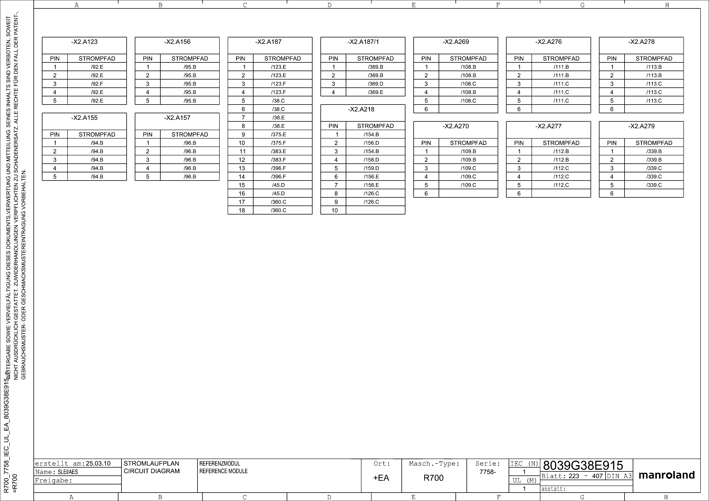

# +EA — Sheet 223 of 407 — REFERENZMODUL

**REFERENCE MODULE**

> Part of the manroland **R700** printing press IEC/UL circuit diagrams.
> Drawing class: **Stromlaufplan / Circuit diagram** (DIN A3).
> Document `+EA` covers the **Printing unit** machine section.

## At a glance

| Field | Value |
|---|---|
| Document | `+EA`  (8039G38E915) |
| Sheet | **223** of 407 |
| Section (DE) | REFERENZMODUL |
| Section (EN) | REFERENCE MODULE |
| Section type | REFERENCE_MODULE — Reference module |
| Machine type | `R700` |
| Series | `7758` |
| Created | 25.03.10 |
| Replaces | — |
| Columns used | A, B, C, D, E, F, G, H |
| Path numbers | — |
| Labels on sheet | 208 |
| Cross-refs out | 81 |
| Cross-refs in | 0 |

**Previous:** [+EA sheet 222](SHEET_0222.md) · **Next:** [+EA sheet 224](SHEET_0224.md) · **Document TOC:** [_TOC.md](_TOC.md)  (+EA) · **Master TOC:** [all sheets](../_MASTER_TOC.md)

## Sheet image (300 DPI, exact vector render)



_Rendered directly from the PDF vector layer at 300 DPI (1-bit), no OCR and no resampling. Use it to confirm anything ambiguous in the text below._

## Cross-references on this sheet

Each entry is a wire leaving this sheet. The printed token is `/sheet.column`; the link resolves to that sheet inside the same document.

| Ref | Target sheet | Col | Path | Destination on target | Target section | From col |
|---|---|---|---|---|---|---|
| `/92.E` | [+EA sheet 92](SHEET_0092.md) | E | — | — | BLASRAHMEN | A |
| `/95.B` | [+EA sheet 95](SHEET_0095.md) | B | — | — | BLASRAHMEN | B |
| `/123.E` | [+EA sheet 123](SHEET_0123.md) | E | — | — | TROCKENBESTÄUBER | C |
| `/369.B` | [+EA sheet 369](SHEET_0369.md) | B | — | — | OPTION: ENDTROCKNER 1 VORBEREITUNG; | E |
| `/108.B` | [+EA sheet 108](SHEET_0108.md) | B | — | — | BLAS/SAUGLUFT MIT MOTORVENTILEINSTELLUNG | F |
| `/111.B` | [+EA sheet 111](SHEET_0111.md) | B | — | — | BLAS/SAUGLUFT MIT MOTORVENTILEINSTELLUNG | G |
| `/113.B` | [+EA sheet 113](SHEET_0113.md) | B | — | — | BLAS/SAUGLUFT MIT MOTORVENTILEINSTELLUNG | H |
| `/92.E` | [+EA sheet 92](SHEET_0092.md) | E | — | — | BLASRAHMEN | A |
| `/95.B` | [+EA sheet 95](SHEET_0095.md) | B | — | — | BLASRAHMEN | B |
| `/123.E` | [+EA sheet 123](SHEET_0123.md) | E | — | — | TROCKENBESTÄUBER | C |
| `/369.B` | [+EA sheet 369](SHEET_0369.md) | B | — | — | OPTION: ENDTROCKNER 1 VORBEREITUNG; | E |
| `/108.B` | [+EA sheet 108](SHEET_0108.md) | B | — | — | BLAS/SAUGLUFT MIT MOTORVENTILEINSTELLUNG | F |
| `/111.B` | [+EA sheet 111](SHEET_0111.md) | B | — | — | BLAS/SAUGLUFT MIT MOTORVENTILEINSTELLUNG | G |
| `/113.B` | [+EA sheet 113](SHEET_0113.md) | B | — | — | BLAS/SAUGLUFT MIT MOTORVENTILEINSTELLUNG | H |
| `/95.B` | [+EA sheet 95](SHEET_0095.md) | B | — | — | BLASRAHMEN | B |
| `/92.F` | [+EA sheet 92](SHEET_0092.md) | F | — | — | BLASRAHMEN | A |
| `/123.F` | [+EA sheet 123](SHEET_0123.md) | F | — | — | TROCKENBESTÄUBER | C |
| `/369.D` | [+EA sheet 369](SHEET_0369.md) | D | — | — | OPTION: ENDTROCKNER 1 VORBEREITUNG; | E |
| `/108.C` | [+EA sheet 108](SHEET_0108.md) | C | — | — | BLAS/SAUGLUFT MIT MOTORVENTILEINSTELLUNG | F |
| `/111.C` | [+EA sheet 111](SHEET_0111.md) | C | — | — | BLAS/SAUGLUFT MIT MOTORVENTILEINSTELLUNG | G |
| `/113.C` | [+EA sheet 113](SHEET_0113.md) | C | — | — | BLAS/SAUGLUFT MIT MOTORVENTILEINSTELLUNG | H |
| `/92.E` | [+EA sheet 92](SHEET_0092.md) | E | — | — | BLASRAHMEN | A |
| `/95.B` | [+EA sheet 95](SHEET_0095.md) | B | — | — | BLASRAHMEN | B |
| `/369.E` | [+EA sheet 369](SHEET_0369.md) | E | — | — | OPTION: ENDTROCKNER 1 VORBEREITUNG; | E |
| `/108.B` | [+EA sheet 108](SHEET_0108.md) | B | — | — | BLAS/SAUGLUFT MIT MOTORVENTILEINSTELLUNG | F |
| `/123.F` | [+EA sheet 123](SHEET_0123.md) | F | — | — | TROCKENBESTÄUBER | C |
| `/111.C` | [+EA sheet 111](SHEET_0111.md) | C | — | — | BLAS/SAUGLUFT MIT MOTORVENTILEINSTELLUNG | G |
| `/113.C` | [+EA sheet 113](SHEET_0113.md) | C | — | — | BLAS/SAUGLUFT MIT MOTORVENTILEINSTELLUNG | H |
| `/92.E` | [+EA sheet 92](SHEET_0092.md) | E | — | — | BLASRAHMEN | A |
| `/95.B` | [+EA sheet 95](SHEET_0095.md) | B | — | — | BLASRAHMEN | B |
| `/38.C` | [+EA sheet 38](SHEET_0038.md) | C | — | — | BUSVERBINDUNGEN: NOT AUS | C |
| `/108.C` | [+EA sheet 108](SHEET_0108.md) | C | — | — | BLAS/SAUGLUFT MIT MOTORVENTILEINSTELLUNG | F |
| `/111.C` | [+EA sheet 111](SHEET_0111.md) | C | — | — | BLAS/SAUGLUFT MIT MOTORVENTILEINSTELLUNG | G |
| `/113.C` | [+EA sheet 113](SHEET_0113.md) | C | — | — | BLAS/SAUGLUFT MIT MOTORVENTILEINSTELLUNG | H |
| `/38.C` | [+EA sheet 38](SHEET_0038.md) | C | — | — | BUSVERBINDUNGEN: NOT AUS | C |
| `/38.E` | [+EA sheet 38](SHEET_0038.md) | E | — | — | BUSVERBINDUNGEN: NOT AUS | C |
| `/38.E` | [+EA sheet 38](SHEET_0038.md) | E | — | — | BUSVERBINDUNGEN: NOT AUS | C |
| `/375.E` | [+EA sheet 375](SHEET_0375.md) | E | — | — | OPTION: ENDTROCKNER 1 VORBEREITUNG; | C |
| `/154.B` | [+EA sheet 154](SHEET_0154.md) | B | — | — | ZUGANGSABSICHERUNG | E |
| `/94.B` | [+EA sheet 94](SHEET_0094.md) | B | — | — | BLASRAHMEN | A |
| `/96.B` | [+EA sheet 96](SHEET_0096.md) | B | — | — | BLASRAHMEN | B |
| `/375.F` | [+EA sheet 375](SHEET_0375.md) | F | — | — | OPTION: ENDTROCKNER 1 VORBEREITUNG; | C |
| `/156.D` | [+EA sheet 156](SHEET_0156.md) | D | — | — | ZUGANGSABSICHERUNG | E |
| `/94.B` | [+EA sheet 94](SHEET_0094.md) | B | — | — | BLASRAHMEN | A |
| `/96.B` | [+EA sheet 96](SHEET_0096.md) | B | — | — | BLASRAHMEN | B |
| `/383.E` | [+EA sheet 383](SHEET_0383.md) | E | — | — | OPTION: ENDTROCKNER 2 VORBEREITUNG | C |
| `/154.B` | [+EA sheet 154](SHEET_0154.md) | B | — | — | ZUGANGSABSICHERUNG | E |
| `/109.B` | [+EA sheet 109](SHEET_0109.md) | B | — | — | BLAS/SAUGLUFT MIT MOTORVENTILEINSTELLUNG | F |
| `/112.B` | [+EA sheet 112](SHEET_0112.md) | B | — | — | BLAS/SAUGLUFT MIT MOTORVENTILEINSTELLUNG | G |
| `/339.B` | [+EA sheet 339](SHEET_0339.md) | B | — | — | OPTION: BOGENWEICHE | H |
| `/94.B` | [+EA sheet 94](SHEET_0094.md) | B | — | — | BLASRAHMEN | A |
| `/96.B` | [+EA sheet 96](SHEET_0096.md) | B | — | — | BLASRAHMEN | B |
| `/109.B` | [+EA sheet 109](SHEET_0109.md) | B | — | — | BLAS/SAUGLUFT MIT MOTORVENTILEINSTELLUNG | F |
| `/112.B` | [+EA sheet 112](SHEET_0112.md) | B | — | — | BLAS/SAUGLUFT MIT MOTORVENTILEINSTELLUNG | G |
| `/339.B` | [+EA sheet 339](SHEET_0339.md) | B | — | — | OPTION: BOGENWEICHE | H |
| `/383.F` | [+EA sheet 383](SHEET_0383.md) | F | — | — | OPTION: ENDTROCKNER 2 VORBEREITUNG | C |
| `/158.D` | [+EA sheet 158](SHEET_0158.md) | D | — | — | ZUGANGSABSICHERUNG | E |
| `/94.B` | [+EA sheet 94](SHEET_0094.md) | B | — | — | BLASRAHMEN | A |
| `/96.B` | [+EA sheet 96](SHEET_0096.md) | B | — | — | BLASRAHMEN | B |
| `/396.F` | [+EA sheet 396](SHEET_0396.md) | F | — | — | OPTION: ZWISCHENTROCKNER VORBEREITUNG; | C |
| `/159.D` | [+EA sheet 159](SHEET_0159.md) | D | — | — | ZUGANGSABSICHERUNG | E |
| `/109.C` | [+EA sheet 109](SHEET_0109.md) | C | — | — | BLAS/SAUGLUFT MIT MOTORVENTILEINSTELLUNG | F |
| `/112.C` | [+EA sheet 112](SHEET_0112.md) | C | — | — | BLAS/SAUGLUFT MIT MOTORVENTILEINSTELLUNG | G |
| `/339.C` | [+EA sheet 339](SHEET_0339.md) | C | — | — | OPTION: BOGENWEICHE | H |
| `/94.B` | [+EA sheet 94](SHEET_0094.md) | B | — | — | BLASRAHMEN | A |
| `/96.B` | [+EA sheet 96](SHEET_0096.md) | B | — | — | BLASRAHMEN | B |
| `/156.E` | [+EA sheet 156](SHEET_0156.md) | E | — | — | ZUGANGSABSICHERUNG | E |
| `/396.F` | [+EA sheet 396](SHEET_0396.md) | F | — | — | OPTION: ZWISCHENTROCKNER VORBEREITUNG; | C |
| `/109.C` | [+EA sheet 109](SHEET_0109.md) | C | — | — | BLAS/SAUGLUFT MIT MOTORVENTILEINSTELLUNG | F |
| `/112.C` | [+EA sheet 112](SHEET_0112.md) | C | — | — | BLAS/SAUGLUFT MIT MOTORVENTILEINSTELLUNG | G |
| `/339.C` | [+EA sheet 339](SHEET_0339.md) | C | — | — | OPTION: BOGENWEICHE | H |
| `/156.E` | [+EA sheet 156](SHEET_0156.md) | E | — | — | ZUGANGSABSICHERUNG | E |
| `/45.D` | [+EA sheet 45](SHEET_0045.md) | D | — | — | BUSVERBINDUNGEN: 20 mA SCHLEIFE | C |
| `/109.C` | [+EA sheet 109](SHEET_0109.md) | C | — | — | BLAS/SAUGLUFT MIT MOTORVENTILEINSTELLUNG | F |
| `/112.C` | [+EA sheet 112](SHEET_0112.md) | C | — | — | BLAS/SAUGLUFT MIT MOTORVENTILEINSTELLUNG | G |
| `/339.C` | [+EA sheet 339](SHEET_0339.md) | C | — | — | OPTION: BOGENWEICHE | H |
| `/45.D` | [+EA sheet 45](SHEET_0045.md) | D | — | — | BUSVERBINDUNGEN: 20 mA SCHLEIFE | C |
| `/126.C` | [+EA sheet 126](SHEET_0126.md) | C | — | — | ZUGANGSABSICHERUNG | E |
| `/360.C` | [+EA sheet 360](SHEET_0360.md) | C | — | — | OPTION: | C |
| `/126.C` | [+EA sheet 126](SHEET_0126.md) | C | — | — | ZUGANGSABSICHERUNG | E |
| `/360.C` | [+EA sheet 360](SHEET_0360.md) | C | — | — | OPTION: | C |

## Devices on this sheet

| Tag | Class | Class meaning (IEC) | Col | Sub | Terminal | Sign |
|---|---|---|---|---|---|---|
| `X2.A156` | — | cross-device reference | B | — | — | — |
| `X2.A157` | — | cross-device reference | B | — | — | — |
| `X2.A123` | — | cross-device reference | A | — | — | — |
| `X2.A155` | — | cross-device reference | A | — | — | — |
| `X2.A187` | — | cross-device reference | C | — | — | — |
| `X2.A218` | — | cross-device reference | D | — | — | — |
| `X2.A269` | — | cross-device reference | F | — | — | — |
| `X2.A270` | — | cross-device reference | F | — | — | — |
| `X2.A276` | — | cross-device reference | G | — | — | — |
| `X2.A277` | — | cross-device reference | G | — | — | — |
| `X2.A278` | — | cross-device reference | H | — | — | — |
| `X2.A279` | — | cross-device reference | H | — | — | — |

## Potentials / nets

_No named potentials on this sheet._

## Wire-end annotations (grouped as printed)

A wire that continues elsewhere is annotated with a small cluster: the destination description, the path/line number `#NN`, and the `/sheet.column` cross reference. Each row below is one such cluster exactly as it is grouped on the drawing.

| Col | Y | Path | Cross-ref | Text on the wire |
|---|---|---|---|---|
| A | 65.5 | — | — | `X2.A123` |
| B | 65.5 | — | — | `X2.A156` |
| C | 65.5 | — | — | `X2.A187` |
| D | 65.5 | — | — | `X2.A187/1` |
| F | 65.5 | — | — | `X2.A269` |
| G | 65.5 | — | — | `X2.A276` |
| H | 65.5 | — | — | `X2.A278` |
| A | 94.2 | — | — | `PIN 2 3 4 5 1 STROMPFAD` |
| B | 94.2 | — | — | `PIN 2 3 4 5 1 STROMPFAD` |
| C | 94.2 | — | — | `PIN 10 12 13 14 15 16 17 18 11 2 3 4 5 6 7 8 9 1 STROMPFAD` |
| D | 94.2 | — | — | `PIN 2 3 4 1 STROMPFAD` |
| E | 94.2 | — | — | `PIN 2 3 4 5 6 1 STROMPFAD` |
| G | 94.2 | — | — | `PIN 2 3 4 5 6 1 STROMPFAD` |
| H | 94.2 | — | — | `PIN 2 3 4 5 6 1 STROMPFAD` |
| A | 108.7 | — | `/92.E` | — |
| B | 108.7 | — | `/95.B` | — |
| C | 108.7 | — | `/123.E` | — |
| E | 108.7 | — | `/369.B` | — |
| F | 108.7 | — | `/108.B` | — |
| G | 108.7 | — | `/111.B` | — |
| H | 108.7 | — | `/113.B` | — |
| A | 122.8 | — | `/92.E` | — |
| B | 122.8 | — | `/95.B` | — |
| C | 122.9 | — | `/123.E` | — |
| E | 122.9 | — | `/369.B` | — |
| F | 122.9 | — | `/108.B` | — |
| G | 122.9 | — | `/111.B` | — |
| H | 122.9 | — | `/113.B` | — |
| A | 137.0 | — | `/92.F` | — |
| B | 137.0 | — | `/95.B` | — |
| C | 137.0 | — | `/123.F` | — |
| E | 137.1 | — | `/369.D` | — |
| F | 137.1 | — | `/108.C` | — |
| G | 137.1 | — | `/111.C` | — |
| H | 137.1 | — | `/113.C` | — |
| A | 151.2 | — | `/92.E` | — |
| B | 151.2 | — | `/95.B` | — |
| C | 151.2 | — | `/123.F` | — |
| E | 151.2 | — | `/369.E` | — |
| F | 151.2 | — | `/108.B` | — |
| G | 151.2 | — | `/111.C` | — |
| H | 151.2 | — | `/113.C` | — |
| A | 165.4 | — | `/92.E` | — |
| B | 165.4 | — | `/95.B` | — |
| C | 165.4 | — | `/38.C` | — |
| F | 165.4 | — | `/108.C` | — |
| G | 165.4 | — | `/111.C` | — |
| H | 165.4 | — | `/113.C` | — |
| D | 178.9 | — | — | `X2.A218` |
| C | 179.6 | — | `/38.C` | — |
| A | 193.1 | — | — | `X2.A155` |
| B | 193.1 | — | — | `X2.A157` |
| C | 193.7 | — | `/38.E` | — |
| F | 207.2 | — | — | `X2.A270` |
| G | 207.2 | — | — | `X2.A277` |
| H | 207.2 | — | — | `X2.A279` |
| D | 207.5 | — | — | `PIN 10 2 3 4 5 6 7 8 9 1 STROMPFAD` |
| C | 207.9 | — | `/38.E` | — |
| A | 221.7 | — | — | `PIN 2 3 4 5 1 STROMPFAD` |
| B | 221.7 | — | — | `PIN 2 3 4 5 1 STROMPFAD` |
| C | 222.1 | — | `/375.E` | — |
| E | 222.1 | — | `/154.B` | — |
| E | 235.9 | — | — | `PIN 2 3 4 5 6 1 STROMPFAD` |
| G | 235.9 | — | — | `PIN 2 3 4 5 6 1 STROMPFAD` |
| H | 235.9 | — | — | `PIN 2 3 4 5 6 1 STROMPFAD` |
| A | 236.2 | — | `/94.B` | — |
| B | 236.2 | — | `/96.B` | — |
| C | 236.3 | — | `/375.F` | — |
| E | 236.3 | — | `/156.D` | — |
| A | 250.4 | — | `/94.B` | — |
| B | 250.4 | — | `/96.B` | — |
| C | 250.4 | — | `/383.E` | — |
| E | 250.4 | — | `/154.B` | — |
| F | 250.4 | — | `/109.B` | — |
| G | 250.4 | — | `/112.B` | — |
| H | 250.4 | — | `/339.B` | — |
| A | 264.6 | — | `/94.B` | — |
| B | 264.6 | — | `/96.B` | — |
| C | 264.6 | — | `/383.F` | — |
| E | 264.6 | — | `/158.D` | — |
| F | 264.6 | — | `/109.B` | — |
| G | 264.6 | — | `/112.B` | — |
| H | 264.6 | — | `/339.B` | — |
| A | 278.8 | — | `/94.B` | — |
| B | 278.8 | — | `/96.B` | — |
| C | 278.8 | — | `/396.F` | — |
| E | 278.8 | — | `/159.D` | — |
| F | 278.8 | — | `/109.C` | — |
| G | 278.8 | — | `/112.C` | — |
| H | 278.8 | — | `/339.C` | — |
| A | 292.9 | — | `/94.B` | — |
| B | 292.9 | — | `/96.B` | — |
| C | 292.9 | — | `/396.F` | — |
| E | 292.9 | — | `/156.E` | — |
| F | 293.0 | — | `/109.C` | — |
| G | 293.0 | — | `/112.C` | — |
| H | 293.0 | — | `/339.C` | — |
| C | 307.1 | — | `/45.D` | — |
| E | 307.1 | — | `/156.E` | — |
| F | 307.1 | — | `/109.C` | — |
| G | 307.1 | — | `/112.C` | — |
| H | 307.1 | — | `/339.C` | — |
| C | 321.3 | — | `/45.D` | — |
| E | 321.3 | — | `/126.C` | — |
| C | 335.5 | — | `/360.C` | — |
| E | 335.5 | — | `/126.C` | — |
| C | 349.7 | — | `/360.C` | — |


## Reconstructed tables

This sheet carries tabular content (pin map / terminal assignment / index). The grid below was rebuilt from the drawing's own rule lines, so each row is exactly one physical row of the table.

### Table 1 — 12 data rows × 2 columns (at x=70.9, y=62.4) — **X2.A123**

| PIN | STROMPFAD |
|---|---|
| `1` | `/92.E` |
| `2` | `/92.E` |
| `3` | `/92.F` |
| `4` | `/92.E` |
| `5` | `/92.E` |
|  | `X2.A155` |
| `PIN` | `STROMPFAD` |
| `1` | `/94.B` |
| `2` | `/94.B` |
| `3` | `/94.B` |
| `4` | `/94.B` |
| `5` | `/94.B` |


### Table 2 — 12 data rows × 2 columns (at x=226.8, y=62.4) — **X2.A156**

| PIN | STROMPFAD |
|---|---|
| `1` | `/95.B` |
| `2` | `/95.B` |
| `3` | `/95.B` |
| `4` | `/95.B` |
| `5` | `/95.B` |
|  | `X2.A157` |
| `PIN` | `STROMPFAD` |
| `1` | `/96.B` |
| `2` | `/96.B` |
| `3` | `/96.B` |
| `4` | `/96.B` |
| `5` | `/96.B` |


### Table 3 — 18 data rows × 2 columns (at x=382.7, y=62.4) — **X2.A187**

| PIN | STROMPFAD |
|---|---|
| `1` | `/123.E` |
| `2` | `/123.E` |
| `3` | `/123.F` |
| `4` | `/123.F` |
| `5` | `/38.C` |
| `6` | `/38.C` |
| `7` | `/38.E` |
| `8` | `/38.E` |
| `9` | `/375.E` |
| `10` | `/375.F` |
| `11` | `/383.E` |
| `12` | `/383.F` |
| `13` | `/396.F` |
| `14` | `/396.F` |
| `15` | `/45.D` |
| `16` | `/45.D` |
| `17` | `/360.C` |
| `18` | `/360.C` |


### Table 4 — 16 data rows × 2 columns (at x=538.6, y=62.4) — **X2.A187/1**

| PIN | STROMPFAD |
|---|---|
| `1` | `/369.B` |
| `2` | `/369.B` |
| `3` | `/369.D` |
| `4` | `/369.E` |
|  | `X2.A218` |
| `PIN` | `STROMPFAD` |
| `1` | `/154.B` |
| `2` | `/156.D` |
| `3` | `/154.B` |
| `4` | `/158.D` |
| `5` | `/159.D` |
| `6` | `/156.E` |
| `7` | `/156.E` |
| `8` | `/126.C` |
| `9` | `/126.C` |
| `10` |  |


### Table 5 — 14 data rows × 2 columns (at x=694.5, y=62.4) — **X2.A269**

| PIN | STROMPFAD |
|---|---|
| `1` | `/108.B` |
| `2` | `/108.B` |
| `3` | `/108.C` |
| `4` | `/108.B` |
| `5` | `/108.C` |
| `6` |  |
|  | `X2.A270` |
| `PIN` | `STROMPFAD` |
| `1` | `/109.B` |
| `2` | `/109.B` |
| `3` | `/109.C` |
| `4` | `/109.C` |
| `5` | `/109.C` |
| `6` |  |


### Table 6 — 14 data rows × 2 columns (at x=850.4, y=62.4) — **X2.A276**

| PIN | STROMPFAD |
|---|---|
| `1` | `/111.B` |
| `2` | `/111.B` |
| `3` | `/111.C` |
| `4` | `/111.C` |
| `5` | `/111.C` |
| `6` |  |
|  | `X2.A277` |
| `PIN` | `STROMPFAD` |
| `1` | `/112.B` |
| `2` | `/112.B` |
| `3` | `/112.C` |
| `4` | `/112.C` |
| `5` | `/112.C` |
| `6` |  |


### Table 7 — 14 data rows × 2 columns (at x=1006.3, y=62.4) — **X2.A278**

| PIN | STROMPFAD |
|---|---|
| `1` | `/113.B` |
| `2` | `/113.B` |
| `3` | `/113.C` |
| `4` | `/113.C` |
| `5` | `/113.C` |
| `6` |  |
|  | `X2.A279` |
| `PIN` | `STROMPFAD` |
| `1` | `/339.B` |
| `2` | `/339.B` |
| `3` | `/339.C` |
| `4` | `/339.C` |
| `5` | `/339.C` |
| `6` |  |


## Notes and free text on this sheet

| Text | Col | Y (pt) |
|---|---|---|
| `PIN` | B | 94.2 |
| `STROMPFAD` | B | 94.15 |
| `PIN` | A | 94.2 |
| `STROMPFAD` | A | 94.15 |
| `PIN` | C | 94.2 |
| `STROMPFAD` | C | 94.15 |
| `PIN` | D | 94.2 |
| `STROMPFAD` | E | 94.15 |
| `X2.A187/1` | D | 65.51 |
| `PIN` | E | 94.2 |
| `STROMPFAD` | F | 94.15 |
| `PIN` | F | 94.2 |
| `STROMPFAD` | G | 94.15 |
| `PIN` | G | 94.2 |
| `STROMPFAD` | H | 94.15 |

## Complete label inventory (exact text from the drawing)

Every text object inside the drawing area of this sheet, in DIN reading order (column A→H, then top→bottom). This is the authoritative list: if a string is not here it is not printed on this sheet.

| Col | Y | X | Dir | Type | Text |
|---|---|---|---|---|---|
| A | 65.5 | 119.8 | → | device ref | `X2.A123` |
| A | 94.2 | 84.0 | → | text | `PIN` |
| A | 94.2 | 132.2 | → | text | `STROMPFAD` |
| A | 108.4 | 90.0 | → | number | `1` |
| A | 108.7 | 152.9 | → | cross-reference | `/92.E` |
| A | 122.5 | 89.4 | → | number | `2` |
| A | 122.8 | 152.9 | → | cross-reference | `/92.E` |
| A | 136.7 | 89.4 | → | number | `3` |
| A | 137.0 | 153.1 | → | cross-reference | `/92.F` |
| A | 150.9 | 89.4 | → | number | `4` |
| A | 151.2 | 152.9 | → | cross-reference | `/92.E` |
| A | 165.1 | 89.4 | → | number | `5` |
| A | 165.4 | 152.9 | → | cross-reference | `/92.E` |
| A | 193.1 | 119.8 | → | device ref | `X2.A155` |
| A | 221.7 | 132.2 | → | text | `STROMPFAD` |
| A | 221.8 | 84.0 | → | text | `PIN` |
| A | 235.9 | 90.0 | → | number | `1` |
| A | 236.2 | 152.8 | → | cross-reference | `/94.B` |
| A | 250.1 | 89.4 | → | number | `2` |
| A | 250.4 | 152.8 | → | cross-reference | `/94.B` |
| A | 264.3 | 89.4 | → | number | `3` |
| A | 264.6 | 152.8 | → | cross-reference | `/94.B` |
| A | 278.5 | 89.4 | → | number | `4` |
| A | 278.8 | 152.8 | → | cross-reference | `/94.B` |
| A | 292.6 | 89.4 | → | number | `5` |
| A | 292.9 | 152.8 | → | cross-reference | `/94.B` |
| B | 65.5 | 275.7 | → | device ref | `X2.A156` |
| B | 94.2 | 240.0 | → | text | `PIN` |
| B | 94.2 | 288.1 | → | text | `STROMPFAD` |
| B | 108.4 | 245.9 | → | number | `1` |
| B | 108.7 | 308.7 | → | cross-reference | `/95.B` |
| B | 122.5 | 245.3 | → | number | `2` |
| B | 122.8 | 308.7 | → | cross-reference | `/95.B` |
| B | 136.7 | 245.3 | → | number | `3` |
| B | 137.0 | 308.7 | → | cross-reference | `/95.B` |
| B | 150.9 | 245.3 | → | number | `4` |
| B | 151.2 | 308.7 | → | cross-reference | `/95.B` |
| B | 165.1 | 245.3 | → | number | `5` |
| B | 165.4 | 308.7 | → | cross-reference | `/95.B` |
| B | 193.1 | 275.7 | → | device ref | `X2.A157` |
| B | 221.7 | 288.1 | → | text | `STROMPFAD` |
| B | 221.8 | 240.0 | → | text | `PIN` |
| B | 235.9 | 245.9 | → | number | `1` |
| B | 236.2 | 308.7 | → | cross-reference | `/96.B` |
| B | 250.1 | 245.3 | → | number | `2` |
| B | 250.4 | 308.7 | → | cross-reference | `/96.B` |
| B | 264.3 | 245.3 | → | number | `3` |
| B | 264.6 | 308.7 | → | cross-reference | `/96.B` |
| B | 278.5 | 245.3 | → | number | `4` |
| B | 278.8 | 308.7 | → | cross-reference | `/96.B` |
| B | 292.6 | 245.3 | → | number | `5` |
| B | 292.9 | 308.7 | → | cross-reference | `/96.B` |
| C | 65.5 | 428.7 | → | device ref | `X2.A187` |
| C | 94.2 | 395.9 | → | text | `PIN` |
| C | 94.2 | 444.0 | → | text | `STROMPFAD` |
| C | 108.4 | 407.6 | → | number | `1` |
| C | 108.7 | 455.2 | → | cross-reference | `/123.E` |
| C | 122.5 | 405.9 | → | number | `2` |
| C | 122.9 | 455.2 | → | cross-reference | `/123.E` |
| C | 136.7 | 405.9 | → | number | `3` |
| C | 137.0 | 455.4 | → | cross-reference | `/123.F` |
| C | 150.9 | 405.9 | → | number | `4` |
| C | 151.2 | 455.4 | → | cross-reference | `/123.F` |
| C | 165.1 | 405.9 | → | number | `5` |
| C | 165.4 | 457.4 | → | cross-reference | `/38.C` |
| C | 179.2 | 405.9 | → | number | `6` |
| C | 179.6 | 457.4 | → | cross-reference | `/38.C` |
| C | 193.4 | 405.9 | → | number | `7` |
| C | 193.7 | 457.7 | → | cross-reference | `/38.E` |
| C | 207.6 | 405.9 | → | number | `8` |
| C | 207.9 | 457.7 | → | cross-reference | `/38.E` |
| C | 221.8 | 405.9 | → | number | `9` |
| C | 222.1 | 455.2 | → | cross-reference | `/375.E` |
| C | 235.9 | 400.5 | → | number | `10` |
| C | 236.3 | 455.4 | → | cross-reference | `/375.F` |
| C | 250.1 | 402.2 | → | number | `11` |
| C | 250.4 | 455.2 | → | cross-reference | `/383.E` |
| C | 264.3 | 400.5 | → | number | `12` |
| C | 264.6 | 455.4 | → | cross-reference | `/383.F` |
| C | 278.5 | 400.5 | → | number | `13` |
| C | 278.8 | 455.4 | → | cross-reference | `/396.F` |
| C | 292.6 | 400.5 | → | number | `14` |
| C | 293.0 | 455.4 | → | cross-reference | `/396.F` |
| C | 306.8 | 400.5 | → | number | `15` |
| C | 307.1 | 457.4 | → | cross-reference | `/45.D` |
| C | 321.0 | 400.5 | → | number | `16` |
| C | 321.3 | 457.4 | → | cross-reference | `/45.D` |
| C | 335.1 | 400.5 | → | number | `17` |
| C | 335.5 | 455.0 | → | cross-reference | `/360.C` |
| C | 349.3 | 400.5 | → | number | `18` |
| C | 349.7 | 455.0 | → | cross-reference | `/360.C` |
| D | 65.5 | 583.8 | → | text | `X2.A187/1` |
| D | 94.2 | 551.8 | → | text | `PIN` |
| D | 108.4 | 557.7 | → | number | `1` |
| D | 122.5 | 557.1 | → | number | `2` |
| D | 136.7 | 557.1 | → | number | `3` |
| D | 150.9 | 557.1 | → | number | `4` |
| D | 178.9 | 584.6 | → | device ref | `X2.A218` |
| D | 207.6 | 551.8 | → | text | `PIN` |
| D | 221.8 | 563.5 | → | number | `1` |
| D | 235.9 | 561.8 | → | number | `2` |
| D | 250.1 | 561.8 | → | number | `3` |
| D | 264.3 | 561.8 | → | number | `4` |
| D | 278.5 | 561.8 | → | number | `5` |
| D | 292.6 | 561.8 | → | number | `6` |
| D | 306.8 | 561.8 | → | number | `7` |
| D | 321.0 | 561.8 | → | number | `8` |
| D | 335.1 | 561.8 | → | number | `9` |
| D | 349.3 | 556.4 | → | number | `10` |
| E | 94.2 | 600.0 | → | text | `STROMPFAD` |
| E | 94.2 | 707.7 | → | text | `PIN` |
| E | 108.4 | 713.6 | → | number | `1` |
| E | 108.7 | 618.1 | → | cross-reference | `/369.B` |
| E | 122.5 | 713.1 | → | number | `2` |
| E | 122.9 | 618.1 | → | cross-reference | `/369.B` |
| E | 136.7 | 713.1 | → | number | `3` |
| E | 137.1 | 618.0 | → | cross-reference | `/369.D` |
| E | 150.9 | 713.1 | → | number | `4` |
| E | 151.2 | 618.2 | → | cross-reference | `/369.E` |
| E | 165.1 | 713.1 | → | number | `5` |
| E | 179.2 | 713.1 | → | number | `6` |
| E | 207.5 | 600.0 | → | text | `STROMPFAD` |
| E | 222.1 | 611.0 | → | cross-reference | `/154.B` |
| E | 235.9 | 707.7 | → | text | `PIN` |
| E | 236.3 | 610.9 | → | cross-reference | `/156.D` |
| E | 250.1 | 713.6 | → | number | `1` |
| E | 250.4 | 611.0 | → | cross-reference | `/154.B` |
| E | 264.3 | 713.1 | → | number | `2` |
| E | 264.6 | 610.9 | → | cross-reference | `/158.D` |
| E | 278.5 | 713.1 | → | number | `3` |
| E | 278.8 | 610.9 | → | cross-reference | `/159.D` |
| E | 292.6 | 713.1 | → | number | `4` |
| E | 292.9 | 611.1 | → | cross-reference | `/156.E` |
| E | 306.8 | 713.1 | → | number | `5` |
| E | 307.1 | 611.1 | → | cross-reference | `/156.E` |
| E | 321.0 | 713.1 | → | number | `6` |
| E | 321.3 | 610.9 | → | cross-reference | `/126.C` |
| E | 335.5 | 610.9 | → | cross-reference | `/126.C` |
| F | 65.5 | 743.4 | → | device ref | `X2.A269` |
| F | 94.2 | 755.9 | → | text | `STROMPFAD` |
| F | 94.2 | 863.6 | → | text | `PIN` |
| F | 108.4 | 869.5 | → | number | `1` |
| F | 108.7 | 774.0 | → | cross-reference | `/108.B` |
| F | 122.5 | 869.0 | → | number | `2` |
| F | 122.9 | 774.0 | → | cross-reference | `/108.B` |
| F | 136.7 | 869.0 | → | number | `3` |
| F | 137.1 | 773.9 | → | cross-reference | `/108.C` |
| F | 150.9 | 869.0 | → | number | `4` |
| F | 151.2 | 774.0 | → | cross-reference | `/108.B` |
| F | 165.1 | 869.0 | → | number | `5` |
| F | 165.4 | 773.9 | → | cross-reference | `/108.C` |
| F | 179.2 | 869.0 | → | number | `6` |
| F | 207.2 | 743.4 | → | device ref | `X2.A270` |
| F | 235.9 | 755.9 | → | text | `STROMPFAD` |
| F | 235.9 | 863.6 | → | text | `PIN` |
| F | 250.1 | 869.5 | → | number | `1` |
| F | 250.4 | 774.0 | → | cross-reference | `/109.B` |
| F | 264.3 | 869.0 | → | number | `2` |
| F | 264.6 | 774.0 | → | cross-reference | `/109.B` |
| F | 278.5 | 869.0 | → | number | `3` |
| F | 278.8 | 773.9 | → | cross-reference | `/109.C` |
| F | 292.6 | 869.0 | → | number | `4` |
| F | 293.0 | 773.9 | → | cross-reference | `/109.C` |
| F | 306.8 | 869.0 | → | number | `5` |
| F | 307.1 | 773.9 | → | cross-reference | `/109.C` |
| F | 321.0 | 869.0 | → | number | `6` |
| G | 65.5 | 899.3 | → | device ref | `X2.A276` |
| G | 94.2 | 911.8 | → | text | `STROMPFAD` |
| G | 94.2 | 1019.5 | → | text | `PIN` |
| G | 108.4 | 1025.4 | → | number | `1` |
| G | 108.7 | 929.9 | → | cross-reference | `/111.B` |
| G | 122.5 | 1024.9 | → | number | `2` |
| G | 122.9 | 929.9 | → | cross-reference | `/111.B` |
| G | 136.7 | 1024.9 | → | number | `3` |
| G | 137.1 | 929.8 | → | cross-reference | `/111.C` |
| G | 150.9 | 1024.9 | → | number | `4` |
| G | 151.2 | 929.8 | → | cross-reference | `/111.C` |
| G | 165.1 | 1024.9 | → | number | `5` |
| G | 165.4 | 929.8 | → | cross-reference | `/111.C` |
| G | 179.2 | 1024.9 | → | number | `6` |
| G | 207.2 | 899.3 | → | device ref | `X2.A277` |
| G | 235.9 | 911.8 | → | text | `STROMPFAD` |
| G | 235.9 | 1019.5 | → | text | `PIN` |
| G | 250.1 | 1025.4 | → | number | `1` |
| G | 250.4 | 929.9 | → | cross-reference | `/112.B` |
| G | 264.3 | 1024.9 | → | number | `2` |
| G | 264.6 | 929.9 | → | cross-reference | `/112.B` |
| G | 278.5 | 1024.9 | → | number | `3` |
| G | 278.8 | 929.8 | → | cross-reference | `/112.C` |
| G | 292.6 | 1024.9 | → | number | `4` |
| G | 293.0 | 929.8 | → | cross-reference | `/112.C` |
| G | 306.8 | 1024.9 | → | number | `5` |
| G | 307.1 | 929.8 | → | cross-reference | `/112.C` |
| G | 321.0 | 1024.9 | → | number | `6` |
| H | 65.5 | 1055.2 | → | device ref | `X2.A278` |
| H | 94.2 | 1067.7 | → | text | `STROMPFAD` |
| H | 108.7 | 1085.8 | → | cross-reference | `/113.B` |
| H | 122.9 | 1085.8 | → | cross-reference | `/113.B` |
| H | 137.1 | 1085.7 | → | cross-reference | `/113.C` |
| H | 151.2 | 1085.7 | → | cross-reference | `/113.C` |
| H | 165.4 | 1085.7 | → | cross-reference | `/113.C` |
| H | 207.2 | 1055.2 | → | device ref | `X2.A279` |
| H | 235.9 | 1067.7 | → | text | `STROMPFAD` |
| H | 250.4 | 1085.8 | → | cross-reference | `/339.B` |
| H | 264.6 | 1085.8 | → | cross-reference | `/339.B` |
| H | 278.8 | 1085.7 | → | cross-reference | `/339.C` |
| H | 293.0 | 1085.7 | → | cross-reference | `/339.C` |
| H | 307.1 | 1085.7 | → | cross-reference | `/339.C` |

## Reading-order text block

The same content as a plain block, grouped by DIN column — convenient to paste or to match against a visual description.

```text
=== Column A ===
  65.5  119.8  devref       X2.A123
  94.2   84.0  text         PIN
  94.2  132.2  text         STROMPFAD
 108.4   90.0  numeric      1
 108.7  152.9  xref         /92.E
 122.5   89.4  numeric      2
 122.8  152.9  xref         /92.E
 136.7   89.4  numeric      3
 137.0  153.1  xref         /92.F
 150.9   89.4  numeric      4
 151.2  152.9  xref         /92.E
 165.1   89.4  numeric      5
 165.4  152.9  xref         /92.E
 193.1  119.8  devref       X2.A155
 221.7  132.2  text         STROMPFAD
 221.8   84.0  text         PIN
 235.9   90.0  numeric      1
 236.2  152.8  xref         /94.B
 250.1   89.4  numeric      2
 250.4  152.8  xref         /94.B
 264.3   89.4  numeric      3
 264.6  152.8  xref         /94.B
 278.5   89.4  numeric      4
 278.8  152.8  xref         /94.B
 292.6   89.4  numeric      5
 292.9  152.8  xref         /94.B
=== Column B ===
  65.5  275.7  devref       X2.A156
  94.2  240.0  text         PIN
  94.2  288.1  text         STROMPFAD
 108.4  245.9  numeric      1
 108.7  308.7  xref         /95.B
 122.5  245.3  numeric      2
 122.8  308.7  xref         /95.B
 136.7  245.3  numeric      3
 137.0  308.7  xref         /95.B
 150.9  245.3  numeric      4
 151.2  308.7  xref         /95.B
 165.1  245.3  numeric      5
 165.4  308.7  xref         /95.B
 193.1  275.7  devref       X2.A157
 221.7  288.1  text         STROMPFAD
 221.8  240.0  text         PIN
 235.9  245.9  numeric      1
 236.2  308.7  xref         /96.B
 250.1  245.3  numeric      2
 250.4  308.7  xref         /96.B
 264.3  245.3  numeric      3
 264.6  308.7  xref         /96.B
 278.5  245.3  numeric      4
 278.8  308.7  xref         /96.B
 292.6  245.3  numeric      5
 292.9  308.7  xref         /96.B
=== Column C ===
  65.5  428.7  devref       X2.A187
  94.2  395.9  text         PIN
  94.2  444.0  text         STROMPFAD
 108.4  407.6  numeric      1
 108.7  455.2  xref         /123.E
 122.5  405.9  numeric      2
 122.9  455.2  xref         /123.E
 136.7  405.9  numeric      3
 137.0  455.4  xref         /123.F
 150.9  405.9  numeric      4
 151.2  455.4  xref         /123.F
 165.1  405.9  numeric      5
 165.4  457.4  xref         /38.C
 179.2  405.9  numeric      6
 179.6  457.4  xref         /38.C
 193.4  405.9  numeric      7
 193.7  457.7  xref         /38.E
 207.6  405.9  numeric      8
 207.9  457.7  xref         /38.E
 221.8  405.9  numeric      9
 222.1  455.2  xref         /375.E
 235.9  400.5  numeric      10
 236.3  455.4  xref         /375.F
 250.1  402.2  numeric      11
 250.4  455.2  xref         /383.E
 264.3  400.5  numeric      12
 264.6  455.4  xref         /383.F
 278.5  400.5  numeric      13
 278.8  455.4  xref         /396.F
 292.6  400.5  numeric      14
 293.0  455.4  xref         /396.F
 306.8  400.5  numeric      15
 307.1  457.4  xref         /45.D
 321.0  400.5  numeric      16
 321.3  457.4  xref         /45.D
 335.1  400.5  numeric      17
 335.5  455.0  xref         /360.C
 349.3  400.5  numeric      18
 349.7  455.0  xref         /360.C
=== Column D ===
  65.5  583.8  text         X2.A187/1
  94.2  551.8  text         PIN
 108.4  557.7  numeric      1
 122.5  557.1  numeric      2
 136.7  557.1  numeric      3
 150.9  557.1  numeric      4
 178.9  584.6  devref       X2.A218
 207.6  551.8  text         PIN
 221.8  563.5  numeric      1
 235.9  561.8  numeric      2
 250.1  561.8  numeric      3
 264.3  561.8  numeric      4
 278.5  561.8  numeric      5
 292.6  561.8  numeric      6
 306.8  561.8  numeric      7
 321.0  561.8  numeric      8
 335.1  561.8  numeric      9
 349.3  556.4  numeric      10
=== Column E ===
  94.2  600.0  text         STROMPFAD
  94.2  707.7  text         PIN
 108.4  713.6  numeric      1
 108.7  618.1  xref         /369.B
 122.5  713.1  numeric      2
 122.9  618.1  xref         /369.B
 136.7  713.1  numeric      3
 137.1  618.0  xref         /369.D
 150.9  713.1  numeric      4
 151.2  618.2  xref         /369.E
 165.1  713.1  numeric      5
 179.2  713.1  numeric      6
 207.5  600.0  text         STROMPFAD
 222.1  611.0  xref         /154.B
 235.9  707.7  text         PIN
 236.3  610.9  xref         /156.D
 250.1  713.6  numeric      1
 250.4  611.0  xref         /154.B
 264.3  713.1  numeric      2
 264.6  610.9  xref         /158.D
 278.5  713.1  numeric      3
 278.8  610.9  xref         /159.D
 292.6  713.1  numeric      4
 292.9  611.1  xref         /156.E
 306.8  713.1  numeric      5
 307.1  611.1  xref         /156.E
 321.0  713.1  numeric      6
 321.3  610.9  xref         /126.C
 335.5  610.9  xref         /126.C
=== Column F ===
  65.5  743.4  devref       X2.A269
  94.2  755.9  text         STROMPFAD
  94.2  863.6  text         PIN
 108.4  869.5  numeric      1
 108.7  774.0  xref         /108.B
 122.5  869.0  numeric      2
 122.9  774.0  xref         /108.B
 136.7  869.0  numeric      3
 137.1  773.9  xref         /108.C
 150.9  869.0  numeric      4
 151.2  774.0  xref         /108.B
 165.1  869.0  numeric      5
 165.4  773.9  xref         /108.C
 179.2  869.0  numeric      6
 207.2  743.4  devref       X2.A270
 235.9  755.9  text         STROMPFAD
 235.9  863.6  text         PIN
 250.1  869.5  numeric      1
 250.4  774.0  xref         /109.B
 264.3  869.0  numeric      2
 264.6  774.0  xref         /109.B
 278.5  869.0  numeric      3
 278.8  773.9  xref         /109.C
 292.6  869.0  numeric      4
 293.0  773.9  xref         /109.C
 306.8  869.0  numeric      5
 307.1  773.9  xref         /109.C
 321.0  869.0  numeric      6
=== Column G ===
  65.5  899.3  devref       X2.A276
  94.2  911.8  text         STROMPFAD
  94.2 1019.5  text         PIN
 108.4 1025.4  numeric      1
 108.7  929.9  xref         /111.B
 122.5 1024.9  numeric      2
 122.9  929.9  xref         /111.B
 136.7 1024.9  numeric      3
 137.1  929.8  xref         /111.C
 150.9 1024.9  numeric      4
 151.2  929.8  xref         /111.C
 165.1 1024.9  numeric      5
 165.4  929.8  xref         /111.C
 179.2 1024.9  numeric      6
 207.2  899.3  devref       X2.A277
 235.9  911.8  text         STROMPFAD
 235.9 1019.5  text         PIN
 250.1 1025.4  numeric      1
 250.4  929.9  xref         /112.B
 264.3 1024.9  numeric      2
 264.6  929.9  xref         /112.B
 278.5 1024.9  numeric      3
 278.8  929.8  xref         /112.C
 292.6 1024.9  numeric      4
 293.0  929.8  xref         /112.C
 306.8 1024.9  numeric      5
 307.1  929.8  xref         /112.C
 321.0 1024.9  numeric      6
=== Column H ===
  65.5 1055.2  devref       X2.A278
  94.2 1067.7  text         STROMPFAD
 108.7 1085.8  xref         /113.B
 122.9 1085.8  xref         /113.B
 137.1 1085.7  xref         /113.C
 151.2 1085.7  xref         /113.C
 165.4 1085.7  xref         /113.C
 207.2 1055.2  devref       X2.A279
 235.9 1067.7  text         STROMPFAD
 250.4 1085.8  xref         /339.B
 264.6 1085.8  xref         /339.B
 278.8 1085.7  xref         /339.C
 293.0 1085.7  xref         /339.C
 307.1 1085.7  xref         /339.C
```

---
_Generated from the PDF vector text layer; no OCR. Source: `R700_7758_IEC_UL_EA_8039G38E915_p`, sheet 223._
