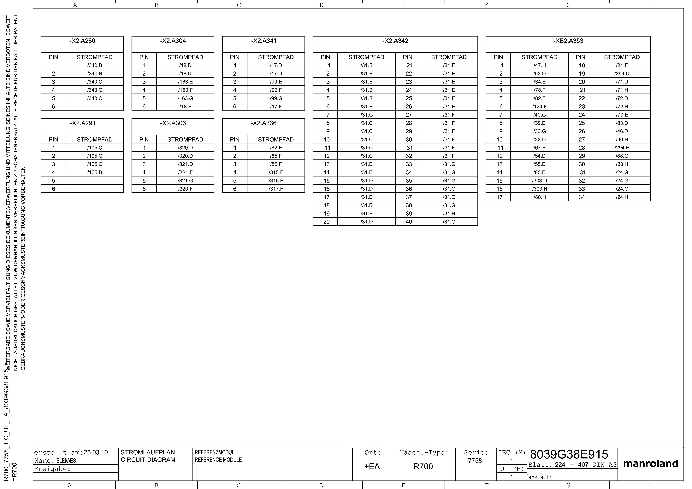

# +EA — Sheet 224 of 407 — REFERENZMODUL

**REFERENCE MODULE**

> Part of the manroland **R700** printing press IEC/UL circuit diagrams.
> Drawing class: **Stromlaufplan / Circuit diagram** (DIN A3).
> Document `+EA` covers the **Printing unit** machine section.

## At a glance

| Field | Value |
|---|---|
| Document | `+EA`  (8039G38E915) |
| Sheet | **224** of 407 |
| Section (DE) | REFERENZMODUL |
| Section (EN) | REFERENCE MODULE |
| Section type | REFERENCE_MODULE — Reference module |
| Machine type | `R700` |
| Series | `7758` |
| Created | 25.03.10 |
| Replaces | — |
| Columns used | A, B, C, D, E, F, G, H |
| Path numbers | — |
| Labels on sheet | 245 |
| Cross-refs out | 107 |
| Cross-refs in | 0 |

**Previous:** [+EA sheet 223](SHEET_0223.md) · **Next:** [+EA sheet 225](SHEET_0225.md) · **Document TOC:** [_TOC.md](_TOC.md)  (+EA) · **Master TOC:** [all sheets](../_MASTER_TOC.md)

## Sheet image (300 DPI, exact vector render)



_Rendered directly from the PDF vector layer at 300 DPI (1-bit), no OCR and no resampling. Use it to confirm anything ambiguous in the text below._

## Cross-references on this sheet

Each entry is a wire leaving this sheet. The printed token is `/sheet.column`; the link resolves to that sheet inside the same document.

| Ref | Target sheet | Col | Path | Destination on target | Target section | From col |
|---|---|---|---|---|---|---|
| `/31.B` | [+EA sheet 31](SHEET_0031.md) | B | — | — | BUSVERBINDUNGEN: SICHERHEITSBUS | E |
| `/31.E` | [+EA sheet 31](SHEET_0031.md) | E | — | — | BUSVERBINDUNGEN: SICHERHEITSBUS | F |
| `/81.E` | [+EA sheet 81](SHEET_0081.md) | E | — | — | AUSLEGERSTAPELSTEUERUNG: BEDIENKOMMANDOS | H |
| `/340.B` | [+EA sheet 340](SHEET_0340.md) | B | — | — | OPTION: BOGENWEICHE | A |
| `/18.D` | [+EA sheet 18](SHEET_0018.md) | D | — | — | SPANNUNGSVERSORGUNG: 400V, 24V | B |
| `/17.D` | [+EA sheet 17](SHEET_0017.md) | D | — | — | SPANNUNGSVERSORGUNG: 400V, 24V | C |
| `/47.H` | [+EA sheet 47](SHEET_0047.md) | H | — | — | SCHUTZ | G |
| `/31.B` | [+EA sheet 31](SHEET_0031.md) | B | — | — | BUSVERBINDUNGEN: SICHERHEITSBUS | E |
| `/31.E` | [+EA sheet 31](SHEET_0031.md) | E | — | — | BUSVERBINDUNGEN: SICHERHEITSBUS | F |
| `/340.B` | [+EA sheet 340](SHEET_0340.md) | B | — | — | OPTION: BOGENWEICHE | A |
| `/18.D` | [+EA sheet 18](SHEET_0018.md) | D | — | — | SPANNUNGSVERSORGUNG: 400V, 24V | B |
| `/17.D` | [+EA sheet 17](SHEET_0017.md) | D | — | — | SPANNUNGSVERSORGUNG: 400V, 24V | C |
| `/53.D` | [+EA sheet 53](SHEET_0053.md) | D | — | — | MASCHINENBEDIENUNG: LAUFKOMMANDOS | G |
| `/294.D` | [+EA sheet 294](SHEET_0294.md) | D | — | — | OPTION: ZWISCHENSTAPEL / | H |
| `/99.E` | [+EA sheet 99](SHEET_0099.md) | E | — | — | BOGENFÜHRUNGSELEMENT | C |
| `/31.B` | [+EA sheet 31](SHEET_0031.md) | B | — | — | BUSVERBINDUNGEN: SICHERHEITSBUS | E |
| `/31.E` | [+EA sheet 31](SHEET_0031.md) | E | — | — | BUSVERBINDUNGEN: SICHERHEITSBUS | F |
| `/34.E` | [+EA sheet 34](SHEET_0034.md) | E | — | — | BUSVERBINDUNGEN: NOT AUS | G |
| `/163.E` | [+EA sheet 163](SHEET_0163.md) | E | — | — | VERLÄNGERUNG 1828,4MM | B |
| `/71.D` | [+EA sheet 71](SHEET_0071.md) | D | — | — | AUSLEGERSTAPELSTEUERUNG | H |
| `/340.C` | [+EA sheet 340](SHEET_0340.md) | C | — | — | OPTION: BOGENWEICHE | A |
| `/31.B` | [+EA sheet 31](SHEET_0031.md) | B | — | — | BUSVERBINDUNGEN: SICHERHEITSBUS | E |
| `/31.E` | [+EA sheet 31](SHEET_0031.md) | E | — | — | BUSVERBINDUNGEN: SICHERHEITSBUS | F |
| `/99.F` | [+EA sheet 99](SHEET_0099.md) | F | — | — | BOGENFÜHRUNGSELEMENT | C |
| `/78.F` | [+EA sheet 78](SHEET_0078.md) | F | — | — | AUSLEGERSTAPELSTEUERUNG | G |
| `/163.F` | [+EA sheet 163](SHEET_0163.md) | F | — | — | VERLÄNGERUNG 1828,4MM | B |
| `/340.C` | [+EA sheet 340](SHEET_0340.md) | C | — | — | OPTION: BOGENWEICHE | A |
| `/71.H` | [+EA sheet 71](SHEET_0071.md) | H | — | — | AUSLEGERSTAPELSTEUERUNG | H |
| `/31.B` | [+EA sheet 31](SHEET_0031.md) | B | — | — | BUSVERBINDUNGEN: SICHERHEITSBUS | E |
| `/31.E` | [+EA sheet 31](SHEET_0031.md) | E | — | — | BUSVERBINDUNGEN: SICHERHEITSBUS | F |
| `/82.E` | [+EA sheet 82](SHEET_0082.md) | E | — | — | AUSLEGERSTAPELSTEUERUNG: PROGRAMMSCHALTWERK | G |
| `/99.G` | [+EA sheet 99](SHEET_0099.md) | G | — | — | BOGENFÜHRUNGSELEMENT | C |
| `/163.G` | [+EA sheet 163](SHEET_0163.md) | G | — | — | VERLÄNGERUNG 1828,4MM | B |
| `/72.D` | [+EA sheet 72](SHEET_0072.md) | D | — | — | AUSLEGERSTAPELSTEUERUNG | H |
| `/340.C` | [+EA sheet 340](SHEET_0340.md) | C | — | — | OPTION: BOGENWEICHE | A |
| `/31.B` | [+EA sheet 31](SHEET_0031.md) | B | — | — | BUSVERBINDUNGEN: SICHERHEITSBUS | E |
| `/31.E` | [+EA sheet 31](SHEET_0031.md) | E | — | — | BUSVERBINDUNGEN: SICHERHEITSBUS | F |
| `/18.F` | [+EA sheet 18](SHEET_0018.md) | F | — | — | SPANNUNGSVERSORGUNG: 400V, 24V | B |
| `/17.F` | [+EA sheet 17](SHEET_0017.md) | F | — | — | SPANNUNGSVERSORGUNG: 400V, 24V | C |
| `/124.F` | [+EA sheet 124](SHEET_0124.md) | F | — | — | TROCKENBESTÄUBER | G |
| `/72.H` | [+EA sheet 72](SHEET_0072.md) | H | — | — | AUSLEGERSTAPELSTEUERUNG | H |
| `/73.E` | [+EA sheet 73](SHEET_0073.md) | E | — | — | AUSLEGERSTAPELSTEUERUNG | H |
| `/31.F` | [+EA sheet 31](SHEET_0031.md) | F | — | — | BUSVERBINDUNGEN: SICHERHEITSBUS | F |
| `/40.G` | [+EA sheet 40](SHEET_0040.md) | G | — | — | BUSVERBINDUNGEN: STOP SICHERN | G |
| `/31.C` | [+EA sheet 31](SHEET_0031.md) | C | — | — | BUSVERBINDUNGEN: SICHERHEITSBUS | E |
| `/31.F` | [+EA sheet 31](SHEET_0031.md) | F | — | — | BUSVERBINDUNGEN: SICHERHEITSBUS | F |
| `/31.C` | [+EA sheet 31](SHEET_0031.md) | C | — | — | BUSVERBINDUNGEN: SICHERHEITSBUS | E |
| `/39.D` | [+EA sheet 39](SHEET_0039.md) | D | — | — | BUSVERBINDUNGEN: STOP SICHERN | G |
| `/83.D` | [+EA sheet 83](SHEET_0083.md) | D | — | — | AUSLEGERSTAPELSTEUERUNG: PROGRAMMSCHALTWERK | H |
| `/31.F` | [+EA sheet 31](SHEET_0031.md) | F | — | — | BUSVERBINDUNGEN: SICHERHEITSBUS | F |
| `/33.G` | [+EA sheet 33](SHEET_0033.md) | G | — | — | BUSVERBINDUNGEN: NOT AUS | G |
| `/31.C` | [+EA sheet 31](SHEET_0031.md) | C | — | — | BUSVERBINDUNGEN: SICHERHEITSBUS | E |
| `/46.D` | [+EA sheet 46](SHEET_0046.md) | D | — | — | SCHUTZ | H |
| `/31.F` | [+EA sheet 31](SHEET_0031.md) | F | — | — | BUSVERBINDUNGEN: SICHERHEITSBUS | F |
| `/31.C` | [+EA sheet 31](SHEET_0031.md) | C | — | — | BUSVERBINDUNGEN: SICHERHEITSBUS | E |
| `/32.D` | [+EA sheet 32](SHEET_0032.md) | D | — | — | BUSVERBINDUNGEN: NOT AUS | G |
| `/46.H` | [+EA sheet 46](SHEET_0046.md) | H | — | — | SCHUTZ | H |
| `/82.E` | [+EA sheet 82](SHEET_0082.md) | E | — | — | AUSLEGERSTAPELSTEUERUNG: PROGRAMMSCHALTWERK | C |
| `/67.E` | [+EA sheet 67](SHEET_0067.md) | E | — | — | LEITSTANDSFUNKTIONEN | G |
| `/31.F` | [+EA sheet 31](SHEET_0031.md) | F | — | — | BUSVERBINDUNGEN: SICHERHEITSBUS | F |
| `/31.C` | [+EA sheet 31](SHEET_0031.md) | C | — | — | BUSVERBINDUNGEN: SICHERHEITSBUS | E |
| `/105.C` | [+EA sheet 105](SHEET_0105.md) | C | — | — | BOGENFÜHRUNGSELEMENT | A |
| `/320.D` | [+EA sheet 320](SHEET_0320.md) | D | — | — | OPTION: VERLÄNGERUNG 3656,8MM | B |
| `/294.H` | [+EA sheet 294](SHEET_0294.md) | H | — | — | OPTION: ZWISCHENSTAPEL / | H |
| `/85.F` | [+EA sheet 85](SHEET_0085.md) | F | — | — | AUSLEGERSTAPELSTEUERUNG: PROGRAMMSCHALTWERK | C |
| `/31.F` | [+EA sheet 31](SHEET_0031.md) | F | — | — | BUSVERBINDUNGEN: SICHERHEITSBUS | F |
| `/88.G` | [+EA sheet 88](SHEET_0088.md) | G | — | — | SAUGWALZE | H |
| `/31.C` | [+EA sheet 31](SHEET_0031.md) | C | — | — | BUSVERBINDUNGEN: SICHERHEITSBUS | E |
| `/54.D` | [+EA sheet 54](SHEET_0054.md) | D | — | — | MASCHINENBEDIENUNG: LAUFKOMMANDOS | G |
| `/105.C` | [+EA sheet 105](SHEET_0105.md) | C | — | — | BOGENFÜHRUNGSELEMENT | A |
| `/320.D` | [+EA sheet 320](SHEET_0320.md) | D | — | — | OPTION: VERLÄNGERUNG 3656,8MM | B |
| `/85.F` | [+EA sheet 85](SHEET_0085.md) | F | — | — | AUSLEGERSTAPELSTEUERUNG: PROGRAMMSCHALTWERK | C |
| `/31.G` | [+EA sheet 31](SHEET_0031.md) | G | — | — | BUSVERBINDUNGEN: SICHERHEITSBUS | F |
| `/105.C` | [+EA sheet 105](SHEET_0105.md) | C | — | — | BOGENFÜHRUNGSELEMENT | A |
| `/321.D` | [+EA sheet 321](SHEET_0321.md) | D | — | — | OPTION: VERLÄNGERUNG 3656,8MM | B |
| `/31.D` | [+EA sheet 31](SHEET_0031.md) | D | — | — | BUSVERBINDUNGEN: SICHERHEITSBUS | E |
| `/55.D` | [+EA sheet 55](SHEET_0055.md) | D | — | — | MASCHINENBEDIENUNG: LAUFKOMMANDOS | G |
| `/38.H` | [+EA sheet 38](SHEET_0038.md) | H | — | — | BUSVERBINDUNGEN: NOT AUS | H |
| `/105.B` | [+EA sheet 105](SHEET_0105.md) | B | — | — | BOGENFÜHRUNGSELEMENT | A |
| `/315.E` | [+EA sheet 315](SHEET_0315.md) | E | — | — | OPTION: LOGISTIK, AUSLEGER | C |
| `/321.F` | [+EA sheet 321](SHEET_0321.md) | F | — | — | OPTION: VERLÄNGERUNG 3656,8MM | B |
| `/31.G` | [+EA sheet 31](SHEET_0031.md) | G | — | — | BUSVERBINDUNGEN: SICHERHEITSBUS | F |
| `/24.G` | [+EA sheet 24](SHEET_0024.md) | G | — | — | BUSVERBINDUNGEN: SICHERHEITSBUS | H |
| `/31.D` | [+EA sheet 31](SHEET_0031.md) | D | — | — | BUSVERBINDUNGEN: SICHERHEITSBUS | E |
| `/80.D` | [+EA sheet 80](SHEET_0080.md) | D | — | — | AUSLEGERSTAPELSTEUERUNG: BEDIENKOMMANDOS | G |
| `/316.F` | [+EA sheet 316](SHEET_0316.md) | F | — | — | OPTION: LOGISTIK, AUSLEGER | C |
| `/31.G` | [+EA sheet 31](SHEET_0031.md) | G | — | — | BUSVERBINDUNGEN: SICHERHEITSBUS | F |
| `/24.G` | [+EA sheet 24](SHEET_0024.md) | G | — | — | BUSVERBINDUNGEN: SICHERHEITSBUS | H |
| `/321.G` | [+EA sheet 321](SHEET_0321.md) | G | — | — | OPTION: VERLÄNGERUNG 3656,8MM | B |
| `/31.D` | [+EA sheet 31](SHEET_0031.md) | D | — | — | BUSVERBINDUNGEN: SICHERHEITSBUS | E |
| `/303.D` | [+EA sheet 303](SHEET_0303.md) | D | — | — | OPTION: ZWISCHENSTAPEL / | G |
| `/31.G` | [+EA sheet 31](SHEET_0031.md) | G | — | — | BUSVERBINDUNGEN: SICHERHEITSBUS | F |
| `/24.G` | [+EA sheet 24](SHEET_0024.md) | G | — | — | BUSVERBINDUNGEN: SICHERHEITSBUS | H |
| `/320.F` | [+EA sheet 320](SHEET_0320.md) | F | — | — | OPTION: VERLÄNGERUNG 3656,8MM | B |
| `/317.F` | [+EA sheet 317](SHEET_0317.md) | F | — | — | OPTION: LOGISTIK, AUSLEGER | C |
| `/31.D` | [+EA sheet 31](SHEET_0031.md) | D | — | — | BUSVERBINDUNGEN: SICHERHEITSBUS | E |
| `/303.H` | [+EA sheet 303](SHEET_0303.md) | H | — | — | OPTION: ZWISCHENSTAPEL / | G |
| `/31.G` | [+EA sheet 31](SHEET_0031.md) | G | — | — | BUSVERBINDUNGEN: SICHERHEITSBUS | F |
| `/31.D` | [+EA sheet 31](SHEET_0031.md) | D | — | — | BUSVERBINDUNGEN: SICHERHEITSBUS | E |
| `/80.H` | [+EA sheet 80](SHEET_0080.md) | H | — | — | AUSLEGERSTAPELSTEUERUNG: BEDIENKOMMANDOS | G |
| `/24.H` | [+EA sheet 24](SHEET_0024.md) | H | — | — | BUSVERBINDUNGEN: SICHERHEITSBUS | H |
| `/31.G` | [+EA sheet 31](SHEET_0031.md) | G | — | — | BUSVERBINDUNGEN: SICHERHEITSBUS | F |
| `/31.D` | [+EA sheet 31](SHEET_0031.md) | D | — | — | BUSVERBINDUNGEN: SICHERHEITSBUS | E |
| `/31.E` | [+EA sheet 31](SHEET_0031.md) | E | — | — | BUSVERBINDUNGEN: SICHERHEITSBUS | E |
| `/31.H` | [+EA sheet 31](SHEET_0031.md) | H | — | — | BUSVERBINDUNGEN: SICHERHEITSBUS | F |
| `/31.G` | [+EA sheet 31](SHEET_0031.md) | G | — | — | BUSVERBINDUNGEN: SICHERHEITSBUS | F |
| `/31.D` | [+EA sheet 31](SHEET_0031.md) | D | — | — | BUSVERBINDUNGEN: SICHERHEITSBUS | E |

## Devices on this sheet

| Tag | Class | Class meaning (IEC) | Col | Sub | Terminal | Sign |
|---|---|---|---|---|---|---|
| `X2.A280` | — | cross-device reference | A | — | — | — |
| `X2.A291` | — | cross-device reference | A | — | — | — |
| `X2.A304` | — | cross-device reference | B | — | — | — |
| `X2.A306` | — | cross-device reference | B | — | — | — |
| `X2.A341` | — | cross-device reference | C | — | — | — |
| `X2.A336` | — | cross-device reference | C | — | — | — |
| `X2.A342` | — | cross-device reference | E | — | — | — |
| `XB2.A353` | — | cross-device reference | G | — | — | — |

## Potentials / nets

_No named potentials on this sheet._

## Wire-end annotations (grouped as printed)

A wire that continues elsewhere is annotated with a small cluster: the destination description, the path/line number `#NN`, and the `/sheet.column` cross reference. Each row below is one such cluster exactly as it is grouped on the drawing.

| Col | Y | Path | Cross-ref | Text on the wire |
|---|---|---|---|---|
| A | 65.5 | — | — | `X2.A280` |
| B | 65.5 | — | — | `X2.A304` |
| C | 65.5 | — | — | `X2.A341` |
| E | 65.5 | — | — | `X2.A342` |
| G | 65.5 | — | — | `XB2.A353` |
| A | 94.2 | — | — | `PIN 2 3 4 5 6 1 STROMPFAD` |
| B | 94.2 | — | — | `PIN 2 3 4 5 6 1 STROMPFAD` |
| C | 94.2 | — | — | `PIN 2 3 4 5 6 1 STROMPFAD` |
| D | 94.2 | — | — | `PIN STROMPFAD` |
| E | 94.2 | — | — | `PIN STROMPFAD` |
| F | 94.2 | — | — | `PIN STROMPFAD` |
| G | 94.2 | — | — | `PIN 18 19 20 22 23 24 25 26 27 28 29 30 32 33 34 21 31 STROMPFAD` |
| D | 108.4 | — | — | `2 3 4 5 6 7 8 9 1` |
| E | 108.4 | — | — | `22 21` |
| F | 108.4 | — | — | `2 3 4 5 6 7 8 9 1` |
| A | 108.7 | — | `/340.B` | — |
| B | 108.7 | — | `/18.D` | — |
| C | 108.7 | — | `/17.D` | — |
| E | 108.7 | — | `/31.B` | — |
| F | 108.7 | — | `/31.E` | — |
| G | 108.7 | — | `/47.H` | — |
| H | 108.7 | — | `/81.E` | — |
| E | 122.8 | — | `/31.B` | — |
| F | 122.8 | — | `/31.E` | — |
| A | 122.9 | — | `/340.B` | — |
| B | 122.9 | — | `/18.D` | — |
| C | 122.9 | — | `/17.D` | — |
| G | 122.9 | — | `/53.D` | — |
| H | 122.9 | — | `/294.D` | — |
| E | 136.7 | — | — | `23 24 25 26 27 28 29 30 32 33 34 35 36 37 38 39 40 31` |
| B | 137.0 | — | `/163.E` | — |
| C | 137.0 | — | `/99.E` | — |
| E | 137.0 | — | `/31.B` | — |
| F | 137.0 | — | `/31.E` | — |
| G | 137.0 | — | `/34.E` | — |
| A | 137.1 | — | `/340.C` | — |
| H | 137.1 | — | `/71.D` | — |
| A | 151.2 | — | `/340.C` | — |
| B | 151.2 | — | `/163.F` | — |
| C | 151.2 | — | `/99.F` | — |
| E | 151.2 | — | `/31.B` | — |
| F | 151.2 | — | `/31.E` | — |
| G | 151.2 | — | `/78.F` | — |
| H | 151.2 | — | `/71.H` | — |
| A | 165.4 | — | `/340.C` | — |
| B | 165.4 | — | `/163.G` | — |
| C | 165.4 | — | `/99.G` | — |
| E | 165.4 | — | `/31.B` | — |
| F | 165.4 | — | `/31.E` | — |
| G | 165.4 | — | `/82.E` | — |
| H | 165.4 | — | `/72.D` | — |
| E | 179.5 | — | `/31.B` | — |
| F | 179.5 | — | `/31.E` | — |
| B | 179.6 | — | `/18.F` | — |
| C | 179.6 | — | `/17.F` | — |
| G | 179.6 | — | `/124.F` | — |
| H | 179.6 | — | `/72.H` | — |
| F | 193.7 | — | `/31.F` | — |
| G | 193.7 | — | `/40.G` | — |
| H | 193.7 | — | `/73.E` | — |
| E | 193.8 | — | `/31.C` | — |
| A | 207.2 | — | — | `X2.A291` |
| B | 207.2 | — | — | `X2.A306` |
| C | 207.2 | — | — | `X2.A336` |
| E | 207.9 | — | `/31.C` | — |
| F | 207.9 | — | `/31.F` | — |
| G | 207.9 | — | `/39.D` | — |
| H | 207.9 | — | `/83.D` | — |
| E | 222.1 | — | `/31.C` | — |
| F | 222.1 | — | `/31.F` | — |
| G | 222.1 | — | `/33.G` | — |
| H | 222.1 | — | `/46.D` | — |
| A | 235.9 | — | — | `PIN 2 3 4 5 6 1 STROMPFAD` |
| B | 235.9 | — | — | `PIN 2 3 4 5 6 1 STROMPFAD` |
| C | 235.9 | — | — | `PIN 2 3 4 5 6 1 STROMPFAD` |
| D | 235.9 | — | — | `10 12 13 14 15 16 17 18 19 11` |
| F | 235.9 | — | — | `10 12 13 14 15 16 17 11` |
| F | 236.2 | — | `/31.F` | — |
| E | 236.3 | — | `/31.C` | — |
| G | 236.3 | — | `/32.D` | — |
| H | 236.3 | — | `/46.H` | — |
| A | 250.4 | — | `/105.C` | — |
| B | 250.4 | — | `/320.D` | — |
| C | 250.4 | — | `/82.E` | — |
| E | 250.4 | — | `/31.C` | — |
| F | 250.4 | — | `/31.F` | — |
| G | 250.4 | — | `/67.E` | — |
| H | 250.4 | — | `/294.H` | — |
| A | 264.6 | — | `/105.C` | — |
| B | 264.6 | — | `/320.D` | — |
| C | 264.6 | — | `/85.F` | — |
| E | 264.6 | — | `/31.C` | — |
| F | 264.6 | — | `/31.F` | — |
| G | 264.6 | — | `/54.D` | — |
| H | 264.6 | — | `/88.G` | — |
| A | 278.8 | — | `/105.C` | — |
| B | 278.8 | — | `/321.D` | — |
| C | 278.8 | — | `/85.F` | — |
| E | 278.8 | — | `/31.D` | — |
| F | 278.8 | — | `/31.G` | — |
| G | 278.8 | — | `/55.D` | — |
| H | 278.8 | — | `/38.H` | — |
| A | 292.9 | — | `/105.B` | — |
| B | 292.9 | — | `/321.F` | — |
| C | 292.9 | — | `/315.E` | — |
| F | 292.9 | — | `/31.G` | — |
| H | 292.9 | — | `/24.G` | — |
| E | 293.0 | — | `/31.D` | — |
| G | 293.0 | — | `/80.D` | — |
| B | 307.1 | — | `/321.G` | — |
| C | 307.1 | — | `/316.F` | — |
| E | 307.1 | — | `/31.D` | — |
| F | 307.1 | — | `/31.G` | — |
| G | 307.1 | — | `/303.D` | — |
| H | 307.1 | — | `/24.G` | — |
| B | 321.3 | — | `/320.F` | — |
| C | 321.3 | — | `/317.F` | — |
| E | 321.3 | — | `/31.D` | — |
| F | 321.3 | — | `/31.G` | — |
| G | 321.3 | — | `/303.H` | — |
| H | 321.3 | — | `/24.G` | — |
| E | 335.5 | — | `/31.D` | — |
| F | 335.5 | — | `/31.G` | — |
| G | 335.5 | — | `/80.H` | — |
| H | 335.5 | — | `/24.H` | — |
| E | 349.6 | — | `/31.D` | — |
| F | 349.6 | — | `/31.G` | — |
| E | 363.8 | — | `/31.E` | — |
| F | 363.8 | — | `/31.H` | — |
| D | 377.7 | — | — | `20` |
| E | 378.0 | — | `/31.D` | — |
| F | 378.0 | — | `/31.G` | — |


## Reconstructed tables

This sheet carries tabular content (pin map / terminal assignment / index). The grid below was rebuilt from the drawing's own rule lines, so each row is exactly one physical row of the table.

### Table 1 — 14 data rows × 2 columns (at x=70.9, y=62.4) — **X2.A280**

| PIN | STROMPFAD |
|---|---|
| `1` | `/340.B` |
| `2` | `/340.B` |
| `3` | `/340.C` |
| `4` | `/340.C` |
| `5` | `/340.C` |
| `6` |  |
|  | `X2.A291` |
| `PIN` | `STROMPFAD` |
| `1` | `/105.C` |
| `2` | `/105.C` |
| `3` | `/105.C` |
| `4` | `/105.B` |
| `5` |  |
| `6` |  |


### Table 2 — 14 data rows × 2 columns (at x=226.8, y=62.4) — **X2.A304**

| PIN | STROMPFAD |
|---|---|
| `1` | `/18.D` |
| `2` | `/18.D` |
| `3` | `/163.E` |
| `4` | `/163.F` |
| `5` | `/163.G` |
| `6` | `/18.F` |
|  | `X2.A306` |
| `PIN` | `STROMPFAD` |
| `1` | `/320.D` |
| `2` | `/320.D` |
| `3` | `/321.D` |
| `4` | `/321.F` |
| `5` | `/321.G` |
| `6` | `/320.F` |


### Table 3 — 14 data rows × 2 columns (at x=382.7, y=62.4) — **X2.A341**

| PIN | STROMPFAD |
|---|---|
| `1` | `/17.D` |
| `2` | `/17.D` |
| `3` | `/99.E` |
| `4` | `/99.F` |
| `5` | `/99.G` |
| `6` | `/17.F` |
|  | `X2.A336` |
| `PIN` | `STROMPFAD` |
| `1` | `/82.E` |
| `2` | `/85.F` |
| `3` | `/85.F` |
| `4` | `/315.E` |
| `5` | `/316.F` |
| `6` | `/317.F` |


### Table 4 — 20 data rows × 4 columns (at x=538.6, y=62.4) — **X2.A342**

| PIN | STROMPFAD | PIN | STROMPFAD |
|---|---|---|---|
| `1` | `/31.B` | `21` | `/31.E` |
| `2` | `/31.B` | `22` | `/31.E` |
| `3` | `/31.B` | `23` | `/31.E` |
| `4` | `/31.B` | `24` | `/31.E` |
| `5` | `/31.B` | `25` | `/31.E` |
| `6` | `/31.B` | `26` | `/31.E` |
| `7` | `/31.C` | `27` | `/31.F` |
| `8` | `/31.C` | `28` | `/31.F` |
| `9` | `/31.C` | `29` | `/31.F` |
| `10` | `/31.C` | `30` | `/31.F` |
| `11` | `/31.C` | `31` | `/31.F` |
| `12` | `/31.C` | `32` | `/31.F` |
| `13` | `/31.D` | `33` | `/31.G` |
| `14` | `/31.D` | `34` | `/31.G` |
| `15` | `/31.D` | `35` | `/31.G` |
| `16` | `/31.D` | `36` | `/31.G` |
| `17` | `/31.D` | `37` | `/31.G` |
| `18` | `/31.D` | `38` | `/31.G` |
| `19` | `/31.E` | `39` | `/31.H` |
| `20` | `/31.D` | `40` | `/31.G` |


### Table 5 — 17 data rows × 4 columns (at x=836.2, y=62.4) — **XB2.A353**

| PIN | STROMPFAD | PIN | STROMPFAD |
|---|---|---|---|
| `1` | `/47.H` | `18` | `/81.E` |
| `2` | `/53.D` | `19` | `/294.D` |
| `3` | `/34.E` | `20` | `/71.D` |
| `4` | `/78.F` | `21` | `/71.H` |
| `5` | `/82.E` | `22` | `/72.D` |
| `6` | `/124.F` | `23` | `/72.H` |
| `7` | `/40.G` | `24` | `/73.E` |
| `8` | `/39.D` | `25` | `/83.D` |
| `9` | `/33.G` | `26` | `/46.D` |
| `10` | `/32.D` | `27` | `/46.H` |
| `11` | `/67.E` | `28` | `/294.H` |
| `12` | `/54.D` | `29` | `/88.G` |
| `13` | `/55.D` | `30` | `/38.H` |
| `14` | `/80.D` | `31` | `/24.G` |
| `15` | `/303.D` | `32` | `/24.G` |
| `16` | `/303.H` | `33` | `/24.G` |
| `17` | `/80.H` | `34` | `/24.H` |


## Notes and free text on this sheet

| Text | Col | Y (pt) |
|---|---|---|
| `PIN` | A | 94.2 |
| `STROMPFAD` | A | 94.15 |
| `PIN` | B | 94.2 |
| `STROMPFAD` | B | 94.15 |
| `PIN` | C | 94.2 |
| `STROMPFAD` | C | 94.15 |
| `PIN` | D | 94.2 |
| `STROMPFAD` | E | 94.15 |
| `PIN` | E | 94.2 |
| `STROMPFAD` | F | 94.15 |
| `PIN` | F | 94.2 |
| `STROMPFAD` | G | 94.15 |
| `PIN` | G | 94.2 |
| `STROMPFAD` | H | 94.15 |

## Complete label inventory (exact text from the drawing)

Every text object inside the drawing area of this sheet, in DIN reading order (column A→H, then top→bottom). This is the authoritative list: if a string is not here it is not printed on this sheet.

| Col | Y | X | Dir | Type | Text |
|---|---|---|---|---|---|
| A | 65.5 | 119.8 | → | device ref | `X2.A280` |
| A | 94.2 | 84.0 | → | text | `PIN` |
| A | 94.2 | 132.2 | → | text | `STROMPFAD` |
| A | 108.4 | 90.0 | → | number | `1` |
| A | 108.7 | 150.4 | → | cross-reference | `/340.B` |
| A | 122.5 | 89.4 | → | number | `2` |
| A | 122.9 | 150.4 | → | cross-reference | `/340.B` |
| A | 136.7 | 89.4 | → | number | `3` |
| A | 137.1 | 150.2 | → | cross-reference | `/340.C` |
| A | 150.9 | 89.4 | → | number | `4` |
| A | 151.2 | 150.2 | → | cross-reference | `/340.C` |
| A | 165.1 | 89.4 | → | number | `5` |
| A | 165.4 | 150.2 | → | cross-reference | `/340.C` |
| A | 179.2 | 89.4 | → | number | `6` |
| A | 207.2 | 120.5 | → | device ref | `X2.A291` |
| A | 235.9 | 84.0 | → | text | `PIN` |
| A | 235.9 | 132.2 | → | text | `STROMPFAD` |
| A | 250.1 | 90.0 | → | number | `1` |
| A | 250.4 | 150.2 | → | cross-reference | `/105.C` |
| A | 264.3 | 89.4 | → | number | `2` |
| A | 264.6 | 150.2 | → | cross-reference | `/105.C` |
| A | 278.5 | 89.4 | → | number | `3` |
| A | 278.8 | 150.2 | → | cross-reference | `/105.C` |
| A | 292.6 | 89.4 | → | number | `4` |
| A | 292.9 | 150.4 | → | cross-reference | `/105.B` |
| A | 306.8 | 89.4 | → | number | `5` |
| A | 321.0 | 89.4 | → | number | `6` |
| B | 65.5 | 275.7 | → | device ref | `X2.A304` |
| B | 94.2 | 240.0 | → | text | `PIN` |
| B | 94.2 | 288.1 | → | text | `STROMPFAD` |
| B | 108.4 | 245.9 | → | number | `1` |
| B | 108.7 | 308.6 | → | cross-reference | `/18.D` |
| B | 122.5 | 245.3 | → | number | `2` |
| B | 122.9 | 308.6 | → | cross-reference | `/18.D` |
| B | 136.7 | 245.3 | → | number | `3` |
| B | 137.0 | 306.4 | → | cross-reference | `/163.E` |
| B | 150.9 | 245.3 | → | number | `4` |
| B | 151.2 | 306.6 | → | cross-reference | `/163.F` |
| B | 165.1 | 245.3 | → | number | `5` |
| B | 165.4 | 306.0 | → | cross-reference | `/163.G` |
| B | 179.2 | 245.3 | → | number | `6` |
| B | 179.6 | 309.0 | → | cross-reference | `/18.F` |
| B | 207.2 | 275.7 | → | device ref | `X2.A306` |
| B | 235.9 | 240.0 | → | text | `PIN` |
| B | 235.9 | 288.1 | → | text | `STROMPFAD` |
| B | 250.1 | 245.9 | → | number | `1` |
| B | 250.4 | 306.1 | → | cross-reference | `/320.D` |
| B | 264.3 | 245.3 | → | number | `2` |
| B | 264.6 | 306.1 | → | cross-reference | `/320.D` |
| B | 278.5 | 245.3 | → | number | `3` |
| B | 278.8 | 306.1 | → | cross-reference | `/321.D` |
| B | 292.6 | 245.3 | → | number | `4` |
| B | 293.0 | 306.6 | → | cross-reference | `/321.F` |
| B | 306.8 | 245.3 | → | number | `5` |
| B | 307.1 | 306.0 | → | cross-reference | `/321.G` |
| B | 321.0 | 245.3 | → | number | `6` |
| B | 321.3 | 306.6 | → | cross-reference | `/320.F` |
| C | 65.5 | 432.3 | → | device ref | `X2.A341` |
| C | 94.2 | 395.9 | → | text | `PIN` |
| C | 94.2 | 444.0 | → | text | `STROMPFAD` |
| C | 108.4 | 401.8 | → | number | `1` |
| C | 108.7 | 464.5 | → | cross-reference | `/17.D` |
| C | 122.5 | 401.2 | → | number | `2` |
| C | 122.9 | 464.5 | → | cross-reference | `/17.D` |
| C | 136.7 | 401.2 | → | number | `3` |
| C | 137.0 | 464.7 | → | cross-reference | `/99.E` |
| C | 150.9 | 401.2 | → | number | `4` |
| C | 151.2 | 464.9 | → | cross-reference | `/99.F` |
| C | 165.1 | 401.2 | → | number | `5` |
| C | 165.4 | 464.3 | → | cross-reference | `/99.G` |
| C | 179.2 | 401.2 | → | number | `6` |
| C | 179.6 | 464.9 | → | cross-reference | `/17.F` |
| C | 207.2 | 431.6 | → | device ref | `X2.A336` |
| C | 235.9 | 395.9 | → | text | `PIN` |
| C | 235.9 | 444.0 | → | text | `STROMPFAD` |
| C | 250.1 | 401.8 | → | number | `1` |
| C | 250.4 | 464.7 | → | cross-reference | `/82.E` |
| C | 264.3 | 401.2 | → | number | `2` |
| C | 264.6 | 464.9 | → | cross-reference | `/85.F` |
| C | 278.5 | 401.2 | → | number | `3` |
| C | 278.8 | 464.9 | → | cross-reference | `/85.F` |
| C | 292.6 | 401.2 | → | number | `4` |
| C | 292.9 | 462.3 | → | cross-reference | `/315.E` |
| C | 306.8 | 401.2 | → | number | `5` |
| C | 307.1 | 462.5 | → | cross-reference | `/316.F` |
| C | 321.0 | 401.2 | → | number | `6` |
| C | 321.3 | 462.5 | → | cross-reference | `/317.F` |
| D | 94.2 | 551.8 | → | text | `PIN` |
| D | 108.4 | 563.5 | → | number | `1` |
| D | 122.5 | 561.8 | → | number | `2` |
| D | 136.7 | 561.8 | → | number | `3` |
| D | 150.9 | 561.8 | → | number | `4` |
| D | 165.1 | 561.8 | → | number | `5` |
| D | 179.2 | 561.8 | → | number | `6` |
| D | 193.4 | 561.8 | → | number | `7` |
| D | 207.6 | 561.8 | → | number | `8` |
| D | 221.8 | 561.8 | → | number | `9` |
| D | 235.9 | 556.4 | → | number | `10` |
| D | 250.1 | 558.1 | → | number | `11` |
| D | 264.3 | 556.4 | → | number | `12` |
| D | 278.5 | 556.4 | → | number | `13` |
| D | 292.6 | 556.4 | → | number | `14` |
| D | 306.8 | 556.4 | → | number | `15` |
| D | 321.0 | 556.4 | → | number | `16` |
| D | 335.1 | 556.4 | → | number | `17` |
| D | 349.3 | 556.4 | → | number | `18` |
| D | 363.5 | 556.4 | → | number | `19` |
| D | 377.7 | 556.4 | → | number | `20` |
| E | 65.5 | 658.3 | → | device ref | `X2.A342` |
| E | 94.2 | 600.0 | → | text | `STROMPFAD` |
| E | 94.2 | 693.5 | → | text | `PIN` |
| E | 108.4 | 699.9 | → | number | `21` |
| E | 108.7 | 620.5 | → | cross-reference | `/31.B` |
| E | 122.5 | 698.2 | → | number | `22` |
| E | 122.8 | 620.5 | → | cross-reference | `/31.B` |
| E | 136.7 | 698.2 | → | number | `23` |
| E | 137.0 | 620.5 | → | cross-reference | `/31.B` |
| E | 150.9 | 698.2 | → | number | `24` |
| E | 151.2 | 620.5 | → | cross-reference | `/31.B` |
| E | 165.1 | 698.2 | → | number | `25` |
| E | 165.4 | 620.5 | → | cross-reference | `/31.B` |
| E | 179.2 | 698.2 | → | number | `26` |
| E | 179.5 | 620.5 | → | cross-reference | `/31.B` |
| E | 193.4 | 698.2 | → | number | `27` |
| E | 193.7 | 620.4 | → | cross-reference | `/31.C` |
| E | 207.6 | 698.2 | → | number | `28` |
| E | 207.9 | 620.4 | → | cross-reference | `/31.C` |
| E | 221.8 | 698.2 | → | number | `29` |
| E | 222.1 | 620.4 | → | cross-reference | `/31.C` |
| E | 235.9 | 698.2 | → | number | `30` |
| E | 236.3 | 620.4 | → | cross-reference | `/31.C` |
| E | 250.1 | 699.9 | → | number | `31` |
| E | 250.4 | 620.4 | → | cross-reference | `/31.C` |
| E | 264.3 | 698.2 | → | number | `32` |
| E | 264.6 | 620.4 | → | cross-reference | `/31.C` |
| E | 278.5 | 698.2 | → | number | `33` |
| E | 278.8 | 620.4 | → | cross-reference | `/31.D` |
| E | 292.6 | 698.2 | → | number | `34` |
| E | 293.0 | 620.4 | → | cross-reference | `/31.D` |
| E | 306.8 | 698.2 | → | number | `35` |
| E | 307.1 | 620.4 | → | cross-reference | `/31.D` |
| E | 321.0 | 698.2 | → | number | `36` |
| E | 321.3 | 620.4 | → | cross-reference | `/31.D` |
| E | 335.1 | 698.2 | → | number | `37` |
| E | 335.5 | 620.4 | → | cross-reference | `/31.D` |
| E | 349.3 | 698.2 | → | number | `38` |
| E | 349.7 | 620.4 | → | cross-reference | `/31.D` |
| E | 363.5 | 698.2 | → | number | `39` |
| E | 363.8 | 620.6 | → | cross-reference | `/31.E` |
| E | 377.7 | 698.2 | → | number | `40` |
| E | 378.0 | 620.4 | → | cross-reference | `/31.D` |
| F | 94.2 | 741.7 | → | text | `STROMPFAD` |
| F | 94.2 | 849.4 | → | text | `PIN` |
| F | 108.4 | 861.2 | → | number | `1` |
| F | 108.7 | 762.4 | → | cross-reference | `/31.E` |
| F | 122.5 | 859.5 | → | number | `2` |
| F | 122.8 | 762.4 | → | cross-reference | `/31.E` |
| F | 136.7 | 859.5 | → | number | `3` |
| F | 137.0 | 762.4 | → | cross-reference | `/31.E` |
| F | 150.9 | 859.5 | → | number | `4` |
| F | 151.2 | 762.4 | → | cross-reference | `/31.E` |
| F | 165.1 | 859.5 | → | number | `5` |
| F | 165.4 | 762.4 | → | cross-reference | `/31.E` |
| F | 179.2 | 859.5 | → | number | `6` |
| F | 179.5 | 762.4 | → | cross-reference | `/31.E` |
| F | 193.4 | 859.5 | → | number | `7` |
| F | 193.7 | 762.5 | → | cross-reference | `/31.F` |
| F | 207.6 | 859.5 | → | number | `8` |
| F | 207.9 | 762.5 | → | cross-reference | `/31.F` |
| F | 221.8 | 859.5 | → | number | `9` |
| F | 222.1 | 762.5 | → | cross-reference | `/31.F` |
| F | 235.9 | 854.1 | → | number | `10` |
| F | 236.2 | 762.5 | → | cross-reference | `/31.F` |
| F | 250.1 | 855.8 | → | number | `11` |
| F | 250.4 | 762.5 | → | cross-reference | `/31.F` |
| F | 264.3 | 854.1 | → | number | `12` |
| F | 264.6 | 762.5 | → | cross-reference | `/31.F` |
| F | 278.5 | 854.1 | → | number | `13` |
| F | 278.8 | 762.0 | → | cross-reference | `/31.G` |
| F | 292.6 | 854.1 | → | number | `14` |
| F | 292.9 | 762.0 | → | cross-reference | `/31.G` |
| F | 306.8 | 854.1 | → | number | `15` |
| F | 307.1 | 762.0 | → | cross-reference | `/31.G` |
| F | 321.0 | 854.1 | → | number | `16` |
| F | 321.3 | 762.0 | → | cross-reference | `/31.G` |
| F | 335.1 | 854.1 | → | number | `17` |
| F | 335.5 | 762.0 | → | cross-reference | `/31.G` |
| F | 349.6 | 762.0 | → | cross-reference | `/31.G` |
| F | 363.8 | 762.4 | → | cross-reference | `/31.H` |
| F | 378.0 | 762.0 | → | cross-reference | `/31.G` |
| G | 65.5 | 952.4 | → | device ref | `XB2.A353` |
| G | 94.2 | 897.6 | → | text | `STROMPFAD` |
| G | 94.2 | 991.1 | → | text | `PIN` |
| G | 108.4 | 995.8 | → | number | `18` |
| G | 108.7 | 918.3 | → | cross-reference | `/47.H` |
| G | 122.5 | 995.8 | → | number | `19` |
| G | 122.9 | 918.0 | → | cross-reference | `/53.D` |
| G | 136.7 | 995.8 | → | number | `20` |
| G | 137.0 | 918.3 | → | cross-reference | `/34.E` |
| G | 150.9 | 997.5 | → | number | `21` |
| G | 151.2 | 918.4 | → | cross-reference | `/78.F` |
| G | 165.1 | 995.8 | → | number | `22` |
| G | 165.4 | 918.3 | → | cross-reference | `/82.E` |
| G | 179.2 | 995.8 | → | number | `23` |
| G | 179.6 | 916.0 | → | cross-reference | `/124.F` |
| G | 193.4 | 995.8 | → | number | `24` |
| G | 193.7 | 917.9 | → | cross-reference | `/40.G` |
| G | 207.6 | 995.8 | → | number | `25` |
| G | 207.9 | 918.0 | → | cross-reference | `/39.D` |
| G | 221.8 | 995.8 | → | number | `26` |
| G | 222.1 | 917.9 | → | cross-reference | `/33.G` |
| G | 235.9 | 995.8 | → | number | `27` |
| G | 236.3 | 918.0 | → | cross-reference | `/32.D` |
| G | 250.1 | 995.8 | → | number | `28` |
| G | 250.4 | 918.3 | → | cross-reference | `/67.E` |
| G | 264.3 | 995.8 | → | number | `29` |
| G | 264.6 | 918.0 | → | cross-reference | `/54.D` |
| G | 278.5 | 995.8 | → | number | `30` |
| G | 278.8 | 918.0 | → | cross-reference | `/55.D` |
| G | 292.6 | 997.5 | → | number | `31` |
| G | 293.0 | 918.0 | → | cross-reference | `/80.D` |
| G | 306.8 | 995.8 | → | number | `32` |
| G | 307.1 | 915.6 | → | cross-reference | `/303.D` |
| G | 321.0 | 995.8 | → | number | `33` |
| G | 321.3 | 915.9 | → | cross-reference | `/303.H` |
| G | 335.1 | 995.8 | → | number | `34` |
| G | 335.5 | 918.3 | → | cross-reference | `/80.H` |
| H | 94.2 | 1039.3 | → | text | `STROMPFAD` |
| H | 108.7 | 1060.0 | → | cross-reference | `/81.E` |
| H | 122.9 | 1057.3 | → | cross-reference | `/294.D` |
| H | 137.1 | 1059.7 | → | cross-reference | `/71.D` |
| H | 151.2 | 1060.0 | → | cross-reference | `/71.H` |
| H | 165.4 | 1059.7 | → | cross-reference | `/72.D` |
| H | 179.6 | 1060.0 | → | cross-reference | `/72.H` |
| H | 193.7 | 1060.0 | → | cross-reference | `/73.E` |
| H | 207.9 | 1059.7 | → | cross-reference | `/83.D` |
| H | 222.1 | 1059.7 | → | cross-reference | `/46.D` |
| H | 236.3 | 1060.0 | → | cross-reference | `/46.H` |
| H | 250.4 | 1057.6 | → | cross-reference | `/294.H` |
| H | 264.6 | 1059.6 | → | cross-reference | `/88.G` |
| H | 278.8 | 1060.0 | → | cross-reference | `/38.H` |
| H | 292.9 | 1059.6 | → | cross-reference | `/24.G` |
| H | 307.1 | 1059.6 | → | cross-reference | `/24.G` |
| H | 321.3 | 1059.6 | → | cross-reference | `/24.G` |
| H | 335.5 | 1060.0 | → | cross-reference | `/24.H` |

## Reading-order text block

The same content as a plain block, grouped by DIN column — convenient to paste or to match against a visual description.

```text
=== Column A ===
  65.5  119.8  devref       X2.A280
  94.2   84.0  text         PIN
  94.2  132.2  text         STROMPFAD
 108.4   90.0  numeric      1
 108.7  150.4  xref         /340.B
 122.5   89.4  numeric      2
 122.9  150.4  xref         /340.B
 136.7   89.4  numeric      3
 137.1  150.2  xref         /340.C
 150.9   89.4  numeric      4
 151.2  150.2  xref         /340.C
 165.1   89.4  numeric      5
 165.4  150.2  xref         /340.C
 179.2   89.4  numeric      6
 207.2  120.5  devref       X2.A291
 235.9   84.0  text         PIN
 235.9  132.2  text         STROMPFAD
 250.1   90.0  numeric      1
 250.4  150.2  xref         /105.C
 264.3   89.4  numeric      2
 264.6  150.2  xref         /105.C
 278.5   89.4  numeric      3
 278.8  150.2  xref         /105.C
 292.6   89.4  numeric      4
 292.9  150.4  xref         /105.B
 306.8   89.4  numeric      5
 321.0   89.4  numeric      6
=== Column B ===
  65.5  275.7  devref       X2.A304
  94.2  240.0  text         PIN
  94.2  288.1  text         STROMPFAD
 108.4  245.9  numeric      1
 108.7  308.6  xref         /18.D
 122.5  245.3  numeric      2
 122.9  308.6  xref         /18.D
 136.7  245.3  numeric      3
 137.0  306.4  xref         /163.E
 150.9  245.3  numeric      4
 151.2  306.6  xref         /163.F
 165.1  245.3  numeric      5
 165.4  306.0  xref         /163.G
 179.2  245.3  numeric      6
 179.6  309.0  xref         /18.F
 207.2  275.7  devref       X2.A306
 235.9  240.0  text         PIN
 235.9  288.1  text         STROMPFAD
 250.1  245.9  numeric      1
 250.4  306.1  xref         /320.D
 264.3  245.3  numeric      2
 264.6  306.1  xref         /320.D
 278.5  245.3  numeric      3
 278.8  306.1  xref         /321.D
 292.6  245.3  numeric      4
 293.0  306.6  xref         /321.F
 306.8  245.3  numeric      5
 307.1  306.0  xref         /321.G
 321.0  245.3  numeric      6
 321.3  306.6  xref         /320.F
=== Column C ===
  65.5  432.3  devref       X2.A341
  94.2  395.9  text         PIN
  94.2  444.0  text         STROMPFAD
 108.4  401.8  numeric      1
 108.7  464.5  xref         /17.D
 122.5  401.2  numeric      2
 122.9  464.5  xref         /17.D
 136.7  401.2  numeric      3
 137.0  464.7  xref         /99.E
 150.9  401.2  numeric      4
 151.2  464.9  xref         /99.F
 165.1  401.2  numeric      5
 165.4  464.3  xref         /99.G
 179.2  401.2  numeric      6
 179.6  464.9  xref         /17.F
 207.2  431.6  devref       X2.A336
 235.9  395.9  text         PIN
 235.9  444.0  text         STROMPFAD
 250.1  401.8  numeric      1
 250.4  464.7  xref         /82.E
 264.3  401.2  numeric      2
 264.6  464.9  xref         /85.F
 278.5  401.2  numeric      3
 278.8  464.9  xref         /85.F
 292.6  401.2  numeric      4
 292.9  462.3  xref         /315.E
 306.8  401.2  numeric      5
 307.1  462.5  xref         /316.F
 321.0  401.2  numeric      6
 321.3  462.5  xref         /317.F
=== Column D ===
  94.2  551.8  text         PIN
 108.4  563.5  numeric      1
 122.5  561.8  numeric      2
 136.7  561.8  numeric      3
 150.9  561.8  numeric      4
 165.1  561.8  numeric      5
 179.2  561.8  numeric      6
 193.4  561.8  numeric      7
 207.6  561.8  numeric      8
 221.8  561.8  numeric      9
 235.9  556.4  numeric      10
 250.1  558.1  numeric      11
 264.3  556.4  numeric      12
 278.5  556.4  numeric      13
 292.6  556.4  numeric      14
 306.8  556.4  numeric      15
 321.0  556.4  numeric      16
 335.1  556.4  numeric      17
 349.3  556.4  numeric      18
 363.5  556.4  numeric      19
 377.7  556.4  numeric      20
=== Column E ===
  65.5  658.3  devref       X2.A342
  94.2  600.0  text         STROMPFAD
  94.2  693.5  text         PIN
 108.4  699.9  numeric      21
 108.7  620.5  xref         /31.B
 122.5  698.2  numeric      22
 122.8  620.5  xref         /31.B
 136.7  698.2  numeric      23
 137.0  620.5  xref         /31.B
 150.9  698.2  numeric      24
 151.2  620.5  xref         /31.B
 165.1  698.2  numeric      25
 165.4  620.5  xref         /31.B
 179.2  698.2  numeric      26
 179.5  620.5  xref         /31.B
 193.4  698.2  numeric      27
 193.7  620.4  xref         /31.C
 207.6  698.2  numeric      28
 207.9  620.4  xref         /31.C
 221.8  698.2  numeric      29
 222.1  620.4  xref         /31.C
 235.9  698.2  numeric      30
 236.3  620.4  xref         /31.C
 250.1  699.9  numeric      31
 250.4  620.4  xref         /31.C
 264.3  698.2  numeric      32
 264.6  620.4  xref         /31.C
 278.5  698.2  numeric      33
 278.8  620.4  xref         /31.D
 292.6  698.2  numeric      34
 293.0  620.4  xref         /31.D
 306.8  698.2  numeric      35
 307.1  620.4  xref         /31.D
 321.0  698.2  numeric      36
 321.3  620.4  xref         /31.D
 335.1  698.2  numeric      37
 335.5  620.4  xref         /31.D
 349.3  698.2  numeric      38
 349.7  620.4  xref         /31.D
 363.5  698.2  numeric      39
 363.8  620.6  xref         /31.E
 377.7  698.2  numeric      40
 378.0  620.4  xref         /31.D
=== Column F ===
  94.2  741.7  text         STROMPFAD
  94.2  849.4  text         PIN
 108.4  861.2  numeric      1
 108.7  762.4  xref         /31.E
 122.5  859.5  numeric      2
 122.8  762.4  xref         /31.E
 136.7  859.5  numeric      3
 137.0  762.4  xref         /31.E
 150.9  859.5  numeric      4
 151.2  762.4  xref         /31.E
 165.1  859.5  numeric      5
 165.4  762.4  xref         /31.E
 179.2  859.5  numeric      6
 179.5  762.4  xref         /31.E
 193.4  859.5  numeric      7
 193.7  762.5  xref         /31.F
 207.6  859.5  numeric      8
 207.9  762.5  xref         /31.F
 221.8  859.5  numeric      9
 222.1  762.5  xref         /31.F
 235.9  854.1  numeric      10
 236.2  762.5  xref         /31.F
 250.1  855.8  numeric      11
 250.4  762.5  xref         /31.F
 264.3  854.1  numeric      12
 264.6  762.5  xref         /31.F
 278.5  854.1  numeric      13
 278.8  762.0  xref         /31.G
 292.6  854.1  numeric      14
 292.9  762.0  xref         /31.G
 306.8  854.1  numeric      15
 307.1  762.0  xref         /31.G
 321.0  854.1  numeric      16
 321.3  762.0  xref         /31.G
 335.1  854.1  numeric      17
 335.5  762.0  xref         /31.G
 349.6  762.0  xref         /31.G
 363.8  762.4  xref         /31.H
 378.0  762.0  xref         /31.G
=== Column G ===
  65.5  952.4  devref       XB2.A353
  94.2  897.6  text         STROMPFAD
  94.2  991.1  text         PIN
 108.4  995.8  numeric      18
 108.7  918.3  xref         /47.H
 122.5  995.8  numeric      19
 122.9  918.0  xref         /53.D
 136.7  995.8  numeric      20
 137.0  918.3  xref         /34.E
 150.9  997.5  numeric      21
 151.2  918.4  xref         /78.F
 165.1  995.8  numeric      22
 165.4  918.3  xref         /82.E
 179.2  995.8  numeric      23
 179.6  916.0  xref         /124.F
 193.4  995.8  numeric      24
 193.7  917.9  xref         /40.G
 207.6  995.8  numeric      25
 207.9  918.0  xref         /39.D
 221.8  995.8  numeric      26
 222.1  917.9  xref         /33.G
 235.9  995.8  numeric      27
 236.3  918.0  xref         /32.D
 250.1  995.8  numeric      28
 250.4  918.3  xref         /67.E
 264.3  995.8  numeric      29
 264.6  918.0  xref         /54.D
 278.5  995.8  numeric      30
 278.8  918.0  xref         /55.D
 292.6  997.5  numeric      31
 293.0  918.0  xref         /80.D
 306.8  995.8  numeric      32
 307.1  915.6  xref         /303.D
 321.0  995.8  numeric      33
 321.3  915.9  xref         /303.H
 335.1  995.8  numeric      34
 335.5  918.3  xref         /80.H
=== Column H ===
  94.2 1039.3  text         STROMPFAD
 108.7 1060.0  xref         /81.E
 122.9 1057.3  xref         /294.D
 137.1 1059.7  xref         /71.D
 151.2 1060.0  xref         /71.H
 165.4 1059.7  xref         /72.D
 179.6 1060.0  xref         /72.H
 193.7 1060.0  xref         /73.E
 207.9 1059.7  xref         /83.D
 222.1 1059.7  xref         /46.D
 236.3 1060.0  xref         /46.H
 250.4 1057.6  xref         /294.H
 264.6 1059.6  xref         /88.G
 278.8 1060.0  xref         /38.H
 292.9 1059.6  xref         /24.G
 307.1 1059.6  xref         /24.G
 321.3 1059.6  xref         /24.G
 335.5 1060.0  xref         /24.H
```

---
_Generated from the PDF vector text layer; no OCR. Source: `R700_7758_IEC_UL_EA_8039G38E915_p`, sheet 224._
