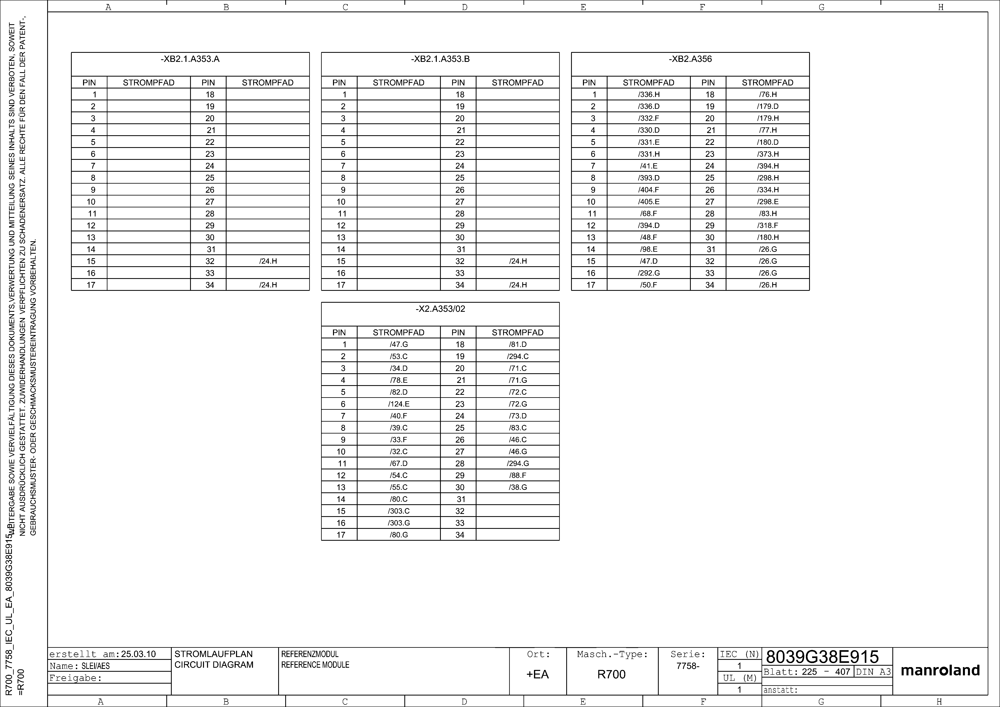

# +EA — Sheet 225 of 407 — REFERENZMODUL

**REFERENCE MODULE**

> Part of the manroland **R700** printing press IEC/UL circuit diagrams.
> Drawing class: **Stromlaufplan / Circuit diagram** (DIN A3).
> Document `+EA` covers the **Printing unit** machine section.

## At a glance

| Field | Value |
|---|---|
| Document | `+EA`  (8039G38E915) |
| Sheet | **225** of 407 |
| Section (DE) | REFERENZMODUL |
| Section (EN) | REFERENCE MODULE |
| Section type | REFERENCE_MODULE — Reference module |
| Machine type | `R700` |
| Series | `7758` |
| Created | 25.03.10 |
| Replaces | — |
| Columns used | A, B, C, D, E, F, G |
| Path numbers | — |
| Labels on sheet | 224 |
| Cross-refs out | 68 |
| Cross-refs in | 0 |

**Previous:** [+EA sheet 224](SHEET_0224.md) · **Next:** [+EA sheet 226](SHEET_0226.md) · **Document TOC:** [_TOC.md](_TOC.md)  (+EA) · **Master TOC:** [all sheets](../_MASTER_TOC.md)

## Sheet image (300 DPI, exact vector render)



_Rendered directly from the PDF vector layer at 300 DPI (1-bit), no OCR and no resampling. Use it to confirm anything ambiguous in the text below._

## Cross-references on this sheet

Each entry is a wire leaving this sheet. The printed token is `/sheet.column`; the link resolves to that sheet inside the same document.

| Ref | Target sheet | Col | Path | Destination on target | Target section | From col |
|---|---|---|---|---|---|---|
| `/76.H` | [+EA sheet 76](SHEET_0076.md) | H | — | — | AUSLEGERSTAPELSTEUERUNG | G |
| `/336.H` | [+EA sheet 336](SHEET_0336.md) | H | — | — | OPTION: BOGENWEICHE | F |
| `/336.D` | [+EA sheet 336](SHEET_0336.md) | D | — | — | OPTION: BOGENWEICHE | F |
| `/179.D` | [+EA sheet 179](SHEET_0179.md) | D | — | — | RESERVE | G |
| `/332.F` | [+EA sheet 332](SHEET_0332.md) | F | — | — | OPTION: BOGENWEICHE | F |
| `/179.H` | [+EA sheet 179](SHEET_0179.md) | H | — | — | RESERVE | G |
| `/330.D` | [+EA sheet 330](SHEET_0330.md) | D | — | — | OPTION: BOGENWEICHE | F |
| `/77.H` | [+EA sheet 77](SHEET_0077.md) | H | — | — | AUSLEGERSTAPELSTEUERUNG | G |
| `/331.E` | [+EA sheet 331](SHEET_0331.md) | E | — | — | OPTION: BOGENWEICHE | F |
| `/180.D` | [+EA sheet 180](SHEET_0180.md) | D | — | — | RESERVE | G |
| `/331.H` | [+EA sheet 331](SHEET_0331.md) | H | — | — | OPTION: BOGENWEICHE | F |
| `/373.H` | [+EA sheet 373](SHEET_0373.md) | H | — | — | OPTION: ENDTROCKNER 1 VORBEREITUNG; | G |
| `/41.E` | [+EA sheet 41](SHEET_0041.md) | E | — | — | BUSVERBINDUNGEN: STOP SICHERN | F |
| `/394.H` | [+EA sheet 394](SHEET_0394.md) | H | — | — | OPTION: ZWISCHENTROCKNER VORBEREITUNG; | G |
| `/393.D` | [+EA sheet 393](SHEET_0393.md) | D | — | — | OPTION: ZWISCHENTROCKNER VORBEREITUNG; | F |
| `/298.H` | [+EA sheet 298](SHEET_0298.md) | H | — | — | OPTION: ZWISCHENSTAPEL / | G |
| `/404.F` | [+EA sheet 404](SHEET_0404.md) | F | — | — | OPTION: SCHNITTSTELLE UV ENDTROCKNER | F |
| `/334.H` | [+EA sheet 334](SHEET_0334.md) | H | — | — | OPTION: BOGENWEICHE | G |
| `/405.E` | [+EA sheet 405](SHEET_0405.md) | E | — | — | OPTION: SCHNITTSTELLE UV ENDTROCKNER | F |
| `/298.E` | [+EA sheet 298](SHEET_0298.md) | E | — | — | OPTION: ZWISCHENSTAPEL / | G |
| `/68.F` | [+EA sheet 68](SHEET_0068.md) | F | — | — | LEITSTANDSFUNKTIONEN | F |
| `/83.H` | [+EA sheet 83](SHEET_0083.md) | H | — | — | AUSLEGERSTAPELSTEUERUNG: PROGRAMMSCHALTWERK | G |
| `/318.F` | [+EA sheet 318](SHEET_0318.md) | F | — | — | OPTION: LOGISTIK, AUSLEGER | G |
| `/394.D` | [+EA sheet 394](SHEET_0394.md) | D | — | — | OPTION: ZWISCHENTROCKNER VORBEREITUNG; | F |
| `/48.F` | [+EA sheet 48](SHEET_0048.md) | F | — | — | SCHUTZ | F |
| `/180.H` | [+EA sheet 180](SHEET_0180.md) | H | — | — | RESERVE | G |
| `/98.E` | [+EA sheet 98](SHEET_0098.md) | E | — | — | BOGENFÜHRUNGSELEMENT | F |
| `/26.G` | [+EA sheet 26](SHEET_0026.md) | G | — | — | BUSVERBINDUNGEN: SICHERHEITSBUS | G |
| `/26.G` | [+EA sheet 26](SHEET_0026.md) | G | — | — | BUSVERBINDUNGEN: SICHERHEITSBUS | G |
| `/24.H` | [+EA sheet 24](SHEET_0024.md) | H | — | — | BUSVERBINDUNGEN: SICHERHEITSBUS | B |
| `/24.H` | [+EA sheet 24](SHEET_0024.md) | H | — | — | BUSVERBINDUNGEN: SICHERHEITSBUS | D |
| `/47.D` | [+EA sheet 47](SHEET_0047.md) | D | — | — | SCHUTZ | F |
| `/26.G` | [+EA sheet 26](SHEET_0026.md) | G | — | — | BUSVERBINDUNGEN: SICHERHEITSBUS | G |
| `/292.G` | [+EA sheet 292](SHEET_0292.md) | G | — | — | OPTION: PROBEBOGENENTNAHME HALBAUTOMATISCH | F |
| `/50.F` | [+EA sheet 50](SHEET_0050.md) | F | — | — | SCHUTZ | F |
| `/24.H` | [+EA sheet 24](SHEET_0024.md) | H | — | — | BUSVERBINDUNGEN: SICHERHEITSBUS | B |
| `/24.H` | [+EA sheet 24](SHEET_0024.md) | H | — | — | BUSVERBINDUNGEN: SICHERHEITSBUS | D |
| `/26.H` | [+EA sheet 26](SHEET_0026.md) | H | — | — | BUSVERBINDUNGEN: SICHERHEITSBUS | G |
| `/47.G` | [+EA sheet 47](SHEET_0047.md) | G | — | — | SCHUTZ | C |
| `/81.D` | [+EA sheet 81](SHEET_0081.md) | D | — | — | AUSLEGERSTAPELSTEUERUNG: BEDIENKOMMANDOS | D |
| `/53.C` | [+EA sheet 53](SHEET_0053.md) | C | — | — | MASCHINENBEDIENUNG: LAUFKOMMANDOS | C |
| `/294.C` | [+EA sheet 294](SHEET_0294.md) | C | — | — | OPTION: ZWISCHENSTAPEL / | D |
| `/34.D` | [+EA sheet 34](SHEET_0034.md) | D | — | — | BUSVERBINDUNGEN: NOT AUS | C |
| `/71.C` | [+EA sheet 71](SHEET_0071.md) | C | — | — | AUSLEGERSTAPELSTEUERUNG | D |
| `/78.E` | [+EA sheet 78](SHEET_0078.md) | E | — | — | AUSLEGERSTAPELSTEUERUNG | C |
| `/71.G` | [+EA sheet 71](SHEET_0071.md) | G | — | — | AUSLEGERSTAPELSTEUERUNG | D |
| `/82.D` | [+EA sheet 82](SHEET_0082.md) | D | — | — | AUSLEGERSTAPELSTEUERUNG: PROGRAMMSCHALTWERK | C |
| `/72.C` | [+EA sheet 72](SHEET_0072.md) | C | — | — | AUSLEGERSTAPELSTEUERUNG | D |
| `/124.E` | [+EA sheet 124](SHEET_0124.md) | E | — | — | TROCKENBESTÄUBER | C |
| `/72.G` | [+EA sheet 72](SHEET_0072.md) | G | — | — | AUSLEGERSTAPELSTEUERUNG | D |
| `/40.F` | [+EA sheet 40](SHEET_0040.md) | F | — | — | BUSVERBINDUNGEN: STOP SICHERN | C |
| `/73.D` | [+EA sheet 73](SHEET_0073.md) | D | — | — | AUSLEGERSTAPELSTEUERUNG | D |
| `/39.C` | [+EA sheet 39](SHEET_0039.md) | C | — | — | BUSVERBINDUNGEN: STOP SICHERN | C |
| `/83.C` | [+EA sheet 83](SHEET_0083.md) | C | — | — | AUSLEGERSTAPELSTEUERUNG: PROGRAMMSCHALTWERK | D |
| `/33.F` | [+EA sheet 33](SHEET_0033.md) | F | — | — | BUSVERBINDUNGEN: NOT AUS | C |
| `/46.C` | [+EA sheet 46](SHEET_0046.md) | C | — | — | SCHUTZ | D |
| `/46.G` | [+EA sheet 46](SHEET_0046.md) | G | — | — | SCHUTZ | D |
| `/32.C` | [+EA sheet 32](SHEET_0032.md) | C | — | — | BUSVERBINDUNGEN: NOT AUS | C |
| `/67.D` | [+EA sheet 67](SHEET_0067.md) | D | — | — | LEITSTANDSFUNKTIONEN | C |
| `/294.G` | [+EA sheet 294](SHEET_0294.md) | G | — | — | OPTION: ZWISCHENSTAPEL / | D |
| `/88.F` | [+EA sheet 88](SHEET_0088.md) | F | — | — | SAUGWALZE | D |
| `/54.C` | [+EA sheet 54](SHEET_0054.md) | C | — | — | MASCHINENBEDIENUNG: LAUFKOMMANDOS | C |
| `/38.G` | [+EA sheet 38](SHEET_0038.md) | G | — | — | BUSVERBINDUNGEN: NOT AUS | D |
| `/55.C` | [+EA sheet 55](SHEET_0055.md) | C | — | — | MASCHINENBEDIENUNG: LAUFKOMMANDOS | C |
| `/80.C` | [+EA sheet 80](SHEET_0080.md) | C | — | — | AUSLEGERSTAPELSTEUERUNG: BEDIENKOMMANDOS | C |
| `/303.C` | [+EA sheet 303](SHEET_0303.md) | C | — | — | OPTION: ZWISCHENSTAPEL / | C |
| `/303.G` | [+EA sheet 303](SHEET_0303.md) | G | — | — | OPTION: ZWISCHENSTAPEL / | C |
| `/80.G` | [+EA sheet 80](SHEET_0080.md) | G | — | — | AUSLEGERSTAPELSTEUERUNG: BEDIENKOMMANDOS | C |

## Devices on this sheet

| Tag | Class | Class meaning (IEC) | Col | Sub | Terminal | Sign |
|---|---|---|---|---|---|---|
| `XB2.1.A353.A` | — | cross-device reference | B | — | — | — |
| `XB2.1.A353.B` | — | cross-device reference | D | — | — | — |
| `XB2.A356` | — | cross-device reference | F | — | — | — |

## Potentials / nets

_No named potentials on this sheet._

## Wire-end annotations (grouped as printed)

A wire that continues elsewhere is annotated with a small cluster: the destination description, the path/line number `#NN`, and the `/sheet.column` cross reference. Each row below is one such cluster exactly as it is grouped on the drawing.

| Col | Y | Path | Cross-ref | Text on the wire |
|---|---|---|---|---|
| B | 65.5 | — | — | `XB2.1.A353.A` |
| D | 65.5 | — | — | `XB2.1.A353.B` |
| F | 65.5 | — | — | `XB2.A356` |
| A | 94.2 | — | — | `PIN STROMPFAD` |
| B | 94.2 | — | — | `PIN 18 19 20 22 23 24 25 26 27 28 29 30 32 33 34 21 31 STROMPFAD` |
| C | 94.2 | — | — | `PIN STROMPFAD` |
| D | 94.2 | — | — | `PIN 18 19 20 22 23 24 25 26 27 28 29 30 32 33 34 21 31 STROMPFAD` |
| E | 94.2 | — | — | `PIN STROMPFAD` |
| F | 94.2 | — | — | `PIN 18 19 20 22 23 24 25 26 27 28 29 30 32 33 34 21 31 STROMPFAD` |
| A | 108.4 | — | — | `2 3 4 5 6 7 8 9 1` |
| C | 108.4 | — | — | `2 3 4 5 6 7 8 9 1` |
| E | 108.4 | — | — | `2 3 4 5 6 7 8 9 1` |
| F | 108.7 | — | `/336.H` | — |
| G | 108.7 | — | `/76.H` | — |
| F | 122.9 | — | `/336.D` | — |
| G | 122.9 | — | `/179.D` | — |
| F | 137.0 | — | `/332.F` | — |
| G | 137.1 | — | `/179.H` | — |
| F | 151.2 | — | `/330.D` | — |
| G | 151.2 | — | `/77.H` | — |
| F | 165.4 | — | `/331.E` | — |
| G | 165.4 | — | `/180.D` | — |
| F | 179.6 | — | `/331.H` | — |
| G | 179.6 | — | `/373.H` | — |
| F | 193.7 | — | `/41.E` | — |
| G | 193.8 | — | `/394.H` | — |
| F | 207.9 | — | `/393.D` | — |
| G | 207.9 | — | `/298.H` | — |
| F | 222.1 | — | `/404.F` | — |
| G | 222.1 | — | `/334.H` | — |
| A | 235.9 | — | — | `10 12 13 14 15 16 17 11` |
| C | 235.9 | — | — | `10 12 13 14 15 16 17 11` |
| E | 235.9 | — | — | `10 12 13 14 15 16 17 11` |
| F | 236.2 | — | `/405.E` | — |
| G | 236.2 | — | `/298.E` | — |
| F | 250.4 | — | `/68.F` | — |
| G | 250.4 | — | `/83.H` | — |
| F | 264.6 | — | `/394.D` | — |
| G | 264.6 | — | `/318.F` | — |
| F | 278.8 | — | `/48.F` | — |
| G | 278.8 | — | `/180.H` | — |
| F | 292.9 | — | `/98.E` | — |
| G | 292.9 | — | `/26.G` | — |
| B | 307.1 | — | `/24.H` | — |
| D | 307.1 | — | `/24.H` | — |
| F | 307.1 | — | `/47.D` | — |
| G | 307.1 | — | `/26.G` | — |
| F | 321.3 | — | `/292.G` | — |
| G | 321.3 | — | `/26.G` | — |
| B | 335.5 | — | `/24.H` | — |
| D | 335.5 | — | `/24.H` | — |
| F | 335.5 | — | `/50.F` | — |
| G | 335.5 | — | `/26.H` | — |
| D | 363.1 | — | — | `X2.A353/02` |
| C | 391.8 | — | — | `PIN STROMPFAD` |
| D | 391.8 | — | — | `PIN 18 19 20 22 23 24 25 26 27 28 29 30 32 33 34 21 31 STROMPFAD` |
| C | 406.0 | — | — | `2 3 4 5 6 7 8 9 1` |
| C | 406.3 | — | `/47.G` | — |
| D | 406.3 | — | `/81.D` | — |
| C | 420.5 | — | `/53.C` | — |
| D | 420.5 | — | `/294.C` | — |
| C | 434.7 | — | `/34.D` | — |
| D | 434.7 | — | `/71.C` | — |
| C | 448.8 | — | `/78.E` | — |
| D | 448.9 | — | `/71.G` | — |
| C | 463.0 | — | `/82.D` | — |
| D | 463.0 | — | `/72.C` | — |
| C | 477.2 | — | `/124.E` | — |
| D | 477.2 | — | `/72.G` | — |
| C | 491.4 | — | `/40.F` | — |
| D | 491.4 | — | `/73.D` | — |
| C | 505.6 | — | `/39.C` | — |
| D | 505.6 | — | `/83.C` | — |
| C | 519.7 | — | `/33.F` | — |
| D | 519.7 | — | `/46.C` | — |
| C | 533.6 | — | — | `10 12 13 14 15 16 17 11` |
| C | 533.9 | — | `/32.C` | — |
| D | 533.9 | — | `/46.G` | — |
| C | 548.1 | — | `/67.D` | — |
| D | 548.1 | — | `/294.G` | — |
| C | 562.2 | — | `/54.C` | — |
| D | 562.2 | — | `/88.F` | — |
| C | 576.4 | — | `/55.C` | — |
| D | 576.4 | — | `/38.G` | — |
| C | 590.6 | — | `/80.C` | — |
| C | 604.8 | — | `/303.C` | — |
| C | 618.9 | — | `/303.G` | — |
| C | 633.1 | — | `/80.G` | — |


## Reconstructed tables

This sheet carries tabular content (pin map / terminal assignment / index). The grid below was rebuilt from the drawing's own rule lines, so each row is exactly one physical row of the table.

### Table 1 — 17 data rows × 4 columns (at x=85.0, y=62.4) — **XB2.1.A353.A**

| PIN | STROMPFAD | PIN | STROMPFAD |
|---|---|---|---|
| `1` |  | `18` |  |
| `2` |  | `19` |  |
| `3` |  | `20` |  |
| `4` |  | `21` |  |
| `5` |  | `22` |  |
| `6` |  | `23` |  |
| `7` |  | `24` |  |
| `8` |  | `25` |  |
| `9` |  | `26` |  |
| `10` |  | `27` |  |
| `11` |  | `28` |  |
| `12` |  | `29` |  |
| `13` |  | `30` |  |
| `14` |  | `31` |  |
| `15` |  | `32` | `/24.H` |
| `16` |  | `33` |  |
| `17` |  | `34` | `/24.H` |


### Table 2 — 36 data rows × 4 columns (at x=382.7, y=62.4) — **XB2.1.A353.B**

| PIN | STROMPFAD | PIN | STROMPFAD |
|---|---|---|---|
| `1` |  | `18` |  |
| `2` |  | `19` |  |
| `3` |  | `20` |  |
| `4` |  | `21` |  |
| `5` |  | `22` |  |
| `6` |  | `23` |  |
| `7` |  | `24` |  |
| `8` |  | `25` |  |
| `9` |  | `26` |  |
| `10` |  | `27` |  |
| `11` |  | `28` |  |
| `12` |  | `29` |  |
| `13` |  | `30` |  |
| `14` |  | `31` |  |
| `15` |  | `32` | `/24.H` |
| `16` |  | `33` |  |
| `17` |  | `34` | `/24.H` |
|  |  | `X2.A353/02` |  |
| `PIN` | `STROMPFAD` | `PIN` | `STROMPFAD` |
| `1` | `/47.G` | `18` | `/81.D` |
| `2` | `/53.C` | `19` | `/294.C` |
| `3` | `/34.D` | `20` | `/71.C` |
| `4` | `/78.E` | `21` | `/71.G` |
| `5` | `/82.D` | `22` | `/72.C` |
| `6` | `/124.E` | `23` | `/72.G` |
| `7` | `/40.F` | `24` | `/73.D` |
| `8` | `/39.C` | `25` | `/83.C` |
| `9` | `/33.F` | `26` | `/46.C` |
| `10` | `/32.C` | `27` | `/46.G` |
| `11` | `/67.D` | `28` | `/294.G` |
| `12` | `/54.C` | `29` | `/88.F` |
| `13` | `/55.C` | `30` | `/38.G` |
| `14` | `/80.C` | `31` |  |
| `15` | `/303.C` | `32` |  |
| `16` | `/303.G` | `33` |  |
| `17` | `/80.G` | `34` |  |


### Table 3 — 17 data rows × 4 columns (at x=680.3, y=62.4) — **XB2.A356**

| PIN | STROMPFAD | PIN | STROMPFAD |
|---|---|---|---|
| `1` | `/336.H` | `18` | `/76.H` |
| `2` | `/336.D` | `19` | `/179.D` |
| `3` | `/332.F` | `20` | `/179.H` |
| `4` | `/330.D` | `21` | `/77.H` |
| `5` | `/331.E` | `22` | `/180.D` |
| `6` | `/331.H` | `23` | `/373.H` |
| `7` | `/41.E` | `24` | `/394.H` |
| `8` | `/393.D` | `25` | `/298.H` |
| `9` | `/404.F` | `26` | `/334.H` |
| `10` | `/405.E` | `27` | `/298.E` |
| `11` | `/68.F` | `28` | `/83.H` |
| `12` | `/394.D` | `29` | `/318.F` |
| `13` | `/48.F` | `30` | `/180.H` |
| `14` | `/98.E` | `31` | `/26.G` |
| `15` | `/47.D` | `32` | `/26.G` |
| `16` | `/292.G` | `33` | `/26.G` |
| `17` | `/50.F` | `34` | `/26.H` |


## Notes and free text on this sheet

| Text | Col | Y (pt) |
|---|---|---|
| `PIN` | A | 94.2 |
| `STROMPFAD` | A | 94.15 |
| `PIN` | B | 94.2 |
| `STROMPFAD` | B | 94.15 |
| `PIN` | C | 94.2 |
| `STROMPFAD` | C | 94.15 |
| `PIN` | D | 94.2 |
| `STROMPFAD` | D | 94.15 |
| `PIN` | E | 94.2 |
| `STROMPFAD` | F | 94.15 |
| `PIN` | F | 94.2 |
| `STROMPFAD` | G | 94.15 |
| `X2.A353/02` | D | 363.14 |

## Complete label inventory (exact text from the drawing)

Every text object inside the drawing area of this sheet, in DIN reading order (column A→H, then top→bottom). This is the authoritative list: if a string is not here it is not printed on this sheet.

| Col | Y | X | Dir | Type | Text |
|---|---|---|---|---|---|
| A | 94.2 | 98.2 | → | text | `PIN` |
| A | 94.2 | 146.4 | → | text | `STROMPFAD` |
| A | 108.4 | 110.0 | → | number | `1` |
| A | 122.5 | 108.3 | → | number | `2` |
| A | 136.7 | 108.3 | → | number | `3` |
| A | 150.9 | 108.3 | → | number | `4` |
| A | 165.1 | 108.3 | → | number | `5` |
| A | 179.2 | 108.3 | → | number | `6` |
| A | 193.4 | 108.3 | → | number | `7` |
| A | 207.6 | 108.3 | → | number | `8` |
| A | 221.8 | 108.3 | → | number | `9` |
| A | 235.9 | 102.9 | → | number | `10` |
| A | 250.1 | 104.6 | → | number | `11` |
| A | 264.3 | 102.9 | → | number | `12` |
| A | 278.5 | 102.9 | → | number | `13` |
| A | 292.6 | 102.9 | → | number | `14` |
| A | 306.8 | 102.9 | → | number | `15` |
| A | 321.0 | 102.9 | → | number | `16` |
| A | 335.1 | 102.9 | → | number | `17` |
| B | 65.5 | 191.5 | → | device ref | `XB2.1.A353.A` |
| B | 94.2 | 240.0 | → | text | `PIN` |
| B | 94.2 | 288.1 | → | text | `STROMPFAD` |
| B | 108.4 | 244.6 | → | number | `18` |
| B | 122.5 | 244.6 | → | number | `19` |
| B | 136.7 | 244.6 | → | number | `20` |
| B | 150.9 | 246.3 | → | number | `21` |
| B | 165.1 | 244.6 | → | number | `22` |
| B | 179.2 | 244.6 | → | number | `23` |
| B | 193.4 | 244.6 | → | number | `24` |
| B | 207.6 | 244.6 | → | number | `25` |
| B | 221.8 | 244.6 | → | number | `26` |
| B | 235.9 | 244.6 | → | number | `27` |
| B | 250.1 | 244.6 | → | number | `28` |
| B | 264.3 | 244.6 | → | number | `29` |
| B | 278.5 | 244.6 | → | number | `30` |
| B | 292.6 | 246.3 | → | number | `31` |
| B | 306.8 | 244.6 | → | number | `32` |
| B | 307.1 | 308.8 | → | cross-reference | `/24.H` |
| B | 321.0 | 244.6 | → | number | `33` |
| B | 335.1 | 244.6 | → | number | `34` |
| B | 335.5 | 308.8 | → | cross-reference | `/24.H` |
| C | 94.2 | 395.9 | → | text | `PIN` |
| C | 94.2 | 444.0 | → | text | `STROMPFAD` |
| C | 108.4 | 407.6 | → | number | `1` |
| C | 122.5 | 405.9 | → | number | `2` |
| C | 136.7 | 405.9 | → | number | `3` |
| C | 150.9 | 405.9 | → | number | `4` |
| C | 165.1 | 405.9 | → | number | `5` |
| C | 179.2 | 405.9 | → | number | `6` |
| C | 193.4 | 405.9 | → | number | `7` |
| C | 207.6 | 405.9 | → | number | `8` |
| C | 221.8 | 405.9 | → | number | `9` |
| C | 235.9 | 400.5 | → | number | `10` |
| C | 250.1 | 402.2 | → | number | `11` |
| C | 264.3 | 400.5 | → | number | `12` |
| C | 278.5 | 400.5 | → | number | `13` |
| C | 292.6 | 400.5 | → | number | `14` |
| C | 306.8 | 400.5 | → | number | `15` |
| C | 321.0 | 400.5 | → | number | `16` |
| C | 335.1 | 400.5 | → | number | `17` |
| C | 391.8 | 395.9 | → | text | `PIN` |
| C | 391.8 | 444.0 | → | text | `STROMPFAD` |
| C | 406.0 | 407.6 | → | number | `1` |
| C | 406.3 | 464.3 | → | cross-reference | `/47.G` |
| C | 420.2 | 405.9 | → | number | `2` |
| C | 420.5 | 464.5 | → | cross-reference | `/53.C` |
| C | 434.4 | 405.9 | → | number | `3` |
| C | 434.7 | 464.5 | → | cross-reference | `/34.D` |
| C | 448.5 | 405.9 | → | number | `4` |
| C | 448.8 | 464.7 | → | cross-reference | `/78.E` |
| C | 462.7 | 405.9 | → | number | `5` |
| C | 463.0 | 464.5 | → | cross-reference | `/82.D` |
| C | 476.9 | 405.9 | → | number | `6` |
| C | 477.2 | 462.3 | → | cross-reference | `/124.E` |
| C | 491.0 | 405.9 | → | number | `7` |
| C | 491.4 | 464.9 | → | cross-reference | `/40.F` |
| C | 505.2 | 405.9 | → | number | `8` |
| C | 505.6 | 464.5 | → | cross-reference | `/39.C` |
| C | 519.4 | 405.9 | → | number | `9` |
| C | 519.7 | 464.9 | → | cross-reference | `/33.F` |
| C | 533.6 | 400.5 | → | number | `10` |
| C | 533.9 | 464.5 | → | cross-reference | `/32.C` |
| C | 547.7 | 402.2 | → | number | `11` |
| C | 548.1 | 464.5 | → | cross-reference | `/67.D` |
| C | 561.9 | 400.5 | → | number | `12` |
| C | 562.3 | 464.5 | → | cross-reference | `/54.C` |
| C | 576.1 | 400.5 | → | number | `13` |
| C | 576.4 | 464.5 | → | cross-reference | `/55.C` |
| C | 590.3 | 400.5 | → | number | `14` |
| C | 590.6 | 464.5 | → | cross-reference | `/80.C` |
| C | 604.4 | 400.5 | → | number | `15` |
| C | 604.8 | 462.0 | → | cross-reference | `/303.C` |
| C | 618.6 | 400.5 | → | number | `16` |
| C | 618.9 | 461.9 | → | cross-reference | `/303.G` |
| C | 632.8 | 400.5 | → | number | `17` |
| C | 633.1 | 464.3 | → | cross-reference | `/80.G` |
| D | 65.5 | 489.5 | → | device ref | `XB2.1.A353.B` |
| D | 94.2 | 537.6 | → | text | `PIN` |
| D | 94.2 | 585.8 | → | text | `STROMPFAD` |
| D | 108.4 | 542.3 | → | number | `18` |
| D | 122.5 | 542.3 | → | number | `19` |
| D | 136.7 | 542.3 | → | number | `20` |
| D | 150.9 | 544.0 | → | number | `21` |
| D | 165.1 | 542.3 | → | number | `22` |
| D | 179.2 | 542.3 | → | number | `23` |
| D | 193.4 | 542.3 | → | number | `24` |
| D | 207.6 | 542.3 | → | number | `25` |
| D | 221.8 | 542.3 | → | number | `26` |
| D | 235.9 | 542.3 | → | number | `27` |
| D | 250.1 | 542.3 | → | number | `28` |
| D | 264.3 | 542.3 | → | number | `29` |
| D | 278.5 | 542.3 | → | number | `30` |
| D | 292.6 | 544.0 | → | number | `31` |
| D | 306.8 | 542.3 | → | number | `32` |
| D | 307.1 | 606.5 | → | cross-reference | `/24.H` |
| D | 321.0 | 542.3 | → | number | `33` |
| D | 335.1 | 542.3 | → | number | `34` |
| D | 335.5 | 606.5 | → | cross-reference | `/24.H` |
| D | 363.1 | 495.1 | → | text | `X2.A353/02` |
| D | 391.8 | 537.6 | → | text | `PIN` |
| D | 391.8 | 585.8 | → | text | `STROMPFAD` |
| D | 406.0 | 542.3 | → | number | `18` |
| D | 406.3 | 606.2 | → | cross-reference | `/81.D` |
| D | 420.2 | 542.3 | → | number | `19` |
| D | 420.5 | 603.8 | → | cross-reference | `/294.C` |
| D | 434.4 | 542.3 | → | number | `20` |
| D | 434.7 | 606.2 | → | cross-reference | `/71.C` |
| D | 448.5 | 544.0 | → | number | `21` |
| D | 448.9 | 606.0 | → | cross-reference | `/71.G` |
| D | 462.7 | 542.3 | → | number | `22` |
| D | 463.0 | 606.2 | → | cross-reference | `/72.C` |
| D | 476.9 | 542.3 | → | number | `23` |
| D | 477.2 | 606.0 | → | cross-reference | `/72.G` |
| D | 491.0 | 542.3 | → | number | `24` |
| D | 491.4 | 606.2 | → | cross-reference | `/73.D` |
| D | 505.2 | 542.3 | → | number | `25` |
| D | 505.6 | 606.2 | → | cross-reference | `/83.C` |
| D | 519.4 | 542.3 | → | number | `26` |
| D | 519.7 | 606.2 | → | cross-reference | `/46.C` |
| D | 533.6 | 542.3 | → | number | `27` |
| D | 533.9 | 606.0 | → | cross-reference | `/46.G` |
| D | 547.7 | 542.3 | → | number | `28` |
| D | 548.1 | 603.6 | → | cross-reference | `/294.G` |
| D | 561.9 | 542.3 | → | number | `29` |
| D | 562.2 | 606.6 | → | cross-reference | `/88.F` |
| D | 576.1 | 542.3 | → | number | `30` |
| D | 576.4 | 606.0 | → | cross-reference | `/38.G` |
| D | 590.3 | 544.0 | → | number | `31` |
| D | 604.4 | 542.3 | → | number | `32` |
| D | 618.6 | 542.3 | → | number | `33` |
| D | 632.8 | 542.3 | → | number | `34` |
| E | 94.2 | 693.5 | → | text | `PIN` |
| E | 108.4 | 705.3 | → | number | `1` |
| E | 122.5 | 703.6 | → | number | `2` |
| E | 136.7 | 703.6 | → | number | `3` |
| E | 150.9 | 703.6 | → | number | `4` |
| E | 165.1 | 703.6 | → | number | `5` |
| E | 179.2 | 703.6 | → | number | `6` |
| E | 193.4 | 703.6 | → | number | `7` |
| E | 207.6 | 703.6 | → | number | `8` |
| E | 221.8 | 703.6 | → | number | `9` |
| E | 235.9 | 698.2 | → | number | `10` |
| E | 250.1 | 699.9 | → | number | `11` |
| E | 264.3 | 698.2 | → | number | `12` |
| E | 278.5 | 698.2 | → | number | `13` |
| E | 292.6 | 698.2 | → | number | `14` |
| E | 306.8 | 698.2 | → | number | `15` |
| E | 321.0 | 698.2 | → | number | `16` |
| E | 335.1 | 698.2 | → | number | `17` |
| F | 65.5 | 796.5 | → | device ref | `XB2.A356` |
| F | 94.2 | 741.7 | → | text | `STROMPFAD` |
| F | 94.2 | 835.2 | → | text | `PIN` |
| F | 108.4 | 839.9 | → | number | `18` |
| F | 108.7 | 760.0 | → | cross-reference | `/336.H` |
| F | 122.5 | 839.9 | → | number | `19` |
| F | 122.9 | 759.7 | → | cross-reference | `/336.D` |
| F | 136.7 | 839.9 | → | number | `20` |
| F | 137.0 | 760.1 | → | cross-reference | `/332.F` |
| F | 150.9 | 841.6 | → | number | `21` |
| F | 151.2 | 759.7 | → | cross-reference | `/330.D` |
| F | 165.1 | 839.9 | → | number | `22` |
| F | 165.4 | 760.0 | → | cross-reference | `/331.E` |
| F | 179.2 | 839.9 | → | number | `23` |
| F | 179.6 | 760.0 | → | cross-reference | `/331.H` |
| F | 193.4 | 839.9 | → | number | `24` |
| F | 193.7 | 762.4 | → | cross-reference | `/41.E` |
| F | 207.6 | 839.9 | → | number | `25` |
| F | 207.9 | 759.7 | → | cross-reference | `/393.D` |
| F | 221.8 | 839.9 | → | number | `26` |
| F | 222.1 | 760.1 | → | cross-reference | `/404.F` |
| F | 235.9 | 839.9 | → | number | `27` |
| F | 236.2 | 760.0 | → | cross-reference | `/405.E` |
| F | 250.1 | 839.9 | → | number | `28` |
| F | 250.4 | 762.5 | → | cross-reference | `/68.F` |
| F | 264.3 | 839.9 | → | number | `29` |
| F | 264.6 | 759.7 | → | cross-reference | `/394.D` |
| F | 278.5 | 839.9 | → | number | `30` |
| F | 278.8 | 762.5 | → | cross-reference | `/48.F` |
| F | 292.6 | 841.6 | → | number | `31` |
| F | 292.9 | 762.4 | → | cross-reference | `/98.E` |
| F | 306.8 | 839.9 | → | number | `32` |
| F | 307.1 | 762.1 | → | cross-reference | `/47.D` |
| F | 321.0 | 839.9 | → | number | `33` |
| F | 321.3 | 759.5 | → | cross-reference | `/292.G` |
| F | 335.1 | 839.9 | → | number | `34` |
| F | 335.5 | 762.5 | → | cross-reference | `/50.F` |
| G | 94.2 | 883.4 | → | text | `STROMPFAD` |
| G | 108.7 | 904.1 | → | cross-reference | `/76.H` |
| G | 122.9 | 901.4 | → | cross-reference | `/179.D` |
| G | 137.1 | 901.7 | → | cross-reference | `/179.H` |
| G | 151.2 | 904.1 | → | cross-reference | `/77.H` |
| G | 165.4 | 901.4 | → | cross-reference | `/180.D` |
| G | 179.6 | 901.7 | → | cross-reference | `/373.H` |
| G | 193.8 | 901.7 | → | cross-reference | `/394.H` |
| G | 207.9 | 901.7 | → | cross-reference | `/298.H` |
| G | 222.1 | 901.7 | → | cross-reference | `/334.H` |
| G | 236.2 | 901.7 | → | cross-reference | `/298.E` |
| G | 250.4 | 904.1 | → | cross-reference | `/83.H` |
| G | 264.6 | 901.8 | → | cross-reference | `/318.F` |
| G | 278.8 | 901.7 | → | cross-reference | `/180.H` |
| G | 292.9 | 903.7 | → | cross-reference | `/26.G` |
| G | 307.1 | 903.7 | → | cross-reference | `/26.G` |
| G | 321.3 | 903.7 | → | cross-reference | `/26.G` |
| G | 335.5 | 904.1 | → | cross-reference | `/26.H` |

## Reading-order text block

The same content as a plain block, grouped by DIN column — convenient to paste or to match against a visual description.

```text
=== Column A ===
  94.2   98.2  text         PIN
  94.2  146.4  text         STROMPFAD
 108.4  110.0  numeric      1
 122.5  108.3  numeric      2
 136.7  108.3  numeric      3
 150.9  108.3  numeric      4
 165.1  108.3  numeric      5
 179.2  108.3  numeric      6
 193.4  108.3  numeric      7
 207.6  108.3  numeric      8
 221.8  108.3  numeric      9
 235.9  102.9  numeric      10
 250.1  104.6  numeric      11
 264.3  102.9  numeric      12
 278.5  102.9  numeric      13
 292.6  102.9  numeric      14
 306.8  102.9  numeric      15
 321.0  102.9  numeric      16
 335.1  102.9  numeric      17
=== Column B ===
  65.5  191.5  devref       XB2.1.A353.A
  94.2  240.0  text         PIN
  94.2  288.1  text         STROMPFAD
 108.4  244.6  numeric      18
 122.5  244.6  numeric      19
 136.7  244.6  numeric      20
 150.9  246.3  numeric      21
 165.1  244.6  numeric      22
 179.2  244.6  numeric      23
 193.4  244.6  numeric      24
 207.6  244.6  numeric      25
 221.8  244.6  numeric      26
 235.9  244.6  numeric      27
 250.1  244.6  numeric      28
 264.3  244.6  numeric      29
 278.5  244.6  numeric      30
 292.6  246.3  numeric      31
 306.8  244.6  numeric      32
 307.1  308.8  xref         /24.H
 321.0  244.6  numeric      33
 335.1  244.6  numeric      34
 335.5  308.8  xref         /24.H
=== Column C ===
  94.2  395.9  text         PIN
  94.2  444.0  text         STROMPFAD
 108.4  407.6  numeric      1
 122.5  405.9  numeric      2
 136.7  405.9  numeric      3
 150.9  405.9  numeric      4
 165.1  405.9  numeric      5
 179.2  405.9  numeric      6
 193.4  405.9  numeric      7
 207.6  405.9  numeric      8
 221.8  405.9  numeric      9
 235.9  400.5  numeric      10
 250.1  402.2  numeric      11
 264.3  400.5  numeric      12
 278.5  400.5  numeric      13
 292.6  400.5  numeric      14
 306.8  400.5  numeric      15
 321.0  400.5  numeric      16
 335.1  400.5  numeric      17
 391.8  395.9  text         PIN
 391.8  444.0  text         STROMPFAD
 406.0  407.6  numeric      1
 406.3  464.3  xref         /47.G
 420.2  405.9  numeric      2
 420.5  464.5  xref         /53.C
 434.4  405.9  numeric      3
 434.7  464.5  xref         /34.D
 448.5  405.9  numeric      4
 448.8  464.7  xref         /78.E
 462.7  405.9  numeric      5
 463.0  464.5  xref         /82.D
 476.9  405.9  numeric      6
 477.2  462.3  xref         /124.E
 491.0  405.9  numeric      7
 491.4  464.9  xref         /40.F
 505.2  405.9  numeric      8
 505.6  464.5  xref         /39.C
 519.4  405.9  numeric      9
 519.7  464.9  xref         /33.F
 533.6  400.5  numeric      10
 533.9  464.5  xref         /32.C
 547.7  402.2  numeric      11
 548.1  464.5  xref         /67.D
 561.9  400.5  numeric      12
 562.3  464.5  xref         /54.C
 576.1  400.5  numeric      13
 576.4  464.5  xref         /55.C
 590.3  400.5  numeric      14
 590.6  464.5  xref         /80.C
 604.4  400.5  numeric      15
 604.8  462.0  xref         /303.C
 618.6  400.5  numeric      16
 618.9  461.9  xref         /303.G
 632.8  400.5  numeric      17
 633.1  464.3  xref         /80.G
=== Column D ===
  65.5  489.5  devref       XB2.1.A353.B
  94.2  537.6  text         PIN
  94.2  585.8  text         STROMPFAD
 108.4  542.3  numeric      18
 122.5  542.3  numeric      19
 136.7  542.3  numeric      20
 150.9  544.0  numeric      21
 165.1  542.3  numeric      22
 179.2  542.3  numeric      23
 193.4  542.3  numeric      24
 207.6  542.3  numeric      25
 221.8  542.3  numeric      26
 235.9  542.3  numeric      27
 250.1  542.3  numeric      28
 264.3  542.3  numeric      29
 278.5  542.3  numeric      30
 292.6  544.0  numeric      31
 306.8  542.3  numeric      32
 307.1  606.5  xref         /24.H
 321.0  542.3  numeric      33
 335.1  542.3  numeric      34
 335.5  606.5  xref         /24.H
 363.1  495.1  text         X2.A353/02
 391.8  537.6  text         PIN
 391.8  585.8  text         STROMPFAD
 406.0  542.3  numeric      18
 406.3  606.2  xref         /81.D
 420.2  542.3  numeric      19
 420.5  603.8  xref         /294.C
 434.4  542.3  numeric      20
 434.7  606.2  xref         /71.C
 448.5  544.0  numeric      21
 448.9  606.0  xref         /71.G
 462.7  542.3  numeric      22
 463.0  606.2  xref         /72.C
 476.9  542.3  numeric      23
 477.2  606.0  xref         /72.G
 491.0  542.3  numeric      24
 491.4  606.2  xref         /73.D
 505.2  542.3  numeric      25
 505.6  606.2  xref         /83.C
 519.4  542.3  numeric      26
 519.7  606.2  xref         /46.C
 533.6  542.3  numeric      27
 533.9  606.0  xref         /46.G
 547.7  542.3  numeric      28
 548.1  603.6  xref         /294.G
 561.9  542.3  numeric      29
 562.2  606.6  xref         /88.F
 576.1  542.3  numeric      30
 576.4  606.0  xref         /38.G
 590.3  544.0  numeric      31
 604.4  542.3  numeric      32
 618.6  542.3  numeric      33
 632.8  542.3  numeric      34
=== Column E ===
  94.2  693.5  text         PIN
 108.4  705.3  numeric      1
 122.5  703.6  numeric      2
 136.7  703.6  numeric      3
 150.9  703.6  numeric      4
 165.1  703.6  numeric      5
 179.2  703.6  numeric      6
 193.4  703.6  numeric      7
 207.6  703.6  numeric      8
 221.8  703.6  numeric      9
 235.9  698.2  numeric      10
 250.1  699.9  numeric      11
 264.3  698.2  numeric      12
 278.5  698.2  numeric      13
 292.6  698.2  numeric      14
 306.8  698.2  numeric      15
 321.0  698.2  numeric      16
 335.1  698.2  numeric      17
=== Column F ===
  65.5  796.5  devref       XB2.A356
  94.2  741.7  text         STROMPFAD
  94.2  835.2  text         PIN
 108.4  839.9  numeric      18
 108.7  760.0  xref         /336.H
 122.5  839.9  numeric      19
 122.9  759.7  xref         /336.D
 136.7  839.9  numeric      20
 137.0  760.1  xref         /332.F
 150.9  841.6  numeric      21
 151.2  759.7  xref         /330.D
 165.1  839.9  numeric      22
 165.4  760.0  xref         /331.E
 179.2  839.9  numeric      23
 179.6  760.0  xref         /331.H
 193.4  839.9  numeric      24
 193.7  762.4  xref         /41.E
 207.6  839.9  numeric      25
 207.9  759.7  xref         /393.D
 221.8  839.9  numeric      26
 222.1  760.1  xref         /404.F
 235.9  839.9  numeric      27
 236.2  760.0  xref         /405.E
 250.1  839.9  numeric      28
 250.4  762.5  xref         /68.F
 264.3  839.9  numeric      29
 264.6  759.7  xref         /394.D
 278.5  839.9  numeric      30
 278.8  762.5  xref         /48.F
 292.6  841.6  numeric      31
 292.9  762.4  xref         /98.E
 306.8  839.9  numeric      32
 307.1  762.1  xref         /47.D
 321.0  839.9  numeric      33
 321.3  759.5  xref         /292.G
 335.1  839.9  numeric      34
 335.5  762.5  xref         /50.F
=== Column G ===
  94.2  883.4  text         STROMPFAD
 108.7  904.1  xref         /76.H
 122.9  901.4  xref         /179.D
 137.1  901.7  xref         /179.H
 151.2  904.1  xref         /77.H
 165.4  901.4  xref         /180.D
 179.6  901.7  xref         /373.H
 193.8  901.7  xref         /394.H
 207.9  901.7  xref         /298.H
 222.1  901.7  xref         /334.H
 236.2  901.7  xref         /298.E
 250.4  904.1  xref         /83.H
 264.6  901.8  xref         /318.F
 278.8  901.7  xref         /180.H
 292.9  903.7  xref         /26.G
 307.1  903.7  xref         /26.G
 321.3  903.7  xref         /26.G
 335.5  904.1  xref         /26.H
```

---
_Generated from the PDF vector text layer; no OCR. Source: `R700_7758_IEC_UL_EA_8039G38E915_p`, sheet 225._
