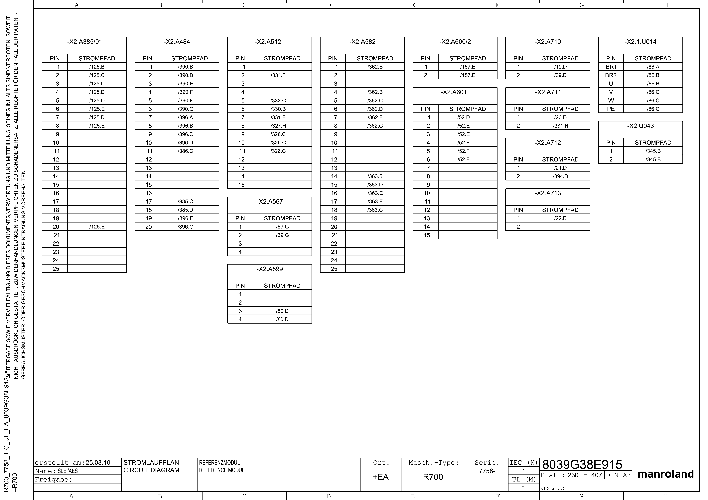

# +EA — Sheet 230 of 407 — REFERENZMODUL

**REFERENCE MODULE**

> Part of the manroland **R700** printing press IEC/UL circuit diagrams.
> Drawing class: **Stromlaufplan / Circuit diagram** (DIN A3).
> Document `+EA` covers the **Printing unit** machine section.

## At a glance

| Field | Value |
|---|---|
| Document | `+EA`  (8039G38E915) |
| Sheet | **230** of 407 |
| Section (DE) | REFERENZMODUL |
| Section (EN) | REFERENCE MODULE |
| Section type | REFERENCE_MODULE — Reference module |
| Machine type | `R700` |
| Series | `7758` |
| Created | 25.03.10 |
| Replaces | — |
| Columns used | A, B, C, D, E, F, G, H |
| Path numbers | — |
| Labels on sheet | 238 |
| Cross-refs out | 70 |
| Cross-refs in | 0 |

**Previous:** [+EA sheet 229](SHEET_0229.md) · **Next:** [+EA sheet 231](SHEET_0231.md) · **Document TOC:** [_TOC.md](_TOC.md)  (+EA) · **Master TOC:** [all sheets](../_MASTER_TOC.md)

## Sheet image (300 DPI, exact vector render)



_Rendered directly from the PDF vector layer at 300 DPI (1-bit), no OCR and no resampling. Use it to confirm anything ambiguous in the text below._

## Cross-references on this sheet

Each entry is a wire leaving this sheet. The printed token is `/sheet.column`; the link resolves to that sheet inside the same document.

| Ref | Target sheet | Col | Path | Destination on target | Target section | From col |
|---|---|---|---|---|---|---|
| `/86.A` | [+EA sheet 86](SHEET_0086.md) | A | — | — | SAUGWALZE | H |
| `/125.B` | [+EA sheet 125](SHEET_0125.md) | B | — | — | TROCKENBESTÄUBER | A |
| `/390.B` | [+EA sheet 390](SHEET_0390.md) | B | — | — | OPTION: ZWISCHENTROCKNER VORBEREITUNG; | B |
| `/362.B` | [+EA sheet 362](SHEET_0362.md) | B | — | — | OPTION: | E |
| `/157.E` | [+EA sheet 157](SHEET_0157.md) | E | — | — | ZUGANGSABSICHERUNG | F |
| `/19.D` | [+EA sheet 19](SHEET_0019.md) | D | — | — | SPANNUNGSVERSORGUNG: 400V, 24V | G |
| `/86.B` | [+EA sheet 86](SHEET_0086.md) | B | — | — | SAUGWALZE | H |
| `/390.B` | [+EA sheet 390](SHEET_0390.md) | B | — | — | OPTION: ZWISCHENTROCKNER VORBEREITUNG; | B |
| `/157.E` | [+EA sheet 157](SHEET_0157.md) | E | — | — | ZUGANGSABSICHERUNG | F |
| `/331.F` | [+EA sheet 331](SHEET_0331.md) | F | — | — | OPTION: BOGENWEICHE | C |
| `/39.D` | [+EA sheet 39](SHEET_0039.md) | D | — | — | BUSVERBINDUNGEN: STOP SICHERN | G |
| `/125.C` | [+EA sheet 125](SHEET_0125.md) | C | — | — | TROCKENBESTÄUBER | A |
| `/86.B` | [+EA sheet 86](SHEET_0086.md) | B | — | — | SAUGWALZE | H |
| `/390.E` | [+EA sheet 390](SHEET_0390.md) | E | — | — | OPTION: ZWISCHENTROCKNER VORBEREITUNG; | B |
| `/125.C` | [+EA sheet 125](SHEET_0125.md) | C | — | — | TROCKENBESTÄUBER | A |
| `/362.B` | [+EA sheet 362](SHEET_0362.md) | B | — | — | OPTION: | E |
| `/390.F` | [+EA sheet 390](SHEET_0390.md) | F | — | — | OPTION: ZWISCHENTROCKNER VORBEREITUNG; | B |
| `/125.D` | [+EA sheet 125](SHEET_0125.md) | D | — | — | TROCKENBESTÄUBER | A |
| `/86.C` | [+EA sheet 86](SHEET_0086.md) | C | — | — | SAUGWALZE | H |
| `/390.F` | [+EA sheet 390](SHEET_0390.md) | F | — | — | OPTION: ZWISCHENTROCKNER VORBEREITUNG; | B |
| `/86.C` | [+EA sheet 86](SHEET_0086.md) | C | — | — | SAUGWALZE | H |
| `/125.D` | [+EA sheet 125](SHEET_0125.md) | D | — | — | TROCKENBESTÄUBER | A |
| `/332.C` | [+EA sheet 332](SHEET_0332.md) | C | — | — | OPTION: BOGENWEICHE | C |
| `/362.C` | [+EA sheet 362](SHEET_0362.md) | C | — | — | OPTION: | E |
| `/125.E` | [+EA sheet 125](SHEET_0125.md) | E | — | — | TROCKENBESTÄUBER | A |
| `/330.B` | [+EA sheet 330](SHEET_0330.md) | B | — | — | OPTION: BOGENWEICHE | C |
| `/390.G` | [+EA sheet 390](SHEET_0390.md) | G | — | — | OPTION: ZWISCHENTROCKNER VORBEREITUNG; | B |
| `/86.C` | [+EA sheet 86](SHEET_0086.md) | C | — | — | SAUGWALZE | H |
| `/362.D` | [+EA sheet 362](SHEET_0362.md) | D | — | — | OPTION: | E |
| `/396.A` | [+EA sheet 396](SHEET_0396.md) | A | — | — | OPTION: ZWISCHENTROCKNER VORBEREITUNG; | B |
| `/331.B` | [+EA sheet 331](SHEET_0331.md) | B | — | — | OPTION: BOGENWEICHE | C |
| `/362.F` | [+EA sheet 362](SHEET_0362.md) | F | — | — | OPTION: | E |
| `/125.D` | [+EA sheet 125](SHEET_0125.md) | D | — | — | TROCKENBESTÄUBER | A |
| `/52.D` | [+EA sheet 52](SHEET_0052.md) | D | — | — | MASCHINENBEDIENUNG: SPANNUNGSVERSORGUNG | F |
| `/20.D` | [+EA sheet 20](SHEET_0020.md) | D | — | — | SPANNUNGSVERSORGUNG: 400V, 24V | G |
| `/52.E` | [+EA sheet 52](SHEET_0052.md) | E | — | — | MASCHINENBEDIENUNG: SPANNUNGSVERSORGUNG | F |
| `/125.E` | [+EA sheet 125](SHEET_0125.md) | E | — | — | TROCKENBESTÄUBER | A |
| `/396.B` | [+EA sheet 396](SHEET_0396.md) | B | — | — | OPTION: ZWISCHENTROCKNER VORBEREITUNG; | B |
| `/362.G` | [+EA sheet 362](SHEET_0362.md) | G | — | — | OPTION: | E |
| `/327.H` | [+EA sheet 327](SHEET_0327.md) | H | — | — | OPTION: BOGENWEICHE | C |
| `/381.H` | [+EA sheet 381](SHEET_0381.md) | H | — | — | OPTION: ENDTROCKNER 2 VORBEREITUNG | G |
| `/52.E` | [+EA sheet 52](SHEET_0052.md) | E | — | — | MASCHINENBEDIENUNG: SPANNUNGSVERSORGUNG | F |
| `/396.C` | [+EA sheet 396](SHEET_0396.md) | C | — | — | OPTION: ZWISCHENTROCKNER VORBEREITUNG; | B |
| `/326.C` | [+EA sheet 326](SHEET_0326.md) | C | — | — | OPTION: BOGENWEICHE | C |
| `/52.E` | [+EA sheet 52](SHEET_0052.md) | E | — | — | MASCHINENBEDIENUNG: SPANNUNGSVERSORGUNG | F |
| `/396.D` | [+EA sheet 396](SHEET_0396.md) | D | — | — | OPTION: ZWISCHENTROCKNER VORBEREITUNG; | B |
| `/326.C` | [+EA sheet 326](SHEET_0326.md) | C | — | — | OPTION: BOGENWEICHE | C |
| `/52.F` | [+EA sheet 52](SHEET_0052.md) | F | — | — | MASCHINENBEDIENUNG: SPANNUNGSVERSORGUNG | F |
| `/345.B` | [+EA sheet 345](SHEET_0345.md) | B | — | — | OPTION: INLINEOBSERVER | H |
| `/386.C` | [+EA sheet 386](SHEET_0386.md) | C | — | — | OPTION: ZWISCHENTROCKNER VORBEREITUNG; | B |
| `/326.C` | [+EA sheet 326](SHEET_0326.md) | C | — | — | OPTION: BOGENWEICHE | C |
| `/52.F` | [+EA sheet 52](SHEET_0052.md) | F | — | — | MASCHINENBEDIENUNG: SPANNUNGSVERSORGUNG | F |
| `/345.B` | [+EA sheet 345](SHEET_0345.md) | B | — | — | OPTION: INLINEOBSERVER | H |
| `/21.D` | [+EA sheet 21](SHEET_0021.md) | D | — | — | SPANNUNGSVERSORGUNG: 400V, 24V | G |
| `/363.B` | [+EA sheet 363](SHEET_0363.md) | B | — | — | OPTION: | E |
| `/394.D` | [+EA sheet 394](SHEET_0394.md) | D | — | — | OPTION: ZWISCHENTROCKNER VORBEREITUNG; | G |
| `/363.D` | [+EA sheet 363](SHEET_0363.md) | D | — | — | OPTION: | E |
| `/363.E` | [+EA sheet 363](SHEET_0363.md) | E | — | — | OPTION: | E |
| `/363.E` | [+EA sheet 363](SHEET_0363.md) | E | — | — | OPTION: | E |
| `/385.C` | [+EA sheet 385](SHEET_0385.md) | C | — | — | OPTION: ZWISCHENTROCKNER VORBEREITUNG; | B |
| `/22.D` | [+EA sheet 22](SHEET_0022.md) | D | — | STROMPFAD PIN 1 2 | SPANNUNGSVERSORGUNG: 400V, 24V | G |
| `/385.D` | [+EA sheet 385](SHEET_0385.md) | D | — | — | OPTION: ZWISCHENTROCKNER VORBEREITUNG; | B |
| `/363.C` | [+EA sheet 363](SHEET_0363.md) | C | — | — | OPTION: | E |
| `/396.E` | [+EA sheet 396](SHEET_0396.md) | E | — | — | OPTION: ZWISCHENTROCKNER VORBEREITUNG; | B |
| `/125.E` | [+EA sheet 125](SHEET_0125.md) | E | — | — | TROCKENBESTÄUBER | A |
| `/69.G` | [+EA sheet 69](SHEET_0069.md) | G | — | — | SCHMIERUNG | C |
| `/396.G` | [+EA sheet 396](SHEET_0396.md) | G | — | — | OPTION: ZWISCHENTROCKNER VORBEREITUNG; | B |
| `/69.G` | [+EA sheet 69](SHEET_0069.md) | G | — | — | SCHMIERUNG | C |
| `/80.D` | [+EA sheet 80](SHEET_0080.md) | D | — | — | AUSLEGERSTAPELSTEUERUNG: BEDIENKOMMANDOS | C |
| `/80.D` | [+EA sheet 80](SHEET_0080.md) | D | — | — | AUSLEGERSTAPELSTEUERUNG: BEDIENKOMMANDOS | C |

## Devices on this sheet

| Tag | Class | Class meaning (IEC) | Col | Sub | Terminal | Sign |
|---|---|---|---|---|---|---|
| `BR1` | BR |  | G | — | — | — |
| `BR2` | BR |  | G | — | — | — |
| `X2.A512` | — | cross-device reference | C | — | — | — |
| `X2.A557` | — | cross-device reference | C | — | — | — |
| `X2.A582` | — | cross-device reference | D | — | — | — |
| `X2.1.U014` | — | cross-device reference | H | — | — | — |
| `X2.U043` | — | cross-device reference | H | — | — | — |
| `X2.A484` | — | cross-device reference | B | — | — | — |
| `X2.A601` | — | cross-device reference | E | — | — | — |
| `X2.A711` | — | cross-device reference | G | — | — | — |
| `X2.A712` | — | cross-device reference | G | — | — | — |
| `X2.A710` | — | cross-device reference | G | — | — | — |
| `X2.A713` | — | cross-device reference | G | — | — | — |
| `X2.A599` | — | cross-device reference | C | — | — | — |

## Potentials / nets

| Potential | Count | Columns | Attached devices | Terminals |
|---|---|---|---|---|
| `PE` | 1 | G | — | — |


A potential such as `L24+/4` or `M24+` is a named supply/return rail; every place it appears on this sheet is electrically common.

## Wire-end annotations (grouped as printed)

A wire that continues elsewhere is annotated with a small cluster: the destination description, the path/line number `#NN`, and the `/sheet.column` cross reference. Each row below is one such cluster exactly as it is grouped on the drawing.

| Col | Y | Path | Cross-ref | Text on the wire |
|---|---|---|---|---|
| A | 65.5 | — | — | `X2.A385/01` |
| B | 65.5 | — | — | `X2.A484` |
| C | 65.5 | — | — | `X2.A512` |
| D | 65.5 | — | — | `X2.A582` |
| F | 65.5 | — | — | `X2.A600/2` |
| G | 65.5 | — | — | `X2.A710` |
| H | 65.5 | — | — | `X2.1.U014` |
| A | 94.2 | — | — | `PIN STROMPFAD` |
| B | 94.2 | — | — | `PIN 10 12 13 14 15 16 11 2 3 4 5 6 7 8 9 1 STROMPFAD` |
| C | 94.2 | — | — | `PIN 10 12 13 14 15 11 2 3 4 5 6 7 8 9 1 STROMPFAD` |
| D | 94.2 | — | — | `PIN STROMPFAD` |
| E | 94.2 | — | — | `PIN 2 1 STROMPFAD` |
| G | 94.2 | — | — | `PIN 2 1 STROMPFAD` |
| H | 94.2 | — | — | `BR2 BR1 PIN STROMPFAD` |
| A | 108.4 | — | — | `2 3 4 5 6 7 8 9 1` |
| D | 108.4 | — | — | `2 3 4 5 6 7 8 9 1` |
| A | 108.7 | — | `/125.B` | — |
| B | 108.7 | — | `/390.B` | — |
| E | 108.7 | — | `/362.B` | — |
| F | 108.7 | — | `/157.E` | — |
| G | 108.7 | — | `/19.D` | — |
| H | 108.7 | — | `/86.A` | — |
| H | 122.8 | — | `/86.B` | — |
| A | 122.9 | — | `/125.C` | — |
| B | 122.9 | — | `/390.B` | — |
| C | 122.9 | — | `/331.F` | — |
| F | 122.9 | — | `/157.E` | — |
| G | 122.9 | — | `/39.D` | — |
| G | 136.7 | — | — | `PE W U V` |
| B | 137.0 | — | `/390.E` | — |
| H | 137.0 | — | `/86.B` | — |
| A | 137.1 | — | `/125.C` | — |
| E | 150.6 | — | — | `X2.A601` |
| G | 150.6 | — | — | `X2.A711` |
| A | 151.2 | — | `/125.D` | — |
| B | 151.2 | — | `/390.F` | — |
| E | 151.2 | — | `/362.B` | — |
| H | 151.2 | — | `/86.C` | — |
| A | 165.4 | — | `/125.D` | — |
| B | 165.4 | — | `/390.F` | — |
| C | 165.4 | — | `/332.C` | — |
| E | 165.4 | — | `/362.C` | — |
| H | 165.4 | — | `/86.C` | — |
| E | 179.2 | — | — | `PIN 10 12 13 14 15 11 2 3 4 5 6 7 8 9 1 STROMPFAD` |
| G | 179.2 | — | — | `PIN 2 1 STROMPFAD` |
| A | 179.6 | — | `/125.E` | — |
| B | 179.6 | — | `/390.G` | — |
| C | 179.6 | — | `/330.B` | — |
| E | 179.6 | — | `/362.D` | — |
| H | 179.6 | — | `/86.C` | — |
| B | 193.7 | — | `/396.A` | — |
| C | 193.7 | — | `/331.B` | — |
| E | 193.7 | — | `/362.F` | — |
| A | 193.8 | — | `/125.D` | — |
| F | 193.8 | — | `/52.D` | — |
| G | 193.8 | — | `/20.D` | — |
| H | 207.2 | — | — | `X2.U043` |
| A | 207.9 | — | `/125.E` | — |
| B | 207.9 | — | `/396.B` | — |
| C | 207.9 | — | `/327.H` | — |
| E | 207.9 | — | `/362.G` | — |
| F | 207.9 | — | `/52.E` | — |
| G | 207.9 | — | `/381.H` | — |
| B | 222.1 | — | `/396.C` | — |
| C | 222.1 | — | `/326.C` | — |
| F | 222.1 | — | `/52.E` | — |
| G | 235.6 | — | — | `X2.A712` |
| A | 235.9 | — | — | `10 12 13 14 15 16 17 18 19 20 11` |
| D | 235.9 | — | — | `10 12 13 14 15 16 17 18 19 20 11` |
| H | 235.9 | — | — | `PIN 2 1 STROMPFAD` |
| F | 236.2 | — | `/52.E` | — |
| B | 236.3 | — | `/396.D` | — |
| C | 236.3 | — | `/326.C` | — |
| B | 250.4 | — | `/386.C` | — |
| C | 250.4 | — | `/326.C` | — |
| F | 250.4 | — | `/52.F` | — |
| H | 250.4 | — | `/345.B` | — |
| G | 264.2 | — | — | `PIN 2 1 STROMPFAD` |
| F | 264.6 | — | `/52.F` | — |
| H | 264.6 | — | `/345.B` | — |
| G | 278.8 | — | `/21.D` | — |
| E | 292.9 | — | `/363.B` | — |
| G | 293.0 | — | `/394.D` | — |
| E | 307.1 | — | `/363.D` | — |
| G | 320.6 | — | — | `X2.A713` |
| E | 321.3 | — | `/363.E` | — |
| C | 334.8 | — | — | `X2.A557` |
| B | 335.1 | — | — | `17 18` |
| B | 335.5 | — | `/385.C` | — |
| E | 335.5 | — | `/363.E` | — |
| G | 349.3 | — | `/22.D` | `PIN 2 1 STROMPFAD` |
| B | 349.7 | — | `/385.D` | — |
| E | 349.7 | — | `/363.C` | — |
| C | 363.4 | — | — | `PIN 2 3 4 1 STROMPFAD` |
| B | 363.5 | — | — | `19 20` |
| B | 363.8 | — | `/396.E` | — |
| A | 378.0 | — | `/125.E` | — |
| B | 378.0 | — | `/396.G` | — |
| C | 378.0 | — | `/69.G` | — |
| A | 391.8 | — | — | `22 23 24 25 21` |
| D | 391.8 | — | — | `22 23 24 25 21` |
| C | 392.2 | — | `/69.G` | — |
| C | 448.2 | — | — | `X2.A599` |
| C | 476.8 | — | — | `PIN 2 3 4 1 STROMPFAD` |
| C | 519.7 | — | `/80.D` | — |
| C | 533.9 | — | `/80.D` | — |


## Reconstructed tables

This sheet carries tabular content (pin map / terminal assignment / index). The grid below was rebuilt from the drawing's own rule lines, so each row is exactly one physical row of the table.

### Table 1 — 25 data rows × 2 columns (at x=70.9, y=62.4) — **X2.A385/01**

| PIN | STROMPFAD |
|---|---|
| `1` | `/125.B` |
| `2` | `/125.C` |
| `3` | `/125.C` |
| `4` | `/125.D` |
| `5` | `/125.D` |
| `6` | `/125.E` |
| `7` | `/125.D` |
| `8` | `/125.E` |
| `9` |  |
| `10` |  |
| `11` |  |
| `12` |  |
| `13` |  |
| `14` |  |
| `15` |  |
| `16` |  |
| `17` |  |
| `18` |  |
| `19` |  |
| `20` | `/125.E` |
| `21` |  |
| `22` |  |
| `23` |  |
| `24` |  |
| `25` |  |


### Table 2 — 20 data rows × 2 columns (at x=226.8, y=62.4) — **X2.A484**

| PIN | STROMPFAD |
|---|---|
| `1` | `/390.B` |
| `2` | `/390.B` |
| `3` | `/390.E` |
| `4` | `/390.F` |
| `5` | `/390.F` |
| `6` | `/390.G` |
| `7` | `/396.A` |
| `8` | `/396.B` |
| `9` | `/396.C` |
| `10` | `/396.D` |
| `11` | `/386.C` |
| `12` |  |
| `13` |  |
| `14` |  |
| `15` |  |
| `16` |  |
| `17` | `/385.C` |
| `18` | `/385.D` |
| `19` | `/396.E` |
| `20` | `/396.G` |


### Table 3 — 27 data rows × 2 columns (at x=382.7, y=62.4) — **X2.A512**

| PIN | STROMPFAD |
|---|---|
| `1` |  |
| `2` | `/331.F` |
| `3` |  |
| `4` |  |
| `5` | `/332.C` |
| `6` | `/330.B` |
| `7` | `/331.B` |
| `8` | `/327.H` |
| `9` | `/326.C` |
| `10` | `/326.C` |
| `11` | `/326.C` |
| `12` |  |
| `13` |  |
| `14` |  |
| `15` |  |
|  | `X2.A557` |
| `PIN` | `STROMPFAD` |
| `1` | `/69.G` |
| `2` | `/69.G` |
| `3` |  |
| `4` |  |
|  | `X2.A599` |
| `PIN` | `STROMPFAD` |
| `1` |  |
| `2` |  |
| `3` | `/80.D` |
| `4` | `/80.D` |


### Table 4 — 25 data rows × 2 columns (at x=538.6, y=62.4) — **X2.A582**

| PIN | STROMPFAD |
|---|---|
| `1` | `/362.B` |
| `2` |  |
| `3` |  |
| `4` | `/362.B` |
| `5` | `/362.C` |
| `6` | `/362.D` |
| `7` | `/362.F` |
| `8` | `/362.G` |
| `9` |  |
| `10` |  |
| `11` |  |
| `12` |  |
| `13` |  |
| `14` | `/363.B` |
| `15` | `/363.D` |
| `16` | `/363.E` |
| `17` | `/363.E` |
| `18` | `/363.C` |
| `19` |  |
| `20` |  |
| `21` |  |
| `22` |  |
| `23` |  |
| `24` |  |
| `25` |  |


### Table 5 — 19 data rows × 2 columns (at x=694.5, y=62.4) — **X2.A600/2**

| PIN | STROMPFAD |
|---|---|
| `1` | `/157.E` |
| `2` | `/157.E` |
|  | `X2.A601` |
| `PIN` | `STROMPFAD` |
| `1` | `/52.D` |
| `2` | `/52.E` |
| `3` | `/52.E` |
| `4` | `/52.E` |
| `5` | `/52.F` |
| `6` | `/52.F` |
| `7` |  |
| `8` |  |
| `9` |  |
| `10` |  |
| `11` |  |
| `12` |  |
| `13` |  |
| `14` |  |
| `15` |  |


### Table 6 — 14 data rows × 2 columns (at x=850.4, y=62.4) — **X2.A710**

| PIN | STROMPFAD |
|---|---|
| `1` | `/19.D` |
| `2` | `/39.D` |
|  | `X2.A711` |
| `PIN` | `STROMPFAD` |
| `1` | `/20.D` |
| `2` | `/381.H` |
|  | `X2.A712` |
| `PIN` | `STROMPFAD` |
| `1` | `/21.D` |
| `2` | `/394.D` |
|  | `X2.A713` |
| `PIN` | `STROMPFAD` |
| `1` | `/22.D` |
| `2` |  |


### Table 7 — 10 data rows × 2 columns (at x=1006.3, y=62.4) — **X2.1.U014**

| PIN | STROMPFAD |
|---|---|
| `BR1` | `/86.A` |
| `BR2` | `/86.B` |
| `U` | `/86.B` |
| `V` | `/86.C` |
| `W` | `/86.C` |
| `PE` | `/86.C` |
|  | `X2.U043` |
| `PIN` | `STROMPFAD` |
| `1` | `/345.B` |
| `2` | `/345.B` |


## Notes and free text on this sheet

| Text | Col | Y (pt) |
|---|---|---|
| `PIN` | A | 94.2 |
| `STROMPFAD` | A | 94.15 |
| `X2.A385/01` | A | 65.51 |
| `PIN` | C | 94.2 |
| `STROMPFAD` | C | 94.15 |
| `PIN` | D | 94.2 |
| `STROMPFAD` | E | 94.15 |
| `PIN` | E | 94.2 |
| `STROMPFAD` | F | 94.15 |
| `X2.A600/2` | F | 65.51 |
| `PIN` | G | 94.2 |
| `STROMPFAD` | H | 94.15 |
| `U` | G | 136.67 |
| `V` | G | 150.86 |
| `W` | G | 164.64 |
| `PIN` | B | 94.2 |
| `STROMPFAD` | B | 94.15 |
| `PIN` | F | 179.24 |
| `STROMPFAD` | G | 179.19 |

## Complete label inventory (exact text from the drawing)

Every text object inside the drawing area of this sheet, in DIN reading order (column A→H, then top→bottom). This is the authoritative list: if a string is not here it is not printed on this sheet.

| Col | Y | X | Dir | Type | Text |
|---|---|---|---|---|---|
| A | 65.5 | 113.1 | → | text | `X2.A385/01` |
| A | 94.2 | 84.0 | → | text | `PIN` |
| A | 94.2 | 132.2 | → | text | `STROMPFAD` |
| A | 108.4 | 95.8 | → | number | `1` |
| A | 108.7 | 150.4 | → | cross-reference | `/125.B` |
| A | 122.5 | 94.1 | → | number | `2` |
| A | 122.9 | 150.2 | → | cross-reference | `/125.C` |
| A | 136.7 | 94.1 | → | number | `3` |
| A | 137.1 | 150.2 | → | cross-reference | `/125.C` |
| A | 150.9 | 94.1 | → | number | `4` |
| A | 151.2 | 150.2 | → | cross-reference | `/125.D` |
| A | 165.1 | 94.1 | → | number | `5` |
| A | 165.4 | 150.2 | → | cross-reference | `/125.D` |
| A | 179.2 | 94.1 | → | number | `6` |
| A | 179.6 | 150.5 | → | cross-reference | `/125.E` |
| A | 193.4 | 94.1 | → | number | `7` |
| A | 193.8 | 150.2 | → | cross-reference | `/125.D` |
| A | 207.6 | 94.1 | → | number | `8` |
| A | 207.9 | 150.5 | → | cross-reference | `/125.E` |
| A | 221.8 | 94.1 | → | number | `9` |
| A | 235.9 | 88.7 | → | number | `10` |
| A | 250.1 | 90.4 | → | number | `11` |
| A | 264.3 | 88.7 | → | number | `12` |
| A | 278.5 | 88.7 | → | number | `13` |
| A | 292.6 | 88.7 | → | number | `14` |
| A | 306.8 | 88.7 | → | number | `15` |
| A | 321.0 | 88.7 | → | number | `16` |
| A | 335.1 | 88.7 | → | number | `17` |
| A | 349.3 | 88.7 | → | number | `18` |
| A | 363.5 | 88.7 | → | number | `19` |
| A | 377.7 | 88.7 | → | number | `20` |
| A | 378.0 | 150.5 | → | cross-reference | `/125.E` |
| A | 391.8 | 90.4 | → | number | `21` |
| A | 406.0 | 88.7 | → | number | `22` |
| A | 420.2 | 88.7 | → | number | `23` |
| A | 434.4 | 88.7 | → | number | `24` |
| A | 448.5 | 88.7 | → | number | `25` |
| B | 65.5 | 275.7 | → | device ref | `X2.A484` |
| B | 94.2 | 240.0 | → | text | `PIN` |
| B | 94.2 | 288.1 | → | text | `STROMPFAD` |
| B | 108.4 | 251.7 | → | number | `1` |
| B | 108.7 | 299.2 | → | cross-reference | `/390.B` |
| B | 122.5 | 250.0 | → | number | `2` |
| B | 122.9 | 299.2 | → | cross-reference | `/390.B` |
| B | 136.7 | 250.0 | → | number | `3` |
| B | 137.0 | 299.3 | → | cross-reference | `/390.E` |
| B | 150.9 | 250.0 | → | number | `4` |
| B | 151.2 | 299.5 | → | cross-reference | `/390.F` |
| B | 165.1 | 250.0 | → | number | `5` |
| B | 165.4 | 299.5 | → | cross-reference | `/390.F` |
| B | 179.2 | 250.0 | → | number | `6` |
| B | 179.6 | 298.9 | → | cross-reference | `/390.G` |
| B | 193.4 | 250.0 | → | number | `7` |
| B | 193.7 | 299.1 | → | cross-reference | `/396.A` |
| B | 207.6 | 250.0 | → | number | `8` |
| B | 207.9 | 299.2 | → | cross-reference | `/396.B` |
| B | 221.8 | 250.0 | → | number | `9` |
| B | 222.1 | 299.1 | → | cross-reference | `/396.C` |
| B | 235.9 | 244.6 | → | number | `10` |
| B | 236.3 | 299.1 | → | cross-reference | `/396.D` |
| B | 250.1 | 246.3 | → | number | `11` |
| B | 250.4 | 299.1 | → | cross-reference | `/386.C` |
| B | 264.3 | 244.6 | → | number | `12` |
| B | 278.5 | 244.6 | → | number | `13` |
| B | 292.6 | 244.6 | → | number | `14` |
| B | 306.8 | 244.6 | → | number | `15` |
| B | 321.0 | 244.6 | → | number | `16` |
| B | 335.1 | 244.6 | → | number | `17` |
| B | 335.5 | 299.1 | → | cross-reference | `/385.C` |
| B | 349.3 | 244.6 | → | number | `18` |
| B | 349.7 | 299.1 | → | cross-reference | `/385.D` |
| B | 363.5 | 244.6 | → | number | `19` |
| B | 363.8 | 299.3 | → | cross-reference | `/396.E` |
| B | 377.7 | 244.6 | → | number | `20` |
| B | 378.0 | 298.9 | → | cross-reference | `/396.G` |
| C | 65.5 | 428.7 | → | device ref | `X2.A512` |
| C | 94.2 | 395.9 | → | text | `PIN` |
| C | 94.2 | 444.0 | → | text | `STROMPFAD` |
| C | 108.4 | 407.6 | → | number | `1` |
| C | 122.5 | 405.9 | → | number | `2` |
| C | 122.9 | 455.4 | → | cross-reference | `/331.F` |
| C | 136.7 | 405.9 | → | number | `3` |
| C | 150.9 | 405.9 | → | number | `4` |
| C | 165.1 | 405.9 | → | number | `5` |
| C | 165.4 | 455.0 | → | cross-reference | `/332.C` |
| C | 179.2 | 405.9 | → | number | `6` |
| C | 179.6 | 455.1 | → | cross-reference | `/330.B` |
| C | 193.4 | 405.9 | → | number | `7` |
| C | 193.7 | 455.1 | → | cross-reference | `/331.B` |
| C | 207.6 | 405.9 | → | number | `8` |
| C | 207.9 | 455.2 | → | cross-reference | `/327.H` |
| C | 221.8 | 405.9 | → | number | `9` |
| C | 222.1 | 455.0 | → | cross-reference | `/326.C` |
| C | 235.9 | 400.5 | → | number | `10` |
| C | 236.3 | 455.0 | → | cross-reference | `/326.C` |
| C | 250.1 | 402.2 | → | number | `11` |
| C | 250.4 | 455.0 | → | cross-reference | `/326.C` |
| C | 264.3 | 400.5 | → | number | `12` |
| C | 278.5 | 400.5 | → | number | `13` |
| C | 292.6 | 400.5 | → | number | `14` |
| C | 306.8 | 400.5 | → | number | `15` |
| C | 334.8 | 431.6 | → | device ref | `X2.A557` |
| C | 363.4 | 444.0 | → | text | `STROMPFAD` |
| C | 363.5 | 395.9 | → | text | `PIN` |
| C | 377.7 | 401.8 | → | number | `1` |
| C | 378.0 | 464.3 | → | cross-reference | `/69.G` |
| C | 391.8 | 401.2 | → | number | `2` |
| C | 392.2 | 464.3 | → | cross-reference | `/69.G` |
| C | 406.0 | 401.2 | → | number | `3` |
| C | 420.2 | 401.2 | → | number | `4` |
| C | 448.2 | 431.6 | → | device ref | `X2.A599` |
| C | 476.8 | 444.0 | → | text | `STROMPFAD` |
| C | 476.9 | 395.9 | → | text | `PIN` |
| C | 491.0 | 401.8 | → | number | `1` |
| C | 505.2 | 401.2 | → | number | `2` |
| C | 519.4 | 401.2 | → | number | `3` |
| C | 519.7 | 464.5 | → | cross-reference | `/80.D` |
| C | 533.6 | 401.2 | → | number | `4` |
| C | 533.9 | 464.5 | → | cross-reference | `/80.D` |
| D | 65.5 | 587.5 | → | device ref | `X2.A582` |
| D | 94.2 | 551.8 | → | text | `PIN` |
| D | 108.4 | 563.5 | → | number | `1` |
| D | 122.5 | 561.8 | → | number | `2` |
| D | 136.7 | 561.8 | → | number | `3` |
| D | 150.9 | 561.8 | → | number | `4` |
| D | 165.1 | 561.8 | → | number | `5` |
| D | 179.2 | 561.8 | → | number | `6` |
| D | 193.4 | 561.8 | → | number | `7` |
| D | 207.6 | 561.8 | → | number | `8` |
| D | 221.8 | 561.8 | → | number | `9` |
| D | 235.9 | 556.4 | → | number | `10` |
| D | 250.1 | 558.1 | → | number | `11` |
| D | 264.3 | 556.4 | → | number | `12` |
| D | 278.5 | 556.4 | → | number | `13` |
| D | 292.6 | 556.4 | → | number | `14` |
| D | 306.8 | 556.4 | → | number | `15` |
| D | 321.0 | 556.4 | → | number | `16` |
| D | 335.1 | 556.4 | → | number | `17` |
| D | 349.3 | 556.4 | → | number | `18` |
| D | 363.5 | 556.4 | → | number | `19` |
| D | 377.7 | 556.4 | → | number | `20` |
| D | 391.8 | 558.1 | → | number | `21` |
| D | 406.0 | 556.4 | → | number | `22` |
| D | 420.2 | 556.4 | → | number | `23` |
| D | 434.4 | 556.4 | → | number | `24` |
| D | 448.5 | 556.4 | → | number | `25` |
| E | 94.2 | 600.0 | → | text | `STROMPFAD` |
| E | 94.2 | 707.7 | → | text | `PIN` |
| E | 108.4 | 713.6 | → | number | `1` |
| E | 108.7 | 618.1 | → | cross-reference | `/362.B` |
| E | 122.5 | 713.1 | → | number | `2` |
| E | 150.5 | 741.3 | → | device ref | `X2.A601` |
| E | 151.2 | 618.1 | → | cross-reference | `/362.B` |
| E | 165.4 | 618.0 | → | cross-reference | `/362.C` |
| E | 179.2 | 707.7 | → | text | `PIN` |
| E | 179.6 | 618.0 | → | cross-reference | `/362.D` |
| E | 193.4 | 719.4 | → | number | `1` |
| E | 193.7 | 618.4 | → | cross-reference | `/362.F` |
| E | 207.6 | 717.7 | → | number | `2` |
| E | 207.9 | 617.8 | → | cross-reference | `/362.G` |
| E | 221.8 | 717.7 | → | number | `3` |
| E | 235.9 | 717.7 | → | number | `4` |
| E | 250.1 | 717.7 | → | number | `5` |
| E | 264.3 | 717.7 | → | number | `6` |
| E | 278.5 | 717.7 | → | number | `7` |
| E | 292.6 | 717.7 | → | number | `8` |
| E | 292.9 | 618.1 | → | cross-reference | `/363.B` |
| E | 306.8 | 717.7 | → | number | `9` |
| E | 307.1 | 618.0 | → | cross-reference | `/363.D` |
| E | 321.0 | 712.3 | → | number | `10` |
| E | 321.3 | 618.2 | → | cross-reference | `/363.E` |
| E | 335.1 | 714.0 | → | number | `11` |
| E | 335.5 | 618.2 | → | cross-reference | `/363.E` |
| E | 349.3 | 712.3 | → | number | `12` |
| E | 349.7 | 618.0 | → | cross-reference | `/363.C` |
| E | 363.5 | 712.3 | → | number | `13` |
| E | 377.7 | 712.3 | → | number | `14` |
| E | 391.8 | 712.3 | → | number | `15` |
| F | 65.5 | 739.0 | → | text | `X2.A600/2` |
| F | 94.2 | 755.9 | → | text | `STROMPFAD` |
| F | 94.2 | 863.6 | → | text | `PIN` |
| F | 108.4 | 869.5 | → | number | `1` |
| F | 108.7 | 774.1 | → | cross-reference | `/157.E` |
| F | 122.5 | 869.0 | → | number | `2` |
| F | 122.9 | 774.1 | → | cross-reference | `/157.E` |
| F | 179.2 | 755.9 | → | text | `STROMPFAD` |
| F | 179.2 | 863.6 | → | text | `PIN` |
| F | 193.4 | 869.5 | → | number | `1` |
| F | 193.7 | 769.2 | → | cross-reference | `/52.D` |
| F | 207.6 | 869.0 | → | number | `2` |
| F | 207.9 | 769.5 | → | cross-reference | `/52.E` |
| F | 222.1 | 769.5 | → | cross-reference | `/52.E` |
| F | 236.2 | 769.5 | → | cross-reference | `/52.E` |
| F | 250.4 | 769.6 | → | cross-reference | `/52.F` |
| F | 264.3 | 863.6 | → | text | `PIN` |
| F | 264.6 | 769.6 | → | cross-reference | `/52.F` |
| F | 278.5 | 869.5 | → | number | `1` |
| F | 292.6 | 869.0 | → | number | `2` |
| F | 349.3 | 863.6 | → | text | `PIN` |
| F | 363.5 | 869.5 | → | number | `1` |
| F | 377.7 | 869.0 | → | number | `2` |
| G | 65.5 | 899.3 | → | device ref | `X2.A710` |
| G | 94.2 | 911.8 | → | text | `STROMPFAD` |
| G | 94.2 | 1019.5 | → | text | `PIN` |
| G | 108.3 | 1018.6 | → | device tag | `BR1` |
| G | 108.7 | 932.2 | → | cross-reference | `/19.D` |
| G | 122.5 | 1017.8 | → | device tag | `BR2` |
| G | 122.9 | 932.2 | → | cross-reference | `/39.D` |
| G | 136.7 | 1024.0 | → | text | `U` |
| G | 150.5 | 900.0 | → | device ref | `X2.A711` |
| G | 150.9 | 1024.3 | → | text | `V` |
| G | 164.6 | 1022.6 | → | text | `W` |
| G | 179.2 | 911.8 | → | text | `STROMPFAD` |
| G | 179.2 | 1020.9 | → | potential | `PE` |
| G | 193.7 | 932.2 | → | cross-reference | `/20.D` |
| G | 207.9 | 930.0 | → | cross-reference | `/381.H` |
| G | 235.6 | 899.3 | → | device ref | `X2.A712` |
| G | 235.9 | 1019.5 | → | text | `PIN` |
| G | 250.1 | 1025.4 | → | number | `1` |
| G | 264.2 | 911.8 | → | text | `STROMPFAD` |
| G | 264.3 | 1024.9 | → | number | `2` |
| G | 278.8 | 932.2 | → | cross-reference | `/21.D` |
| G | 293.0 | 929.8 | → | cross-reference | `/394.D` |
| G | 320.6 | 899.3 | → | device ref | `X2.A713` |
| G | 349.3 | 911.8 | → | text | `STROMPFAD` |
| G | 363.8 | 932.2 | → | cross-reference | `/22.D` |
| H | 65.5 | 1050.5 | → | device ref | `X2.1.U014` |
| H | 94.2 | 1067.7 | → | text | `STROMPFAD` |
| H | 108.7 | 1088.1 | → | cross-reference | `/86.A` |
| H | 122.8 | 1088.2 | → | cross-reference | `/86.B` |
| H | 137.0 | 1088.2 | → | cross-reference | `/86.B` |
| H | 151.2 | 1088.1 | → | cross-reference | `/86.C` |
| H | 165.4 | 1088.1 | → | cross-reference | `/86.C` |
| H | 179.6 | 1088.1 | → | cross-reference | `/86.C` |
| H | 207.2 | 1054.9 | → | device ref | `X2.U043` |
| H | 235.9 | 1067.7 | → | text | `STROMPFAD` |
| H | 250.4 | 1085.8 | → | cross-reference | `/345.B` |
| H | 264.6 | 1085.8 | → | cross-reference | `/345.B` |

## Reading-order text block

The same content as a plain block, grouped by DIN column — convenient to paste or to match against a visual description.

```text
=== Column A ===
  65.5  113.1  text         X2.A385/01
  94.2   84.0  text         PIN
  94.2  132.2  text         STROMPFAD
 108.4   95.8  numeric      1
 108.7  150.4  xref         /125.B
 122.5   94.1  numeric      2
 122.9  150.2  xref         /125.C
 136.7   94.1  numeric      3
 137.1  150.2  xref         /125.C
 150.9   94.1  numeric      4
 151.2  150.2  xref         /125.D
 165.1   94.1  numeric      5
 165.4  150.2  xref         /125.D
 179.2   94.1  numeric      6
 179.6  150.5  xref         /125.E
 193.4   94.1  numeric      7
 193.8  150.2  xref         /125.D
 207.6   94.1  numeric      8
 207.9  150.5  xref         /125.E
 221.8   94.1  numeric      9
 235.9   88.7  numeric      10
 250.1   90.4  numeric      11
 264.3   88.7  numeric      12
 278.5   88.7  numeric      13
 292.6   88.7  numeric      14
 306.8   88.7  numeric      15
 321.0   88.7  numeric      16
 335.1   88.7  numeric      17
 349.3   88.7  numeric      18
 363.5   88.7  numeric      19
 377.7   88.7  numeric      20
 378.0  150.5  xref         /125.E
 391.8   90.4  numeric      21
 406.0   88.7  numeric      22
 420.2   88.7  numeric      23
 434.4   88.7  numeric      24
 448.5   88.7  numeric      25
=== Column B ===
  65.5  275.7  devref       X2.A484
  94.2  240.0  text         PIN
  94.2  288.1  text         STROMPFAD
 108.4  251.7  numeric      1
 108.7  299.2  xref         /390.B
 122.5  250.0  numeric      2
 122.9  299.2  xref         /390.B
 136.7  250.0  numeric      3
 137.0  299.3  xref         /390.E
 150.9  250.0  numeric      4
 151.2  299.5  xref         /390.F
 165.1  250.0  numeric      5
 165.4  299.5  xref         /390.F
 179.2  250.0  numeric      6
 179.6  298.9  xref         /390.G
 193.4  250.0  numeric      7
 193.7  299.1  xref         /396.A
 207.6  250.0  numeric      8
 207.9  299.2  xref         /396.B
 221.8  250.0  numeric      9
 222.1  299.1  xref         /396.C
 235.9  244.6  numeric      10
 236.3  299.1  xref         /396.D
 250.1  246.3  numeric      11
 250.4  299.1  xref         /386.C
 264.3  244.6  numeric      12
 278.5  244.6  numeric      13
 292.6  244.6  numeric      14
 306.8  244.6  numeric      15
 321.0  244.6  numeric      16
 335.1  244.6  numeric      17
 335.5  299.1  xref         /385.C
 349.3  244.6  numeric      18
 349.7  299.1  xref         /385.D
 363.5  244.6  numeric      19
 363.8  299.3  xref         /396.E
 377.7  244.6  numeric      20
 378.0  298.9  xref         /396.G
=== Column C ===
  65.5  428.7  devref       X2.A512
  94.2  395.9  text         PIN
  94.2  444.0  text         STROMPFAD
 108.4  407.6  numeric      1
 122.5  405.9  numeric      2
 122.9  455.4  xref         /331.F
 136.7  405.9  numeric      3
 150.9  405.9  numeric      4
 165.1  405.9  numeric      5
 165.4  455.0  xref         /332.C
 179.2  405.9  numeric      6
 179.6  455.1  xref         /330.B
 193.4  405.9  numeric      7
 193.7  455.1  xref         /331.B
 207.6  405.9  numeric      8
 207.9  455.2  xref         /327.H
 221.8  405.9  numeric      9
 222.1  455.0  xref         /326.C
 235.9  400.5  numeric      10
 236.3  455.0  xref         /326.C
 250.1  402.2  numeric      11
 250.4  455.0  xref         /326.C
 264.3  400.5  numeric      12
 278.5  400.5  numeric      13
 292.6  400.5  numeric      14
 306.8  400.5  numeric      15
 334.8  431.6  devref       X2.A557
 363.4  444.0  text         STROMPFAD
 363.5  395.9  text         PIN
 377.7  401.8  numeric      1
 378.0  464.3  xref         /69.G
 391.8  401.2  numeric      2
 392.2  464.3  xref         /69.G
 406.0  401.2  numeric      3
 420.2  401.2  numeric      4
 448.2  431.6  devref       X2.A599
 476.8  444.0  text         STROMPFAD
 476.9  395.9  text         PIN
 491.0  401.8  numeric      1
 505.2  401.2  numeric      2
 519.4  401.2  numeric      3
 519.7  464.5  xref         /80.D
 533.6  401.2  numeric      4
 533.9  464.5  xref         /80.D
=== Column D ===
  65.5  587.5  devref       X2.A582
  94.2  551.8  text         PIN
 108.4  563.5  numeric      1
 122.5  561.8  numeric      2
 136.7  561.8  numeric      3
 150.9  561.8  numeric      4
 165.1  561.8  numeric      5
 179.2  561.8  numeric      6
 193.4  561.8  numeric      7
 207.6  561.8  numeric      8
 221.8  561.8  numeric      9
 235.9  556.4  numeric      10
 250.1  558.1  numeric      11
 264.3  556.4  numeric      12
 278.5  556.4  numeric      13
 292.6  556.4  numeric      14
 306.8  556.4  numeric      15
 321.0  556.4  numeric      16
 335.1  556.4  numeric      17
 349.3  556.4  numeric      18
 363.5  556.4  numeric      19
 377.7  556.4  numeric      20
 391.8  558.1  numeric      21
 406.0  556.4  numeric      22
 420.2  556.4  numeric      23
 434.4  556.4  numeric      24
 448.5  556.4  numeric      25
=== Column E ===
  94.2  600.0  text         STROMPFAD
  94.2  707.7  text         PIN
 108.4  713.6  numeric      1
 108.7  618.1  xref         /362.B
 122.5  713.1  numeric      2
 150.5  741.3  devref       X2.A601
 151.2  618.1  xref         /362.B
 165.4  618.0  xref         /362.C
 179.2  707.7  text         PIN
 179.6  618.0  xref         /362.D
 193.4  719.4  numeric      1
 193.7  618.4  xref         /362.F
 207.6  717.7  numeric      2
 207.9  617.8  xref         /362.G
 221.8  717.7  numeric      3
 235.9  717.7  numeric      4
 250.1  717.7  numeric      5
 264.3  717.7  numeric      6
 278.5  717.7  numeric      7
 292.6  717.7  numeric      8
 292.9  618.1  xref         /363.B
 306.8  717.7  numeric      9
 307.1  618.0  xref         /363.D
 321.0  712.3  numeric      10
 321.3  618.2  xref         /363.E
 335.1  714.0  numeric      11
 335.5  618.2  xref         /363.E
 349.3  712.3  numeric      12
 349.7  618.0  xref         /363.C
 363.5  712.3  numeric      13
 377.7  712.3  numeric      14
 391.8  712.3  numeric      15
=== Column F ===
  65.5  739.0  text         X2.A600/2
  94.2  755.9  text         STROMPFAD
  94.2  863.6  text         PIN
 108.4  869.5  numeric      1
 108.7  774.1  xref         /157.E
 122.5  869.0  numeric      2
 122.9  774.1  xref         /157.E
 179.2  755.9  text         STROMPFAD
 179.2  863.6  text         PIN
 193.4  869.5  numeric      1
 193.7  769.2  xref         /52.D
 207.6  869.0  numeric      2
 207.9  769.5  xref         /52.E
 222.1  769.5  xref         /52.E
 236.2  769.5  xref         /52.E
 250.4  769.6  xref         /52.F
 264.3  863.6  text         PIN
 264.6  769.6  xref         /52.F
 278.5  869.5  numeric      1
 292.6  869.0  numeric      2
 349.3  863.6  text         PIN
 363.5  869.5  numeric      1
 377.7  869.0  numeric      2
=== Column G ===
  65.5  899.3  devref       X2.A710
  94.2  911.8  text         STROMPFAD
  94.2 1019.5  text         PIN
 108.3 1018.6  devtag       BR1
 108.7  932.2  xref         /19.D
 122.5 1017.8  devtag       BR2
 122.9  932.2  xref         /39.D
 136.7 1024.0  text         U
 150.5  900.0  devref       X2.A711
 150.9 1024.3  text         V
 164.6 1022.6  text         W
 179.2  911.8  text         STROMPFAD
 179.2 1020.9  net          PE
 193.7  932.2  xref         /20.D
 207.9  930.0  xref         /381.H
 235.6  899.3  devref       X2.A712
 235.9 1019.5  text         PIN
 250.1 1025.4  numeric      1
 264.2  911.8  text         STROMPFAD
 264.3 1024.9  numeric      2
 278.8  932.2  xref         /21.D
 293.0  929.8  xref         /394.D
 320.6  899.3  devref       X2.A713
 349.3  911.8  text         STROMPFAD
 363.8  932.2  xref         /22.D
=== Column H ===
  65.5 1050.5  devref       X2.1.U014
  94.2 1067.7  text         STROMPFAD
 108.7 1088.1  xref         /86.A
 122.8 1088.2  xref         /86.B
 137.0 1088.2  xref         /86.B
 151.2 1088.1  xref         /86.C
 165.4 1088.1  xref         /86.C
 179.6 1088.1  xref         /86.C
 207.2 1054.9  devref       X2.U043
 235.9 1067.7  text         STROMPFAD
 250.4 1085.8  xref         /345.B
 264.6 1085.8  xref         /345.B
```

---
_Generated from the PDF vector text layer; no OCR. Source: `R700_7758_IEC_UL_EA_8039G38E915_p`, sheet 230._
