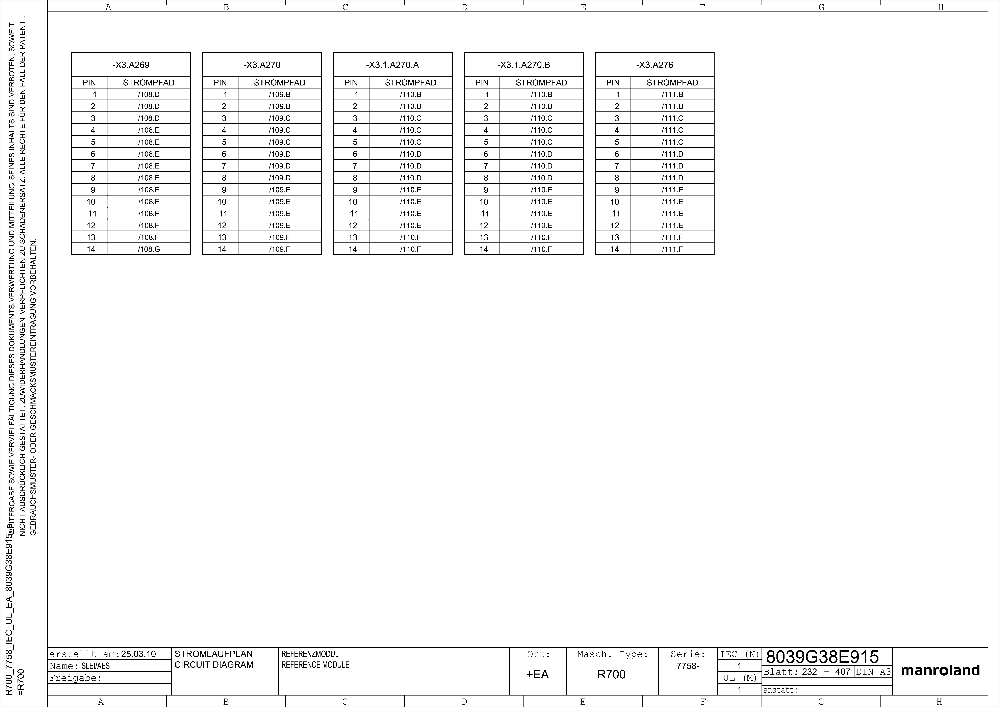

# +EA — Sheet 232 of 407 — REFERENZMODUL

**REFERENCE MODULE**

> Part of the manroland **R700** printing press IEC/UL circuit diagrams.
> Drawing class: **Stromlaufplan / Circuit diagram** (DIN A3).
> Document `+EA` covers the **Printing unit** machine section.

## At a glance

| Field | Value |
|---|---|
| Document | `+EA`  (8039G38E915) |
| Sheet | **232** of 407 |
| Section (DE) | REFERENZMODUL |
| Section (EN) | REFERENCE MODULE |
| Section type | REFERENCE_MODULE — Reference module |
| Machine type | `R700` |
| Series | `7758` |
| Created | 25.03.10 |
| Replaces | — |
| Columns used | A, B, C, D, E, F |
| Path numbers | — |
| Labels on sheet | 155 |
| Cross-refs out | 70 |
| Cross-refs in | 0 |

**Previous:** [+EA sheet 231](SHEET_0231.md) · **Next:** [+EA sheet 233](SHEET_0233.md) · **Document TOC:** [_TOC.md](_TOC.md)  (+EA) · **Master TOC:** [all sheets](../_MASTER_TOC.md)

## Sheet image (300 DPI, exact vector render)



_Rendered directly from the PDF vector layer at 300 DPI (1-bit), no OCR and no resampling. Use it to confirm anything ambiguous in the text below._

## Cross-references on this sheet

Each entry is a wire leaving this sheet. The printed token is `/sheet.column`; the link resolves to that sheet inside the same document.

| Ref | Target sheet | Col | Path | Destination on target | Target section | From col |
|---|---|---|---|---|---|---|
| `/109.B` | [+EA sheet 109](SHEET_0109.md) | B | — | — | BLAS/SAUGLUFT MIT MOTORVENTILEINSTELLUNG | B |
| `/110.B` | [+EA sheet 110](SHEET_0110.md) | B | — | — | BLAS/SAUGLUFT MIT MOTORVENTILEINSTELLUNG | D |
| `/110.B` | [+EA sheet 110](SHEET_0110.md) | B | — | — | BLAS/SAUGLUFT MIT MOTORVENTILEINSTELLUNG | E |
| `/111.B` | [+EA sheet 111](SHEET_0111.md) | B | — | — | BLAS/SAUGLUFT MIT MOTORVENTILEINSTELLUNG | F |
| `/108.D` | [+EA sheet 108](SHEET_0108.md) | D | — | — | BLAS/SAUGLUFT MIT MOTORVENTILEINSTELLUNG | A |
| `/109.B` | [+EA sheet 109](SHEET_0109.md) | B | — | — | BLAS/SAUGLUFT MIT MOTORVENTILEINSTELLUNG | B |
| `/110.B` | [+EA sheet 110](SHEET_0110.md) | B | — | — | BLAS/SAUGLUFT MIT MOTORVENTILEINSTELLUNG | D |
| `/110.B` | [+EA sheet 110](SHEET_0110.md) | B | — | — | BLAS/SAUGLUFT MIT MOTORVENTILEINSTELLUNG | E |
| `/111.B` | [+EA sheet 111](SHEET_0111.md) | B | — | — | BLAS/SAUGLUFT MIT MOTORVENTILEINSTELLUNG | F |
| `/108.D` | [+EA sheet 108](SHEET_0108.md) | D | — | — | BLAS/SAUGLUFT MIT MOTORVENTILEINSTELLUNG | A |
| `/108.D` | [+EA sheet 108](SHEET_0108.md) | D | — | — | BLAS/SAUGLUFT MIT MOTORVENTILEINSTELLUNG | A |
| `/109.C` | [+EA sheet 109](SHEET_0109.md) | C | — | — | BLAS/SAUGLUFT MIT MOTORVENTILEINSTELLUNG | B |
| `/110.C` | [+EA sheet 110](SHEET_0110.md) | C | — | — | BLAS/SAUGLUFT MIT MOTORVENTILEINSTELLUNG | D |
| `/110.C` | [+EA sheet 110](SHEET_0110.md) | C | — | — | BLAS/SAUGLUFT MIT MOTORVENTILEINSTELLUNG | E |
| `/111.C` | [+EA sheet 111](SHEET_0111.md) | C | — | — | BLAS/SAUGLUFT MIT MOTORVENTILEINSTELLUNG | F |
| `/108.E` | [+EA sheet 108](SHEET_0108.md) | E | — | — | BLAS/SAUGLUFT MIT MOTORVENTILEINSTELLUNG | A |
| `/109.C` | [+EA sheet 109](SHEET_0109.md) | C | — | — | BLAS/SAUGLUFT MIT MOTORVENTILEINSTELLUNG | B |
| `/110.C` | [+EA sheet 110](SHEET_0110.md) | C | — | — | BLAS/SAUGLUFT MIT MOTORVENTILEINSTELLUNG | D |
| `/110.C` | [+EA sheet 110](SHEET_0110.md) | C | — | — | BLAS/SAUGLUFT MIT MOTORVENTILEINSTELLUNG | E |
| `/111.C` | [+EA sheet 111](SHEET_0111.md) | C | — | — | BLAS/SAUGLUFT MIT MOTORVENTILEINSTELLUNG | F |
| `/108.E` | [+EA sheet 108](SHEET_0108.md) | E | — | — | BLAS/SAUGLUFT MIT MOTORVENTILEINSTELLUNG | A |
| `/109.C` | [+EA sheet 109](SHEET_0109.md) | C | — | — | BLAS/SAUGLUFT MIT MOTORVENTILEINSTELLUNG | B |
| `/110.C` | [+EA sheet 110](SHEET_0110.md) | C | — | — | BLAS/SAUGLUFT MIT MOTORVENTILEINSTELLUNG | D |
| `/110.C` | [+EA sheet 110](SHEET_0110.md) | C | — | — | BLAS/SAUGLUFT MIT MOTORVENTILEINSTELLUNG | E |
| `/111.C` | [+EA sheet 111](SHEET_0111.md) | C | — | — | BLAS/SAUGLUFT MIT MOTORVENTILEINSTELLUNG | F |
| `/108.E` | [+EA sheet 108](SHEET_0108.md) | E | — | — | BLAS/SAUGLUFT MIT MOTORVENTILEINSTELLUNG | A |
| `/109.D` | [+EA sheet 109](SHEET_0109.md) | D | — | — | BLAS/SAUGLUFT MIT MOTORVENTILEINSTELLUNG | B |
| `/110.D` | [+EA sheet 110](SHEET_0110.md) | D | — | — | BLAS/SAUGLUFT MIT MOTORVENTILEINSTELLUNG | D |
| `/110.D` | [+EA sheet 110](SHEET_0110.md) | D | — | — | BLAS/SAUGLUFT MIT MOTORVENTILEINSTELLUNG | E |
| `/111.D` | [+EA sheet 111](SHEET_0111.md) | D | — | — | BLAS/SAUGLUFT MIT MOTORVENTILEINSTELLUNG | F |
| `/108.E` | [+EA sheet 108](SHEET_0108.md) | E | — | — | BLAS/SAUGLUFT MIT MOTORVENTILEINSTELLUNG | A |
| `/109.D` | [+EA sheet 109](SHEET_0109.md) | D | — | — | BLAS/SAUGLUFT MIT MOTORVENTILEINSTELLUNG | B |
| `/110.D` | [+EA sheet 110](SHEET_0110.md) | D | — | — | BLAS/SAUGLUFT MIT MOTORVENTILEINSTELLUNG | D |
| `/110.D` | [+EA sheet 110](SHEET_0110.md) | D | — | — | BLAS/SAUGLUFT MIT MOTORVENTILEINSTELLUNG | E |
| `/111.D` | [+EA sheet 111](SHEET_0111.md) | D | — | — | BLAS/SAUGLUFT MIT MOTORVENTILEINSTELLUNG | F |
| `/108.E` | [+EA sheet 108](SHEET_0108.md) | E | — | — | BLAS/SAUGLUFT MIT MOTORVENTILEINSTELLUNG | A |
| `/109.D` | [+EA sheet 109](SHEET_0109.md) | D | — | — | BLAS/SAUGLUFT MIT MOTORVENTILEINSTELLUNG | B |
| `/110.D` | [+EA sheet 110](SHEET_0110.md) | D | — | — | BLAS/SAUGLUFT MIT MOTORVENTILEINSTELLUNG | D |
| `/110.D` | [+EA sheet 110](SHEET_0110.md) | D | — | — | BLAS/SAUGLUFT MIT MOTORVENTILEINSTELLUNG | E |
| `/111.D` | [+EA sheet 111](SHEET_0111.md) | D | — | — | BLAS/SAUGLUFT MIT MOTORVENTILEINSTELLUNG | F |
| `/109.E` | [+EA sheet 109](SHEET_0109.md) | E | — | — | BLAS/SAUGLUFT MIT MOTORVENTILEINSTELLUNG | B |
| `/110.E` | [+EA sheet 110](SHEET_0110.md) | E | — | — | BLAS/SAUGLUFT MIT MOTORVENTILEINSTELLUNG | D |
| `/110.E` | [+EA sheet 110](SHEET_0110.md) | E | — | — | BLAS/SAUGLUFT MIT MOTORVENTILEINSTELLUNG | E |
| `/111.E` | [+EA sheet 111](SHEET_0111.md) | E | — | — | BLAS/SAUGLUFT MIT MOTORVENTILEINSTELLUNG | F |
| `/108.F` | [+EA sheet 108](SHEET_0108.md) | F | — | — | BLAS/SAUGLUFT MIT MOTORVENTILEINSTELLUNG | A |
| `/109.E` | [+EA sheet 109](SHEET_0109.md) | E | — | — | BLAS/SAUGLUFT MIT MOTORVENTILEINSTELLUNG | B |
| `/110.E` | [+EA sheet 110](SHEET_0110.md) | E | — | — | BLAS/SAUGLUFT MIT MOTORVENTILEINSTELLUNG | D |
| `/110.E` | [+EA sheet 110](SHEET_0110.md) | E | — | — | BLAS/SAUGLUFT MIT MOTORVENTILEINSTELLUNG | E |
| `/111.E` | [+EA sheet 111](SHEET_0111.md) | E | — | — | BLAS/SAUGLUFT MIT MOTORVENTILEINSTELLUNG | F |
| `/108.F` | [+EA sheet 108](SHEET_0108.md) | F | — | — | BLAS/SAUGLUFT MIT MOTORVENTILEINSTELLUNG | A |
| `/109.E` | [+EA sheet 109](SHEET_0109.md) | E | — | — | BLAS/SAUGLUFT MIT MOTORVENTILEINSTELLUNG | B |
| `/110.E` | [+EA sheet 110](SHEET_0110.md) | E | — | — | BLAS/SAUGLUFT MIT MOTORVENTILEINSTELLUNG | D |
| `/110.E` | [+EA sheet 110](SHEET_0110.md) | E | — | — | BLAS/SAUGLUFT MIT MOTORVENTILEINSTELLUNG | E |
| `/111.E` | [+EA sheet 111](SHEET_0111.md) | E | — | — | BLAS/SAUGLUFT MIT MOTORVENTILEINSTELLUNG | F |
| `/108.F` | [+EA sheet 108](SHEET_0108.md) | F | — | — | BLAS/SAUGLUFT MIT MOTORVENTILEINSTELLUNG | A |
| `/109.E` | [+EA sheet 109](SHEET_0109.md) | E | — | — | BLAS/SAUGLUFT MIT MOTORVENTILEINSTELLUNG | B |
| `/110.E` | [+EA sheet 110](SHEET_0110.md) | E | — | — | BLAS/SAUGLUFT MIT MOTORVENTILEINSTELLUNG | D |
| `/110.E` | [+EA sheet 110](SHEET_0110.md) | E | — | — | BLAS/SAUGLUFT MIT MOTORVENTILEINSTELLUNG | E |
| `/111.E` | [+EA sheet 111](SHEET_0111.md) | E | — | — | BLAS/SAUGLUFT MIT MOTORVENTILEINSTELLUNG | F |
| `/108.F` | [+EA sheet 108](SHEET_0108.md) | F | — | — | BLAS/SAUGLUFT MIT MOTORVENTILEINSTELLUNG | A |
| `/108.F` | [+EA sheet 108](SHEET_0108.md) | F | — | — | BLAS/SAUGLUFT MIT MOTORVENTILEINSTELLUNG | A |
| `/109.F` | [+EA sheet 109](SHEET_0109.md) | F | — | — | BLAS/SAUGLUFT MIT MOTORVENTILEINSTELLUNG | B |
| `/110.F` | [+EA sheet 110](SHEET_0110.md) | F | — | — | BLAS/SAUGLUFT MIT MOTORVENTILEINSTELLUNG | D |
| `/110.F` | [+EA sheet 110](SHEET_0110.md) | F | — | — | BLAS/SAUGLUFT MIT MOTORVENTILEINSTELLUNG | E |
| `/111.F` | [+EA sheet 111](SHEET_0111.md) | F | — | — | BLAS/SAUGLUFT MIT MOTORVENTILEINSTELLUNG | F |
| `/109.F` | [+EA sheet 109](SHEET_0109.md) | F | — | — | BLAS/SAUGLUFT MIT MOTORVENTILEINSTELLUNG | B |
| `/110.F` | [+EA sheet 110](SHEET_0110.md) | F | — | — | BLAS/SAUGLUFT MIT MOTORVENTILEINSTELLUNG | D |
| `/110.F` | [+EA sheet 110](SHEET_0110.md) | F | — | — | BLAS/SAUGLUFT MIT MOTORVENTILEINSTELLUNG | E |
| `/111.F` | [+EA sheet 111](SHEET_0111.md) | F | — | — | BLAS/SAUGLUFT MIT MOTORVENTILEINSTELLUNG | F |
| `/108.G` | [+EA sheet 108](SHEET_0108.md) | G | — | — | BLAS/SAUGLUFT MIT MOTORVENTILEINSTELLUNG | A |

## Devices on this sheet

| Tag | Class | Class meaning (IEC) | Col | Sub | Terminal | Sign |
|---|---|---|---|---|---|---|
| `X3.A269` | — | cross-device reference | A | — | — | — |
| `X3.A270` | — | cross-device reference | B | — | — | — |
| `X3.1.A270.A` | — | cross-device reference | C | — | — | — |
| `X3.1.A270.B` | — | cross-device reference | E | — | — | — |
| `X3.A276` | — | cross-device reference | F | — | — | — |

## Potentials / nets

_No named potentials on this sheet._

## Wire-end annotations (grouped as printed)

A wire that continues elsewhere is annotated with a small cluster: the destination description, the path/line number `#NN`, and the `/sheet.column` cross reference. Each row below is one such cluster exactly as it is grouped on the drawing.

| Col | Y | Path | Cross-ref | Text on the wire |
|---|---|---|---|---|
| A | 72.6 | — | — | `X3.A269` |
| B | 72.6 | — | — | `X3.A270` |
| C | 72.6 | — | — | `X3.1.A270.A` |
| E | 72.6 | — | — | `X3.1.A270.B` |
| F | 72.6 | — | — | `X3.A276` |
| A | 94.2 | — | — | `PIN STROMPFAD` |
| B | 94.2 | — | — | `PIN STROMPFAD` |
| C | 94.2 | — | — | `PIN STROMPFAD` |
| D | 94.2 | — | — | `PIN STROMPFAD` |
| F | 94.2 | — | — | `PIN STROMPFAD` |
| A | 108.4 | — | — | `2 3 4 5 6 7 8 9 1` |
| B | 108.4 | — | — | `2 3 4 5 6 7 8 9 1` |
| C | 108.4 | — | — | `2 3 4 5 6 7 8 9 1` |
| D | 108.4 | — | — | `2 3 4 5 6 7 8 9 1` |
| E | 108.4 | — | — | `2 3 4 5 6 7 8 9 1` |
| A | 108.7 | — | `/108.D` | — |
| B | 108.7 | — | `/109.B` | — |
| D | 108.7 | — | `/110.B` | — |
| E | 108.7 | — | `/110.B` | — |
| F | 108.7 | — | `/111.B` | — |
| A | 122.9 | — | `/108.D` | — |
| B | 122.9 | — | `/109.B` | — |
| D | 122.9 | — | `/110.B` | — |
| E | 122.9 | — | `/110.B` | — |
| F | 122.9 | — | `/111.B` | — |
| A | 137.1 | — | `/108.D` | — |
| B | 137.1 | — | `/109.C` | — |
| D | 137.1 | — | `/110.C` | — |
| E | 137.1 | — | `/110.C` | — |
| F | 137.1 | — | `/111.C` | — |
| A | 151.2 | — | `/108.E` | — |
| B | 151.2 | — | `/109.C` | — |
| D | 151.2 | — | `/110.C` | — |
| E | 151.2 | — | `/110.C` | — |
| F | 151.2 | — | `/111.C` | — |
| A | 165.4 | — | `/108.E` | — |
| B | 165.4 | — | `/109.C` | — |
| D | 165.4 | — | `/110.C` | — |
| E | 165.4 | — | `/110.C` | — |
| F | 165.4 | — | `/111.C` | — |
| A | 179.6 | — | `/108.E` | — |
| B | 179.6 | — | `/109.D` | — |
| D | 179.6 | — | `/110.D` | — |
| E | 179.6 | — | `/110.D` | — |
| F | 179.6 | — | `/111.D` | — |
| A | 193.7 | — | `/108.E` | — |
| B | 193.8 | — | `/109.D` | — |
| D | 193.8 | — | `/110.D` | — |
| E | 193.8 | — | `/110.D` | — |
| F | 193.8 | — | `/111.D` | — |
| A | 207.9 | — | `/108.E` | — |
| B | 207.9 | — | `/109.D` | — |
| D | 207.9 | — | `/110.D` | — |
| E | 207.9 | — | `/110.D` | — |
| F | 207.9 | — | `/111.D` | — |
| A | 222.1 | — | `/108.F` | — |
| B | 222.1 | — | `/109.E` | — |
| D | 222.1 | — | `/110.E` | — |
| E | 222.1 | — | `/110.E` | — |
| F | 222.1 | — | `/111.E` | — |
| A | 235.9 | — | — | `10 12 13 14 11` |
| B | 235.9 | — | — | `10 12 13 14 11` |
| C | 235.9 | — | — | `10 12 13 14 11` |
| D | 235.9 | — | — | `10 12 13 14 11` |
| E | 235.9 | — | — | `10 12 13 14 11` |
| B | 236.2 | — | `/109.E` | — |
| D | 236.2 | — | `/110.E` | — |
| E | 236.2 | — | `/110.E` | — |
| F | 236.2 | — | `/111.E` | — |
| A | 236.3 | — | `/108.F` | — |
| A | 250.4 | — | `/108.F` | — |
| B | 250.4 | — | `/109.E` | — |
| D | 250.4 | — | `/110.E` | — |
| E | 250.4 | — | `/110.E` | — |
| F | 250.4 | — | `/111.E` | — |
| A | 264.6 | — | `/108.F` | — |
| B | 264.6 | — | `/109.E` | — |
| D | 264.6 | — | `/110.E` | — |
| E | 264.6 | — | `/110.E` | — |
| F | 264.6 | — | `/111.E` | — |
| A | 278.8 | — | `/108.F` | — |
| B | 278.8 | — | `/109.F` | — |
| D | 278.8 | — | `/110.F` | — |
| E | 278.8 | — | `/110.F` | — |
| F | 278.8 | — | `/111.F` | — |
| B | 292.9 | — | `/109.F` | — |
| D | 292.9 | — | `/110.F` | — |
| E | 292.9 | — | `/110.F` | — |
| F | 292.9 | — | `/111.F` | — |
| A | 293.0 | — | `/108.G` | — |


## Reconstructed tables

This sheet carries tabular content (pin map / terminal assignment / index). The grid below was rebuilt from the drawing's own rule lines, so each row is exactly one physical row of the table.

### Table 1 — 14 data rows × 2 columns (at x=85.0, y=62.4) — **X3.A269**

| PIN | STROMPFAD |
|---|---|
| `1` | `/108.D` |
| `2` | `/108.D` |
| `3` | `/108.D` |
| `4` | `/108.E` |
| `5` | `/108.E` |
| `6` | `/108.E` |
| `7` | `/108.E` |
| `8` | `/108.E` |
| `9` | `/108.F` |
| `10` | `/108.F` |
| `11` | `/108.F` |
| `12` | `/108.F` |
| `13` | `/108.F` |
| `14` | `/108.G` |


### Table 2 — 14 data rows × 2 columns (at x=240.9, y=62.4) — **X3.A270**

| PIN | STROMPFAD |
|---|---|
| `1` | `/109.B` |
| `2` | `/109.B` |
| `3` | `/109.C` |
| `4` | `/109.C` |
| `5` | `/109.C` |
| `6` | `/109.D` |
| `7` | `/109.D` |
| `8` | `/109.D` |
| `9` | `/109.E` |
| `10` | `/109.E` |
| `11` | `/109.E` |
| `12` | `/109.E` |
| `13` | `/109.F` |
| `14` | `/109.F` |


### Table 3 — 14 data rows × 2 columns (at x=396.9, y=62.4) — **X3.1.A270.A**

| PIN | STROMPFAD |
|---|---|
| `1` | `/110.B` |
| `2` | `/110.B` |
| `3` | `/110.C` |
| `4` | `/110.C` |
| `5` | `/110.C` |
| `6` | `/110.D` |
| `7` | `/110.D` |
| `8` | `/110.D` |
| `9` | `/110.E` |
| `10` | `/110.E` |
| `11` | `/110.E` |
| `12` | `/110.E` |
| `13` | `/110.F` |
| `14` | `/110.F` |


### Table 4 — 14 data rows × 2 columns (at x=552.8, y=62.4) — **X3.1.A270.B**

| PIN | STROMPFAD |
|---|---|
| `1` | `/110.B` |
| `2` | `/110.B` |
| `3` | `/110.C` |
| `4` | `/110.C` |
| `5` | `/110.C` |
| `6` | `/110.D` |
| `7` | `/110.D` |
| `8` | `/110.D` |
| `9` | `/110.E` |
| `10` | `/110.E` |
| `11` | `/110.E` |
| `12` | `/110.E` |
| `13` | `/110.F` |
| `14` | `/110.F` |


### Table 5 — 14 data rows × 2 columns (at x=708.7, y=62.4) — **X3.A276**

| PIN | STROMPFAD |
|---|---|
| `1` | `/111.B` |
| `2` | `/111.B` |
| `3` | `/111.C` |
| `4` | `/111.C` |
| `5` | `/111.C` |
| `6` | `/111.D` |
| `7` | `/111.D` |
| `8` | `/111.D` |
| `9` | `/111.E` |
| `10` | `/111.E` |
| `11` | `/111.E` |
| `12` | `/111.E` |
| `13` | `/111.F` |
| `14` | `/111.F` |


## Notes and free text on this sheet

| Text | Col | Y (pt) |
|---|---|---|
| `PIN` | A | 94.2 |
| `STROMPFAD` | A | 94.15 |
| `PIN` | B | 94.2 |
| `STROMPFAD` | B | 94.15 |
| `PIN` | C | 94.2 |
| `STROMPFAD` | D | 94.15 |
| `PIN` | D | 94.2 |
| `STROMPFAD` | E | 94.15 |
| `PIN` | E | 94.2 |
| `STROMPFAD` | F | 94.15 |

## Complete label inventory (exact text from the drawing)

Every text object inside the drawing area of this sheet, in DIN reading order (column A→H, then top→bottom). This is the authoritative list: if a string is not here it is not printed on this sheet.

| Col | Y | X | Dir | Type | Text |
|---|---|---|---|---|---|
| A | 72.6 | 133.9 | → | device ref | `X3.A269` |
| A | 94.2 | 98.2 | → | text | `PIN` |
| A | 94.2 | 146.4 | → | text | `STROMPFAD` |
| A | 108.4 | 110.0 | → | number | `1` |
| A | 108.7 | 164.4 | → | cross-reference | `/108.D` |
| A | 122.5 | 108.3 | → | number | `2` |
| A | 122.9 | 164.4 | → | cross-reference | `/108.D` |
| A | 136.7 | 108.3 | → | number | `3` |
| A | 137.1 | 164.4 | → | cross-reference | `/108.D` |
| A | 150.9 | 108.3 | → | number | `4` |
| A | 151.2 | 164.7 | → | cross-reference | `/108.E` |
| A | 165.1 | 108.3 | → | number | `5` |
| A | 165.4 | 164.7 | → | cross-reference | `/108.E` |
| A | 179.2 | 108.3 | → | number | `6` |
| A | 179.6 | 164.7 | → | cross-reference | `/108.E` |
| A | 193.4 | 108.3 | → | number | `7` |
| A | 193.7 | 164.7 | → | cross-reference | `/108.E` |
| A | 207.6 | 108.3 | → | number | `8` |
| A | 207.9 | 164.7 | → | cross-reference | `/108.E` |
| A | 221.8 | 108.3 | → | number | `9` |
| A | 222.1 | 164.8 | → | cross-reference | `/108.F` |
| A | 235.9 | 102.9 | → | number | `10` |
| A | 236.3 | 164.8 | → | cross-reference | `/108.F` |
| A | 250.1 | 104.6 | → | number | `11` |
| A | 250.4 | 164.8 | → | cross-reference | `/108.F` |
| A | 264.3 | 102.9 | → | number | `12` |
| A | 264.6 | 164.8 | → | cross-reference | `/108.F` |
| A | 278.5 | 102.9 | → | number | `13` |
| A | 278.8 | 164.8 | → | cross-reference | `/108.F` |
| A | 292.6 | 102.9 | → | number | `14` |
| A | 293.0 | 164.3 | → | cross-reference | `/108.G` |
| B | 72.6 | 289.8 | → | device ref | `X3.A270` |
| B | 94.2 | 254.1 | → | text | `PIN` |
| B | 94.2 | 302.3 | → | text | `STROMPFAD` |
| B | 108.4 | 265.9 | → | number | `1` |
| B | 108.7 | 320.5 | → | cross-reference | `/109.B` |
| B | 122.5 | 264.2 | → | number | `2` |
| B | 122.9 | 320.5 | → | cross-reference | `/109.B` |
| B | 136.7 | 264.2 | → | number | `3` |
| B | 137.1 | 320.3 | → | cross-reference | `/109.C` |
| B | 150.9 | 264.2 | → | number | `4` |
| B | 151.2 | 320.3 | → | cross-reference | `/109.C` |
| B | 165.1 | 264.2 | → | number | `5` |
| B | 165.4 | 320.3 | → | cross-reference | `/109.C` |
| B | 179.2 | 264.2 | → | number | `6` |
| B | 179.6 | 320.3 | → | cross-reference | `/109.D` |
| B | 193.4 | 264.2 | → | number | `7` |
| B | 193.8 | 320.3 | → | cross-reference | `/109.D` |
| B | 207.6 | 264.2 | → | number | `8` |
| B | 207.9 | 320.3 | → | cross-reference | `/109.D` |
| B | 221.8 | 264.2 | → | number | `9` |
| B | 222.1 | 320.6 | → | cross-reference | `/109.E` |
| B | 235.9 | 258.8 | → | number | `10` |
| B | 236.2 | 320.6 | → | cross-reference | `/109.E` |
| B | 250.1 | 260.5 | → | number | `11` |
| B | 250.4 | 320.6 | → | cross-reference | `/109.E` |
| B | 264.3 | 258.8 | → | number | `12` |
| B | 264.6 | 320.6 | → | cross-reference | `/109.E` |
| B | 278.5 | 258.8 | → | number | `13` |
| B | 278.8 | 320.7 | → | cross-reference | `/109.F` |
| B | 292.6 | 258.8 | → | number | `14` |
| B | 293.0 | 320.7 | → | cross-reference | `/109.F` |
| C | 72.6 | 436.0 | → | device ref | `X3.1.A270.A` |
| C | 94.2 | 410.0 | → | text | `PIN` |
| C | 108.4 | 421.8 | → | number | `1` |
| C | 122.5 | 420.1 | → | number | `2` |
| C | 136.7 | 420.1 | → | number | `3` |
| C | 150.9 | 420.1 | → | number | `4` |
| C | 165.1 | 420.1 | → | number | `5` |
| C | 179.2 | 420.1 | → | number | `6` |
| C | 193.4 | 420.1 | → | number | `7` |
| C | 207.6 | 420.1 | → | number | `8` |
| C | 221.8 | 420.1 | → | number | `9` |
| C | 235.9 | 414.7 | → | number | `10` |
| C | 250.1 | 416.4 | → | number | `11` |
| C | 264.3 | 414.7 | → | number | `12` |
| C | 278.5 | 414.7 | → | number | `13` |
| C | 292.6 | 414.7 | → | number | `14` |
| D | 94.2 | 458.2 | → | text | `STROMPFAD` |
| D | 94.2 | 565.9 | → | text | `PIN` |
| D | 108.4 | 577.7 | → | number | `1` |
| D | 108.7 | 476.4 | → | cross-reference | `/110.B` |
| D | 122.5 | 576.0 | → | number | `2` |
| D | 122.9 | 476.4 | → | cross-reference | `/110.B` |
| D | 136.7 | 576.0 | → | number | `3` |
| D | 137.1 | 476.2 | → | cross-reference | `/110.C` |
| D | 150.9 | 576.0 | → | number | `4` |
| D | 151.2 | 476.2 | → | cross-reference | `/110.C` |
| D | 165.1 | 576.0 | → | number | `5` |
| D | 165.4 | 476.2 | → | cross-reference | `/110.C` |
| D | 179.2 | 576.0 | → | number | `6` |
| D | 179.6 | 476.2 | → | cross-reference | `/110.D` |
| D | 193.4 | 576.0 | → | number | `7` |
| D | 193.8 | 476.2 | → | cross-reference | `/110.D` |
| D | 207.6 | 576.0 | → | number | `8` |
| D | 207.9 | 476.2 | → | cross-reference | `/110.D` |
| D | 221.8 | 576.0 | → | number | `9` |
| D | 222.1 | 476.5 | → | cross-reference | `/110.E` |
| D | 235.9 | 570.6 | → | number | `10` |
| D | 236.2 | 476.5 | → | cross-reference | `/110.E` |
| D | 250.1 | 572.3 | → | number | `11` |
| D | 250.4 | 476.5 | → | cross-reference | `/110.E` |
| D | 264.3 | 570.6 | → | number | `12` |
| D | 264.6 | 476.5 | → | cross-reference | `/110.E` |
| D | 278.5 | 570.6 | → | number | `13` |
| D | 278.8 | 476.6 | → | cross-reference | `/110.F` |
| D | 292.6 | 570.6 | → | number | `14` |
| D | 293.0 | 476.6 | → | cross-reference | `/110.F` |
| E | 72.6 | 592.3 | → | device ref | `X3.1.A270.B` |
| E | 94.2 | 614.1 | → | text | `STROMPFAD` |
| E | 94.2 | 721.8 | → | text | `PIN` |
| E | 108.4 | 733.6 | → | number | `1` |
| E | 108.7 | 632.3 | → | cross-reference | `/110.B` |
| E | 122.5 | 731.9 | → | number | `2` |
| E | 122.9 | 632.3 | → | cross-reference | `/110.B` |
| E | 136.7 | 731.9 | → | number | `3` |
| E | 137.1 | 632.1 | → | cross-reference | `/110.C` |
| E | 150.9 | 731.9 | → | number | `4` |
| E | 151.2 | 632.1 | → | cross-reference | `/110.C` |
| E | 165.1 | 731.9 | → | number | `5` |
| E | 165.4 | 632.1 | → | cross-reference | `/110.C` |
| E | 179.2 | 731.9 | → | number | `6` |
| E | 179.6 | 632.1 | → | cross-reference | `/110.D` |
| E | 193.4 | 731.9 | → | number | `7` |
| E | 193.8 | 632.1 | → | cross-reference | `/110.D` |
| E | 207.6 | 731.9 | → | number | `8` |
| E | 207.9 | 632.1 | → | cross-reference | `/110.D` |
| E | 221.8 | 731.9 | → | number | `9` |
| E | 222.1 | 632.4 | → | cross-reference | `/110.E` |
| E | 235.9 | 726.5 | → | number | `10` |
| E | 236.2 | 632.4 | → | cross-reference | `/110.E` |
| E | 250.1 | 728.2 | → | number | `11` |
| E | 250.4 | 632.4 | → | cross-reference | `/110.E` |
| E | 264.3 | 726.5 | → | number | `12` |
| E | 264.6 | 632.4 | → | cross-reference | `/110.E` |
| E | 278.5 | 726.5 | → | number | `13` |
| E | 278.8 | 632.6 | → | cross-reference | `/110.F` |
| E | 292.6 | 726.5 | → | number | `14` |
| E | 293.0 | 632.6 | → | cross-reference | `/110.F` |
| F | 72.6 | 757.6 | → | device ref | `X3.A276` |
| F | 94.2 | 770.0 | → | text | `STROMPFAD` |
| F | 108.7 | 788.2 | → | cross-reference | `/111.B` |
| F | 122.9 | 788.2 | → | cross-reference | `/111.B` |
| F | 137.1 | 788.0 | → | cross-reference | `/111.C` |
| F | 151.2 | 788.0 | → | cross-reference | `/111.C` |
| F | 165.4 | 788.0 | → | cross-reference | `/111.C` |
| F | 179.6 | 788.0 | → | cross-reference | `/111.D` |
| F | 193.8 | 788.0 | → | cross-reference | `/111.D` |
| F | 207.9 | 788.0 | → | cross-reference | `/111.D` |
| F | 222.1 | 788.3 | → | cross-reference | `/111.E` |
| F | 236.2 | 788.3 | → | cross-reference | `/111.E` |
| F | 250.4 | 788.3 | → | cross-reference | `/111.E` |
| F | 264.6 | 788.3 | → | cross-reference | `/111.E` |
| F | 278.8 | 788.5 | → | cross-reference | `/111.F` |
| F | 293.0 | 788.5 | → | cross-reference | `/111.F` |

## Reading-order text block

The same content as a plain block, grouped by DIN column — convenient to paste or to match against a visual description.

```text
=== Column A ===
  72.6  133.9  devref       X3.A269
  94.2   98.2  text         PIN
  94.2  146.4  text         STROMPFAD
 108.4  110.0  numeric      1
 108.7  164.4  xref         /108.D
 122.5  108.3  numeric      2
 122.9  164.4  xref         /108.D
 136.7  108.3  numeric      3
 137.1  164.4  xref         /108.D
 150.9  108.3  numeric      4
 151.2  164.7  xref         /108.E
 165.1  108.3  numeric      5
 165.4  164.7  xref         /108.E
 179.2  108.3  numeric      6
 179.6  164.7  xref         /108.E
 193.4  108.3  numeric      7
 193.7  164.7  xref         /108.E
 207.6  108.3  numeric      8
 207.9  164.7  xref         /108.E
 221.8  108.3  numeric      9
 222.1  164.8  xref         /108.F
 235.9  102.9  numeric      10
 236.3  164.8  xref         /108.F
 250.1  104.6  numeric      11
 250.4  164.8  xref         /108.F
 264.3  102.9  numeric      12
 264.6  164.8  xref         /108.F
 278.5  102.9  numeric      13
 278.8  164.8  xref         /108.F
 292.6  102.9  numeric      14
 293.0  164.3  xref         /108.G
=== Column B ===
  72.6  289.8  devref       X3.A270
  94.2  254.1  text         PIN
  94.2  302.3  text         STROMPFAD
 108.4  265.9  numeric      1
 108.7  320.5  xref         /109.B
 122.5  264.2  numeric      2
 122.9  320.5  xref         /109.B
 136.7  264.2  numeric      3
 137.1  320.3  xref         /109.C
 150.9  264.2  numeric      4
 151.2  320.3  xref         /109.C
 165.1  264.2  numeric      5
 165.4  320.3  xref         /109.C
 179.2  264.2  numeric      6
 179.6  320.3  xref         /109.D
 193.4  264.2  numeric      7
 193.8  320.3  xref         /109.D
 207.6  264.2  numeric      8
 207.9  320.3  xref         /109.D
 221.8  264.2  numeric      9
 222.1  320.6  xref         /109.E
 235.9  258.8  numeric      10
 236.2  320.6  xref         /109.E
 250.1  260.5  numeric      11
 250.4  320.6  xref         /109.E
 264.3  258.8  numeric      12
 264.6  320.6  xref         /109.E
 278.5  258.8  numeric      13
 278.8  320.7  xref         /109.F
 292.6  258.8  numeric      14
 293.0  320.7  xref         /109.F
=== Column C ===
  72.6  436.0  devref       X3.1.A270.A
  94.2  410.0  text         PIN
 108.4  421.8  numeric      1
 122.5  420.1  numeric      2
 136.7  420.1  numeric      3
 150.9  420.1  numeric      4
 165.1  420.1  numeric      5
 179.2  420.1  numeric      6
 193.4  420.1  numeric      7
 207.6  420.1  numeric      8
 221.8  420.1  numeric      9
 235.9  414.7  numeric      10
 250.1  416.4  numeric      11
 264.3  414.7  numeric      12
 278.5  414.7  numeric      13
 292.6  414.7  numeric      14
=== Column D ===
  94.2  458.2  text         STROMPFAD
  94.2  565.9  text         PIN
 108.4  577.7  numeric      1
 108.7  476.4  xref         /110.B
 122.5  576.0  numeric      2
 122.9  476.4  xref         /110.B
 136.7  576.0  numeric      3
 137.1  476.2  xref         /110.C
 150.9  576.0  numeric      4
 151.2  476.2  xref         /110.C
 165.1  576.0  numeric      5
 165.4  476.2  xref         /110.C
 179.2  576.0  numeric      6
 179.6  476.2  xref         /110.D
 193.4  576.0  numeric      7
 193.8  476.2  xref         /110.D
 207.6  576.0  numeric      8
 207.9  476.2  xref         /110.D
 221.8  576.0  numeric      9
 222.1  476.5  xref         /110.E
 235.9  570.6  numeric      10
 236.2  476.5  xref         /110.E
 250.1  572.3  numeric      11
 250.4  476.5  xref         /110.E
 264.3  570.6  numeric      12
 264.6  476.5  xref         /110.E
 278.5  570.6  numeric      13
 278.8  476.6  xref         /110.F
 292.6  570.6  numeric      14
 293.0  476.6  xref         /110.F
=== Column E ===
  72.6  592.3  devref       X3.1.A270.B
  94.2  614.1  text         STROMPFAD
  94.2  721.8  text         PIN
 108.4  733.6  numeric      1
 108.7  632.3  xref         /110.B
 122.5  731.9  numeric      2
 122.9  632.3  xref         /110.B
 136.7  731.9  numeric      3
 137.1  632.1  xref         /110.C
 150.9  731.9  numeric      4
 151.2  632.1  xref         /110.C
 165.1  731.9  numeric      5
 165.4  632.1  xref         /110.C
 179.2  731.9  numeric      6
 179.6  632.1  xref         /110.D
 193.4  731.9  numeric      7
 193.8  632.1  xref         /110.D
 207.6  731.9  numeric      8
 207.9  632.1  xref         /110.D
 221.8  731.9  numeric      9
 222.1  632.4  xref         /110.E
 235.9  726.5  numeric      10
 236.2  632.4  xref         /110.E
 250.1  728.2  numeric      11
 250.4  632.4  xref         /110.E
 264.3  726.5  numeric      12
 264.6  632.4  xref         /110.E
 278.5  726.5  numeric      13
 278.8  632.6  xref         /110.F
 292.6  726.5  numeric      14
 293.0  632.6  xref         /110.F
=== Column F ===
  72.6  757.6  devref       X3.A276
  94.2  770.0  text         STROMPFAD
 108.7  788.2  xref         /111.B
 122.9  788.2  xref         /111.B
 137.1  788.0  xref         /111.C
 151.2  788.0  xref         /111.C
 165.4  788.0  xref         /111.C
 179.6  788.0  xref         /111.D
 193.8  788.0  xref         /111.D
 207.9  788.0  xref         /111.D
 222.1  788.3  xref         /111.E
 236.2  788.3  xref         /111.E
 250.4  788.3  xref         /111.E
 264.6  788.3  xref         /111.E
 278.8  788.5  xref         /111.F
 293.0  788.5  xref         /111.F
```

---
_Generated from the PDF vector text layer; no OCR. Source: `R700_7758_IEC_UL_EA_8039G38E915_p`, sheet 232._
